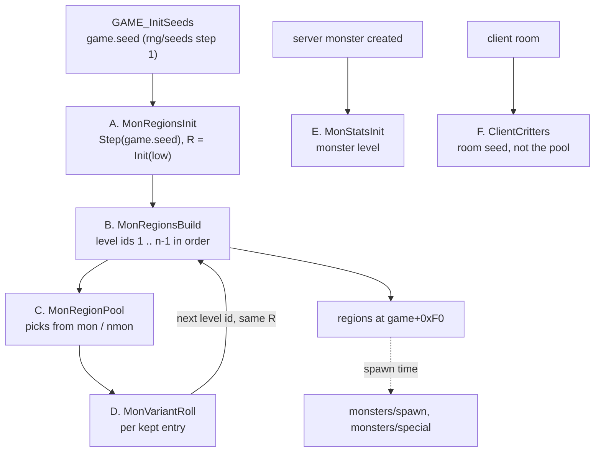
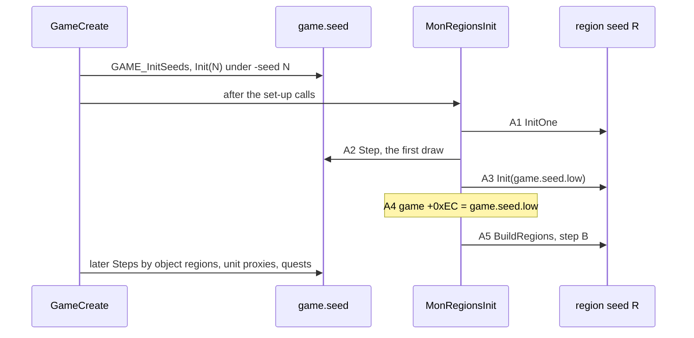
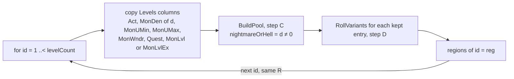
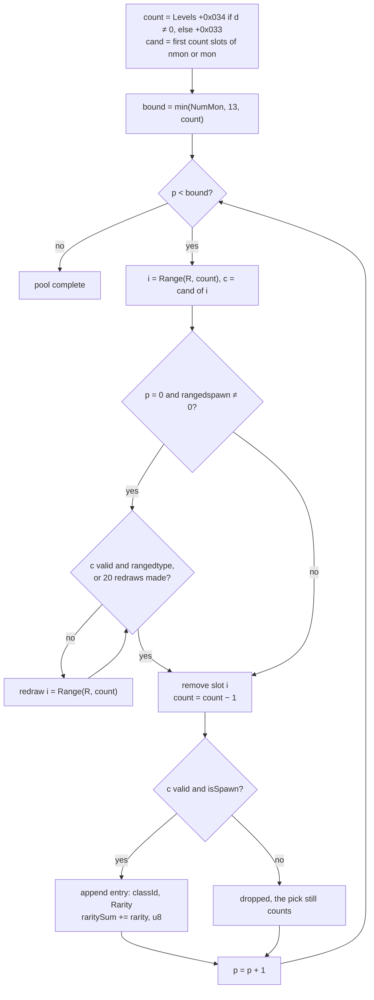
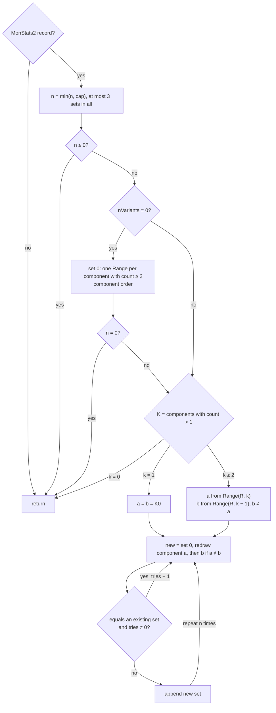
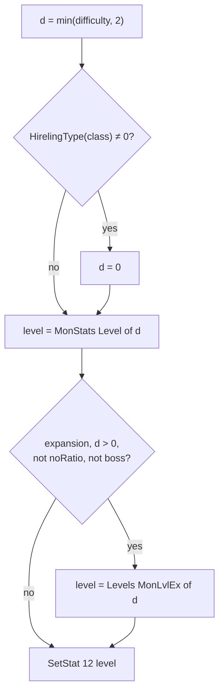
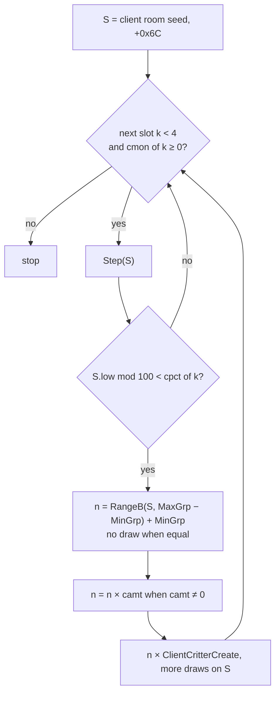
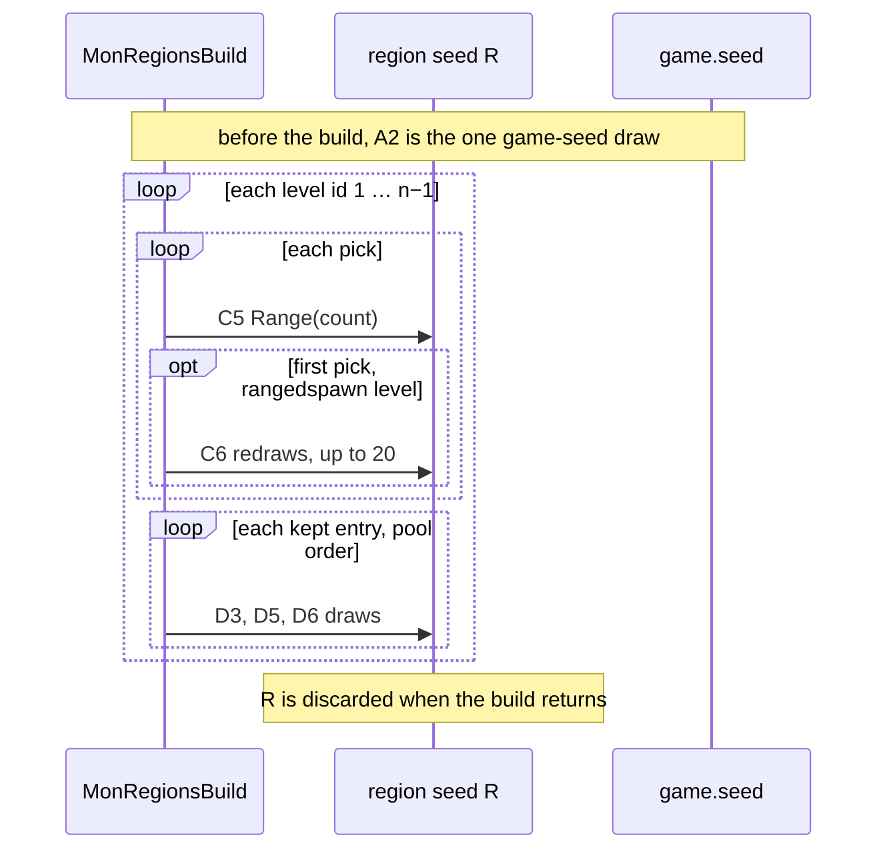
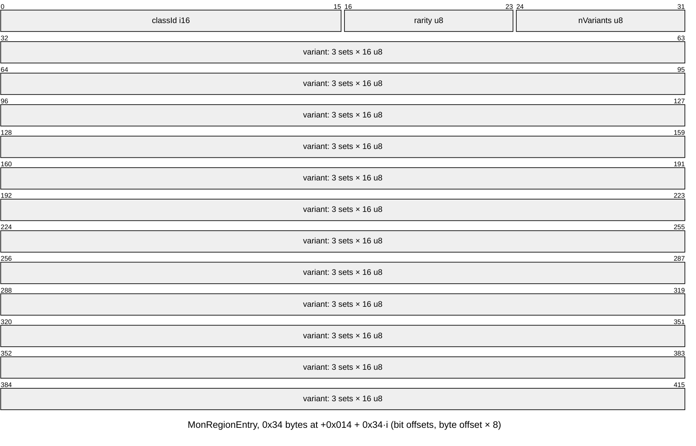

# Level monster pools ("monster regions") and the monster level

## Purpose

At game creation the server builds one **monster region** for every level id, all from one region seed
that comes from the game seed's first draw. A region holds the level's **monster pool**: up to 13 classes
picked from the level's `mon` (normal) or `nmon` (nightmare, hell) candidates, each with a rarity weight
and up to three appearance sets. It also copies the level's density and unique-count columns. The
spawn code later picks classes from it. This spec also gives the **monster level** rule that runs when
any server monster is created, and the client **critter** draw, which does not use the pool.
Primitives (`Step`, `Range`, `RangeB`, `Init`, `InitOne`) are those of [rng](../rng/README.md). The game
seed is defined in [rng/seeds](../rng/seeds.md) step 1.

## Entry points

| When | Function | Tag |
|---|---|---|
| Game created (single player): calls the region init after `GAME_InitSeeds` and the set-up calls listed below | fn:sub_00530BF0_GameCreate@0x00530BF0 | [C] |
| Game created, other path (same order after `GAME_InitSeeds`, three middle calls absent) | fn:sub_00530930_GameCreateA@0x00530930 | [I] |
| Region seed: one game-seed draw | fn:sub_00547D20_MonRegionsInit@0x00547D20 | [C] |
| All regions built, level ids 1 … n−1 | fn:sub_005479C0_MonRegionsBuild@0x005479C0 | [C] |
| One level's pool | fn:sub_005475E0_MonRegionPool@0x005475E0 | [C] |
| One entry's appearance sets | fn:sub_005BDB20_MonVariantRoll@0x005BDB20 | [C] |
| Server monster created: the monster level | fn:sub_00574250_MonsterInit@0x00574250 → fn:sub_00573CB0_MonStatsInit@0x00573CB0 (run:2026-10-12-mon-pool-p2) | [C] |
| Client room's critters | fn:sub_0046C460_ClientCritters@0x0046C460 | [C] |

- [C] Every logged region build returns to `0x00530DCF` inside `sub_00530BF0_GameCreate`, and the call order
  there is `GAME_InitSeeds`, `0x00541470`, `0x0053F4B0`, `0x005379A0`, `0x00539A30`, `0x0052B5E0`,
  (`0x00539000` only if `game+0x6A` = 1), `0x0053FF90`, then `sub_00547D20_MonRegionsInit`.
  (fn:sub_00530BF0_GameCreate@0x00530BF0, fn:GAME_InitSeeds@0x0052C280, run:2026-10-12-mon-pool;
  [monsters/0001 §1](../../findings/monsters/0001-level-pool.md#1-where-and-when-game-creation))

## Inputs

### Tables

All tables are the compiled `.bin` records, indexed by **record position** ([data/excel](../data/excel.md)).
A monster class is a MonStats record position (the stored distinct-Id ordinal, used as a position).

| Anchor | Used for |
|---|---|
| tbl:Levels.txt:mon1 | `mon` slots, 25 × i16 at `+0x036`: normal candidates |
| tbl:Levels.txt:nmon1 | `nmon` slots, 25 × i16 at `+0x068`: nightmare and hell candidates |
| tbl:Levels.txt:umon1 | `umon` slots, 25 × i16 at `+0x09A`: counted at load only; read at spawn time (`monsters/special`) |
| tbl:Levels.txt:NumMon | u8 at `+0x032`: the pick bound |
| tbl:Levels.txt:rangedspawn | u8 at `+0x031`: first-pick ranged rule |
| tbl:Levels.txt:Act | u8 at `+0x003`: copied into the region |
| tbl:Levels.txt:MonDen | i32 × 3 at `+0x01C`: copied, `[difficulty]` |
| tbl:Levels.txt:MonUMin, tbl:Levels.txt:MonUMax | u8 × 3 at `+0x028`, `+0x02B`: copied, `[difficulty]` |
| tbl:Levels.txt:MonWndr | u8 at `+0x02E`: copied |
| tbl:Levels.txt:Quest | u8 at `+0x030`: copied |
| tbl:Levels.txt:MonLvl1, tbl:Levels.txt:MonLvl1Ex | i16 × 3 at `+0x010` / `+0x016`: region copy (classic / expansion); `MonLvl*Ex` is the monster level in expansion nightmare and hell |
| tbl:Levels.txt:cmon1, tbl:Levels.txt:cpct1, tbl:Levels.txt:camt1 | 4 × i16 each at `+0x0CC`, `+0x0D4`, `+0x0DC`: critters |
| tbl:MonStats.txt:isSpawn | `+0x00C` bit 0: a picked class is kept only if set |
| tbl:MonStats.txt:noRatio, tbl:MonStats.txt:boss | `+0x00C` bits 2 and 6: keep the MonStats level |
| tbl:MonStats.txt:rangedtype | `+0x00F` bit 4: the ranged rule's test |
| tbl:MonStats.txt:Rarity | u8 at `+0x02E`: the entry's weight |
| tbl:MonStats.txt:MonStatsEx | i16 at `+0x018`: the class's `monstats2` record |
| tbl:MonStats.txt:Level | i16 × 3 at `+0x0AA` (`Level`, `Level(N)`, `Level(H)`): the monster level |
| tbl:MonStats.txt:MinGrp, tbl:MonStats.txt:MaxGrp | u8 at `+0x02F`, `+0x030`: critter count |
| tbl:MonStats2.txt:HDv … `S8v` | u8 × 16 at `+0x015..+0x024`: the counts of the sixteen component lists; u8 at `+0x025`: Σ(count − 1), computed by the compiler, the set-cap exponent ([MonStats2](../../tables/MonStats2.md)) |
| tbl:MonStats2.txt:TotalPieces | `+0x0EC`: the `> 2` test of the region append (§ Consumers) |

- [C] The candidate counts are computed at load, not at build: `DRLG_LoadLevels` stores one count each for
  `mon`, `nmon` and `umon` as u8 at `+0x033`, `+0x034`, `+0x035`, bytes that have no `.txt` column, and the
  pool reads them there; the run reproduces every pool from these counts. (fn:DRLG_LoadLevels@0x0061C540,
  run:2026-10-12-mon-pool, [monsters/0001 §3](../../findings/monsters/0001-level-pool.md#3-the-pool-sub_005475e0_monregionpool))
- [I] The count is the number of **leading** non-negative slots (of 25), up to the first negative one, not the
  number of set slots. Stock data has no blank before a set slot, so the two agree and the run cannot tell them
  apart; the rule rests on the code read. (fn:DRLG_LoadLevels@0x0061C540)
- [I] `enabled` (MonStats) is not tested by the pool code. (fn:sub_005475E0_MonRegionPool@0x005475E0)
- [C] No pool cell names a class with `enabled` 0 in stock data (table survey).
  (tbl:MonStats.txt:enabled, [Levels § Survey](../../tables/Levels.md#survey-per-difficulty))

### Runtime state

| State | Type | Source |
|---|---|---|
| game seed | `Seed` at game `+0xD0` | [rng/seeds](../rng/seeds.md) step 1; under `-seed N` it is `Init(N)` |
| region seed `R` | `Seed`, a local of `MonRegionsInit` | step A |
| `game.monRegionSeedLow` | u32 at game `+0xEC` | step A |
| difficulty | u8 at game `+0x06D`, 0 normal, 1 nightmare, 2 hell | game creation |
| expansion | u32 at game `+0x070`, non-zero in an expansion game | game creation |
| `regions[id]` | pointer array at game `+0xF0`, one `MonRegion` per level id, `[0]` unused | step B |
| level count | i32 at `g_pDataTables+0xC5C` (137 stock) | data/excel |
| client room seed | `Seed` at active room `+0x6C` (client copy) | [rng/seeds](../rng/seeds.md) step 6 |

### Constants

| Name | Value | Anchor | Tag |
|---|---|---|---|
| `POOL_MAX` | 13 entries per region | fn:sub_005475E0_MonRegionPool@0x005475E0 | [C] |
| `SLOTS` | 25 slots per `mon`/`nmon`/`umon` array | fn:DRLG_LoadLevels@0x0061C540 | [C] |
| `RANGED_REDRAWS` | 20 | fn:sub_005475E0_MonRegionPool@0x005475E0 (`0x0054790D`) | [C] |
| `SETS_MAX` | 3 appearance sets per entry | fn:sub_005BDB20_MonVariantRoll@0x005BDB20 | [C] |
| `DUP_TRIES` | 3 | fn:sub_005BDB20_MonVariantRoll@0x005BDB20 | [C] |
| `MONSTATS_REC` | `0x1A8` bytes | fn:sub_005475E0_MonRegionPool@0x005475E0 | [C] |
| `REGION_SIZE` | `0x2E4` bytes | fn:sub_005479C0_MonRegionsBuild@0x005479C0, struct:MonRegion | [C] |
| hireling classes | 271, 338, 359, 560, 561 (`roguehire`, `act2hire`, `act3hire`, `act5hire1`, `act5hire2`) | fn:sub_0063EE90_HirelingType@0x0063EE90 | [I] |

## Algorithm



### A. The region seed (`sub_00547D20_MonRegionsInit`)



```
A1. InitOne(R)                                                   [C] (fn:sub_00547D20_MonRegionsInit@0x00547D20, run:2026-10-12-mon-pool)
A2. Step(game.seed)                                              ; game-seed draw (the first after GAME_InitSeeds)
A3. Init(R, game.seed.low)                                       ; R = {low, 666}
A4. game.monRegionSeedLow ← game.seed.low                        ; +0xEC
A5. BuildRegions(R, game.difficulty, game.expansion)             ; step B
```

- [C] Under `-seed N` the game seed is `Init(N)` with no earlier draw, so A2 is its **first** draw and every
  pool is a function of N and the difficulty only. No map seed, act, level or DRLG room is involved; the act,
  level and room seeds of [rng/seeds](../rng/seeds.md) steps 3–6 come later and do not feed it. All ten games
  of run:2026-10-12-mon-pool and all seven natural games of run:2026-10-12-mon-pool-p2 sit at draw index 1 of
  `Init(N)`. The nightmare and hell side holds for the forced games of the first run (step note C1) and for the
  natural nightmare and hell games of the second, seed 1. (fn:sub_00547D20_MonRegionsInit@0x00547D20,
  run:2026-10-12-mon-pool, run:2026-10-12-mon-pool-p2)
- [I] The game-creation calls after this one also step the game seed: object regions `0x00546C60`, unit
  proxies `0x00536070`, quests `0x00545D80`, in that order. They are not specified here.
  (fn:sub_00530BF0_GameCreate@0x00530BF0, [monsters/0001 §1](../../findings/monsters/0001-level-pool.md#1-where-and-when-game-creation))
- [C] `R` is a local of `MonRegionsInit`; nothing else draws from it, and it is not kept after the build.
  Only the game seed's single draw is visible to the rest of the game. (fn:sub_00547D20_MonRegionsInit@0x00547D20, run:2026-10-12-mon-pool)

### B. The region build (`sub_005479C0_MonRegionsBuild`)



```
B1. Init(R, game.seed.low)                                       [C] (fn:sub_005479C0_MonRegionsBuild@0x005479C0, run:2026-10-12-mon-pool)
                                                                 ; the same value again: no effect on the result
B2. if DifficultyRecord(difficulty) = none: fatal error          [I] (fn:sub_00611D30_DifficultyRec@0x00611D30) ; never exercised
B3. d: u8 ← difficulty
    for id: i32 in 1 ..< levelCount:                             [C] (fn:sub_005479C0_MonRegionsBuild@0x005479C0, run:2026-10-12-mon-pool)
B4.   L ← Levels[id]                                             ; LEVELS_GetRecord, record position
      reg ← new MonRegion, 0x2E4 bytes, all zero
      reg.act      ← L.Act                                       ; u8
      reg.levelId  ← id
      reg.monDen   ← L.MonDen[d]                                 ; i32
      reg.monUMin  ← L.MonUMin[d];  reg.monUMax ← L.MonUMax[d]   ; u8
      reg.monWndr  ← L.MonWndr;     reg.quest   ← L.Quest        ; u8
      reg.nRooms   ← −1;            reg.unk2D4  ← −1             ; +0x00C, +0x2D4
      reg.monLvl   ← reg.monLvl2 ← (expansion ≠ 0 ? L.MonLvlEx[d] : L.MonLvl[d])   ; i16 sign-extended to i32
B5.   BuildPool(R, L, reg, nightmareOrHell: d ≠ 0)               ; step C
B6.   for i in 0 ..< reg.nPool:
        RollVariants(R, reg.entries[i], n: 3)                    ; step D
B7.   regions[id] ← reg
```

Step notes:

- B3. [C] Level 0 (*Null*) gets no region. Levels are processed in id order, and each level's pool **and**
  its appearance sets are complete before the next level's first draw, so one level's data changes every
  later level's pool. (fn:sub_005479C0_MonRegionsBuild@0x005479C0, run:2026-10-12-mon-pool)
- B4. [C] Both arms of the `monLvl`/`monLvl2` copy are logged as written: `MonLvlEx[d]` in every expansion game,
  `MonLvl[d]` (classic) in the classic nightmare and hell games, which the model predicts region for region.
  (fn:sub_005479C0_MonRegionsBuild@0x005479C0, struct:MonRegion+0x2DC, run:2026-10-12-mon-pool, run:2026-10-12-mon-pool-p2)
- B4. [I] `monLvl`/`monLvl2` (`+0x2DC`/`+0x2E0`) are never read anywhere in the binary (no other displacement
  `0x2DC`/`0x2E0` access in `.text`); the monster level comes from step E. In the classic games the region holds the
  classic `MonLvl` while the monsters take MonStats `Level*` (step E). (struct:MonRegion+0x2DC, fn:sub_005479C0_MonRegionsBuild@0x005479C0)

### C. The pool pick (`sub_005475E0_MonRegionPool`)



```
C1. count: i32 ← nightmareOrHell ? L[+0x034] : L[+0x033]         [C] (fn:sub_005475E0_MonRegionPool@0x005475E0, run:2026-10-12-mon-pool)
    cand: i16[] ← first `count` slots of (nightmareOrHell ? L.nmon : L.mon)
C2. bound: i32 ← min(L.NumMon, 13, count)
C3. for p: i32 in 0 ..< bound:
C4.   if count < 1: stop                                         ; never true in stock data (bound ≤ count)
C5.   i: u32 ← Range(R, count)                                   ; draw, guarded Range (inlined, pow2 mask)
      c: i16 ← cand[i]
C6.   if p = 0 and L.rangedspawn ≠ 0:                            [C] (0x0054790D, run:2026-10-12-mon-pool)
        for t in 0 ..< 20:
          if Valid(c) and MonStats[c].rangedtype: break
          i ← Range(R, count);  c ← cand[i]                      ; draw (redraw, same count)
C7.   remove cand[i], shifting the later slots down;  count ← count − 1
C8.   if Valid(c) and MonStats[c].isSpawn:                       [C] (fn:sub_005475E0_MonRegionPool@0x005475E0, run:2026-10-12-mon-pool)
        e ← reg.entries[reg.nPool]
        e.classId ← c;  e.rarity ← MonStats[c].Rarity
        reg.raritySum ← (u8) (reg.raritySum + e.rarity)
        reg.nPool ← reg.nPool + 1;  reg.nEntries ← reg.nEntries + 1

    Valid(c) = 0 ≤ c < nMonStats;  MonStats[c] = g_pMonStats + 0x1A8 × c   [C] (data:g_pMonStats@0x0096C6A8, run:2026-10-12-mon-pool)
```

Step notes:

- C1. [C] The selector is `difficulty ≠ 0` and nothing else: normal reads `mon`, nightmare and hell read
  `nmon`. The expansion flag is not read here. In run:2026-10-12-mon-pool the nightmare and hell pools were
  built with the difficulty byte **forced**: the logger wrote it at `0x00547D63`, just before the build's only
  read of it at `0x00547D66`, in otherwise normal games (an ADR-0003 intervention, listed in that run's record).
  The natural nightmare and hell games of run:2026-10-12-mon-pool-p2 (no forcing, seed 1, all 136 levels) build
  regions identical to the forced seed-1 ones, entry for entry and seed after for seed after.
  (fn:sub_005475E0_MonRegionPool@0x005475E0, tbl:Levels.txt:nmon1, run:2026-10-12-mon-pool, run:2026-10-12-mon-pool-p2)
- C1. [C] Classic nightmare and hell games use the same column set (`nmon`) as expansion ones: the pool code
  reads no game-type flag, and the classic games of the second run build the same regions as the expansion
  games of the same seed and difficulty, apart from the copied `monLvl` fields (B4).
  (fn:sub_005475E0_MonRegionPool@0x005475E0, run:2026-10-12-mon-pool-p2)
- C1. [I] A classic **normal** game reads `mon` like an expansion one: same code path, but no classic normal
  game was logged. (fn:sub_005475E0_MonRegionPool@0x005475E0)
- C5. [C] `count` is the **remaining** candidate count, so the draw ranges shrink by one per pick. A slot
  is never taken twice, but a class named in two slots can be taken twice; every run has 6–10 regions holding
  one class twice. (fn:sub_005475E0_MonRegionPool@0x005475E0, run:2026-10-12-mon-pool)
- C6. [C] The ranged rule applies to the **first pick only**. The test comes before each redraw, so a first
  draw that is already ranged makes no redraw, and after 20 redraws the last class drawn is taken whatever it
  is. All 20 `rangedspawn` levels are built with it in every run. Both ends are exercised: of the 200 ranged
  first picks of the run (20 levels × 10 games), 76 needed no redraw and 42 used all 20 redraws without
  finding a ranged class and kept the last one drawn; every one of those regions and its seed after is
  reproduced. (fn:sub_005475E0_MonRegionPool@0x005475E0,
  tbl:Levels.txt:rangedspawn, tbl:MonStats.txt:rangedtype, run:2026-10-12-mon-pool)
- C8. [C] A picked class with `isSpawn` 0 is dropped **after** it was picked: the pick still counts against
  `bound` and its slot is still removed. *Mountain Top* (three `ancientbarb*`, all `isSpawn` 0) therefore builds
  an empty pool, as do the ten levels with `NumMon` 0. (fn:sub_005475E0_MonRegionPool@0x005475E0,
  tbl:MonStats.txt:isSpawn, run:2026-10-12-mon-pool)
- C8. [C] There is no weighting at pick time: `Rarity` is only copied into the entry and summed, for the
  weighted pick at spawn time. (fn:sub_005475E0_MonRegionPool@0x005475E0, tbl:MonStats.txt:Rarity, run:2026-10-12-mon-pool)
- C8. [C] Class 723 (*Pandemonium 3*'s first slot) is MonStats record 723, the second `cr_lancer8`, not
  `overseer6`: every run puts class 723 in level 135's region, and runtime record 723 is byte-identical to
  `monstats.bin` record 723. The hell builds of level 135 in run:2026-10-12-mon-pool carry the same forced
  difficulty byte as C1; the natural hell games of run:2026-10-12-mon-pool-p2 (expansion and classic, seed 1)
  hold class 723 in level 135 too.
  (fn:sub_005475E0_MonRegionPool@0x005475E0, data:g_pMonStats@0x0096C6A8, run:2026-10-12-mon-pool, run:2026-10-12-mon-pool-p2)

### D. Appearance sets (`sub_005BDB20_MonVariantRoll`)



Each kept entry gets up to three **appearance sets**: one byte per `monstats2` component (16 of them,
`HD` … `S8` by data), each the index of one of that component's variants.

```
RollVariants(R, e, n: i32 = 3):                                  [C] (fn:sub_005BDB20_MonVariantRoll@0x005BDB20, run:2026-10-12-mon-pool)
D1. m2 ← MonStats2 record of e.classId (MonStats +0x018)         ; fn:sub_00451FE0_MonStats2Rec
    if m2 = none: return
D2. comp: u8[16] ← m2[+0x015 .. +0x024]
    cap: i32 ← (1 << (m2[+0x025] & 31)) − e.nVariants            ; +0x025 = Σ(count − 1), see below
    n ← min(n, cap)
    if e.nVariants + n > 3: n ← 3 − e.nVariants
    if n ≤ 0: return
D3. if e.nVariants = 0:
      for c in 0 ..< 16:                                         ; in component order
        set0[c] ← comp[c] < 2 ? 0 : Range(R, comp[c])            ; draw only where comp[c] ≥ 2
      e.sets[0] ← set0;  e.nVariants ← 1;  n ← n − 1
D4. if n = 0: return
D5. K ← [c for c in 0 ..< 16 if comp[c] > 1]  (in order);  k ← |K|
    if k = 0: return
    if k = 1: a ← b ← K[0]
    else:
      u ← Range(R, k);  a ← K[u];  K[u] ← K[k − 1]               ; draw
      b ← K[Range(R, k − 1)]                                     ; draw; b ≠ a
D6. repeat n times:
      tries: i32 ← 3
      loop:
        new ← copy of e.sets[0]
        new[a] ← Range(R, comp[a])                               ; draw
        if a ≠ b: new[b] ← Range(R, comp[b])                     ; draw
        dup ← false
        for each s in e.sets[0 ..< e.nVariants]:
          if s = new: tries ← tries − 1;  dup ← true
        if not dup or tries = 0: exit loop
      e.sets[e.nVariants] ← new;  e.nVariants ← e.nVariants + 1  ; appended even if still a duplicate
```

- [C] These draws sit between one level's pool picks and the next level's, on the same `R`, so a
  reimplementation must make them even if it never draws monsters, or every later pool is wrong.
  (fn:sub_005BDB20_MonVariantRoll@0x005BDB20, run:2026-10-12-mon-pool)
- [C] Every new set differs from set 0 in at most the two components `a` and `b`, chosen once per entry.
  (fn:sub_005BDB20_MonVariantRoll@0x005BDB20, run:2026-10-12-mon-pool)
- [I] `+0x025` has no `.txt` column: the table compiler stores Σ over the sixteen component lists of `count − 1`
  for each count ≥ 2, capped at 254, when it handles the last list (`S8v`).
  (fn:sub_00657010_MonStats2CompList@0x00657010, [data/0004](../../findings/data/0004-cell-converters.md))
- [C] The stock `+0x025` byte equals that sum in all 609 `monstats2` records (0 in 461, up to 49), so a
  reimplementation computes it from the `HDv` … `S8v` lists. (tbl:MonStats2.txt:HDv, [MonStats2](../../tables/MonStats2.md),
  [data/0004](../../findings/data/0004-cell-converters.md))
- [I] With 0 the cap allows one set (set 0 only); with 16 or more it never binds. The logged regions show 0, `0x10`
  and `0x31`. (fn:sub_005BDB20_MonVariantRoll@0x005BDB20)

### E. The monster level (`sub_00573CB0_MonStatsInit`)



Not part of the region build: it runs at every server monster creation, from the monster's class and the
level of the room it is created in. run:2026-10-12-mon-pool-p2 logs the level chosen and the `d` used
(`0x00573E56`) for creations outside town where the two sources differ; the branches it did not reach are
marked inferred line by line.

```
MonsterLevel(game, class, levelId) → i32:                        [C] (fn:sub_00573CB0_MonStatsInit@0x00573CB0, 0x00573DC1..0x00573E70, run:2026-10-12-mon-pool-p2)
E1. d: u32 ← min(game.difficulty, 2)
E2. if HirelingType(class) ≠ 0: d ← 0                            [C] (fn:sub_0063EE90_HirelingType@0x0063EE90, run:2026-10-12-mon-pool-p2, run:2026-10-16-hirelings) ; logged for 271, 338, 359, 561
E3. level: i32 ← MonStats[class].Level[d]                        ; i16 at +0x0AA + 2d, sign-extended
E4. if game.expansion ≠ 0 and d > 0                              [C] (0x00573E20, fn:sub_0061DCA0_LevelMonLvl@0x0061DCA0, run:2026-10-12-mon-pool-p2)
       and not MonStats[class].noRatio
       and not MonStats[class].boss:                             [C] (fn:sub_00573CB0_MonStatsInit@0x00573CB0 0x00573E2E–0x00573E40, run:2026-10-16-quest-drops) ; the boss test
      level ← Levels[levelId].MonLvlEx[d]                        ; i16, sign-extended; 1 if levelId has no record (step notes)
E5. SetStat(unit, 12 /* level */, level)
```

- [C] So in an **expansion** game, nightmare and hell monsters take the area level `MonLvl2Ex`/`MonLvl3Ex`,
  and `noRatio` classes (player summons and pets) keep MonStats `Level(N)`/`Level(H)`. Normal-difficulty
  monsters take MonStats `Level`. In a **classic** nightmare or hell game the monsters take MonStats `Level(N)`/
  `Level(H)`. The logged cases, each where the two sources differ: expansion hell and nightmare, *Jail Level 1*
  (29), classes 384 `skmage_fire2` and 57 `goatman5` get 71 / 41 (`MonLvl3Ex`/`MonLvl2Ex`), not MonStats
  70 / 40; classic hell and nightmare, same level and classes, 70 / 40; expansion normal, *Stony Field* (4),
  class 6 `zombie2` gets MonStats `Level` 2, not `MonLvl1Ex` 4; a Clay Golem (289, `noRatio`) cast in *Jail
  Level 1*, expansion hell, gets MonStats `Level(H)` (blank, 0), not 71. 61 creations separate the sources, all
  as E1–E4 say. (fn:sub_00573CB0_MonStatsInit@0x00573CB0, fn:sub_0061DCA0_LevelMonLvl@0x0061DCA0,
  tbl:MonStats.txt:Level, tbl:Levels.txt:MonLvl1Ex, run:2026-10-12-mon-pool-p2)
- [C] In the logged classic nightmare and hell games and in expansion normal, no area-level column gives the
  monster level. *Jail Level 1*'s classic `MonLvl2`/`MonLvl3` are 35 / 60, and the classic games' monsters there
  take 40 / 70 (MonStats). In the expansion normal game, *Stony Field*'s `MonLvl1Ex` and classic `MonLvl1` are both
  4, and class 6 there takes 2 (MonStats `Level`), so neither column is used there.
  (fn:sub_00573CB0_MonStatsInit@0x00573CB0, tbl:Levels.txt:MonLvl1, run:2026-10-12-mon-pool-p2)
- [I] In general, the classic `Levels.MonLvl1..3` columns are not read for a monster level. That covers classic
  normal, which by the code takes MonStats `Level` too (E4 needs `expansion ≠ 0`), and it rests on the code read.
  (fn:sub_00573CB0_MonStatsInit@0x00573CB0)
- [C] `boss` classes keep MonStats `Level(N)`/`Level(H)` in expansion nightmare and hell: the test is the byte
  `MonStats+0x00C & 0x40` (mask `g_BitMask32[6]`) next to `noRatio`'s `& 0x04` at the same branch
  (0x00573E2E–0x00573E40). Andariel (156, `boss`) was created in an expansion nightmare game at level 49 (`Level(N)`,
  not `MonLvl2Ex` 43 of her level 37) and in hell at 75 (`Level(H)`, not 73); `tools/monpool.py check`
  reproduces both with every other monster level of those games (23 306 of 23 306).
  (fn:sub_00573CB0_MonStatsInit@0x00573CB0, tbl:MonStats.txt:boss, tbl:Levels.txt:MonLvl2Ex, run:2026-10-16-quest-drops,
  [items/quest-drops § G](../items/quest-drops.md#g-the-boss-level-exception-monsterspool-e4))
- [I] The other `boss` classes take the same test; only Andariel was created in the run. (fn:sub_00573CB0_MonStatsInit@0x00573CB0)
- [I] A classic **normal** game takes MonStats `Level` like an expansion one (E4 needs `expansion ≠ 0`); no
  classic normal game was logged. (fn:sub_00573CB0_MonStatsInit@0x00573CB0)
- [I] When the monster's level id has no `Levels` record, `sub_0061DCA0_LevelMonLvl` returns 1; never
  exercised. (fn:sub_0061DCA0_LevelMonLvl@0x0061DCA0)
- [C] A hireling takes normal's `Level` whatever the difficulty, because E2 sets `d` to 0 before both E3 and
  E4: the mercenary (271 `roguehire`) loaded in an expansion hell game is created with `d` = 0 and level 1
  (MonStats `Level`; `Level(H)` is 67). (fn:sub_0063EE90_HirelingType@0x0063EE90, fn:sub_00573CB0_MonStatsInit@0x00573CB0, run:2026-10-12-mon-pool-p2)
- [C] The four hireling classes that have a `Hireling` row take the same step in every difficulty and in both game
  types: in run:2026-10-16-hirelings every mercenary creation (hires and loads; 271, 338, 359 and 561 in expansion
  Normal, Nightmare and Hell, and 271, 338, 359 in classic Normal, Nightmare and Hell) was made with `d` = 0 at
  MonStats `Level` 1, where `Level(N)`/`Level(H)` are 34/67 for 271, 338 and 359 (`tools/monpool.py check`, 10 788 of
  10 788). The test reads only the unit type and class, not the expansion flag. `MERC_SetLevel` then overwrites the
  level and the stats ([hirelings § I](../hirelings/README.md#i-monster-class-and-the-monster-level)).
  (fn:sub_0063EE90_HirelingType@0x0063EE90, fn:sub_00573CB0_MonStatsInit@0x00573CB0, fn:MERC_SetLevel@0x00572840,
  run:2026-10-16-hirelings)
- [C] Class 560 (`act5hire1`) is recognised by the test but is never created as a mercenary on stock data: every
  hire, free-mercenary and load path takes the class from a `Hireling` row, and the stock `Class` column holds only
  271, 338, 359 and 561 (all 120 rows). Non-hireling creation paths are not covered by this claim.
  (fn:MERC_Create@0x005774F0, fn:HIRE_Hire@0x005770E0, fn:HIRE_GiveFreeMerc@0x00579180, tbl:Hireling.txt:Class,
  run:2026-10-16-hirelings)
- [I] Town NPCs created in an expansion nightmare or hell game get their town's `MonLvl*Ex`, which is blank
  (stored 0). The town NPCs of every logged game (the 47 of run:2026-10-12-mon-pool, normal; the Act I camp of
  every -p2 game) take 0, which their MonStats `Level*` (0) also gives, so they don't tell the sources apart.
  (fn:sub_00573CB0_MonStatsInit@0x00573CB0, [Levels § Per-difficulty columns](../../tables/Levels.md#per-difficulty-columns-and-their-blanks))
- [I] `MonLvl.txt` is not read for the level. It is read right after, at row `min(level, nMonLvl − 1)`, for
  hit points, defence, to-hit, damage and experience (`monsters/stats`).
  (fn:sub_006538A0_MonLvlStats@0x006538A0, tbl:MonLvl.txt:HP)
- [I] Champion, unique and minion level bonuses are applied after this by the special-monster code
  (`monsters/special`), not here. (fn:sub_00573CB0_MonStatsInit@0x00573CB0)

### F. Critters (`sub_0046C460_ClientCritters`): not from the pool



```
Critters(room, levelId):                                         [C] (fn:sub_0046C460_ClientCritters@0x0046C460, run:2026-10-12-mon-pool)
F1. S ← room.seed                                                ; client active room +0x6C
F2. for k in 0 ..< 4:
      cls: i16 ← Levels[levelId].cmon[k];  if cls < 0: stop
F3.   Step(S)                                                    ; draw, inlined, no guard
      if S.low mod 100 < (u32)(i32) Levels[levelId].cpct[k]:     ; unsigned compare
F4.     n: u32 ← RangeB(S, MaxGrp − MinGrp) + MinGrp             ; MonStats[cls] +0x030, +0x02F; guarded: no draw if equal
F5.     if camt[k] ≠ 0: n ← n × camt[k]
F6.     repeat n times: ClientCritterCreate(room, cls)           ; draws more from S (monsters/spawn)
```

- [C] Critters are a separate, client-side draw per client room, from the room seed; nothing here reads
  the region or its pool. The `[C]` covers F2–F5 from a given room seed and the fact that the pool is not
  used: the run takes each room's entry seed from the log (`CR0`), a boundary oracle on the room seed
  (ADR-0004), and checks every room to its first creation (or to its exit seed when it has no critter).
  (fn:sub_0046C460_ClientCritters@0x0046C460, tbl:Levels.txt:cmon1, tbl:Levels.txt:cpct1, run:2026-10-12-mon-pool)
- [C] F4 is `RangeB(MaxGrp − MinGrp) + MinGrp`, so `MaxGrp` itself is never reached when the two differ,
  and when they are equal no draw is made. The no-draw case is exercised: in all 12 rooms of the run where a
  slot passed the `cpct` test, the class (`chicken` 149, `bug` 268) has `MinGrp` = `MaxGrp`, and the room seed at
  the first creation matches with no draw for the count. The `MinGrp` < `MaxGrp` case was not reached. (fn:sub_0046C460_ClientCritters@0x0046C460, tbl:MonStats.txt:MaxGrp, run:2026-10-12-mon-pool)
- [I] The draws inside `sub_0046C1A0_ClientCritterCreate` (placement, the client unit seed) are not read, so
  the slots after the first slot that creates critters are not predicted. (fn:sub_0046C1A0_ClientCritterCreate@0x0046C1A0)
- [C] `camt` is 0 in every stock row and `cpct` is 2..100 on every named slot, so F5 never fires and the
  sign of `cpct` never matters in stock data. (tbl:Levels.txt:camt1, [Levels § Critters](../../tables/Levels.md#critters-cmon14-cpct14-camt14))

### Draw order on `R`



- [C] All draws on `R` happen in one pass at game creation, in this order: for each level id 1 … n−1, the
  pool picks C5 (with the C6 redraws on the first pick), then for each kept entry in pool order its D3, D5
  and D6 draws. Nothing else draws on `R`, and `R` is gone when the build returns. The only other seed the
  build touches is one draw of the game seed (A2). (fn:sub_005479C0_MonRegionsBuild@0x005479C0, run:2026-10-12-mon-pool)

## Outputs

`regions[id]` for `id` in 1 … n−1, a `MonRegion` of `0x2E4` bytes (`re/types/monregion.h`). Fields set by the
build, all little-endian:



| Offset | Field | Type | Value | Anchor | Tag |
|---|---|---|---|---|---|
| `+0x000` | `act` | u8 | `Levels.Act` | struct:MonRegion+0x000 | [C] |
| `+0x00C` | `nRooms` | i32 | −1 | struct:MonRegion+0x00C | [C] |
| `+0x010` | `nPool` | u8 | kept pool entries (0 … 13); spawn picks range over these | struct:MonRegion+0x010 | [C] |
| `+0x011` | `raritySum` | u8 | sum of the entries' `rarity`, mod 256 | struct:MonRegion+0x011 | [C] |
| `+0x012` | `nEntries` | u8 | = `nPool` after the build; spawn time may append | struct:MonRegion+0x012 | [C] |
| `+0x014 + 0x34·i` | `entries[i].classId` | i16 | MonStats record position | struct:MonRegionEntry+0x00 | [C] |
| `+0x016 + 0x34·i` | `entries[i].rarity` | u8 | `MonStats.Rarity` | struct:MonRegionEntry+0x02 | [C] |
| `+0x017 + 0x34·i` | `entries[i].nVariants` | u8 | 0 … 3 | struct:MonRegionEntry+0x03 | [C] |
| `+0x018 + 0x34·i` | `entries[i].variant[3][16]` | u8 | appearance sets | struct:MonRegionEntry+0x04 | [C] |
| `+0x2B8` | `monDen` | i32 | `Levels.MonDen[d]` | struct:MonRegion+0x2B8 | [C] |
| `+0x2BC`, `+0x2BD` | `monUMin`, `monUMax` | u8 | `Levels.MonUMin[d]`, `MonUMax[d]` | struct:MonRegion+0x2BC | [C] |
| `+0x2BE` | `monWndr` | u8 | `Levels.MonWndr` | struct:MonRegion+0x2BE | [C] |
| `+0x2C0` | `levelId` | i32 | `id` | struct:MonRegion+0x2C0 | [C] |
| `+0x2D4` | `unk2D4` | i32 | −1 | struct:MonRegion+0x2D4 | [C] |
| `+0x2D8` | `quest` | u8 | `Levels.Quest` | struct:MonRegion+0x2D8 | [C] |
| `+0x2DC`, `+0x2E0` | `monLvl`, `monLvl2` | i32 | B4; never read | struct:MonRegion+0x2DC | [I] |

Every other byte is 0. The `[C]` rows are the fields the run logs for every region and `tools/monpool.py`
reproduces (struct:MonRegion, struct:MonRegionEntry, run:2026-10-12-mon-pool); the last row is `[C]` as
written in expansion and classic games and `[I]` as unread (step notes B4).

### Consumers (named only)

- [I] Random population (`sub_0054EC90_RoomPopulate`) runs only when the region's `monDen` ≠ 0
  (`sub_0054EBC0_RoomPopulateGate`), so *Mountain Top* and normal-difficulty *Siege 1* get no random
  population whatever their pool. (fn:sub_0054EC90_RoomPopulate@0x0054EC90, fn:sub_0054EBC0_RoomPopulateGate@0x0054EBC0, tbl:Levels.txt:MonDen)
- [I] The spawn-time class pick `sub_005BDE80_MonRegionPickClass` draws `RangeB(roomSeed, raritySum) + 1`
  and walks the entries subtracting `rarity`, so a `Rarity` 0 entry is never picked; with `nPool` = 0 nothing
  spawns. For champions and uniques in **normal** difficulty it picks from `umon` instead (`umon[Range(count)]`,
  count at Levels `+0x035`); in nightmare and hell they come from the region pool. Specified in
  `monsters/spawn` and `monsters/special`. (fn:sub_005BDE80_MonRegionPickClass@0x005BDE80, tbl:Levels.txt:umon1)
- [I] `sub_00547BC0_MonRegionFindAdd` (from `sub_00574250_MonsterInit`) appends a class not yet in its level's
  region (while `nEntries` < 13 and MonStats2 `TotalPieces`, `+0x0EC`, is > 2), rolling its sets from the **unit**
  seed, not from `R`. (fn:sub_00547BC0_MonRegionFindAdd@0x00547BC0, fn:sub_00574250_MonsterInit@0x00574250, tbl:MonStats2.txt:TotalPieces)
- [I] The object-region code reads the pool too (`sub_005474C0_RegionActClass`). (fn:sub_005474C0_RegionActClass@0x005474C0)

## Worked example

Source: run:2026-10-12-mon-pool, log `monpool-1-normal.log` (`-seed 1`, normal, expansion; the one game of
the run whose difficulty byte was not rewritten). `tools/monpool.py` reproduces the pools and the seed after
each level:

```
python3 -I tools/monpool.py pool workspace/merged/data/global/excel --seed 1 --diff 0 --level 1 --level 2 --level 3
game seed Init(1) after 1 step(s): 6ac6935f:00000000; region seed = Init(6ac6935f)
level   1 act 0 mlvl   0 pool [] seed after 6ac6935f:0000029a
level   2 act 0 mlvl   1 pool [5(r2,3v) 19(r2,3v) 63(r2,1v)] seed after d52ffc3b:270b4ee5
level   3 act 0 mlvl   2 pool [28(r1,1v) 58(r2,1v) 165(r1,3v)] seed after 679fafd2:63e02d41
```

`check` compares the same values with every logged region (1557/1557 for the run). The individual draws
below come from stepping the same model; each can be re-derived with [rng](../rng/README.md) step 1. Seeds are
`low:high` in hex.

**A.** Game seed `Init(1)` = `00000001:0000029a`. A2: `1 × 0x6AC690C5 + 0x29A = 0x6AC6935F`, so the game seed
becomes `6ac6935f:00000000` (logged `MPS gseed`), and `R = Init(0x6AC6935F)` = `6ac6935f:0000029a`.

**Level 1** (*Act 1 - Town*): `NumMon` 0, so `bound` = 0. No draw; `R` stays `6ac6935f:0000029a` (logged).

**Level 2** (*Act 1 - Wilderness 1*): `mon` = [5 `zombie1`, 19 `fallen1`, 63 `quillrat1`], `NumMon` 3, so
`bound` = 3 and every candidate is taken; the draws still happen.

| draw | call | `R` after | result | taken |
|---|---|---|---|---|
| 1 | `Range(R, 3)` | `2f2edab5:2c890afd` | 0 | 5 `zombie1` (rarity 2) |
| 2 | `Range(R, 2)` | `f09b2846:13adff7a` | 0 | 19 `fallen1` (rarity 2) |
| 3 | `Range(R, 1)` | `a3df5d58:645adebe` | 0 | 63 `quillrat1` (rarity 2) |

Appearance sets, in entry order:
- `zombie1`: `comp` = [3,3,3,3,3,0,0,0,3,3,3,0,0,0,0,0], cap exponent 16. D3: eight draws (components 0–4,
  8–10) give set 0 = `00 00 00 00 00 00 00 00 01 01 02 00 00 00 00 00`. D5: `K` = [0,1,2,3,4,8,9,10],
  `Range(R, 8)` = 2 → `a` = 2, `K[2]` ← 10, `Range(R, 7)` = 3 → `b` = `K[3]` = 3. D6: set 1 draws (a, b) = (1, 1),
  set 2 draws (2, 2); no duplicate. 14 draws.
- `fallen1`: `comp` = [0,1,0,0,0,3,0,4,2,1,0,0,0,0,0,1], exponent 6. D3: components 5, 7, 8 give (0, 1, 0).
  D5: `K` = [5,7,8], `Range(R, 3)` = 1 → `a` = 7, `K[1]` ← 8, `Range(R, 2)` = 1 → `b` = 8. D6: set 1 (a, b) = (0, 0),
  set 2 = (2, 1). 9 draws.
- `quillrat1`: exponent 0, so the cap is one set; no component has a count ≥ 2, so set 0 is all zero with no
  draw.

Region 2: `nPool` 3, `raritySum` 6, `monDen` 520, `monUMin`/`monUMax` 0/0, `monWndr` 1, `monLvl` 1 (`MonLvl1Ex`),
`R` after = `d52ffc3b:270b4ee5` (26 draws; logged).

**Level 3** (*Act 1 - Wilderness 2*): `mon` = [28 `brute1`, 43 `corruptrogue1`, 58 `fallenshaman1`,
165 `cr_lancer1`], `NumMon` 3: four candidates for three picks, so the draws decide the pool.

| draw | call | `R` after | result | taken | remaining |
|---|---|---|---|---|---|
| 1 | `Range(R, 4)` | `b67b984c:58eb3a1c` | 0 | 28 `brute1` (rarity 1) | [43, 58, 165] |
| 2 | `Range(R, 3)` | `8e7a2c98:4c1cb7d9` | 1 | 58 `fallenshaman1` (rarity 2) | [43, 165] |
| 3 | `Range(R, 2)` | `16c688d1:3b6d1988` | 1 | 165 `cr_lancer1` (rarity 1) | [43] |

`corruptrogue1` is left out. Appearance sets: `brute1` and `fallenshaman1` have exponent 0 and no component
count ≥ 2: one all-zero set each, no draw. `cr_lancer1` (`comp` = [3,3,3,3,3,3,0,0,3,3,3,0,0,0,0,0], exponent 18):
- D3: nine draws give set 0 = `00 01 00 01 01 02 00 00 00 02 02 00 00 00 00 00`.
- D5: `K` = [0,1,2,3,4,5,8,9,10], `Range(R, 9)` = 3 → `a` = 3, `K[3]` ← 10, `Range(R, 8)` = 2 → `b` = 2.
- D6, set 1: (a, b) = (1, 1): differs from set 0 at component 2, appended.
- D6, set 2: (1, 0) equals set 0 (a duplicate, `tries` 3 → 2), redrawn: (1, 2), appended.
- 17 draws in all (9 + 2 + 2 + 2 + 2).

Region 3: `nPool` 3, `raritySum` 4, `monUMin`/`monUMax` 1/1, `monLvl` 2, `R` after = `679fafd2:63e02d41` (logged).

**Monster level, logged** (step E; source: run:2026-10-12-mon-pool-p2, natural games, `-seed 1`). Classes 384
`skmage_fire2` and 57 `goatman5` (MonStats `Level`/`Level(N)`/`Level(H)` = 10/40/70 each) created in *Jail
Level 1* (29; `MonLvl1Ex..3Ex` = 10/41/71, classic `MonLvl1..3` = 10/35/60):

| difficulty | expansion game | classic game |
|---|---|---|
| nightmare | **41** (`MonLvl2Ex`), logged | **40** (MonStats `Level(N)`), logged |
| hell | **71** (`MonLvl3Ex`), logged | **70** (MonStats `Level(H)`), logged |

Normal difficulty was logged in *Stony Field* instead: class 6 `zombie2` gets 2 (MonStats `Level`; `MonLvl1Ex` 4).
`python3 -I tools/monpool.py mlvl workspace/merged/data/global/excel --cls 384 --level 29 --diff 2 --exp 1`
prints `monster level 71 (difficulty index 2)`, and `--exp 0` prints 70; `tools/monpool.py check` predicts every
logged level and `d` of the run from class, level id, difficulty and game type.

**Monster level, model only** (not logged for this class; the model's prediction). A `cr_lancer1` (class 165,
MonStats `Level`/`Level(N)`/`Level(H)` = 2/36/67) created in level 3 (`MonLvl1Ex..3Ex` = 2/36/68):

| difficulty | expansion game | classic game |
|---|---|---|
| normal | 2 (MonStats `Level`) | 2 |
| nightmare | 36 (`MonLvl2Ex`) | 36 (MonStats `Level(N)`) |
| hell | **68** (`MonLvl3Ex`) | **67** (MonStats `Level(H)`) |

`python3 -I tools/monpool.py mlvl workspace/merged/data/global/excel --cls 165 --level 3 --diff 2 --exp 1`
prints `monster level 68 (difficulty index 2)`, and `--exp 0` prints 67.

## Reimplementation notes

- **Every pool depends on every earlier level.** One `R` runs through all levels in id order, including
  their appearance-set draws. Leaving out a level that draws, or the appearance sets of any entry, shifts
  every later pool. [C] (fn:sub_005479C0_MonRegionsBuild@0x005479C0, run:2026-10-12-mon-pool)
- **The pool is per game, not per level visit.** It is fixed at game creation and depends on the game seed
  and the difficulty only; the map seed and the order in which levels are entered do not affect it. The
  nightmare and hell side holds for the forced games of run:2026-10-12-mon-pool (ADR-0003 intervention, step
  note C1) and for natural nightmare and hell games, seed 1, which build the same regions. [C]
  (fn:sub_00547D20_MonRegionsInit@0x00547D20, run:2026-10-12-mon-pool, run:2026-10-12-mon-pool-p2)
- **The game seed is shared.** The region init's single draw (A2) is one step in the game seed's sequence;
  the object regions, unit proxies, quests and every server unit created later step the same seed after it
  ([rng/seeds](../rng/seeds.md) step 7a). [I] (fn:sub_00530BF0_GameCreate@0x00530BF0)
- **A dropped class still costs a pick.** `isSpawn` is tested after the pick and the slot removal (C8).
  [C] (fn:sub_005475E0_MonRegionPool@0x005475E0, run:2026-10-12-mon-pool)
- **Positions, not names.** A pool cell is a MonStats record position. Resolving it by `Id` name lands on
  the first `cr_lancer8` for 723 instead of the second. [C] (data:g_pMonStats@0x0096C6A8, run:2026-10-12-mon-pool)
- **Candidate count stops at the first blank.** The count is the number of leading non-negative slots (out of
  25), not the number of set slots; the two agree in stock data only. [I] (fn:DRLG_LoadLevels@0x0061C540)
- **`raritySum` is a u8.** The field is one byte. [C] (struct:MonRegion+0x011, run:2026-10-12-mon-pool) It cannot
  overflow in stock data (13 × 2 at most); with large `Rarity` values it would wrap mod 256, which no run
  exercised. [I] (fn:sub_005475E0_MonRegionPool@0x005475E0)
- **Duplicate check in D6 tests `tries = 0`, not `≤ 0`.** When two existing sets both equal the new one, one
  try costs two, so `tries` can pass from 1 to −1 and the loop then runs until a non-duplicate is drawn.
  [I] (fn:sub_005BDB20_MonVariantRoll@0x005BDB20)
- **Critter count excludes `MaxGrp`.** `RangeB(MaxGrp − MinGrp) + MinGrp` (F4). [C] (fn:sub_0046C460_ClientCritters@0x0046C460, run:2026-10-12-mon-pool)
- **Monster level ignores `Levels.MonLvl1..3`.** The classic area-level columns are copied into the region
  (B4, never read). In the logged classic nightmare and hell games the monsters take MonStats `Level*`, not
  `MonLvl2`/`MonLvl3`, and in expansion normal they take MonStats `Level`, not `MonLvl1` or `MonLvl1Ex`.
  [C] (fn:sub_00573CB0_MonStatsInit@0x00573CB0, run:2026-10-12-mon-pool-p2) Classic normal (MonStats `Level` by
  the code) and the no-record fallback were not logged. [I] (fn:sub_00573CB0_MonStatsInit@0x00573CB0, fn:sub_0061DCA0_LevelMonLvl@0x0061DCA0)
- **Hirelings use normal's level.** `d` is forced to 0 before the MonStats read and the area-level test, so a
  hell mercenary is created at its MonStats `Level` (1), in expansion and classic alike, and only then levelled by
  `MERC_SetLevel` ([hirelings](../hirelings/README.md)). [C] (fn:sub_0063EE90_HirelingType@0x0063EE90,
  run:2026-10-12-mon-pool-p2, run:2026-10-16-hirelings) Class 560 has no `Hireling` row, so no hire or load creates
  it on stock data. [C] (tbl:Hireling.txt:Class, fn:MERC_Create@0x005774F0, run:2026-10-16-hirelings)

## Evidence

- [findings/monsters/0001-level-pool.md](../../findings/monsters/0001-level-pool.md): the whole algorithm
  (sections 1–4 pool and sets, 5 monster level, 6 consumers, 7 critters, 8 ordinal 723).
- [findings/monsters/experiments.md § run:2026-10-12-mon-pool](../../findings/monsters/experiments.md#run2026-10-12-mon-pool):
  ten games, 1360 regions, 47 monster levels, 130 critter rooms, 1557/1557; the forced difficulty byte and the
  room-seed oracle are listed there.
- [findings/monsters/experiments.md § run:2026-10-12-mon-pool-p2](../../findings/monsters/experiments.md#run2026-10-12-mon-pool-p2):
  seven natural games (`-seed 1`; expansion normal, nightmare, hell; classic nightmare, hell; a mercenary; a Clay
  Golem), 952 regions, 162 monster levels (61 outside town that separate the two sources), 1483/1483.
- [findings/items/0010-quest-drops.md § 7](../../findings/items/0010-quest-drops.md#7-the-boss-exception-of-monsterspool-e4)
  and [findings/items/experiments.md § run:2026-10-16-quest-drops](../../findings/items/experiments.md#run2026-10-16-quest-drops):
  the `boss` test re-read, and Andariel created in an expansion nightmare and hell game (23 306/23 306 monster levels).
- [findings/hirelings/experiments.md § run:2026-10-16-hirelings](../../findings/hirelings/experiments.md#run2026-10-16-hirelings):
  the mercenary creations of the four hireling classes with a `Hireling` row, every difficulty, expansion and classic
  (10 788/10 788 creations by `tools/monpool.py check`); [hirelings/0001 § 8](../../findings/hirelings/0001-hirelings.md#8-monstats-class-and-the-e2-level-path).
- `tools/monpool.py` (`pool`, `check`, `mlvl`): the model behind the confirmed tags and the worked example.
- [findings/data/0004-cell-converters.md](../../findings/data/0004-cell-converters.md): the compiler callback that
  computes `monstats2` `+0x025`.
- Tables: [MonStats2](../../tables/MonStats2.md#what-the-monster-pool-reads),
  [Levels](../../tables/Levels.md#monster-pool-columns-plan-0012-phase-0),
  [MonStats](../../tables/MonStats.md#pool-and-level-columns-plan-0012-phase-0), [MonLvl](../../tables/MonLvl.md).
- Types: `re/types/monregion.h` (`MonRegion`, `MonRegionEntry`), `re/types/game.h` (`Game`).
- Upstream: [rng](../rng/README.md), [rng/seeds](../rng/seeds.md), [data/excel](../data/excel.md#h-monster-references).

## Open questions

- ~~The `boss` exception of E4 has no logged creation~~: closed by run:2026-10-16-quest-drops (Andariel in an expansion
  nightmare and hell game, § E).
- [L] Step E's other unlogged paths: a classic normal game (pool and monster level) apart from the hireling
  classes, and a creation with no level record (the `1` fallback). The hireling classes are closed by
  run:2026-10-16-hirelings (§ E: 271, 338, 359 and 561 logged; 560 never created as a mercenary on stock data, no `Hireling` row).
- [L] The natural nightmare and hell regions are checked for one seed (1), with Act I visited; more seeds and acts
  would widen the natural evidence (the forced run covers seed 2 hell).
- ~~The meaning of `monstats2` `+0x025` and `+0x0EC`, and the component names of `+0x015..+0x024`~~: answered by
  [MonStats2](../../tables/MonStats2.md) and [data/0004](../../findings/data/0004-cell-converters.md) (plan 0015):
  the `HDv` … `S8v` counts, Σ(count − 1), and `TotalPieces`; see section D and § Consumers.
- [L] The draws of `sub_0046C1A0_ClientCritterCreate` belong to `monsters/spawn`.
