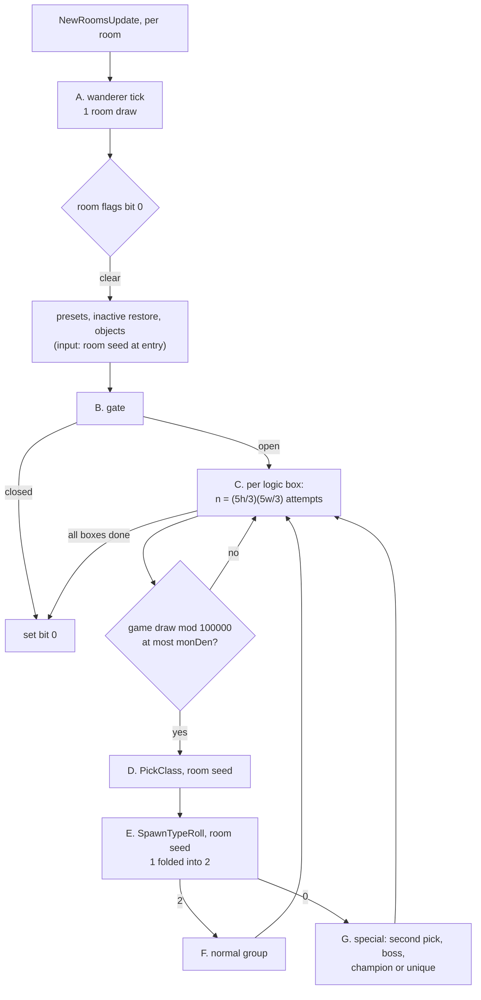
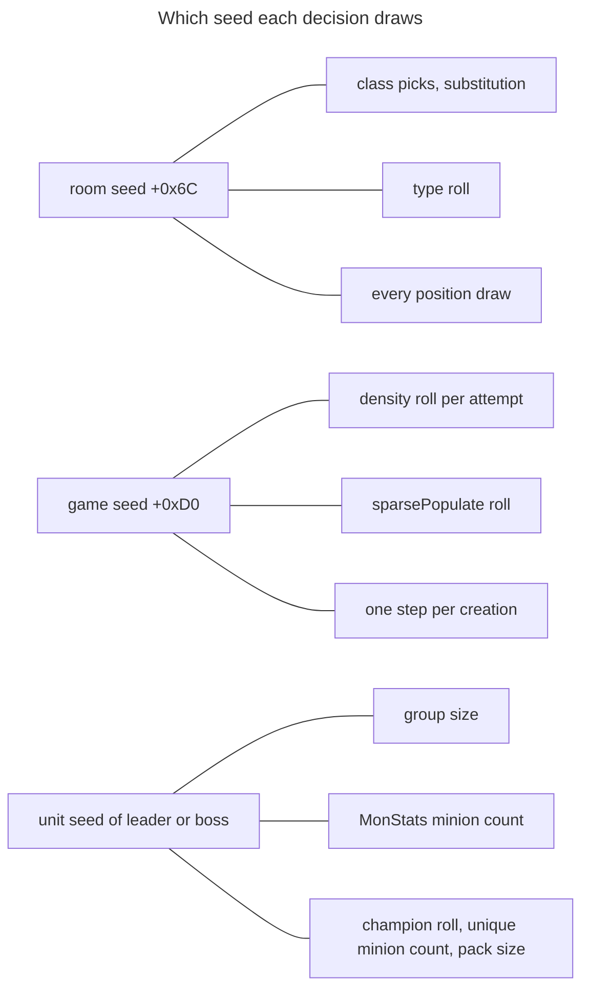
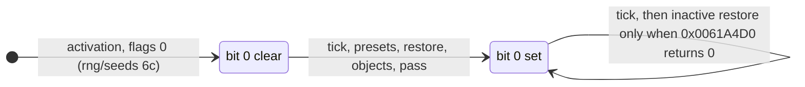
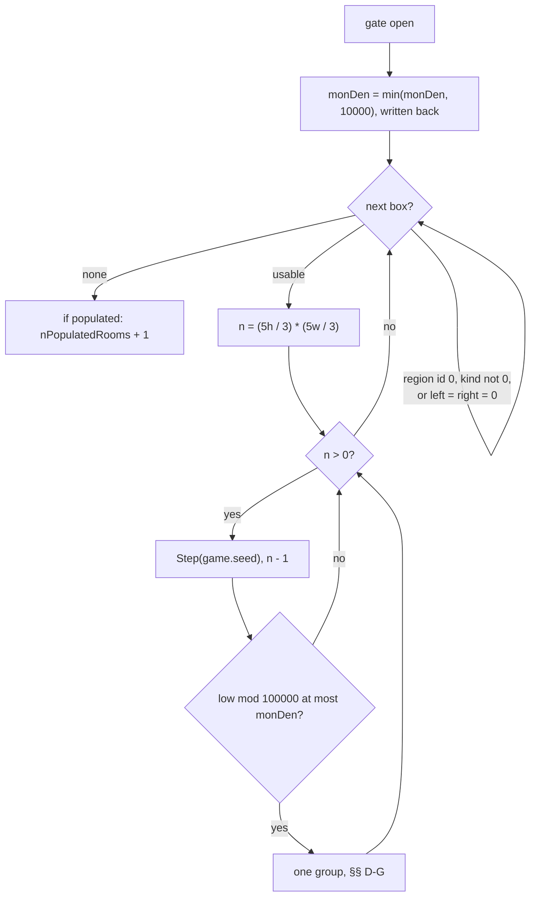
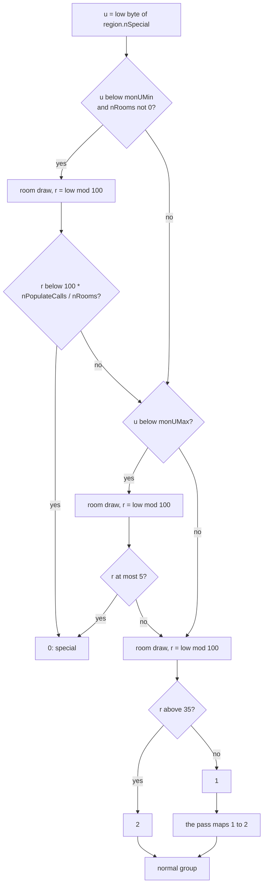
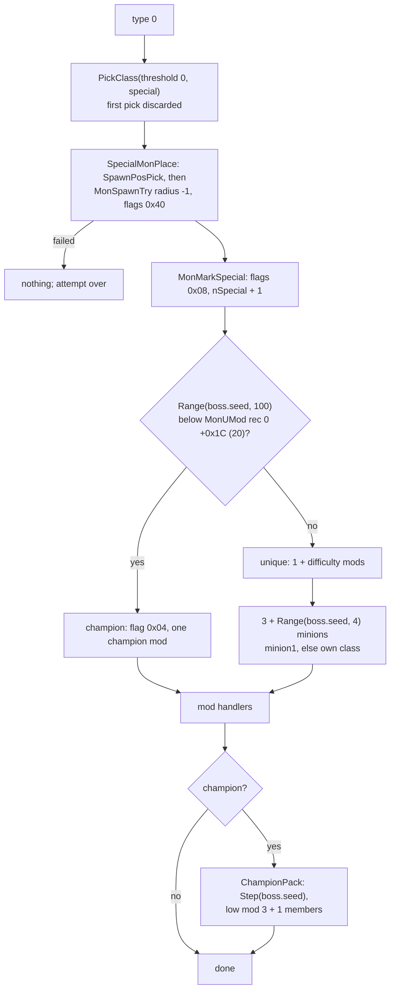
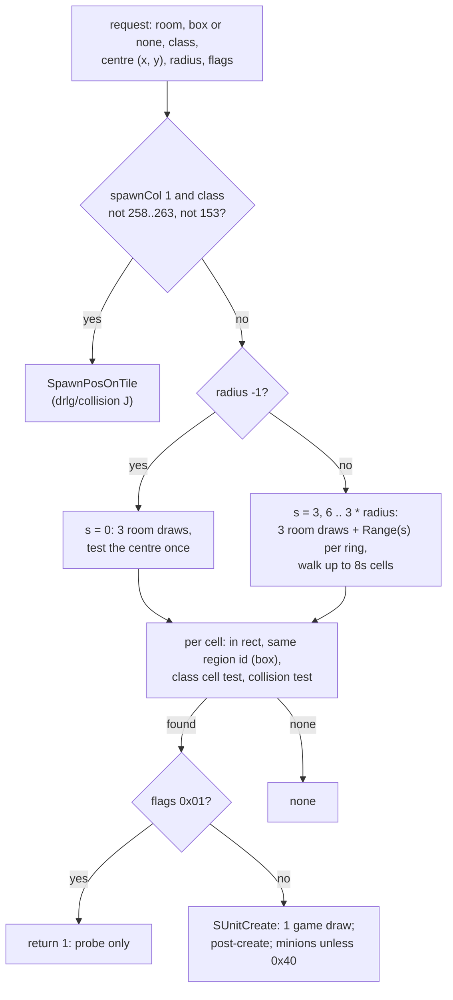
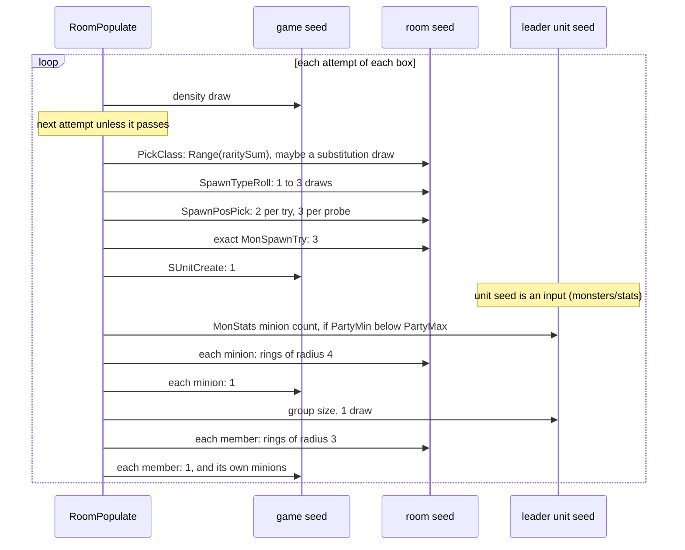

# Random population of a room

## Purpose

When the server activates a room for the first time, the population pass fills it with random monsters
taken from the level's monster pool ([pool.md](pool.md)). It splits the room into its logic boxes, makes a
number of attempts per box that depends on the box size, lets each attempt through with a density chance,
picks a class, decides whether the group is normal or special, and places the leader, the group members
and their minions. A special boss then becomes a champion with a pack, or a unique with minions. This spec gives
the pass with its exact draw order on the three seeds it uses: the **room seed**, the **game seed** and the
**unit seeds** of the monsters it creates. The modifiers, names and superuniques belong to `monsters/special`,
and hit points and damage to `monsters/stats`. Primitives (`Step`, `Range`, `Init`) are those of
[rng](../rng/README.md); `RangeB` in our symbol names is the second compile of `Range` and behaves the same.

## Entry points

| When | Function | Tag |
|---|---|---|
| New rooms of an act are updated (server), per room: wanderer tick, then on first activation presets, inactive units, objects, **the pass** | fn:sub_0052D160_NewRoomsUpdate@0x0052D160 | [C] |
| The same sequence for one room (three callers, not read) | fn:sub_0052D0F0_RoomUpdateOne@0x0052D0F0 | [I] |
| The population pass | fn:sub_0054EC90_RoomPopulate@0x0054EC90 | [C] |
| Its gate | fn:sub_0054EBC0_RoomPopulateGate@0x0054EBC0 | [C] |
| Class pick | fn:sub_005BDE80_MonRegionPickClass@0x005BDE80 | [C] |
| Normal or special | fn:sub_005BE020_SpawnTypeRoll@0x005BE020 | [C] |
| Normal group | fn:sub_0054DF80_SpawnGroup@0x0054DF80 | [C] |
| Special boss, then its champion pack | fn:sub_005A43E0_SpecialMonSpawn@0x005A43E0, fn:sub_0054E1E0_ChampionPack@0x0054E1E0 | [C] |
| Every creation: position search and create | fn:sub_005B2A00_MonSpawnTry@0x005B2A00 | [C] |

- [C] The pass and everything below it run on the server only; their game argument is the server game. Each
  run of `NewRoomsUpdate` walks the act's room list and treats each room as in § A. (fn:sub_0052D160_NewRoomsUpdate@0x0052D160,
  fn:sub_0054EC90_RoomPopulate@0x0054EC90, run:2026-10-13-mon-spawn)
- [I] The client never runs this pass. A client room's own content is the critter draw of
  [pool.md § F](pool.md#f-critters-sub_0046c460_clientcritters-not-from-the-pool). (fn:sub_0046C460_ClientCritters@0x0046C460,
  [monsters/0002 § 1](../../findings/monsters/0002-room-population.md#1-when-the-pass-runs-and-the-room-seed-before-it))

## Inputs

### Tables

All tables are the compiled `.bin` records, indexed by record position ([data/excel](../data/excel.md)). A class is a
MonStats record position.

| Anchor | Used for |
|---|---|
| tbl:Levels.txt:MonDen | density per difficulty, through the region (`monDen`, `+0x2B8`) |
| tbl:Levels.txt:MonUMin, tbl:Levels.txt:MonUMax | the special catch-up and cap, through the region (`+0x2BC`, `+0x2BD`) |
| tbl:Levels.txt:umon1 | `umon` slots (i16 × 25 at `+0x09A`) and their count at `+0x035` (filled at load): the special class in normal difficulty |
| tbl:Levels.txt:WarpDist | `+0x0C`: the warp-distance rejection of `SpawnPosPick` |
| tbl:Levels.txt:MonWndr | `+0x2E`: the wanderer gate only (§ K) |
| tbl:Levels.txt:Act | `+0x03`: the wanderer table row (§ K) |
| tbl:MonStats.txt:BaseId | `+0x02`: fallen/scarab rule, class-cell test, tentaclehead minions |
| tbl:MonStats.txt:placespawn, tbl:MonStats.txt:spawn | `+0x0E` bit 7 and i16 `+0x20`: the pick-time substitution |
| tbl:MonStats.txt:MinGrp, tbl:MonStats.txt:MaxGrp | u8 `+0x2F`, `+0x30`: normal group size |
| tbl:MonStats.txt:sparsePopulate | u8 `+0x31`: the group's game-seed roll |
| tbl:MonStats.txt:minion1, tbl:MonStats.txt:minion2 | i16 `+0x26`, `+0x28`: MonStats minions; `minion1` also for unique minions |
| tbl:MonStats.txt:PartyMin, tbl:MonStats.txt:PartyMax | u8 `+0x2C`, `+0x2D`: MonStats minion count |
| tbl:MonStats.txt:SetBoss, tbl:MonStats.txt:BossXfer | `+0x0C` bits 4, 5: minion linking (named only) |
| tbl:MonStats.txt:neverCount, tbl:MonStats.txt:Align | `+0x0E` bit 2, `+0x4C`: post-create setup (named only) |
| tbl:MonStats.txt:MonStatsEx | `+0x18`: the MonStats2 record |
| tbl:MonStats2.txt:SizeX | s8 `+0x08`: collision footprint size |
| tbl:MonStats2.txt:spawnCol | u8 `+0x0A`: collision mask and the tile placement |
| tbl:MonStats2.txt:objCol | `+0x06` bit 2: the evil hut object |
| MonUMod record 0, u32 `+0x1C` (the `constants` column, 20; no table doc yet) | the champion chance |

### Runtime state

| State | Type | Source |
|---|---|---|
| room seed | `Seed` at active room `+0x6C` | [rng/seeds](../rng/seeds.md) step 6c, then the draws of § A |
| room flags | u32 at active room `+0x34`; bit 0 = populated | rng/seeds step 6c |
| room rectangle | i32 x, y, w, h at active room `+0x4C`, subtiles | DRLG |
| game seed | `Seed` at game `+0xD0` | rng/seeds step 1, then every earlier consumer |
| difficulty | u8 at game `+0x06D` (0 normal, 1 nightmare, 2 hell) | game creation |
| region | `MonRegion` of the room's level, game `+0xF0` | [pool.md § Outputs](pool.md#outputs) |
| `region.nPopulateCalls` | i32 `+0x004`: rooms of the level that reached the gate | § B |
| `region.nPopulatedRooms` | i32 `+0x008` | § C |
| `region.nRooms` | i32 `+0x00C`, −1 until the first gate call | § B |
| `region.nPool`, `region.raritySum`, `region.entries[]` | u8 `+0x010`, u8 `+0x011`, `+0x014 + 0x34·i` | pool.md |
| `region.monDen`, `monUMin`, `monUMax` | i32 `+0x2B8`, u8 `+0x2BC`, u8 `+0x2BD` | pool.md |
| `region.nWanderers` | i32 `+0x2C4` | § K |
| `region.nSpecial` | i32 `+0x2C8`, compared through its low byte | § E |
| unit seed | `Seed` at unit `+0x20` | the creation (§ J) |
| unit flags | monster data flags: `0x01`, `0x04` champion, `0x08` special, `0x10` minion | § G |

### Constants

| Name | Value | Anchor | Tag |
|---|---|---|---|
| `DEN_SCALE` | 100000 (density roll modulus) | fn:sub_0054EC90_RoomPopulate@0x0054EC90 | [C] |
| `DEN_MAX` | 10000 (density clamp, written back) | 0x0054ECE2 | [C] |
| `SUBST_NORMAL`, `SUBST_SPECIAL` | 20, 0 (substitution thresholds) | fn:sub_005BDE80_MonRegionPickClass@0x005BDE80 | [C] |
| `UMAX_LIMIT` | 5: special iff `r ≤ 5`, so 6 of 100 | 0x005BE0DB | [C] |
| `TYPE_SPLIT` | 35: type 1 iff `r ≤ 35` (folded into 2 anyway) | fn:sub_005BE020_SpawnTypeRoll@0x005BE020 | [C] |
| `POS_TRIES` | 20 random points in `SpawnPosPick` | fn:sub_0054DC40_SpawnPosPick@0x0054DC40 | [C] |
| `UNIQUE_MINIONS` | 3 … 6 | fn:sub_005A0C00_UniqueMinions@0x005A0C00 | [C] |
| `PACK_MOD` | 16, the mod `ChampionPack` passes to each member (`push 0x10`) | 0x0054E246 | [C] |
| collision mask by `spawnCol` | 0 and other: `0x3C01`; 2: `0x3F11` | fn:sub_005B2A00_MonSpawnTry@0x005B2A00, run:2026-10-14-collision (1754 and 10 `CollisionTest` calls) | [C] |
| collision mask by `spawnCol` | 1: `0x01C0`; 3: 0 (not reached in either run) | fn:sub_005B2A00_MonSpawnTry@0x005B2A00, [drlg/collision § Open questions](../drlg/collision.md#open-questions) | [I] |
| `EVILHUT`, its object | class 528, object 562 | 0x0054E03B | [I] |
| wanderer class list | Act I: one class, 270 `rogue2`; other acts none | 0x00731B2C, fn:sub_0054EF50_WandererSpawn@0x0054EF50 | [I] |

### Inputs and oracles

The pass reads state that other subsystems own. Phase 2 of plan 0014 took each of them from the log as an
ADR-0004 oracle: a **value oracle** is a predicate whose result is taken (the room and game seed were asserted unchanged
across each call, and its arguments were asserted); a **seed oracle** is a callee that steps a seed, whose
exit seed is taken. A reimplementation supplies these from the owning subsystem. Every `[C]` below holds under
these inputs. [C] ([monsters/0002 § 9](../../findings/monsters/0002-room-population.md#9-boundary-decision-and-the-phase-2-logging-plan),
run:2026-10-13-mon-spawn) Plan 0017 replaced the four position predicates and the tile placement by the model of
[drlg/collision](../drlg/collision.md), which runs on the grid snapshot at pass entry, the logic-box grids and the level's warp points; those
are now the inputs, listed with their owners in [drlg/collision § Inputs and oracles](../drlg/collision.md#inputs-and-oracles). The rerun
predicted 1764 `CollisionTest`, 2665 `LogicRegionIdAt`, 1782 `SpawnClassCellTest`, 1645 `NearWarpTest` and 195 `SpawnPosOnTile`
calls with 0 mismatches. The plan 0014 logs carry no snapshot, so on them the predicates stay value oracles. [C]
(run:2026-10-14-collision, [monsters/0002 § 9](../../findings/monsters/0002-room-population.md#9-boundary-decision-and-the-phase-2-logging-plan))

| Input | Kind | What the pass needs | Owner | Tag |
|---|---|---|---|---|
| room seed at pass entry | seed oracle (the window before the pass) | `+0x6C` after the wanderer tick, the DS1 presets, the inactive-unit restore and the objects (§ A). Predicted from `-seed` through the tick in 516 of 516 rooms; at pass entry predicted end to end only where the presets/objects window drew nothing, 176 of 516 rooms (11 of 169 populated) | `drlg/preset` (preset units), `objects` (object population), `monsters/special` (preset specials) | [C] (run:2026-10-13-mon-spawn, fn:sub_005559A0_RoomPresetUnits@0x005559A0, fn:sub_00552610_RoomObjectsPopulate@0x00552610) |
| game seed at pass entry | run-time state | `+0xD0` after every earlier consumer in the game | every game-seed consumer ([rng/seeds](../rng/seeds.md) step note 7a) | [C] (run:2026-10-13-mon-spawn) |
| gate's DRLG parts | value oracle | `RoomPopLevelId` (0 when DRLG room `+0x28` has bit `0x800000`), the level's DRLG room count, the Chaos Sanctuary quest test | `drlg/preset`, `drlg/overview`, quests | [C] (fn:sub_0061A1F0_RoomPopLevelId@0x0061A1F0, fn:sub_00642BE0_LevelRoomCount@0x00642BE0, run:2026-10-13-mon-spawn) |
| logic boxes | DRLG state | the list at DRLG room `+0x64` → `+0x30`: per box the tile rectangle `+0x10`, kind `+0x20`, region id `+0x28`, next `+0x2C`. Built by the room's `Logicals` builder, [drlg/collision § G](../drlg/collision.md#g-logic-regions) | `drlg/collision` | [C] (struct:LogicBox+0x10, struct:LogicBox+0x20, struct:LogicBox+0x28, struct:LogicBox+0x2C, run:2026-10-13-mon-spawn, run:2026-10-14-collision) |
| grid snapshot at pass entry | value oracle | the u16 collision grids of the room and the rooms within two hops: the tile stamp of activation plus every mark made before the pass (preset units, objects, players, walk-ins) | `drlg/collision`, `objects` | [C] (fn:sub_0054EC90_RoomPopulate@0x0054EC90, run:2026-10-14-collision) |
| `CollisionTest(room, x, y, size, mask)` | modelled, [drlg/collision § E](../drlg/collision.md#e-collisiontest-by-size) | 0 = free; the grid snapshot plus the marks of the monsters the pass has created ([§ F](../drlg/collision.md#f-unit-marks)) | `drlg/collision` | [C] (fn:sub_0064D9B0_CollisionTest@0x0064D9B0, run:2026-10-14-collision) |
| `LogicRegionIdAt(room, x, y)` | modelled, [drlg/collision § G](../drlg/collision.md#g-logic-regions) step G4 | region id of the logic box at a subtile, −1 if none, 0 if no room holds it | `drlg/collision` | [C] (fn:sub_0061B130_LogicRegionIdAt@0x0061B130, run:2026-10-14-collision) |
| `SpawnClassCellTest(class, room, x, y, 1)` | modelled, [drlg/collision § H](../drlg/collision.md#h-spawnclasscelltestclass-room-x-y-flag) | an extra cell test for five `BaseId`s, true for every other class | `drlg/collision` | [C] (fn:sub_005FD350_SpawnClassCellTest@0x005FD350, run:2026-10-14-collision) |
| `NearWarpTest(room, x, y)` | modelled, [drlg/collision § I](../drlg/collision.md#i-nearwarptestgame-room-x-y-and-its-side-effects), on the logged warp and type-11 points | point within `WarpDist` of one of the level's warp points or of its waypoint point. Not pure: it can activate a room and step the level seed | `drlg/collision`; the points `drlg/warps` | [C] (fn:sub_0054DB50_NearWarpTest@0x0054DB50, run:2026-10-14-collision) |
| `SpawnPosOnTile(room)` | modelled, [drlg/collision § J](../drlg/collision.md#j-spawnposontileroom-spawncol-1) | the `spawnCol` 1 tile placement: one room draw, then a scan | `drlg/collision` | [C] (fn:sub_005B2700_SpawnPosOnTile@0x005B2700, run:2026-10-14-collision) |
| seed of another room at its first request in a pass | seed oracle | a frog demon placed on a near room's tile: its group and minions draw from that room's seed (2 calls) | [rng/seeds](../rng/seeds.md) | [C] (fn:sub_005B2700_SpawnPosOnTile@0x005B2700, run:2026-10-14-collision) |
| unit seed after `SUnitCreate` | seed oracle | the new monster's `+0x20`. The game-seed step is in scope (§ J); the unit seed is 2 steps past `Init(step(game).low)` on 914 of 916 creations, 6 and 15 on the other two | `monsters/stats` | [C] (fn:sub_00555230_SUnitCreate@0x00555230, run:2026-10-13-mon-spawn) |
| special mods after the champion roll, the unique-minion setup, the mod handlers of a boss and of each pack member | seed oracles | the boss's or member's unit seed after each; room and game seed unchanged | `monsters/special` | [C] (fn:sub_005A0760_SpecialModsRoll@0x005A0760, fn:sub_005A2120_SpecialModsApply@0x005A2120, run:2026-10-13-mon-spawn) |

- [C] `CollisionTest`, `LogicRegionIdAt` and `SpawnClassCellTest` draw nothing and change nothing. `NearWarpTest` draws on
  neither the pass room's seed nor the game seed, but its waypoint lookup can activate a room inside the pass and, in a level with
  `Position` set, step the level seed once ([drlg/collision § I](../drlg/collision.md#i-nearwarptestgame-room-x-y-and-its-side-effects)).
  The grid the collision test reads is stamped from DT1 sub-tile bytes at activation and marked by every unit placed
  before, objects and earlier monsters of the same pass included. (fn:sub_0064D9B0_CollisionTest@0x0064D9B0,
  fn:sub_0054DB50_NearWarpTest@0x0054DB50, run:2026-10-14-collision)

## Algorithm





- [C] The pass draws on three seeds. The **game seed** gives the density roll of every attempt, the
  `sparsePopulate` roll and one step per creation. The **room seed** gives the class picks, the substitution
  roll, the type roll and every position draw. The **leader's or boss's unit seed** gives the group size, the
  MonStats minion count, the champion roll, the unique minion count and the champion pack size.
  (fn:sub_0054EC90_RoomPopulate@0x0054EC90, fn:sub_005B2A00_MonSpawnTry@0x005B2A00, fn:sub_00555230_SUnitCreate@0x00555230,
  run:2026-10-13-mon-spawn)

### A. When the pass runs, and the room seed before it



```
A1. NewRoomsUpdate(game):                                         [C] (fn:sub_0052D160_NewRoomsUpdate@0x0052D160, 0x0052D1C4, 0x0052D1C9, run:2026-10-13-mon-spawn)
      for act in game.acts[0 ..< 5] with act[+0x54] ≠ 0:
        for room in the act's room list (next = room +0x7C):
          RoomWandererTick(game, room)                            ; § K, one room draw, always
          if room.flags & 1 = 0:
            RoomPresetUnits(game, room)                           ; input (drlg/preset, monsters/special)
            RoomInactiveUnitsRestore(game, room)                  ; input
            RoomObjectsPopulate(game, room)                       ; input (objects)
            RoomPopulate(game, room)                              ; §§ B–J
            room.flags ← room.flags | 1
          else if 0x0061A4D0(room) = 0:
            RoomInactiveUnitsRestore(game, room)
        act[+0x54] ← 0
```

Step notes:

A1. The wanderer tick runs every time a room is in a new-rooms walk, populated or not, so a room's seed keeps
moving after its population. That matters only to later consumers of the same room seed. [I]
(fn:sub_0052D160_NewRoomsUpdate@0x0052D160, 0x0052D1C4) `sub_0052D0F0_RoomUpdateOne` runs the same body for one
room; its three callers are not read. [I] (fn:sub_0052D0F0_RoomUpdateOne@0x0052D0F0)

A2. The room seed at pass entry is `rng/seeds` step 6c, one tick step (plus the wanderer roll's draws in the rare
case of § K), then whatever the presets and object population drew. Those consumers are out of scope here and
are inputs (*Inputs and oracles*). In the reproduction the window drew nothing in 176 of 516 rooms, and only in
those is the pass-entry seed predicted from `-seed` end to end. [C] (fn:sub_005559A0_RoomPresetUnits@0x005559A0,
fn:sub_00552610_RoomObjectsPopulate@0x00552610, run:2026-10-13-mon-spawn)

### B. The gate

```
B1. Gate(game, room) → bool:                                      [C] except the lines tagged [I] (fn:sub_0054EBC0_RoomPopulateGate@0x0054EBC0, run:2026-10-13-mon-spawn)
      region ← game.regions[level id of room]
      if region = none: return false                              ; [I] never taken in the run (fn:sub_0054EBC0_RoomPopulateGate@0x0054EBC0)
      region.nPopulateCalls ← region.nPopulateCalls + 1           ; before any other test
      lvl ← RoomPopLevelId(room)                                  ; input: 0 if DRLG room +0x28 & 0x800000
      if lvl = 0: return false
      if region.nRooms < 0:
        region.nRooms ← LevelRoomCount(act of region, lvl)        ; input, read once
      if region.monDen = 0 or region.nRooms = 0: return false     ; taken on MonDen 0; [I] nRooms = 0 never seen (fn:sub_0054EBC0_RoomPopulateGate@0x0054EBC0)
      if level id of room = 108 and quest byte (0x005B5210) ≠ 0: return false    ; [I] Chaos Sanctuary (0x0054EC1B)
      return true
```

- [C] `nPopulateCalls` counts every gate call, so it is the number of rooms of the level that have had their
  first activation, the current one included; § E uses it as "rooms visited". `nRooms` is the level's DRLG room
  count. (fn:sub_0054EBC0_RoomPopulateGate@0x0054EBC0, struct:MonRegion+0x004, struct:MonRegion+0x00C, run:2026-10-13-mon-spawn)
- [C] A level whose region `monDen` is 0 gets no random population. The run saw 37 closed gates, on levels 1, 75
  and 110. (fn:sub_0054EBC0_RoomPopulateGate@0x0054EBC0, tbl:Levels.txt:MonDen, run:2026-10-13-mon-spawn)
- [C] Two of the three writers of DRLG room bit `0x800000` are a preset room with `Populate` 0 and
  `DRLG_RoomNoPopNearTown`, both `drlg/preset` ([drlg/preset](../drlg/preset.md)). (fn:DRLG_RoomNoPopNearTown@0x0066BD50,
  run:2026-10-13-drlg-preset) [I] The third is `sub_0066E360_HiddenWarpTilesAdd`. (fn:sub_0066E360_HiddenWarpTilesAdd@0x0066E360)

### C. Density: attempts per logic box



```
C1. RoomPopulate(game, room):                                     [C] except the lines tagged [I] (fn:sub_0054EC90_RoomPopulate@0x0054EC90, 0x0054ED55, 0x0054EDB1, 0x0054EDD4, 0x0054ECE2, run:2026-10-13-mon-spawn)
      if not Gate(game, room): return
      box ← first logic box of room                               ; input
      if box = none: return                                       ; [I] never taken in the run (fn:sub_0054EC90_RoomPopulate@0x0054EC90)
      region ← game.regions[RoomPopLevelId(room)]
      region.monDen ← min(region.monDen, 10000)                   ; i32, stored back
      populated: bool ← false
      for each box in the list:
        if box.regionId = 0 or box.kind ≠ 0: continue
        (left, top, right, bottom): i32 ← box.rect                ; tiles
        if left = 0 and right = 0: continue                       ; [I] never taken in the run (fn:sub_0054EC90_RoomPopulate@0x0054EC90)
        n: i32 ← ((5·bottom − 5·top) ÷ 3) × ((5·right − 5·left) ÷ 3)    ; ÷ truncates toward zero
        while n > 0:
          n ← n − 1
          Step(game.seed)                                         ; game draw: density
          r: u32 ← game.seed.low mod 100000                       ; unsigned
          if (i32) r > region.monDen: continue                    ; signed compare: passes iff r ≤ monDen
          (class, rec) ← PickClass(game, region, room, 20, false) ; § D
          if rec = none: return                                   ; [I] no record: leave at once, no +0x08 (0x0054EDF9)
          t ← SpawnTypeRoll(region, room)                         ; § E
          if t = 1: t ← 2
          if t = 0: populated ← SpecialGroup(…) or populated      ; § G
          else:     populated ← NormalGroup(…) or populated       ; § F
      if populated: region.nPopulatedRooms ← region.nPopulatedRooms + 1
```

Step notes:

C1. One attempt passes with probability `(monDen + 1)/100000`, and the attempt count grows with the box area in
subtiles: an 8 × 8-tile box (40 × 40 subtiles) gets `13 × 13 = 169` attempts. [C] (0x0054ED55, 0x0054EDD4,
run:2026-10-13-mon-spawn) A box of the list is a DRLG logic region; only its second rectangle (`+0x10`) is read. [I]
(struct:LogicBox+0x10, fn:sub_0066CCB0_LogicBoxSingle@0x0066CCB0) The `MonDen` clamp is a store into the region,
so a value above 10000 behaves as 10000 from then on; the stock maximum is 2200. [C] (0x0054ECE2, tbl:Levels.txt:MonDen,
run:2026-10-13-mon-spawn)

### D. The class pick

```
D1. PickClass(game, region, room, threshold: u8, special: bool) → (class: i16, rec):   [C] except the lines tagged [I] (fn:sub_005BDE80_MonRegionPickClass@0x005BDE80, 0x005BDFB8, run:2026-10-13-mon-spawn)
      if special and game.difficulty = 0:                         ; normal difficulty only
        L ← Levels[region.levelId];  c: u8 ← L[+0x035]            ; umon count, filled at load
        if c = 0: return (0, none)                                ; [I] never taken in the run (0x005BDEB4)
        class ← L.umon[Range(room.seed, c)]                       ; room draw; no substitution
      else:
        if region.nPool = 0: return (0, none)                     ; [I] never taken in the run (fn:sub_005BDE80_MonRegionPickClass@0x005BDE80)
        w: i32 ← Range(room.seed, region.raritySum) + 1           ; room draw
        i ← 0
        while i < region.nPool:
          w ← w − region.entries[i].rarity
          if w ≤ 0: break
          i ← i + 1
        class ← region.entries[i].classId
        rec ← MonStats[class] if 0 ≤ class < nMonStats else none
        if rec ≠ none and rec.spawn ≥ 0 and rec.placespawn:
          Step(room.seed)                                         ; room draw: substitution
          if room.seed.low mod 100 > threshold: class ← rec.spawn ; unsigned mod, signed compare
      return (class, MonStats[class] if 0 ≤ class < nMonStats else none)
```

- [C] Thresholds are 20 for the pass's pick and 0 for the special pick, so a `placespawn` class (stock: the three
  `crownest`) turns into its `spawn` class with probability 79/100 and 99/100. The run took the substitution 14
  times and kept the class 5 times. (0x005BDFB8, tbl:MonStats.txt:placespawn, tbl:MonStats.txt:spawn, run:2026-10-13-mon-spawn)
- [C] In normal difficulty the special class is `umon[Range(c)]`, 9 picks in the run; the count `c` at Levels
  `+0x035` is 0 in `levels.bin` and set at load to the number of leading non-blank `umon` slots. Every level with
  a non-zero normal `MonDen` has `umon1`, so the stock data never reaches the `c = 0` exit through the pass.
  (0x005BDEB4, tbl:Levels.txt:umon1, run:2026-10-13-mon-spawn)
- [C] A `Rarity` 0 entry is never picked: the walk stops at the first entry that brings `w` to 0 or below, and `w`
  starts at 1 or more. (fn:sub_005BDE80_MonRegionPickClass@0x005BDE80, run:2026-10-13-mon-spawn)

### E. The type roll, and the 1 → 2 fold



```
E1. SpawnTypeRoll(region, room) → 0 | 1 | 2:                      [C] (fn:sub_005BE020_SpawnTypeRoll@0x005BE020, 0x005BE037, 0x005BE0A3, 0x005BE0DB, run:2026-10-13-mon-spawn)
      u: u8 ← region.nSpecial & 0xFF                              ; unsigned compares
      if u < region.monUMin and region.nRooms ≠ 0:
        Step(room.seed);  r: u32 ← room.seed.low mod 100          ; room draw
        if (i32) r < (region.nPopulateCalls × 100) ÷ region.nRooms: return 0     ; i32 idiv
      if u < region.monUMax:
        Step(room.seed)                                           ; room draw
        if room.seed.low mod 100 ≤ 5: return 0
      Step(room.seed)                                             ; room draw, always reached here
      return 2 if room.seed.low mod 100 > 35 else 1
E2. In RoomPopulate:  if t = 1: t ← 2                             [C] (0x0054EE0B, run:2026-10-13-mon-spawn)
```

Step notes:

E1. While the level has fewer specials than `MonUMin`, an attempt that passed density is special with probability
`⌊100·visited/rooms⌋/100`, roughly the explored fraction, so the catch-up grows as the level is explored; it is not a
guarantee. Below `MonUMax` a flat 6/100 applies. With `MonUMin = MonUMax = 0` neither draw happens and the level
gets no random champions or uniques. [C] (0x005BE037, 0x005BE0A3, tbl:Levels.txt:MonUMin, tbl:Levels.txt:MonUMax,
run:2026-10-13-mon-spawn: 346 type rolls, 115 `MonUMin` draws, 252 `MonUMax` draws, one special at exactly `r = 5`)

E2. **There is no type-1 group.** The pass turns 1 into 2 before its switch, so both values give a normal group.
The champion branch for 1 at `0x0054EEE4` (one `sub_005BDFF0_ARoomSeedStep` draw, then `sub_0054E190_FormationGroup`)
is unreachable in 1.14d. The last draw of the roll still happens, and its value only decides 1 or 2, which
changes nothing. A reimplementation draws it and ignores it. [C] (0x0054EE0B, 0x0054EE1E, fn:sub_005BDFF0_ARoomSeedStep@0x005BDFF0,
fn:sub_0054E190_FormationGroup@0x0054E190, run:2026-10-13-mon-spawn: the breakpoint on `0x0054EEE4` never hit)

E3. **The count is live.** `nSpecial` (`+0x2C8`) is raised by `MonMarkSpecial` once for each monster not yet flagged
`0x08`: a random special boss, each champion-pack member, a preset special and a superunique. It is lowered when a
monster with flag `0x01` leaves its level, and is never reset, so the "per-level count" builds up over the game
and is not fixed at level creation. [C] for the increments (run:2026-10-13-mon-spawn: 30 increments, each checked;
no decrement inside a pass) [I] for the decrement and the preset and superunique paths
(fn:sub_005A0320_MonMarkSpecial@0x005A0320, fn:sub_00547ED0_MonRegionUnitLeave@0x00547ED0, 0x00547F15)

### F. The normal group

```
F1. NormalGroup(game, room, box, class, rec) → leader | none:     [C] except the lines tagged [I] (0x0054EE24, 0x0054EE9F, fn:sub_0054EC40_IsFallenScarab@0x0054EC40, run:2026-10-13-mon-spawn)
      if MonStats[class].BaseId ∈ {19 fallen1, 91 scarab1}: (min, max) ← (1, 1)
      else: (min, max): (u8, u8) ← (rec.MinGrp, rec.MaxGrp)
      if rec.sparsePopulate ≠ 0:                                  ; [I] never reached in stock data (0x0054EE4D)
        Step(game.seed)                                           ; [I] game draw (0x0054EE8C)
        if game.seed.low mod 100 > rec.sparsePopulate: return none     ; [I] nothing in its place (0x0054EE8C)
      return SpawnGroup(game, room, box, class, min, max)

F2. SpawnGroup(game, room, box, class, min: u8, max: u8) → leader | none:   [C] except the lines tagged [I] (fn:sub_0054DF80_SpawnGroup@0x0054DF80, 0x0054E040, 0x0054E053, run:2026-10-13-mon-spawn)
      if min = 0 or max = 0 or max < min: return none             ; [I] never taken: stock MinGrp ≥ 1 (fn:sub_0054DF80_SpawnGroup@0x0054DF80)
      (x, y) ← SpawnPosPick(game, room, box, class, avoidWarp: true)   ; § H; on failure return none
      leader ← MonSpawnTry{room, box, class, (x, y), radius −1, flags 0}   ; § H; creates, then MonStats minions (§ I)
      if leader = none: return none                               ; [I] never taken in the run (fn:sub_0054DF80_SpawnGroup@0x0054DF80)
      if MonStats2(class).objCol and class = 528:                 ; [I] evilhut only, not reached (0x0054E03B)
        create object 562 at the leader                           ; [I] SUnitCreate type 2 (0x0054E03B)
      k: i32 ← (min − 1) + Range(leader.seed, max − min + 1)      ; leader-seed draw, always (n ≥ 1)
      repeat k times:
        MonSpawnTry{near leader, box, class, radius 3, flags 0}   ; failures ignored
      return leader
```

- [C] The group is the leader plus `k` members, uniform in `[min, max]` before placement failures. The size draw
  is on the **leader's** unit seed and comes **after** the leader's own MonStats minions (§ I), which drew first on
  the same seed. (0x0054E040, 0x0054E053, fn:sub_005B2830_MinionsSpawn@0x005B2830, run:2026-10-13-mon-spawn)
- [C] Fallen and scarab classes (by `BaseId`) always form a one-monster group; their party comes from
  `PartyMin`/`PartyMax` (§ I), with `minion1` the class itself on 22 pool classes. A shaman-type class brings
  its own party for each member. (fn:sub_0054EC40_IsFallenScarab@0x0054EC40, tbl:MonStats.txt:BaseId, run:2026-10-13-mon-spawn)
- [C] The pass counts the room as populated when `SpawnGroup` returns a leader. (0x0054EEA4, run:2026-10-13-mon-spawn)
- [I] The `sparsePopulate` roll uses the **game** seed after the type roll; the group spawns iff
  `low mod 100 ≤ sparsePopulate`, with probability `(v + 1)/100`. A failed roll ends the attempt: no leader, no
  members, no minions, and no other class in its place. (0x0054EE4D, 0x0054EE8C, tbl:MonStats.txt:sparsePopulate)
- [C] Stock data never reaches that roll through the pass. Only `evilhut` (40) has `sparsePopulate`, and it is in no
  `mon`, `nmon` or `umon` column of the 137 `levels.txt` rows and is no class's `spawn` target; it appears only as a
  MonPreset entry, which the preset path places without `SpawnGroup`. (tbl:MonStats.txt:sparsePopulate,
  tbl:Levels.txt:mon1, tbl:MonStats.txt:spawn, [monsters/0002 § 5](../../findings/monsters/0002-room-population.md#5-the-two-group-branches))

### G. The special group: boss, champion or unique



```
G1. SpecialGroup(game, region, room, box) → bool:                 [C] (0x0054EEFE, 0x0054EF3D, run:2026-10-13-mon-spawn)
      (class2, _) ← PickClass(game, region, room, 0, true)        ; § D; rec not checked
      boss ← SpecialMonSpawn(game, room, box, class2, allowChampion: true, x: 0, y: 0, avoidWarp: true)
      if boss = none: return false
      ChampionPack(boss, box, class2)
      return true

G2. SpecialMonSpawn(…) → boss | none:                             [C] except the line tagged [I] (fn:sub_005A43E0_SpecialMonSpawn@0x005A43E0, fn:sub_005A09E0_SpecialMonPlace@0x005A09E0, fn:sub_005A0320_MonMarkSpecial@0x005A0320, run:2026-10-13-mon-spawn)
      (x, y) ← SpawnPosPick(game, room, box, class2, avoidWarp: true)    ; § H; on failure return none
      boss ← MonSpawnTry{room, box, class2, (x, y), radius −1, flags 0x40}   ; 0x40: no MonStats minions
      if boss = none: return none                                 ; [I] never taken in the run (fn:sub_005A09E0_SpecialMonPlace@0x005A09E0)
      MonMarkSpecial(boss)                                        ; flags |= 0x08, region.nSpecial + 1 if not already set
      boss.flags ← boss.flags | 0x01
      SpecialModsRoll(boss, game, allowChampion: true)            ; G3
      SpecialModsApply(boss, box, 3, 6, minions: true)            ; G4
      return boss

G3. SpecialModsRoll, the part in scope:                           [C] (fn:sub_005A0760_SpecialModsRoll@0x005A0760, 0x005A0817, 0x005A0825, run:2026-10-13-mon-spawn)
      c: u32 ← MonUMod record 0, u32 at +0x1C                     ; 20 in stock data; 0 if the table is empty
      if Range(boss.seed, 100) < c:                               ; boss-seed draw
        boss.flags ← boss.flags | 0x04                            ; champion
        … one champion mod                                        ; input: monsters/special
      else:
        … 1 + difficulty unique mods                              ; input: monsters/special
      the boss's unit seed after the mods is an input             ; seed oracle (monsters/special)

G4. SpecialModsApply, the part in scope:                          [C] (fn:sub_005A0C00_UniqueMinions@0x005A0C00, fn:sub_005A0BB0_UniqueMinionClass@0x005A0BB0, 0x005A0C44, 0x005A0C55, run:2026-10-13-mon-spawn)
      if boss.flags & 0x04 = 0:                                   ; unique
        m ← minion1 of class2 if it is a valid class else class2
        repeat 3 + Range(boss.seed, 4) times:                     ; boss-seed draw: 3 … 6
          u ← MonSpawnTry{near boss, box, m, radius 3, flags 0x40}
          if u: u.flags ← u.flags | 0x10                          ; minion
      the mod handlers run next                                   ; seed oracle (monsters/special)

G5. ChampionPack(boss, box, class2):                              [C] (fn:sub_0054E1E0_ChampionPack@0x0054E1E0, 0x0054E233, 0x0054E246, run:2026-10-13-mon-spawn)
      if boss.flags & 0x04 = 0: return
      Step(boss.seed)                                             ; boss-seed draw
      repeat (boss.seed.low mod 3) + 1 times:                     ; unsigned mod: 1 … 3 members
        u ← MonSpawnTry{near boss, box, class2, radius 4, flags 0}    ; flags 0: MonStats minions (§ I)
        if u: ChampionMemberMark(u, 16)

G6. ChampionMemberMark(u, mod: u8):                               [C] except the lines tagged [I] (fn:sub_005A48C0_ChampionMemberMark@0x005A48C0, 0x005A4911, 0x005A492C, run:2026-10-13-mon-spawn)
      if u is a monster with data and u.flags & 0x04 = 0:          ; [I] otherwise nothing: never taken in the run (fn:sub_005A48C0_ChampionMemberMark@0x005A48C0)
        MonMarkSpecial(u);  u.flags ← u.flags | 0x05
        if (number of mods of u) < 9:                              ; [I] otherwise no append and no apply: never taken in the run (0x005A4911)
          append mod to u's mods
          SpecialModsApply(u, no box, 0, 0, minions: true)        ; champion: no unique minions; mod handlers only (seed oracle)
```

- [C] **Champion or unique is decided after the boss is placed, on the boss's unit seed**, not by the type roll:
  the boss is a champion when `Range(boss.seed, 100) < 20`, 20 of 100. The run logged 24 such rolls, champion
  exactly when `r < 20` (`r` = 0, 9, 4, 15). (0x005A0817, fn:sub_005A0760_SpecialModsRoll@0x005A0760, run:2026-10-13-mon-spawn)
- [C] By data, MonUMod `+0x1C` is the `constants` column, and row 0 holds 20 (43 of 43 rows match `monumod.txt`).
  The table has no doc yet ([backlog](../../backlog.md)). (0x005A0817, [monsters/0002 § 5](../../findings/monsters/0002-room-population.md#5-the-two-group-branches))
- [C] The special class is a **second** pick: from `umon` in normal difficulty, from the region pool with
  substitution threshold 0 in nightmare and hell. The first pick of the attempt only decided whether a record
  exists. (0x005BDE9B, fn:sub_005BDE80_MonRegionPickClass@0x005BDE80, run:2026-10-13-mon-spawn)
- [C] A unique gets 3 … 6 minions of `minion1` (or its own class), independent of `PartyMin`/`PartyMax`; `minion2` is
  not used on this path. The boss itself gets no MonStats minions (request flags `0x40`). (fn:sub_005A0BB0_UniqueMinionClass@0x005A0BB0,
  0x005A0A31, run:2026-10-13-mon-spawn)
- [C] A champion pack is the boss plus 1 … 3 members of its class. Each member counts as special (`nSpecial` + 1),
  is flagged champion, receives mod 16 when it has fewer than 9 mods, and has its mod handlers run. Members are
  created with flags 0, so a member of a class with `minion1` brings MonStats minions. The run had 4 packs, with
  the live count checked across every member. (fn:sub_0054E1E0_ChampionPack@0x0054E1E0,
  fn:sub_005A48C0_ChampionMemberMark@0x005A48C0, run:2026-10-13-mon-spawn)

### H. Placement: `SpawnPosPick` and `MonSpawnTry`



```
H1. SpawnPosPick(game, room, box, class, avoidWarp: bool) → (x, y) | none:    [C] except the line tagged [I] (fn:sub_0054DC40_SpawnPosPick@0x0054DC40, fn:sub_0054DAC0_SpawnBoxBounds@0x0054DAC0, run:2026-10-13-mon-spawn)
      if box: (x0, y0) ← (5·box.left + 1, 5·box.top + 1);  (w, h) ← (5·box.right − x0, 5·box.bottom − y0)
      else:   (x0, y0) ← (room.x + 1, room.y + 1);         (w, h) ← (room.w − 1, room.h − 1)
      repeat 20 times:
        x ← x0 + Range(room.seed, w)                              ; room draw
        y ← y0 + Range(room.seed, h)                              ; room draw
        if avoidWarp and NearWarpTest(room, x, y): continue       ; input (value oracle)
        if box and LogicRegionIdAt(room, x, y) ≠ box.regionId: continue    ; input (value oracle); [I] never taken in the run (0x0054DD49)
        if MonSpawnTry{room, box, class, (x, y), radius −1, flags 0x01} = 1:   ; probe: 3 room draws
          return (x, y)
      return none

H2. MonSpawnTry(R) → unit | 1 | none:                             [C] except the lines tagged [I] (fn:sub_005B2A00_MonSpawnTry@0x005B2A00, 0x005B2B63, 0x005B2DE6, run:2026-10-13-mon-spawn)
      if R.class is not a valid class or has no MonStats2 record: return none   ; [I] never taken in the run (0x005B2A16, 0x005B2A43, 0x005B2A72, 0x005B2A8B)
      m2 ← MonStats2[MonStats[R.class].MonStatsEx]
      mask ← collision mask for m2.spawnCol (Constants)
      (L, T, Rt, B) ← 5 × R.box.rect if R.box else (room.x, room.y, room.x + room.w, room.y + room.h)
      (s, smax): (i32, i32) ← (0, 0) if R.radius < 0 else (3, 3·R.radius)
      if m2.spawnCol = 1 and R.class ∉ 258 … 263 and R.class ≠ 153:   ; [C] the frog demons (0x005B2BB1, run:2026-10-14-collision)
        (x, y) ← SpawnPosOnTile(room)                             ; [C] drlg/collision § J: RangeB(room.seed, nTiles), then a scan (fn:sub_005B2700_SpawnPosOnTile@0x005B2700, run:2026-10-14-collision)
      else:
        if smax < s: return none                                  ; [I] radius 0 only, never taken in the run (fn:sub_005B2A00_MonSpawnTry@0x005B2A00)
        found ← none
        while s ≤ smax and found = none:
          Step(room.seed)                                         ; room draw
          if room.seed.low is odd: dx ← s;  dy ← Range(room.seed, s);  dir ← (0, 1)
          else:                    dx ← Range(room.seed, s);  dy ← s;  dir ← (1, 0)
          Step(room.seed);  if room.seed.low is odd: dx ← −dx      ; room draw
          Step(room.seed);  if room.seed.low is odd: dy ← −dy      ; room draw
          (x, y) ← (R.x + dx, R.y + dy)
          (l, t, r, b) ← (R.x − s, R.y − s, R.x + s, R.y + s)
          repeat max(8·s, 1) times:
            if (x, y) = (l, t): dir ← (1, 0)
            if x = r: (if y = t: dir ← (0, 1));  (if y = b: dir ← (−1, 0))
            if x = l: (if y = b: dir ← (0, −1));  (if y = t and x = r and y = b: dir ← (0, 0))
            (x, y) ← (x, y) + dir                                 ; move, then test
            if not (L ≤ x < Rt and T ≤ y < B): continue
            if R.box and LogicRegionIdAt(room, x, y) ≠ R.box.regionId: continue      ; input; [I] never taken in the run (0x005B2D7F)
            if not SpawnClassCellTest(R.class, room, x, y, 1): continue              ; input
            if CollisionTest(room, x, y, m2.SizeX, mask) ≠ 0       ; input
               and R.flags & 0x80 = 0: continue                   ; [I] the 0x80 bypass: no pass request sets it (0x005B2DAD)
            found ← (x, y);  break
          s ← s + 3
        if found = none: return none
        (x, y) ← found
      if x = 0 or y = 0: return none                              ; [I] never taken in the run (fn:sub_005B2A00_MonSpawnTry@0x005B2A00)
      if R.flags & 0x01: return 1                                 ; probe: nothing created
      unit ← SUnitCreate(type 1, R.class, x, y, game, room, mode 3 if R.flags & 0x20 else 1, …)   ; § J
      if unit = none: return none                                 ; [I] never taken in the run (0x005B2E46)
      post-create setup (named only, draws nothing in the run); it refreshes the unit's collision mark (drlg/collision § F)
      if R.flags & 0x40 = 0: MinionsSpawn(unit)                   ; § I
      return unit
```

Request wrappers fix the room and box. `SpawnAtPos` takes no box, `SpawnInBox` takes a box, and
`SpawnNearUnit` centres on the unit's position in the unit's room, with a box (the group members of § F, unique
minions and pack members). `SpawnNearUnitNoBox` does the same without a box (the MonStats minions of § I). [C]
(fn:sub_005B2F20_SpawnAtPos@0x005B2F20, fn:sub_005B3040_SpawnInBox@0x005B3040, fn:sub_005B2F70_SpawnNearUnit@0x005B2F70,
fn:sub_005B23C0_SpawnNearUnitNoBox@0x005B23C0, struct:MonSpawnReq+0x20, run:2026-10-13-mon-spawn)

Step notes:

H1. Placing a leader or boss costs `2 × tries` room draws in `SpawnPosPick`, then 3 for the probe, then 3 more for
the exact `MonSpawnTry` that creates it at the returned point: **an exact placement (radius −1) still makes 3
room draws**, because `Range(…, 0)` draws nothing and both sign draws happen. With `s = 0` the corner rules end
on direction (0, 0), so the centre is tested once. [C] (0x005B2B63, 0x005B2DE6, fn:sub_0054DC40_SpawnPosPick@0x0054DC40,
run:2026-10-13-mon-spawn) The warp test rejects a point whose squared distance in subtiles to one of the **level's** warp points (`level+0x1E0`,
up to 9 entries; per level, not per room) or to the level's type-11 point is below `WarpDist`. [C]
(fn:sub_0054DB50_NearWarpTest@0x0054DB50, tbl:Levels.txt:WarpDist, run:2026-10-14-collision) The test has two side effects, both
specified in [drlg/collision § I](../drlg/collision.md#i-nearwarptestgame-room-x-y-and-its-side-effects): when no warp point is near, its waypoint
lookup can activate the room that holds the point inside the pass (17 times in the run, `Position` 0 levels), and in a level with
`Position` set it steps the level seed once per lookup (Tristram, 20 lookups). It runs only for a try that reaches it. [C]
(fn:sub_0066B2B0_LevelPointFind@0x0066B2B0, fn:sub_0061B730_RoomActivateB@0x0061B730, run:2026-10-14-collision)

H2. A ring walk starts at a random cell of the ring and **moves before it tests**, so the start cell is tested
last if at all. The start direction runs against the corner turns on two of the four edges, so the walk reverses
at the first corner and tests some cells twice (the worked example shows it). Cells outside the rectangle are
skipped without a predicate call; `PtInRect` excludes the right and bottom edges. Positions are subtiles. [C]
(0x005B2B63–0x005B2DE6, run:2026-10-13-mon-spawn: every tested cell of 916 creations in order)

H3. The collision test dispatches on the footprint size (`SizeX`): 2 tests the cell and its four neighbours, 3 the
3×3 square. Each cell is `grid[(y − y0)·w + x − x0] & mask` on the u16 grid of the room that holds it, and a footprint
cell in no room reachable from the request's room adds `0x27`, unmasked ([drlg/collision § E](../drlg/collision.md#e-collisiontest-by-size)).
[C] (fn:sub_0064D9B0_CollisionTest@0x0064D9B0, 0x0064D450, 0x0064D100, run:2026-10-14-collision) Sizes 0 and 1 test one
cell and other sizes return `0xFFFF`; no pool class reached them. [I] (fn:sub_0064D9B0_CollisionTest@0x0064D9B0)

H4. **What blocks.** The default mask `0x3C01` reads tile bit 0, objects, doors and the `0x1000`/`0x2000` centre marks, but
not the monster bit `0x100` ([drlg/collision § D](../drlg/collision.md#d-the-u16-word-bit-by-bit)). A monster the pass has created therefore
blocks later placements only through its `0x1000` cells: its centre for size 1 or 2, its plus for size 3. A **wraith** is
created with pattern 5 (the plus of `0x100`, no centre mark), but the post-create refresh turns that into pattern 1 before the
next test, so a created wraith blocks through its `0x1000` centre like any size-2 monster. Only a size-0 monster blocks nothing.
[C] (fn:COLL_PatternMark@0x0064EA90, fn:sub_00649CA0_PathPatternRefresh@0x00649CA0, run:2026-10-14-collision: 410 creations,
4 `wraith2`, 67 placements accepted with a `0x100` cell in their footprint)

H5. `SpawnClassCellTest` passes every class except five `BaseId`s, which test an offset cell
([drlg/collision § H](../drlg/collision.md#h-spawnclasscelltestclass-room-x-y-flag)): 206 `crownest1`, 228 `sarcophagus`, 298 `vilemother1`
(passes on this path), 334 `suckernest1`, 528 `evilhut`. [C] for 206, 298 and the pass-through (fn:sub_005FD350_SpawnClassCellTest@0x005FD350,
run:2026-10-14-collision) [I] for 228, 334 and 528, not reached (fn:sub_005FD350_SpawnClassCellTest@0x005FD350)

### I. MonStats minions

```
I1. MinionsSpawn(unit):                                           [C] except the lines tagged [I] (fn:sub_005B2830_MinionsSpawn@0x005B2830, fn:sub_004CC790_RandRangeIncl@0x004CC790, run:2026-10-13-mon-spawn)
      rec ← MonStats[unit.class]
      if rec.minion1 is not a valid class: return
      if rec.BaseId = 261 (tentaclehead1): separate branch 0x005B2570    ; [I] not reached (fn:sub_005B2830_MinionsSpawn@0x005B2830)
      lo, hi: u8 ← rec.PartyMin, rec.PartyMax
      n ← lo if lo ≥ hi else lo + Range(unit.seed, hi − lo + 1)  ; unit-seed draw only when lo < hi; [I] lo ≥ hi never taken in the run (fn:sub_004CC790_RandRangeIncl@0x004CC790)
      k ← 0
      repeat n times:
        m ← (rec.minion1, rec.minion2)[k]
        MonSpawnTry{near unit, no box, m, radius 4, flags 0x40}
        k ← k + 1;  if k > (1 if rec.minion2 is a valid class else 0): k ← 0
      with SetBoss, each minion is linked to its leader; BossXfer is passed to the link (named only)
```

- [C] Minions run for **every** creation without request flag `0x40`: each normal-group leader and member and each
  champion-pack member. Leaders, members and pack members of a class with `minion1` therefore each bring their
  own party. Bosses, unique minions and minions themselves (all `0x40`) bring none. The run created or tried 163
  MonStats minions. (fn:sub_005B2830_MinionsSpawn@0x005B2830, tbl:MonStats.txt:PartyMin, tbl:MonStats.txt:minion1,
  tbl:MonStats.txt:minion2, run:2026-10-13-mon-spawn)
- [C] Minions take no box, so their cells skip the region-id test. (fn:sub_005B23C0_SpawnNearUnitNoBox@0x005B23C0,
  run:2026-10-13-mon-spawn)
- [I] No read of the player count, party size or `/players` exists in the code read for this pass; group size, minions
  and density do not scale with players in it. Not read: `SUnitCreate`, the mod handlers and the post-create helpers.
  ([monsters/0002 § 6](../../findings/monsters/0002-room-population.md#6-placement-monspawntry), fn:sub_0054EC90_RoomPopulate@0x0054EC90)

### J. Creation and the unit seed

```
J1. SUnitCreate(type 1, class, x, y, game, room, …) → unit, as seen by this pass:   [C] (fn:sub_00555230_SUnitCreate@0x00555230, 0x005B2E3D, 0x005B2EE4, run:2026-10-13-mon-spawn)
      Step(game.seed)                                             ; exactly one game draw per creation (rng/seeds 7a)
      unit.seed ← input                                           ; monsters/stats; see note J1
      room and game seed are unchanged by everything else in the creation and by the post-create setup
```

Step notes:

J1. `rng/seeds` step 7a sets `unit.seed ← Init(game.seed.low)` after the step. The seed the pass then draws on is
**2 steps past** that value on 914 of 916 logged creations, and 6 and 15 steps past it on the other two (a `goatman1`
unique boss, level 4; a `fallen1` minion of a `fallenshaman1`, level 3). The steps happen inside `SUnitCreate`;
which callee makes them is not read. This spec therefore takes the unit seed after `SUnitCreate` as an input owned by
`monsters/stats`. [C] (fn:sub_00555230_SUnitCreate@0x00555230, fn:sub_00552DF0_UnitSeedInit@0x00552DF0, run:2026-10-13-mon-spawn)

J2. Every draw this pass makes on a unit seed comes after that input, in this order: the MonStats minion count
(§ I, inside the creation), then the group size (§ F) for a leader; the champion roll (§ G3), then, after the
mods input, the unique minion count (G4) and, after the mod handlers input, the pack size (G5) for a boss. [C]
(fn:sub_0054DF80_SpawnGroup@0x0054DF80, fn:sub_005A43E0_SpecialMonSpawn@0x005A43E0, fn:sub_0054E1E0_ChampionPack@0x0054E1E0,
run:2026-10-13-mon-spawn)

### K. Wanderers (the tick)

```
K1. RoomWandererTick(game, room):                                 [C] for the first draw, [I] for the rest (fn:sub_0054F060_RoomWandererTick@0x0054F060, run:2026-10-13-mon-spawn)
      Step(room.seed)                                             ; room draw, every tick
      if room.seed.low & 0x7FFF = 0 and room[+0x78] = 0 and Levels[level].MonWndr ≠ 0:
        WandererRoll: Step(room.seed)                             ; room draw
          if room.seed.low mod 100 < 3 and region.nWanderers < 3:
            WandererSpawn: class ← list[Range(room.seed, count)] for the level's act    ; room draw
              SpawnPosPick(no box, no warp test), SpawnAtPos, then region.nWanderers + 1
```

- [C] The tick's first draw happens on every tick, and the run checked it on 516 rooms. The wanderer roll never fired
  (1 in 32768 ticks), so the rest of K1 stays `[I]`. (fn:sub_0054F060_RoomWandererTick@0x0054F060, run:2026-10-13-mon-spawn)
- [I] The class list has an entry for Act I only: one class, 270 `rogue2`. (fn:sub_0054EF50_WandererSpawn@0x0054EF50, 0x00731B2C)
- [I] `MonWndr` reaches the game only through this gate. A static search finds two readers of Levels `+0x2E`: the
  region build, which copies it to `+0x2BE`, a field nothing reads, and this tick. It does not decide whether
  monsters roam or stand still. (fn:sub_005479C0_MonRegionsBuild@0x005479C0, 0x00547A99, 0x0054F0AA, tbl:Levels.txt:MonWndr)
  [C] Watchpoints on the byte for five played levels hit only the region-build read while their monsters were
  activated, roamed and fought. (run:2026-10-13-mon-spawn)
- [I] `MonSpcWalk` is read only by a pathing helper and plays no part in spawning. (fn:sub_005B13E0_MonSpcWalkCheck@0x005B13E0,
  tbl:Levels.txt:MonSpcWalk)

### Draw order across the three seeds



The diagram shows the normal branch. The special branch replaces the leader by the boss and adds the boss-seed
draws of G3–G5.

## Outputs

- Monsters created in the room through `SUnitCreate` (type 1), each with class, subtile position and unit
  seed; specials flagged `0x08` (and `0x04` for a champion, `0x01` for boss and pack members), minions of a unique
  flagged `0x10`. [C] (fn:sub_005B2A00_MonSpawnTry@0x005B2A00, fn:sub_005A0320_MonMarkSpecial@0x005A0320, run:2026-10-13-mon-spawn)
- The room seed and the game seed advanced by exactly the draws above; the room flags bit 0 set by the caller. [C]
  (fn:sub_0052D160_NewRoomsUpdate@0x0052D160, run:2026-10-13-mon-spawn)
- Region updates: `nPopulateCalls` + 1 on every gate call, `nRooms` set once, `monDen` clamped, `nPopulatedRooms` + 1
  when a leader or boss was placed, `nSpecial` + 1 per special monster. [C] (struct:MonRegion+0x004, struct:MonRegion+0x008,
  struct:MonRegion+0x2C8, run:2026-10-13-mon-spawn)
- Downstream: `monsters/special` (mods, names, the champion and unique effects, superuniques), `monsters/stats`
  (the unit seed's own draws, level and stats; [pool.md § E](pool.md#e-the-monster-level-sub_00573cb0_monstatsinit)),
  `items/tc` (drops from these monsters, [items/tc](../items/tc.md)) and `drlg/collision` (the grid marks they leave).

## Worked example

Source: run:2026-10-13-mon-spawn, log `monspawn-s3-1-hell-a1.log`, pass at line 21181: `-seed 1`, an expansion
hell game, level 5 *Dark Wood*, active room `0x03021700` (DRLG room `0x03130700`). It is one of the 11 populated
rooms whose pass-entry room seed is predicted end to end. `python3 -I tools/monspawn.py check <log> -v` lists it as
`[('normal', 64, 3), ('normal', 64, 1), ('normal', 20, 1)]`; the room passes with every other room of the log
(29 853 checks, 0 mismatches). Every value below was re-derived with `tools/rng.py` from the seeds named, and each
matches the log line. Seeds are `low:high` in hex. Positions are subtiles.

**The room seed from `-seed 1`.**

| Step | Operation | Value |
|---|---|---|
| rng/seeds 3b | `levelSeedBase` = `Step(Init(1)).low` | `6AC6935F` |
| rng/seeds 4 | level 5 seed | `Init(6AC69364)` |
| rng/seeds 5, drlg/overview | DRLG room `+0x04` (predicted by `tools/drlg.py gen`) | `8E44259B` |
| rng/seeds 6a–6b | `Init(8E44259B)`, k = 122 room-type draws (`tools/drlg.py roomk`) | `0A8F2A48:218010C7` |
| rng/seeds 6c | activation draw, `Init(low)` | active-room seed `4D241A2F:0000029A`, flags 0 |
| A1 | wanderer tick: one draw (`low & 0x7FFF` = `0x18C5`, no roll) | `61DC98C5:202CC863` |
| A1 | presets, inactive restore, objects | no draw: still `61DC98C5:202CC863` at pass entry |
| input | game seed at pass entry (run-time state) | `444E14BD:29F916E8` |

**Region and box.** Region of level 5, hell: `nPool` 3, `raritySum` 5, entries (20 `fallen2`, rarity 2),
(166 `cr_lancer2`, 1), (64 `quillrat2`, 2); `monDen` 520, `monUMin` 7, `monUMax` 9, `nSpecial` 7, `nRooms` 58,
`nPopulateCalls` 36 → 37 at the gate. One logic box, tile rectangle (3104, 1122)–(3112, 1130), region id 1, kind 0:
`n = (40 ÷ 3) × (40 ÷ 3) = 169` attempts. The `SpawnPosPick` range is `x0 = 15521`, `y0 = 5611`, `w = h = 39`.

**Attempt 46** (attempts 1–45 drew `r > 520`): game draw → `A79BB8F8:065EAFCC`, `r = 504`, passes.

| Room draws | Result | Room seed after |
|---|---|---|
| `Range(5) + 1` | 4: 4 − 2 = 2, 2 − 1 = 1, 1 − 2 < 0 → class 64 `quillrat2` (no `placespawn`) | `3F3B27FC:28D13F37` |
| type roll | `u` = 7 is not below `monUMin` 7: no catch-up draw. Below `monUMax` 9: `r` = 51 > 5. Last draw `r` = 24 ≤ 35 → 1, folded into 2: normal | `D7082900:26AE17A7` |
| `SpawnPosPick` try 1 | `Range(39)`, `Range(39)` → (15557, 5612); not near a warp, region 1 | `6ACFCF66:62DC2E94` |
| probe, radius −1 | 3 draws, collision 0 | `052B8A21:1F9AB280` |
| create, radius −1 | 3 draws; `SUnitCreate`: game → `590F86A4:45E87BD0`; leader seed (input) `D496D6A5:212B878A` | `8ED5D56C:09A88AA0` |

`quillrat2` has no `minion1`, so no minion draw. Group size: `MinGrp`/`MaxGrp` 1/3, `k = 0 + Range(leader, 3) = 2`
(leader seed → `E7998483:58AB59C2`).

- Member 1, ring `s = 3`: even → `dx = Range(3) = 1`, `dy = 3`, signs +, + → start (15558, 5615), direction (1, 0).
  Tested: (15559, 5615) collision 39; (15560, 5615) is outside the box (right edge excluded) and is the ring's
  corner (r, b), so the direction turns to (−1, 0); (15559, 5615) again, 39; (15558, 5615) 0 → created. Room seed
  `7F5E6B22:2560059C`, game `956F5804:2525821F`.
- Member 2, ring `s = 3`: `dx = −2`, `dy = −3` → start (15555, 5609), above the box. The walk runs along the top
  edge and down the right edge outside the box, turns at (15560, 5615), and tests (15559, 5615) 4135,
  (15558, 5615) 4096 (member 1 stands there), (15557, 5615) 4096, (15556, 5615) 0 → created. Room seed
  `EB2F2AF7:5D62BD2A`, game `806E7D33:3E540311`.

**Attempt 90**: `r = 31`. `Range(5) + 1 = 5` → class 64. Type: 70, then 17 → 1 → 2. Position (15538, 5643), probe and
create (room seed `958E183B:1FCBF491`, game `D83794A8:13967392`), leader seed `A9FB49BA:14283A3D`, `k = Range(3) = 0`:
a group of one.

**Attempt 100**: `r = 520`, equal to `monDen`, passes. `Range(5) + 1 = 2` → 2 − 2 = 0 → class 20 `fallen2`. Type: 34,
then 92 → 2. `fallen2` has `BaseId` `fallen1`, so (min, max) = (1, 1). Position (15552, 5642), probe and create
(room `9F393120:283BBFB8`, game `02EDC268:262F9B10`), leader seed `013AE0B5:2C86C396`. Inside the creation,
`MinionsSpawn`: `minion1` = `fallen2`, `PartyMin`/`PartyMax` 2/4, `n = 2 + Range(leader, 3) = 2` (leader seed →
`FB397EDF:00835546`). Minion 1, radius 4, no box: `dx = 0`, `dy = +3` → tested (15553, 5645) 1, (15554, 5645) 1,
(15555, 5645) 0 → created (game `90F0B518:0138B80B`). Minion 2: `dx = 0`, `dy = −3` → (15553, 5639) 1, (15554, 5639) 0 →
created (room `E1A856E7:21B1C714`, game `F0E19383:3C74171E`). Then the group size: `k = 0 + Range(leader, 1) = 0`, one
draw (leader seed → `219966E1:68C8AB12`).

**Exit.** Attempts 101–169 all draw `r > 520`. Game seed `4832CBF3:4D9E1F18`, room seed `E1A856E7:21B1C714`. Seven monsters:

| Group | Class | Positions |
|---|---|---|
| 1 | 64 `quillrat2` × 3 | (15557, 5612), (15558, 5615), (15556, 5615) |
| 2 | 64 `quillrat2` × 1 | (15538, 5643) |
| 3 | 20 `fallen2` + 2 `fallen2` minions | (15552, 5642); (15555, 5645), (15554, 5639) |

`nPopulatedRooms` 14 → 15, `nSpecial` stays 7, the region's live monster count 117 → 124.

## Reimplementation notes

- **Do not implement a type-1 champion group.** `SpawnTypeRoll` can return 1, but the pass folds it into 2 before
  dispatch; the `0x0054EEE4` branch and `FormationGroup` are dead code. Keep the roll's last draw. [C] (0x0054EE0B,
  fn:sub_0054E190_FormationGroup@0x0054E190, run:2026-10-13-mon-spawn)
- **Champion or unique is not part of the type roll.** It is `Range(boss.seed, 100) < 20` after the boss is placed. [C]
  (0x005A0817, run:2026-10-13-mon-spawn)
- **`MonUMax` is per attempt and 6/100.** A community page says each room attempts a unique at 5/100 and that `MonUMax`
  caps successful attempts. In 1.14d the roll is made for each attempt that passed density, succeeds for `r ≤ 5`, and
  compares the cap with the live special count, which includes pack members, preset specials and superuniques. The
  run settled this with a special at exactly `r = 5`. [C] (0x005BE0DB, run:2026-10-13-mon-spawn,
  [monsters/0002 § Leads used](../../findings/monsters/0002-room-population.md#leads-used))
- **`MonWndr` is not a roam/stand flag.** A community page says it decides whether unactivated monsters roam. In 1.14d it
  gates only the wanderer roll (§ K). [I] (0x0054F0AA, fn:sub_005479C0_MonRegionsBuild@0x005479C0) [C] for the run
  watch (run:2026-10-13-mon-spawn)
- **The leader's seed serves its minions first.** The MonStats minion count is drawn inside the leader's creation,
  before `SpawnGroup` draws the group size on the same seed. [C] (fn:sub_005B2830_MinionsSpawn@0x005B2830,
  fn:sub_0054DF80_SpawnGroup@0x0054DF80, run:2026-10-13-mon-spawn)
- **`Range(x, 1)` draws.** The group size of a one-monster group still steps the leader's seed (`n = 1` passes the
  `n < 1` test). `Range(x, 0)` does not, which is why an exact placement costs 3 draws, not 4. [C]
  ([rng](../rng/README.md) step 2, 0x0054E040, run:2026-10-13-mon-spawn)
- **The density test is `≤`.** `r = monDen` passes, as attempt 100 of the worked example shows. [C] (0x0054EDD4, run:2026-10-13-mon-spawn)
- **The probe costs draws.** `SpawnPosPick` probes the point with a full radius −1 `MonSpawnTry` (3 room draws) and the
  caller creates there with a second one (3 more). [C] (fn:sub_0054DC40_SpawnPosPick@0x0054DC40, run:2026-10-13-mon-spawn)
- **A failed placement still consumes its draws.** Ring draws and `SpawnPosPick` tries are spent whether or not a
  cell is found; failed members are simply missing. [C] (fn:sub_005B2A00_MonSpawnTry@0x005B2A00, run:2026-10-13-mon-spawn)
- **The collision grid changes as the pass runs.** Each monster placed marks cells that later members test (member 1
  blocks member 2 in the worked example). A reimplementation needs [drlg/collision](../drlg/collision.md) and the unit footprints,
  or it diverges on the first contested cell. [C] (fn:sub_0064D9B0_CollisionTest@0x0064D9B0, run:2026-10-13-mon-spawn)
  Only the `0x1000` centre marks block a default spawn, and a wraith has one once the post-create refresh has run (H4). [C]
  (fn:sub_00649CA0_PathPatternRefresh@0x00649CA0, run:2026-10-14-collision)
- **The special count is compared through its low byte.** `nSpecial` is an i32 compared as a u8 with `MonUMin`/`MonUMax`.
  [C] (0x005BE037, struct:MonRegion+0x2C8, run:2026-10-13-mon-spawn)
- **No class record ends the whole pass.** When the first pick of an attempt returns no record, the pass returns at once
  and does not count the room as populated. [I] (0x0054EDF9)
- **No expansion branch.** The pass and its callees do not test the expansion flag; it enters only through the region
  and the champion mod pick of `monsters/special`. No classic or nightmare game was logged. [I] (fn:sub_005A0500_ChampionModPick@0x005A0500,
  [monsters/0002 § 8](../../findings/monsters/0002-room-population.md#8-classic-expansion-and-difficulty))

## Evidence

- [findings/monsters/0002-room-population.md](../../findings/monsters/0002-room-population.md): the whole pass,
  §§ 1–9, after the Phase 2 review fixes F6–F11.
- [findings/monsters/experiments.md § run:2026-10-13-mon-spawn](../../findings/monsters/experiments.md#run2026-10-13-mon-spawn):
  three owner-played games (`-seed` 12345 and 1, normal and hell, Acts I–V), 516 room activations, 169 populated rooms,
  916 creations, 4 champion packs, 20 unique groups, 110 302 checks, 0 mismatches; the oracles; the 11 end-to-end
  rooms; the unit-seed outliers.
- `tools/monspawn.py check`: the model behind the confirmed tags and the worked example. Its `guard …` counters
  say which guard exits of §§ B–I the run took; every exit left untagged in a confirmed block has a non-zero count.
- [findings/monsters/0001-level-pool.md § 6](../../findings/monsters/0001-level-pool.md#6-who-reads-the-pool-named-for-monstersspawn):
  the readers of the pool named first.
- Tables: [MonStats § Spawn columns](../../tables/MonStats.md#spawn-columns-plan-0014-phase-0),
  [Levels § Spawn survey](../../tables/Levels.md#spawn-survey-per-difficulty-plan-0014-phase-0), [MonStats2](../../tables/MonStats2.md),
  [MonPreset](../../tables/MonPreset.md).
- Types: `re/types/monregion.h` (`MonRegion`), `re/types/monspawn.h` (`LogicBox`, `LogicRecord`, `MonSpawnReq`).
- Upstream: [rng](../rng/README.md), [rng/seeds](../rng/seeds.md), [monsters/pool](pool.md), [drlg/preset](../drlg/preset.md),
  [drlg/collision](../drlg/collision.md) (the position tests, the marks and the tile placement; run:2026-10-14-collision).

## Open questions

- [L] **`sparsePopulate`, untested.** The code reading (§ F, `[I]`) is that the group spawns with probability
  `(v + 1)/100` on the game seed and that nothing replaces it, minions included. src:d2dfg-blizzard says the value is
  the chance that the monster does *not* spawn and that another spawns in its place; src:pk-monstats-guide says a
  failure can leave only the minions. Stock data never reaches the roll, so no stock run can settle it. A `-direct -txt`
  run with an edited Levels row (e.g. `evilhut` in a pool) could; such a run is no evidence for a stock-data claim.
  (architect ruling, plan 0014 Phase 1b review; [backlog](../../backlog.md))
- [L] The unreached branches, each `[I]` above: `tentaclehead1` minions, the evil hut object, the `0x80` collision bypass, the `x = 0 or y = 0` exit,
  the no-record exit, the wanderer roll and spawn, and the guard exits no logged call took (plan 0014 FS1–FS2): no
  region, `nRooms` = 0, no logic box, a box with `left = right = 0`, `c` = 0 and `nPool` = 0 in the class pick, the
  `MinGrp`/`MaxGrp` exit, a failed creation after a found cell (leader, boss, `unit = none`), an invalid class in
  `MonSpawnTry`, `smax < s`, a region-id mismatch in either position search, `PartyMin ≥ PartyMax`, and the two
  negative tests of `ChampionMemberMark`. A run that reaches one should log it; `tools/monspawn.py` counts each
  (`guard …` lines). (fn:sub_005B2A00_MonSpawnTry@0x005B2A00, fn:sub_0054F060_RoomWandererTick@0x0054F060)
- [L] Which callee of `SUnitCreate` makes the 2 (or 6, or 15) unit-seed steps. Owner: `monsters/stats`.
- [L] Nightmare, classic and multiplayer games were not logged. By the code they take the same path (difficulty
  enters through the region values, `umon` and the special mods), but a run would close it.
- [L] What room `+0x78` is (it must be 0 for a wanderer), and when `0x0061A4D0` lets a populated room restore its
  inactive units.
- [L] The positions still depend on inputs that no spec produces end to end: the grid snapshot at pass entry (its object
  marks wait on `objects`), and the level's warp and waypoint points (`drlg/warps`). The unreached parts of the
  predicates (sizes 0 and 1, `BaseId`s 228, 334 and 528, the masks `0x01C0` and `0`) are listed in
  [drlg/collision § Open questions](../drlg/collision.md#open-questions).
