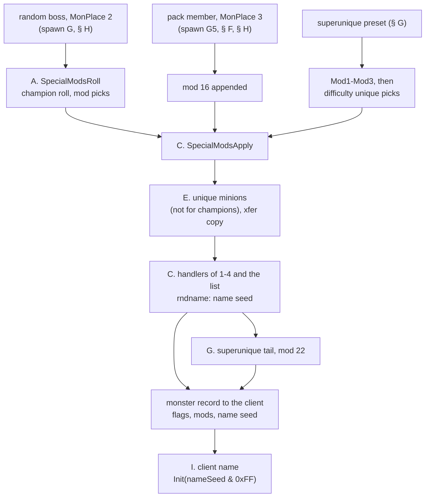
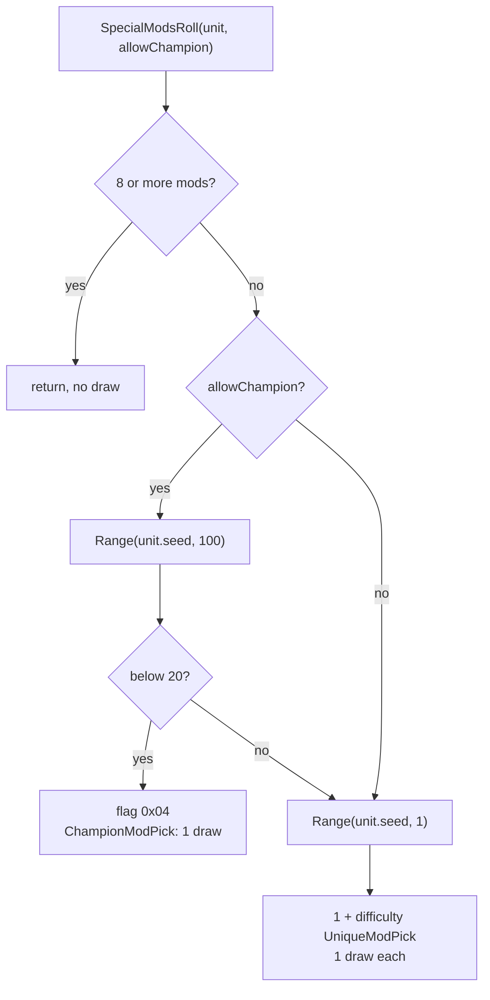
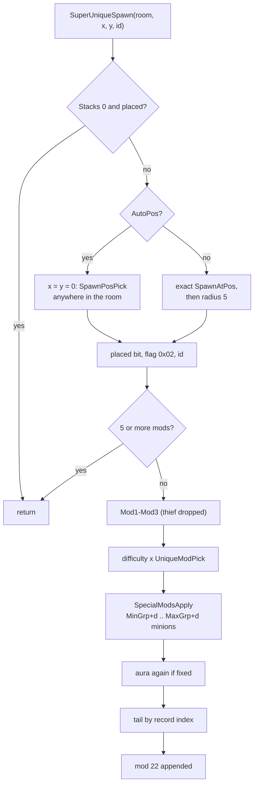
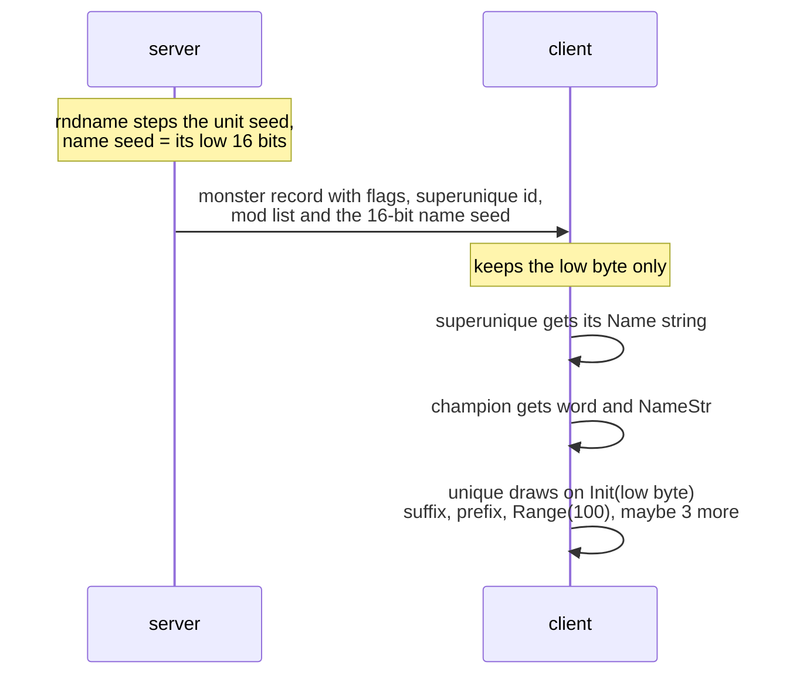
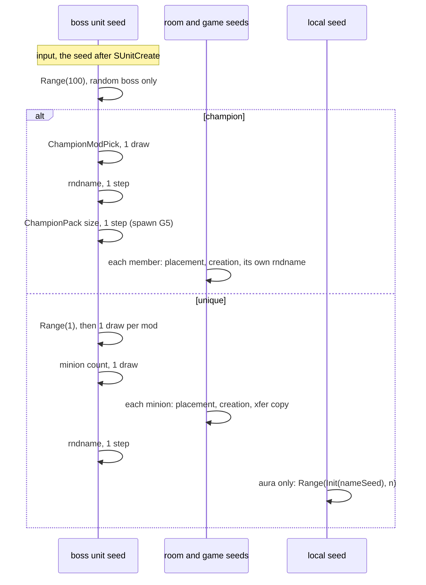

# Special monsters: mods, minions, superuniques and names

## Purpose

A monster becomes special in one of four ways: the population pass makes it a random boss
([monsters/spawn § G](spawn.md#g-the-special-group-boss-champion-or-unique)), it joins a champion pack, a DS1 preset
places a MonPlace special, or a preset places a superunique. This spec covers what happens next. It gives the champion
or unique roll and the weighted mod picks from `MonUMod`, the mod handlers and the one draw they make, which mods pass to
a unique's minions, how a superunique is built from its `SuperUniques` row, and the name roll. The roll runs on the
client from a name seed the server sends. Every draw is given in order, with the seed it uses: the special's **unit
seed**, a **local seed** made from the name seed, or the client's own seed. What the mods *do* (hit points, damage, auras,
resistances) is specified in [monsters/stats](stats.md) and is only named here. Primitives (`Step`, `Range`, `Init`) are those of
[rng](../rng/README.md); `RangeB` in our symbol names is the second compile of `Range` and behaves the same.

## Entry points

| When | Function | Tag |
|---|---|---|
| Random boss of the pass (and MonPlace 2): champion roll and mod picks | fn:sub_005A0760_SpecialModsRoll@0x005A0760 | [C] |
| Every special: unique minions, then the mod handlers | fn:sub_005A2120_SpecialModsApply@0x005A2120 | [C] |
| Champion-pack member and MonPlace 3 champion: mod 16 appended, then the handlers | fn:sub_005A48C0_ChampionMemberMark@0x005A48C0 | [C] |
| Superunique placed from a preset | fn:sub_005A49B0_SuperUniqueSpawn@0x005A49B0 | [C] |
| MonPlace preset: cases 2 and 3 (and the fixed classes `0x11`–`0x20`) | fn:sub_0054E600_PresetMonSpawn@0x0054E600 | [C] |
| Client: the display name | fn:sub_004AC870_ClientMonNameBuild@0x004AC870 | [C] |
| Inactive-unit restore of a special or a minion ([drlg/lifecycle § H](../drlg/lifecycle.md#h-the-restore)) | fn:sub_005A4440_SpecialMonRestore@0x005A4440, fn:sub_005A46E0_MinionRestore@0x005A46E0 | [C] (run:2026-10-17-lifecycle) |
| An existing monster made special: the Warping Shrine (`Shrines.txt` row 20), `OBJOP_Shrine` → `g_ShrineEffects[20]` = `0x00583050` ([§ J](#j-other-entry-paths-and-pre-existing-mods)) | fn:sub_005A4940_MonMakeSpecial@0x005A4940, fn:sub_00583050_ShrineWarping@0x00583050 | [I] |

- [C] Everything except the name roll runs on the server, on the server game. Of the paths below that the run reached,
  the random boss and MonPlace 2 roll their mods with `SpecialModsRoll`, a pack member or preset champion takes mod 16,
  and a superunique takes fixed mods from its table row; all of them end in `SpecialModsApply`. (fn:sub_005A43E0_SpecialMonSpawn@0x005A43E0, fn:sub_005A49B0_SuperUniqueSpawn@0x005A49B0,
  fn:sub_005A48C0_ChampionMemberMark@0x005A48C0, run:2026-10-14-mon-special)

| Caller | Unit | Mods from | `SpecialModsApply` minions |
|---|---|---|---|
| `SpecialMonSpawn` (pass; MonPlace 2) | new boss | `SpecialModsRoll(allowChampion)` | yes, 3 … 6 |
| `ChampionMemberMark` (pack member; MonPlace 3) | member or preset champion | mod 16 appended | yes, 0 … 0, skipped (champion) |
| `SuperUniqueSpawn` (preset) | superunique | `Mod1`–`Mod3`, then `difficulty` unique picks | yes, `MinGrp + d … MaxGrp + d` |
| `SpecialMonRestore` (inactive restore) | restored special | saved list | no |
| `MonMakeSpecial` | existing monster | `SpecialModsRoll(allowChampion = 1)` | no |

## Inputs

### Tables

All tables are the compiled `.bin` records, indexed by record position ([data/excel](../data/excel.md)). A mod is a
MonUMod row index (= its `id`); a class is a MonStats record position.

| Anchor | Used for |
|---|---|
| tbl:MonUMod.txt:constants | u32 `+0x1C` of row 0: the champion chance (20) |
| tbl:MonUMod.txt:cpick | s16 at `+0x0E + 2·difficulty`: champion pick weight |
| tbl:MonUMod.txt:upick | s16 at `+0x14 + 2·difficulty`: unique pick weight |
| tbl:MonUMod.txt:champion | u8 `+0x08`: candidate of the champion pick (≠ 0) or of the unique pick (0) |
| tbl:MonUMod.txt:enabled, tbl:MonUMod.txt:version | u8 `+0x06`, u16 `+0x04`: `ModEligible` |
| tbl:MonUMod.txt:exclude1, tbl:MonUMod.txt:exclude2 | s16 `+0x0A`, `+0x0C`: excluded MonType rows |
| tbl:MonUMod.txt:fPick | u8 `+0x09`: the extra class test |
| tbl:MonUMod.txt:xfer | u8 `+0x07`: copied into a unique minion's list |
| tbl:SuperUniques.txt:Class | i32 `+0x04`: the superunique's class |
| tbl:SuperUniques.txt:Superunique | `+0x08`: the record index the tail switch reads |
| tbl:SuperUniques.txt:Mod1 | u32 × 3 at `+0x0C`: fixed mods `Mod1`–`Mod3` |
| tbl:SuperUniques.txt:MinGrp, tbl:SuperUniques.txt:MaxGrp | u32 `+0x1C`, `+0x20`: minion count bounds |
| tbl:SuperUniques.txt:AutoPos | u8 `+0x24`: discard the preset point |
| tbl:SuperUniques.txt:Stacks | u8 `+0x26`: may be placed again in the same game |
| tbl:SuperUniques.txt:Name | u16 `+0x02`: the name string (client) |
| tbl:UniquePrefix.txt:Name, tbl:UniqueSuffix.txt:Name, tbl:UniqueAppellation.txt:Name | u16 string index per row: the name words (client) |
| tbl:MonStats.txt:minion1 | i16 `+0x26`: unique-minion class |
| tbl:MonStats.txt:MonType | i16 `+0x1C`: the class's MonType, for `exclude1`/`exclude2` |
| tbl:MonStats.txt:isMelee, tbl:MonStats.txt:nomultishot | `+0x0C` bit 1, `+0x0E` bit 1: `fPick` 2 |
| tbl:MonStats2.txt:mA1, tbl:MonStats2.txt:mWL | mode bits at MonStats2 `+0xF0`: `fPick` 1 and 3 |
| tbl:MonStats.txt:BaseId | `+0x02`: the post-create mods (§ J) |
| tbl:MonStats.txt:NameStr | `+0x06`: a champion's name (client) |
| `montype.bin` (no table doc) | 12-byte records, `equiv1`..`equiv3` s16 at `+0x02`, `+0x04`, `+0x06`: the MonType matrix (§ B) |

Constant data in `Game.exe`:

| Data | Used for | Tag |
|---|---|---|
| data:g_UModHandlers@0x0073C008 | one server handler pointer per MonUMod row; null for rows 0, 3, 7, 10–15, 19–22, 24, 29, 31–35, 40, 42 | [I] |
| data:g_UModAlwaysMods@0x006E2168 | the mods whose handlers always run: 1, 2, 3, 4 | [I] |
| data:g_UModAuraTable@0x0073BF68 | 8 rows `{minLevel, add, mul, div, skill}` (i32 × 5): the aura choice | [I] |
| data:g_ChampionNameStr@0x006DA488 | champion mod → name word | [I] |
| data:g_ClientUModHandlers@0x00724D78 | client handler per mod; rows 1, 12, 16, 36–39 are the name builder | [I] |

### Runtime state

| State | Type | Source |
|---|---|---|
| unit seed | `Seed` at unit `+0x20` | after `SUnitCreate` (input, [monsters/stats § B](stats.md#b-monstatsinit-in-order); [spawn § J](spawn.md#j-creation-and-the-unit-seed)) |
| mod list | u8 × 9 at `MonsterData+0x1C`, ends at the first 0 | post-create mods (§ J), then this spec |
| flags | at `MonsterData+0x16`: `0x01` boss or pack member, `0x02` superunique, `0x04` champion, `0x08` special, `0x10` minion; `0x20`/`0x40` set by the champion-mod handlers (named) | this spec and [spawn § G](spawn.md#g-the-special-group-boss-champion-or-unique) |
| name seed | u16 at `MonsterData+0x14` | written by the `rndname` handler (§ C) |
| superunique id | `MonsterData+0x26` | `SuperUniqueSpawn` |
| difficulty | u8 at game `+0x06D` (0, 1, 2) | game creation |
| expansion flag | dword at game `+0x70` | game creation |
| placed bits | one bit per superunique at game `+0x1D30` | `SuperUniqueSpawn` |
| monster level | stat 12 of the unit | [monsters/stats § D](stats.md#d-classic-nightmare-and-hell-sub_0063eef0_monclassicdiffadjust) (read by the `aura` handler only) |
| room seed, game seed | `+0x6C` of the active room, game `+0xD0` | [spawn](spawn.md) (placement of superuniques, MonPlace specials and minions) |

### Constants

| Name | Value | Anchor | Tag |
|---|---|---|---|
| champion chance | `Range(100) <` 20 (MonUMod row 0 `constants`) | 0x005A0817, tbl:MonUMod.txt:constants, run:2026-10-14-mon-special | [C] |
| unique mod count | `1 + difficulty`, at most 9 mods in all | fn:sub_005A0760_SpecialModsRoll@0x005A0760, run:2026-10-14-mon-special | [C] for the count; the cap is [I] (0x005A088F) |
| unique minions of a random unique | 3 … 6 | fn:sub_005A0C00_UniqueMinions@0x005A0C00, run:2026-10-14-mon-special | [C] |
| `PACK_MOD` | 16 `champion`, the only mod of a pack member or a preset champion | fn:sub_005A48C0_ChampionMemberMark@0x005A48C0, run:2026-10-14-mon-special | [C] |
| `QUEST_MOD` | 22 `questcomplete`, appended to every superunique | fn:sub_005A49B0_SuperUniqueSpawn@0x005A49B0, run:2026-10-14-mon-special | [C] |
| `THIEF` | 24, dropped from a superunique's fixed mods | 0x005A4AF0–0x005A4B22 | [I] |
| aura classes | 704 `ubermephisto`: Conviction at level 20; superunique 37 (Lord De Seis): index 5 | fn:sub_005A1650_UModAura@0x005A1650 | [I] |
| name formats | `string.tbl` 1721 `"%0 %1"`, 1722 `"%0 %1 %2"`; `patchstring.tbl` 11072 `"%0 %1"` | fn:sub_004AC870_ClientMonNameBuild@0x004AC870 | [I] |

### Inputs and oracles

Phase 2 of plan 0018 replaced every special-path oracle of plan 0014 by the model of this spec (`tools/monspecial.py`, run
inside `tools/monspawn.py`): 70 special-mods rolls, 169 picks, 606 handler calls on specials and 1667 on group members,
130 `rndname` steps, 12 aura draws, 277 transferred minion lists, 11 superuniques, 4 + 4 MonPlace presets and 94 client
name rolls, in all three difficulties, classic and expansion, `monspawn: 390144 checks, 0 mismatches`. [C]
(run:2026-10-14-mon-special, [monsters/0002 § 9](../../findings/monsters/0002-room-population.md#9-boundary-decision-and-the-phase-2-logging-plan))
What remains are inputs owned by other subsystems; every `[C]` below holds under them.

| Input | Kind | What this spec needs | Owner | Tag |
|---|---|---|---|---|
| unit seed after `SUnitCreate` | seed oracle | the boss's, member's or superunique's `+0x20` before its first special draw | [monsters/stats](stats.md) ([spawn § J](spawn.md#j-creation-and-the-unit-seed)) | [C] (fn:sub_00555230_SUnitCreate@0x00555230, run:2026-10-14-mon-special) |
| presets, inactive restore, objects window | seed oracle | the room and game seed after the window (`RW1` → `RW4`). Its superunique and MonPlace 2/3 spawns are modelled here from the room and game seed at their own entry; the rest of the window is the oracle | `drlg/preset`, `objects` | [C] (fn:sub_005559A0_RoomPresetUnits@0x005559A0, fn:sub_00552610_RoomObjectsPopulate@0x00552610, run:2026-10-14-mon-special) |
| grid snapshot at each preset special | value input | the collision grids a superunique or MonPlace special is placed on | `drlg/collision`, `objects` | [C] (fn:sub_005A09E0_SpecialMonPlace@0x005A09E0, run:2026-10-14-mon-special) |
| monster level read by `aura` | compared value | stat 12 after `leveladd`; it enters the draw only through `level ≥ 20` | [monsters/stats § D3](stats.md#d-classic-nightmare-and-hell-sub_0063eef0_monclassicdiffadjust) | [C] (fn:sub_005A1650_UModAura@0x005A1650, run:2026-10-14-mon-special) |
| handler effects and their deep callees | seed-asserted calls | skill and AI setup, stat writes, quest hooks: no seed of unit, room or game changes across them; a change would be a failure, not a taken value | [monsters/stats § G](stats.md#g-the-mod-handlers-stat-effects), quests | [C] (fn:sub_005A2120_SpecialModsApply@0x005A2120, run:2026-10-14-mon-special) |
| placement of minions and escorts | modelled in [spawn § H](spawn.md#h-placement-spawnpospick-and-monspawntry) | `MonSpawnTry` with its room and game draws | `monsters/spawn` | [C] (fn:sub_005B2A00_MonSpawnTry@0x005B2A00, run:2026-10-14-mon-special) |

- [C] `MonTypeIsA` is not an oracle: its bit matrix is built from `montype` by code that is read (§ B4), and all 153 calls
  of the run were predicted. (fn:sub_005A0070_MonTypeIsA@0x005A0070, fn:sub_00658460_MonTypeReachable@0x00658460,
  run:2026-10-14-mon-special)

## Algorithm



- [C] The mods of a random boss are rolled once, on its unit seed, after it is placed and before its minions. The
  handlers then step the unit seed once (`rndname`), and the name seed taken from that step is the only special-path value
  the client receives besides the flags and the mod list. (fn:sub_005A0760_SpecialModsRoll@0x005A0760,
  fn:sub_005A2120_SpecialModsApply@0x005A2120, fn:sub_0045F190_ClientMonAssign@0x0045F190, run:2026-10-14-mon-special)

### A. Champion or unique



```
A1. SpecialModsRoll(unit, game, allowChampion: bool):           [C] except the lines tagged [I] (fn:sub_005A0760_SpecialModsRoll@0x005A0760, 0x005A07E7, 0x005A0871, run:2026-10-14-mon-special)
      if game = none or game.difficulty ≥ 3 or unit has no monster data: return   ; [I] never taken (fn:sub_005A0760_SpecialModsRoll@0x005A0760)
      k: i32 ← ModCount(unit.mods)                               ; mods before the first 0, at most 9
      if k ≥ 8: return                                           ; [I] no draw; never taken (0x005A07CD)
      if allowChampion:
        c: u32 ← MonUMod[0].constants (0 if the table is empty)  ; 20
        r: u32 ← Range(unit.seed, 100)                           ; draw#1, unit seed
        if (i32) r < (i32) c:
          unit.flags ← unit.flags | 0x04                         ; champion
          m: u8 ← ChampionModPick(unit, game)                    ; draw#2 (B1)
          if m ≠ 0: ModAppend(unit.mods, m)
          return
      n: i32 ← Range(unit.seed, 1) + 1 + game.difficulty         ; draw: steps, returns 0
      if k + n ≥ 9: n ← 9 − k                                    ; [I] never taken (0x005A088F)
      have ← { every mod in unit.mods }                          ; post-create mods included
      while n > 0:
        m ← UniqueModPick(unit, game, have)                      ; one draw unless no candidate (B2)
        if m = 0: break                                          ; [I] never taken (0x005A08FA)
        ModAppend(unit.mods, m);  have ← have ∪ {m};  n ← n − 1
```

Step notes:

A1. `allowChampion` is 1 for the pass's random boss and 0 for a MonPlace 2 special. With 0 the `Range(100)` draw is not
made at all, so a MonPlace 2 special is always a unique and costs one draw less. [C] (0x005A07E7, run:2026-10-14-mon-special:
66 rolls with the champion roll, 4 without) A champion gets exactly one mod from this function and no unique mods; a unique
draws `Range(1)` and then one pick per mod, so it costs `1 + (1 + difficulty)` unit-seed steps after the champion roll. [C]
(0x005A0843, run:2026-10-14-mon-special, run:2026-10-13-mon-spawn)

A2. `ModAppend` writes into the first free slot of the 9 and writes nothing when all 9 are used. [I]
(fn:sub_005A02E0_ModAppend@0x005A02E0, fn:sub_005A0260_ModCount@0x005A0260)

### B. The weighted picks

```
B1. ChampionModPick(unit, game) → u8:                             [C] except the line tagged [I] (fn:sub_005A0500_ChampionModPick@0x005A0500, run:2026-10-14-mon-special)
      cand ← [];  total: i32 ← 0
      for r in 0 ..< nMonUMod:                                   ; row order
        w: i16 ← MonUMod[r].cpick[game.difficulty]               ; s16 at +0x0E + 2·difficulty
        if w > 0 and MonUMod[r].champion ≠ 0 and ModEligible(r, game, unit):
          append (r, w) to cand;  total ← total + w
          if |cand| = 256: break                                 ; [I] (fn:sub_005A0500_ChampionModPick@0x005A0500)
      x: u32 ← Range(unit.seed, total)                           ; one unit-seed draw; none when total < 1
      for (r, w) in cand:
        if x < w: return r
        x ← x − w
      return 0

B2. UniqueModPick(unit, game, have) → u8:                         [C] (fn:sub_005A0600_UniqueModPick@0x005A0600, run:2026-10-14-mon-special)
      as B1, with  w ← MonUMod[r].upick[game.difficulty]          ; s16 at +0x14 + 2·difficulty
      and the row test  w > 0 and MonUMod[r].champion = 0 and ModEligible(r, game, unit) and r ∉ have
      if total < 1: return 0                                     ; no draw

B3. ModEligible(r, game, unit) → bool:                            [C] except the line tagged [I] (fn:sub_005A03E0_ModEligible@0x005A03E0, 0x005A03F4, run:2026-10-14-mon-special)
      rec ← MonUMod[r]
      if rec.enabled = 0: return false
      if game.expansion = 0 and rec.version ≥ 100: return false  ; version u16; expansion = dword game+0x70
      for t in (rec.exclude1, rec.exclude2):                     ; s16
        if t ≤ 0: break
        if MonTypeIsA(unit.class, t): return false               ; [I] never true in the run (fn:sub_005A0070_MonTypeIsA@0x005A0070)
      case rec.fPick:
        1: return MonModeAllowed(unit.class, 4)                  ; MonStats2 +0xF0 bit 4, mode A1
        2: return not (MonStats[unit.class].isMelee or MonStats[unit.class].nomultishot)
        3: return MonModeAllowed(unit.class, 2)                  ; bit 2, mode WL
      return true

B4. MonTypeIsA(class, t) → bool:                                  [I] (fn:sub_005A0070_MonTypeIsA@0x005A0070, fn:sub_00658520_MonTypeLoad@0x00658520, fn:sub_00658460_MonTypeReachable@0x00658460)
      c: i16 ← MonStats[class].MonType
      if c, t ∉ [0, nTypes): return false
      return Reachable(t, c)
    Reachable(i, j) → bool:                                      ; built once at load into a bit matrix
      if j ≤ 0 or not (0 < i < nTypes): return false
      stack ← [i]                                                ; capacity 128
      while stack not empty:
        p ← pop(stack)
        if p = j: return true
        if p ≥ nTypes or |stack| > 124: return false
        if MonType[p].equiv1 > 0:
          push equiv1
          if equiv2 ≠ 0: push equiv2;  if equiv3 ≠ 0: push equiv3
      return false
```

Step notes:

B1. The weights are u16 fields read as signed shorts, and only those above 0 count. The draw is one `Range` over the
total, and the first candidate whose cumulative weight exceeds it wins. [C] (fn:sub_005A0500_ChampionModPick@0x005A0500,
fn:sub_005A0600_UniqueModPick@0x005A0600, run:2026-10-14-mon-special: the candidate list, total and draw of all 16
champion and 153 unique picks) The unique pick inlines the draw: a power-of-two total masks the low word, any other total
takes the unsigned remainder. Both give `low mod total`, so it is `Range`. [I] (0x005A06CC–0x005A070A)

B2. With stock data a classic game has one champion candidate, `champion` (16). The other four champion mods (`ghostly`,
`fanatic`, `possessed`, `berserk`) have `version` 100. Classic and expansion have the same unique candidates, 12 in normal
and 13 in nightmare and hell (`resist`, 8, gets its weight there), before the class tests of `ModEligible`. Every stock weight is 1 (champion) or 6 (unique), so the
candidates of a pick are equally likely. [C] (tbl:MonUMod.txt:version, tbl:MonUMod.txt:upick, struct:Game+0x070,
run:2026-10-14-mon-special)

B3. `ModEligible` runs before the `have` test, so a mod already in the list is still tested (with its `MonTypeIsA`
calls) and then skipped. This changes no draw. [C] (fn:sub_005A0600_UniqueModPick@0x005A0600, run:2026-10-14-mon-special:
153 `MonTypeIsA` calls predicted in number and result) `fPick` 1 is `teleport`, 2 `multishot`, 3 `fast`; the run's
candidate lists agree with the three tests over every class rolled. [C] (tbl:MonUMod.txt:fPick,
fn:sub_0046C140_MonModeAllowed@0x0046C140, run:2026-10-14-mon-special)

B4. Row `t` of the matrix holds every MonType reachable from `t` through `equiv1`..`equiv3`, `t` included. An `exclude`
type therefore excludes its own classes and those of the types it lists as `equiv`, not the classes of the types that list
it. The stock data has one exclusion, `lightning` (17) on MonType `sandleaper` (22), which lists no `equiv`. It refuses
`lightning` to exactly the `sandleaper` classes. [I] (fn:sub_00658460_MonTypeReachable@0x00658460, tbl:MonUMod.txt:exclude1)
The run never rolled a `sandleaper` special, so the exclusion itself is unreached. All 153 logged calls returned 0, as
predicted. [C] (run:2026-10-14-mon-special)

B5. The champion pick takes only rows whose `champion` byte is non-zero, and the unique pick only rows where it is 0. A row
with `champion` 0 and a `cpick` weight would never be a champion's mod. No stock row has that combination
(*Open questions*). [I] (0x005A056F, tbl:MonUMod.txt:champion)

### C. Mod handlers

```
C1. SpecialModsApply(game, unit, box, min: i32, max: i32, minions: bool):   [C] (fn:sub_005A2120_SpecialModsApply@0x005A2120, run:2026-10-14-mon-special)
      if minions: UniqueMinions(unit, box, min, max)             ; § E, before any handler
      for m in (1, 2, 3, 4), then each m in unit.mods up to the first 0:
        if UModHandlers[m] ≠ null: UModHandlers[m](unit, m, flag: 1)
        MonGroupForEach(unit, m, flag: 0)                        ; the same handler, if any, on each group member

C2. UModRndName(unit, flag):  mod 1                              [C] (fn:sub_005A0CE0_UModRndName@0x005A0CE0, run:2026-10-14-mon-special)
      if flag = 0: return
      Step(unit.seed)                                            ; the only handler draw on a persistent seed
      unit.nameSeed: u16 ← unit.seed.low & 0xFFFF

C3. UModAura(unit, flag):  mod 30                                [C] for the draw, [I] for the lines tagged [I] (fn:sub_005A1650_UModAura@0x005A1650, run:2026-10-14-mon-special)
      if flag = 0: return                                        ; [I] (fn:sub_005A1650_UModAura@0x005A1650)
      lvl: i32 ← unit level (stat 12)                            ; input, stats.md § D3
      if lvl ≤ 0: lvl ← 1                                        ; [I] guard, not reached (0x005A1685)
      n: i32 ← number of AuraTable rows with minLevel ≤ lvl      ; [I] stock: 6 below 20, 7 from 20 on (data:g_UModAuraTable@0x0073BF68)
      if n = 0: n ← 1                                            ; [I] guard, not reached (0x005A16EE)
      local: Seed ← Init(unit.nameSeed)                          ; [I] Init(0x1506) without MonsterData, not reachable for a monster (0x005A1704)
      i: u32 ← Range(local, n)                                   ; local-seed draw, also for the two cases below
      if unit.superUniqueId = 37: i ← 5                          ; [I] Lord De Seis, not reached (0x005A172C)
      if unit.class = 704: Conviction at skill level 20; return  ; [I] ubermephisto, not reached (0x005A1748)
      k: i32 ← (AuraTable[i].add + lvl) × mul ÷ div              ; [I] signed, lvl the guarded level (0x005A1776)
      if k ≤ 1: k ← 1;  if k ≥ 99: k ← 99                        ; [I] (0x005A1795–0x005A17A4)
      skill ← AuraTable[i].skill;  level ← k                     ; [I] effect: stats.md § G (fn:sub_005A1650_UModAura@0x005A1650)
```

Step notes:

C1. The handler order is 1, 2, 3, 4, then the list in slot order. Row 3 has no handler, so the calls that run are
`rndname`, `hpmultiply`, `leveladd` and then the list. [C] (data:g_UModAlwaysMods@0x006E2168, run:2026-10-14-mon-special: 606
handler calls on specials) A mod that occurs twice runs twice. Megaflow Rectifier, whose `Mod1` is `rndname`, steps its
seed twice. [C] (run:2026-10-13-mon-spawn) The group walk finds the unit's leader through `MonsterData+0x28` and calls the
handler with flag 0 on every unit in the leader's list. For a unique or superunique boss that list is its minions. [I]
(fn:sub_0058F380_MonGroupForEach@0x0058F380, fn:sub_005A2100_UModHandlerThunk@0x005A2100) None of the 1667 group-member
calls of the run moved a unit, room or game seed, so the member order does not matter for the seeds. [C]
(run:2026-10-14-mon-special)

C2. The name seed is the low 16 bits of the unit seed's `low` word after the step. The run predicted all 130 steps
and name seeds. [C] (fn:sub_005A0CE0_UModRndName@0x005A0CE0, run:2026-10-14-mon-special)

C3. The aura draw touches no persistent seed. All 12 aura draws of the run were predicted on `Init(nameSeed)`, with
`n` = 6 once (normal, level 5) and `n` = 7 eleven times, indices 0 to 6 all seen. [C] (fn:sub_005A1650_UModAura@0x005A1650,
run:2026-10-14-mon-special) The eight rows are `(minLevel, add, mul, div, skill)`: (0, 0, 1, 6, 98) Might, (0, 0, 1, 6,
102) Holy Fire, (0, 0, 1, 5, 108) Blessed Aim, (0, 0, 1, 7, 114) Holy Freeze, (0, 0, 1, 8, 123) Conviction, (0, 0, 1, 8, 122)
Fanaticism, (20, 0, 1, 8, 118) Holy Shock, (999, 0, 0, 1, 103) Thorns, so Thorns needs level 999. [I]
(data:g_UModAuraTable@0x0073BF68) The level the handler reads is stat 12 after `leveladd`. In a classic nightmare or hell
game that is MonStats `Level` + 25·d + 3 ([monsters/stats § D3](stats.md#d-classic-nightmare-and-hell-sub_0063eef0_monclassicdiffadjust)). [C]
(fn:sub_0063EEF0_MonClassicDiffAdjust@0x0063EEF0, run:2026-10-15-mon-stats) A
superunique with `aura` among its fixed mods runs this handler a second time (§ G). The second call uses the same local
seed and gives the same index. [I] (fn:sub_005A49B0_SuperUniqueSpawn@0x005A49B0) The draw comes before the Lord De Seis and
class-704 tests, so `ubermephisto` and Lord De Seis also take one step of their local seed, which no persistent seed sees.
[I] (0x005A1727, 0x005A1748) The two guards map a level ≤ 0 to 1, which the skill-level formula then uses too, and a row
count of 0 to 1, so `Range(local, 1)` returns 0 and row 0 is used. Stock data reaches neither: the first rows have
`minLevel` 0 and a monster's level is ≥ 1. [I] (0x005A1685, 0x005A16EE, data:g_UModAuraTable@0x0073BF68)

### D. Per-mod draws

One row per MonUMod row. Weights are normal / nightmare / hell. "Flag 1" is the special itself and "flag 0" a member of
its group. No handler draws on the room or game seed. The effect column only names what [monsters/stats § G](stats.md#g-the-mod-handlers-stat-effects) specifies.

| Row | Mod | Weights | `xfer` | Server handler | Draws, flag 1 | Flag 0 | Effect (named) | Tag |
|---|---|---|---|---|---|---|---|---|
| 0 | `none` | — (`enabled` 0) | 1 | null | — | — | its `constants` is the champion chance | [I] (data:g_UModHandlers@0x0073C008) |
| 1 | `rndname` | — | 0 | fn:sub_005A0CE0_UModRndName@0x005A0CE0, always run | **1 unit-seed step**; name seed | nothing | name seed | [C] (run:2026-10-14-mon-special) |
| 2 | `hpmultiply` | — | 0 | fn:sub_005A0DC0_UModHpMultiply@0x005A0DC0, always run | none | runs | hit points | [C] (run:2026-10-14-mon-special) |
| 3 | `light` | — | 0 | null, always tried | — | — | — | [C] (data:g_UModAlwaysMods@0x006E2168, run:2026-10-14-mon-special) |
| 4 | `leveladd` | — | 0 | fn:sub_005A0E40_UModLevelAdd@0x005A0E40, always run | none | runs | level + 3, experience × 5 | [C] (run:2026-10-14-mon-special) |
| 5 | `strong` | u 6/6/6 | 1 | fn:sub_005A17E0_UModStrong@0x005A17E0 | none | runs | to-hit, damage | [C] (run:2026-10-14-mon-special) |
| 6 | `fast` | u 6/6/6, `fPick` 3 | 1 | fn:sub_005A1910_UModFast@0x005A1910 | none | runs | velocity | [C] (run:2026-10-14-mon-special) |
| 7 | `curse` | u 6/6/6 | 1 | null | — | — | elsewhere | [C] (run:2026-10-14-mon-special) |
| 8 | `resist` | u 0/6/6 | 1 | fn:sub_005A1370_UModResist@0x005A1370 | none | nothing | resistances | [C] (run:2026-10-14-mon-special) |
| 9 | `fire` | u 6/6/6 | 1 | fn:sub_005A1990_UModFire@0x005A1990 | none | runs, `resist` part skipped | enchant damage, resistance | [C] (run:2026-10-14-mon-special) |
| 10, 11, 13, 14, 15 | `poisondead`, `durieldead`, `rage`, `spcdamage`, `partydead` | — | 0 | null | — | — | post-create mods (§ J) | [I] (data:g_UModHandlers@0x0073C008) |
| 12 | `bloodraven` | — | 0 | null (client: the name) | — | — | Blood Raven's name | [I] (data:g_ClientUModHandlers@0x00724D78) |
| 16 | `champion` | c 1/1/1 | 1 | fn:sub_005A0E80_UModChampion@0x005A0E80 | none | nothing | level − 1, experience, to-hit, damage, velocity | [C] (run:2026-10-14-mon-special) |
| 17 | `lightning` | u 6/6/6, `exclude1` `sandleaper` | 1 | fn:sub_005A1B00_UModLightning@0x005A1B00 | none | runs, `resist` part skipped | enchant damage, resistance | [C] (run:2026-10-14-mon-special) |
| 18 | `cold` | u 6/6/6 | 1 | fn:sub_005A1C70_UModCold@0x005A1C70 | none | runs, `resist` part skipped | enchant damage, resistance | [C] (run:2026-10-14-mon-special) |
| 19, 21 | `hireable`, `killself` | — | 0 | null | — | — | — | [I] (data:g_UModHandlers@0x0073C008) |
| 20 | `scarab` | — | 0 | null | — | — | post-create mod of `scarab1` classes | [C] (run:2026-10-14-mon-special) |
| 22 | `questcomplete` | — | 0 | null | — | — | appended to every superunique | [C] (run:2026-10-14-mon-special) |
| 23 | `poisonhit` | — | 0 | fn:sub_005A1E00_UModPoisonHit@0x005A1E00 | none | runs, `resist` part skipped | enchant damage | [I] (fn:sub_005A1E00_UModPoisonHit@0x005A1E00) |
| 24 | `thief` | — (`enabled` 0) | 1 | null | — | — | never written (§ G) | [I] (0x005A4AF0–0x005A4B22) |
| 25 | `manahit` | u 6/6/6 | 1 | fn:sub_005A1F90_UModManaHit@0x005A1F90 | none | runs, `resist` part skipped | enchant damage | [C] (run:2026-10-14-mon-special) |
| 26 | `teleport` | u 6/6/6, `fPick` 1 | 1 | fn:sub_005A1600_UModTeleport@0x005A1600 | none on unit, room or game seed (skill setup asserted) | nothing | teleport skill | [C] (run:2026-10-14-mon-special) |
| 27 | `spectralhit` | u 6/6/6 | 1 | fn:sub_005A1370_UModResist@0x005A1370 | none | nothing | resistances | [C] (run:2026-10-14-mon-special) |
| 28 | `stoneskin` | u 6/6/6 | 1 | fn:sub_005A1370_UModResist@0x005A1370 | none | nothing | resistances | [C] (run:2026-10-14-mon-special) |
| 29 | `multishot` | u 6/6/6, `fPick` 2 | 1 | null | — | — | elsewhere | [C] (run:2026-10-14-mon-special) |
| 30 | `aura` | u 6/6/6 | 0 | fn:sub_005A1650_UModAura@0x005A1650 | **`Range(Init(nameSeed), n)`** on a local seed | nothing | aura skill and level | [C] (run:2026-10-14-mon-special) |
| 31–35, 40, 42 | `goboom`, `firespike_explode`, `suicideminion_explode`, `ai_after_death`, `shatter_on_death`, `worms_on_death`, `lightningdeath` | — | 0 | null | — | — | — | [I] (data:g_UModHandlers@0x0073C008) |
| 36 | `ghostly` | c 1/1/1, expansion | 1 | fn:sub_005A1080_UModGhostly@0x005A1080 | none | nothing | flag `0x40`/`0x20`, then `champion`'s effects | [C] (run:2026-10-14-mon-special) |
| 37 | `fanatic` | c 1/1/1, expansion | 1 | fn:sub_005A11F0_UModFanatic@0x005A11F0 | none | nothing | flag `0x40`/`0x20`, then `champion`'s effects | [C] (run:2026-10-14-mon-special) |
| 38 | `possessed` | c 1/1/1, expansion | 1 | fn:sub_005A1230_UModPossessed@0x005A1230 | none | nothing | flag `0x40`/`0x20`, then `champion`'s effects | [C] (run:2026-10-14-mon-special) |
| 39 | `berserk` | c 1/1/1, expansion | 1 | fn:sub_005A1280_UModBerserk@0x005A1280 | none | nothing | flag `0x40`/`0x20`, then `champion`'s effects | [C] (run:2026-10-14-mon-special) |
| 41 | `always_run_ai` | — | 0 | fn:sub_005A1330_UModAlwaysRunAi@0x005A1330 | none on the three seeds (AI event, not reached) | runs | AI timer | [I] (fn:sub_005A1330_UModAlwaysRunAi@0x005A1330) |

- [C] A `[C]` row is a mod that was in some logged special's list (or always run) in run:2026-10-14-mon-special, with its
  handler calls seed-asserted. The `[I]` rows were never in a logged list. For those the "none" rests on the static call
  graph: no LCG step and no RNG call in the stat handlers, the single step of `rndname`, the local draw of `aura`, and RNG
  only deep inside the skill and AI callees of `teleport`, `aura` and `always_run_ai`. (run:2026-10-14-mon-special,
  fn:sub_005A1330_UModAlwaysRunAi@0x005A1330, fn:sub_005A1600_UModTeleport@0x005A1600)

### E. Unique minions and transfer

```
E1. UniqueMinions(boss, box, min: i32, max: i32):                 [C] except the line tagged [I] (fn:sub_005A0C00_UniqueMinions@0x005A0C00, fn:sub_005A0BB0_UniqueMinionClass@0x005A0BB0, run:2026-10-14-mon-special)
      if boss.flags & 0x04: return                               ; champion: no draw
      cls ← MonStats[boss.class].minion1 if it is a valid class else boss.class
      if cls is not a valid class: return                        ; [I] (fn:sub_005A0C00_UniqueMinions@0x005A0C00)
      n: i32 ← min + RangeB(boss.seed, max − min + 1)            ; one boss-seed draw, also when min = max
      repeat n times:
        u ← box ? SpawnNearUnit(boss, box, cls, radius 3, flags 0x40)
                : SpawnNearUnitNoBox(boss, cls, radius 3, flags 0x40)   ; spawn § H; 0x40: no MonStats minions
        if u ≠ none:
          ModsXferCopy(dst: u, src: boss)
          link u to the boss;  u.flags ← u.flags | 0x10          ; minion

E2. ModsXferCopy(dst, src):                                       [C] (fn:sub_005A0930_ModsXferCopy@0x005A0930, 0x005A09A8, run:2026-10-14-mon-special)
      k: i32 ← ModCount(dst.mods);  w: i32 ← k;  j: i32 ← 0      ; the minion's own mods stay first
      while k < 9:
        m ← src.mods[j]
        if m = 0: break
        if MonUMod[m].xfer ≠ 0: dst.mods[w] ← m;  w ← w + 1
        k ← k + 1;  j ← j + 1                                    ; counts every boss mod examined, copied or not
```

Step notes:

E1. The copy runs as each minion is created, inside `SpecialModsApply` and before the boss's handlers. The boss's rolled
mods, or a superunique's fixed and extra mods, are therefore in the copy. A superunique's mod 22, appended later, is not.
The run predicted all 277 minion lists after the copy, including Beetleburst's `scarab2` minions, whose own post-create
mod 20 comes first. [C] (0x005A0C8F, 0x005A4B8E, run:2026-10-14-mon-special) A minion's own handlers are never called for
its copied list, and the copied list is what the server sends for the minion. [C] (fn:sub_005A0930_ModsXferCopy@0x005A0930,
fn:sub_0053E2E0_MonUnitPacketBuild@0x0053E2E0, fn:sub_0045F190_ClientMonAssign@0x0045F190, run:2026-10-14-mon-special,
run:2026-10-15-mon-stats, [monsters/0003 § Plan 0038 batch S3b](../../findings/monsters/0003-special-monsters.md#plan-0038-batch-s3b-2026-10-16))
What reaches it is the boss's handlers with flag 0 (§ C), for every boss mod, `xfer` or not. The other readers of a monster's list see any later append: the
inactive save copies all nine bytes, the restore re-appends with flag 0 each byte that differs from the new unit's list
([drlg/lifecycle § H](../drlg/lifecycle.md#h-the-restore)), and a three-slot packet path sends slots 0–2 only; the fourth
reader is `SuperUniqueSpawn`'s own later append. [I] (fn:sub_0058F380_MonGroupForEach@0x0058F380,
fn:sub_0053E2E0_MonUnitPacketBuild@0x0053E2E0, fn:sub_005421A0_InactiveMonsterSave@0x005421A0,
fn:sub_005A4850_ModAppendApply@0x005A4850, 0x00597C87,
[monsters/0003 § Plan 0038 batch S3b](../../findings/monsters/0003-special-monsters.md#plan-0038-batch-s3b-2026-10-16))

E2. With stock data every unique-pick mod except `aura` has `xfer` 1, and so do the five champion mods. A unique's
minions therefore carry all its rolled mods except `aura`. [C] (tbl:MonUMod.txt:xfer, run:2026-10-14-mon-special)
Because `k` counts examined mods from the minion's own count, a minion that already holds `c` mods examines at most
`9 − c` boss mods. [I] (0x005A09A8, fn:sub_005A0930_ModsXferCopy@0x005A0930)

### F. Champion pack members and preset champions

```
F1. ChampionMemberMark(u, mod: u8 = 16):                          [C] except the lines tagged [I] (fn:sub_005A48C0_ChampionMemberMark@0x005A48C0, run:2026-10-14-mon-special)
      if u has no monster data or u.flags & 0x04: return         ; [I] never taken (fn:sub_005A48C0_ChampionMemberMark@0x005A48C0)
      MonMarkSpecial(u);  u.flags ← u.flags | 0x05
      if ModCount(u.mods) < 9:                                   ; [I] the else branch never taken (0x005A4911)
        ModAppend(u.mods, mod)
        SpecialModsApply(game, u, no box, 0, 0, minions: true)   ; UniqueMinions returns at once (champion)
```

- [C] Pack members and MonPlace 3 champions never call `SpecialModsRoll` or `ChampionModPick`. Each one gets mod 16,
  whatever mod the pack's boss drew, and its handlers then step its own unit seed once (`rndname`). The run predicted the
  mods and handlers of all 49 members and preset champions. (fn:sub_005A48C0_ChampionMemberMark@0x005A48C0,
  fn:sub_0054E1E0_ChampionPack@0x0054E1E0, run:2026-10-14-mon-special)
- [C] Pack members are not linked as minions. The boss's group walk therefore reaches none of them, and they take no
  `xfer` copy. (fn:sub_0054E1E0_ChampionPack@0x0054E1E0, run:2026-10-14-mon-special) The pack size and the members'
  placement are [spawn § G5](spawn.md#g-the-special-group-boss-champion-or-unique).

### G. Superuniques



```
G1. SuperUniqueSpawn(game, room, x: i32, y: i32, id: i32) → unit | none:   [C] except the lines tagged [I] (fn:sub_005A49B0_SuperUniqueSpawn@0x005A49B0, fn:sub_005A09E0_SpecialMonPlace@0x005A09E0, run:2026-10-14-mon-special)
      if game.difficulty > 2: return none                        ; [I] (fn:sub_005A49B0_SuperUniqueSpawn@0x005A49B0)
      rec ← SuperUniques[id];  if rec = none or rec.Class < 0: return none        ; [I] (fn:sub_005A49B0_SuperUniqueSpawn@0x005A49B0)
      if rec.Stacks = 0 and placed[id]: return none             ; [I] bit 1 << (id & 7) of byte game+0x1D30 + (id >> 3) (0x005A4A09)
      if rec.AutoPos ≠ 0: (x, y) ← (0, 0)
      u ← SpecialMonPlace(room, no box, x, y, rec.Class, radius −1, avoidWarp: false)
      if u = none: return none
      placed[id] ← 1;  u.flags ← u.flags | 0x02;  u.superUniqueId ← id
      if ModCount(u.mods) ≥ 5: return u                          ; [I] nothing below runs (0x005A4AD4)
      have ← ∅;  hasAura ← false                                 ; post-create mods are not in have
      for j in 0 ..< 3:
        m ← rec.Mod[j];  if m = 0: break
        if m = 24: continue                                      ; [I] thief, not written (0x005A4AF0–0x005A4B22)
        if m = 30: hasAura ← true                                ; [I] not reached (0x005A4AF0–0x005A4B22)
        ModAppend(u.mods, m);  have ← have ∪ {m}
      repeat game.difficulty times:                              ; 0, 1 or 2 extra mods
        m ← UniqueModPick(u, game, have);  if m = 0: break       ; unit-seed draw (B2)
        ModAppend(u.mods, m);  have ← have ∪ {m}
      (min, max): (i32, i32) ← (rec.MinGrp, rec.MaxGrp)
      if min ≠ 0 and max ≠ 0: (min, max) ← (min + d, max + d)    ; d = difficulty
      SpecialModsApply(game, u, no box, min, max, minions: true) ; § C, § E
      if hasAura: UModAura(u, flag: 1)                           ; [I] a second time (fn:sub_005A1650_UModAura@0x005A1650)
      tail by rec.Superunique (record index), table below        ; [I] for the non-default cases (fn:sub_005A49B0_SuperUniqueSpawn@0x005A49B0)
      ModAppendApply(u, 22, 1)                                   ; questcomplete; no handler
      return u
```

**Tails** by the record index at `+0x08`. Every other record has no tail. The calls are named only.

| Record | Superunique | Tail | Draws | Tag |
|---|---|---|---|---|
| 6 | The Countess | state 118, quest hook 5, AI mode 13 | none | [I] (fn:sub_005A49B0_SuperUniqueSpawn@0x005A49B0) |
| 10 | Radament | `2 + Range(u.seed, 5)` × `skeleton5`, then one each of `skmage_pois3`, `skmage_cold4`, `skmage_fire3`, `skmage_ltng3`, all `SpawnNearUnitNoBox(…, radius 4, flags 0x40)` | **1 unit-seed draw**, then the room and game draws of each spawn | [I] (0x005A4CD1) |
| 26, 27, 29 | Ismail Vilehand, Geleb Flamefinger, Toorc Icefist | quest hook 19 | none | [I] (fn:sub_005A49B0_SuperUniqueSpawn@0x005A49B0) |
| 36, 37, 38 | Infector of Souls, Lord De Seis, Grand Vizier of Chaos | quest hook 23 | none | [I] (fn:sub_005A49B0_SuperUniqueSpawn@0x005A49B0) |
| 39 | The Cow King | quest hook 4 | none | [I] (fn:sub_005A49B0_SuperUniqueSpawn@0x005A49B0) |
| 42 | Siege Boss | `EscortSpawn(minion1, radius 20, 20 ×, flags 0)`, quest hook 31, state 118 | the escorts' spawns | [I] (fn:sub_005B24E0_EscortSpawn@0x005B24E0) |
| 43, 44, 45 | Ancient Barbarian 1–3 | quest hook 35 | none | [I] (fn:sub_005A49B0_SuperUniqueSpawn@0x005A49B0) |
| 60 | Nihlathak Boss | links itself, `EscortSpawn(LevelClassVariant(minion1), radius 10, 20 ×, flags 0x40)`, quest hook 34 | the escorts' spawns | [I] (fn:sub_005B24E0_EscortSpawn@0x005B24E0, fn:sub_0063EC70_LevelClassVariant@0x0063EC70) |
| 62 | Baal Subject 2 | `EscortSpawn(skmage_cold3, radius 20, 10 ×, flags 0x40)` | the escorts' spawns | [I] (fn:sub_005B24E0_EscortSpawn@0x005B24E0) |

Step notes:

G1. **Placement.** `SpecialMonPlace` with no box and a point tries an exact `SpawnAtPos(x, y, class, radius −1, flags
0x40)` and then the same with radius 5. With `AutoPos` the point is (0, 0), and `SpawnPosPick(no box, avoidWarp: false)`
first draws a point anywhere in the room rectangle on the room seed ([spawn § H](spawn.md#h-placement-spawnpospick-and-monspawntry)).
The point is not near the preset except because the preset lies in that room. The superunique is marked special
(`nSpecial` + 1) and gets flag `0x01`. [C] (fn:sub_005A09E0_SpecialMonPlace@0x005A09E0, 0x005A4A2B, tbl:SuperUniques.txt:AutoPos,
run:2026-10-14-mon-special: 5 exact placements and 6 `AutoPos` ones, e.g. Griswold at (25141, 5179) for the preset point
(25131, 5191))

G2. **Fixed mods.** `Mod1`–`Mod3` are MonUMod row indices, written as they are after any post-create mods, and they skip
`ModEligible`. So `rndname`, `poisonhit` or a mod whose `fPick` or `exclude` test would fail can be fixed. [C] for the
writing order (run:2026-10-14-mon-special: Beetleburst entered with its post-create mod 20, then its fixed mods) [I] for the
skipped test (0x005A4AF0–0x005A4B22, tbl:SuperUniques.txt:Mod1)

G3. **Extra mods.** The `difficulty` extra picks are the unique pick of § B on the unit seed, with only the fixed mods in
`have`. An extra never repeats a fixed mod, but it can repeat a post-create mod. No `Range(1)` precedes them. The run had 7
superuniques with 1 extra in nightmare or 2 in hell. [C] (0x005A4B24–0x005A4B6A, `memset` at 0x005A4ABB,
run:2026-10-14-mon-special)

G4. **Minions.** The count is `min + RangeB(u.seed, max − min + 1)` from § E, after the difficulty bonus. A record with
`MinGrp` = `MaxGrp` = 0 still makes one `RangeB(1)` draw and gets no minion. The minions are of `minion1`, or of the
superunique's own class when it has none. [C] (fn:sub_005A0C00_UniqueMinions@0x005A0C00, run:2026-10-14-mon-special: Rakanishu
8, 9 and 10 in normal, nightmare and hell; Griswold ×4 and Threash Socket with `MinGrp` 0; run:2026-10-13-mon-spawn: Megaflow
Rectifier 8 of its own class) A record with only one of the two bounds non-zero gets no bonus. [I] (0x005A4B72–0x005A4B86)

G5. The `Stacks` byte is the only "may appear again" switch. `SuperUniqueSpawn` makes no quest test of its own, and the
quest hooks of the tails register the unit; they do not gate it. [I] (0x005A4A09–0x005A4A25, tbl:SuperUniques.txt:Stacks)

### H. MonPlace presets

`sub_0054E600_PresetMonSpawn` handles the MonPreset ids above the MonStats and SuperUniques ranges; the MonPlace index is
`id − nMonStats − nSuperUniques` ([drlg/preset](../drlg/preset.md)).

```
H1. MonPlace case 2, a unique from the region:                     [C] (0x0054E850–0x0054E890, run:2026-10-14-mon-special)
      (class, rec) ← PickClass(game, region, room, threshold 0, special: true)    ; spawn § D
      if rec ≠ none: SpecialMonSpawn(game, room, no box, class, allowChampion: false, x: 0, y: 0, avoidWarp: true)

H2. MonPlace case 3, a champion at the point:                      [C] (0x0054E8A0–0x0054E909, run:2026-10-14-mon-special)
      (class, rec) ← PickClass(game, region, room, threshold 0, special: true)
      u ← SpawnAtPos(x, y, class, radius −1, flags 0)            ; MonStats minions are made
      ChampionMemberMark(u, 16)                                  ; § F
      ChampionPack(u, no box, class)                             ; spawn § G5: seed mod 3 + 1 members, mod 16 each
```

- [C] Case 2 ignores the preset point. The boss stands at a random point of the room away from warps, rolls `1 + d`
  unique mods with no `Range(100)` draw, and gets 3 … 6 minions. Case 3 has no `ChampionModPick`: a preset champion
  always has mod 16. Both were reproduced in Tristram in four games (normal classic and expansion, nightmare, hell).
  (fn:sub_0054E600_PresetMonSpawn@0x0054E600, fn:sub_005BDE80_MonRegionPickClass@0x005BDE80, run:2026-10-14-mon-special)
- [I] Cases `0x11`–`0x20` are fixed classes at the point and not specials: 17 `fallen1`, 18 `fallenshaman1`, 22
  `fetish1`, 23 `fetishshaman1`; 29 `minion1`, 30 `imp1` (`deathmauler1` in level 110), 31 `act5barb1`, 32
  `reanimatedhorde3`, these four with mode 12; 25, 27 and 28 nothing (their table entry returns 0); 19–21
  never reach this table (next bullet). What 24 and 26 do outside Normal is an open question. The class goes through
  `LevelClassVariant` and then `PresetFallenVariant` (`fallen1` → `fallen2` in level 6, `fallen3` in 7, 12, 16;
  `fallenshaman1` → `fallenshaman2` in 6 and 7, `fallenshaman3` in 12 and 16). `reanimatedhorde3` (438) draws
  `Range(u.seed, 50)` for an AI timer. In normal difficulty `0x18` and `0x1A` place a group in the preset's box instead.
  (fn:sub_0054E2A0_PresetFallenVariant@0x0054E2A0, fn:sub_0063EC70_LevelClassVariant@0x0063EC70,
  fn:sub_0054E090_PresetGroupSpawn@0x0054E090)
- [I] **Every MonPlace row, from the switch.** The MonPlace branch switches on `index − 2` with the bound `0x1E`
  (0x0054E76F–0x0054E782). Rows 0, 1 and 33–36 fail the bound, and rows 6, 7, 9, 12–16 and 19–21 have byte-table entry 8;
  both go to 0x0054EAFE, which returns 0 with no call. **These rows place nothing in `PresetMonSpawn`**:
  `place_nothing`, `place_npc_pack`, the river monsters, `place_amphibian`, the nests, the talking and dumb guards,
  `place_maggot`, `place_maggotegg`, `place_mosquitonest` and `place_group25` to `place_group100`. A `place_group25`–`75`
  unit that the DRLG preset pass keeps on its room-seed draw ([drlg/preset § 3](../drlg/preset.md#3-the-keepdrop-rolls))
  still places nothing here. The rows placed at the preset point with `SpawnAtPos(x, y, class, mode, radius −1, …)` and
  no special code:

  | Row | `code` | Class | Flags | Anchor |
  |---|---|---|---|---|
  | 4 | `place_rogue_warner` | 266 `navi` | 0 | 0x0054E919–0x0054E933 |
  | 5 | `place_bloodraven` | 267 `bloodraven` | 0 | 0x0054E808–0x0054E840 |
  | 8 | `place_tightspotboss` | 284 `maggotqueen1` | 8 | 0x0054E943–0x0054E95D |
  | 10 | `place_tentacle_ns` | `tentaclehead1`–`3` by level | 4 | 0x0054E789–0x0054E7F8 |
  | 11 | `place_tentacle_ew` | `tentaclehead1`–`3` by level | 0 | 0x0054E789–0x0054E7F8 |

  Rows 4 and 5 use their class only while `nMonStats` exceeds it, else −1. Rows 10 and 11 step class 261's `BaseId`
  along `NextInClass` once in levels 76–78 (`tentaclehead2`) and twice in 92 and 93 (`tentaclehead3`), else not at all.
  The scope is this function: `PresetUnitDispatch` returns its result with no fallback (0x005558DD–0x005558EA), and both
  the first spawn (`PresetUnitSpawn`) and the inactive restore (`RoomInactiveUnitsRestore`) reach the switch through it.
  The four other callers of `PresetMonSpawn` (0x00545C75, 0x0058A70D, 0x005AA231, 0x005ACB43) and any other reader of
  the room's preset list are not followed. ([monsters/0003 § 7](../../findings/monsters/0003-special-monsters.md#7-monplace-presets-2-and-3-and-0x110x20);
  fn:sub_0054E600_PresetMonSpawn@0x0054E600, fn:sub_005557D0_PresetUnitDispatch@0x005557D0,
  fn:sub_005B2F20_SpawnAtPos@0x005B2F20, fn:sub_0054DA60_MonClassChainStep@0x0054DA60, tbl:MonPlace.txt:code,
  tbl:MonStats.txt:NextInClass)

### I. Names



```
I1. Client name of a special (called for mods 1, 12, 16, 36–39):  [C] for the random-unique roll, [I] for the rest (fn:sub_004AC870_ClientMonNameBuild@0x004AC870, fn:sub_0045F190_ClientMonAssign@0x0045F190, 0x0045F387, run:2026-10-14-mon-special)
      if the unit is not special (flag 0x08): return             ; [I] minions (0x10) get no name (fn:sub_004AD020_ClientMonModsApply@0x004AD020)
      s8: u8 ← received nameSeed & 0xFF                          ; the client keeps the low byte
      if flags & 0x02: name ← String(SuperUniques[unit.superUniqueId].Name); return   ; [I] (fn:sub_004AC870_ClientMonNameBuild@0x004AC870)
      if flags & 0x04:                                           ; [I] champion (fn:sub_004AC870_ClientMonNameBuild@0x004AC870)
        word ← g_ChampionNameStr[mod]: 16 → 3220, 36 → 11084, 37 → 11085, 38 → 11086, any other → 11087
        name ← Format(11072 "%0 %1", String(word), String(MonStats[class].NameStr));  return
      Init(unit.clientSeed, s8)                                  ; low = s8, high = 666
      if mod = 12: name ← String(3111);  return                  ; [I] Blood Raven (fn:sub_004AC870_ClientMonNameBuild@0x004AC870)
      if class ∈ {156, 211, 242, 243, 256, 333, 544, 704 … 709}: fixed boss string;  return   ; [I] not reached (fn:sub_004AC870_ClientMonNameBuild@0x004AC870)
      s ← UniqueSuffix[Range(seed, nSuffix)]                     ; client draw#1
      p ← UniquePrefix[Range(seed, nPrefix)]                     ; client draw#2
      name ← Format(1721 "%0 %1", p, s)
      if Range(seed, 100) < 50:                                  ; client draw#3
        a ← UniqueAppellation[Range(seed, nApp)]                 ; client draw#4
        s ← UniqueSuffix[Range(seed, nSuffix)]                   ; client draw#5
        p ← UniquePrefix[Range(seed, nPrefix)]                   ; client draw#6
        name ← Format(1722 "%0 %1 %2", p, s, a)
```

Step notes:

I1. **Only 256 random-unique names exist.** The server writes a 16-bit name seed and sends all 16 bits
(`MonUnitPacketBuild`). The client's reader `ClientMonAssign` reads them and keeps only the low byte (`movzx cx, al` at
`0x0045F387`) before it stores the seed on the client unit. The whole roll runs on `Init(nameSeed & 0xFF)`, so a unique's
name is one of at most 256 draw sequences. All 94 client rolls of the run followed it, 41 with one pair and 53 with the
appellation round. [C] (fn:sub_0045F190_ClientMonAssign@0x0045F190, 0x0045F387, fn:sub_0053E2E0_MonUnitPacketBuild@0x0053E2E0,
fn:sub_004AC780_ClientMonNameSeedSet@0x004AC780, run:2026-10-14-mon-special)

I2. The order is suffix, then prefix, in both rounds, and the appellation comes first in the second round. When the 50 %
branch is taken the first pair has been drawn and is discarded. Each word is a row index `Range(seed, rows)` over the
table's records (stock: 69 suffixes, 53 prefixes, 25 appellations). [C] (fn:sub_00653F10_UniqueSuffixRoll@0x00653F10,
fn:sub_00653ED0_UniquePrefixRoll@0x00653ED0, fn:sub_00653F50_UniqueAppellationRoll@0x00653F50, 0x004ACAF6–0x004ACB47,
run:2026-10-14-mon-special) An entry whose string index is 0 or does not resolve gives an empty string. [I] (0x0096D4B4)
Turning a string index into text is the `data/strings` lookup, specified in [data/strings § C](../data/strings.md#c-index--text--strtable_getbyindex)
(stored u16 → table and entry → UTF-16 text; the word indices 2702–2849 lie in `string.tbl`). [C]
(tbl:UniquePrefix.txt:Name, fn:STRTABLE_GetByIndex@0x00524A30, run:2026-10-15-strings)

I3. The builder re-initialises its seed on every call. A random unique's name depends on nothing but the name seed, and the
roll cannot feed a server seed. For a champion the client calls the builder for mod 1 first (no word matches, so word
11087) and then for the champion mod in the list, and the last call sets the name. [I]
(fn:sub_004AD020_ClientMonModsApply@0x004AD020, data:g_ChampionNameStr@0x006DA488, data:g_ClientUModHandlers@0x00724D78)

I4. `UniqueTitle` is loaded and freed, and nothing reads it. [I] (fn:sub_0065A400_MonsterTablesLoad@0x0065A400,
fn:sub_00653E20_UNameTablesFree@0x00653E20, tbl:UniqueTitle.txt:Name)

### J. Other entry paths and pre-existing mods

- [I] `MonSpawnTry`'s post-create step appends fixed mods by `BaseId` before any special code runs. The helper is
  `MonPostCreateMods`: `brute2` 13, `scarab1` 20, `mummy1` 10, `duriel` 11 and 22, traps 14, `boneprison1`..`4` 15,
  `reanimatedhorde1` 34, `suicideminion1` 33, `frozenhorror1` 35, `ancientbarb1`..`3` 22. A second helper,
  `MonPostCreateBoss`, covers the act and uber bosses, Blood Raven (12 and 22), the Maggot Queen and `firegolem` (31).
  These count as mods already present: `SpecialModsRoll` puts them in `have`, and a superunique's fixed mods follow them.
  (fn:sub_005B21B0_MonPostCreateMods@0x005B21B0, fn:sub_005B1CF0_MonPostCreateBoss@0x005B1CF0, tbl:MonStats.txt:BaseId)
- [C] None of the `MonPostCreateMods` mods has a server handler, so they draw nothing. The superunique Beetleburst
  (`scarab2`) and its minions entered with mod 20 already present, as modelled. (fn:sub_005B21B0_MonPostCreateMods@0x005B21B0,
  run:2026-10-14-mon-special)
- [I] An inactive special that is restored (`SpecialMonRestore`) gets its saved mods and name seed back and runs
  `SpecialModsApply` without minions. A restored minion (`MinionRestore`) gets its
  saved mods and the handlers with flag 0. `MonMakeSpecial` runs `SpecialModsRoll(…, allowChampion = 1)` on an existing
  monster and then `SpecialModsApply` without minions. It sets flag `0x01` at `MonsterData+0x16`, calls
  `MonMarkSpecial` and sets unit flag `0x800`.
  (fn:sub_005A4440_SpecialMonRestore@0x005A4440, fn:sub_005A46E0_MinionRestore@0x005A46E0,
  fn:sub_005A4940_MonMakeSpecial@0x005A4940, fn:sub_005A0320_MonMarkSpecial@0x005A0320)
- [C] A restored champion's stat 12 is what the **flag-1** handlers give (15 restores; with flag 0 each would come out one
  level high), and `SpecialMonRestore` applies them through its `SpecialModsApply` call (0x005A4558), which calls the
  special's own handlers with flag 1 (0x005A214D, 0x005A21A6). A restored minion's stat 12 is the level plus the handlers
  of mods 1–4 and its saved mods (144), which does not tell the minion path's flag
  ([drlg/lifecycle § H](../drlg/lifecycle.md#h-the-restore)). (run:2026-10-17-lifecycle, fn:sub_005A4440_SpecialMonRestore@0x005A4440,
  fn:sub_005A2120_SpecialModsApply@0x005A2120, fn:sub_005A46E0_MinionRestore@0x005A46E0)
- [I] The 0 that `SpecialMonRestore` pushes is `SpecialModsApply`'s `minions` argument (0x005A454E, tested at
  0x005A2123), not a handler flag. `MinionRestore` calls the handlers itself with flag 0 (0x005A4811, 0x005A4830), so
  `rndname` takes no unit-seed step there ([drlg/lifecycle § H](../drlg/lifecycle.md#h-the-restore)).
  (fn:sub_005A4440_SpecialMonRestore@0x005A4440, fn:sub_005A46E0_MinionRestore@0x005A46E0,
  fn:sub_005A0CE0_UModRndName@0x005A0CE0)
- [I] **`MonMakeSpecial`'s caller is the Warping Shrine.** `OBJ_OperateDispatch` calls `g_ObjOperateFns[OperateFn]`;
  slot 2 is `OBJOP_Shrine`. It acts only on a shrine not yet used (object data `+0x0C` = 0 and mode 0), marks it used
  (`+0x0C` = operator id + 1, mode 1), and calls `g_ShrineEffects[Code]` from the shrine record (a NULL row falls back
  to `SHRINE_Refill`, `0x005828E0`). Row 20, `Shrines.txt`'s Warping Shrine ("nearest monster becomes unique"), is
  `sub_00583050_ShrineWarping`: it finds the nearest qualifying monster to the operator and, on a hit, calls
  `MonMakeSpecial` on it (0x005830C7–0x005830CC). With no hit, nothing happens. No session operated a Warping Shrine,
  so the path is code-read only. (fn:OBJ_OperateDispatch@0x00584420, data:g_ObjOperateFns@0x00732D18,
  fn:OBJOP_Shrine@0x00583C70, data:g_ShrineEffects@0x006E1850, fn:sub_00583050_ShrineWarping@0x00583050,
  tbl:Shrines.txt:Code; [monsters/0003 § Plan 0039 batch P1c](../../findings/monsters/0003-special-monsters.md#plan-0039-batch-p1c-2026-10-17))
- [I] **The shrine's target.** `sub_0065A800_NearestUnitFind(operator, x, y, radius 0, filter)` walks the units of the
  operator's room and its near rooms (a room whose rectangle lies outside the radius is skipped; radius 0 becomes
  `0x10000`, so in practice there is no limit). It keeps the unit with the strictly smallest distance, so the first one
  met wins a tie. The distance is `(min(dx, dy) + 2·max(dx, dy)) / 2`, truncating, with `dx = |x − ux|` and
  `dy = |y − uy|`. The filter `sub_00582750_WarpShrineTargetOk` accepts a unit only when all of these hold: it is not
  the operator and is a monster (type 1); it is not on the operator's side and has alignment 0; it is not in a death
  mode and is in mode 1 or 2 (neutral or walk); `MonModeAllowed(class, 2)` holds; its MonStats2 `Height` byte is
  non-zero; it is not a `boss` and not a prime evil; and none of the special flags `0x01`–`0x10` is set. So a
  champion, unique, superunique or minion is never picked. (fn:sub_0065A800_NearestUnitFind@0x0065A800,
  fn:sub_006417F0_UnitDistance@0x006417F0, fn:sub_00582750_WarpShrineTargetOk@0x00582750,
  fn:sub_0046C140_MonModeAllowed@0x0046C140, fn:sub_005A0180_MonTypeFlag@0x005A0180, 0x005827D8,
  tbl:MonStats2.txt:Height)

### Draw order on the unit seed



- [C] On the boss's unit seed a random champion costs 1 + 1 + 1 draws before its pack size (champion roll, pick,
  `rndname`), and a random unique costs `1 + 1 + (1 + difficulty)` before its minions, then 1 for the minion count and 1
  for `rndname`. A superunique costs `difficulty` extra picks, then 1 for its minion count and 1 for `rndname` (Radament's
  tail adds one more, § G). (fn:sub_005A0760_SpecialModsRoll@0x005A0760, fn:sub_005A0C00_UniqueMinions@0x005A0C00,
  fn:sub_005A0CE0_UModRndName@0x005A0CE0, fn:sub_005A49B0_SuperUniqueSpawn@0x005A49B0, run:2026-10-14-mon-special)

## Outputs

- The special's mod list (u8 × 9, ending at the first 0), its flags (`0x04` champion, `0x02` superunique, `0x08` special,
  `0x01`), its name seed, and for a superunique its id. Its unit seed is advanced by exactly the draws above. [C]
  (fn:sub_005A2120_SpecialModsApply@0x005A2120, run:2026-10-14-mon-special)
- A unique's or superunique's minions, each flagged `0x10`, linked to the boss, with the boss's `xfer` mods appended to its
  own. A champion pack's members, each with mod 16. [C] (fn:sub_005A0C00_UniqueMinions@0x005A0C00,
  fn:sub_005A48C0_ChampionMemberMark@0x005A48C0, run:2026-10-14-mon-special)
- The room and game seeds, advanced only by the minions', members' and escorts' placements and creations
  ([spawn § H, § J](spawn.md#h-placement-spawnpospick-and-monspawntry)) and by a superunique's own placement. [C]
  (run:2026-10-14-mon-special)
- On the client, the display name. [C] for a random unique (fn:sub_004AC870_ClientMonNameBuild@0x004AC870,
  run:2026-10-14-mon-special)
- Downstream: [monsters/stats § G](stats.md#g-the-mod-handlers-stat-effects) applies the effects of each handler and the `constants` rows 1–33, and `items/tc` picks the
  drop TC by champion, unique or superunique ([items/tc](../items/tc.md)).

## Worked example

Every value below is from the logs of run:2026-10-14-mon-special. The draws were re-derived with `tools/rng.py` from the
seeds named and each one matches the log; `python3 -I tools/monspawn.py check <log>` reproduces the whole log with 0
mismatches. Seeds are `low:high` in hex. A "step" is one `Step` of the named seed.

### Example 1: a champion pack (expansion nightmare)

Source: `workspace/logs/monspecial-s6-2106-nightmare.log`, line 3700 (`-seed 2106`, expansion nightmare, level 112 Arreat
Plateau). A random boss of class 620 `blunderbore6` (`NameStr` `Mauler`, no `minion1`), unit id 9. Its unit seed after
`SUnitCreate` (input) is `2F323723:44E307EC`; it has no mods.

| # | Draw | Seed after | Result |
|---|---|---|---|
| 1 | `Range(boss, 100)` | `F89D25DB:13AF665B` | 11 < 20: champion, flags `0x09` → `0x0D` |
| 2 | `ChampionModPick`: candidates 16, 36, 37, 38, 39 (weight 1 each, expansion), total 5; `Range(boss, 5)` | `BF4AB7E2:67B1E7CF` | 4 → mod 39 `berserk` |
| — | `SpecialModsApply`: `UniqueMinions` returns (champion) | — | no draw |
| 3 | handler 1 `rndname`: step | `706C88B9:4FC9501B` | name seed `0x88B9` = 35001 |
| — | handlers 2, 4, 39 | unchanged; room `69DCEEF2:5106C7B3`, game `EE90C51B:5D9351B2` unchanged | — |
| 4 | `ChampionPack`: step, `low mod 3 + 1` | `394C9678:2EE42422` | `0x394C9678 mod 3` = 1 → 2 members |

Members (each placed with radius 4 around the boss, [spawn § G5](spawn.md#g-the-special-group-boss-champion-or-unique)):

| Member | Unit seed after `SUnitCreate` (input) | Mods | `rndname` step → | Name seed |
|---|---|---|---|---|
| id 10 | `9F2E0993:530B733B` | [16] | `FC8D815A:42648796` | 33114 |
| id 11 | `4C1B6DB3:593F1E5F` | [16] | `4E81391E:1FBE63AD` | 14622 |

On the client the boss is named with word 11087 and `Mauler`, and the members with word 3220 and `Mauler`. No client draw
is made. The live special count went from 0 to 3.

### Example 2: a unique group (expansion nightmare)

Source: the same log, line 9960. A random boss of class 620 `blunderbore6`, unit id 97, in the same level. Unit seed after
`SUnitCreate` (input) `4E0156CB:21241A4D`, no mods.

| # | Draw | Seed after | Result |
|---|---|---|---|
| 1 | `Range(boss, 100)` | `18001484:20890F16` | 36 ≥ 20: unique |
| 2 | `Range(boss, 1)` | `2A3B18AA:0A02A621` | 0; `n` = 0 + 1 + 1 = 2 |
| 3 | `UniqueModPick`: 13 candidates 5, 6, 7, 8, 9, 17, 18, 25, 26, 27, 28, 29, 30 (weight 6), total 78 (`MonTypeIsA(620, 22)` = 0 for `lightning`); `Range(boss, 78)` | `3ED840F3:119D39CD` | 21 → 5 (0–5), 6 (6–11), 7 (12–17), **8** (18–23): `resist` |
| 4 | second pick: 12 candidates (8 removed), total 72; `Range(boss, 72)` | `EC81E4CC:1A3649B0` | 68 → the 12th candidate: **30** `aura`. Mods [8, 30] |
| 5 | `UniqueMinions(3, 6)`: class 620 (no `minion1`); `RangeB(boss, 4)` | `98A61AAC:62A53AF2` | 0 → 3 minions |
| — | minions ids 98, 99, 100, each placed with radius 3 and created (room and game draws, spawn § H); `ModsXferCopy` | — | each gets [8] (`resist` has `xfer` 1, `aura` 0) |
| 6 | handler 1 `rndname`: step | `2280814E:3FAB2DD7` | name seed `0x814E` = 33102 |
| — | handlers 2, 4, 8 on the boss; every handler also runs on the 3 minions with flag 0 | boss, room `0E560ABD:071DECFF` and game `CFF270A7:62DA9406` unchanged; minion seeds unchanged | — |
| 7 | handler 30 `aura`: local seed `Init(33102)` = `0000814E:0000029A`; level 63, so `n` = 7; `Range(local, 7)` | local `977363A0:000035EE` | 6 → Holy Shock (skill 118). Boss seed unchanged |

Client (line 10357): the record carries name seed 33102; the client keeps `33102 & 0xFF` = 78.

| # | Client draw on `Init(78)` = `0000004E:0000029A` | Seed after | Result |
|---|---|---|---|
| 1 | suffix `Range(69)` | `88801EA0:00000020` | 37 `BangUM` |
| 2 | prefix `Range(53)` | `0B919140:38EEECF7` | 47 `DoomUM` |
| 3 | `Range(100)` | `D927B337:04D33F45` | 55 ≥ 50: no appellation |

The name is format 1721 with prefix and suffix, "Doom Bang" (a key ending in `UM` drops it in its text, per the table
docs).

### Example 3: a superunique (expansion hell)

Source: `workspace/logs/monspecial-s11-2111-hell.log`, line 3855 (`-seed 2111`, expansion hell, level 4 Stony Field).
Rakanishu, record 3: class 20 `fallen2`, `Mod1` 17, `Mod2` 6, `Mod3` 0, `MinGrp` = `MaxGrp` = 8, `AutoPos` 0, `Stacks` 0,
not yet placed. The exact placement at the preset point (5099, 5219) costs 3 room draws (room `39E33144:354998C5` →
`824B6B7C:26EFD6FB`) and one game step. The unit seed after `SUnitCreate` (input) is `552E1840:49D16526`.

| # | Draw | Seed after | Result |
|---|---|---|---|
| — | fixed mods 17, 6 written (`ModEligible` skipped) | — | mods [17, 6] |
| 1 | extra pick 1: 10 candidates 5, 7, 8, 9, 18, 25, 26, 27, 28, 30 (6 and 17 held; 29 `multishot` refused by `fPick` 2), total 60; `Range(u, 60)` | `056E0E66:238727DD` | 6 → 7 `curse` |
| 2 | extra pick 2: 9 candidates, total 54; `Range(u, 54)` | `98359C5B:0243C827` | 41 → the 7th candidate, 27 `spectralhit`. Mods [17, 6, 7, 27] |
| 3 | minions (8 + 2) … (8 + 2): `RangeB(u, 1)` | `E7DA4A2E:3F7C4247` | 0 → 10 `fallen2` minions, each copying [17, 6, 7, 27] |
| 4 | handler 1 `rndname` | `DFC537AD:60B438A9` | name seed 14253 |
| — | tail: record 3 has none; mod 22 appended | — | mods [17, 6, 7, 27, 22], flags `0x0B` |

The client shows the record's `Name`; no client draw.

### Example 4: a name with an appellation

Source: `workspace/logs/monspecial-s11-2111-hell.log`, line 6512. A unique of class 53, unit id 48, server name seed
54871 (`0xD657`). The client keeps 87 (`0x57`).

| # | Client draw on `Init(87)` = `00000057:0000029A` | Seed after | Result |
|---|---|---|---|
| 1 | suffix `Range(69)` | `497B358D:00000024` | 66 `maul` (discarded) |
| 2 | prefix `Range(53)` | `A6FD85A5:1EA60305` | 48 `BaneUM` (discarded) |
| 3 | `Range(100)` | `EA88AAFE:45A67FDA` | 14 < 50: appellation round |
| 4 | appellation `Range(25)` | `0D74F550:61D28123` | 9 `the Mauler` |
| 5 | suffix `Range(69)` | `62B047B3:059CDDA5` | 68 `lust` |
| 6 | prefix `Range(53)` | `B20ABA64:292989D6` | 13 `Fire` |

The name is format 1722 with prefix, suffix and appellation, from the keys `Fire`, `lust`, `the Mauler`.

## Reimplementation notes

- **Roll the name on the low byte.** The server's 16-bit name seed is what it stores and sends, but the client keeps only
  the low byte, and the name roll runs on `Init(nameSeed & 0xFF)`. A reimplementation that seeds the roll with 16 bits
  shows different names for 255 of 256 seeds. [C] (0x0045F387, run:2026-10-14-mon-special)
- **`Range(1)` is a real draw.** A unique's mod count is `Range(unit.seed, 1) + 1 + difficulty`. The `Range(1)` always
  returns 0 and still steps the seed. A superunique's extra picks have no such draw. [C]
  (fn:sub_005A0760_SpecialModsRoll@0x005A0760, run:2026-10-14-mon-special)
- **MonPlace 2 skips the champion roll** (`allowChampion` 0). Do not draw `Range(100)` for it. [C] (0x005A07E7,
  run:2026-10-14-mon-special)
- **A pack member is not rolled.** Every member and every MonPlace 3 champion gets mod 16, not the boss's champion mod. [C]
  (fn:sub_005A48C0_ChampionMemberMark@0x005A48C0, run:2026-10-14-mon-special)
- **The minion count comes before `rndname`.** `SpecialModsApply` makes the unique minions first and then runs the
  handlers, so the boss's minion-count draw precedes its name-seed step, and the minions' creations (room and game draws)
  fall between them. [C] (fn:sub_005A2120_SpecialModsApply@0x005A2120, run:2026-10-14-mon-special)
- **`rndname` runs for champions too**, and for pack members, because mods 1–4 always run. Every special's unit seed steps
  once in `SpecialModsApply`. A superunique whose `Mod1` is `rndname` steps twice. [C] (data:g_UModAlwaysMods@0x006E2168,
  run:2026-10-13-mon-spawn, run:2026-10-14-mon-special)
- **The transfer copies at creation.** Copy the boss's `xfer` mods when each minion is created, not after the handlers, and
  start at the minion's own first free slot. [C] (fn:sub_005A0930_ModsXferCopy@0x005A0930, run:2026-10-14-mon-special)
- **The extra picks of a superunique ignore its post-create mods.** `have` holds only the fixed mods. [C] (0x005A4ABB,
  run:2026-10-14-mon-special)
- **`MinGrp` 0 still draws.** A superunique with no minions makes one `RangeB(1)` draw on its unit seed. [C]
  (fn:sub_005A0C00_UniqueMinions@0x005A0C00, run:2026-10-14-mon-special)
- **The aura draw is local.** `Range(Init(nameSeed), n)` touches no seed of the game; do not draw it on the unit seed. [C]
  (fn:sub_005A1650_UModAura@0x005A1650, run:2026-10-14-mon-special)
- **The expansion flag matters only to the picks.** It enters the special path through `ModEligible`'s `version` test
  alone, which leaves classic champions with `champion` (16) as their only candidate. [C] (struct:Game+0x070,
  run:2026-10-14-mon-special)

## Evidence

- [findings/monsters/0003-special-monsters.md](../../findings/monsters/0003-special-monsters.md): §§ 1–8 (the reading),
  § 10 (the reproduction), *Leads used* (the Phase 1b cross-check: 37 verdicts, the three contradicted claims).
- [findings/monsters/experiments.md § run:2026-10-14-mon-special](../../findings/monsters/experiments.md#run2026-10-14-mon-special):
  twelve sessions, normal, nightmare and hell, classic and expansion; 20 champion packs, 54 unique groups, 11
  superuniques, 4 + 4 MonPlace presets, 94 client name rolls; `monspawn: 390144 checks, 0 mismatches`.
- [findings/monsters/0002-room-population.md § 9](../../findings/monsters/0002-room-population.md#9-boundary-decision-and-the-phase-2-logging-plan):
  the oracles plan 0018 replaced.
- `tools/monspecial.py`: the model behind the confirmed tags (run inside `tools/monspawn.py check`).
- Tables: [MonUMod](../../tables/MonUMod.md), [SuperUniques](../../tables/SuperUniques.md),
  [UniquePrefix](../../tables/UniquePrefix.md), [UniqueSuffix](../../tables/UniqueSuffix.md),
  [UniqueAppellation](../../tables/UniqueAppellation.md), [UniqueTitle](../../tables/UniqueTitle.md),
  [MonStats](../../tables/MonStats.md), [MonStats2](../../tables/MonStats2.md).
- Types: `re/types/monspecial.h` (`MonsterData`, `MonUModRec`, `SuperUniqueRec`, `UModAuraRow`).
- Upstream: [rng](../rng/README.md), [rng/seeds](../rng/seeds.md), [monsters/spawn](spawn.md),
  [monsters/pool](pool.md), [drlg/preset](../drlg/preset.md), [drlg/collision](../drlg/collision.md).

## Open questions

- [L] **`champion` = 0 rows in the champion pick.** The code takes only rows with a non-zero `champion` byte (§ B5);
  src:d2dfg-blizzard says a `champion` 0 mod "can be used by any type of special monster". No stock row has `champion` 0
  and a `cpick` weight, so stock data cannot show the difference and no stock run can settle it (architect ruling, plan
  0018 Phase 1b). An edited-data run could, but would be no evidence for a stock-data claim.
- ~~The monster level the `aura` handler reads in a classic game~~ answered in [monsters/stats § D3](stats.md#d-classic-nightmare-and-hell-sub_0063eef0_monclassicdiffadjust):
  MonStats `Level` + 25·d + 3 (run:2026-10-15-mon-stats, classic hell, level 71 for class 48).
- ~~The guards of `UModAura` for a level below 1 or an empty row count~~ answered in § C3 from
  [monsters/0003 § 4](../../findings/monsters/0003-special-monsters.md#4-specialmodsapply-and-the-per-handler-draw-table):
  both are in the code (`0x005A1685`, `0x005A16EE`); stock data cannot reach them.
- [L] Unreached, each inferred above: the `lightning` × `sandleaper` exclusion, an empty candidate list, the ≥ 8 skip and the
  ≤ 9 cut, the superunique tails (Radament's `Range(5)` + 2 escorts, the quest hooks, the `EscortSpawn` tails), `thief`,
  an `aura` superunique with its second aura call and Lord De Seis's index, `ubermephisto`'s aura, a superunique with 5
  or more mods at creation, the `Stacks` refusal, `poisonhit` and `always_run_ai` handlers, a client fixed-name class and
  Blood Raven's name, a minion restored without its boss (the inactive-restore paths themselves are reached by
  run:2026-10-17-lifecycle, [drlg/lifecycle § H](../drlg/lifecycle.md#h-the-restore)), and the Warping Shrine's `MonMakeSpecial` (no session operated one). None is reachable on demand with stock data and the recipes built so
  far (architect ruling (c), plan 0018 Phase 2).
- ~~What calls `sub_005A4940_MonMakeSpecial` (caller `0x00583050`)~~ answered in [§ J](#j-other-entry-paths-and-pre-existing-mods) (the Warping Shrine) from
  [monsters/0003 § Plan 0039 batch P1c](../../findings/monsters/0003-special-monsters.md#plan-0039-batch-p1c-2026-10-17); the
  path is unreached, in the list above.
- [L] **What MonPlace rows 24 and 26 do outside Normal** (§ H). Both go to the group case, which places a group only in
  Normal; monsters/0003 § 7's older bullet reads 24 as class 0 in the fixed-class table, the newer switch bullet does not
  list either row, and [MonPlace](../../tables/MonPlace.md) says both placed nothing in Hell's logs. At the `lane/sw6`
  review an objdump read gives rows 24 and 26 the group case's switch byte and that case a return of 0 when the game's
  difficulty is not Normal, not a fixed-class entry; the finding has not taken this in. Owner: reverser (the open
  monsters/0003 § 7 reconcile entry).
- [L] Where a unique's random colour is drawn, and on which client seed. It is display only and cannot reach a server seed,
  and the name roll re-initialises its own seed.
- ~~The effects of every handler and the readers of `constants` rows 1–33~~ specified in [monsters/stats § G](stats.md#g-the-mod-handlers-stat-effects).
