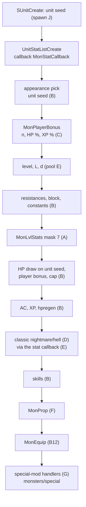
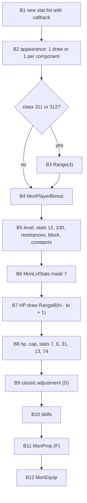
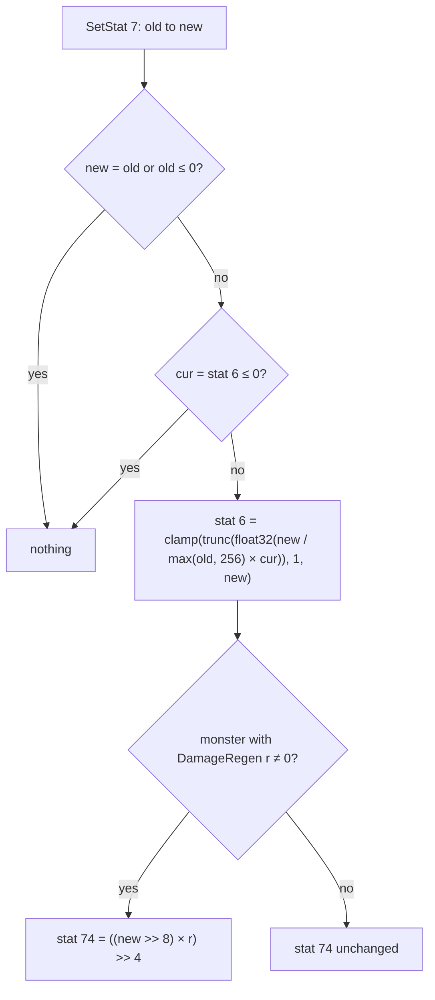
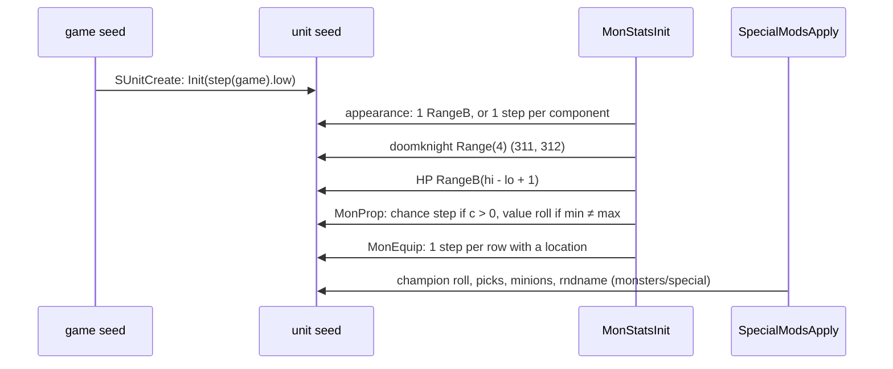

# Monster stats: hit points, defence, experience, resistances, MonProp and the mod effects

## Purpose

Every server monster gets its stats once, when it is created. The level comes from [monsters/pool § E](pool.md#e-the-monster-level-sub_00573cb0_monstatsinit).
`MonStatsInit` then sets the hit points (one draw on the unit seed), defence, experience, resistances, block and a few
constant stats, from `MonStats` scaled by the `MonLvl` row of the level. It adds the player-count bonus, the classic
nightmare/hell factors, the class's `MonProp` row and its skills. Later in the creation, the special-mod handlers of
[monsters/special](special.md) change these stats for champions, uniques, superuniques and their minions. This spec gives
each stat as an ordered integer computation, the draws on the unit seed in order, the unit's stat-change callback that
rescales current HP and regeneration when max HP changes, and the per-mod effects. To-hit and damage are not creation
stats. They are computed at attack time and are given here for reference only (§ H). Primitives (`Step`, `Range`, `Init`) are those of
[rng](../rng/README.md); `RangeB` in our symbol names is the second compile of `Range` and behaves the same.



## Entry points

| When | Function | Tag |
|---|---|---|
| Server monster created: base stats | fn:sub_00574250_MonsterInit@0x00574250 → fn:sub_00573CB0_MonStatsInit@0x00573CB0 | [C] (run:2026-10-15-mon-stats) |
| MonLvl × MonStats per mask | fn:sub_006538A0_MonLvlStats@0x006538A0 | [C] (run:2026-10-15-mon-stats) |
| Player count, its HP and XP percentages, `MonsterSkillBonus` | fn:sub_00573930_MonPlayerBonus@0x00573930 | [C] (run:2026-10-15-mon-stats) |
| Classic nightmare and hell factors | fn:sub_0063EEF0_MonClassicDiffAdjust@0x0063EEF0 | [C] (run:2026-10-15-mon-stats) |
| Any later change of max HP (stat 7) | fn:sub_0055B800_MonStatCallback@0x0055B800 | [C] (run:2026-10-15-mon-stats) |
| Special-mod handlers (stat writes) | fn:sub_005A2120_SpecialModsApply@0x005A2120 → the handlers of § G | [C] for the handlers met (run:2026-10-15-mon-stats) |
| Attack: to-hit and damage (reference only; the attack is [combat](../combat/README.md)) | fn:sub_005A4F50_MonAttackStats@0x005A4F50 | [C] for its draws (run:2026-10-16-combat) and for stats 21, 22 and 19 from the mode's MonLvl cells (run:2026-10-27-skills); [I] for the other terms |

## Inputs

### Tables

All tables are the compiled `.bin` records, indexed by record position ([data/excel](../data/excel.md)). `d` is the stats
difficulty and `L` the MonLvl column set (§ Runtime state).

| Anchor | Used for |
|---|---|
| tbl:MonStats.txt:Level | the level triple (via [pool § E](pool.md#e-the-monster-level-sub_00573cb0_monstatsinit)); `Level` (normal) for the classic level rewrite |
| tbl:MonStats.txt:minHP, tbl:MonStats.txt:MaxHP(N) | `minHP[d]`/`maxHP[d]`, s16 at `+0x0B0 + 2d` / `+0x0B6 + 2d` |
| tbl:MonStats.txt:AC, tbl:MonStats.txt:Exp | s16 at `+0x0BC + 2d` / `+0x0D4 + 2d` |
| tbl:MonStats.txt:ResFi (and `ResDm`, `ResMa`, `ResLi`, `ResCo`, `ResPo`) | s16 at `+0x144 + 6k + 2d`, stats 36, 37, 39, 41, 43, 45 |
| tbl:MonStats.txt:ToBlock | u8 at `+0x0A3 + d`, stat 20 |
| tbl:MonStats.txt:DamageRegen | u32 `+0x1A0`, stat 74 |
| tbl:MonStats.txt:Align | `+0x4C`: 0 enemy (player bonus), 1 skips the bonus and the classic factors |
| tbl:MonStats.txt:noRatio | `+0x0C` bit 2: MonStats cells taken raw, no MonLvl scaling |
| tbl:MonStats.txt:Velocity | u16 `+0x32`: the velocity bonus of `champion`, `fanatic` and `fast` |
| tbl:MonStats.txt:Skill1, tbl:MonStats.txt:Sk1lvl | 8 skills (s16 `+0x170 + 2k`) and levels (s8 `+0x198 + k`) |
| tbl:MonStats.txt:MonProp | `+0x1A`: the class's MonProp row |
| tbl:MonLvl.txt:HP, tbl:MonLvl.txt:AC, tbl:MonLvl.txt:XP | row `min(level, 110)`, column `+0x18·g + 0xC·L + 4·d` (u32) |
| tbl:MonLvl.txt:L-HP(H) | the `L-` set, which single player reads |
| tbl:MonLvl.txt:DM | the enchant base of § G (and attack-time damage, § H) |
| tbl:MonProp.txt:prop1, tbl:MonProp.txt:par1, tbl:MonProp.txt:min1, tbl:MonProp.txt:max1 | slot `k` of difficulty `d` at `+0x04 + 0x60·d + 0x10·(k−1)` |
| tbl:MonProp.txt:chance1 | u8 at `+0x124 + 6·d + (k−1)` |
| tbl:DifficultyLevels.txt:MonsterSkillBonus | `+0x10`: added to every skill level |
| tbl:DifficultyLevels.txt:ChampionDamageBonus | `+0x34`, `CDB`: scales the champion, berserk and strong bonuses |
| tbl:MonUMod.txt:constants | `c[i]`, rows 1–33: the mod percentages of § G |

### Runtime state

| State | Type | Source |
|---|---|---|
| unit seed | `Seed` at unit `+0x20` | after `SUnitCreate` ([spawn § J](spawn.md#j-creation-and-the-unit-seed)); see § B, step note B1 |
| `d` | u32: `min(game+0x6D, 2)`, 0 for a hireling | [pool § E](pool.md#e-the-monster-level-sub_00573cb0_monstatsinit) |
| `L` | bool: `game+0x6A ≠ 0 or game+0x74 ≠ 0` (1 in every logged single-player game) | the MonLvl column set |
| expansion flag | game `+0x70` | game creation |
| player count | `PlayerCount(game)`: alive players raised to the `/players` setting in game types 1–3 | fn:sub_00535790_PlayerCount@0x00535790 ([items/tc](../items/tc.md)) |
| monster level | i32 | [pool § E](pool.md#e-the-monster-level-sub_00573cb0_monstatsinit) |
| mod list, flags | `MonsterData+0x1C`, `MonsterData+0x16` | [monsters/special](special.md#runtime-state) |

Stats are `ItemStatCost` rows ([ItemStatCost](../../tables/ItemStatCost.md)): 6 `hitpoints` and 7 `maxhp` (both
`ValShift` 8, so HP × 256), 12 `level`, 13 `experience`, 16 `item_armor_percent`, 20 `toblock`, 25 `damagepercent`, 31
`armorclass`, 36 `damageresist`, 37 `magicresist`, 39/41/43/45 fire/lightning/cold/poison resist, 48–63 the elemental damage
and length stats, 67 `velocitypercent`, 68 `attackrate`, 69 `other_animrate`, 74 `hpregen`, 100 `monster_playercount`,
119 `item_tohit_percent`, 352 `last_sent_hp_pct`. `SetStat` replaces a base value; `AddStat` adds to it and does nothing for
0: 464 `leveladd` writes over a non-zero level and experience, 1 194 non-zero `AddStat` calls, and 44 `AddStat(k, 0)` on a
stat not in the list, after which no logged base list holds an entry of value 0 (234 244 entries). [C]
(fn:sub_00627260_UnitSetStat@0x00627260, fn:sub_006272B0_UnitAddStat@0x006272B0, run:2026-10-15-mon-stats,
[monsters/0004 § Plan 0038 batch S3a](../../findings/monsters/0004-stats.md#plan-0038-batch-s3a-2026-10-16))

### Constants

| Name | Value | Anchor | Tag |
|---|---|---|---|
| `g_PlayerHpPct[n]`, `g_PlayerXpPct[n]`, `n` = 0..8 | `0, 0, 50, 100, 150, 200, 250, 300, 350` (both) | data:g_PlayerHpPct@0x006E1590, data:g_PlayerXpPct@0x006E15B4, run:2026-10-15-mon-stats | [C] |
| HP % for `n` ≥ 9 / XP % for `n` ≥ 9 | `(n − 2)·50` / `10n + 260` | fn:sub_005738F0_PlayerHpPct@0x005738F0, fn:sub_00573910_PlayerXpPct@0x00573910 | [I] |
| HP cap | `hp ≥ 0x800000` → `0x7FFFFF` (before the `<< 8`) | 0x00573F7E–0x00573FC8 | [I] |
| constant stats at creation | 67 = 75, 68 = 100, 69 = 100, 352 = 128 | 0x00573F14, run:2026-10-15-mon-stats | [C] |
| `g_ClassicDiffAdjust` rows `{stat, nmMul, nmDiv, hellMul, hellDiv}` | `{7, 1, 2, 1, 2}`, `{31, 10, 12, 10, 12}`, `{13, 10, 17, 10, 26}` | data:g_ClassicDiffAdjust@0x006EA9F0, run:2026-10-15-mon-stats | [C] |
| classic level | MonStats `Level` (normal) + 25·d | fn:sub_0063EEF0_MonClassicDiffAdjust@0x0063EEF0, run:2026-10-15-mon-stats | [C] |
| `MonsterSkillBonus` by difficulty | 0 / 3 / 7 (data) | tbl:DifficultyLevels.txt:MonsterSkillBonus, run:2026-10-16-sweep-monsters-b (B10) | [C] |
| `CDB` by difficulty | 90 / 75 / 66 (data) | tbl:DifficultyLevels.txt:ChampionDamageBonus, run:2026-10-15-mon-stats | [C] |
| MonUMod `c[1..3]` minion HP % | 100 / 75 / 50 | tbl:MonUMod.txt:constants, run:2026-10-15-mon-stats | [C] |
| `c[4..6]` champion HP %, `c[7..9]` unique HP % | 200 / 150 / 100; 300 / 200 / 100 | tbl:MonUMod.txt:constants, run:2026-10-15-mon-stats | [C] |
| `c[10]`, `c[11]` champion to-hit %, damage % | 75, 100 | tbl:MonUMod.txt:constants, run:2026-10-15-mon-stats | [C] |
| `c[12]`, `c[13]` strong to-hit % minion, unique | 50, 100 | tbl:MonUMod.txt:constants, run:2026-10-15-mon-stats | [C] |
| `c[14]`, `c[15]` strong damage % minion, unique | 75, 150 | tbl:MonUMod.txt:constants, run:2026-10-15-mon-stats | [C] |
| `c[16..18]`, `c[19..21]` minion enchant min %, max % | 0 / 33 / 33; 0 / 50 / 50 | tbl:MonUMod.txt:constants, run:2026-10-15-mon-stats | [C] |
| `c[22..24]`, `c[25..27]` champion (ghostly) cold min %, max % | 33 / 33 / 33; 50 / 50 / 50 | tbl:MonUMod.txt:constants, run:2026-10-15-mon-stats | [C] |
| `c[28..30]`, `c[31..33]` unique enchant min %, max % | 66 / 66 / 66; 100 / 100 / 100 | tbl:MonUMod.txt:constants, run:2026-10-15-mon-stats | [C] |

The `c[i]` descriptions are the table's `*constant desc` text; the readers above are what fixes their use. `c[i]` is 0
for `i` ≥ the row count. [I] (fn:sub_005A00F0_UModConstant@0x005A00F0)

### Inputs and oracles

The model of this spec (`tools/monstats.py`, chained after `tools/monspawn.py` and `tools/monspecial.py`) reproduces
every creation of run:2026-10-15-mon-stats: 4 571 creations over expansion and classic, normal, nightmare and hell, player
counts 1, 3 and 8, with `monstats: 62991 checks, 0 mismatches`. It predicts the unit-seed draws of `MonStatsInit`, the
base stats after the classic adjustment, after MonProp and at the exit, and the stats after every handler call with flag 1
and flag 0. [C] (run:2026-10-15-mon-stats, [monsters/0004 § 12](../../findings/monsters/0004-stats.md#12-phase-2-results-run2026-10-15-mon-stats))
A forced-path run (ADR-0010, MonUMod edited so that `berserk` is the only champion mod with a weight) adds the `berserk`
handler: 33 berserkers in 33 packs, `monstats: 30863 checks, 0 mismatches`. It backs the handler and the berserker level
only, no frequency and no champion chance. [C] (run:2026-10-15-berserk-forced, [monsters/0004 § 8](../../findings/monsters/0004-stats.md#8-the-mod-handlers-stat-effects))

| Input | Kind | What this spec needs | Owner | Tag |
|---|---|---|---|---|
| unit seed at `MonStatsInit` entry | seed input | `Init(step(game).low)` (rng/seeds 7a); 22 creations of the run start from another seed, which the model takes from the log: the region append's `MonVariantRoll` on the unit seed ([pool § D](pool.md#d-appearance-sets-sub_005bdb20_monvariantroll)), which the chain predicts ([chain § Algorithm](../chain/README.md#algorithm) E2) | [rng/seeds](../rng/seeds.md), [spawn § J](spawn.md#j-creation-and-the-unit-seed) | [C] (run:2026-10-15-mon-stats, [chain/0002 § 3](../../findings/chain/0002-retirements.md#3-oracle-14-the-unit-seed-after-sunitcreate)) |
| monster level | value input | stat 12 before this spec's writes | [pool § E](pool.md#e-the-monster-level-sub_00573cb0_monstatsinit) | [C] (run:2026-10-15-mon-stats) |
| `MonEquipInit`'s item creation | modelled (B12; an ADR-0004 seed oracle in this spec's run, which met no class with an `oninit` row; no longer an oracle) | the unit-seed step per row and each item's two game-seed steps; the items themselves are the item chain's ([chain § Algorithm](../chain/README.md#algorithm) E3, G2–H) | `items/*` | [C] for the stock `oninit` rows, 234 and 267 (fn:sub_005D6B60_MonEquipInit@0x005D6B60, run:2026-10-20-chain, run:2026-10-21-chain2) |
| mod lists and flags | value input | which handlers run, with which flag, in which order | [monsters/special](special.md#c-mod-handlers) | [C] (fn:sub_005A2120_SpecialModsApply@0x005A2120, run:2026-10-15-mon-stats) |
| re-created monster's stats 7, 12, 13 | specified elsewhere | the restore writes 13 and 7 from the inactive record; 12 is this spec's `MonsterInit` level plus the re-applied mods | [drlg/lifecycle § H](../drlg/lifecycle.md#h-the-restore) | [C] (run:2026-10-17-lifecycle, fn:sub_005424F0_InactiveMonstersRestore@0x005424F0) |

Out of scope: to-hit, damage and elemental damage (attack time, § H), skills and AI, and what an aura does in combat.
[I] (architect ruling, plan 0025 Phase 1; fn:sub_005A4F50_MonAttackStats@0x005A4F50)

## Algorithm

### A. `MulDiv` and `MonLvlStats`

```
A1. MulDiv(a: i32, b: i32, c: i32) → i32:                        [C] (fn:sub_00483360_MulDiv@0x00483360, 0x00483376–0x004833D7, run:2026-10-17-sweep-emu2)
      if c = 0: return 0
      if a > 0x100000:
        if c ≤ a >> 4: return (a ÷ c) × b                         ; arithmetic shift, signed compare; truncates before multiplying, product wraps
        else: return low32((i64) a × b ÷ c)                       ; fn:CRT_alldiv@0x00684240, truncates toward zero; a quotient outside i32 wraps
      if b > 0x10000:
        if c ≤ b >> 4: return (b ÷ c) × a
        else: return low32((i64) a × b ÷ c)
      return (a × b) ÷ c                                          ; 32-bit imul (wraps) / idiv, the creation branch

A2. MonLvlStats(class, L: bool, d: u32, level: i32, mask) → out: [C] (fn:sub_006538A0_MonLvlStats@0x006538A0, run:2026-10-15-mon-stats)
      if level < 0: return, out untouched                         ; [I] (fn:sub_006538A0_MonLvlStats@0x006538A0)
      row ← MonLvl[min(level, nMonLvl − 1)]                       ; nMonLvl − 1 = 110
      d ← (d < 1) ? 0 : min(d, 2)
      ms ← MonStats[class];  ratio: bool ← not ms.noRatio
      if mask & 1:
        out.minHp: i32 ← ratio ? MulDiv(row.HP(L, d), ms.minHP[d], 100) : ms.minHP[d]
        out.maxHp: i32 ← ratio ? MulDiv(row.HP(L, d), ms.maxHP[d], 100) : ms.maxHP[d]
      if mask & 2: out.ac: i32  ← ratio ? MulDiv(row.AC(L, d), ms.AC[d], 100)  : ms.AC[d]
      if mask & 4: out.exp: i32 ← ratio ? MulDiv(row.XP(L, d), ms.Exp[d], 100) : ms.Exp[d]
```

Step notes:

A1. `MulDiv` is signed and truncates toward zero in every branch. The 32-bit branch is the one every `MonLvlStats` call at
creation takes on stock data (largest products: MonLvl HP 10 000 × `maxHP` 9 981; MonLvl XP 160 000 × `Exp` ≤ 6 600, both
below 2³¹), and it is reproduced bit-exactly. [C] (fn:sub_00483360_MulDiv@0x00483360, run:2026-10-15-mon-stats) The other
branches are as A1 gives them: under emulation 4 000 synthetic triples (the branch edges, negative values, `c` = 0, random
words) return the model's value, and an exact-quotient control differs in 1 948. A 64-bit quotient outside the 32-bit range
is returned wrapped (its low 32 bits; EDX holds the high half), not saturated. A negative `c` always satisfies
`c ≤ a >> 4` (resp. `b >> 4`) inside the two large-argument branches, so it takes the truncate-first form there; with `a` and
`b` both at or below their thresholds it takes the 32-bit branch. [C] (fn:sub_00483360_MulDiv@0x00483360,
fn:CRT_alldiv@0x00684240, run:2026-10-17-sweep-emu2, [monsters/0004 § Plan 0038 batch S1f](../../findings/monsters/0004-stats.md#plan-0038-batch-s1f-2026-10-17))
The emulation leaves out the one input that faults, a 32-bit product wrapping to `INT32_MIN` with `c` = −1 (`idiv`
overflow traps on the processor). [I] (0x00483376–0x0048338C)

A2. MonStats cells are read as s16 (`movsx`), MonLvl cells as dwords. Masks 8 to `0x100` (to-hit, damage, elemental
damage) are attack-time (§ H); creation uses mask 7 only. [I] (0x0065395C–0x00653A00, tbl:MonLvl.txt:HP) Single player reads
the `L-` set: in 3 954 nightmare and hell creations of the run where the two sets give different values, every one matches
`L-`. This contradicts `src:d2dfg-blizzard`, which reserves `L-` for ladder games. [C] (0x00573F41,
fn:sub_006538A0_MonLvlStats@0x006538A0, run:2026-10-15-mon-stats) With stock data the sets differ only in `AC(N)`, `AC(H)`
and `HP(H)`. [C] (tbl:MonLvl.txt:AC(N), tbl:MonLvl.txt:HP(H))

### B. `MonStatsInit` in order



```
MonStatsInit(game, room, regionEntry), unit = the new monster:   [C] except the lines tagged [I] (fn:sub_00573CB0_MonStatsInit@0x00573CB0, run:2026-10-15-mon-stats)
B1. UnitStatListCreate(unit, callback: MonStatCallback)          ; before the first SetStat (0x00573E62)
B2. MonComponentsPick(regionEntry, unit):                        ; unit-seed draws (fn:sub_005739D0_MonComponentsPick@0x005739D0)
      if regionEntry ≠ 0 and regionEntry.nVariants ≠ 0:
        i ← RangeB(unit.seed, regionEntry.nVariants)             ; draw#1
        appearance[0..15] ← regionEntry.variant[i]               ; 16 bytes to MonsterData+0x04
      else for k in 0 ..< 16:
        c: i32 ← MonCompCount(unit, k)                           ; MonStats2 component count
        if c < 1: appearance[k] ← 0                              ; no draw
        else: Step(unit.seed); appearance[k] ← (c is a power of 2) ? low & (c − 1) : low mod c   ; one draw, also for c = 1
B3. if class = 311: MonsterData.b0E ← Range(unit.seed, 4)        ; [C] draw (0x00573D93–0x00573DAC, run:2026-10-16-sweep-monsters-b)
    if class = 312: MonsterData.b0E ← MonsterData.b0F ← Range(unit.seed, 4)   ; [C] one draw (0x00573D68–0x00573D8E, run:2026-10-21-sweep-monsters-a)
B4. pb ← MonPlayerBonus(game, room, unit)                        ; § C
B5. d, level as in pool § E
    SetStat(12, level);  SetStat(100, max(1, pb.players))
    SetStat(36, ResDm[d]); SetStat(37, ResMa[d]); SetStat(39, ResFi[d])
    SetStat(41, ResLi[d]); SetStat(43, ResCo[d]); SetStat(45, ResPo[d])   ; s16 cells, as they are
    SetStat(20, ToBlock[d])                                      ; u8
    SetStat(68, 100); SetStat(67, 75); SetStat(69, 100); SetStat(352, 128)
B6. o ← MonLvlStats(class, L, d, level, mask 7)                  ; § A2
B7. base: i32 ← o.minHp + RangeB(unit.seed, o.maxHp − o.minHp + 1)   ; draw; no step when the range is < 1
B8. hp: i32 ← base + MulDiv(base, pb.hpPct, 100)
    if hp ≥ 0x800000: hp ← 0x7FFFFF
    SetStat(7, hp << 8);  SetStat(6, hp << 8)
    SetStat(31, o.ac)
    SetStat(13, o.exp + MulDiv(o.exp, pb.xpPct, 100))
    r: u32 ← MonStats.DamageRegen                                ; r < 0 → fatal 222; r & 0xFFFFF000 → fatal 223 [I] (0x00573FF6–0x00574058)
    if r = 0: SetStat(74, 0)
    else if (hp << 8) > 0x7FFFFFFF ÷ r: SetStat(74, ((hp << 8) >> 12) × r)   ; [I] overflow branch (0x00573FF6–0x00574058)
    else: SetStat(74, ((hp << 8) × r) >> 12)
B9. MonClassicDiffAdjust(unit, game.expansion, game.difficulty)  ; § D
B10. for k in 0 ..< 8:                                           ; [C] (0x005740E0–0x00574135, fn:sub_0056DEB0_UnitSkillAdd@0x0056DEB0, run:2026-10-16-sweep-monsters-b)
       if Skill[k] ≥ 0 and Sk_lvl[k] > 0: UnitSkillAdd(unit, Skill[k], Sk_lvl[k] + pb.skillBonus)
B11. MonProp (§ F)
B12. MonEquipInit(unit, …, level, level, 1)                      ; [C] the call (0x00574235, run:2026-10-20-chain); its walk: note B12
```

Step notes:

B1. The callback is what rescales stat 6 and recomputes stat 74 whenever max HP changes later (§ E). The first
`SetStat(7)` of B8 has `old` = 0 and triggers nothing. [C] (fn:sub_00626D40_UnitStatListCreate@0x00626D40,
fn:sub_0055B800_MonStatCallback@0x0055B800, run:2026-10-15-mon-stats)

B2. The run made the variant-set pick in 4 255 creations and the per-component draws in 316, all predicted. The
per-component fallback draws for every count ≥ 1, unlike `MonVariantRoll` of [pool § D](pool.md#d-appearance-sets-sub_005bdb20_monvariantroll),
which skips counts < 2. [C] (fn:sub_005739D0_MonComponentsPick@0x005739D0, fn:sub_006647C0_MonCompCount@0x006647C0,
run:2026-10-15-mon-stats) The appearance pick and the HP draw are the two unit-seed steps that
[spawn § J1](spawn.md#j-creation-and-the-unit-seed) sees on most creations. [C] (0x00573F8F, run:2026-10-14-mon-special,
run:2026-10-15-mon-stats)

B3. The `doomknight` draw comes right after the appearance pick, on the unit seed. Class 311 (`doomknight2`) stores it
in `MonsterData +0x0E` (appearance byte 10): all 99 creations of a nightmare *River of Flame* (107) session. Class 312
(`doomknight3`) writes one `Range(4)` to both `+0x0E` and `+0x0F` (bytes 10 and 11): 63 creations in a nightmare *Chaos
Sanctuary* (108) session, the two bytes equal in every one and all four values met. `tools/monstats.py` reproduces the
bytes and the unit seed after them. [C] (fn:sub_00573CB0_MonStatsInit@0x00573CB0, run:2026-10-16-sweep-monsters-b,
run:2026-10-21-sweep-monsters-a, [monsters/0004 § Plan 0038 batch H4a](../../findings/monsters/0004-stats.md#plan-0038-batch-h4a-run2026-10-21-sweep-monsters-a))

B5. Blank MonStats cells are used as the value 0; there is no "none" test. No hell adjustment is applied to the
resistances at creation. [C] (0x00573E83–0x00573F03, tbl:MonStats.txt:ResFi, run:2026-10-15-mon-stats) Stat 100 is
the creation player count and stays fixed (§ C). [C] (run:2026-10-15-mon-stats)

B7. `RangeB(seed, n)` steps once and returns `low mod n` for `n` ≥ 1, and returns 0 with no step for `n` < 1 (signed),
as in [rng](../rng/README.md#algorithm). So `maxHp = minHp` still steps (`n` = 1), and a reversed range (`maxHp < minHp`)
makes no step and gives `minHp`. [C] for the draw (run:2026-10-15-mon-stats). The reversed range is `[C]` by composition:
0x00573F83–0x00573F99 is straight-line code (the `n` computation, the call, the add of `minHp`), `MonLvlStats` scales
`minHp` and `maxHp` each on its own and never compares them, and `RNG_RangeB`'s `n` ≤ 0 branch (0x0045C3E3–0x0045C3E7) is
`[C]` in rng. Two stock rows are reversed in Normal: `mephistospirit` (401, placed by `mephcomp.ds1` in level 102) and
`minionspawner1` (484, in no pool or DS1). No logged creation met one. [C] (fn:RNG_RangeB@0x0045C3E0,
fn:sub_00573CB0_MonStatsInit@0x00573CB0, tbl:MonStats.txt:minHP, run:2026-10-11-rng-emu, run:2026-10-15-mon-stats,
[monsters/0004 § Plan 0038 batch S3b](../../findings/monsters/0004-stats.md#plan-0038-batch-s3b-2026-10-16))

B8. The hpregen formula is evaluated on the HP before the classic adjustment; § E recomputes it with a different
rounding when max HP changes. Stat 13 has no cap. [C] (0x00573FCD–0x00573FF1, tbl:MonStats.txt:DamageRegen,
run:2026-10-15-mon-stats)

B10. `MonsterSkillBonus` comes from the DifficultyLevels record of `game+0x6D`, and the step makes no draw for a
monster. After the loop the unit's skill list is exactly `{(Skill[k], Sk_lvl[k] + bonus) : Skill[k] ≥ 0, Sk_lvl[k] > 0}`:
2 678 creations, 2 102 skills, bonus 0 in normal (2 153 creations), 3 in nightmare (249) and 7 in hell (276), with the
unit seed checked across the loop in every creation. The call right after it, `0x0063EBC0`, is an empty function
(`ret 8`). [C] (fn:sub_00573CB0_MonStatsInit@0x00573CB0, fn:sub_0056DEB0_UnitSkillAdd@0x0056DEB0, tbl:MonStats.txt:Skill1,
tbl:MonStats.txt:Sk1lvl, tbl:DifficultyLevels.txt:MonsterSkillBonus, run:2026-10-16-sweep-monsters-b,
[monsters/0004 § Plan 0038 batch H4b](../../findings/monsters/0004-stats.md#plan-0038-batch-h4b-run2026-10-16-sweep-monsters-b)) A `Sk<k>mode` ≥ 0 also
sets the skill's mode, and `UnitSkillAdd` reaches RNG only through its player branch; the mode was not logged. [I]
(fn:sub_0056DEB0_UnitSkillAdd@0x0056DEB0)

B12. `MonEquipInit` runs only for a class with a `monequip` row whose `oninit` byte is set, on a unit with an
inventory. From the first row of the class whose level ≤ the monster level, for each following row of the class,
it counts `k` leading item slots with a location 1..10 (≤ 3). If `k` > 0, one unit-seed step picks one (`low & (k − 1)`
or `low mod k`), and the item is created when that location is free. Item creation draws on the game seed and on its
own seeds. [I] (fn:sub_005D6B60_MonEquipInit@0x005D6B60, fn:sub_005D30A0_MonEquipFirstRow@0x005D30A0)
The `oninit` byte is at row `+0x04` and the level the row is compared with is the s16 at `+0x02`; a class's first row
is the first record whose `monster` is the class (MonStats `+0x2A`, written at load). The code tests `row[+4]`, and a
check of `monequip.bin` against `monequip.txt` agrees on all 45 rows; the stock table has two `oninit` classes, 234
(`flyingscimitar`) and 267 (`bloodraven`), each its class's first row. [C] (fn:sub_005D6B60_MonEquipInit@0x005D6B60,
0x005D6BA5, [chain/0002 § 11](../../findings/chain/0002-retirements.md#11-oracle-13-monequips-items))
The path those two rows take is reproduced: one row of level 0 with one location, so `k` = 1, the masked step, and one
item at a free location with its two game-seed steps. run:2026-10-21-chain2 creates class 267 three times and class
234 once, with the unit seed after `MonEquipInit` predicted and each item made by the item chain, and the control that
leaves out the location draw fails each case. In run:2026-10-20-chain, one creation of each class reproduces the unit seed
after `MonEquipInit` (0x0057423A) with its one item (two items in all), and a control with no `MonEquipInit` walk fails both. So the call is
made and its draws are the model's on the stock rows; the seed after it is no longer an oracle. [C]
(fn:sub_005D6B60_MonEquipInit@0x005D6B60, fn:sub_00573B20_MonEquipItemCreate@0x00573B20, run:2026-10-20-chain,
run:2026-10-21-chain2, [monsters/0004 § Plan 0038 batch H4a](../../findings/monsters/0004-stats.md#plan-0038-batch-h4a-run2026-10-21-sweep-monsters-a)) The level skip, a second row, `k` of 2 or 3 and an
occupied location are unreachable with the stock table and stay `[I]` (*Open questions*). [I]
(fn:sub_005D6B60_MonEquipInit@0x005D6B60)

### C. The player count (`sub_00573930_MonPlayerBonus`)

```
C1. MonPlayerBonus(game, room, unit) → pb:                       [C] (fn:sub_00573930_MonPlayerBonus@0x00573930, run:2026-10-15-mon-stats)
      pb ← {hpPct: 0, xpPct: 0, players: 0, skillBonus: 0, difficulty: 0}
      if unit is a monster with a MonStats record:
        if MonStats.Align = 0:
          n: i32 ← max(1, PlayerCount(game))
          pb.hpPct ← (n < 9) ? g_PlayerHpPct[n] : (n − 2) × 50
          pb.xpPct ← (n < 9) ? g_PlayerXpPct[n] : 10 × n + 260
          pb.players ← n
        else: pb.players ← 1
        rec ← DifficultyRec(game.difficulty)
        if game.difficulty ≥ 3: game.difficulty ← 2              ; [I] writes the game byte (fn:sub_00573930_MonPlayerBonus@0x00573930)
        pb.skillBonus ← rec.MonsterSkillBonus;  pb.difficulty ← game.difficulty
```

Step notes:

C1. The bonus is **+50 % per player beyond the first**, for hit points and experience alike, so at `/players 8` both
gain 350 %. [C] (data:g_PlayerHpPct@0x006E1590, data:g_PlayerXpPct@0x006E15B4, run:2026-10-15-mon-stats) `Align` 1 (town
NPCs, critters, hirelings, player summons) and 2 (`cow`, `camel`) get no bonus and `players` 1: `Align` 1 at `/players` 8
for 16 classes (Lut Gholein's NPCs and the `roguehire` hireling) and `Align` 2 (`cow`) at 8, each record reproduced;
`camel` was not met (the test reads `Align` only). [C] (0x0057396C, tbl:MonStats.txt:Align, run:2026-10-16-sweep-monsters-b,
run:2026-10-15-mon-stats)

C1. **Real players count as `/players` does.** In plan 0044's two-client run (no `/players`), the 16 creations made while
the joiner was in the game had `MonPlayerBonus` `[50, 50, 0, 0, 2]` (hpPct, xpPct, skillBonus, difficulty, players)
and the 44 made before the join and after the leave `[0, 0, 0, 0, 1]`; `monstats.py` reproduced the run's 780 checks
with the live players taken from the host's player lines. Scope: one and two live players; 8 of the 44 fell between a
one-player and a two-player line, so the logger's sampling, not the count rule, decides those. [C]
(fn:sub_00573930_MonPlayerBonus@0x00573930, run:2026-10-20-two-clients,
[multiplayer/0001 § 6](../../findings/multiplayer/0001-cases.md#6-phase-2-results-run2026-10-20-two-clients))
Whether a dead player counts here is not separated (no player died in that session); by the code it does not,
through `PlayerCount` ([items/tc F2](../items/tc.md)). [I] (fn:sub_00535790_PlayerCount@0x00535790)

C2. **The count is applied once, at creation. A live monster is never rescaled.** `PlayerCount` has two callers, this
function and the TC drop code, and stat 100 keeps the creation count. The run changed `/players` 13 times in nine games
and compared stats 7, 12, 13 and 100 of 302 live monsters at each change: all equal their creation values. [C]
(fn:sub_00535790_PlayerCount@0x00535790, run:2026-10-15-mon-stats) Monsters created after a change get the new count.
[C] (run:2026-10-15-mon-stats) The re-creation of a monster from an inactive room
is a separate case ([drlg/lifecycle § H](../drlg/lifecycle.md#h-the-restore)).

C3. `MonPlayerBonus` is also called by four attack and skill functions (`0x005E8810`, `0x005E9750`, `0x005F0B00`,
`0x005FC450`), which write no HP. Later readers of stat 100 (crushing blow at `0x005BFFC0`, with `PlayerHpPct`) use the
creation count. [I] (fn:sub_00573930_MonPlayerBonus@0x00573930)

### D. Classic nightmare and hell (`sub_0063EEF0_MonClassicDiffAdjust`)

```
D1. MonClassicDiffAdjust(unit, expansion, d: game byte):         [C] (fn:sub_0063EEF0_MonClassicDiffAdjust@0x0063EEF0, data:g_ClassicDiffAdjust@0x006EA9F0, run:2026-10-15-mon-stats)
      if expansion ≠ 0 or d = 0 or MonStats.Align = 1: return
      for row in g_ClassicDiffAdjust[0 ..< 3]:                   ; stats 7, 31, 13 in that order
        v: i32 ← GetStat(unit, row.stat)
        SetStat(row.stat, (d = 1) ? MulDiv(v, row.nmMul, row.nmDiv) : MulDiv(v, row.hellMul, row.hellDiv))
      SetStat(12, MonStats.Level[0] + 25 × d)                    ; Level (normal), +0x0AA
```

Step notes:

D1. Max HP × 1/2, AC × 10/12, experience × 10/17 (nightmare) or × 10/26 (hell). The halving of stat 7 runs the stat
callback (§ E), which halves the current HP (stat 6) with it and recomputes stat 74. The run's 354 classic nightmare
and hell creations are all reproduced, and in all 354 `Level + 25·d` differs from `Level(d)`. [C]
(fn:sub_0063EEF0_MonClassicDiffAdjust@0x0063EEF0, fn:sub_0055B800_MonStatCallback@0x0055B800, run:2026-10-15-mon-stats)

D2. The MonLvl row of § A was chosen by MonStats `Level(N)`/`Level(H)` ([pool § E](pool.md#e-the-monster-level-sub_00573cb0_monstatsinit)).
Only the level **stat** becomes `Level + 25·d`, and every later reader of stat 12 sees that value: the mod handlers (the
enchant base `ℓ` of § G, `leveladd`, `aura`) and the attack code. [C] (fn:sub_0063EEF0_MonClassicDiffAdjust@0x0063EEF0,
run:2026-10-15-mon-stats)

D3. **The classic aura level.** `UModAura` reads stat 12 after `leveladd`, so in a classic nightmare or hell game it reads
`Level + 25·d + 3`. In classic hell the run logged five aura uniques of class 48 (`Level` 18, `Level(H)` 78) drawing their
aura with level 71 = 18 + 50 + 3, not `Level(H)` + 3 = 81. [C] (fn:sub_005A1650_UModAura@0x005A1650,
fn:sub_0063EEF0_MonClassicDiffAdjust@0x0063EEF0, run:2026-10-15-mon-stats) The draw itself is in
[special § C3](special.md#c-mod-handlers).

D4. A class with `Align` 1 is skipped: the 8 classic nightmare and hell creations of `Align` 1 classes keep their level
and stats, while the 354 of `Align` 0 are adjusted. [C] (fn:sub_0063EEF0_MonClassicDiffAdjust@0x0063EEF0,
tbl:MonStats.txt:Align, run:2026-10-15-mon-stats) `d` here is the game byte, not the hireling's forced 0; the two differ
only for a hireling, which has `Align` 1 and is skipped anyway, so no creation separates them. [I]
(0x0057405D–0x0057406A)

### E. The stat callback (`sub_0055B800_MonStatCallback`), stat 7



```
E1. on SetStat(unit, 7, new), old = the previous value:          [C] (fn:sub_0055B800_MonStatCallback@0x0055B800, 0x0055B8EC–0x0055B998, run:2026-10-15-mon-stats)
      if new = old or old ≤ 0: return
      cur: i32 ← GetStat(unit, 6);  if cur ≤ 0: return
      if old ≤ 0x100: old ← 0x100
      x ← (float) new ÷ (float) old × cur                        ; fild / fidiv / fimul
      v: i32 ← trunc(float32(x))                                 ; fstp to a float32, then truncated
      SetStat(unit, 6, clamp(v, 1, new))
      r: u32 ← unit is a monster ? MonStats.DamageRegen : 0
      if r ≠ 0: SetStat(unit, 74, ((new >> 8) × r) >> 4)
```

Step notes:

E1. The quotient and product are computed in floating point, the result is stored as a float32, and the float32 is
truncated to an integer. The model computes the product in double precision and rounds it to float32. That reproduces
every classic nightmare/hell creation and every `hpmultiply` call of the run. [C] (fn:sub_0055B800_MonStatCallback@0x0055B800,
run:2026-10-15-mon-stats) The x87 control word in force is the one the CRT start-up sets, and no game code changes its
precision or rounding control persistently. It rounds to nearest and its precision is not 24 bits: round-toward-zero would
change 282 of the run's 825 logged stat-6 rescales, and 24-bit precision four. [C] (fn:CRT_setdefaultprecision@0x0068E70A,
run:2026-10-15-mon-stats) The precision is 53 bits (`_PC_53`, written once at start-up); the run does not separate 53 from
64 bits, so the width rests on the code. [I] (fn:CRT_setdefaultprecision@0x0068E70A, fn:CRT_fpmath@0x00682FAE) A
double-precision product rounded to nearest float32 is that configuration. The final conversion truncates toward zero
whatever the rounding control is. [I] (fn:CRT_ftol2@0x00682FD0)

E2. Who triggers it: the classic halving (§ D) and every `MonHpAddPct` (§ G). `MonHpAddPct` writes stat 6 itself right
after stat 7, so there the callback's stat 6 is overwritten and only its stat 74 matters. `hpmultiply` with flag 1 then
sets stat 74 to 0; with flag 0 (group members) and in `possessed` and `berserk` the callback's stat 74 stays. [C]
(fn:sub_005A0D20_MonHpAddPct@0x005A0D20, fn:sub_005A0DC0_UModHpMultiply@0x005A0DC0, run:2026-10-15-mon-stats) The
`berserk` part is shown by the 33 berserkers of a forced-path run, every stat write predicted. [C]
(fn:sub_005A1280_UModBerserk@0x005A1280, run:2026-10-15-berserk-forced)

E3. The callback's other cases (stats 9, 11, 83, 97, 98, 107, 126, 127, 151, 188, 204) are not reached by a creation
stat. They are specified in [stats/aggregate § G](../stats/aggregate.md#g-the-maxima-the-rescale-and-the-stat-callback)
(plan 0041): stats 9 and 11 rescale current mana and stamina by the rule of E1 (a player's 5 752 rescales of
stats 7, 9 and 11 reproduced). [C] (fn:sub_0055B800_MonStatCallback@0x0055B800, run:2026-10-17-stats) The skill,
item-aura and state cases are read from the code. [I] (fn:sub_0055B800_MonStatCallback@0x0055B800)

### F. MonProp at creation

```
F1. rec ← MonPropRec(class)                                      [C] except the lines tagged [I] (fn:sub_00573470_MonPropRec@0x00573470, 0x00574177–0x00574220, run:2026-10-15-mon-stats)
    if rec ≠ 0: for k in 0 ..< 6:
      slot ← rec.slot[d][k];  if slot.prop < 0: break
      c: u8 ← rec.chance[d][k]
      if c = 0: apply ← true                                     ; no draw
      else: Step(unit.seed); apply ← (low mod 100 < c)           ; [I] draw, unsigned mod (0x005741B1–0x005741F4)
      if apply: PROP_ApplyBlock(mode 0, unit, slot, flags 0x40)  ; value roll on the unit seed when min ≠ max
```

Step notes:

F1. `d` is the stats difficulty (0 for a hireling). Every monster of the class gets the row, special or not. The
applied stats go to a stat list of flags `0x40` attached to the unit's list. `par`, `min` and `max` mean what they mean
for the property's `func` in [items/properties § D–E](../items/properties.md#d-the-value-roll-and-the-stat-writer).
`PROP_RollValue` draws on the **unit seed**, not an item seed. [C] (fn:PROP_ApplyBlock@0x0065FD70,
fn:PROP_RollValue@0x0065E9E0, run:2026-10-15-mon-stats)

F2. Stock `chance` is 0 in every slot, so every set slot applies with no `chance` draw, and the `chance` > 0 branch is not
reached on stock data. On stock data only `thorns` has `min ≠ max` (`quillrat6..8`, nightmare 15..20, hell 30..40). The run
reproduced `thorns` 15..20 with its unit-seed roll (`quillrat8`, nightmare, 242 creations) and `crush` 15 (nightmare) and 25
(hell) of `blunderbore1` in classic. [C] (tbl:MonProp.txt:chance1, tbl:MonProp.txt:min1, run:2026-10-15-mon-stats)

F3. `sub_00573470_MonPropRec` is the only reader of `g_pMonProp`: the one `DataTables + 0xC30` operand in `.text` is its
own (0x005734AC), and the address `0x0096C860` appears only in the loader and the unloader. Of the three MonProp rows with
a normal slot, two are unreachable on stock data: `baboon6` is only in `nmon` of level 124 (no normal pool), and no
MonStats record names the `irongolem` row. [C] (fn:sub_00573470_MonPropRec@0x00573470, data:g_pMonProp@0x0096C860,
tbl:MonProp.txt:prop1, tbl:MonStats.txt:MonProp, [monsters/0004 § Plan 0038 batch S3b](../../findings/monsters/0004-stats.md#plan-0038-batch-s3b-2026-10-16))
The third, `druidhawk`, **is** reachable: it is the summon of the Druid skill Raven (221), `MonStatsInit` takes `d` = 0
only for the five hireling classes, and `MonPropRec` runs for every monster (0x0057416D), so a Druid's Raven in a normal
game reads the normal row (`stupidity`, −1). The summon's creation path into `MonsterInit` is not read and the MonProp
list of such a creation was not logged (*Open questions*). [I] (fn:sub_00573CB0_MonStatsInit@0x00573CB0, fn:sub_0063EE90_HirelingType@0x0063EE90,
0x0057416D, tbl:Skills.txt:summon)

F3. **A summon's seed, life and defence** are the creation's: in 219 summons of plan 0045 (207 Ravens, 12 Raise Skeleton
`necroskeleton`) the new unit's seed is `Init(Step(game seed).low)` and its life (stat 6 = stat 7) and defence (stat 31)
are what `MonStatsInit`'s draws give on that seed (§ B: one draw per MonStats2 component with a count of 1 or more,
then the life draw of the class's raw cells, both classes `noRatio`); the Raven's 20–32 range separates in 207.
[C] (fn:sub_0056D940_SpawnOwnedMonster@0x0056D940, fn:sub_00573CB0_MonStatsInit@0x00573CB0, run:2026-10-27-skills,
[skills/dispatch § L](../skills/dispatch.md#l-summons)) The summon's other stats (`SummonInitStats`, the skill's
bonuses) and a summon class without `noRatio` are not checked. [I] (fn:sub_005C4470_SummonInitStats@0x005C4470,
run:2026-10-27-skills)

### G. The mod handlers' stat effects

The handlers run in `SpecialModsApply`'s order ([special § C1](special.md#c-mod-handlers)): mods 1, 2, 3, 4, then the mod
list. After each one the same handler runs with flag 0 on every group member. Flag 1 is the special itself and flag 0
a member of its group. A champion-pack member runs its own pass with flag 1. No flag-0 call follows a champion, so a
champion leader's pass reaches no pack member. Flag-0 calls go to the minions of uniques and superuniques, and to the
MonStats minions of a champion-pack member whose class is `SetBoss`: `MinionsSpawn` gives it minions (it is created
without flag `0x40`), and its own pass walks them with flag 0 (64 walks, classes 59, 397 and 645, the minions' stats
reproduced). [C] (fn:sub_005A2120_SpecialModsApply@0x005A2120, run:2026-10-14-mon-special, run:2026-10-15-mon-stats,
[monsters/0004 § Plan 0038 batch S3a](../../findings/monsters/0004-stats.md#plan-0038-batch-s3a-2026-10-16), [monsters/0003 § Plan 0038 batch S3a](../../findings/monsters/0003-special-monsters.md#plan-0038-batch-s3a-2026-10-16)) No handler draws on any seed. [C]
(fn:sub_005A2120_SpecialModsApply@0x005A2120, run:2026-10-14-mon-special)

Notation: `lvl` is stat 12 when the handler is called, `x` is stat 13 then. `÷ 100` is signed 32-bit division
truncating toward zero. `CDB` is DifficultyLevels `ChampionDamageBonus` of `game+0x6D`. "champion part" is the flag-1
body of `champion` without its velocity, given in the `champion` row: 71 `champion` calls in nightmare (CDB 75) and hell
(66), and the champion part inside 11 `ghostly`, 3 `fanatic` and 7 `possessed` calls, every stat write reproduced. [C]
(fn:sub_005A0E80_UModChampion@0x005A0E80, tbl:DifficultyLevels.txt:ChampionDamageBonus, run:2026-10-15-mon-stats)

| Mod (row) | Handler | Flag 1 (the special) | Flag 0 (group member) | Tag |
|---|---|---|---|---|
| 2 `hpmultiply` | fn:sub_005A0DC0_UModHpMultiply@0x005A0DC0 | `MonHpAddPct(c[4+d])` if the champion flag (`MonsterData+0x16` & 4) is set, else `MonHpAddPct(c[7+d])`; then SetStat(74, 0) | `MonHpAddPct(c[1+d])` | [C] (run:2026-10-15-mon-stats: 198 / 266 calls) |
| 4 `leveladd` | fn:sub_005A0E40_UModLevelAdd@0x005A0E40 | SetStat(12, lvl + 3); SetStat(13, x × 5) | the same | [C] (run:2026-10-15-mon-stats: 198 / 266) |
| 16 `champion` | fn:sub_005A0E80_UModChampion@0x005A0E80 | SetStat(12, lvl − 1); SetStat(13, x − 2·(x ÷ 5)) (unsigned); AddStat(25, CDB·c[11] ÷ 100); AddStat(119, CDB·c[10] ÷ 100); AddStat(67, 20) if `Velocity` > 0 | nothing | [C] (run:2026-10-15-mon-stats: 71 / 8) |
| 36 `ghostly` | fn:sub_005A1080_UModGhostly@0x005A1080 | flag `0x40`; SetStat(36, 80); champion part (no velocity); AddStat(54, c[22+d]·DM ÷ 100); AddStat(55, c[25+d]·DM ÷ 100); AddStat(56, 150) | nothing | [C] flag 1 (run:2026-10-15-mon-stats: 11 / 0); [I] flag 0 |
| 37 `fanatic` | fn:sub_005A11F0_UModFanatic@0x005A11F0 | SetStat(16, −70); champion part; AddStat(67, clamp(2048 ÷ Velocity − 128, 10, 100)) if `Velocity` > 0 | nothing | [C] flag 1 (run:2026-10-15-mon-stats: 3 / 0); [I] flag 0 |
| 38 `possessed` | fn:sub_005A1230_UModPossessed@0x005A1230 | flag `0x20`; `MonHpAddPct(100)`; champion part; AddStat(67, 20) if `Velocity` > 0 | nothing | [C] flag 1 (run:2026-10-15-mon-stats: 7 / 0); [I] flag 0 |
| 39 `berserk` | fn:sub_005A1280_UModBerserk@0x005A1280 | `MonHpAddPct(−75)`; AddStat(25, CDB·300 ÷ 100); AddStat(119, CDB·300 ÷ 100); **no champion part** | nothing | [C] flag 1 (run:2026-10-15-berserk-forced: 33 / 0); [I] flag 0 |
| 5 `strong` | fn:sub_005A17E0_UModStrong@0x005A17E0 | AddStat(25, CDB·c[15] ÷ 100); AddStat(119, CDB·c[13] ÷ 100) | AddStat(25, CDB·c[14] ÷ 100); AddStat(119, CDB·c[12] ÷ 100) | [C] (run:2026-10-15-mon-stats: 12 / 45) |
| 6 `fast` | fn:sub_005A1910_UModFast@0x005A1910 | AddStat(67, clamp(2048 ÷ Velocity − 128, 10, 100)) if `Velocity` > 0 | the same | [C] (run:2026-10-15-mon-stats: 16 / 57) |
| 9 `fire` | fn:sub_005A1990_UModFire@0x005A1990 | AddStat(48, c[28+d]·DM ÷ 100); AddStat(49, c[31+d]·DM ÷ 100); then the `resist` part | stats 48, 49 with `c[16+d]`, `c[19+d]`; no `resist` part | [C] (run:2026-10-15-mon-stats: 12 / 35) |
| 17 `lightning` | fn:sub_005A1B00_UModLightning@0x005A1B00 | the same into 50, 51; `resist` part | 50, 51 | [C] (run:2026-10-15-mon-stats: 26 / 60) |
| 18 `cold` | fn:sub_005A1C70_UModCold@0x005A1C70 | the same into 54, 55, and AddStat(56, 5·ℓ + 100); `resist` part | 54, 55, 56 | [C] (run:2026-10-15-mon-stats: 30 / 71) |
| 23 `poisonhit` | fn:sub_005A1E00_UModPoisonHit@0x005A1E00 | the same into 57, 58, and AddStat(59, (5·ℓ + 150)·2); `resist` part | 57, 58, 59 | [I] (not met) |
| 25 `manahit` | fn:sub_005A1F90_UModManaHit@0x005A1F90 | the same into 62, 63, each value × 256; `resist` part | 62, 63 (× 256) | [C] (run:2026-10-15-mon-stats: 30 / 62) |
| 8 `resist`, 27 `spectralhit`, 28 `stoneskin` | fn:sub_005A1370_UModResist@0x005A1370 | § G4 | nothing | [C] (run:2026-10-15-mon-stats: 37 / 85, 17 / 39, 28 / 31) |
| 30 `aura` | fn:sub_005A1650_UModAura@0x005A1650 | aura skill and level from `lvl` ([special § C3](special.md#c-mod-handlers); classic level § D3) | nothing | [C] (run:2026-10-15-mon-stats: 30 / 75) |
| 26 `teleport` | fn:sub_005A1600_UModTeleport@0x005A1600 | adds a skill at level 1 and sets its mode; no stat | nothing | [C] (run:2026-10-15-mon-stats: 21 / 49) |
| 1 `rndname` | fn:sub_005A0CE0_UModRndName@0x005A0CE0 | the name seed ([special § C2](special.md#c-mod-handlers)); no stat | nothing | [C] (run:2026-10-15-mon-stats: 198 / 266) |
| 41 `always_run_ai` | fn:sub_005A1330_UModAlwaysRunAi@0x005A1330 | AI event 7 at frame `game+0xA8` + 75; no stat | the same | [I] (not met) |

Every other row has no server handler ([special § D](special.md#d-per-mod-draws)). The counts are the run's handler calls
with flag 1 / flag 0. [C] (data:g_UModHandlers@0x0073C008, run:2026-10-15-mon-stats)

```
G1. MonHpAddPct(unit, pct: i32):                                 [C] (fn:sub_005A0D20_MonHpAddPct@0x005A0D20, 0x005A0D29–0x005A0DB8, run:2026-10-15-mon-stats)
      h: i32 ← GetMaxHp(unit)                                    ; stat 7, HP × 256 (fn:sub_00625D10_UnitGetMaxHp@0x00625D10)
      if h > 0x100000:                     q ← (h ÷ 100) × pct   ; truncates before multiplying
      else if pct > 0x10000 and pct ≥ 1600: q ← (pct ÷ 100) × h  ; [I] not reached (0x005A0D29–0x005A0DB8)
      else if pct > 0x10000:               q ← (i64) h × pct ÷ 100   ; [I] not reached (0x005A0D29–0x005A0DB8)
      else:                                q ← (h × pct) ÷ 100
      SetStat(7, h + q)                                          ; runs the stat callback (§ E)
      SetStat(6, h + q)

G2. Enchant base:                                                [C] (0x005A1A00–0x005A1AD8, fn:sub_005A1990_UModFire@0x005A1990, run:2026-10-15-mon-stats)
      ℓ: i32 ← clamp(lvl, 1, nMonLvl − 1)                        ; lvl < 2 → 1
      DM: i32 ← MonLvl[ℓ].DM(L, d)                               ; d = min(game+0x6D, 2)

G3. Champion velocity, by the mod id (only when Velocity > 0):   [C] (0x005A0FE7–0x005A1069, tbl:MonStats.txt:Velocity, run:2026-10-15-mon-stats)
      36 ghostly: nothing;  37 fanatic: clamp(2048 ÷ Velocity − 128, 10, 100);  16, 38: + 20
```

Step notes:

G1. A monster whose HP exceeds 4 096 (`h` > `0x100000`) takes the first branch, which truncates `h` to a multiple of
100 before multiplying. The worked examples below take this branch. The handlers stack: a `possessed` champion gets
`c[4+d]` from `hpmultiply`, then + 100 % of the result. [C] (fn:sub_005A0D20_MonHpAddPct@0x005A0D20, run:2026-10-15-mon-stats)
`hpmultiply` tests the champion flag through `sub_005A0180_MonTypeFlag(unit, 4)`: 92 flag-1 calls on champions take
`c[4+d]` and 106 on uniques and superuniques `c[7+d]`. [C] (fn:sub_005A0180_MonTypeFlag@0x005A0180,
fn:sub_005A0DC0_UModHpMultiply@0x005A0DC0, struct:MonsterData+0x16, run:2026-10-15-mon-stats) It does nothing when
`game+0x6D` ≥ 3, which single player never holds (`MonPlayerBonus` writes 2 over a larger value first). [I]
(0x005A0DDE–0x005A0E34)

G2. Every enchant handler also uses this `ℓ` for the cold and poison lengths. In a classic nightmare or hell game `lvl`
is the rewritten `Level + 25·d` (+ 3 after `leveladd`), not the level that chose the stats row (§ D2). [C]
(fn:sub_005A1C70_UModCold@0x005A1C70, run:2026-10-15-mon-stats)

G3. The branch that would add −33 for mod 36 is unreachable: the id is tested for 36 twice. [I] (0x005A0FE7–0x005A1069)
The `fanatic` and `fast` bonus is `clamp(2048 ÷ Velocity − 128, 10, 100)` with signed division (`idiv` at 0x005A1951):
100 at velocities 1 and 3–7 and 42 at 12 in 76 logged calls. [C] (fn:sub_005A1910_UModFast@0x005A1910,
fn:sub_005A11F0_UModFanatic@0x005A11F0, tbl:MonStats.txt:Velocity, run:2026-10-15-mon-stats) So it is 100 for `Velocity`
≤ 8 and 99 at 9 (2048 ÷ 9 = 227), not 100 up to 9 as this note said before plan 0038's S3a batch; velocities 8 and 9
were not met. [I] (tbl:MonStats.txt:Velocity)
Stat 67 is the velocity term of the moving factor `max(B_FRW + stat 67, 25)`: it sets the path speed of every moving
mode and the animation rate of the moving branch, a classic monster's S1–S4 among them; a monster's walk and run
animation bases `+0x36`/`+0x38` are computed from the `WL` and `RN` records at load
([anim/movement § A](../anim/movement.md#a-speeds), A1 and A4). [C] (fn:UNIT_AnimSetRate@0x00623F50,
fn:sub_00650F00_MonStatsSpeeds@0x00650F00, run:2026-10-27-anim)

G4. **`resist`, `spectralhit`, `stoneskin` and the enchant `resist` part** (`sub_005A1370_UModResist`, the mod id in
`EDX`, flag 1 only):

```
G4. UModResist(unit, mod):                                       [C] (fn:sub_005A1370_UModResist@0x005A1370, run:2026-10-15-mon-stats)
      if mod = 28: SetStat(31, stat31 × 2)                       ; stoneskin, before the immunity count
      k: i32 ← number of stats 39, 41, 43, 45, 36, 37 that are ≥ 100
      if k ≥ 2: return
      case mod:
        8 resist:        for s in (43 cold, 39 fire, 41 lightning):
                           if stat s < 100: stat s ← stat s + 40; if stat s ≥ 100: k ← k + 1
                           if k = 2: stop
        9 / 18 / 17 / 23: stat 39 / 43 / 41 / 45 ← + 75          ; fire / cold / lightning / poison, no cap
        25 manahit:      stat 37 ← + 20
        27 spectralhit:  for s in (43 cold, 39 fire, 41 lightning):
                           if stat s < 75: stat s ← stat s + 20, with the same k rule
        28 stoneskin:    stat 36 ← + 50
```

Every write is a `SetStat` of `old + delta`. [C] (fn:sub_005A1370_UModResist@0x005A1370, run:2026-10-15-mon-stats) Spectral
Hit adds **20**, not the 40 of `src:arreat-summit-bonuses`. The run's 17 `spectralhit` uniques show it, for example class 58
going from 40/165/40 to 60/165/60 cold/fire/lightning. [C] (0x005A1370, run:2026-10-15-mon-stats) The `poisonhit` row (23) is
[I] (not met). (fn:sub_005A1E00_UModPoisonHit@0x005A1E00)

G5. **`willowisp1` halving.** For a class whose base class is 118 (`willowisp1`: Gloams, Burning Souls, Black Souls) the
damage-% bonus (stat 25) of `champion`, `berserk` and `strong` is halved. It was not met. [I] (0x005A0FB7–0x005A0FCF,
fn:sub_00463860_MonBaseId@0x00463860, fn:sub_00463900_MonClassCheck@0x00463900) The halving is a signed `q ÷ 2`,
truncating toward zero, of the stat-25 value already divided by 100 (`q = CDB·c ÷ 100`), not `q >> 1`. Stat 119 (to-hit)
is not halved. With stock values `q` ≥ 0, where the two forms agree. [I] (champion 0x005A0FC8–0x005A0FCF, berserk
0x005A12FD–0x005A1304, strong 0x005A18E6–0x005A18ED)

G6. **The berserker level is + 3.** run:2026-10-15-mon-stats made 12 champion-mod picks in the expansion and none drew
`berserk`; a forced-path run (MonUMod edited, ADR-0010) met 33 berserkers in 33 packs. Every berserker ends at its
pre-handler level + 3 (`leveladd`, with no − 1, since `berserk` does not run the champion part), with its experience × 5,
and every one of the 56 champion-member calls ends at + 2 (`leveladd` + 3, `champion` − 1). [C]
(fn:sub_005A1280_UModBerserk@0x005A1280, fn:sub_005A0E40_UModLevelAdd@0x005A0E40, run:2026-10-15-berserk-forced) This
contradicts `src:arreat-summit-bonuses` (+ 2 for every champion; [monsters/0004 *Leads used*](../../findings/monsters/0004-stats.md#leads-used)):
1.14d gives a berserker + 3, so a reimplementation must not "correct" it. The run backs no frequency (the edit makes
`berserk` the only weighted champion mod and sets the champion chance to 100).

G7. **`UniqueDamageBonus` is never read.** A full trace of every `DifficultyRec` call site and every reference to
`g_pDifficultyLevels` finds no read of `+0x30`. The unique `strong` bonus reads `ChampionDamageBonus`. The two
damage-bonus columns are equal in stock data, so play cannot tell them apart. [I]
(fn:sub_00611D30_DifficultyRec@0x00611D30, data:g_pDifficultyLevels@0x0096C8AC)

**`HireableBossDamagePercent` (`+0x38`) has a reader**, outside monster creation: `COMBAT_DamagePercent` reads it
at 0x0057C0FE from the difficulty record its caller keeps, and when the attacker is a hireling and the defender a
boss it is the percentage the hit's damage is scaled by ([combat/reductions § A](../combat/reductions.md#a-combat_applyreductions);
correction in [monsters/0004 § 1](../../findings/monsters/0004-stats.md#1-the-two-loader-descriptors)). The mercenary
hitting Andariel reproduced 50 in Normal and 35 in Nightmare. [C] (fn:COMBAT_DamagePercent@0x0057C060,
tbl:DifficultyLevels.txt:HireableBossDamagePercent, run:2026-10-16-combat) Hell's 25 reproduced in 33 events, which
tells this column from `MonsterCEDamagePercent` (20 in Hell). [C] (0x0057C0FE, run:2026-10-16-combat)

### H. To-hit and damage at attack time (reference only)

```
H1. MonAttackStats(unit, mode), at each attack:                  [I] (fn:sub_005A4F50_MonAttackStats@0x005A4F50, fn:sub_005A4F20_PlayerDmgBonus@0x005A4F20, data:g_PlayerDmgBonus@0x006E21F4)
      lvl ← stat 12 now
      out ← MonLvlStats(class, L, d, lvl, mask 0x10 (mode 5) | 0x20 (modes 7, 8) | 0x08 (others))   ; MonLvl TH, DM × A1/A2/S1 cells ÷ 100
      add the skill-damage pair (0x0056E050)
      if classic and d > 0 and Align ≠ 1: damage × 10/12, to-hit × 10/15
      if expansion: b ← (d = 0 or n < 2) ? 0 : (n < 9 ? 8·(n − 1) : 8n − 16), n = stat 100; each value += value·b ÷ 128
      clear the list, then write stats 21, 22, 19 to it
      for each El<e> whose mode matches: apply if El<e>Pct ≥ 100 or Range(unit.seed, 100) < El<e>Pct   ; draw; type 10 also Range(unit.seed, 5)
        ; MonLvlStats mask 0x40 + e: El2 and El3 take El1's minimum, maximum and length
```

H1. To-hit, damage and elemental damage are not creation stats. They are out of the creation model; the expansion
damage bonus is + 6.25 % per player beyond the first, in nightmare and hell only. [I] (fn:sub_005A4F50_MonAttackStats@0x005A4F50, fn:sub_005A4F20_PlayerDmgBonus@0x005A4F20)

H1. **Stats 21, 22 and 19 are confirmed** for the plain cells: in 26 425 calls of plan 0045 (12 732 in
run:2026-10-25-skills' logs, 13 693 in run:2026-10-27-skills') they are `MulDiv(MonLvl DM, MinD / MaxD, 100)` and
`MulDiv(MonLvl TH, TH, 100)` of the mode's columns, `A2` for mode 5, `S1` for modes 7 and 8, `A1` for every other
(the raw cells for a `noRatio` class), at the unit's stat 12 and the game's difficulty; another column set gives other
values in 26 383 of them. A summon's full list adds its other lists to the same stats: the offset at its first call
holds over its 5 693 later calls. [C] (fn:sub_005A4F50_MonAttackStats@0x005A4F50, fn:sub_006538A0_MonLvlStats@0x006538A0,
run:2026-10-27-skills, run:2026-10-25-skills)

H1. The rest of H1 is the code reading: the `L` columns (the plain ones gave the same values in every call), the
classic factors and the expansion bonus (`b` = 0 in every call: normal and nightmare, one player), the skill-damage
pair (the 2 218 calls of the Raven class 419 are not modelled), type 10's redraw; the list cleared before the writes,
so a stat the call does not write reads 0 afterwards (`0x005A4FB3`); and `El2`/`El3` taking `El1`'s bounds through
the mask `0x40 + e` (`0x005A51D7`–`0x005A525C`; no logged call applied one). [I] (0x005A4FB3, 0x005A51D7,
run:2026-10-27-skills, [monsters/0004 § 9](../../findings/monsters/0004-stats.md#9-to-hit-and-damage-at-attack-time-sub_005a4f50_monattackstats))

H1. **The draws are confirmed.** `MonAttackStats` draws one `Range(unit.seed, 100)` per `El` group whose mode matches
and whose percent is 1..99, one `Range(unit.seed, 5)` for an element type 10, and nothing else: 5 060 calls, 167 with
an `El` group applied, 2 795 chained to the attack they open. [C] (fn:sub_005A4F50_MonAttackStats@0x005A4F50,
run:2026-10-16-combat) Plan 0045's 26 439 modelled calls held the same: 21 with one `Range(unit.seed, 100)` (19
failing, 2 applying an `El1` cold and poison attack), 26 418 with none; the 516 calls made before the unit has a stat
list write nothing and leave the seed as it was. [C] (fn:sub_005A4F50_MonAttackStats@0x005A4F50, run:2026-10-27-skills)
It runs at the monster's mode change (`MonSetMode` passes the new mode, except for get-hit). [I]
(fn:sub_005A7C20_MonSetMode@0x005A7C20, 0x005A7D34) Mode 5 reads the `A2` cells, 7 and 8 the `S1` cells, every other
mode the `A1` cells. [C] (fn:sub_005A4F50_MonAttackStats@0x005A4F50, run:2026-10-27-skills) `sequence` 14 among the others is the reading. [I] (0x005A7D34)

H1. **`noRatio` elemental damage is 0 at attack time.** For a `noRatio` class `MonLvlStats` writes the raw
`El<e>MinD/MaxD` to its output `+0x24`/`+0x28`, but `MonAttackStats` reads the elemental min and max at `+0x2C`/`+0x30`,
which only ratio classes fill; such a monster's `El` attack sets min = max = 0 and only the duration. [I]
(0x00653BC2–0x00653C2D, 0x005A5160, struct:MonLvlStatsOut+0x2C)

H1. The attack that uses these stats (to-hit, the damage build, the defender's reductions and delivery) is specified
in [combat](../combat/README.md); a reimplementation takes the stats of H1 as that spec's inputs. [I]
(fn:MON_MeleeHit@0x005A5490)

### Draw order on the unit seed



[C] All of `MonStatsInit`'s unit-seed draws come before the special-mod draws of [monsters/special](special.md)
(champion roll, picks, minion count, `rndname`). In order: the appearance pick, `Range(4)` for classes 311/312, the HP draw,
the MonProp draws per slot (the `chance` step, then the value roll), then the MonEquip steps. Phase 2 predicts each of
them and compares the unit seed after each. (fn:sub_005739D0_MonComponentsPick@0x005739D0, 0x00573F8F, 0x005741C2,
fn:sub_005D6B60_MonEquipInit@0x005D6B60, run:2026-10-15-mon-stats) The stat handlers of § G make no draw. [C]
(run:2026-10-14-mon-special)

## Outputs

- The base stat list of the monster at the end of creation: 6, 7, 12, 13, 20, 31, 36, 37, 39, 41, 43, 45, 67, 68,
  69, 74, 100, 352 (those with a non-zero value), then the mod handlers' changes to 6, 7, 12, 13, 16, 25, 31, 36–45,
  48–63, 67, 74, 119. [C] (run:2026-10-15-mon-stats)
- The MonProp stat list (flags `0x40`) attached to the unit's list. [C] (fn:PROP_ApplyBlock@0x0065FD70, run:2026-10-15-mon-stats)
- The skills set at creation with their levels (B10). [C] (fn:sub_0056DEB0_UnitSkillAdd@0x0056DEB0, run:2026-10-16-sweep-monsters-b)
- The unit seed, advanced by exactly the draws of § B and § F (and MonEquip's, B12). [C] (run:2026-10-15-mon-stats,
  run:2026-10-21-chain2)
- Downstream: [items/tc](../items/tc.md) reads stat 12 (the level) when the monster drops, and the TC player-count model
  reads the player count separately. `hirelings` reuses MonStats rows through Hireling.txt.

## Worked example

Every value is from the logs of run:2026-10-15-mon-stats (`workspace/logs/monstats-s3/s8/s10-*-hell.log`), expansion hell
at `/players 8`, single player (`L` = 1). `python3 -I tools/monstats.py check -v <log>` reproduces each log with 0
mismatches. The HP draws were re-derived from the logged seeds with the [rng](../rng/README.md) step and match the log.
Seeds are `low:high` in hex. Table cells are those of the hell columns (`(H)`), quoted only as needed.

### Example 1: a normal monster (`skeleton6`, class 648, Glacial Trail)

| Step | Computation | Result |
|---|---|---|
| entry | unit seed `7a3698cc:0000029a`; region entry with 3 variant sets | — |
| B2 | `RangeB(3)`: one step | seed `67be5796:32f9669b` |
| B4 | `n` = 8: hpPct 350, xpPct 350, skillBonus 7 | stat 100 = 8 |
| B5 | level 83 ([pool § E](pool.md#e-the-monster-level-sub_00573cb0_monstatsinit)); `ResDm..ResPo` 33, 70, 50, 100, 25, 105; `ToBlock` 30 | stats 36, 37, 39, 41, 43, 45, 20 |
| B6 | MonLvl row 83 `L-HP(H)` 5952, `L-AC(H)` 1616, `L-XP(H)` 48477; MonStats `MinHP(H)` 70, `MaxHP(H)` 100, `AC(H)` 100, `Exp(H)` 85 | lo = 5952·70 ÷ 100 = **4166**, hi = **5952**, ac **1616**, exp 48477·85 ÷ 100 = **41205** |
| B7 | `RangeB(1787)`: step → `f3bb2d09:2b454826`, `0xF3BB2D09 mod 1787` = 694 | base = 4166 + 694 = **4860** |
| B8 | hp = 4860 + 4860·350 ÷ 100 = 4860 + 17010 | **21870**; stats 7, 6 = 21870 << 8 = **5598720** |
| B8 | exp = 41205 + 41205·350 ÷ 100 = 41205 + 144217 | stat 13 = **185422** |
| B8 | `DamageRegen` 2: (5598720 × 2) >> 12 | stat 74 = **2733** |
| B9–B12 | expansion: no classic adjustment; no MonProp, no MonEquip | unit seed at exit `f3bb2d09:2b454826` (2 steps) |

With the plain MonLvl columns (`L` = 0) the same class would get lo/hi/ac 3124/4464/1374, so this creation tells the two
sets apart. [C] (fn:sub_00573CB0_MonStatsInit@0x00573CB0, run:2026-10-15-mon-stats)

### Example 2: a champion (`sk_archer7`, class 576, Frozen Tundra), mod `possessed`

Creation (level 81, the area's `MonLvl3Ex`):

| Step | Computation | Result |
|---|---|---|
| entry, B2 | `ec285a98:0000029a`; `RangeB(3)` | `6f933992:627fe245` |
| B6 | MonLvl row 81 `L-HP(H)` 5722, `L-AC(H)` 1581, `L-XP(H)` 45759; MonStats 70, 100, 100, 95 | lo 4005, hi 5722, ac 1581, exp 43471 |
| B7 | `RangeB(1718)`: step → `0a194f9f:2e8980ce`, result 65 | base 4070 |
| B8 | hp = 4070 + 14245 = 18315; exp = 43471 + 152148 | stats 7, 6 = **4688640**; 13 = **195619**; 74 = (4688640·2) >> 12 = **2289** |

Its champion roll and the champion pick (mod 38) are [monsters/special § A](special.md#a-champion-or-unique); flags `0x0D`
(champion). Then the handler pass, with flag 1 only (a champion gets no flag-0 calls):

| Handler | Computation | Stats after |
|---|---|---|
| 1 `rndname` | name seed only | unchanged |
| 2 `hpmultiply`, champion, hell: `c[6]` = 100 | h = 4688640 > `0x100000`: q = (4688640 ÷ 100)·100 = 4688600 | 7, 6 = **9377240**; the callback recomputed 74, then SetStat(74, 0) |
| 4 `leveladd` | 81 + 3; 195619 × 5 | 12 = **84**; 13 = **978095** |
| 38 `possessed` | `MonHpAddPct(100)`: q = (9377240 ÷ 100)·100 = 9377200 | 7, 6 = **18754440** |
| | callback: ((18754440 >> 8)·2) >> 4 = (73259·2) >> 4 | 74 = **9157** |
| | champion part: 84 − 1; 978095 − 2·(978095 ÷ 5) = 978095 − 391238 | 12 = **83**; 13 = **586857** |
| | AddStat(25, 66·100 ÷ 100); AddStat(119, 66·75 ÷ 100); velocity + 20 | 25 = **66**; 119 = **49**; 67 = 75 + 20 = **95**; flags `0x2D` |

[C] (fn:sub_005A0D20_MonHpAddPct@0x005A0D20, fn:sub_005A1230_UModPossessed@0x005A1230, fn:sub_0055B800_MonStatCallback@0x0055B800,
run:2026-10-15-mon-stats)

### Example 3: a unique (`slinger9`, class 612, Arreat Plateau) and one minion, mods `stoneskin`, `manahit`, `fast`

Creation of the boss (level 81):

| Step | Computation | Result |
|---|---|---|
| entry, B2 | `b5734b1d:0000029a`; `RangeB(3)` | `96671feb:4bae7ae2` |
| B5 | `ResDm` 25, `ResMa` blank (0), `ResFi`/`ResLi`/`ResCo` 50, `ResPo` 100; `ToBlock` 19 | stat 37 is 0 and not in the list |
| B6 | MonLvl row 81 (as above); MonStats `MinHP(H)` 55, `MaxHP(H)` 85, `AC(H)` 95, `Exp(H)` 80 | lo 3147, hi 4863, ac 1501, exp 36607 |
| B7 | `RangeB(1717)`: step → `08c03ab9:3ebb5c08`, result 154 | base 3301 |
| B8 | hp = 3301 + 11553 = 14854; exp = 36607 + 128124 | 7, 6 = **3802624**; 13 = **164731**; 74 = **1856** |

Handlers on the boss (flag 1, flags `0x09`):

| Handler | Computation | Stats after |
|---|---|---|
| 2 `hpmultiply`, unique, hell: `c[9]` = 100 | q = (3802624 ÷ 100)·100 = 3802600 | 7, 6 = **7605224**; 74 removed (0) |
| 4 `leveladd` | 81 + 3; 164731 × 5 | 12 = **84**; 13 = **823655** |
| 28 `stoneskin` | stat 31 × 2; `k` = 1 (poison 100) < 2, so damage resist + 50 | 31 = **3002**; 36 = 25 + 50 = **75** |
| 25 `manahit` | ℓ = 84, `DM` = MonLvl row 84 `L-DM(H)` 94; min `c[30]` = 66: 66·94 ÷ 100 = 62; max `c[33]` = 100: 94; × 256 | 62 = **15872**; 63 = **24064** |
| | `resist` part: `k` = 1, magic + 20 | 37 = **20** |
| 6 `fast` | `Velocity` 12: 2048 ÷ 12 − 128 = 170 − 128 = 42, inside 10..100 | 67 = 75 + 42 = **117** |

One of its three minions, the same class created with `RangeB(1717)` = 411: base 3558, hp 16011, stats 7, 6 = 4098816,
74 = 2001. The flag-0 calls on it:

| Handler | Computation | Stats after |
|---|---|---|
| 2 `hpmultiply`, minion, hell: `c[3]` = 50 | q = (4098816 ÷ 100)·50 = 2049400 | 7, 6 = **6148216**; callback: 74 = ((6148216 >> 8)·2) >> 4 = **3002**, kept |
| 4 `leveladd` | the same as flag 1 | 12 = 84; 13 = 823655 |
| 28 `stoneskin` | nothing with flag 0 | unchanged (31 = 1501, 36 = 25) |
| 25 `manahit` | `c[18]` = 33: 33·94 ÷ 100 = 31; `c[21]` = 50: 47; × 256; no `resist` part | 62 = **7936**; 63 = **12032**; 37 stays 0 |
| 6 `fast` | the same as flag 1 | 67 = **117** |

[C] (fn:sub_005A0DC0_UModHpMultiply@0x005A0DC0, fn:sub_005A1370_UModResist@0x005A1370, fn:sub_005A1F90_UModManaHit@0x005A1F90,
fn:sub_005A1910_UModFast@0x005A1910, run:2026-10-15-mon-stats)

## Reimplementation notes

- **Draw the HP range with `RangeB(hi − lo + 1)`, also when `hi = lo`.** That is one step with result 0. Only a reversed
  range makes no step. [C] for the draw (run:2026-10-15-mon-stats) and, by composition, for the reversed range (step
  note B7). [C] (fn:RNG_RangeB@0x0045C3E0, run:2026-10-11-rng-emu)
- **Single player reads the `L-` MonLvl columns.** Do not "correct" this to the plain columns: 3 954 creations of the run
  show it. [C] (run:2026-10-15-mon-stats)
- **The player count is frozen at creation.** Changing `/players` changes nothing on live monsters, and stat 100 keeps the
  creation count for later readers. [C] (run:2026-10-15-mon-stats)
- **`MonHpAddPct` truncates before it multiplies** once max HP × 256 exceeds `0x100000` (HP > 4 096), which is every hell
  special of the examples. [C] (fn:sub_005A0D20_MonHpAddPct@0x005A0D20, run:2026-10-15-mon-stats)
- **Two hpregen formulas.** Creation uses `((hp << 8)·r) >> 12`; the stat callback uses `((new >> 8)·r) >> 4`, which
  truncates the HP first. They can differ by one, and a group member keeps the callback's value. [C]
  (0x00573FF6–0x00574058, fn:sub_0055B800_MonStatCallback@0x0055B800, run:2026-10-15-mon-stats)
- **Stat 6 follows stat 7 through the callback**, also in the classic halving, where no code writes stat 6 directly. [C] (fn:sub_0055B800_MonStatCallback@0x0055B800, run:2026-10-15-mon-stats)
- **Classic nightmare and hell use two levels.** The MonLvl row of the base stats comes from `Level(N)`/`Level(H)`; the level
  stat, and with it the enchant `DM` row, `leveladd` and the aura level, comes from `Level + 25·d`. [C]
  (fn:sub_0063EEF0_MonClassicDiffAdjust@0x0063EEF0, run:2026-10-15-mon-stats)
- **Mod order matters.** The `resist` count `k` is taken when each handler runs, so an earlier enchant's + 75 can block a
  later one. `stoneskin` doubles defence before it tests `k`. [C] (fn:sub_005A1370_UModResist@0x005A1370, run:2026-10-15-mon-stats)
- **Spectral Hit is + 20**, and a unique's `strong` uses `ChampionDamageBonus`. 1.14d differs here from the community
  pages; keep the code's values. [C] for Spectral Hit (run:2026-10-15-mon-stats); [I] for the unread `UniqueDamageBonus`
  (fn:sub_00611D30_DifficultyRec@0x00611D30)
- **`MonPlayerBonus` writes the game's difficulty byte** to 2 when it is ≥ 3. [I] (fn:sub_00573930_MonPlayerBonus@0x00573930)
- **A champion-pack member is not a group member** of its leader: it runs its own flag-1 pass and gets the champion HP
  %, not the minion one. [C] (fn:sub_005A2120_SpecialModsApply@0x005A2120, run:2026-10-15-mon-stats)

## Evidence

- [findings/monsters/0004-stats.md](../../findings/monsters/0004-stats.md): §§ 1–9 (the reading), § 10 (the boundary),
  § 11 (the stat callback), § 12 (the Phase 2 results), *Leads used* (the Phase 1b cross-check; four contradicted claims:
  the `L-` columns in single player, Spectral Hit + 20, the berserker level, `UniqueDamageBonus`, the last downgraded to not
  covered).
- [findings/monsters/experiments.md § run:2026-10-15-mon-stats](../../findings/monsters/experiments.md#run2026-10-15-mon-stats):
  eleven sessions, 4 571 creations, 13 player-count changes; `monstats: 62991 checks, 0 mismatches`, chained
  `monspawn: 296910 checks, 0 mismatches`.
- [findings/monsters/experiments.md § run:2026-10-15-berserk-forced](../../findings/monsters/experiments.md#run2026-10-15-berserk-forced):
  forced path (MonUMod: row 0 champion chance and the `cpick` weights of rows 16, 36–38), six sessions, 33 berserkers in
  33 packs; `monstats: 30863 checks, 0 mismatches`, chained monspawn 188 628 and collision 15 165 checks, 0 mismatches.
  The row 0 edit taints no claim (only the champion-chance roll reads it).
  Its *Re-analysis 2026-10-15* addendum recomputes the 825 stat-6 rescales under each x87 precision and rounding mode
  (`tools/monstats.py fpsens`), the corroboration of § E1's control word (architect ruling 2026-10-15).
- [findings/monsters/0001-level-pool.md § 5](../../findings/monsters/0001-level-pool.md#5-the-monster-level-sub_00573cb0_monstatsinit):
  the level and `L`.
- [findings/monsters/0003-special-monsters.md § 4](../../findings/monsters/0003-special-monsters.md#4-specialmodsapply-and-the-per-handler-draw-table):
  the handler order and their (absent) draws.
- Plan 0038 sweep ([plan 0038](../../plans/0038-inferred-claims-sweep.md)): the batch sections of
  [monsters/0004](../../findings/monsters/0004-stats.md): [S3a](../../findings/monsters/0004-stats.md#plan-0038-batch-s3a-2026-10-16) (kept logs: `SetStat`/`AddStat`, the champion
  part, `MonTypeFlag`, the velocity bonus, the `Align` 1 skip; two corrections),
  [H4b](../../findings/monsters/0004-stats.md#plan-0038-batch-h4b-run2026-10-16-sweep-monsters-b) (run:2026-10-16-sweep-monsters-b: the skill list,
  `doomknight2`, `Align` 1 and 2), [S3b](../../findings/monsters/0004-stats.md#plan-0038-batch-s3b-2026-10-16) (the reversed HP range, the MonProp reader
  and rows), [S1f](../../findings/monsters/0004-stats.md#plan-0038-batch-s1f-2026-10-17) (run:2026-10-17-sweep-emu2: `MulDiv` under emulation) and
  [H4a](../../findings/monsters/0004-stats.md#plan-0038-batch-h4a-run2026-10-21-sweep-monsters-a) (run:2026-10-21-sweep-monsters-a: `doomknight3`;
  run:2026-10-20-chain: `MonEquipInit`).
- `tools/monstats.py`: the model behind the confirmed tags (run with `check`, chained after `tools/monspawn.py`).
- Tables: [MonStats](../../tables/MonStats.md#readers-at-creation-and-at-attack-time-plan-0025-phase-1),
  [MonLvl](../../tables/MonLvl.md#code-semantics-plan-0025-phase-1), [MonProp](../../tables/MonProp.md#code-semantics-plan-0025-phase-1),
  [DifficultyLevels](../../tables/DifficultyLevels.md#code-semantics-plan-0025-phase-1), [MonUMod](../../tables/MonUMod.md#interpretation-notes),
  [ItemStatCost](../../tables/ItemStatCost.md).
- Types: `re/types/monstats.h` (`MonLvlRec`, `MonLvlStatsOut`, `MonPlayerBonus`, `MonPropRec`, `DifficultyLevelsRec`,
  `ClassicDiffAdjustRow`).
- Upstream: [rng](../rng/README.md), [rng/seeds](../rng/seeds.md), [monsters/pool](pool.md), [monsters/spawn](spawn.md),
  [monsters/special](special.md), [items/properties](../items/properties.md).

## Open questions

- ~~**Re-created monsters.** A monster whose room went inactive is created again with the same unit id and class through a
  full `MonsterInit` (a new unit seed and HP draw, which the model predicts). Its stats 7, 12 and 13 then hold the first
  instance's values, while stat 100 is the new instance's. The run met 57 such monsters at a player-count change. The
  restore code was not read, so the model takes these values from the log.~~ Answered in
  [drlg/lifecycle § H](../drlg/lifecycle.md#h-the-restore) (run:2026-10-17-lifecycle, 2 035 restores): the restore writes
  stats 13 and 7 from the inactive record and stat 6 by a 7500-frame rule, and leaves stat 12 to `MonsterInit` and the
  re-applied mods.
- [L] **A renderer resetting the x87 control word** (§ E1). Direct3D without an FPU-preserve flag sets 24-bit precision on
  the thread that creates the device. Which thread the 1.14d Direct3D or Glide path creates it on, and with which flags, is
  unread. The run's windowed configuration excludes 24-bit precision for its own thread; a Direct3D or Glide run would settle
  it with the same re-analysis ([monsters/0004](../../findings/monsters/0004-stats.md) *Open questions*).
- [L] The `willowisp1` halving (§ G5): the case itself, which no run met.
- [L] Unreached on stock data or not met, each inferred above: `berserk` with flag 0 (§ G; a champion has no group
  members), `poisonhit`,
  `always_run_ai`, MonEquip's level skip, second row, `k` of 2 or 3
  and occupied location (no stock row reaches them; the one-row path is reproduced, B12), a MonProp slot with `chance` > 0,
  the `MonHpAddPct` overflow branches, the hpregen overflow branch (only the Uber Tristram classes 704–709 can pass it),
  `fast`/`fanatic` at `Velocity` 8 and 9, and player counts ≥ 9. The reversed HP range, the doomknight `Range(4)` and the
  `MulDiv` branches are closed by plan 0038 (§ B7, § B3, § A1).
- [L] **MonProp in normal, corrected by plan 0038 S3b** (§ F3): the `druidhawk` normal row was said unreachable, but a
  Druid's Raven in a normal game reads it by the code. A Druid casting Raven in a normal game under `mon-stats.gdb` (its
  `SI` lines carry the MonProp stat list) would log it; the H4a run did not take that piece, and run:2026-10-27-skills
  checked the Ravens' seed, life and defence only.
- ~~`Flag-0 calls go to the minions of uniques and superuniques only`~~ (§ G, corrected by plan 0038 S3a): a `SetBoss`
  champion-pack member's own MonStats minions get flag-0 calls too.
- ~~The formulas of the stats `MonAttackStats` writes~~: the plain MonLvl cells by mode confirmed by
  run:2026-10-27-skills (§ H1).
- [L] The rest of `MonAttackStats` (§ H1): the `L` cells, the skill-damage pair, the classic factors, the expansion
  player-count bonus, type 10's redraw, and an `El2`/`El3` attack ([combat § Open questions](../combat/README.md#open-questions)).
