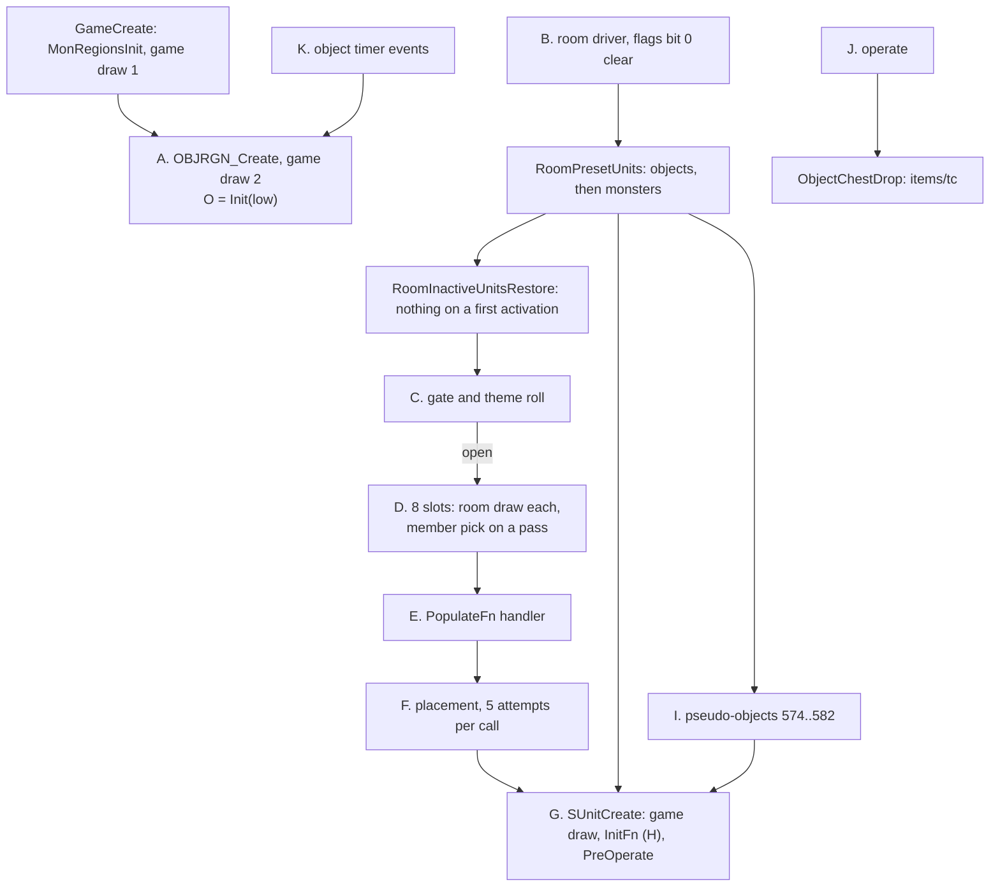
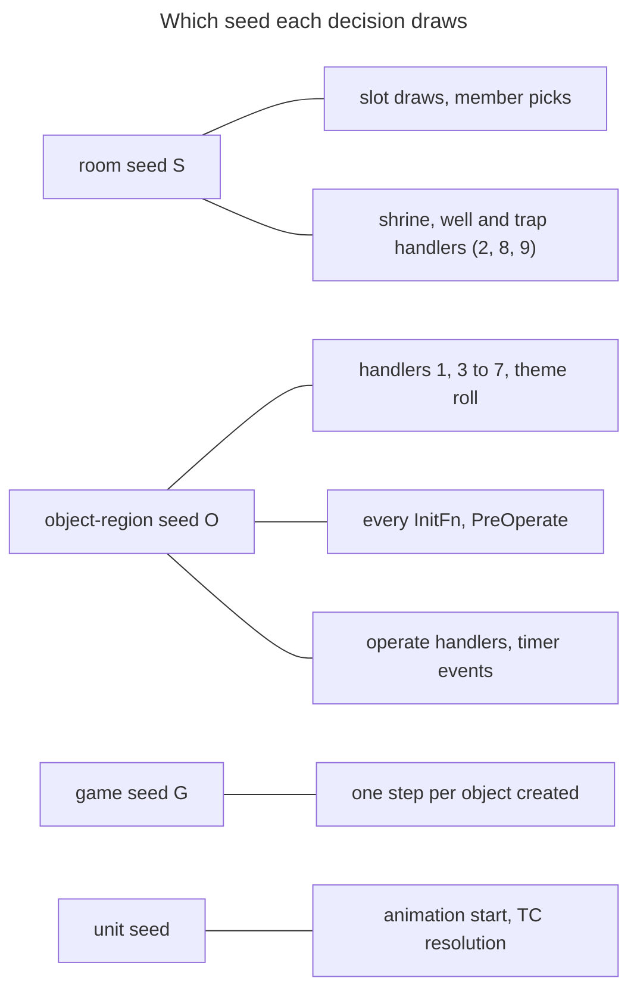
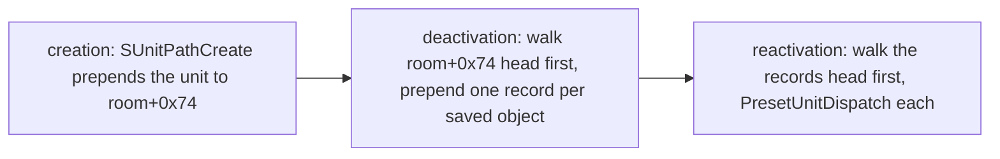
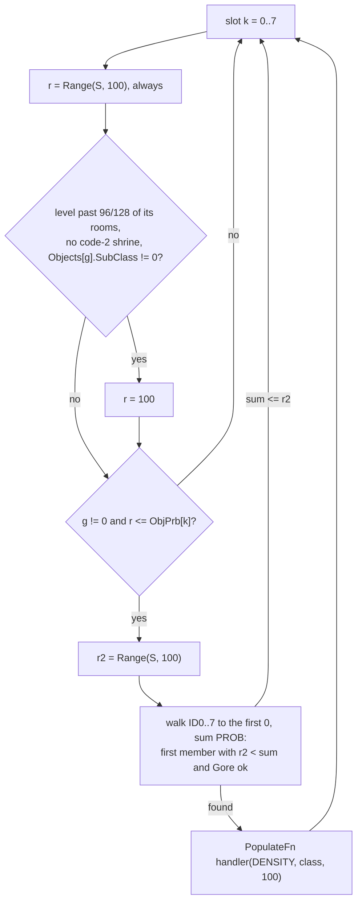
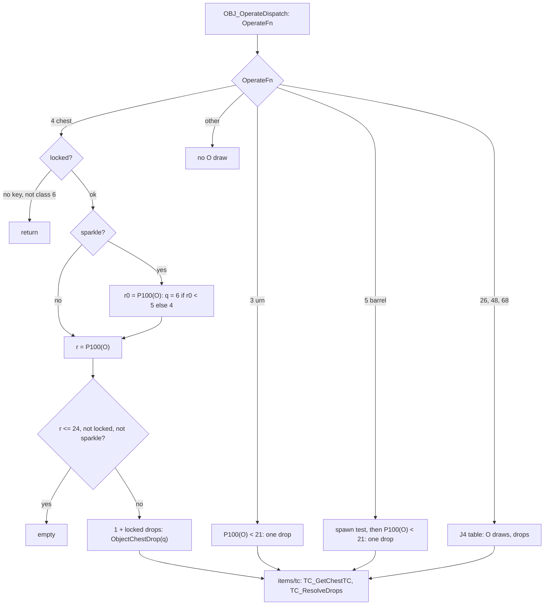
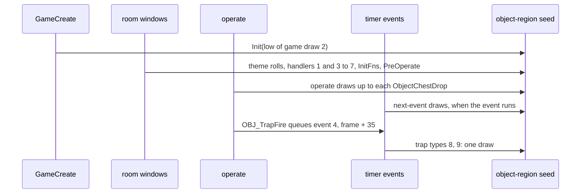

# Objects: room object population, placement, preset objects, creation rolls and the chest drop

## Purpose

When the server activates a room for the first time it creates the room's objects in three steps: the DS1 preset
objects, the inactive-unit restore (which does nothing on a first activation) and the random object population,
which walks the eight object-group slots of the room's level, picks a group member, and places it with a handler
chosen by the member's `PopulateFn`. Every object created then runs its creation rolls (unit seed, `InitFn`,
`PreOperate`). This spec gives that whole window with its exact draw order on its four seeds: the **room seed**,
the game-wide **object-region seed**, the **game seed** and each object's **unit seed**. It also gives the operate
path of chests and containers up to the call into item creation; the treasure class chosen there and everything after
it belong to [items/tc](../items/tc.md). What a shrine, a well, a trap or any other object *does* is game simulation
(ADR-0002) and is only named. Primitives (`Step`, `Range`, `Init`) are those of [rng](../rng/README.md).

## Entry points

| When | Function | Tag |
|---|---|---|
| Game creation: the object region and its seed (right after the monster regions) | fn:OBJRGN_Create@0x00546C60, called from fn:sub_00530BF0_GameCreate@0x00530BF0 | [C] |
| First activation of a room, in the room driver: presets, restore, objects, then the monster pass | fn:sub_0052D160_NewRoomsUpdate@0x0052D160 | [C] |
| DS1 preset units of the room (objects first, then monsters) | fn:sub_005559A0_RoomPresetUnits@0x005559A0 → fn:sub_005557D0_PresetUnitDispatch@0x005557D0 | [C] |
| DS1 pseudo-objects 574..582 | fn:OBJ_PresetPseudoDispatch@0x0054F490 | [C] |
| Inactive-unit restore (nothing on a first activation; a full re-creation on a revisit) | fn:sub_00542B40_RoomInactiveUnitsRestore@0x00542B40 | [C] |
| Random object population of the room | fn:sub_00552610_RoomObjectsPopulate@0x00552610 | [C] |
| Every object creation | fn:sub_00555230_SUnitCreate@0x00555230 → fn:OBJ_ServerInit@0x0054F5D0 | [C] |
| A player operates an object | fn:OBJ_OperateDispatch@0x00584420 | [C] |
| A chest or container drops (into items/tc) | fn:sub_00585B90_ObjectChestDrop@0x00585B90 → fn:TC_ResolveDrops@0x0055A6D0 | [C] |
| An object timer event runs from the game's event queue | data:g_ObjEventFns@0x006E19B0 | [C] |

- [C] Everything here runs on the server; the room driver calls the window only while the room's flags bit 0 is clear,
  and the monster population pass ([monsters/spawn](../monsters/spawn.md)) follows it.
  (fn:sub_0052D160_NewRoomsUpdate@0x0052D160, run:2026-10-15-objects,
  [objects/0001 § 1](../../findings/objects/0001-object-population.md#1-the-window-and-the-three-seeds))

## Inputs

### Tables

All tables are the compiled `.bin` records, indexed by record position ([data/excel](../data/excel.md)).

| Anchor | Used for |
|---|---|
| tbl:Levels.txt:ObjGrp0, tbl:Levels.txt:ObjPrb0 | u8 × 8 at `+0x0E5` and `+0x0ED` (`..7`): the eight slots, group index and chance (§ D) |
| tbl:Levels.txt:Themes | `+0x210`: the theme roll in the gate (§ C) |
| tbl:Levels.txt:MonLvl1 | u8 `+0x010`, the normal-difficulty column in **every** difficulty: trap and lock chances (§ H) |
| tbl:Levels.txt:Act | `+0x003`: the act of each object-region level record (§ A) |
| tbl:ObjGroup.txt:ID0 | u32 × 8 at `+0x00`: member classes (Objects record indices); the walk stops at the first 0 (§ D) |
| tbl:ObjGroup.txt:PROB0 | u8 × 8 at `+0x28`: cumulative percentages against one draw (§ D) |
| tbl:ObjGroup.txt:DENSITY0 | u8 × 8 at `+0x20`: the count factor passed to the handler; ≥ 128 is fatal (§ D, § E) |
| tbl:Objects.txt:PopulateFn, tbl:Objects.txt:InitFn, tbl:Objects.txt:OperateFn | u8 `+0x1B2`, `+0x1B1`, `+0x1B3`: handler indices (§ E, § H, § J) |
| tbl:Objects.txt:SizeX, tbl:Objects.txt:SizeY | `+0xD0`, `+0xD4`: placement sizes and the mark (§ F, § G) |
| tbl:Objects.txt:SubClass | `+0x167`: read by the forced-slot rule **at the group index** (§ D) |
| tbl:Objects.txt:Gore | `+0x172`: member skip against the gore limit (§ D) |
| tbl:Objects.txt:Orientation | `+0x13C`: the shrine placer (§ F) |
| tbl:Objects.txt:Xspace, tbl:Objects.txt:Yspace | `+0x162`, `+0x163`, read as **u8**: barrel and crate cluster steps (§ E) |
| tbl:Objects.txt:Lockable | `+0x171`: the lock roll of `InitFn` 3 (§ H) |
| tbl:Objects.txt:PreOperate | `+0x13D`: the 1/14 opened roll (§ G) |
| tbl:Objects.txt:Sync, tbl:Objects.txt:FrameDelta0 | `+0x175`, `+0xF8 + mode`: the animation-start draw on the unit seed (§ G) |
| tbl:Objects.txt:Selectable0 | `+0xC4 + mode`: the selectable flag (§ G) |
| tbl:Objects.txt:Parm0, tbl:Objects.txt:Parm1 | s32 `+0x178`, `+0x17C`: shrine class and forced-shrine class (§ E, § H) |
| tbl:Objects.txt:Mode1 | `+0x140`: a chest's mode after operating (§ J) |
| tbl:Shrines.txt:effectclass | u8 `+0xB2`: which pick list a code is in (§ A, § H) |
| tbl:Shrines.txt:LevelMin | u32 `+0xB4`, compared with the Levels **Id** (§ H) |

Not read by any code of this spec: ObjGroup `SHRINES` and `WELLS`, Shrines `rarity`, Objects `SpawnMax`, `TrapProb`,
`Act`. [I] ([objects/0001 § Data touched](../../findings/objects/0001-object-population.md#data-touched),
tbl:ObjGroup.txt:SHRINES, tbl:Shrines.txt:rarity, tbl:Objects.txt:TrapProb)
[I] Beyond this spec: `SpawnMax` (`+0xC3`) and `Act` (`+0x170`) have no reader in the whole image as far as an operand
scan can tell (no `+0xC3` displacement at all; the one byte operand at `+0x170` is a stack array at 0x00694D9E), and
none of the 89 functions that fetch an Objects record or read the table pointer reads `TrapProb` (`+0xCC`). A reader
through a computed address, a wider read or a record pointer kept elsewhere is not excluded. (fn:OBJECTS_GetRecord@0x00640E90,
tbl:Objects.txt:SpawnMax, tbl:Objects.txt:Act, tbl:Objects.txt:TrapProb,
[objects/0001 § Plan 0039 batch P1b](../../findings/objects/0001-object-population.md#plan-0039-batch-p1b-2026-10-17))

### Runtime state

| State | Type | Source |
|---|---|---|
| room seed `S` | `Seed` at active room `+0x6C` | [rng/seeds](../rng/seeds.md) step 6c, then the wanderer tick ([monsters/spawn § K](../monsters/spawn.md#k-wanderers-the-tick)) |
| object-region seed `O` | `Seed` at `*(game+0x10F0)` (struct:ObjRgn+0x0) | § A; one stream for the whole game |
| game seed `G` | `Seed` at game `+0xD0` | [rng/seeds](../rng/seeds.md) |
| unit seed | `Seed` at unit `+0x20` | § G |
| level record `L` | `ObjRgnLevel` (0x90 B) per level id, `objrgn+0x48 + 4·id` | § A: `roomsVisited` `+0x04`, `roomCount` `+0x08`, `+0x0C`, `healthShrines` `+0x10`, `nShrinePos` `+0x14`, `nWellPos` `+0x18`, shrine and well positions |
| shrine lists | per `effectclass` 0..7: the Shrines codes in record order (struct:ObjRgn+0x8) | § A |
| room rectangle | `rect = {x, y, w, h}` in subtiles | DRLG |
| object data | `interact` u8 at ObjectData `+0x04` (struct:ObjectData+0x4): shrine code, or trap type (bits 0–6) and locked (bit 7); sparkle flag at unit `+0x78` | § G, § H |
| difficulty, expansion | game | game creation |

### Constants

| Name | Value | Anchor | Tag |
|---|---|---|---|
| slot count | 8 | fn:sub_00552610_RoomObjectsPopulate@0x00552610 | [C] |
| forced-slot threshold | `roomsVisited·128 ÷ roomCount > 96` (signed) | 0x005526CC | [C] |
| gore limit | byte 2, no writer | data:g_ObjGoreLimit@0x00731BBC | [I] |
| placement attempts per placer call | 5 | fn:OBJ_PlaceRandom@0x00550380 | [C] |
| position-test masks | `0x3F11` (box test), `0xC01` (padded box) | fn:OBJ_PosTestPadded@0x00550220 | [C] |
| shrine spacing, well spacing | 50, 100 subtiles on **each** axis | fn:OBJRGN_ShrineDistOk@0x00547430, fn:OBJRGN_WellDistOk@0x005473A0 | [C] |
| shrine cap, well cap per level | 10 (or `> roomCount ÷ 8`), 4 (or `> roomCount ÷ 8`) | fn:OBJRGN_ShrineCapReached@0x00547360, fn:OBJRGN_WellCapReached@0x00547300 | [I] |
| `PreOperate` chance | `Range(O, 14) = 0` | fn:OBJ_ServerInit@0x0054F5D0 | [C] |
| handler tables | `g_ObjInitFns` 80, `g_ObjPopulateFns` 10, `g_ObjOperateFns` 101, `g_ObjTrapFns` 10, `g_ObjPseudoFns` 9 entries | data:g_ObjInitFns@0x00731BC0, data:g_ObjPopulateFns@0x00731D00, data:g_ObjOperateFns@0x00732D18, data:g_ObjTrapFns@0x00732CEC, data:g_ObjPseudoFns@0x00731D28 | [C] |
| eight directions | `dx = −1, 0, 1, −1, 1, −1, 0, 1`, `dy = −1, −1, −1, 0, 0, 1, 1, 1` | data:g_ObjDir8X@0x00731B7C, data:g_ObjDir8Y@0x00731B9C | [C] |

### Inputs and oracles

The reproduction of run:2026-10-15-objects models this whole spec on the four seeds, with the object-region seed
predicted from game creation and carried across every room, operate and timer event; the window RW1 → RW4 of each room
is predicted from its entry, 1265 windows with 0 mismatches in 142 540 checks. The rows below are what it took from the
log ([ADR-0004](../../adrs/0004-boundary-oracles-in-reproduction.md)), except the two collision rows, which plan 0027
Phase 2 moved onto the grid model (150 338 checks, 0 mismatches); a reimplementation supplies them from their
owners. Every `[C]` of this spec holds under these inputs. [C] (run:2026-10-15-objects,
[objects/0001 § 12](../../findings/objects/0001-object-population.md#12-phase-2-the-bit-exact-run))

| Input | Kind | What it holds | Owner | Tag |
|---|---|---|---|---|
| the gate's DRLG parts | value oracle | room flags `0x30000`, `RoomPopLevelId`, the preset test, the town test, `LevelRoomCount` on first read | `drlg/preset`, `drlg/overview` | [C] (fn:OBJ_PopulateGate@0x00552560, run:2026-10-15-objects) |
| `COLL_WHTest` results at the seven object call sites and at the gold piles | modelled, [drlg/collision § E6](../drlg/collision.md#e-collisiontest-by-size) | 0 = free; predicted on the room grids (the activation stamp, the object marks below, the logged monster and gold-item marks): 5767 placer calls and 92 gold-pile calls, 4816 blocked and 1043 free, 0 mismatches | [drlg/collision](../drlg/collision.md#inputs-and-oracles) | [C] (fn:COLL_WHTest@0x0064D800, run:2026-10-15-objects, [objects/0001 § 14](../../findings/objects/0001-object-population.md#14-the-position-tests-and-the-object-marks-on-the-grid-model-plan-0027-phase-2-2026-10-15)) |
| object marks in the collision grid | modelled, § G and [drlg/collision § F](../drlg/collision.md#f-unit-marks) | the mark each created object makes (G1, G4): all 1847 predicted (1835 inside a window, matched with their CM lines; 12 under preset monsters, compared inside the monster's seed oracle); 742 creations with `HasCollision` 0 in their mode made none, as predicted; 433 creations of the revisit restore are applied without a line to compare | `drlg/collision` | [C] (fn:UNIT_CollMarkRect@0x00620A70, fn:UNIT_GetCollMask@0x006209D0, run:2026-10-15-objects) |
| preset monsters of the presets window | seed oracle | `PresetUnitDispatch` of type 1, and the superunique and MonPlace spawns | [monsters/spawn](../monsters/spawn.md), [monsters/special](../monsters/special.md) | [C] (fn:sub_0054E600_PresetMonSpawn@0x0054E600, run:2026-10-15-objects) |
| monster and quest `InitFn`s | seed oracle | `InitFn` 46 (it draws the room, game and object-region seeds inside its monster spawns: 584 object-region draws in 16 calls), 47, 54, 55, 62, 66, 68, 69, Zoo 79, pseudo-object 582 | monsters, quests | [C] (fn:OBJINIT_CityDamnedSpawns@0x005506D0, run:2026-10-15-objects) |
| state `InitFn`s | value oracle | the mode or `interact` value that `InitFn`s without draws set from game state (4, 6, 8, 9, 12, 14, 16, 17, 22, 26 in the run); the unit-seed draw of the mode change is predicted | game state | [C] (data:g_ObjInitFns@0x00731BC0, run:2026-10-15-objects) |
| `TC_ResolveDrops` | seed oracle in the run; modelled by [items/tc](../items/tc.md) | draws the dropping object's **unit seed**; it left the object-region seed alone in all 59 calls | `items/tc` | [C] (fn:TC_ResolveDrops@0x0055A6D0, run:2026-10-15-objects) |
| gold drop of `InitFn` 28, operate monster spawn `0x00582280` | seed oracle | item creation; the gold drop's item marks (`0x200`, 71) stay logged CM lines; the spawn draws no object-region draw (2 spawns) | items, monsters | [C] (fn:OBJINIT_GoldPiles@0x0054F8C0, fn:OBJOP_Barrel@0x005868A0, run:2026-10-15-objects) |
| when a player operates which object | input | simulation | game | [C] (fn:OBJ_OperateDispatch@0x00584420, run:2026-10-15-objects) |
| when an object timer event runs | input | simulation (ADR-0002); its draws are modelled (§ K), the trap event's `OBJTRAP_MonsterSpawn` draw included | game | [C] (data:g_ObjEventFns@0x006E19B0, run:2026-10-15-objects) |
| trap effects | named only | `g_ObjTrapFns[t]`, run by object event 4 (§ K); the `fire` creations of `OBJTRAP_ObjectCreate` (one game-seed step and a unit-seed draw each) are **not modelled**, and no trap of types 5, 7, 8 or 9 fired in the run | game simulation | [I] (fn:OBJ_TrapEvent@0x005817A0, fn:OBJTRAP_ObjectCreate@0x00582380) |
| room and game seeds at each revisit re-creation | logged | the monster and item restores that run before the objects (§ B5) are specified in [drlg/lifecycle § H](../drlg/lifecycle.md#h-the-restore), not in this spec's model; the object re-creations' own draws are this spec's | `drlg/lifecycle` | [I] (fn:sub_00542B40_RoomInactiveUnitsRestore@0x00542B40) |
| populate windows inside an operate | — | a portal-like operate handler that activates a room runs that room's window (§ B) inside the operate; those draws are the window's | this spec | [I] (fn:sub_0052D0F0_RoomUpdateOne@0x0052D0F0) |

## Algorithm





- [C] The window draws four seeds. The **room seed** gives the slot draws, the member picks and every draw of the
  shrine (2), well (8) and trap (9) handlers' room part. The **object-region seed** gives the other handlers, the theme
  roll, every `InitFn`, the `PreOperate` roll, the operate handlers and the timer events. The **game seed** steps once
  per object created. The **unit seed** gives the animation-start draw and, through `TC_ResolveDrops`, the drop.
  (fn:sub_00552610_RoomObjectsPopulate@0x00552610, fn:OBJRGN_GetSeed@0x00546FA0, run:2026-10-14-objects-window,
  run:2026-10-15-objects)

### A. The object-region seed and level records (game creation)

```
A1. OBJRGN_Create(game):                                          [C] (fn:OBJRGN_Create@0x00546C60, run:2026-10-15-objects)
      Step(G); v: u32 ← G.low                                      ; game-seed draw 2 after Init(N)
      Init(objrgn.seed, v)                                         ; O = {v, 666}
      for id in 1 ..< nLevels:
        L[id] ← { act ← Levels[id].Act, roomCount ← 0x7FFFFFFF, +0x1C ← −1, all else 0 }
      for c in 0 ..< 8:
        shrines[c] ← the Shrines codes whose effectclass = c, in record order
```

- A1. [C] `GameCreate` calls `OBJRGN_Create` at `0x00530DD1`, right after `MonRegionsInit` (`0x00530DCA`, game-seed draw
  1, [rng/seeds](../rng/seeds.md) step note 7a); no call sits between the two, so the object region takes game-seed draw
  2. (fn:sub_00530BF0_GameCreate@0x00530BF0, fn:sub_00547D20_MonRegionsInit@0x00547D20, run:2026-10-15-objects)
- A2. [C] `OBJRGN_GetSeed(game, room)` returns the region's seed and ignores the room: there is **one object-region
  stream per game**, advanced by every room's objects in activation order, every operate and every timer event.
  (fn:OBJRGN_GetSeed@0x00546FA0, struct:ObjCtx+0xC, run:2026-10-15-objects)

### B. The window in the room driver, and the revisit

```
B1. per room of the act's new-rooms walk, after the wanderer tick, if room.flags & 1 = 0:   [C] (fn:sub_0052D160_NewRoomsUpdate@0x0052D160, run:2026-10-15-objects)
      RoomPresetUnits(game, room)          ; RW1 → RW2: non-monsters first (objects: § G, § I), then monsters (oracle)
      RoomInactiveUnitsRestore(game, room) ; RW2 → RW3: no record on a first activation, no draw
      RoomObjectsPopulate(game, room)      ; RW3 → RW4: §§ C–F
      ... monster population pass (monsters/spawn), then flags |= 1
```

- B1. [C] A preset object goes `PresetUnitDispatch` → `SUnitCreate(x, y, game, room, flags 1, mode = DS1 mode)` and
  makes the creation draws of § G and **no room-seed draw**, unless its `InitFn` spawns monsters. The walk order (all
  non-monsters, then all monsters) and the per-level walk filters are [drlg/preset § 6](../drlg/preset.md#6-handover-to-the-server-spawners-boundary).
  (fn:sub_005557D0_PresetUnitDispatch@0x005557D0, fn:sub_005559A0_RoomPresetUnits@0x005559A0, run:2026-10-15-objects)
- B2. [C] On a first activation the inactive-unit restore leaves the room, game and object-region seeds unchanged (2090
  first activations of the three earlier runs, and every window of run:2026-10-15-objects).
  (fn:sub_00542B40_RoomInactiveUnitsRestore@0x00542B40, run:2026-10-14-objects-window, run:2026-10-15-objects)
- B3. [C] **Revisit.** When a room that went inactive is activated again (flags bit 0 already set, so outside the
  window above), the restore re-creates each saved object through `PresetUnitDispatch` with **every creation draw**
  of § G (one game-seed step, its `InitFn` on the object-region seed, the `PreOperate` roll), then restores the saved
  `interact` byte, mode and sparkle flag. A chest locked at its first creation stays locked even when its new `InitFn`
  3 roll did not lock it. 548 re-creations reproduced. (fn:sub_00542B40_RoomInactiveUnitsRestore@0x00542B40,
  fn:sub_005557D0_PresetUnitDispatch@0x005557D0, run:2026-10-15-objects)



```
B4. Saving, when the room driver deactivates a room:             [C] for SaveTest (run:2026-10-17-lifecycle), [I] for the rest (fn:sub_0052D240_RoomsDeactivate@0x0052D240, fn:sub_005433F0_InactiveUnitSaveTest@0x005433F0, fn:sub_00542E30_InactiveUnitSave@0x00542E30)
      ; the room's unit list room+0x74 is newest first: every creation prepends (unit+0xE8 ← room+0x74; room+0x74 ← unit)
      for u in room+0x74, head first:
        if u.type = 2 and SaveTest(u): prepend a 0x34-byte record to the room's record list (+0x10, next at +0x30)
      SaveTest(object) holds when all of:
        the level flag Levels.SaveMonsters (leveldefs +0x94) or the preset flag 0x2000000 (set by PresetUnitDispatch) is set;
        Objects.Restore ≠ 0;  (sparkle byte & 0x02) = 0;  Objects.RestoreVirgins = 0 or mode = 0
      classes 59, 60 (portals): always saved, the unit kept alive and flagged 0x100 (unit +0xC8)
      record: x, y (+0x0, +0x4); type, class (+0x8, +0xC); mode (+0x10; mode 1 is saved as 2 when Objects +0x109 = 0
        and Objects +0x141 ≠ 0); game frame (+0x14); unit flags +0xC4, +0xC8 (+0x18, +0x1C); for a shrine its pending
        event time (+0x20/+0x24), otherwise the sparkle byte (+0x24); the interact byte (+0x28); unit +0xB8 (+0x2C)

B5. RoomInactiveUnitsRestore(game, room), on a revisit:           [C] (fn:sub_00542B40_RoomInactiveUnitsRestore@0x00542B40, run:2026-10-15-objects)
      InactiveMonstersRestore(room)                                ; drlg/lifecycle § H; not modelled here
      recs ← InactiveRecordTake(room)                              ; unlinks the record matched on the room's x, y
      InactiveItemsRestore(recs)                                   ; items: a separate list, drlg/lifecycle § H
      for rec in recs.units, head first:                           ; = the earlier creation order, oldest first
        if rec.type = 1 or rec.flagsC8 & 0x100: continue           ; a kept unit (portal) is only moved back
        u ← PresetUnitDispatch(rec.type, rec.class, rec.x, rec.y, mode ← rec.mode)   ; every creation draw of §§ G, H
        restore, no draw:
          a shrine with a saved frame: re-queue its event, interact ← the saved code, 0x00621BB0(Shrines[code])
          a well (SubClass & 0x20): charges from the frames elapsed, refill events queued
          any other object: interact ← rec+0x28, sparkle ← rec+0x24, unit+0xB8 ← rec+0x2C when that is ≠ 0
```

- B4. [C] The save test, with its level flag named `Levels.SaveMonsters`, held on the 3 023 objects of
  run:2026-10-17-lifecycle (`Restore` 0: 15; `RestoreVirgins` on a used object: 30), and the records it wrote came back
  through B5 ([drlg/lifecycle § F](../drlg/lifecycle.md#f-the-save-rule)). Classes 59 and 60 (kept) were not met.
  (run:2026-10-17-lifecycle, fn:sub_005433F0_InactiveUnitSaveTest@0x005433F0, tbl:Levels.txt:SaveMonsters)
- B4. [I] Saving walks a newest-first list and prepends, so it reverses the order: the record list is oldest first.
  Items and monsters are saved to other lists (`0x00541B10`, `0x005421A0`). (fn:sub_0064C2C0_RoomUnitAdd@0x0064C2C0,
  fn:sub_00554850_SUnitPathCreate@0x00554850, tbl:Objects.txt:Restore, tbl:Objects.txt:RestoreVirgins)
- B5. [C] The saved objects are re-created oldest first: in the run every re-creation that followed another one of the
  same restore came after it in the earlier creation order (362 of 362 pairs among the 548 re-created objects). The
  saved id is the **class**, so a DS1 580/581 chest comes back through the plain `SUnitCreate` path, with no 581 class
  draw and no Maggot Lair draw, and its sparkle from the record. (fn:sub_005424F0_InactiveMonstersRestore@0x005424F0,
  fn:sub_005418C0_InactiveRecordTake@0x005418C0, fn:sub_00541AC0_InactiveItemsRestore@0x00541AC0,
  fn:UNIT_IsShrine@0x00621B00, run:2026-10-15-objects)

### C. The gate and the theme roll

```
C1. Gate(game, room, lvlRec) → bool:                              [I] (fn:OBJ_PopulateGate@0x00552560)
      if DrlgRoom(room).flags & 0x30000: return false              ; input: a waypoint sets it on its room
      pop ← RoomPopLevelId(room)                                   ; input: 0 for Populate 0 or the near-town rule
      if pop = 0 or PresetPopTest(room) or pop ≥ nLevels or LevelIsTown(room): return false   ; inputs
      L ← objrgn.level[pop]
      if L.roomCount = 0x7FFFFFFF: L.roomCount ← LevelRoomCount(act of L, pop)               ; input, once
      L.roomsVisited ← L.roomsVisited + 1                          ; [C] counts gated rooms, not populated ones (run:2026-10-15-objects)
      if lvlRec.Themes ≠ 0 and ThemeRoll(game, room, L, lvlRec.Themes) = 1: return false
      return true

C2. ThemeRoll(game, room, L, themes) → i32:                       [C] (fn:OBJ_RoomThemeRoll@0x00552400, run:2026-10-15-objects)
      if L.roomCount < 10 × L[+0x0C]: return 0                     ; +0x0C has no writer: never taken
      r ← Range(O, 100)                                            ; draw
      thr: i32 ← 12
      if L.roomsVisited > L.roomCount ÷ 2: thr ← thr + 5
      if L.roomsVisited > L.roomCount − L.roomCount ÷ 4: thr ← thr + 5
      if r ≥ thr: return 0
      list ← the theme numbers t in 1 ... 7 with themes & (1 << (t − 1)) ≠ 0;  n ← |list|
      i ← Range(O, n)                                              ; draw
      t ← list[i]
      if t < n and g_ObjThemeFns[t] is enabled: return ThemeFn[t](…)   ; never on stock data
      return 0
```

- C1. [C] The gate's DRLG inputs are taken from the log (*Inputs and oracles*). Town windows drew nothing in all 222
  logged town activations. `lvlRec` is the room's **own** level record (`RoomGetLevelId`), while the counters belong
  to the **population** level `pop`. (fn:sub_0061A1F0_RoomPopLevelId@0x0061A1F0, fn:sub_006426A0_LevelIsTown@0x006426A0,
  struct:ObjRgnLevel+0x4, run:2026-10-14-objects-window, run:2026-10-15-objects)
- C2. [C] The stock `Themes` values are 8, 48 and 60; each lists only theme numbers ≥ `n` except 60, whose theme 3 has
  no handler, so **no theme ever runs on stock data** and the roll costs 1 or 2 object-region draws per gated room of
  the 39 levels with `Themes` set (20 rolls in the run, 2 of them drew an index). The theme handlers are named only:
  1 an empty room, 2 a barrel grid, 4 an item grid, 5 and 6 bookshelf or weapon-rack rows. (tbl:Levels.txt:Themes,
  data:g_ObjThemeFns@0x00731E68, run:2026-10-15-objects)

### D. The slot loop and the member pick



```
D1. RoomObjectsPopulate(game, room):                              [C] (fn:sub_00552610_RoomObjectsPopulate@0x00552610, run:2026-10-14-objects-window, run:2026-10-15-objects)
      lvl ← Levels[RoomGetLevelId(room)]
      if not Gate(game, room, lvl): return
      for k in 0 ..< 8:
        g: u8 ← lvl.ObjGrp[k]
        r: u32 ← Range(S, 100)                                     ; draw, every slot, group 0 included
        L ← objrgn.level[RoomPopLevelId(room)]
        if L.roomCount > 0 and (L.roomsVisited << 7) ÷ L.roomCount > 96
           and L.healthShrines = 0 and Objects[g].SubClass ≠ 0:    ; record index g = the GROUP number (sic)
          r ← 100                                                  ; fails every slot (largest ObjPrb is 90)
        if g = 0 or r > lvl.ObjPrb[k]: continue
        G ← ObjGroup[g]; if G = none: return                       ; [I] only past the 133 records (fn:OBJGROUP_GetRecord@0x006412F0)
        r2: u32 ← Range(S, 100)                                    ; draw
        sum: i32 ← 0
        for i in 0 ..< 8 while G.ID[i] ≠ 0:
          sum ← sum + G.PROB[i]
          if r2 < sum and Objects[G.ID[i]].Gore ≤ goreLimit:
            fn ← g_ObjPopulateFns[Objects[G.ID[i]].PopulateFn]    ; PopulateFn ≥ 10 or DENSITY ≥ 0x80: fatal error
            if fn ≠ none: fn(game, room, G.DENSITY[i], G.ID[i], 100)
            break
```

- D1. [C] This order accounts for every room-seed draw of the 1405 drawing windows of the three earlier runs and of
  every window of run:2026-10-15-objects: one draw per slot whether or not the group is 0, `r ≤ ObjPrb` passes (so the
  chance is `(ObjPrb + 1)/100`), one pick draw per passing slot, and nothing placed when the `PROB` sum is at most
  `r2` (259 of 2307 passing slots). `PROB` is a percentage against 100, not a weight over the members' sum.
  (tbl:ObjGroup.txt:PROB0, tbl:Levels.txt:ObjPrb0, run:2026-10-14-objects-window)
- D2. [C] **The forced-slot rule is a game bug the spec keeps.** It tests `Objects[g].SubClass`, the Objects record
  whose index is the group number, so the slots it suppresses are those whose group index is 1–6, 50–53, 59, 60, 77,
  109, 116, 119, 120, 123, 124 or 129. Phase 2 tracked the counters at every slot and they matched; one slot was forced
  directly (Sewers level 2, slot 2, group 5). (0x005526CC, fn:OBJRGN_GetLevel@0x00546F90, tbl:Objects.txt:SubClass,
  run:2026-10-15-objects)
- D3. [I] Group 0 and the memberless groups 30 and 72 cost their draws and place nothing; a `PROB` 0 member is never
  picked; group 69 starts with an empty member slot and never places. The `Gore` test never excludes on stock data
  (`Gore` is 0 or 1, the limit 2). (tbl:Objects.txt:Gore, data:g_ObjGoreLimit@0x00731BBC)
- D4. [C] Every handler receives the member's `DENSITY`, its class (the Objects **record index**) and the
  probability 100. The handlers draw their own probability against 100: that draw always passes, but it is made.
  (data:g_ObjPopulateFns@0x00731D00, run:2026-10-15-objects)

### E. The `PopulateFn` handlers

Notation: `R(s, n)` is `Range(s, n)`: 0 with **no draw** when `n < 1`, else one draw and `low mod n`
([rng](../rng/README.md) step 2). `P100(s)` is `Range(s, 100)`. `RandLoHi(s, lo, hi)` is `lo + Range(s, hi − lo)`, `lo`
without a draw when `hi ≤ lo`. `cnt: i32 ← ((w·h >> 7) · DENSITY) >> 8` with signed shifts. `sx`, `sy` are the class's
`SizeX`, `SizeY` unless noted. Every creation is `SUnitCreate(2, class, x, y, game, room, flags 1, mode 0)` (§ G).
[C] (fn:RNG_RandLoHi@0x004BC500, fn:OBJPOP_Scatter@0x00551470, run:2026-10-15-objects)

| Fn | Handler | Seed | Draw sequence | Tag |
|---|---|---|---|---|
| 1 | `OBJPOP_Clusters` | O | `P100`; the class picks a list; clusters while `cnt > 0` and tries remain (E1) | [C] (fn:OBJPOP_Clusters@0x00550C20, run:2026-10-15-objects) |
| 2 | `OBJPOP_Shrine` | S | `P100`; cap; up to 3 (forced: 30) `OBJ_PlaceByOrientation` calls (E2) | [C] (fn:OBJPOP_Shrine@0x00552B50, run:2026-10-15-objects) |
| 3 | `OBJPOP_Scatter` | O | `P100`; `cnt` × `OBJ_PlaceRandom` | [C] (fn:OBJPOP_Scatter@0x00551470, run:2026-10-15-objects) |
| 4 | `OBJPOP_Barrels` | O | `P100`; `cnt` clusters, `2·cnt` tries, at most 8 objects (E3) | [C] (fn:OBJPOP_Barrels@0x00551850, run:2026-10-15-objects) |
| 5 | `OBJPOP_Crates` | O | `P100`; like 4, a class list of five, at most 8 followers (E4) | [I] (fn:OBJPOP_Crates@0x00551C00) |
| 6 | `OBJPOP_Corpse` | O | handler 3, then `OBJ_FliesAdd` on its last placement | [C] (fn:OBJPOP_Corpse@0x00551690, run:2026-10-15-objects) |
| 7 | `OBJPOP_StickCorpses` | O | `P100`; pattern `R(4)`; ≤ 8 anchor tries; one class draw per placed cell (E5) | [C] (fn:OBJPOP_StickCorpses@0x00551200, run:2026-10-15-objects) |
| 8 | `OBJPOP_Well` | S | cap; `P100`; one `OBJ_PlaceRandomRoomSeed` (E6) | [C] (fn:OBJPOP_Well@0x005516C0, run:2026-10-15-objects) |
| 9 | `OBJPOP_Trap` | S, then O | `P100` on S; `cnt` × `OBJ_PlaceRandom` on O, stopping at the first trap placed | [C] (fn:OBJPOP_Trap@0x00551580, run:2026-10-15-objects) |

- [C] On the room seed, handler 9 draws exactly once, handler 2 draws `1 + 2a` (`a` = placement attempts made), and
  handler 8 draws 0 (cap reached) or `1 + 2a`. Handlers 1 and 3–7 never draw the room seed.
  (run:2026-10-14-objects-window, run:2026-10-15-objects)

**E1. Handler 1 (urns, caskets, baskets, sarcophagi).** [C] (fn:OBJPOP_Clusters@0x00550C20,
data:g_ObjClusterLists@0x00731D50, run:2026-10-15-objects) The class chooses a list, the number of tries, and the ring
step and base used to walk away from the first object; the first object of every cluster uses the padded test.

| Class | List | Tries | Step / base | Follower test |
|---|---|---|---|---|
| 3 | 3, 28 | 18 | 5 / 5 | padded |
| 1, 79 | 79, 53, 1 | 12 | 5 / 5 | padded |
| 4 | 4, 9, 52, 94, 95 | 12 | 0 / 1 | tight |
| 89 | 89, 284 | 12 | 5 / 5 | padded |
| 208, 209 | 208, 209 | 12 | 0 / 1 | tight |
| any other | — | — | — | returns after the `P100` |

```
E1. Clusters(class, DENSITY):                                     [C] (fn:OBJPOP_Clusters@0x00550C20, run:2026-10-15-objects)
      if P100(O) > 100: return                                     ; draw; never taken
      if cnt ≤ 0: return
      while tries > 0:
        cls ← list[R(O, n)]                                        ; n = list length
        x ← rect.x + R(O, w − sx − 1);  y ← rect.y + R(O, h − sy − 1)   ; sx, sy of the member class
        if not PosTestPadded(x, y): tries ← tries − 1; continue
        create(cls, x, y);  k ← 1;  ok ← true
        loop:
          m ← k >> 1
          if m > 0 and R(O, m) ≠ 0: break                          ; the cluster ends with chance 1 − 1/m
          if not ok: break
          ok ← false;  i ← 0;  lim ← 3 × max(cnt, 4)
          while not ok and i < lim:
            Step(O); d ← O.low & 7                                 ; draw
            x ← x + (R(O, step) + base) × dx[d] × 2                 ; R(O, 0) makes no draw
            y ← y + (R(O, step) + base) × dy[d] × 2
            ok ← followerTest(x, y, sx, sy);  i ← i + 1             ; a rejected step still moves the point
          if ok: create(list[R(O, n)], x, y); k ← k + 1
        cnt ← cnt − 1;  tries ← tries − 1
        if cnt ≤ 0: return
```

- E1. [I] Every size in E1 is the **member** class's: the handler fetches `Objects[class]` once, for the class it was
  called with, and never reloads it. So `sx`, `sy` in the first object's two draws, its padded test and every
  follower test (`PosTestTight` or `PosTestPadded` per the table) are the member's `SizeX`, `SizeY`; the class drawn
  from the list only goes to `SUnitCreate`. A follower after a `Casket` (79, 4 × 6) in a group whose member is class
  1 (5 × 3) is tested with 5 × 3. The run drew only the 1 × 1 lists (members 4 and 208), so it cannot tell this from
  the drawn class's size. (fn:OBJPOP_Clusters@0x00550C20, 0x00550C37, 0x0055103E, fn:OBJECTS_GetRecord@0x00640E90,
  tbl:Objects.txt:SizeX)

**E2. Handler 2 (shrines).** [C] (fn:OBJPOP_Shrine@0x00552B50, fn:OBJRGN_HealthShrineDue@0x00547330,
fn:OBJRGN_ShrineCapReached@0x00547360, struct:ObjRgnLevel+0x10, run:2026-10-15-objects)

```
E2. Shrine(class, prob = 100):
      r ← P100(S)                                                  ; draw
      forced ← HealthShrineDue(L)                                  ; [I] the due rule (fn:OBJRGN_HealthShrineDue@0x00547330)
      if forced: tries ← 30
      else: if r > prob: return;  tries ← 3                        ; never returns
      if ShrineCapReached(L): return                               ; [I] nShrinePos = 10 or > roomCount ÷ 8; not reached (fn:OBJRGN_ShrineCapReached@0x00547360)
      repeat tries times until placed:
        PlaceByOrientation(class, sx, sy, room, Orientation, popLvl, ShrineDistOk)   ; on S, F3
      on a placement:
        if forced and code ≠ 2:                                    ; [I] not reached (fn:OBJ_ShrineClassSubst@0x00552AC0)
          class ← Parm1 if 1 ≤ Parm1 ≤ 572 else 84
          ShrinePick(class 2, level 1)                             ; its draws are made, the result discarded
          code ← 2
        if code = 2 or forced: L.healthShrines ← L.healthShrines + 1
        record the position in the level's shrine list (nShrinePos + 1)
```

- E2. [I] `HealthShrineDue` holds once more than 75 % of the level's rooms have been gated and no code-2 shrine
  stands. Its 30 tries were needed by 2 windows of the older runs; a forced conversion of a placed shrine was never
  reached. (fn:OBJRGN_HealthShrineDue@0x00547330, run:2026-10-15-objects)

**E3. Handler 4 (barrels).** [C] (fn:OBJPOP_Barrels@0x00551850, tbl:Objects.txt:Xspace, run:2026-10-15-objects) It
ignores the member class and uses the size and `Xspace`/`Yspace` of record 7 (`Barrel`).
- Each try draws, in order: the class (`low mod 3 = 0` → 11 `BarrelExploding`, else 7), `x = rect.x + R(O, w)`,
  `y = rect.y + R(O, h)`; the tight test decides, and a failure only spends a try (`2·cnt` in all).
- On a success it creates the object and walks a cluster as in E1, each step one draw `d = low & 7`, then
  `x += Xspace·dx[d]`, `y += Yspace·dy[d]` (u8 values), up to 15 steps per follower; each follower draws its class,
  `low & 3 = 0` → 11, else 7.
- The handler returns after 8 objects in all. So the first barrel of a cluster explodes with chance 1/3, each follower
  with 1/4.

**E4. Handler 5 (crates).** [I] (fn:OBJPOP_Crates@0x00551C00) For a class other than 46, each try draws
`cls = list[R(O, 5)]` from (4, 9, 52, 94, 95), then `x`, `y` as in E3; on a success it draws the class **again** and
creates that one; followers take the same class with up to `max(4, ringLim)` steps of the member class's
`Xspace`/`Yspace`, `ringLim` starting at `4·cnt` and dropping by 4 per cluster; the handler stops after 8 followers.
Class 46 (`Crate`) skips both class draws. No stock level reaches it (*Open questions*).

**E5. Handler 7 (rogue on a stick), and flies.** [C] (fn:OBJPOP_StickCorpses@0x00551200, fn:OBJ_FliesAdd@0x00551150,
data:g_ObjStickPatterns@0x00731EB4, run:2026-10-15-objects)
1. `P100(O)` (passes), then the pattern `p = R(O, 4)`.
2. Up to 8 anchor tries: `x = rect.x + R(O, w − sx − 1)`, `y = rect.y + R(O, h − sy − 1)`, padded test with size 5 × 5.
3. For each offset of pattern `p`: the padded test at `anchor + offset` with the class size; on a pass, one draw for
   the class `57 + (low & 1)`, the creation, and `OBJ_FliesAdd`.

`OBJ_FliesAdd` (also handler 6, on the last placement of its handler-3 run) draws `P100(O)` and creates object 103
(`flies`) at the corpse's position when the value is above 70 (chance 29/100). The patterns are written at start-up by
the initialiser `0x006CAF30` (the file image holds zero counts):

| p | Offsets (dx, dy) |
|---|---|
| 0 | (−4,0) (0,0) (4,0) (8,0) (0,4) (0,−4) |
| 1 | (−8,0) (−4,0) (0,0) (4,0) (8,0) |
| 2 | (0,−8) (0,−4) (0,0) (0,4) (0,8) |
| 3 | (−7,−5) (−5,−3) (−3,−1) (0,0) (3,−1) (5,−3) (7,−5) |

**E6. Handler 8 (wells).** [C] (fn:OBJPOP_Well@0x005516C0, fn:OBJRGN_WellCapReached@0x00547300, run:2026-10-15-objects)
It returns at once when `WellCapReached` (`nWellPos = 4` or `> roomCount ÷ 8`; the cap itself is `[I]`, not reached).
Otherwise one room draw against `prob`, then one `OBJ_PlaceRandomRoomSeed` with size `(2·sx + 1) × (2·sy + 1)` and
`WellDistOk`; a placed well's position is recorded.

### F. Placement and the position tests

```
F1. PlaceRandom(class, sx, sy, room) → unit | none:               [C] (fn:OBJ_PlaceRandom@0x00550380, run:2026-10-15-objects)
      if w < 2 or h < 2: return none
      repeat 5 times:
        x ← rect.x + R(O, w − sx − 1);  y ← rect.y + R(O, h − sy − 1)     ; 2 draws per attempt
        if x ≠ 0 and y ≠ 0
           and rect.x + 1 ≤ x < rect.x + w − 1 and rect.y + 1 ≤ y < rect.y + h − 1     ; compared as u16
           and COLL_WHTest(room, x, y, sx + 6, sy + 6, 0x3F11) = 0:
          return create(class, x, y)
      return none                                                  ; no fallback

F2. PlaceRandomRoomSeed: as F1 on S, plus the handler's extra test (WellDistOk)     [C] (fn:OBJ_PlaceRandomRoomSeed@0x00550540, run:2026-10-15-objects)

F3. PlaceByOrientation(class, sx, sy, room, orient, popLvl, spacingFn) → unit | none, on S:   [C] (fn:OBJ_PlaceByOrientation@0x00550A30, tbl:Objects.txt:Orientation, run:2026-10-15-objects)
      ; all values i32; ÷ truncates toward zero
      if sx + 2 > w or sy + 2 > h: return none
      repeat 5 times:
        if orient = 1:
          x: i32 ← rect.x + R(S, w ÷ 2) + w ÷ 4                    ; draw first
          y: i32 ← rect.y + RandLoHi(S, 1, 2)                      ; draw; always 1
        else if orient = 2:                                        ; [I] no orientation-2 shrine in the run (0x00550ABF)
          x ← rect.x + RandLoHi(S, 1, 2)                           ; draw first; always 1
          y ← rect.y + R(S, h ÷ 2) + h ÷ 4                         ; draw
        else:
          x ← rect.x + R(S, w − sx − 1);  y ← rect.y + R(S, h − sy − 1)
        if x = 0 or y = 0: continue                                ; the full 32-bit values
        xl: i32 ← x & 0xFFFF;  yl: i32 ← y & 0xFFFF                 ; the margin is on the low 16 bits, compared signed
        if xl < rect.x + 1 or yl < rect.y + 1: continue
        if xl ≥ rect.x + w − 1 or yl ≥ rect.y + h − 1: continue
        if spacingFn is not a valid code pointer: fatal error 0x634
        if COLL_WHTest(room, x, y, sx + 6, sy + 6, 0x3F11) ≠ 0: continue      ; u16 result
        if (u8) spacingFn(game, popLvl, x, y) = 0: continue        ; called only after a clear test
        return SUnitCreate(2, class, x, y, game, room, flags 1, mode 0)
      return none

F4. PosTestPadded(x, y, sx, sy):                                  [C] (fn:OBJ_PosTestPadded@0x00550220, run:2026-10-15-objects)
      sx + 2 ≤ w, sy + 2 ≤ h, rect.x + 1 < x < rect.x + w − sx − 2, rect.y + 1 < y < rect.y + h − sy − 2,
      COLL_WHTest(room, x, y, sx + 7, sy + 7, 0xC01) = 0 and COLL_WHTest(room, x, y, sx, sy, 0x3F11) = 0

F5. PosTestTight(x, y, sx, sy):                                   [C] (fn:OBJ_PosTestTight@0x005502F0, run:2026-10-15-objects)
      w > 1, h > 1, rect.x + 2 < x < rect.x + w − sx, rect.y + 2 < y < rect.y + h − sy,
      COLL_WHTest(room, x, y, sx + 2, sy + 2, 0x3F11) = 0
```

- F1. [C] Accepted attempts in run:2026-10-15-objects fell at attempts 1 to 5 (153, 87, 67, 51, 29), and 911 placer
  calls found no spot. When no spot is found the object is not created. (fn:OBJ_PlaceRandom@0x00550380,
  run:2026-10-15-objects)
- F3. [C] The margin and tests are the same for every orientation: `OBJ_PlaceRandom`'s one-subtile margin, then the
  box `(sx + 6) × (sy + 6)` with mask `0x3F11`, then the spacing test. Orientation 1 always gives `y = rect.y + 1`,
  which passes the margin whenever `h ≥ 3` (always, since `h ≥ sy + 2`), and its `x` lies in
  `[rect.x + w ÷ 4, rect.x + w ÷ 4 + w ÷ 2 − 1]`, which passes whenever `w ≥ 4`; orientation 2 is the mirror. All 25
  orientation-1 calls of the run (121 attempts) passed the margin, and each attempt made exactly the predicted
  `COLL_WHTest` call. A test `attempt > 4` before the creation can never be true ([I], 0x00550BDE).
  (fn:OBJ_PlaceByOrientation@0x00550A30, fn:RNG_RandLoHi@0x004BC500, fn:COLL_WHTest@0x0064D800,
  fn:OBJRGN_ShrineDistOk@0x00547430, run:2026-10-15-objects)
- F6. [C] `COLL_WHTest(room, x, y, w, h, mask)` tests one cell (`COLL_CellTestNb`) when `w ≤ 1` and `h ≤ 1`, otherwise
  the inclusive rectangle `{x − w/2, y − h/2, x − w/2 + w − 1, y − h/2 + h − 1}` (unsigned halving) with `COLL_RectTest`,
  whose semantics are [drlg/collision § E](../drlg/collision.md#e-collisiontest-by-size). Mask `0x3F11` contains the
  object bit `0x400`, so an earlier object's mark rejects the spot. All 5859 results of the run are predicted on the
  grid model (*Inputs and oracles*). (fn:COLL_WHTest@0x0064D800, fn:COLL_RectTest@0x0064CEB0, fn:COLL_CellTestNb@0x0064CA50,
  run:2026-10-15-objects)
- F7. [C] `ShrineDistOk` rejects a point when, for some recorded shrine of the level, `|dx| < 50` **or** `|dy| < 50`:
  a second shrine needs both axes 50 subtiles away from every earlier one. `WellDistOk` does the same with 100.
  (fn:OBJRGN_ShrineDistOk@0x00547430, fn:OBJRGN_WellDistOk@0x005473A0, run:2026-10-15-objects)

### G. Creation: `SUnitCreate` for an object

```
G1. SUnitCreate(type 2, class, x, y, game, room, flags, mode):    [C] (fn:sub_00555230_SUnitCreate@0x00555230, run:2026-10-15-objects)
      Step(G); Init(unit.seed, G.low)                              ; one game-seed draw (UnitSeedInit)
      unit.data ← new ObjectData (0x38 B); objRec ← Objects[class] ; class = record index
      SetMode(unit, mode)                                          ; G2
      ServerInit(unit)                                             ; G3
      path (G4); no draw

G2. SetMode(unit, mode) → UNIT_AnimInit:                          [C] (fn:UNIT_SetMode@0x00624690, fn:UNIT_AnimInit@0x00624390, run:2026-10-15-objects)
      if objRec.Sync = 0: Range(unit.seed, objRec.FrameDelta[mode] >> 3)     ; unit-seed draw (none when the value is < 1)

G3. ServerInit(unit):                                             [C] (fn:OBJ_ServerInit@0x0054F5D0, run:2026-10-15-objects)
      sparkle ← 0; interact ← 0
      if objRec.InitFn < 80: g_ObjInitFns[InitFn]({game, unit, room, &O, objRec, x, y})   ; § H
      selectable ← objRec.Selectable[mode]
      if objRec.PreOperate and not (unit.flags & 0x80):
        if Range(O, 14) = 0: SetMode(unit, 2)                      ; draw; opened, chance 1/14

G4. SUnitPathCreate(unit), after ServerInit:                      [C] (fn:sub_00554850_SUnitPathCreate@0x00554850, fn:UNIT_CollMarkRect@0x00620A70, run:2026-10-15-objects)
      m ← the unit's mode now                                      ; after the InitFn and the PreOperate roll
      if objRec.HasCollision[m] ≠ 0 and objRec.SizeX ≠ 0 and objRec.SizeY ≠ 0:
        RectOrWH(room, x, y, SizeX, SizeY, UNIT_GetCollMask(unit))  ; drlg/collision § F4 and its mask table
```

- G1. [C] `UnitSeedInit` steps the game seed for every non-player unit, objects included; the path step makes no draw
  for an object. The class is the Objects **record index**: `Id` is never read, so records 410–412 are classes
  410–412 ([I] for the lookup itself). (fn:sub_00552DF0_UnitSeedInit@0x00552DF0, fn:sub_00554850_SUnitPathCreate@0x00554850,
  fn:OBJECTS_GetRecord@0x00640E90, run:2026-10-15-objects)
- G2. [C] The animation draw touches only the object's own unit seed. Any later mode change (a state `InitFn`, the
  `PreOperate` roll, the operate) makes it again. (fn:UNIT_AnimInit@0x00624390, tbl:Objects.txt:Sync,
  tbl:Objects.txt:FrameDelta0, run:2026-10-15-objects)
- G4. [C] Every object mark of run:2026-10-15-objects is predicted this way (*Inputs and oracles*), by mask `0x400`
  1813, `0x404` 13, `0x806` 7 and `0x8000` 2. The door masks `0x804` and `0x400` and an object with `HasCollision` set
  but a zero size were not reached ([I]). (fn:UNIT_GetCollMask@0x006209D0, run:2026-10-15-objects)
- G4 (portals). [C] **A portal marks before its path.** `OBJINIT_Portal` (`InitFn` 12) sets a portal that is in mode 0 to mode 1,
  marks it at once (`UNIT_CollMarkRect` at `0x0054FEA4`, mask `0x8000`) and queues an event (`0x005417D0`); then a
  switch on the room's level id writes object data byte `+4` (no draw). `SUnitPathCreate` marks it again with
  `HasCollision1`, which the OR makes a no-op. These are the two `0x8000` marks of the run (class 60).
  (fn:OBJINIT_Portal@0x0054FE70, run:2026-10-15-objects)
- G3. [C] 510 `PreOperate` rolls reproduced; unit flag `0x80` skips the roll. The super-chest pseudo-object (§ I)
  sets that flag only after the chest's creation, so it does not suppress the chest's own roll ([I], § I1).
  (tbl:Objects.txt:PreOperate, fn:OBJ_PresetSuperChest@0x0054F370, run:2026-10-15-objects)

### H. Draws at creation, per `InitFn`

A callee scan of all 76 distinct `InitFn` handlers to depth 3 found draws only in the rows below; every draw is on
the object-region seed `O` unless the row says otherwise. [I] (data:g_ObjInitFns@0x00731BC0,
[objects/0001 § 7](../../findings/objects/0001-object-population.md#7-the-initfn-draws))

| InitFn | Objects | Draws, in order | Tag |
|---|---|---|---|
| 1 | 92 shrine rows | H1 | [C] (fn:OBJINIT_Shrine@0x0054F9D0, fn:OBJ_ShrinePick@0x0054F770, run:2026-10-15-objects: 65 shrines) |
| 2 | 37 urns, jars, baskets | `P100(O) < MonLvl1 ÷ 8 + 5` → trap type `RandLoHi(O, 1, 9)` (1..8), else none | [C] (fn:OBJINIT_TrapByte@0x0054FBB0, tbl:Levels.txt:MonLvl1, run:2026-10-15-objects: 397 runs) |
| 3 | 71 chests | `InitFn` 2; then, for a `Lockable` row, `P100(O) < MonLvl1 ÷ 2 + 8` → locked (`interact` bit 7); then one draw `v = low mod 0xFFFE + 1` and `Init(unit.seed, v)` | [C] (fn:OBJINIT_Chest@0x0054FCB0, tbl:Objects.txt:Lockable, run:2026-10-15-objects: 212 runs) |
| 27 | goo pile | one draw: `low mod 1000 > 332` → `interact` 0, else 3 (chance 333/1000) | [C] (data:g_ObjInitFns@0x00731BC0, run:2026-10-15-objects: 2 runs) |
| 28 | gold-pile dummy (269) | `n = 1 + low mod 9` piles (1..9); per pile two draws, offsets `(dx, dy) = (low & 3, low & 3)`; the running position `(px, py)` starts at the object's cell; if `RoomAtSubtile(room, px + dx, py + dy)` is the object's room, `(px, py) ← (x + dx, y + dy)` and, when `COLL_WHTest(room, px, py, 1, 1, 0x3F11) = 0`, a gold drop at `(px, py)` (seed oracle; the drop only reads the position) | [C] (fn:OBJINIT_GoldPiles@0x0054F8C0, run:2026-10-15-objects: 14 objects, counts 2–9, 92 tests, 71 drops) |
| 34 | 358, 359 `fire` | one draw, odd → mode 1 | [C] (data:g_ObjInitFns@0x00731BC0, run:2026-10-15-objects: 20 runs) |
| 57 | 397 `sparklychest`, 455 `specialchest` | `InitFn` 3, then the sparkle flag | [I] (fn:OBJINIT_SparklyChest@0x0054FD90) |
| 58 | fissure | one draw for a timer | [I] (data:g_ObjInitFns@0x00731BC0) |
| 79 | Zoo | `RandLoHi` on a quest-held seed, not `O` | [I] (data:g_ObjInitFns@0x00731BC0) |
| 46 | 369 (City of the Damned) | random points and monster spawns 403/404: room, game and `O` draws; seed oracle | [C] (fn:OBJINIT_CityDamnedSpawns@0x005506D0, run:2026-10-15-objects: 16 calls) |
| 47, 54, 55, 62, 66, 68, 69 | quest objects | monster spawns through `SpawnAtPos` or `PresetMonSpawn`; seed oracles | [I] (data:g_ObjInitFns@0x00731BC0) |
| every other | — | no draw; some (4, 6, 8, 9, 12, 14, 16, 17, 22, 26 in the run) set mode or `interact` from game state, whose mode change draws the unit seed (G2) | [I] no draw (data:g_ObjInitFns@0x00731BC0); [C] the state values as inputs (run:2026-10-15-objects) |

Together with § G, one object's creation draws, in order: one game-seed step; G2's unit-seed draw for mode 0 (when
`Sync` is 0); the `InitFn` row above; for a `PreOperate` row the 1/14 roll on `O`, and its mode change's unit-seed draw.
[C] (fn:sub_00555230_SUnitCreate@0x00555230, fn:OBJ_ServerInit@0x0054F5D0, run:2026-10-15-objects)

```
H1. InitFn 1, shrines (object, room):                              [C] (fn:OBJINIT_Shrine@0x0054F9D0, fn:OBJ_ShrinePick@0x0054F770, tbl:Objects.txt:Parm0, run:2026-10-15-objects)
      lid: u32 ← RoomGetLevelId(room)                              ; the Levels Id, not a monster level
      if Parm0 = 0:                                                ; [I] no stock row, unreachable (0x0054F9F5)
        N: i32 ← SHRINES_GetCount()
        repeat up to 8 times:
          code ← 1 + R(O, N − 1)                                   ; draw; never 0, so no (0 → 1) here
          if lid ≥ Shrines[code].LevelMin: stop                    ; u32 compare
        ; after 8 failures the eighth code is kept, as in H1a
      else:
        c ← 2 if Parm0 = 1; 3 if Parm0 = 2; else (R(O, 10) = 0 ? 1 : 4)     ; one draw only in the last case
        code ← ShrinePick(c, lid)                                  ; H1a
      if code = 4: code ← 2;  if code = 5: code ← 3;  if code = 16: code ← 18    ; every Parm0
      interact: u8 ← code;  0x00621BB0(Shrines[code])

H1a. ShrinePick(c: u8, lid: u32) → code:                          [C] (fn:OBJ_ShrinePick@0x0054F770, run:2026-10-15-objects)
      if c = 0 or c > 4: c ← 2                                     ; [I] callers pass 1..4 (0x0054F779)
      n: i32 ← count[c]                                            ; the effectclass-c list of § A
      if n = 0: fatal error 0x2CC
      tries: i32 ← 8
      repeat:
        i ← R(O, n)                                                ; draw
        code ← shrines[c][i]
        if code = 0: code ← 1                                      ; [I] never on stock data (0x0054F809)
        if lid ≥ Shrines[code].LevelMin: break                     ; u32 compare (0x0054F81B)
        tries ← tries − 1
      until tries = 0
      return code                                                  ; all 8 failed: the eighth code, no fallback, no ninth draw
```

- H1. [C] `rarity` is not read: the pick is uniform in the class list. Class 0 (holding row 0, `None`) is never asked
  for. So Health Exchange (4), Mana Exchange (5) and Shrine of Enirhs (16) are never placed by a populate pass, and
  Resist Cold (26), Lightning (32) and Poison (21) only in levels whose id reaches those values. The run's 65 shrines
  took codes 1, 2, 3, 6, 7, 8, 10, 11, 12, 13, 14, 15, 18 and 20. (tbl:Shrines.txt:LevelMin, tbl:Shrines.txt:effectclass,
  run:2026-10-15-objects)
- H1a. [C] When all 8 tries fail `LevelMin`, the eighth code drawn is returned and used. The run reached this once: a
  class-4 shrine in level 3 (Cold Plains) drew 8 codes that all failed and kept code 6 (`LevelMin` 5); its `interact`
  byte and every later draw reproduced. The same keep-the-last rule holds in the `Parm0` 0 branch ([I]).
  (fn:OBJ_ShrinePick@0x0054F770, fn:OBJINIT_Shrine@0x0054F9D0, tbl:Shrines.txt:LevelMin, run:2026-10-15-objects)
- H1b. [I] The `(0 → 1)` maps a list entry 0 (Shrines row 0, `None`) to code 1. Row 0 sits in the class-0 list only
  and `ShrinePick` never reads that list (class 0 becomes 2), so on stock data the guard never fires; only data that
  gives row 0 an `effectclass` of 1 to 4 reaches it. (fn:OBJ_ShrinePick@0x0054F770, fn:OBJRGN_Create@0x00546C60,
  tbl:Shrines.txt:effectclass)
- H2. [C] The trap and lock chances read `MonLvl1` in Nightmare and Hell too: every lock and trap roll of the 212
  chests and 397 containers reproduced on the normal-difficulty column. In Lower Kurast (`MonLvl1` 22) a chest locks
  with chance 19 %. (tbl:Levels.txt:MonLvl1, fn:OBJINIT_Chest@0x0054FCB0, run:2026-10-15-objects)
- H3. [C] `InitFn` 3's re-seed replaces the chest's unit seed, so its drops (§ J) draw from `{v, 666}`, not from the
  game-seed-derived seed of G1. (fn:OBJINIT_Chest@0x0054FCB0, run:2026-10-15-objects)

### I. DS1 preset objects and the pseudo-objects

- [C] `PresetUnitDispatch` sends a type-2 id below 573 to `SUnitCreate` (§ G), does nothing for 573, and sends 574..582
  to `OBJ_PresetPseudoDispatch` (`g_ObjPseudoFns`). (fn:sub_005557D0_PresetUnitDispatch@0x005557D0,
  fn:OBJ_PresetPseudoDispatch@0x0054F490, data:g_ObjPseudoFns@0x00731D28, run:2026-10-15-objects)

| Id | Handler | What it creates | Tag |
|---|---|---|---|
| 574..579 | `OBJ_PresetFixedShrine` | class 136 in the DS1 mode (its `InitFn` 1 draws first), then `code = lo + R(unit.seed, hi − lo)` with (lo, hi) = (2,6), (7,7), (8,11), (12,12), (1,5), (14,14); 4 and 5 → 2. No stock DS1 places them | [I] (fn:OBJ_PresetFixedShrine@0x0054F0D0, data:g_PresetShrineRanges@0x006E1080) |
| 580 | `OBJ_PresetSuperChest` | I1: a random chest as 581 (level 25: class 371), the sparkle flag except in Maggot Lair 62–64, where `P100(O) > 50` skips it; level 25 sets trap type 3; unit flag `0x80`; mode 0 | [C] (fn:OBJ_PresetSuperChest@0x0054F370, run:2026-10-15-objects: 4 super chests) |
| 581 | `OBJ_PresetRandomChest` | one draw on `O`: Act II level 74 `{387, 389, 390, 391}[low & 3]`, other Act II `{87, 88}[low & 1]`; Act III level 83 `{329..332}[low & 3]`, other Act III `{181, 183}[low & 1]`; other acts `{5, 6, 139, 140, 141, 144, 176, 177, 198, 240, 241, 242, 243}[low mod 13]`; mode 0 | [C] (fn:OBJ_PresetRandomChest@0x0054F180, run:2026-10-15-objects) |
| 582 | `OBJ_PresetQuestObject` | the class from quest 13's state, else 307; seed oracle | [I] (fn:OBJ_PresetQuestObject@0x0054F430) |

```
I1. PresetSuperChest(id 580, x, y, game, room):                   [C] (fn:OBJ_PresetSuperChest@0x0054F370, fn:OBJ_PresetRandomChest@0x0054F180, run:2026-10-15-objects)
      lid: u32 ← RoomGetLevelId(room)
      u ← PresetRandomChest(lid = 25 ? 371 : 580, x, y)
          ; (1) one O draw for the class (the 581 row above), made even for 371, which then replaces the drawn class
          ; (2) SUnitCreate(2, class, x, y, game, room, flags 1, mode 0): the game-seed step, then ServerInit:
          ;     the InitFn on O (InitFn 3: trap, lock, re-seed), then the PreOperate roll if the row has one
      if u = none: return none
      if lid − 62 ≤ 2 (unsigned):                                  ; Maggot Lair 1–3
        if P100(O) > 50: goto flag                                 ; (3) draw, after every creation draw; no sparkle
      UNIT_SetSparkle(u, 1)
      if lid = 25: interact ← 3                                    ; [I] whole byte: trap 3, lock bit cleared; not reached (fn:OBJ_PresetSuperChest@0x0054F370)
    flag:
      u.flags(+0xC4) ← u.flags | 0x80
      SetMode(u, 0)                                                ; [I] mode unchanged, so no draw (0x0054F413)
```

- I1. [C] The Maggot Lair draw comes after all of the chest's creation draws (the 581 class draw, the game-seed step,
  the `InitFn` 3 draws, the `PreOperate` roll if any): two of the run's sparkle chests stood in Maggot Lair 1
  (level 62) and drew in exactly this order. (fn:OBJ_PresetSuperChest@0x0054F370, fn:UNIT_SetSparkle@0x005540A0,
  run:2026-10-15-objects)
- I2. [I] The closing `SetMode(u, 0)` returns before the animation start when the mode is already 0, so it draws
  nothing. It would set mode 0 back (and draw the unit seed if `Sync` is 0) only after a `PreOperate` roll had opened
  the chest, and no class that 581 can pick, nor 371, has `PreOperate`. Level 25 (class 371, trap 3) was not reached.
  (fn:UNIT_SetMode@0x00624690, tbl:Objects.txt:PreOperate)

### J. Operate: chests and containers up to the drop



```
J1. OperateDispatch(object, player):                               [C] (fn:OBJ_OperateDispatch@0x00584420, run:2026-10-15-objects)
      if class ∈ {121, 122, 22}: excluded
      g_ObjOperateFns[OperateFn]({game, object, player, &O (+0xC), class})     ; &O from OBJRGN_GetSeed at 0x005844EC

J2. Chest, OperateFn 4:                                           [C] except class 397 (fn:OBJOP_Chest@0x00585F60, run:2026-10-15-objects)
      if mode ≠ 0: return
      locked ← interact & 0x80
      if locked: needs a key (consumed) or player class 6, else return;  drops ← 2
      else: drops ← 1
      if sparkle: r0 ← P100(O); q ← (r0 < 5) ? 6 : 4               ; draw; forced quality rare or magic
      else: q ← 0
      if class ≠ 397:
        r ← P100(O)                                                ; draw
        if r > 24 or sparkle or locked:
          repeat drops times: ObjectChestDrop(q)
          if sparkle and no item made so far is magic or better:
            up to 10 more ObjectChestDrop(q), until one is
        ; else nothing: 25 % of plain chests are empty
      else:                                                        ; [I] class 397, not operated in the run (fn:OBJOP_Chest@0x00585F60)
        q ← 0; sparkle ← 0; r ← Range(O, 10000)
        < 200: ObjectChestDrop(7), once more if not magic+, then F if still not
        < 600: the same with 5;   < 1200: the same with 6
        < 3200: up to 10 drops (4) until 3 are magic+; no item at all → F
        < 6200: up to 10 drops (4) until 2 are magic+; n ← the non-magic items; if n = 0: one drop (0), n ← 1 if it made an item; then 7 − n gold
        else: F
        F: up to 10 drops (4) until one is magic+, then 4 − n drops (0), then 5 'gld ', 2 'hp3 ', 2 'mp3 ' (0x00585970)
      SetMode(1 if objRec.Mode1 ≠ 0 else 2)                        ; G2's unit-seed draw; mode 1 queues the next event
      OBJ_TrapFire(interact & 0x7F)                                ; [I] last; queues object event 4 at frame + 35 (K2), no draw here (fn:OBJ_TrapFire@0x00582510)

J3. ObjectChestDrop(object, player, q):                           [C] the drop's shape (fn:sub_00585B90_ObjectChestDrop@0x00585B90, fn:TC_GetChestTC@0x00654E80, run:2026-10-15-objects)
      tier ← the level's monster level, compared with the monster levels of the act's two reference levels,
             the span between them cut into thirds                 ; 0, 1, 2   [I] (fn:sub_0061DCA0_LevelMonLvl@0x0061DCA0, 0x00585C01–0x00585C87)
      tc ← TC_GetChestTC(difficulty, act, tier)                    ; no draw
      return TC_ResolveDrops(game, src: object, killer: player, tc, ilvl: tier, forcedQ: q, …)   ; draws the object's unit seed; ilvl: tier [I] (0x00585CD2)
```

- J2. [C] The run operated 40 chests: 11 empty (`r ≤ 24`), 6 locked ones opened with two drops each, and 3 sparkle
  chests (DS1 580), all with forced quality 4, which repeated the drop until one item was magic or better (4, 4 and 6
  drops). (fn:OBJOP_Chest@0x00585F60, fn:sub_0062A0F0_ItemQualityMagicPlus@0x0062A0F0, fn:UNIT_GetSparkle@0x005540D0,
  run:2026-10-15-objects)
- J3. [C] **The chest drop is the item-creation entry.** `ObjectChestDrop` makes no draw of its own, picks
  `Act N Chest A/B/C` with `TC_GetChestTC` and calls `TC_ResolveDrops` once; the choice of the TC and the resolution
  are [items/tc § J](../items/tc.md#j-object-drops-named-only). Its `EDX` argument is passed on as the resolver's forced
  quality: 0 from the casket, urn and barrel handlers, `q` from the chest; the resolver applies a non-zero forced
  quality in place of the quality roll of [items/quality](../items/quality.md) for every entry that is not a unique or
  set entry ([items/tc § H](../items/tc.md#h-item-pick-and-hand-off), H4). A sparkle chest uses the usual act chest TC
  (`Act 3 Chest B` twice, `Act 1 Chest A` in the run): only its quality is forced. The confirmation covers this shape (no
  draw of its own, one resolver call), not the tier formula. (0x00585CC5,
  fn:TC_ResolveDrops@0x0055A6D0, data:g_ChestTCs@0x0096C5F4, run:2026-10-15-objects)
- J3. [I] A sparkle chest's gold or potion is built as quality 2 whatever `q` is: the last pre-switch override of item
  creation writes 2 for every base whose type has `Normal` = 1 (`gold` and the potion types; `elix` excepted)
  ([items/tc § J](../items/tc.md#j-object-drops-named-only)). (0x005574E3–0x00557567, tbl:ItemTypes.txt:Normal,
  [items/0001 § Plan 0039 batch P1b](../../findings/items/0001-tc-resolution.md#plan-0039-batch-p1b-2026-10-17))
- J3. [I] **The tier.** `ObjectChestDrop` takes three values of `sub_0061DCA0_LevelMonLvl` (the level's monster level
  for the difficulty, the value [monsters/pool § E4](../monsters/pool.md#e-the-monster-level-sub_00573cb0_monstatsinit)
  calls the area level): the level of the object's room, then the act's two reference levels of the two-level-per-act
  table at 0x006E1988. The tier is the level's monster level, compared with the monster levels of the act's two
  reference levels, the span between them cut into thirds: A, B or C = 0, 1, 2. The exact cut (the `÷ 3` rounding,
  which bound is inclusive) is not yet written in a finding and was not checked against a logged tier (*Open
  questions*). (fn:sub_00585B90_ObjectChestDrop@0x00585B90, fn:sub_0061DCA0_LevelMonLvl@0x0061DCA0,
  [items/0001 § 2](../../findings/items/0001-tc-resolution.md#2-entry-points))
- J3. [I] **The tier is also the resolver's `ilvl`.** The call at 0x00585CD2 pushes the tier in the `ilvl` slot, so a
  chest drop's quality roll runs at `ilvl` 0–2 ([items/quality](../items/quality.md) C1), while the created item's
  own level is taken from the source. (fn:sub_00585B90_ObjectChestDrop@0x00585B90, fn:TC_ResolveDrops@0x0055A6D0,
  [items/0001 § 2](../../findings/items/0001-tc-resolution.md#2-entry-points))
- J4. [C] The other handlers that draw `O` themselves do so as follows (37 urns, jars and baskets, 11 barrels, 1
  casket in the run; no bookshelf, trapped soul or evil urn was operated, so rows 26, 48 and 68 are `[I]`;
  run:2026-10-15-objects):

| OperateFn | Objects | Sequence | Tag |
|---|---|---|---|
| 3 | urns, jars, baskets | `P100(O) < 21` → one `ObjectChestDrop(0)` (chance 21/100: an urn at `r = 20` dropped), then the trap | [C] (fn:OBJOP_Urn@0x005866C0, run:2026-10-15-objects) |
| 5 | barrels | an effect on the operating player (`0x00580A70`, not read), then `Range(O, 10000) ≥ 8192` → a monster spawn (`0x00582280`, no `O` draw), then `P100(O) < 21` → one drop | [C] (fn:OBJOP_Barrel@0x005868A0, run:2026-10-15-objects) |
| 1 | caskets, sarcophagi | one `ObjectChestDrop(0)`; only if it made an item, `Range(O, 10000) ≥ 8192` (18.08 %) → a monster spawn; then the trap | [C] for the no-item path, [I] after an item (fn:OBJOP_Casket@0x00586410, run:2026-10-15-objects) |
| 26 | 179, 180 bookshelves | in mode 0 only: `SetMode(2)` first (its unit-seed draw), then `r = Range(O, 20)`, then one draw `b = low & 1`; `r ≤ 12` → item code `tsc ` (b = 0) or `isc ` (b = 1), else `tbk ` or `ibk `; then the item drop `0x00559A30` | [I] (fn:OBJOP_Bookshelf@0x00584060) |
| 48 | 380, 381 trapped souls | in mode 0 only: `r = P100(O)`; `r < 90` → `ObjectChestDrop(0)`, then mode 5 if it made an item (nothing more if not); `r ≥ 90` → mode 1 and object events 1 and 9 | [I] (fn:OBJOP_TrappedSoul@0x005869F0) |
| 68 | 466 `evilurn` | in mode 0 only: `ObjectChestDrop(0)` first; only if it made an item: mode 1, an event, then `r = Range(O, 255)` and `r ≤ Parm7` (u32; 255 on the stock row, so always) → a special monster from the region (`SpecialMonSpawn`); then `OBJ_TrapFire` | [I] (fn:OBJOP_EvilUrn@0x00586520, tbl:Objects.txt:Parm7) |

- J5. [I] **The survey of every operate handler.** `g_ObjOperateFns` has 101 slots and 68 hold a handler; slots 0,
  35–38, 60 and 74–100 are null, so the Objects rows with `OperateFn` 35–38 (classes 337–340) have no operate. Only
  seven handlers draw the context seed directly: 1, 3, 4 and 5 (J2, J4) and 26, 48 and 68 (J4). The others reach
  `O` only in these ways (data:g_ObjOperateFns@0x00732D18, 0x005844EC):
  - **through an object creation**: the seals (54, 55, 56; classes 392, 394, 396) create class 131 through
    `SealObjectCreate`; its `InitFn` 59 draws nothing and it has no `PreOperate`, so each costs one game-seed step
    and no `O` draw. Handler 73 (566 `Harrogath`) reaches the object creator `0x0056D130`, whose class is an argument
    not read; its creation draws are those of § G;
  - **through the trap, later**: `OBJ_TrapFire` (called by 1, 3, 4, 14, 51 and 68) queues object event 4 (K2);
  - **through a room activation**: 15 (portals 59, 60), 16, 27, 34, 43, 46, 47 (and 50, which jumps to it), 70 and
    72 move a unit to another room through `0x00553720` and reach `RoomUpdateOne`; a room they activate gets the
    window of § B inside the operate (*Inputs and oracles*).

  Armor stands (19) and weapon racks (20) call other item creators (`0x005594C0`, `0x00559630`), not the chest TC.
  (fn:OBJ_OperateDispatch@0x00584420, data:g_ObjOperateFns@0x00732D18, fn:sub_005B6AD0_SealObjectCreate@0x005B6AD0,
  fn:OBJ_TrapFire@0x00582510, fn:sub_0052D0F0_RoomUpdateOne@0x0052D0F0, data:g_ObjInitFns@0x00731BC0)
- J6. [C] The other handlers make no draw as read. Three of them were operated in the run, 7 (exploding barrel 11,
  once), 8 (doors, once) and 23 (waypoints, 23 times), and in all 25 operates the object-region seed was unchanged
  from entry to exit. (fn:sub_00584E30_WaypointOperate@0x00584E30, 0x00584330, 0x00581D40, run:2026-10-15-objects)

### K. Object timer events

- [C] The twelve object event callbacks of `g_ObjEventFns` run from the game's event queue, outside every populate or
  operate scope, and some draw the object-region seed: `0x00581700` draws `Range(O, 35)` for its next event time at
  every call (3042 draws in the run, all at `0x0058176F`). **When** an event runs is game simulation (ADR-0002) and an
  input; its draws are modelled and were compared one by one. A reimplementation that advances `O` only through §§ C–J
  drifts as soon as such an object (a periodic effect, e.g. the act-town fires) has run. What the callbacks do is
  named only (`[I]`). (data:g_ObjEventFns@0x006E19B0, run:2026-10-15-objects)
- [I] **Entry 7 is the quest objects' timer.** `OBJ_EventDispatch` calls `g_ObjEventFns[event](game, object)`; entry 7
  is a thunk that jumps to `QUESTS_ObjectEvent`, which switches on the object class and calls that quest's timer
  function (the Hellforge's `ForgeWave`, Wirt's body's `WirtGold`, and others; § L). Some quest operate slots and
  the timer functions themselves queue event 7. The Hellforge's waves are confirmed on this route (§ L).
  (fn:OBJ_EventDispatch@0x00586AD0, fn:sub_00581A10_ObjEvent7Thunk@0x00581A10, fn:QUESTS_ObjectEvent@0x005449E0,
  data:g_ObjEventFns@0x006E19B0, [items/0010 § 9](../../findings/items/0010-quest-drops.md#9-how-an-object-reaches-the-quest-scripts-the-operate-slot-and-object-event-7-backlog-2026-10-16-static))

```
K2. The trap, from operate to effect:                             [I] (fn:OBJ_TrapFire@0x00582510, fn:OBJ_TrapEvent@0x005817A0, data:g_ObjEventFns@0x006E19B0, data:g_ObjTrapFns@0x00732CEC)
      OBJ_TrapFire(object, t: u8 = interact & 0x7F), inside the operate:
        if t ∈ {8, 9} and the region's monster class test (0x00582250) refuses: return    ; nothing queued
        queue object event 4 at frame + 35                         ; 0x00582595; no draw
      OBJ_TrapEvent (entry 4 of g_ObjEventFns), when the event runs:
        g_ObjTrapFns[t](…)                                         ; 10 entries, entry 0 none
          types 8, 9  OBJTRAP_MonsterSpawn: one draw on O, then (low & 1) + 1 monster spawns (0x00582280)
          types 5, 7  OBJTRAP_ObjectCreate: SUnitCreate class 162 (fire) at the object, mode 1, and a second at x + 1
                      when that is still in the room; each one game-seed step and the mode-1 animation draw on the
                      fire's own unit seed (InitFn 22 draws nothing, no PreOperate), no O draw
          other types named only
```

- K2. [I] The trap's draws therefore happen at the event, 35 frames after the operate, among the other timer events,
  not inside the operate. `OBJTRAP_MonsterSpawn`'s draw is compared like the other event draws; the `fire` creations
  of `OBJTRAP_ObjectCreate` are not modelled (*Inputs and oracles*). No trap of these types fired in the run.
  (fn:OBJTRAP_MonsterSpawn@0x005822F0, fn:OBJTRAP_ObjectCreate@0x00582380, run:2026-10-15-objects)



### L. Quest objects: the Hellforge and the quest-item objects (named only)

A quest object's operate is its `OperateFn` slot like any object's (J1): the quest script **is** the slot's function
(slot 49 the Hellforge, 33 Wirt's body, 24 the `vip` altar, 39–41 and 57–59 the quest chests, 12, 21 and 28 the
Inifuss tree, the Malus and the Lam Esen tome, 25 the orifice). Their later steps (the forge's waves, Wirt's gold
piles) run as object event 7 (§ K), which `QUESTS_ObjectEvent` dispatches by object class. Their item creations draw
the game-wide **quest seed** (`Game+0x10F4` + 0x18), not the object-region seed `O`. What they create, with which
draws, is specified in [items/quest-drops](../items/quest-drops.md); this table only places them.
[I] (fn:OBJ_OperateDispatch@0x00584420, data:g_ObjOperateFns@0x00732D18, fn:QUESTS_ObjectEvent@0x005449E0,
fn:QUESTS_GetSeed@0x005438B0, [items/0010 § 9](../../findings/items/0010-quest-drops.md#9-how-an-object-reaches-the-quest-scripts-the-operate-slot-and-object-event-7-backlog-2026-10-16-static))

| Object | Operate | What it creates, and the draws | Tag |
|---|---|---|---|
| the Hellforge | the first click places the soulstone (`mss`), a timer readies the forge, three strikes with the Hellforge Hammer held **and** equipped; then a timer | four gem waves (perfect, flawless, flawless, standard; `n` gems each, one quest-seed draw per gem) and, in an expansion game, one rune (`Range(questSeed, 11)`) ([items/quest-drops § D4](../items/quest-drops.md#d4-the-hellforge)) | [C] for one player in Normal, Nightmare and Hell (the Hell rune from `r15`…`r25`, Hell ilvl 85; the click is slot 49 and the waves are event 7); `n` > 1 is items/quest-drops § D5's, inferred (fn:sub_005B5C10_A4Q3_ForgeOperate@0x005B5C10, fn:sub_005B6710_A4Q3_ForgeWave@0x005B6710, data:g_ForgeRunesHell@0x0073E540, run:2026-10-16-quest-drops) |
| the quest chests and the altar (`tr1`, `msf`, `box`, `qhr`, `qey`, `qbr`; `vip` from object 149 `taintedsunaltar`) | the chest's quest item(s), then the chest's ordinary drop (§ J3) | then `5 + QuestPick(5)` gold piles on the quest seed ([items/quest-drops § E](../items/quest-drops.md#e-quest-items)) | [I] (fn:sub_00599C10_A2Q2_ScrollChest@0x00599C10, fn:sub_00585B90_ObjectChestDrop@0x00585B90) |
| Wirt's body (268) | the first operate (slot 33: the leg, then event 7) | 10–19 gold piles, `RandLoHi(questSeed, 10, 20)`, one per event-7 timer | [I] (fn:sub_00594630_A1Q4_WirtGold@0x00594630) |
| the objects of `leg`, `bks` (the Inifuss tree), `hdm` (the Malus) and `bbb` | the operate, gated by quest bits | one quest item each, no draw | [I] (fn:sub_00583E70_WirtLegDrop@0x00583E70, fn:sub_00593AF0_A1Q4_InifussDrop@0x00593AF0, fn:sub_00591AC0_A1Q3_MalusDrop@0x00591AC0, fn:sub_005B7A60_A3Q1_TomeDrop@0x005B7A60) |
| the Horadric orifice | opens when the player holds `hst`; placing the staff sets word 10 bits 0 and 13 | no item | [I] (fn:sub_0059DC70_A2Q6_OrificeOperate@0x0059DC70, fn:sub_0059DD80_A2Q6_StaffPlaced@0x0059DD80) |

- L. [C] A quest object's item creation leaves the quest seed unchanged and draws no `O`: the Hellforge's 25 creations of
  the run each had the same quest seed on entry and exit, and the gems took the forge's area level (27 in Normal) as
  ilvl; in the owner-played Hell session the gems and rune took ilvl 85, `MonLvl3Ex` of level 107.
  (fn:sub_00559A30_DropItemAtUnit@0x00559A30, tbl:Levels.txt:MonLvl3Ex, run:2026-10-16-quest-drops)
- L. [I] The bookshelves (`OperateFn` 26) and `0x00585E00` create items too but test no quest state: they are § J4's,
  on `O` and the object's seed. (fn:OBJOP_Bookshelf@0x00584060)

## Outputs

- The room's objects, each with its class, position, mode, `interact` byte (shrine code, or trap type and lock bit),
  sparkle flag and unit seed, and its collision mark when `HasCollision[mode]` is set
  ([drlg/collision § F](../drlg/collision.md#f-unit-marks)). [C] (fn:sub_00555230_SUnitCreate@0x00555230,
  run:2026-10-15-objects)
- The room seed at the monster pass entry (`RW4`), which [monsters/spawn § A](../monsters/spawn.md#a-when-the-pass-runs-and-the-room-seed-before-it)
  consumes, and the advanced object-region and game seeds. [C] (run:2026-10-15-objects)
- The level records' counters (rooms visited, health shrines, shrine and well positions). [C] (struct:ObjRgnLevel+0x4,
  run:2026-10-15-objects)
- On operate: the forced quality and the number of `ObjectChestDrop` calls handed to [items/tc](../items/tc.md). [C]
  (fn:sub_00585B90_ObjectChestDrop@0x00585B90, run:2026-10-15-objects)

## Worked example

Source: run:2026-10-15-objects, checked by `python3 -I tools/objects.py check -v <log>` (0 mismatches). Seeds are
`low:high`, hex; draw values are recomputed with the [rng](../rng/README.md) step from the logged seeds. Positions are
in subtiles; `COLL_WHTest` results and the marks are predicted on the grid model and equal the logged values.

### 1. One room's object population (Cold Plains)

Log `objects-s2-2302-normal.log` (seed 2302, Normal, expansion). Level 3 (Cold Plains), room rectangle
(5080, 5600, 40, 40). At `RW3`: `S = F203F612:445A3ECF`, `O = E5E436E7:37A0A321`, `G = C8BE2664:542FC4C8`. The gate is
open (no flag, population level 3, no preset test, not a town; `Themes` 0, so no theme roll); `roomsVisited` 9 after
the increment, `roomCount` 71, so the forced rule does not apply (`9·128 ÷ 71 = 16`). Slots: 0 group 4 `ObjPrb` 3,
1 group 38 `ObjPrb` 22, 2 group 33 `ObjPrb` 22, 3 group 34 `ObjPrb` 22, 4–7 group 0.

| # | Seed | After | Value | Meaning |
|---|---|---|---|---|
| S1 | S | `81BCBAA9` | 17 | slot 0: 17 > 3, fails |
| S2 | S | `BCE20FDD` | 5 | slot 1: 5 ≤ 22, passes |
| S3 | S | `7FED4BB1` | 41 | pick in group 38: `PROB` sums 34, 67 → member 1, class 174 (`loose rock`, `PopulateFn` 3, `DENSITY` 30) |
| — | — | — | — | handler 3: `cnt = ((40·40 >> 7)·30) >> 8 = (12·30) >> 8 = 1` |
| O1 | O | `9BCAD2E4` | 40 | `P100` against 100: passes |
| O2 | O | `DDEF58B3` | 27 | attempt 1: `x = 5080 + R(38) = 5107` |
| O3 | O | `6480C40A` | 36 | `y = 5600 + R(38) = 5636`; inside the margin; `COLL_WHTest(…, 7, 7, 0x3F11)` = 1: rejected |
| O4 | O | `E5A9BB0C` | 20 | attempt 2: `x = 5100` |
| O5 | O | `0206F5D5` | 11 | `y = 5611`; test = 0: accepted |
| G1 | G | `DD738FBC` | — | `SUnitCreate`: unit seed `DD738FBC:0000029A`; `InitFn` 0, `PreOperate` 0, `Sync` 1: no other draw. The 1×1 mark `0x400` at (5100, 5611) matches its CM line |
| S4 | S | `0FDCEB6F` | 31 | slot 2: fails |
| S5 | S | `BCA517A3` | 99 | slot 3: fails |
| S6–S9 | S | `D506A7C1`, `A47055AC`, `8E84AA6F`, `5865A6C4` | 69, 88, 55, 36 | slots 4–7, group 0: drawn, nothing placed |

At `RW4`: `S = 5865A6C4:3B7179C6` (9 room draws), `O = 0206F5D5:5FCA6A9A` (5 draws), `G = DD738FBC:53BA707C` (1 step),
as logged. [C] (fn:sub_00552610_RoomObjectsPopulate@0x00552610, fn:OBJ_PlaceRandom@0x00550380, run:2026-10-15-objects)

### 2. A shrine creation (Jail Level 1)

Log `objects-s24-2324-normal.log` (seed 2324, Normal, expansion). Level 29 (Jail Level 1, `Themes` 8, `MonLvl1` 10),
room rectangle (17500, 5060, 60, 60). At `RW3` (after the presets window): `S = 3E9F9A6B:140070BB`,
`O = 0163CA78:0EEC6069`, `G = 44AAD1B0:109C952C`.

| # | Seed | After | Value | Meaning |
|---|---|---|---|---|
| O1 | O | `8B6AAEC1` | 77 | theme roll in the gate (`roomCount` 13, `roomsVisited` 2): 77 ≥ 12, no theme |
| S1 | S | `C8707512` | 2 | slot 0, group 51 (`act1 jail shrines`), `ObjPrb` 11: passes |
| S2 | S | `9A6EDFA5` | 77 | pick: `PROB` 12 per member, sums 12, 24, … 84 → member 6, class 77 (`Shrine`, `PopulateFn` 2, `Orientation` 1, size 3 × 3, `Parm0` 1) |
| S3 | S | `D456F2C6` | 38 | handler 2: `P100` against 100; not due (`2·128 ÷ 13 = 19`), so 3 tries; cap not reached |
| S4 | S | `5105E40E` | 28 | orientation 1: `x = 17500 + 60 ÷ 4 + R(30) = 17543` |
| S5 | S | `313512A0` | 0 | `y = 5060 + RandLoHi(1, 2) = 5061`; `COLL_WHTest(…, 9, 9, 0x3F11)` = 0, no earlier shrine: placed |
| G1 | G | `0C22F19C` | — | unit seed `0C22F19C:0000029A` |
| O2 | O | `5F3F7052` | 0 | `InitFn` 1: `Parm0` 1 → class 2 (no draw); `ShrinePick`: list `{2, 4}`, `R(2) = 0` → code 2 (Health Boost), `LevelMin` 1 ≤ 29; no rewrite |

The shrine stores `interact` 2; `PreOperate` 0 and `Sync` 1 add no draw; its 3 × 3 mark matches its CM line. Code 2,
so `healthShrines` becomes 1 and the position enters the shrine list (`nShrinePos` 1), as the next slot's logged counters
show. Slot 1 (group 15, barrels) follows from `S = 313512A0:21CB48CE`, `O = 5F3F7052:3A264FB6`. [C]
(fn:OBJPOP_Shrine@0x00552B50, fn:OBJ_PlaceByOrientation@0x00550A30, fn:OBJINIT_Shrine@0x0054F9D0, run:2026-10-15-objects)

### 3. A chest creation and its operate (Jail Level 1)

Same log. A DS1 preset chest, class 241 (`InitFn` 3, `Lockable` 1, `OperateFn` 4, `Mode1` 1), at (17580, 5073) in level
29, created in a presets window with `O = B894D7A0:5DCD3C69` and `G = 93DC1A62:2A937708`. With `MonLvl1` 10, the trap
chance is `10 ÷ 8 + 5 = 6` and the lock chance `10 ÷ 2 + 8 = 13`.

| # | Seed | After | Value | Meaning |
|---|---|---|---|---|
| G1 | G | `BD96E472` | — | unit seed `BD96E472:0000029A` |
| O1 | O | `27612A89` | 5 | trap roll: 5 < 6, trapped |
| O2 | O | `E2A59836` | 6 | trap type `RandLoHi(1, 9) = 1 + 6 = 7` |
| O3 | O | `B53D4896` | 74 | lock roll: 74 ≥ 13, not locked |
| O4 | O | `8F8998B3` | 47047 | re-seed: `v = 47047 + 1 = 0xB7C8`, unit seed `0000B7C8:0000029A` |

The chest holds `interact` 7. Later in the same game the player operates it, with `O = 01E3F721:3AAA3C21` at entry (the
stream has moved through other rooms, operates and timer events since):

| # | Seed | After | Value | Meaning |
|---|---|---|---|---|
| O5 | O | `B79FF886` | 74 | mode 0, not locked, no sparkle (`q = 0`): `r = 74 > 24` → one drop |
| — | unit | — | — | `ObjectChestDrop(0)`: tier 2, TC 387 `Act 1 Chest C`; `TC_ResolveDrops` draws the unit seed from `0000B7C8:0000029A` and makes no item (exit `9BFABC9C:61AE08E7`, logged; items/tc) |

The resolver leaves `O` at `B79FF886:00C9DBB6`; the chest goes to mode 1 (`Mode1` set) and trap type 7 fires (named
only). [C] (fn:OBJINIT_Chest@0x0054FCB0, fn:OBJINIT_TrapByte@0x0054FBB0, fn:OBJOP_Chest@0x00585F60,
fn:sub_00585B90_ObjectChestDrop@0x00585B90, run:2026-10-15-objects)

## Reimplementation notes

- **One object-region stream per game.** Do not seed it per room or per level. It starts at game-seed draw 2 and
  every theme roll, handler, `InitFn`, `PreOperate`, operate and timer event of the whole game advances it, so the
  order in which rooms activate and objects are operated changes every later object. [C] (fn:OBJRGN_GetSeed@0x00546FA0,
  run:2026-10-15-objects)
- **Draw every slot.** A group-0 slot and a failing slot each cost one room draw; a passing slot costs two even when
  the `PROB` sum leaves nothing. [C] (fn:sub_00552610_RoomObjectsPopulate@0x00552610, run:2026-10-14-objects-window)
- **Keep the forced-slot bug.** The rule reads `Objects[groupIndex].SubClass`, not a member's; testing the member (or
  the group's `SHRINES` flag) changes which slots are suppressed. [C] (0x005526CC, run:2026-10-15-objects)
- **`r ≤ ObjPrb`, `r2 < sum`, `P100 < 21`, `r ≤ 24`.** The comparisons differ by one between the slot test (`≤`), the
  member walk (`<`), the urn drop (`< 21`, so 21 %) and the empty chest (`≤ 24`, so 25 %). [C]
  (fn:sub_00552610_RoomObjectsPopulate@0x00552610, fn:OBJOP_Urn@0x005866C0, fn:OBJOP_Chest@0x00585F60, run:2026-10-15-objects)
- **Draws whose result is not used.** Each handler's `P100` against 100, `RandLoHi(S, 1, 2)` in the shrine placer
  (always 1), and the discarded `ShrinePick` of a forced conversion are all made. [C] for the first two
  (fn:OBJ_PlaceByOrientation@0x00550A30, run:2026-10-15-objects); [I] for the third (fn:OBJ_ShrineClassSubst@0x00552AC0)
- **`R(O, 0)` makes no draw.** The cluster ring steps with `step` 0 (urns, classes 208/209) draw only the direction.
  [C] (fn:RNG_RangeB@0x0045C3E0, fn:OBJPOP_Clusters@0x00550C20, run:2026-10-15-objects)
- **`Xspace`/`Yspace` are unsigned.** A negative `.txt` value is a step of 249..255 subtiles. [C]
  (tbl:Objects.txt:Xspace, fn:OBJPOP_Barrels@0x00551850, run:2026-10-15-objects)
- **`MonLvl1` in every difficulty, `LevelMin` against the level Id.** Neither is the difficulty's monster level. [C]
  (tbl:Levels.txt:MonLvl1, tbl:Shrines.txt:LevelMin, run:2026-10-15-objects)
- **A chest drops from its re-seeded unit seed, not from `O`.** The resolver never touches the object-region seed. [C]
  (fn:OBJINIT_Chest@0x0054FCB0, fn:TC_ResolveDrops@0x0055A6D0, run:2026-10-15-objects)
- **A revisit re-rolls and then overwrites.** The re-created object makes all its creation draws, but its saved
  `interact`, mode and sparkle win. [C] (fn:sub_00542B40_RoomInactiveUnitsRestore@0x00542B40, run:2026-10-15-objects)
- **`ShrinePick` keeps its eighth code.** When no try passes `LevelMin`, the last code drawn is used; there is no
  fallback to an always-allowed shrine and no ninth draw. [C] (fn:OBJ_ShrinePick@0x0054F770, run:2026-10-15-objects)
- **Handler 1 tests with the member's size**, whatever class the list draw gave. [I] (fn:OBJPOP_Clusters@0x00550C20)
- **A revisit restores oldest first, as the plain class.** The saved objects come back in their original creation
  order, and a DS1 580/581 chest comes back without its pseudo-object draws. [C]
  (fn:sub_00542B40_RoomInactiveUnitsRestore@0x00542B40, run:2026-10-15-objects)
- **A trap fires later.** `OBJ_TrapFire` only queues event 4; the trap's object-region draw (types 8, 9) comes 35
  frames later, among the timer events. [I] (fn:OBJ_TrapFire@0x00582510, fn:OBJ_TrapEvent@0x005817A0)
- **The guide's numbers that 1.14d does not follow** (cross-check of objects/0001 § Leads used): urns drop at 21 %,
  not 20 %; gold piles are 1–9, not 1–10; a sparkle chest uses the act chest TC. [C] (run:2026-10-15-objects)

## Evidence

- [findings/objects/0001-object-population.md](../../findings/objects/0001-object-population.md): §§ 1–10 (the window,
  gate, slot loop, handlers, placement, creation, `InitFn`s, presets, operate, restore), § 11 (the boundary), § 12
  (Phase 2 results), § 13 (the details read for this spec: handler 1's sizes, `OBJ_PlaceByOrientation`, `ShrinePick`,
  the 580 order, the revisit order, the `OperateFn` survey and the trap event), § 14 (plan 0027 Phase 2: the position
  tests and the object marks on the grid model, `OBJINIT_Portal`'s early mark, `InitFn` 28's running position) and the
  cross-check in *Leads used*.
- [findings/objects/experiments.md § run:2026-10-15-objects](../../findings/objects/experiments.md#run2026-10-15-objects):
  29 logs, 142 540 checks, 0 mismatches; 1265 windows predicted, 316 populated rooms, 65 shrines, 609 containers,
  89 operated containers; the boundaries and the unreached cases. Its 2026-10-15 addendum (plan 0027 Phase 2): the
  checks on the grid model, 150 338 checks, 0 mismatches.
- [findings/objects/experiments.md § run:2026-10-14-objects-window](../../findings/objects/experiments.md#run2026-10-14-objects-window):
  the room-seed replay of 22 older logs (2090 first activations, 1405 drawing windows).
- [findings/monsters/0002 § 9](../../findings/monsters/0002-room-population.md#9-boundary-decision-and-the-phase-2-logging-plan)
  and [findings/drlg/0005](../../findings/drlg/0005-collision.md): which oracles the run replaced and which stay.
- Tables: [Objects](../../tables/Objects.md), [ObjGroup](../../tables/ObjGroup.md), [Shrines](../../tables/Shrines.md),
  [ObjMode](../../tables/ObjMode.md), [Levels § Object population columns](../../tables/Levels.md#object-population-columns-plan-0023-phase-1).
- Types: `re/types/objects.h` (`ObjRgn`, `ObjRgnLevel`, `ObjectData`, `ObjCtx`, `ObjOpCtx`, `ObjGroupRec`).
- [findings/items/0010-quest-drops.md](../../findings/items/0010-quest-drops.md) §§ 4–5 and
  [§ run:2026-10-16-quest-drops](../../findings/items/experiments.md#run2026-10-16-quest-drops): the quest objects of § L
  (5 Hellforge operations, Normal and Nightmare), with its [owner-played addendum](../../findings/items/experiments.md#owner-played-addendum-same-run-id-2026-10-16-result)
  (the Hell one); § 9 (the operate slots and object event 7).
- Upstream: [rng](../rng/README.md), [rng/seeds](../rng/seeds.md), [drlg/preset](../drlg/preset.md),
  [drlg/collision](../drlg/collision.md). Downstream: [monsters/spawn](../monsters/spawn.md) (the room seed at pass
  entry), [items/tc](../items/tc.md) and [items/quality](../items/quality.md) (the chest drop and its forced quality).

## Open questions

- [I] **Not reached by any run, so as read** (architect ruling (3), plan 0023 Phase 2): `PopulateFn` 5 (no stock level
  names a group with a crate member); `InitFn` 57 and 58 and the class-397 operate table; the casket after it made an
  item; the shrine and well caps; the forced conversion of a placed shrine; the fixed-shrine pseudo-objects 574–579
  (no stock DS1 places them); the theme handlers. (fn:OBJPOP_Crates@0x00551C00, fn:OBJINIT_SparklyChest@0x0054FD90,
  fn:OBJOP_Casket@0x00586410, fn:OBJRGN_ShrineCapReached@0x00547360, fn:OBJ_PresetFixedShrine@0x0054F0D0)
- [I] **Read from the code, not discriminated by the run** (architect ruling 2026-10-15: stated with anchors, enough
  for `reviewed`): handler 1's member-size tests (only 1 × 1 lists were drawn; a casket group, member class 1 or 79,
  would tell), orientation 2 of `OBJ_PlaceByOrientation` (no orientation-2 shrine placed), the `OperateFn` 26, 48 and
  68 draws (none operated), the trap event of types 5, 7, 8 and 9 (none fired), the 580 level-25 path and the
  `ShrinePick` `(0 → 1)` guard (unreachable on stock data). A targeted run is a plan 0027 Phase 3 candidate.
  (fn:OBJPOP_Clusters@0x00550C20, fn:OBJ_PlaceByOrientation@0x00550A30, fn:OBJOP_Bookshelf@0x00584060,
  fn:OBJOP_TrappedSoul@0x005869F0, fn:OBJOP_EvilUrn@0x00586520, fn:OBJ_TrapEvent@0x005817A0)
- [I] **Boundaries that stay logged or unmodelled:** when a timer event runs (an input, § K); the room and game seeds
  at each revisit re-creation (§ B5; the restores before the objects are [drlg/lifecycle § H](../drlg/lifecycle.md#h-the-restore)); the `fire` creations of `OBJTRAP_ObjectCreate`, which draw only the game seed
  and the fire's unit seed, so the checker would not see them (K2). (data:g_ObjEventFns@0x006E19B0,
  fn:sub_00542B40_RoomInactiveUnitsRestore@0x00542B40, fn:OBJTRAP_ObjectCreate@0x00582380)
- ~~**Object marks are not fed to the collision model.**~~ Done at plan 0027 Phase 2: the marks (G4) and the
  `COLL_WHTest` results (F6, `InitFn` 28) are predicted ([objects/0001 § 14](../../findings/objects/0001-object-population.md#14-the-position-tests-and-the-object-marks-on-the-grid-model-plan-0027-phase-2-2026-10-15)).
- [I] **Not reached on the grid model:** the gold-pile branch where `RoomAtSubtile` leaves the room (no test, the
  running position kept), the door masks `0x804` and `0x400`, and units that move between their room's activation
  and its window (players, wandering monsters; their moves are not logged, and none of the 5859 tests needed one).
  (fn:OBJINIT_GoldPiles@0x0054F8C0, fn:UNIT_GetCollMask@0x006209D0)
- [L] Which code, if any, reads Objects `TrapProb` and the zero byte ranges, narrowed (plan 0039 P1b): `SpawnMax` and
  `Act` have no reader by a whole-image operand scan, and no record fetcher reads `TrapProb` (*Inputs*); still open is a
  function that keeps an Objects record pointer from elsewhere and reads `+0xCC` later
  ([objects/0001 § Plan 0039 batch P1b](../../findings/objects/0001-object-population.md#plan-0039-batch-p1b-2026-10-17)).
- ~~How the resolver applies a forced quality to a TC entry that is gold or a potion.~~ Answered in
  [items/tc § J](../items/tc.md#j-object-drops-named-only): built as quality 2 (J3 note here).
- [L] **Unreachable contradictions of the cross-check** (precedent: `sparsePopulate`, plan 0014): `DENSITY` 128 is
  fatal (`cmp bl, 0x80; jae` at `0x005527CE`) where src:d2dfg-blizzard allows it; a shrine row with `Parm0` 0 makes a
  uniform pick over all codes where the guide says health shrine. Only modified data reaches either.
- [L] Multiplayer games were not logged; quest-state objects (582, Zoo, the quest `InitFn`s) stay inputs. The quest
  objects' operates and drops are § L and [items/quest-drops](../items/quest-drops.md), whose open questions hold the
  event-7 route at run time for the quest objects other than the Hellforge.
- [L] **The chest tier's exact cut** (J3): the `÷ 3` rounding and which bound is inclusive, and a check against the tiers
  logged in run:2026-10-15-objects (the Jail chest's tier 2) and run:2026-10-11-tc-drops; until the reverser writes the
  arithmetic of 0x00585C01–0x00585C87 into a finding, the tier formula and the tier-as-`ilvl` hand-off stay inferred
  (backlog 2026-10-16, architect → reverser).
