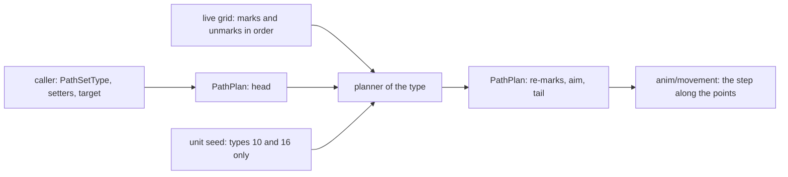
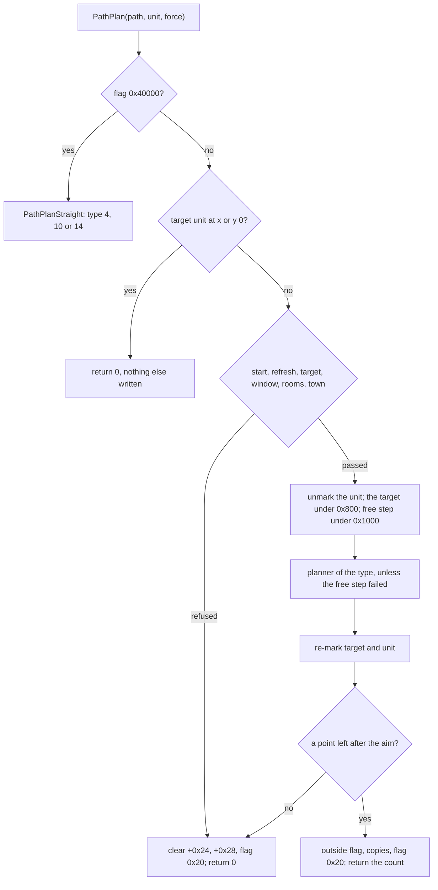
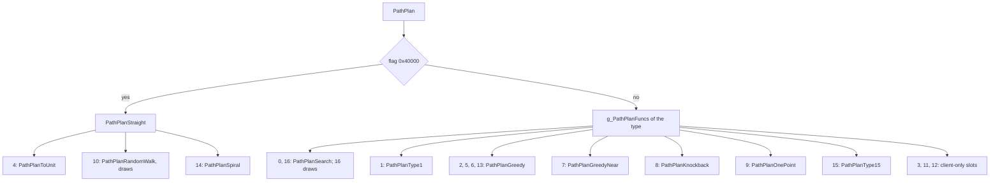
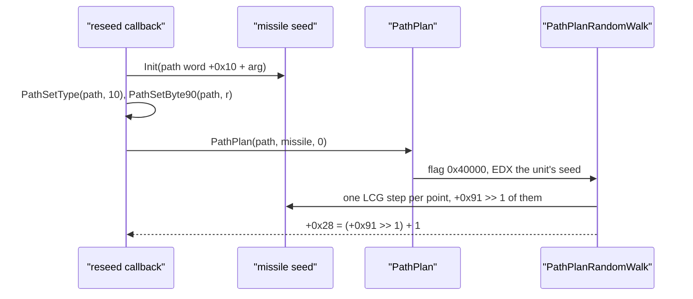
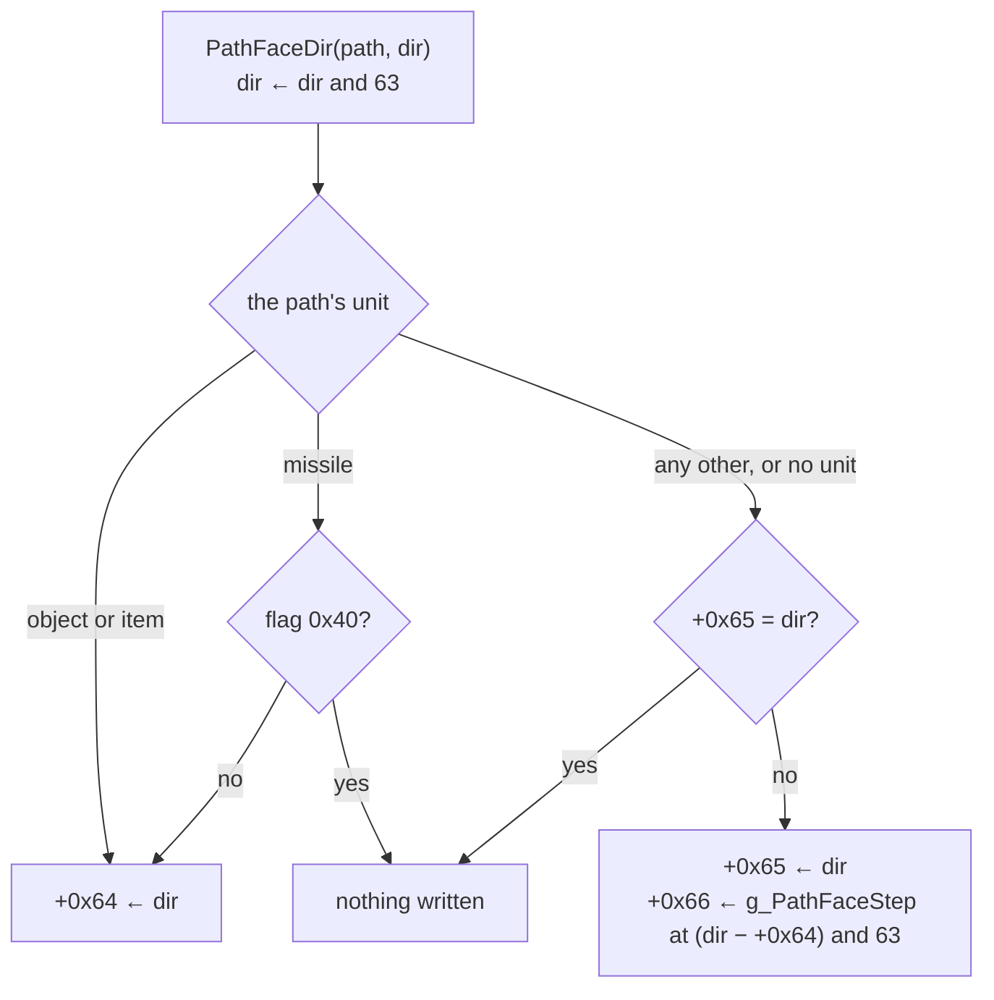

# The path request: the record, the types, the dispatch, the draws, the grid a planner reads

## Purpose

A unit that moves, or a missile that needs a route, holds a path record with a **path type** `0..16`. `PathPlan` takes that record, checks the
request, builds a 0x34-byte context, takes the unit's own marks off the collision grid, calls the type's planner, puts the marks back, and aims the path at
the first point it got. This page is the request, the 17 types, the dispatch, the draws per type and the grid a planner reads. The planners
themselves, as pseudocode, are [path/search](search.md). Who asks for a plan and why is each caller's ([skills/catalogue](../skills/catalogue.md),
[skills/missiles](../skills/missiles.md), [anim/movement](../anim/movement.md), the AI's in [ai/0001 § 8](../../findings/ai/0001-machinery.md#8-the-path-request)); the
per-frame step along the points is [anim/movement § B](../anim/movement.md#b-the-per-frame-step). The grid's cells and marks are [drlg/collision](../drlg/collision.md).



## Entry points

| When | Function | Tag |
|---|---|---|
| Every plan: 68 direct calls in 58 functions, 34 server and 34 client (§ E) | fn:sub_00649970_PathPlan@0x00649970 | [I] |
| A type is set | fn:sub_00648CF0_PathSetType@0x00648CF0 | [C] (run:2026-11-03-path-emu-1) |
| A blocked path is planned again | fn:sub_00650350_PathReplan@0x00650350 | [I] |
| The record is created | fn:PATH_DynamicCreate@0x00649D00, under fn:sub_00554850_SUnitPathCreate@0x00554850 | [I] |
| A mode reset restores the type | `PathMoveReset`, 0x00648DEC–0x00648E25 | [I] |

## Inputs

### Tables

| Anchor | Used for |
|---|---|
| [PathTypes](../../tables/PathTypes.md) (the image's `g_PathPlanFuncs`, `g_PathTypeFlags`, `g_PathTypeParam98`) | planner, flags word and `+0x98` per type |
| [PathDirTables](../../tables/PathDirTables.md) (the image's `g_PathDir8`, `g_PathDirTriples`, `g_PathSignTable`, `g_PathDirTable`) | the free-target step (§ C3), the aim's direction ([anim/movement § B](../anim/movement.md#b-the-per-frame-step)) |
| `g_PathFaceStep`, given by the rule in § H4 and in [PathDirTables](../../tables/PathDirTables.md#the-rules) | the facing step (§ H) |
| tbl:MonStats2.txt:SizeX | a monster's size, hence its pattern ([drlg/collision F2](../drlg/collision.md#f-unit-marks)) |
| tbl:MonStats.txt:npc, tbl:MonStats.txt:inTown | the town test (§ C2) |
| tbl:Objects.txt:IsDoor, tbl:Objects.txt:Orientation | the object target's step (§ C1) |
| tbl:Objects.txt:HasCollision0 | whether an object's rectangle is in the grid (§ F4) |
| tbl:MonStats2.txt:deadCol | a dead monster's mark (§ F4) |
| tbl:Missiles.txt:Range | the random walk's length through the reseed callbacks ([skills/missiles H1](../skills/missiles.md#h-re-seed-sites)) |

### Runtime state

The record's fields are `struct:PathRequestFields` in `re/types/path.h`, 0x200 bytes zeroed at creation. Coordinates are subtiles; a point is `x | y << 16` in a u32. [I] (0x00649D17)

| Field | Type | Meaning |
|---|---|---|
| `+0x00`, `+0x04` | u32 16.16 | the position; `+0x02`, `+0x06` are its subtile words |
| `+0x10`, `+0x12` | u16 | the target point |
| `+0x14`, `+0x16` | u16 | the planned target, copied from `+0x10` after a plan |
| `+0x18`, `+0x1A` | u16 | the target the request used, after the free step |
| `+0x1C` | ptr | the unit's room |
| `+0x24`, `+0x28` | u32 | point index, point count |
| `+0x30` | ptr | the unit |
| `+0x34` | u32 | the flags (bits 8–18 from the type's word; § B) |
| `+0x3C`, `+0x40` | i32 | the type, the saved type |
| `+0x44`, `+0x48` | i32 | size, pattern ([drlg/collision F2](../drlg/collision.md#f-unit-marks)) |
| `+0x4C`, `+0x50` | u32 | `markMask`, `testMask` (§ A) |
| `+0x58` | ptr | the target unit |
| `+0x64`, `+0x65`, `+0x66` | u8 | the facing direction (0–63), the direction to turn to, the turn step (§ H) |
| `+0x6A`, `+0x6E` | i32 | the vector to the next point (§ H) |
| `+0x72`, `+0x76` | i32 | the step per frame (§ H) |
| `+0x7C` | i32 | the speed; it gates a planner's first line ([search § A5](search.md#a5-the-first-line-pathfirstline)) |
| `+0x90` | u8 | knockback distance and countdown |
| `+0x91` | u8 | the limit (`ctx.limit`): at most 77, a player 73 and a monster 14 at creation |
| `+0x92` | u8 | the search's last bound (`ctx.b1C`): a player 70 at creation |
| `+0x93`, `+0x94` | u8 | stop range; re-plan budget |
| `+0x98` | i32 | the type's walk parameter |
| `+0x9C` | u32[78] | the points, to `+0x1D3`; `+0x1D4` is anim/movement's crossed-subtile count |

**The context** (`struct:PathPlanCtx`, on `PathPlan`'s stack, passed in `ECX`). `+0x10` is never written. [I] (0x00649A0A–0x00649A40)

| Field | From | Field | From |
|---|---|---|---|
| `+0x00` start | `+0x02`, `+0x06` | `+0x18` limit (u32) | `+0x91` |
| `+0x04` target | `+0x10`, `+0x12`, moved by the free step | `+0x1C` `b1C` | `+0x92` |
| `+0x08` room | `+0x1C` | `+0x20` type | `+0x3C` |
| `+0x0C` target room | `RoomAtSubtile(room, target)` | `+0x24` size | `+0x44` |
| `+0x14` `refresh` (u8) | § C1's result | `+0x28` pattern | `+0x48` |
| `+0x2C` `testMask` | `+0x50` | `+0x30` path | the record |

### Constants

| Name | Value | Anchor | Tag |
|---|---|---|---|
| point slots | 78 | `+0x9C`..`+0x1D3` | [I] (0x00649D17) |
| window | `|dx|`, `|dy|` ≤ 100, 100 itself passing | 0x00649A96–0x00649AB8 | [C] (control `cmp` fails all 36 it separates, run:2026-11-03-path-emu-1) |
| limit cap of `PathSetByte90` | 77 | fn:sub_00648E70_PathSetByte90@0x00648E70 | [C] (control `cap` fails all 20 it separates, run:2026-11-03-path-emu-1) |
| town levels | 1, 40, 75, 103, 109 | fn:sub_006483A0_PathTargetNotTown@0x006483A0 | [C] (family `town`, run:2026-11-03-path-emu-1) |

## Algorithm

### A. Two masks: what a move tests and what a unit writes

A record holds two masks, and they are not interchangeable. [I] (fn:sub_00648CE0_PathSetCollMask@0x00648CE0, fn:PATH_SetMarkMask@0x00648C30, struct:DynPathColl+0x4C)

- `testMask` (`+0x50`, set by `PathSetCollMask`): the bits a planner and the step refuse.
- `markMask` (`+0x4C`, set by `PATH_SetMarkMask`): the bits the unit writes into the grid. `PATH_SetMarkMask` unmarks under the old mask and marks under the new.

| Who | `testMask` | `markMask` | Tag |
|---|---|---|---|
| player | `0x1C09` | `0x80` | [I] (fn:PATH_DynamicCreate@0x00649D00), the marks [C] at [drlg/collision § F](../drlg/collision.md#f-unit-marks) |
| monster | `PATH_MonTestMask`: `flying` `0x1804`, `opendoors` `0x3401`, else `0x3C01`; wraith `0x804` | `0x100` | [I] (fn:PATH_MonTestMask@0x00648480) |
| missile | `g_MissileCollideTypes[CollideType].mask` ([skills/missiles](../skills/missiles.md)) | 0 at creation; `0x40` when Missiles `Collision` ≠ 0 | [C] the mark ([drlg/collision § F](../drlg/collision.md#f-unit-marks), run:2026-10-14-collision); [I] the test (fn:sub_00648CE0_PathSetCollMask@0x00648CE0) |
| Whirlwind, the plan (start 38, no target) | `0xC01` | no zeroing found at the start | [C] the test mask, to the boundary ([skills/catalogue K11](../skills/catalogue.md), run:2026-10-21-cat-emu-bar) |
| Whirlwind, the flight | `0x401`, the old mask kept at `ebp−0x14` | no zeroing found at the start; the end restores it (0x005D94F2) | [I] (0x005D90AE, 0x005D90B4, fn:sub_005D8F50_SkillSt38Whirlwind@0x005D8F50) |
| Leap, the flight | not stated here | set to 0 (0x005D9F9C), set back at the landing | [I] (fn:sub_005D9D50_SkillSt40Leap@0x005D9D50) |
| Jump | not stated here | no zeroing found at the start; the end restores it (0x005CBA46) | [I] (0x005CBA46) |
| packet 0x5F's reach test | `0x409`, restored after | — | [I] (fn:sub_0054CB10_PlrReachTest@0x0054CB10) |

- [I] Neither Whirlwind mask holds `0x100`, `0x1000` or `0x2000`, so no live unit's mark refuses that plan or that flight. A door's `0x800` is tested by the plan's mask only. (0x005D90B4, [path/0007](../../findings/path/0007-community-cross-check.md))
- [I] `SizeY` is unused by a monster's footprint: `UNIT_GetSizeY` reads it, no monster footprint uses it, and only objects read a Y size. The two columns are equal in every stock row, so the data cannot separate them. (fn:UNIT_GetSizeY@0x006205A0, tbl:MonStats2.txt:SizeY, [drlg/0005](../../findings/drlg/0005-collision.md))

### B. Creation, `PathSetType` and the setters

```
B1. PATH_DynamicCreate(…, room, x, y, unit, flag):                 [I] (fn:PATH_DynamicCreate@0x00649D00, all of B1; not emulated: it allocates first)
      0x200 bytes zeroed
      +0x30 ← unit;  +0x44 ← UNIT_GetSizeX(unit);  +0x48 ← PATH_PatternFromSize
      position ← x << 16 | 0x8000, y alike;  +0x7C ← 0x800;  +0x1C ← room;  +0x93 ← 0;  +0x1D4 ← 1
      player:  markMask 0x80, testMask 0x1C09;  PathSetType(7);  +0x91 ← 73;  +0x92 ← 70
      monster: markMask 0x100;  bits 8–18 cleared;  type 2 written directly, +0x98 ← 0 (no PathSetType)
               testMask ← PATH_MonTestMask (wraith, base id 38: pattern 5, mask 0x804);  +0x91 ← 14
      missile: masks 0;  PathSetType(4)
      flag ≠ 0: sets 0x10                                          ; all three SUnitPathCreate sites pass 0

B2. PathSetType(path, t: i32):                                     [C] (fn:sub_00648CF0_PathSetType@0x00648CF0, run:2026-11-03-path-emu-1: families settype, setters, 760 cases; all of B2)
      player and t = 2: fatal 0x861, before any write
      w: u32 ← g_PathTypeFlags[t]
      if w & 0x2000 and not (+0x34 & 0x4000):  +0x40 ← t           ; saves the type
      if w & 0x8000 and not (+0x34 & 0x10000): +0x80 ← the speed   ; saves the speed
      +0x34 ← (+0x34 & 0xFFF800FF) | w                             ; the whole word, so type 11 also sets bit 2
      +0x3C ← t;  +0x98 ← g_PathTypeParam98[t]                     ; 2, −2, −4 for types 5, 6, 12, else 0
      +0x40 = 11 or 8 after the writes: fatal 0x871, 0x872;  t = 4 with +0x91 ≥ 78: fatal 0x873

B3. Setters:                                                       [C] (run:2026-11-03-path-emu-1, family setters, 360 cases; all of B3)
      PathSetByte90(path, b):  +0x90 ← +0x91 ← min(b, 77); a null path: nothing      (fn:sub_00648E70_PathSetByte90@0x00648E70)
      PathSetKnockDist(path, b): +0x90 ← b                                           (fn:sub_00648E40_PathSetKnockDist@0x00648E40)
      PathSetStopDist(path, b): +0x93 ← b − 1 when (u8)(b − 1) ≤ 18, else 0; null: nothing (fn:sub_00649070_PathSetStopDist@0x00649070)
      PathSetByte94(path, v): +0x94 ← v; v > 255 unsigned: assert 0x965              (fn:sub_006490E0_PathSetByte94@0x006490E0)
      PathAddByte94(path, d): the 32-bit sum, negative → 0, above 255 → 255          (fn:sub_00649140_PathAddByte94@0x00649140)
      PathSetByte92(path, b): +0x92 ← b; a typed path: assert 0x8E8                  (fn:sub_00648F00_PathSetByte92@0x00648F00)
```

- B2. [C] Type 101, which `SkillDo89Jump` passes before its type-8 and type-9 plans, reads index 101 of both tables, 0 in this image, so it clears bits 8–18 and sets `+0x98 = 0`. (0x005CBA59, 0x006EB824, 0x006EB7DC, run:2026-11-03-path-emu-1)
- B4. [I] **`PathMoveReset`** restores the speed from `+0x80` under flag `0x8000`, then sets type 7 for a player and, for any other unit under flag `0x2000`, the saved type `+0x40`. So types 8, 9 and 11, whose words hold both bits, are the temporary ones a reset undoes. (0x00648DEC–0x00648E25, data:g_PathTypeFlags@0x006EB690)

### C. `PathPlan`



```
C. PathPlan(path, unit, force) → i32:                              [C] 3–16b, by emulation to the first boundary (fn:sub_00649970_PathPlan@0x00649970, run:2026-11-03-path-emu-1: plan, plannoop, 1 200 cases, 0 mismatches)
 1.  if path = 0: return 0                                         ; [I] read, not run (0x00649970)
 2.  if path.unit ≠ unit: fatal 0x2E8                              ; [I] read, not run (0x00649970)
 3.  if path.flags & 0x40000: return PathPlanStraight(path, unit)  ; search § I, J, K; before any other test
 4.  path.w54 ← 0
 5.  t ← path.target;  if t and (UnitGetSubX(t) = 0 or UnitGetSubY(t) = 0): return 0     ; nothing else written
 6.  if path.x = 0 and path.y = 0: goto fail
 7.  ctx: start, size, pattern, testMask, limit ← (u8)+0x91, b1C ← +0x92, path
 8.  ctx.refresh ← PathTargetRefresh(ctx)                          ; C1
 9.  if path.tx = 0 and path.ty = 0: goto fail
10.  ctx.target ← (tx, ty);  if ctx.target = ctx.start: goto fail
11.  dx: i32 ← tx − sx;  dy: i32 ← ty − sy;  if |dx| > 100 or |dy| > 100: goto fail      ; words zero-extended, signed compare
12.  ctx.room ← path.room;  ctx.troom ← RoomAtSubtile(room, tx, ty);  if either is 0: goto fail
13.  if not PathTargetNotTown(unit, ctx) and not force: goto fail  ; C2
14.  ctx.type ← path.type
15.  UNIT_CollUnmark(unit, 0)                                      ; returns at once for a player in mode 0 or 17, a monster in mode 0 or 12 (0x006496AB–0x006496C5)
16a. tu ← 0;  if t and UNIT_GetSizeX(t) ≠ 0 and flags & 0x800: tu ← UNIT_CollUnmark(t, 0)     ; shown on units whose unmark returns at once; the grid's half is § F4's T1
16b. go ← 1;  if flags & 0x1000 and Blocked(ctx.room, tx, ty, pattern, testMask): go ← PathTargetFree(ctx)   ; C3
17.  path.fx, fy ← ctx.target;  +0x24 ← 0;  +0x28 ← 0              ; [C] written before the slot read (241 cases, run:2026-11-03-path-emu-1)
18.  n ← 0;  if go: n ← g_PathPlanFuncs[ctx.type](ctx)             ; [C] the slot's argument to IsBadCodePtr, every type 0–16; [I] the call, 0x00649BAE; IsBadCodePtr ≠ 0: fatal 0x37E
19.  +0x28 ← n                                                     ; [I] 19–26: past the import, the tail (0x00649BA1–0x00649C6E)
20.  start changed: fatal 0x389                                    ; a planner may move the target, not the start
21.  if tu ≠ 0: UNIT_CollMark(path.+0x58)                          ; 0x00649BD3–0x00649BD7: the field read again, not t
22.  UNIT_CollMark(unit)                                           ; 0x00649BE0: [C] also when the free step returned 0 (13 plannoop cases)
23.  if n = 0: flags &= ~0x20;  return 0
24.  PathAimNextPoint(path, 1; 1);  if +0x24 ≥ +0x28: goto fail    ; every point at the position
25.  PathPointsOutsideRoom(path);  +0x14, +0x16 ← +0x10, +0x12;  +0x38 ← 0
     if flag 0x10 is clear and there is no target unit: +0x10, +0x12 ← the last point   ; 0x00649C1B
26.  flags |= 0x20;  return n
fail: +0x24 ← 0;  +0x28 ← 0;  flags &= ~0x20;  return 0
```

- C. [I] `force` is read once, at step 13: it lets a refused town target through and changes nothing else. 66 of the 68 call sites push 0, 0x005FBFB7 pushes `EDI` = 0, and only the client site 0x004804C4 can force. (0x00649AEE, 0x005FBFB7, 0x004804C4)
- C. [I] The window tests the request's target, before the free step: a target moved by C3 may lie a few subtiles further, and the planners see the moved one. `RoomAtSubtile` uses the unit's room's near list, so a target in an inactive room refuses. (0x00649AC5)
- C. [C] A target unit at subtile x or y 0 returns 0 before the start test and clears nothing (32 `plan`, 36 `plannoop` cases); the other refusals clear. (0x006499D3–0x006499F0, run:2026-11-03-path-emu-1)
- C. [C] A refused request draws nothing: `EAX` 0 and the seed unchanged in all 628 + 814 refusals of the two runs (624 + 814 stock, F1). Of them, the 211 and the 281 whose reason needs the town test, the room or the free step are **observed, not predicted**: their match says only that the game returned 0. (run:2026-11-04-path, run:2026-11-04-path-2, [path/0004 § 1](../../findings/path/0004-per-event-reproduction.md#1-the-log-and-what-is-compared))

- C. [C] **`PathPointsOutsideRoom` (step 25):** flag bit 0 is cleared, then set when the path has no room or a point of `0 ..< +0x28` lies outside the room's rectangle, `x ≤ px < x + w` and `y ≤ py < y + h`, room words `+0x4C`, `+0x50`, `+0x54`, `+0x58`. A count of 0 leaves it clear. (fn:sub_00647FB0_PathPointsOutsideRoom@0x00647FB0, run:2026-11-03-path-emu-1: family `outside`, 300 cases, control `le` 25)

`Blocked(room, x, y, pattern, mask)` is `COLL_PatternTestBool`: [search § A1](search.md#a1-a-cell-read-blocked).

#### C1. The target refresh

```
PathTargetRefresh(ctx) → u8:                                        [C] (fn:sub_006498A0_PathTargetRefresh@0x006498A0, run:2026-11-03-path-emu-1: 405 cases with a target unit; all but where noted)
  no target unit: return 1
  (path.tx, path.ty) ← the unit's subtile position (words);  both 0: return 0
  by the unit's type:
    0, 1: return 1 when path +0x68 = 0                              ; else PathTargetOffsetX87, an x87 offset not read: [I] then return 1 (0x00649950)
    2:    if record +0x13A (IsDoor): PathTargetObjectStep(ctx);  return 2
    3:    return 1
    4:    return 2
    5: return 1                                                     ; above the table, cmp eax, 4; ja

PathTargetObjectStep(ctx):                                          [C] (fn:sub_006497D0_PathTargetObjectStep@0x006497D0, 0x00649836–0x0064988E, run:2026-11-03-path-emu-1)
  if record +0x13C (Orientation) = 1: target y moves 2 toward the start  ; −2 when start y < the object's +0x10 dword, unsigned compare, else +2
  else: target x likewise on +0x0C                                  ; the step never tests the grid
```

#### C2. The town test

```
PathTargetNotTown(unit, ctx) → bool:                               [C] (fn:sub_006483A0_PathTargetNotTown@0x006483A0, run:2026-11-03-path-emu-1: family town, 400 cases; controls floor 56, npc 5)
  null unit, not a monster, or MonIsNpc(unit): return 1             ; MonStats npc or inTown, or unit +0xC4 negative
  room ← ctx.troom;  if room = 0: the target's room, found from the room at start + (target − start) ÷ 2   ; ÷ truncates toward zero; PathPlan never takes this branch
  return not RoomIsTown(room)                                       ; the DRLG room's level id in {1, 40, 75, 103, 109}
```

#### C3. The free-target step

```
PathTargetFree(ctx) → 0 or 1:                                      [C] (fn:sub_00648120_PathTargetFree@0x00648120, run:2026-11-03-path-emu-1: family free 560 cases and 13 + 13 plannoop; all of C3)
  (d0, d1, d2) ← g_PathDirTriples[PathDirCell(target, start)]       ; main, two alternates; d2 = 255 is none; all in {0, 2, 4, 6, 255}
  m, a, b ← target
  loop:
    if m = start: return 0                                          ; ctx unchanged
    m += g_PathDir8[d0];  if not Blocked(m): ctx.target ← m; break
    a += g_PathDir8[d1];  if not Blocked(a): ctx.target ← a; break
    if d2 ≠ 255: b += g_PathDir8[d2];  if not Blocked(b): ctx.target ← b; break
    d0 ← g_PathDirTriples[PathDirCell(m, start)].main               ; only the main direction is recomputed
  if ctx.target = start: return 0
  if the unit is a player: PathTargetExtendPlayer(ctx)
  return 1

PathTargetExtendPlayer(ctx):                                       [C] (fn:sub_00648050_PathTargetExtendPlayer@0x00648050, control ext4 fails all 33 it separates, run:2026-11-03-path-emu-1)
  dx, dy ← moved target − start
  nothing when |dx| ≥ 5, |dy| ≥ 5 or both 0
  step.x ← sign dx if |dx| ≥ |dy|, else 0                           ; g_PathSignTable[dx + 9 dy]
  step.y ← sign dy if |dy| ≥ |dx|, else 0                           ; g_PathSignTable[dy + 9 dx]
  m ← max(|dx|, |dy|);  p ← the moved target
  while m < 5:
    p ← p + step;  if Blocked(p): stop                              ; u16 adds
    m ← m + 1;  ctx.target ← p
```

`Blocked` here is `COLL_PatternTestBool(ctx.room, x, y, ctx.pattern, ctx.testMask)`; coordinates are u16 adds. `PathDirCell` is [search § A2](search.md#a2-directions). (data:g_PathDirTriples@0x006F1648, data:g_PathDir8@0x006EB398, data:g_PathSignTable@0x006EB490)

*Corrected 2026-11-04 (`lane/a54` review): the step read `(sign dx, sign dy)`. It moves one axis unless `|dx| = |dy|`: a target at `(3, 1)` from the start steps `(1, 0)`, not `(1, 1)`. The table's rule and index are in [PathDirTables](../../tables/PathDirTables.md); path/0001 § 5 has the correction.*

#### C4. The replan

```
PathReplan(unit, flag):                                            [C] to the first boundary (fn:sub_00650350_PathReplan@0x00650350, run:2026-11-03-path-emu-1: family replan, 300 cases, control swap 63)
  p ← unit's path;  if none: return 0
  if not (p.flags & 0x10):
    if the unit is a monster and p.+0x94 = 0: return 0
    UnitMarkUpdated(unit)                                           ; the boundary
    unit +0xC4 |= 1;  PathAddByte94(p, −p.iPoint)                   ; [I] past the boundary (0x00650384)
  t ← p.type
  if t in {2, 13, 15}:
    if flag ≠ 0: p.type ← 13
    else:        p.type ← 2;  p.+0x10 ← p.+0x18                     ; the request's own target
    n ← PathPlan(p, unit, 0)                                        ; returns at 0x006503CE: the boundary, reached in the family with flag 0x10 set
    if n = 0: p.type ← 15;  n ← PathPlan(p, unit, 0)                ; [I] past the boundary (0x006503D2–0x006503DD); the same call as below
  else:
    n ← PathPlan(p, unit, 0)                                        ; returns at 0x006503E2: the boundary
  return n                                                          ; [I] past the boundary (0x006503E2)
```

- C4. [I] `PathReplan` writes `+0x3C` without `PathSetType`, so a re-plan keeps the flags word of the type before it: a 13 re-planned as 2 keeps `0x100`, a 2 re-planned as 15 lacks 15's `0x800`. (0x006503AF–0x006503D2)
- C4. [C] 836 + 889 replans of the two runs reproduce (810 of the 836 stock, `review-s54/logs.txt`), each with a target unit at `PathPlan`'s entry and the seed unchanged. The target revalidation is `PathReplan`'s own code before the call and is not compared: [I]. (0x006503CE, run:2026-11-04-path, run:2026-11-04-path-2)

### D. The 17 types: planner and draws

The table is [PathTypes](../../tables/PathTypes.md)' read from the image; the shape and the point bound are [path/search](search.md). A type with flag `0x40000` has no slot: `PathPlanStraight` (`fn:sub_00649760_PathPlanStraight@0x00649760`) chooses by type, and any other type there is fatal 0x207. [C] (run:2026-11-03-path-emu-1, 0x006499AE) The counts under *Draw evidence* are the logged plans of each run; F1 says which are stock.



| Type | Flags word | Planner | Draws | Draw evidence | Stock server request |
|---:|---|---|---|---|---|
| 0 | `0x21900` | `PathPlanSearch` | none | [C] run:2026-11-03-path-emu-2 | no plan in 46 sessions (§ G3) |
| 1 | `0x01900` | `PathPlanType1` | none | [C] run:2026-11-03-path-emu-3, the map; 824 through type 7's switch | no request observed in 46 sessions (§ G2) |
| 2 | 0 | `PathPlanGreedy`, `+0x98` 0 | none | [C] 161 + 476 monster plans, the seed unchanged (run:2026-11-04-path, run:2026-11-04-path-2) | yes |
| 3 | 0 | `PathPlanType3` | none | [I] (0x00679E5A), [C] the map doesn't read the seed | none (§ G3) |
| 4 | `0x60000` | `PathPlanToUnit` | none | [C] 2 740 + 3 713 plans, the seed unchanged (run:2026-11-04-path, run:2026-11-04-path-2) | yes |
| 5 | 0 | `PathPlanGreedy`, `+0x98` 2 | none | [C] 696 + 626 monster plans (run:2026-11-04-path, run:2026-11-04-path-2) | yes |
| 6 | 0 | `PathPlanGreedy`, `+0x98` −2 | none | [C] 655 + 664 monster plans (run:2026-11-04-path, run:2026-11-04-path-2) | yes |
| 7 | `0x21900` | `PathPlanGreedyNear` | none | [C] 1 313 + 1 321 monster plans; the player's are in the 0 mismatches (run:2026-11-04-path, run:2026-11-04-path-2) | yes |
| 8 | `0x1E600` | `PathPlanKnockback` | none | [C] 282 + 1 303 plans (run:2026-11-04-path, run:2026-11-04-path-2) | yes |
| 9 | `0x1E800` | `PathPlanOnePoint` | none | [C] 54 + 346 plans (run:2026-11-04-path, run:2026-11-04-path-2) | yes |
| 10 | `0x60000` | `PathPlanRandomWalk` | **`+0x91 >> 1`, on the seed passed** | [C] run:2026-11-03-path-emu-3; 654 creations; 698 + 248 plans | yes |
| 11 | `0x1E604` | `PathPlanType11` | none | [I] (0x00679FE7), [C] the map doesn't read the seed | client only (§ G3) |
| 12 | 0 | `PathPlanType12` | none | [I] (0x00679E79), [C] the map doesn't read the seed | none (§ G3) |
| 13 | `0x00100` | `PathPlanGreedy`, `+0x98` 0 | none | [C] 3 851 + 4 587 monster plans (run:2026-11-04-path, run:2026-11-04-path-2) | yes |
| 14 | `0x60000` | `PathPlanSpiral` | none | [C] 27 stock + 233 plans, the seed unchanged (run:2026-11-04-path, run:2026-11-04-path-2) | yes |
| 15 | `0x00800` | `PathPlanType15` | none | [C] 1 349 + 3 309 monster plans (run:2026-11-04-path, run:2026-11-04-path-2) | yes |
| 16 | 0 | `PathPlanSearch` | at each child and each turn, on `unit +0x20` | [C] run:2026-11-03-path-emu-2, 994 022 draws | none: two unreferenced functions (§ G3) |

- D1. [I] **`PathPlan` and everything around it draw nothing:** no `0x6AC690C5` and no call to the 19 RNG functions in `PathPlan`, the refresh, the free step, the town test, the setters, `PathSetType`, `PATH_DynamicCreate`, `PathAimNextPoint`, `PathReplan`; a call graph of 80 functions under them holds no RNG and one indirect call, the slot. [C] in the emulated domain the unit's seed is not read. So every draw of a plan is in a planner. (fn:sub_00649970_PathPlan@0x00649970, 0x00649BAE, run:2026-11-03-path-emu-1)
- D2. [I] Under the eight planners 58 functions hold one LCG step, 0x0067A315, the random walk's; under the search three, type 16's. (0x0067A315, 0x0067A641, 0x0067A6E1, 0x0067A983)
- D3. [I] **`SUnitPathCreate`'s callees after the path** (`PlrPlaceEventsInit`, `MonInitMode`, the mode set) reach 118 RNG functions: those are the mode machine's and the population's, not the path's, and are unfollowed here. (fn:sub_00554850_SUnitPathCreate@0x00554850)
- D4. [I] Types 2 and 13 are the same plan: 13 differs in the flags word's `0x100`, which no planner tests; the only flag a planner reads is `0x200`, inside `PathAimNextPoint`. The difference is `PathReplan`'s (C4). (0x006503AF, data:g_PathTypeFlags@0x006EB690)

The type-10 sequence, as the two reseed callbacks run it:



- D5. [C] The callback seeds the new missile with `Init(path word +0x10 + arg, 0x29A)` (`0x005AC040`: `Init(path word +0x10)`), then neither `PathSetType` nor `PathSetByte90` steps the seed: at `PathPlan`'s entry it is still the `Init`, in all 100 of family `h1obs`. In 654 of 654 creations of the game's logs the exit seed is the one predicted from the `Init` and the logged range: 20 for class 458, 38 for class 195, 10 for class 408. The callbacks are [skills/missiles H1 and H4](../skills/missiles.md#h-re-seed-sites). (fn:sub_005C9290_MissCbReseedPathXPlusArg@0x005C9290, fn:sub_005AC040_MissCbReseedPathX@0x005AC040, run:2026-11-03-path-emu-3, run:2026-10-25-skills, run:2026-10-27-skills, run:2026-10-30-skills-catalogue)
- D6. [C] **After a type-10 plan, class 458 draws nothing more on that seed within its life.** 68 seeds watched by a hardware watchpoint: each next write is a block write over the unit's memory, and in each the high dword still holds the plan's exit value, which a draw would have changed. The control sees draws: of 14 watchpoints on monsters, 8 lines are the LCG step, and the other 6 are the same block write. That the write is the block's release or reuse is [I]. (0x00681F4F, 0x00682A1A, 0x0057CAE6, run:2026-11-04-path)
- D7. [I] **`PATH_CHAIN` for classes 225 and 195, short of the floor of 50 each:** class 225, 216 type-10 plans and 22 seeds watched; class 195, 32 plans and 3 watched; all 25 block writes with the high dword unchanged, 0 of 25 a draw. The earlier run adds one watched seed each. (0x00681F4F, 0x0057CAE6, run:2026-11-04-path-2, run:2026-11-04-path)

### E. Who asks: the request register

All 68 direct calls of `PathPlan`, each type read at its site. "Current" plans with the type the path already holds: a missile's 4 unless a callback set 10 or a do function 14, a monster's last request type, a player's 7 after a reset. [I] (fn:sub_00649970_PathPlan@0x00649970, [path/0001 § 11](../../findings/path/0001-pathplan-register.md#11-the-request-register))

| Owner | Sites | Type at the call |
|---|---:|---|
| player | 2 | 7 or 8 (`PlrModeStartMove` 0x0057F117: `PathMoveReset` gives 7, mode 19 sets 8); 15 (packet 0x5F's reach test 0x0054CBB9) |
| mode machine | 5 | the request's type (`MonPathPlanType` 0x005A62EF), 15 (its fallback 0x005A634E), current (`MonModeStartSkill` 0x005A760D, 0x005A7638), 8 (knockback 0x005A7854) |
| AI | 3 | 2, test plans that restore the path (0x005DD580, 0x005E912D, 0x005FBFB7) |
| skill | 10 | 8, 9 (`SkillDo89Jump`), 2 then 1 (`SkillSt48SwarmMove`), 1 (`SkillDo103DiabRun`), current (`SkillSt31Charge`), 14 (`SkillDo73BlessedHammer`), 7 (`SkillSt38Whirlwind`), 9 then 8 (`LeapAttackPath`) |
| missile | 10 | 4 (`MissileCreate` 0x0059FDB1), 10 (the four reseed callbacks), current (`GuidedSetTarget`, do 7, 11, 16, 35) |
| movement | 2 | 13 or 2, then 15 or current (`PathReplan`) |
| unreferenced | 2 | 16 (0x00663E1B, 0x00663EEB) |
| client | 34 | out of scope (owner decision 5): 14 sites with a scanned `PathSetType`, 20 current |
| **All** | **68** | |

- E1. [C] All 33 722 stock plans of the two runs came through sites of this register, by their return addresses, and the first run's other 842 did too: 0 outside them in either run. The kept checks print that line only when it isn't 0; `review-s54/logs.txt` prints the 0. (0x00649970, `2026-11-04-path-check.txt`, `2026-11-04-path-2-check.txt`, run:2026-11-04-path, run:2026-11-04-path-2)
- E2. [I] **The player's move:** a walk, run or town walk start (`PlrModeStartMove`, modes 2, 3, 6) plans type 7 after `PathMoveReset`; mode 19 plans type 8 with `+0x90 = 5`. **Packet 0x5F:** when the server's position is 15–45 subtiles off, a type-15 plan to the client's point with `testMask` `0x409` and limit 77, accepted only when its end is that point; mask, type and `+0x91` restored. (fn:sub_0057F090_PlrModeStartMove@0x0057F090, fn:sub_0054CD50_SrvPkt5FPlayerPos@0x0054CD50, fn:sub_0054CB10_PlrReachTest@0x0054CB10)
- E3. [I] **The AI's types** are 1, 2, 5, 6, 7, 13 and 15; 5 and 6 through `MonPathPlanType`, 13 through `PathReplan`. `MonMovePlan` falls back to 15 after a failed plan of 2, 7, 9 or 13. The choice is the AI's: [ai/0001 § 8](../../findings/ai/0001-machinery.md#8-the-path-request), research-map row `monsters/ai`. (fn:sub_005A6290_MonPathPlanType@0x005A6290)
- E4. [I] No Missiles column chooses a type: it is a constant in the do function or callback. (fn:sub_005C9290_MissCbReseedPathXPlusArg@0x005C9290, [PathTypes § Columns](../../tables/PathTypes.md#columns-a-request-reads))

### F. The grid a planner reads

#### F1. The planners take the live grid

- [C] **A planner reads the live grid: the cells as they are at the planner call, with the unit's and the target's unmarks of steps 15 and 16a already run.** Given the game's own cells at the call (`PLG`), its context and its record, the models reproduce **33 722 stock plans with 0 mismatches, 20 671 of the second run and 13 051 of the first, on 11 types** (2, 4, 5, 6, 7, 8, 9, 10, 13, 14, 15), each compared on its return, its first `EAX` point words and its exit seed. (fn:sub_00649970_PathPlan@0x00649970, 0x00649BAE, run:2026-11-04-path-2, run:2026-11-04-path, [path/0006](../../findings/path/0006-holdout.md), [path/0004](../../findings/path/0004-per-event-reproduction.md))
- [I] **The first run's other 842 plans** also show 0 mismatches and back nothing here. They come after the probe's first write in two sessions (`k-pal-stony` 532, `k-pal-jail` 310): a breakpoint wrote the start's fraction word, against ADR-0003, so they are not stock. By type: 4 82, 5 47, 6 51, 7 141, 13 369, 14 27, 15 125, and none of 2, 8, 9, 10. A "run 1" count on this page or the next holds them unless it says stock. (0x00649BAE, run:2026-11-04-path, `review-s54/logs.txt`)
- [C] **This is not the predicted grid.** The 0 mismatches take the grid from the game. The same planners on a grid predicted as the built map plus the units are F3's claim, which failed. A reimplementation is held to the planners by this count, and to the grid only by [drlg/collision § F7](../drlg/collision.md#f7-no-bit-is-reference-counted-the-grid-is-the-result-of-its-operations-in-order)'s order rule. (run:2026-11-04-path-2)
- [I] **What the model took from the game:** the planner's address, the context and the record at the call, and the target unit's position. So `PathPlan`'s head, the refresh, the free step, the town test and the slot are inputs here, not predictions, and keep § C's tags. Each context's start equals its record's, and none of the 9 773 plans with a `PLC` in the first run has a record-only refusal reason. (0x00649BAE, run:2026-11-04-path, [path/0004 § 1](../../findings/path/0004-per-event-reproduction.md#1-the-log-and-what-is-compared))
- [I] **The tail** (the aim and the "every point at the position" refusal) agrees in all 13 265 plans of the first run that reached a planner or a straight type, 72 of them with a non-zero count and a return of 0. The aim's writes are not compared. (run:2026-11-04-path)

#### F2. The grid is the result of its operations, in order

- [C] **The grid at a planner call is the result of the marks and unmarks in order, not the union of the present holders. A reimplementation runs the operations and never computes a union of holders.** An unmark is the same footprint with AND-NOT and no bit is reference-counted, so it clears a shared bit another holder also set. The rule and its cases are [drlg/collision § F7](../drlg/collision.md#f7-no-bit-is-reference-counted-the-grid-is-the-result-of-its-operations-in-order). (fn:COLL_PatternUnmark@0x0064EC10, run:2026-10-14-collision)

#### F3. The counted oracle

- [C] **The tie's prediction is wrong in 11 of 15 663 plans on the hold-out** (the plans with a built map), 2 of type 2, 3 of type 13, 6 of type 15, with the bit `0x1000` alone sufficient in all 11. **The test failed by its own terms:** it asked for 0 wrong plans. The rules were frozen before the run, no rule was changed after it, and the frozen rules' prediction was made **without the seventh caller** of `UnitCorpseColl`, whose unit stays in mode 14. (fn:sub_00649970_PathPlan@0x00649970, run:2026-11-04-path-2, [path/0006](../../findings/path/0006-holdout.md))
- [C] The passes on the same logs: frozen own marks 472 wrong, with O1, C1..C3 and T1 72, with W1 62, with L1 11. (`2026-11-04-path-2-grid.txt`, run:2026-11-04-path-2)
- [I] **The candidates, chosen after the result, not tested on data they did not see: 8** are order (F2): the planning unit's own unmark over a reservation (4), a monster that left a reserved cell (1), the target unmark under `0x800` (2), the player's mask set to 0 at Leap's flight (1). **3** are the seventh caller: class 194 in mode 14 after 0x005CAF8E. **No tested rule exists for either**, so a plan's grid stays the counted oracle "the live cells", and what would test them is [this entry](../../backlog/2026-11-04-architect-reverser-0054-grid-tie-operations-in-order-own-hold.md). (0x00649B07, 0x00649B25, 0x00648C7D, 0x005CAF8E)
- [I] What this does not establish: that the grid at a call is a function of the present holders. It is not, by F2. Also not a tag: the wrong-plan count raises nothing, and each raise of F4 rests on its own bit or line. (0x00649BAE, [path/0006 § Where the 11 are](../../findings/path/0006-holdout.md#where-the-11-are))

- [I] So the value-oracle rows of [skills/README](../skills/README.md#the-adr-0014-boundary) and [skills/missiles](../skills/missiles.md#inputs-and-oracles) retire for the planner and stay for the grid: a checker of this spec feeds the planners the logged live cells, and doesn't take them from a union of holders. (0x00649BAE, run:2026-11-04-path-2)

#### F4. Each grid rule at its tag

Corpse cells below are [drlg/collision § F5](../drlg/collision.md#f5-corpse-marks-by-copy-of-the-grid)'s **server** rows; the client's plus is another copy of the grid and is never what a server planner reads.

| Rule | What the grid holds | Tag and scope |
|---|---|---|
| O1, objects | An object's rectangle is in the grid when `HasCollision[mode]` of its class is set; each operate handler that changes the state marks or unmarks itself; the mode change does not | [C] for the bits `0x400` and `0x800`: 0 cells differ over the 154 780 rooms of the 15 663 plans, against 64 229 and 1 572 with the rule off (0x0055494C, 0x00649611, tbl:Objects.txt:HasCollision0, run:2026-11-04-path-2). [I] the operate handlers' route, as [drlg/collision § F](../drlg/collision.md#f-unit-marks) (0x00649611). The other object bits, `0x0002` and `0x0004`, keep 626 and 3 708 cells of unnamed source |
| T1, the plan's target | Under flag `0x800`, a target whose `UNIT_GetSizeX` is not 0 is unmarked, whatever its type, and marked again at the tail when the unmark returned non-zero | [C] a targeted object of size 1 or more: with the rule off, 274 `0x400` and 20 `0x800` cells differ and 35 more plans are wrong; with it on, 0 of those cells (0x00649B10, run:2026-11-04-path-2). [I] the size test's 0 branch and the other unit types as targets, read, not run (0x00649B18) |
| C1, a dead monster, `deadCol` 0 | `UnitCorpseColl(unit, 1)`: the live mark off and a 3×3 of `0x8000`, the record's mask and pattern unchanged, from mode 0 on | [C] 1 527 `COR` lines at 0x005A65D9, all the full 3×3 (0x00649FD8, run:2026-11-04-path-2) |
| C2, `deadCol` 1 | The call is skipped, the live mark stays | [C] classes 403 and 404, 18 distinct dead (0x005A65CD, run:2026-11-04-path-2). [I] class 273 on the server (0x005A65CD) |
| C3, re-created dead | The 3×3, then `SUnitCreate`'s re-mark: record pattern 5, mask `0x8000` | [C] 3 distinct units, as [drlg/lifecycle § H5](../drlg/lifecycle.md#h5-the-grid-marks-of-a-re-created-monster) (0x0055546F, run:2026-11-04-path-2, run:2026-10-21-chain2). [I] that the 22 mode-12 lines came by 0x005A73A6: the line doesn't hold the caller (0x005A73A6) |
| The seventh caller | Skill start 43 on class 194 in mode 14: the same call, so corpse cells cannot be predicted from a mode | [C] the call's effect, 35 lines (0x005CAF8E, run:2026-11-04-path-2). [I] that it causes the 3 plans of F3 |
| C4, no clear | The server's 3×3 has no paired clear: the cells outlast the corpse until the grid is rebuilt. `0x8000` is in no move mask read so far | [I] (0x00649FD8, fn:sub_00649FF0_UnitReviveColl@0x00649FF0). Likely source of the 26 034 differing `0x8000` cells |
| W1, the player after an act change | Unmarked: the first move unmarks and zeroes the room word, the second returns before marking, until a later move or a plan's tail. A level change inside an act keeps the mark | [I] (0x0064EFA3, fn:sub_0053ACC0_PlayerChangeAct@0x0053ACC0, fn:sub_0053AEC0_PlayerChangeLevel@0x0053AEC0): **7 of 7** act changes unmarked, control **3 of 3** marked, floors of 10 short (7 of 16 and 3 of 9 seen), run:2026-11-04-path-2 |
| L1, a reserved landing | Four skill starts mark the landing before the flight; landing unmarks it | [C] the calls at the three reached sites, 128, 237 and 109 lines, and 474 releases (0x005D9123, 0x005D9EF8, 0x005DA5D5, run:2026-11-04-path-2). [I] the holding until release (51 plans in the tie), Jump's site (no stock user) and a monster's arm (0x005CB902) |
| The `0x200` bit | Its source is unknown: 92 597 cells differ on the hold-out and no logged unit holds them | [I] no plan depends on them on these logs; no move mask read holds `0x200`, the spawn mask `0x3F11` does (0x00649BAE, run:2026-11-04-path-2) |

[drlg/collision § F6](../drlg/collision.md#f6-marks-around-a-plan-an-act-change-and-a-reserved-landing) holds the operations of T1, W1 and L1 in order.

### G. What each count tests

#### G1. Per type

Plans are the logged `PathPlan` calls of the two runs, the first run's 842 after the probe's write among them (F1); "ret 0" counts a return of 0 among the plans of the second run that reached a planner or a straight type, the kept check's column (with the refusals, type 15 has 2 563 of 3 599, `review-s54/logs.txt`). "The 0 is" takes [path/0004 § 3](../../findings/path/0004-per-event-reproduction.md#3-controls)'s reading of the first run's controls: weak means these logs add little, and the emulation covers the rest of the code. A planner's 0 mismatches given live grids says nothing about predicting the grid (F1).

| Type | Plans, run 1 + run 2 | Ret 0, run 2 | Largest return, run 2 | Needs the grid, run 1 | The 0 is | Tag |
|---:|---|---:|---:|---:|---|---|
| 2 | 162 + 476 | 62 | 17 | 161 of 161 | fair: 158 of the first 162 one class | [C] (run:2026-11-04-path, run:2026-11-04-path-2) |
| 4 | 2 740 + 3 713 | 0 | 1 | none | weak for its size: one branch, 1 point, no control | [C] (run:2026-11-04-path, run:2026-11-04-path-2) |
| 5 | 696 + 628 | 74 | 6 | 150 of 696 | fair: the `+0x98` walk, short lists | [C] (run:2026-11-04-path, run:2026-11-04-path-2) |
| 6 | 655 + 664 | 71 | 6 | 192 of 655 | fair: as type 5 | [C] (run:2026-11-04-path, run:2026-11-04-path-2) |
| 7 | 2 894 + 4 589 | 64 | 27 | 897 of 2 725 | strong; the 324 boundary and the retry unobserved | [C] (run:2026-11-04-path, run:2026-11-04-path-2) |
| 7 through type 1 | 270 + 554 | — | — | — | fair: the switch only; `nostart`, `pool`, `max77` at 0 in the first run | [C] on that path (0x00679F4D, run:2026-11-04-path, run:2026-11-04-path-2) |
| 8 | 282 + 1 303 | 242 | 1 | 90 of 282 | fair: monster knockback, with 2 player plans in run 2, 1 point at most | [C] (run:2026-11-04-path, run:2026-11-04-path-2) |
| 9 | 54 + 346 | 0 | 1 | 0 | weak: one branch, 1 point, no grid, no separating control | [C] (run:2026-11-04-path, run:2026-11-04-path-2) |
| 10 | 698 + 248 | 0 | 39 | none | strong for count and draws; no grid | [C] (run:2026-11-04-path, run:2026-11-04-path-2) |
| 13 | 4 078 + 4 872 | 1 105 | 20 | 2 985 of 3 851 | strong | [C] (run:2026-11-04-path, run:2026-11-04-path-2) |
| 14 | 54 + 233 | 0 | 77 | none | weak: the first run's stock plans are one list relative to the start, and `swap` separates | [C] (run:2026-11-04-path, run:2026-11-04-path-2) |
| 15 | 1 580 + 3 599 | 2 273 | 29 | 1 182 of 1 349 | strong on those with points; most are the planner's own 0 | [C] (run:2026-11-04-path, run:2026-11-04-path-2) |

- G1. [C] The controls: 0 passed a plan it separates in either run; on the second, 7 of 30 separate none (`greedy ctxroom`, `knock ctxroom`, `near le325`, `near noretry`, `onept ctxroom`, `spiral round`, `type15 lim50`), so those claims stay on the emulation. Comparator mutations are reported: `eax` in 19 857 of 19 857. Flipping the first tested cell changes the model's output in 10 938 of 15 261 plans that tested one, so the model does read the live grid. (`2026-11-04-path-2-check.txt`, run:2026-11-04-path-2)
- G1. [C] **The AI's no-draw prediction:** monster plans reproduced with the unit seed unchanged, types 2, 5, 6, 7, 13, 15 in D's table, each above the floor of 50; type 1, 0. (run:2026-11-04-path, run:2026-11-04-path-2)

#### G2. Type 1

- [C] **The planner:** `PathPlanType1` as a map of what it reads, by emulation to its return (`t1real` 400, `t1syn` 240, `t1stair` 40), and in the game through greedy-near's switch, 270 + 554 plans. (fn:sub_0067B850_PathPlanType1@0x0067B850, run:2026-11-03-path-emu-3, run:2026-11-04-path, run:2026-11-04-path-2)
- [C] **No stock request was observed in 46 sessions** (21 + 25): no plan with type 1 at `PathPlan`'s entry, and in the 25 of the second run all seven `T1S` sites count 0 on either side. (run:2026-11-04-path, run:2026-11-04-path-2)
- [I] **The seven sites** that request it: `AiPathOverrideSet(1)` at `AiHireFollow` 0x005E3BCC and `AiPetMove` 0x005E4300, three in state 13 at 0x005E5DD9, 0x005E5EE7, 0x005E5F40, and `PathSetType(1)` at `SkillDo103DiabRun` 0x005CD484 and `SwarmMove`'s second plan 0x005CBC44. (0x005E3BCC, 0x005CD484)
- [I] **Two are a retry:** `AiHireFollow`'s and `AiPetMove`'s are reached only when the request before returned 0 and a local word is still 0, and followers planned in these logs without one (a mercenary 103 plans, a clay golem 65). **Five were not staged**, so their 0 says nothing of why. (0x005E3BA1–0x005E3BB9, 0x005E42E2–0x005E42ED, run:2026-11-04-path-2)

#### G3. The other short types and stages

- [I] **Type 0:** named for a get-hit ([ai/0001 § 8](../../findings/ai/0001-machinery.md#8-the-path-request)), planned where a "current" site holds it. No plan in 46 sessions, no floor. The planner is [C] by emulation only ([search § L](search.md#l-the-search-types-0-and-16)). (fn:sub_0067AD00_PathPlanSearch@0x0067AD00, run:2026-11-03-path-emu-2)
- [I] **Types 3, 11, 12:** no server code sets them: no store of an immediate 3, 0xB or 0xC to `[reg+0x3C]` in `.text`. The remainder is 18 server register stores of unresolved base and 4 read-modify-write stores. (0x0046525A, 0x00648D70, [path/0003 § 12](../../findings/path/0003-short-planners.md#12-the-0x3c-scan-p13b))
- [C] **Break lines on 3, 11, 12 and the two type-16 functions: no server caller in 46 sessions.** Types 3, 12, 16: no line on either side; type 11, client callers only, 229 + 1 105 hits. The control is greedy under the same break. On the second run it is counted, 18 368 server and 18 176 client hits, so it covers its window within a factor of 2 of its last hit; on the first it is capped at 100 lines per game, so there the absence past its last line is [I]. Of the 22 `+0x3C` store sites, 7 and 6 executed, none storing 3, 0xB or 0xC. The kept check prints only a function with a hit, so the zeros are `review-s54/logs.txt`'s: one loop of the logger arms all six breaks before its `armed` line, which all 21 and 25 logs hold, and the control and type 11 fire from that loop. (0x00679FD0, 0x00679C80, run:2026-11-04-path, run:2026-11-04-path-2)
- [I] **Type 16:** planned only from two functions nothing references. (fn:sub_00663E00_PathPlanType16A@0x00663E00, fn:sub_00663ED0_PathPlanType16B@0x00663ED0)
- [I] **Town-follow is short:** attempted in the Rogue Encampment, 313 plans, no hostile monster in the town room. The geometry stays [drlg/lifecycle](../drlg/lifecycle.md)'s and [drlg/0009 § 11.2](../../findings/drlg/0009-room-lifecycle.md#112-the-town-follow-static-remainder-lanerbs4). (fn:sub_006483A0_PathTargetNotTown@0x006483A0, run:2026-11-04-path-2)
- [I] **Jump is short:** no stock user. No MonStats skill column and no other excel table holds `Jump`; it occurs in `skills.txt` only, and start 47 is Jump's alone. (0x005CB902, tbl:Skills.txt:srvstfunc)

#### G4. Truncation

- [C] **The spiral truncates toward zero.** The code sets the x87 rounding field to 11 around each `FISTP` (`or eax, 0xC00` at 0x0067A1A1 and 0x0067A1CA), which is toward zero for either sign, and the game's own stored integers agree: 233 natural type-14 plans, read-only, 43 804 stored products, 18 174 of which separate the readings: **18 174 truncate, 0 round.** The formula is [search § J](search.md#j-the-spiral-type-14). (0x0067A1AF, 0x0067A1E0, fn:sub_0067A140_PathPlanSpiral@0x0067A140, run:2026-11-04-path-2)
- [I] The earlier probe's 10 of 10 rest on a fraction a breakpoint wrote, so they stay a strong [I] in themselves and are not needed. The p-code `FISTP` rounds, whatever the field says, so the emulator's own 90 spiral cases say nothing about the game. (0x0067A1A1, run:2026-11-04-path, run:2026-11-03-path-emu-3)

### H. The aim and the facing step



```
H1. PathAimNextPoint(path, f; arg) → u32:                           [C] (ADR-0015) (fn:sub_0064FE40_PathAimNextPoint@0x0064FE40, fn:sub_0064FC60_PathDirection@0x0064FC60, run:2026-11-03-path-emu-1, all of H1)
      i ← +0x24;  point ← the point at i                            ; a point's subtile centres: (w << 16) + 0x8000
      while point = (+0x00, +0x04):
        if i ≥ +0x28 − 1:                                           ; signed; the last point is at the position
          +0x24 ← +0x28
          +0x6A, +0x72 ← the image dword 0x006EB7D4 (0)
          +0x6E, +0x76 ← the image dword 0x006EB7D8 (0)
          +0x7C ← 0
          return 1                                                  ; no facing step
        i ← i + 1;  +0x24 ← i;  point ← the point at i
      (vx, vy, dir) ← PathDirection(position, point)                ; anim/movement B2
      +0x6A ← vx;  +0x6E ← vy
      if flags & 0x200: dir ← (dir − 32) & 63
      +0x72 ← (+0x7C × vx) >> 8;  +0x76 ← (+0x7C × vy) >> 8         ; signed 32-bit
      reached: u32 ← position + step lands in the point's subtile on both axes ? 1 : 0
      if arg ≠ 0 or (reached = 1 and f ≠ 0): PathFaceDir(path, dir)
      return reached

H2. PathFaceDir(path, dir: u8):                                     [C] (ADR-0015) (fn:sub_006485F0_PathFaceDir@0x006485F0, 0x006485F0–0x00648634, data:g_PathFaceStep@0x006EB548, run:2026-11-03-path-emu-1, all of H2)
      dir ← dir & 63
      unit ← +0x30
      if unit is an object or an item (types 2, 4):  +0x64 ← dir;  return
      if unit is a missile (type 3):
        if not (flags & 0x40):  +0x64 ← dir
        return
      ; any other unit, or no unit
      if +0x65 = dir: return
      +0x65 ← dir
      +0x66 ← low byte of g_PathFaceStep[(dir − +0x64) & 63]
```

- H1, H2. [C] (ADR-0015) The emulated family `aim`, 500 cases, reproduces both; the `face0` control (no facing step) fails all 308 cases it separates and `sar7` all 417. That is the code's map from the bytes it reads over the family's declared cases, not when the game calls it. (fn:sub_0064FE40_PathAimNextPoint@0x0064FE40, fn:sub_006485F0_PathFaceDir@0x006485F0, run:2026-11-03-path-emu-1)
- H1. [C] (ADR-0015) `PathPlanToUnit` and `PathFirstLine` call `PathAimNextPoint(path, 1; 1)`, so where a point remains their aim makes the facing step. (0x006492F0–0x006493F9, run:2026-11-03-path-emu-1, fn:sub_00679A60_PathFirstLine@0x00679A60, 0x00679AC0–0x00679B1B, run:2026-11-03-path-emu-3)
- H1. [I] `PathPlan`'s tail makes the same call (C's step 24, past the import). (0x00649BA1–0x00649C6E)
- H2. [I] The names are the reverser's, not an observed use: `+0x64` the facing, `+0x65` the direction to turn to, `+0x66` the turn step per direction difference. What applies `+0x66` is not in a finding (Open questions). (struct:PathRequestFields+0x64, fn:sub_006485F0_PathFaceDir@0x006485F0, data:g_PathFaceStep@0x006EB548)
- H3. [I] `PathSetFacing(path, dir)` writes `dir & 0x3F` to both `+0x64` and `+0x65`; a null path writes nothing (0x006488A6). ([ai/0004](../../findings/ai/0004-pool-c.md), fn:sub_006488A0_PathSetFacing@0x006488A0)
- H4. [C] (ADR-0015) **`PathFaceDir`'s read of `g_PathFaceStep`:** index `(dir − +0x64) & 63`, 4 bytes apart, and only the low byte goes to `+0x66` (`mov al, [0x006EB548 + edx*4]`, a `u8`). The family's 173 reads of the table are that read; its model takes the same bytes from the image, so they say nothing of what the table holds. (0x00648620, 0x00648627, run:2026-11-03-path-emu-1)
- H4. [C] **The table's values,** 64 signed dwords at `0x006EB548`, equal this rule on the pinned image ([ADR-0031](../../adrs/0031-constants-of-the-code-image.md), [PathDirTables § The rules](../../tables/PathDirTables.md#the-rules)), in exact integers, `sign(x)` being −1, 0 or 1. A reader takes the result's low byte, so −8 arrives as `0xF8`. `tools/path_survey.py rules` compares them element by element, 64 of 64, gate survey `path` holds the mismatch count and the checksum, and the `lane/a70` review's implementation from the rule's words alone gets the same (`workspace/logs/a70/review/indep.py`). The tag is that equality on this image's elements only, no claim about how the table was made or about another build. (0x00648620, 0x0064887B, data:g_PathFaceStep@0x006EB548)

```
g_PathFaceStep   i 0..63:   d = ((i + 32) & 63) - 32                  ; -32..31
                            t = (|d| + 7) >> 3
                            element [i] = sign(d) * min(8, t * t)
```

## Outputs

`+0x24` the first point not yet at the position, `+0x28` the count, `+0x9C` the points in walking order: the start is one only under types 5 and 6 ([search § C](search.md#c-the-0x98-walk-types-5-and-6)), and type 10's first point is the position ([search § I](search.md#i-the-random-walk-type-10)); `+0x10`/`+0x12` the target or the last point, by C's step 25; flag `0x20` set; the facing and step as `PathAimNextPoint` left them (§ H). Return: the count, or 0. [I] (0x00649BA1–0x00649C6E)

## Worked example

A class 225 missile's type-10 plan, `2026-11-04-path-2-s1-6004-k5-sor-oasis.log` line 1633, its exit at line 1634, run:2026-11-04-path-2. `tools/path.py check` compares this plan's return, points and exit seed among the 248 type-10 plans it matches, and prints no plan alone. `tools/path_spec_review.py logs` (`workspace/logs/path/review-s54/logs.txt`) prints the rows below, the arithmetic of [search § I](search.md#i-the-random-walk-type-10), and compares all 39 points and the seed with the two lines.

- Entry: position subtile (4225, 5126), target (4225, 5125), `+0x91` = 77, flags `0x60020`, seed low `0x00001081`, high `0x0000029A`. So 77 >> 1 = 38 draws; the row's first direction from the start is 6, `(0, −1)`.

| Draw | Low word after | `low & 31` | Add | Direction | Point written |
|---:|---|---:|---:|---:|---|
| 1 | `0x371B45DF` | 31 | +1 | 7 | (4225, 5126), the position |
| 2 | `0x1FC43B7D` | 29 | +1 | 7 | (4227, 5124) |
| 3 | `0xAF222061` | 1 | 0 | 6 | (4229, 5122) |
| 4 | `0x39BF5F03` | 3 | −1 | 5 | (4229, 5120) |
| 5 | `0x1913C626` | 6 | −1 | 5 | (4227, 5118) |

- Exit, logged at line 1634: return 39, last point (4207, 5050), seed low `0x1AE41633`, high `0x59A68177`. No cell is read, so a wall on the way changes nothing in the plan.

## Reimplementation notes

- [I] A planner's grid is the live one after `PathPlan`'s unmarks: a unit doesn't block itself, and a target under flag `0x800` doesn't either. Order matters (F2): an unmark there can take a neighbour's `0x1000`, and the re-mark at the tail gives back only the footprint of the unit marked. (0x00649B07, 0x00649B25, 0x00649BE0)
- [I] `PathPlan`'s tail re-marks the unit even when the free step returned 0 (C's step 22); a plan's tail is one of the two things that end W1's unmarked state. (0x00649BE0)
- [C] Refusals differ: step 5 clears nothing, the others clear `+0x24`, `+0x28` and flag `0x20`. (0x006499D3–0x006499F0, run:2026-11-03-path-emu-1)
- [I] `PathReplan` changes the type without the flags (C4). (0x006503AF–0x006503D2)
- [C] Knockback clears the path's target unit whether or not it finds a point ([search § E](search.md#e-the-knockback-planner-type-8)). (0x00648AE2–0x00648AEA, run:2026-11-03-path-emu-3)
- [I] `0x8000` is written but in no move mask read: on what this spec states, a corpse mark is not a blocker (Open questions). (0x00649FD8, fn:PATH_MonTestMask@0x00648480)
- [I] The plan of type 14 reads no grid. The hammer's end at a wall is the missile's own step, [skills/missiles § D3](../skills/missiles.md#d-each-frame), with [P12's entry](../../backlog/2026-11-04-architect-reverser+spec-writer-0054-p12-missile-own-cell-bit0-vs-floor.md) on the bit-0 case. (fn:sub_005AE1F0_MissileMoveCollide@0x005AE1F0)

## Evidence

- Findings: [path/0001](../../findings/path/0001-pathplan-register.md), [path/0002](../../findings/path/0002-search.md), [path/0003](../../findings/path/0003-short-planners.md), [path/0004](../../findings/path/0004-per-event-reproduction.md), [path/0005](../../findings/path/0005-grid-rules.md), [path/0006](../../findings/path/0006-holdout.md), [path/0007](../../findings/path/0007-community-cross-check.md), [experiments](../../findings/path/experiments.md).
- Tables: [PathTypes](../../tables/PathTypes.md), [MonStats2](../../tables/MonStats2.md), [Objects](../../tables/Objects.md), [Missiles](../../tables/Missiles.md).
- Specs: [drlg/collision](../drlg/collision.md) §§ F, F5, F6, F7; [anim/movement](../anim/movement.md); [skills/missiles](../skills/missiles.md) H1, H4, D3; [skills/catalogue](../skills/catalogue.md) K11; [rng](../rng/README.md).
- Tools: `tools/path.py` (`check`, `grid`, the kept outputs `2026-11-04-path-check.txt`, `2026-11-04-path-2-check.txt`, `2026-11-04-path-2-grid.txt`), `tools/path_emu1.py`, `path_emu2.py`, `path_emu3.py`, `tools/path_holdout_review.py`, `tools/path_scan.py`, `tools/path_survey.py`; the review's figures, `tools/path_spec_review.py`, outputs `workspace/logs/path/review-s54/` (`logs.txt`, `literal.txt`, `manifest.sha256`).

## Open questions

- [L] **Do corpses block movement?** `0x8000` is in no mask read (C4 `[I]`, F4). That is what the findings did not find, not a finding. `unflatDead`: `src:d2mods-monstats-guide` says walking, `src:d2dfg-blizzard` says drawing, no reader read. [Entry](../../backlog/archive/2026-11-04-architect-reverser-0054-unflatdead-reader-corpse-walk-or-draw.md).
- [L] **Pets against players:** no pet-specific mask read (`src:d2mods-monstats-guide`, path/0007 P05). A pet's route has F4's two moves, then `PATH_SetMarkMask(path, 0x100)` when 0x0063EA40 returns 0, a callee unfollowed.
- [L] **No readable community record** for type 10 (no page came back), Teleport as a pathing event (the named pages returned 403, so it is unread, not empty) or corner stalls (only D2R anecdotes). [path/0007 § Not compared](../../findings/path/0007-community-cross-check.md#not-compared).
- [L] **Whirlwind's flight:** `0x401` and the stop at a blocked subtile are read and not compared for a flight; no run shows a flight stopping or passing a unit. (`src:fextralife-d2-whirlwind`, path/0007 P07, P08)
- [L] **An ordered tie's hold-out:** whether the marks and unmarks in the game's order, with 0x005CAF8E, leave 0 wrong plans. The logger holds no line per ordinary mark. [Entry](../../backlog/2026-11-04-architect-reverser-0054-grid-tie-operations-in-order-own-hold.md), which also carries W1 beyond 7 and 3 and the shorts of G3.
- [L] **What sets the `0x200` cells:** no logged unit does, and ground items did not appear in the hash the logger read. Also the relocated dead, `UNIT_CollUnmark`'s argument and a server revival: [entry](../../backlog/2026-11-04-architect-reverser-scol-review-corpse-remainders.md).
- [L] **Classes 225 and 195** beyond their watched seeds (D7), and who creates class 195.
- [L] **Type 1's stages:** the Countess's state 13, Diablo's run, a far-behind mercenary, `SwarmMove`; G2's five sites.
- [L] **Type 0's `b1C` on the server:** `+0x92` is written in the path module only at creation (70 a player) and by `PathSetByte92`, so a monster's would be 0 and type 0 one pass at `h0`. No plan logged it.
- [L] **The 18 unresolved `+0x3C` bases** and the 22 store sites' unobserved rest (G3).
- [L] **The target offset of path `+0x68`:** `PathTargetOffsetX87` (fn:sub_00679190_PathTargetOffsetX87@0x00679190) is x87 and not read.
- [L] **Flags `0x400` and `0x20000`:** what they do and any reader outside the planners ([PathTypes](../../tables/PathTypes.md)).
- [L] **What applies the facing step:** no finding names a reader of `+0x66`, a stepper of `+0x64` toward `+0x65`, or the facing's readers, and PathStep's call of the aim is given with one word (`PathAimNextPoint(p, 1)`, anim/0003 § 2), not as `f` and `arg`. The image holds a second reference to `g_PathFaceStep`, at 0x0064887B, not read in any finding; [PathDirTables](../../tables/PathDirTables.md) records the instruction and its width only. [Reverser's entry](../../backlog/2026-11-04-spec-writer-reverser-path-facing-step-consumer.md).
- [L] **Town-follow:** whether a stock town's geometry admits the route (plan 0052's H5, G3).
