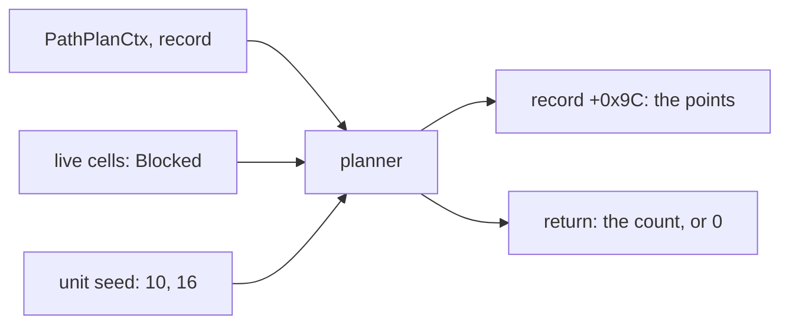
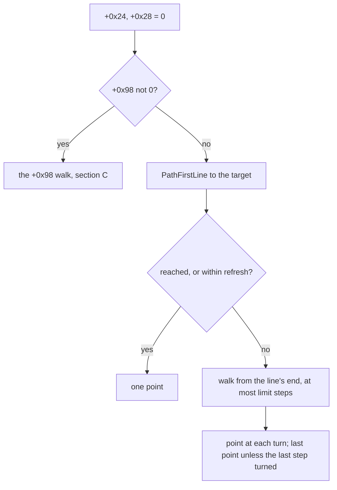
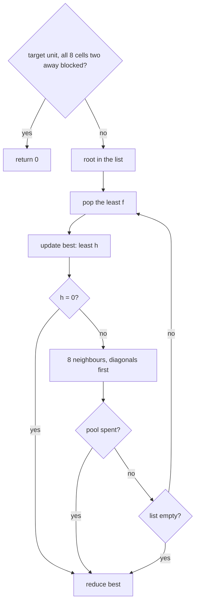
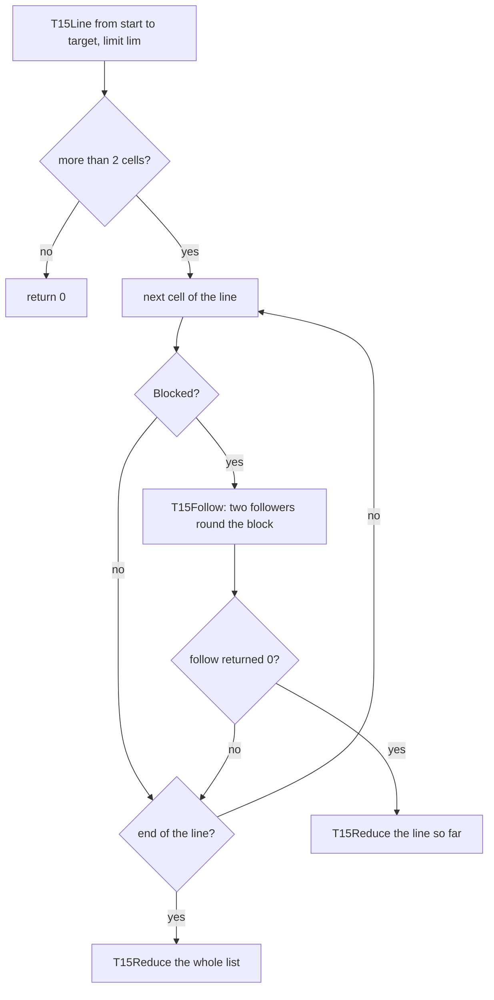
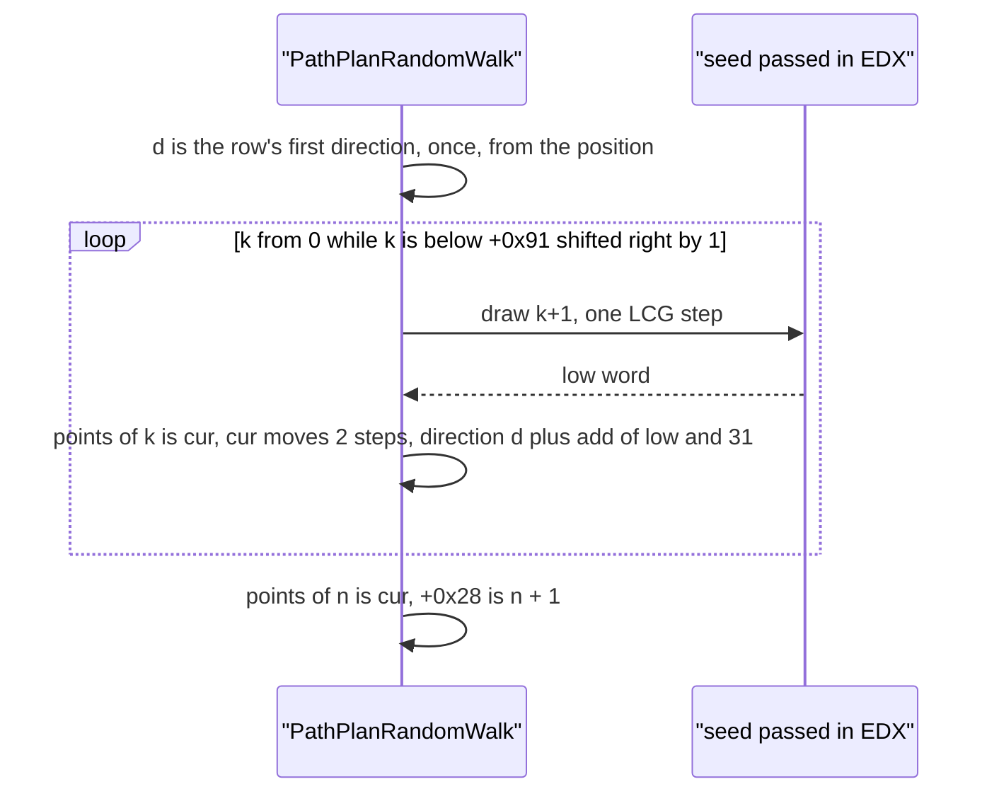
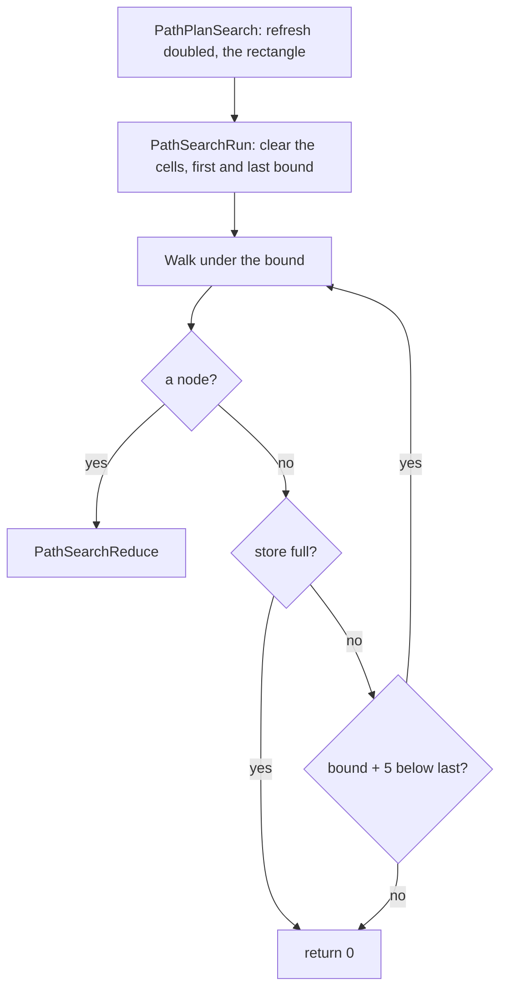
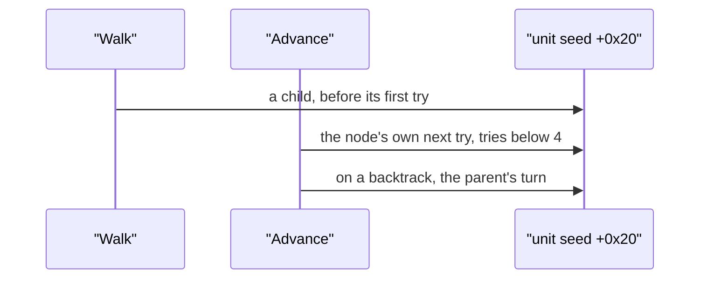

# The planners: search, greedy, type 1, type 15, random walk, spiral and the rest

## Purpose

A planner takes the context [`PathPlan`](README.md#c-pathplan) built and writes the path's points. Its input is the live grid and the context; its output is the
point list and a count. This page holds each planner a stock caller reaches, and the others in short, as pseudocode with its cell reads and its draws. Which caller
reaches which type, what each count tests and the grid they read are [the overview](README.md).

**What the tags cover.** A `[C]` by emulation (ADR-0015) covers the code's map from the bytes it reads, not what the game stores there or when it runs: run:2026-11-03-path-emu-2
and run:2026-11-03-path-emu-3 compare the record byte for byte against each model over declared images, with controls. A `[C]` by the game's plans covers the types and outcomes
[overview § G1](README.md#g1-per-type) lists, given the live cells. A branch that only the emulation reached says so.



## Entry points

| Type | Function | Tag |
|---|---|---|
| 2, 5, 6, 13 | fn:sub_00679C80_PathPlanGreedy@0x00679C80 | [C] (run:2026-11-03-path-emu-3, run:2026-11-04-path) |
| 7 | fn:sub_00679ED0_PathPlanGreedyNear@0x00679ED0 | [C] (run:2026-11-03-path-emu-3, run:2026-11-04-path) |
| 8 | fn:sub_0067A000_PathPlanKnockback@0x0067A000 | [C] (run:2026-11-03-path-emu-3, run:2026-11-04-path) |
| 9 | fn:sub_00679F70_PathPlanOnePoint@0x00679F70 | [C] (run:2026-11-03-path-emu-3, run:2026-11-04-path) |
| 1 | fn:sub_0067B850_PathPlanType1@0x0067B850 | [C] (run:2026-11-03-path-emu-3); in the game through type 7's switch |
| 15 | fn:sub_0067C2D0_PathPlanType15@0x0067C2D0 | [C] (run:2026-11-03-path-emu-3, run:2026-11-04-path) |
| 4, 10, 14 | fn:sub_00649760_PathPlanStraight@0x00649760 | [C] (run:2026-11-03-path-emu-1) |
| 10 | fn:sub_0067A240_PathPlanRandomWalk@0x0067A240 | [C] (run:2026-11-03-path-emu-3, run:2026-10-25-skills) |
| 14 | fn:sub_0067A140_PathPlanSpiral@0x0067A140 | [C] (run:2026-11-04-path-2) |
| 4 | fn:sub_006492F0_PathPlanToUnit@0x006492F0 | [C] (run:2026-11-03-path-emu-1) |
| 0, 16 | fn:sub_0067AD00_PathPlanSearch@0x0067AD00 | [C] by emulation only (run:2026-11-03-path-emu-2) |
| 3, 11, 12, client only | fn:sub_00679E50_PathPlanType3@0x00679E50, fn:sub_00679FD0_PathPlanType11@0x00679FD0, fn:sub_00679E60_PathPlanType12@0x00679E60 | [C] by emulation only (run:2026-11-03-path-emu-3) |

## Inputs

### Tables

These sit in the image's data. The values are read from the pinned image at the address, not listed here, except the short ones the findings state; [this entry](../../backlog/2026-11-04-spec-writer-archivist-path-direction-tables-doc.md) asks for their doc.

| Anchor | Shape | Used for |
|---|---|---|
| data:g_DirOctant@0x006F1518 | `i32[25][3]` by `PathDirCell` | the three directions to a target; column 0 is the octant ([drlg/outdoor](../drlg/outdoor.md)) |
| data:g_PathStep8Long@0x006F1798 | 8 × (dx, dy) i32 | one step: `(1,0), (1,1), (0,1), (−1,1), (−1,0), (−1,−1), (0,−1), (1,−1)` |
| data:g_PathSearchStep8@0x006F1958 | 8 × (dx, dy) i32, read as words | the same steps |
| data:g_PathDistNear@0x006F1698 | `i32[64]` by `dx + 8 dy` | the near distance (A3) |
| data:g_PathSearchTurnRows@0x006F17D8 | `i32[8][8]` | the search's turns (L3) |
| data:g_PathSearchDrawAdd@0x006F18D8 | `i32[32]`: −2..2 six times, then −1, 1 | type 16's addend (L4) |
| data:g_T15Step@0x006F1D98 | 16 × (dx, dy) i32: (0,−1), (1,−1), … twice | a follower's step |
| data:g_T15DirFromStep@0x006F1E28 | centred i32, index `3 dy + dx` | a follower's first direction |
| data:g_T15TurnA@0x006F1EC0, data:g_T15NextA@0x006F1F00, data:g_T15TurnB@0x006F1E40, data:g_T15NextB@0x006F1E80 | `i32[16]` each | the followers' turns and next directions |
| data:g_SineTable@0x00707800 | `f32[512]`, within 1.8e-07 of `sin(2πk/512)` | the spiral |

### Runtime state

The context `ctx` and the record `path` are [overview § Runtime state](README.md#runtime-state). A planner returns its count; `PathPlan` stores it in `+0x28`.

**What decides each planner**, [C] by emulation against the whole record. An undeclared field has no traced read: `ctx +0x0C`, `+0x10`, `+0x1C`, `+0x20`, `+0x24` in the short planners, `ctx.limit`, `ctx.size` and `+0x10` in the search, `ctx.limit`, `ctx.refresh` and `+0x91` in type 1. The table doesn't list the asserts' reads. (run:2026-11-03-path-emu-2, run:2026-11-03-path-emu-3)

| Planner | Cells read under | Limit | Other |
|---|---|---|---|
| Greedy's first line (A4, A5) | `path +0x1C`, `+0x48`, `+0x50`, from the position | — | `+0x7C`, `+0x3C`, the unit's type |
| Greedy's walk (A6) | `ctx.room`, `ctx.pattern`, `ctx.testMask`, from `ctx.start` | `ctx.limit` | `ctx.refresh`, `+0x98` |
| Knockback | as the first line, but from `ctx.start` | — | `+0x90`, `+0x58` |
| Type 1 | `ctx.room`, `ctx.pattern`, `ctx.testMask` | none | `+0x58` |
| Type 15 | `ctx.room`, `ctx.pattern`, `ctx.testMask` | the byte `+0x91`, not `ctx.limit` | `+0x58` |
| Search | `ctx.room`, `ctx.pattern`, `ctx.testMask` | none: `ctx.b1C` is the bound | `ctx.refresh`, `ctx.type`, `ctx.b1C`, `ctx.troom`, and `path +0x30` under type 16 |
| Random walk, spiral | **no cell** | the byte `+0x91`; the spiral neither | the position; the target (walk) |

`PathPlan` writes both sets from the same fields, and a planner does not change `+0x48` or `+0x50`, so in the game the line's and the walk's inputs differ only in where they start. [I] (0x00679726–0x0067972C, 0x00679417–0x00679423)

### Constants

| Name | Value | Anchor | Tag |
|---|---|---|---|
| straight step, diagonal step | 2, 3 | 0x0067A875–0x0067A8E0, fn:sub_0067ADC0_PathOctile@0x0067ADC0 | [C] (controls `cost`, run:2026-11-03-path-emu-2, run:2026-11-03-path-emu-3) |
| `h` | `2 max(|dx|, |dy|) + min(|dx|, |dy|)` | 0x0067A875–0x0067A8E0 | [C] (controls `h`, the same runs) |
| type 1 switch | `dx² + dy² ≤ 324` | 0x00679F43 | [C] (control `le325` 18 cases, run:2026-11-03-path-emu-3) |
| type 1 pool | 200 nodes | 0x0067B1C0–0x0067B1CF | [C] (control `pool`, run:2026-11-03-path-emu-3) |
| search store | 900 nodes, 10 000 tries a pass, 50 000 cells | 0x0067A77E, 0x0067A8EC, 0x0067AABC | [C] (controls `nodes`, `passes`, families `grid`, `over`, run:2026-11-03-path-emu-2) |
| type 15 minimum limit under a target unit | 40 | 0x0067C312 | [C] (control `lim40`, run:2026-11-03-path-emu-3) |
| random walk step | 2 subtiles | 0x0067A352 | [C] (control `step1`, run:2026-11-03-path-emu-3) |
| spiral | `r += 0x2580`, `a += 16`, 77 points | 0x0067A180–0x0067A233 | [I] (the structure agrees under the emulator's rounding, control `swap`, run:2026-11-03-path-emu-3) |

## Algorithm

### A. What the planners share

#### A1. A cell read: `Blocked`

```
Blocked(hint, x, y, pattern, mask) ← COLL_PatternTestBool(hint, x, y, pattern, mask)    [C] (fn:COLL_PatternTestBool@0x0064D910, fn:COLL_PlusTestBool@0x0064D4E0, fn:COLL_RectTestBool@0x0064CF50, run:2026-11-03-path-emu-2)
  pattern 0:       the cell (x, y) & mask; no room: blocked
  pattern 1, 3, 5: the plus, each cell looked up with the centre's room as hint; no centre room, or a room one cell wide or high: blocked
  pattern 2, 4:    the 3×3 rectangle, split across rooms
  any other:       blocked
```

- A1. [C] The cells and masks are [drlg/collision §§ D, E](../drlg/collision.md#e-collisiontest-by-size). The room is a hint for every step of a plan, so a cell in a room outside that room's near list is "no room" and blocked, however large the search's rectangle. (fn:COLL_PatternTestBool@0x0064D910, run:2026-11-03-path-emu-2)
- A1. [C] The grid is the live one, with the unit's own marks already off: [overview § F1](README.md#f1-the-planners-take-the-live-grid). (0x00649BAE, run:2026-11-04-path-2)

#### A2. Directions

```
PathDirCell(a, b) → i32:                                           [C] (fn:sub_00678C10_PathDirCell@0x00678C10, 0x00678C2A–0x00678CA2, run:2026-11-03-path-emu-1, control sign 60)
  dx: i32 ← b.x − a.x;  dy: i32 ← b.y − a.y
  if |dx| ≥ 2|dy|:      dy ← (dy < 0) ? −1 : dy & 1               ; & 1, not a sign
  else if |dy| ≥ 2|dx|: dx ← (dx < 0) ? −1 : dx & 1
  dx ← clamp(dx, −2, 2);  dy ← clamp(dy, −2, 2)
  return 5 dx + dy + 12

PathDirRow(a, b)    ← the three of g_DirOctant[PathDirCell(a, b)]  [C] (fn:sub_00678D70_PathDirRow@0x00678D70, run:2026-11-03-path-emu-3)
PathDirOctant(a, b) ← the first of them                            [C] (fn:sub_00678D10_PathDirOctant@0x00678D10, run:2026-11-03-path-emu-2)
```

- A2. [I] `g_DirOctant` holds 0..7 only, so the assert 0x4C of a third direction 255 cannot fire from these callers. (data:g_DirOctant@0x006F1518, 0x006794BC)

#### A3. Distances

```
PathOctile(a, b):   dx, dy absolute;  2 max(dx, dy) + min(dx, dy)  [C] (fn:sub_0067ADC0_PathOctile@0x0067ADC0, run:2026-11-03-path-emu-3)
PathDistNear(a, b):                                                [C] (fn:sub_00679380_PathDistNear@0x00679380, 0x00679380–0x006793D7, run:2026-11-03-path-emu-3, control dist 7)
  dx, dy absolute
  if dx < 8 and dy < 8:  v ← g_PathDistNear[dx + 8 dy];  return (v < 0) ? 0 : v + 1
  return (dx > dy) ? dy + 2 dx : dx + 2 dy
```

#### A4. The line: `PathLineFree`

```
PathLineFree(path, s, t) → (free, point):                          [C] (fn:sub_00679720_PathLineFree@0x00679720, 0x00679720–0x00679A58, run:2026-11-03-path-emu-3; all of A4)
  Blocked here is under path.room, path.pattern, path.testMask
  dx: i32 ← t.x − s.x;  dy ← t.y − s.y;  ax ← |dx| + 1;  ay ← |dy| + 1
  px ← (dx ≥ 0) ? 1 : −1;  py ← (dy ≥ 0) ? 1 : −1
  (x, y) ← s;  last ← s
  if ax > ay:
    err ← ay
    loop:
      x += px;  if Blocked(x, y): return (0, last)
      err += ay
      if err ≥ ax:
        y += py;  err −= ax
        if err > 0 and Blocked(x, y): return (0, last)
      last ← (x, y)
      if x = t.x: return (1, t)
  if ax < ay: the same with the axes swapped
  if s.x = t.x: return (1, t)
  loop:                                                            ; a diagonal
    x += px;  y += py;  if Blocked(x, y): return (0, last)
    last ← (x, y)
    if x = t.x: return (1, t)
```

Coordinates are u16. `point` is the last point wholly free.

#### A5. The first line: `PathFirstLine`

```
PathFirstLine(path, pt) → (reached, pt):                           [C] (fn:sub_00679A60_PathFirstLine@0x00679A60, 0x00679AC0–0x00679B1B, run:2026-11-03-path-emu-3)
  unit neither player nor monster: assert 0x144;  path type 4: assert 0x145     ; [C] 43 and 25 cases, at their return site 0x00679A83
  pt.x = 0: assert 0x146;  pt.y = 0: assert 0x147                  ; [I] read, not run (0x00679AA5–0x00679AB9)
  if path +0x7C = 0: return (0, the position's subtile)
  PathAimNextPoint(path, 1; 1)                                     ; over the record, points[0] the target, +0x28 = 0
  if path +0x7C = 0: return (0, the position's subtile)            ; the target is the position
  return PathLineFree(path, the position's subtile, pt)
```

- A5. [C] **The planner aims the path before its own points exist,** which writes the vector, the step and the facing, and the speed gates the line. ([anim/movement § B](../anim/movement.md#b-the-per-frame-step) has the aim; 0x00679AC0–0x00679B1B, fn:sub_0064FE40_PathAimNextPoint@0x0064FE40, run:2026-11-03-path-emu-3)

#### A6. Three directions: `PathTry3Dirs`

```
PathTry3Dirs(ctx, cur, dirs) → d or none:                          [C] (fn:sub_006793E0_PathTry3Dirs@0x006793E0, run:2026-11-03-path-emu-3, control order)
  for d in dirs, in order:
    if not Blocked(ctx.room, cur + g_PathStep8Long[d], ctx.pattern, ctx.testMask): return d
  return none
```

### B. The greedy planner: types 2 and 13



```
PathPlanGreedy(ctx) → n:                                           [C] (fn:sub_00679C80_PathPlanGreedy@0x00679C80, run:2026-11-03-path-emu-3: greedy 600, gbound 30; run:2026-11-04-path, run:2026-11-04-path-2; all of B)
 1. +0x24 ← 0;  +0x28 ← 0
 2. if path.+0x98 ≠ 0: return PathWalkParam98(ctx)
 3. points[0] ← ctx.target
 4. (reached, pt) ← PathFirstLine(path, ctx.target)
 5. if reached or PathDistNear(pt, ctx.target) ≤ ctx.refresh: points[0] ← pt;  +0x28 ← 1;  return 1
 6. cur ← ctx.start;  n: i32 ← 0
 7. if pt ≠ ctx.start: points[0] ← pt;  n ← 1;  cur ← pt
 8. limit: i32 ← ctx.limit;  prev ← 0xFF;  turned ← 0;  i: i32 ← 0
 9. while i < limit:                                               ; the test is once at entry and at step 16
10.   if cur = ctx.target:
        if not turned and i ≠ 0: points[n++] ← cur
        break
11.   turned ← 0
12.   d ← PathTry3Dirs(ctx, cur, PathDirRow(cur, ctx.target))
13.   if d is none or ((d − 4) & 7) = prev:                        ; blocked, or a reversal
        if i ≠ 0: points[n++] ← cur
        break
14.   next ← cur + g_PathStep8Long[d]                              ; u16 adds
      if d ≠ prev:
        if cur ≠ ctx.start: points[n++] ← cur
        turned ← 1
15.   cur ← next;  prev ← d;  i ← i + 1
16.   if i ≥ limit:
        if not turned: points[n++] ← cur
        break
17. +0x28 ← n;  return n
```

- B. [C] **A walk whose last step turned ends one step short:** when the step that reaches the target or the limit changed direction, only the corner is written. (0x00679E1D–0x00679E2E, run:2026-11-03-path-emu-3, control `noflag`)
- B. [C] **The first point is written twice when the walk turns at once**, since `cur` equals it and is not the start. (0x00679DDA–0x00679DF4, run:2026-11-03-path-emu-3)
- B. [C] **A reversal ends the walk**, with the point reached written. (0x00679DB7–0x00679DBC, run:2026-11-03-path-emu-3, control `rev`, 2 cases; run:2026-11-04-path, 6; run:2026-11-04-path-2, 1)
- B. [C] Limit 0 writes nothing past the line's end. **At most `ctx.limit + 1` points: 78 at limit 77**, every slot used, no write past it. (0x00679E2E, run:2026-11-03-path-emu-3, family `gbound`)
- B. [I] Types 2 and 13 are one plan ([overview D4](README.md#d-the-17-types-planner-and-draws)). (data:g_PathTypeFlags@0x006EB690)

### C. The `+0x98` walk: types 5 and 6

```
PathWalkParam98(ctx) → n:                                          [C] (fn:sub_00679B30_PathWalkParam98@0x00679B30, 0x00679B30–0x00679C78, run:2026-11-03-path-emu-3: g98 300, values 2, −2, −4, 1; run:2026-11-04-path, run:2026-11-04-path-2; all of C)
  n: i32 ← +0x28                                                   ; appends
  cur ← ctx.start;  prev ← 0xFF;  turned ← 0;  i: i32 ← 0;  limit: i32 ← ctx.limit
  while i < limit:
    if cur = ctx.target:
      if not turned and i ≠ 0: points[n++] ← cur
      break
    dirs ← (PathDirRow(cur, ctx.target)[k] + path.+0x98) & 7, k = 0, 1, 2
    turned ← 0
    d ← PathTry3Dirs(ctx, cur, dirs)
    if d is none or ((d − 4) & 7) = prev:
      if i ≠ 0: points[n++] ← cur
      break
    next ← cur + g_PathStep8Long[d]
    if d ≠ prev: points[n++] ← cur;  turned ← 1                    ; always, so the first point is the start
    cur ← next;  prev ← d;  i ← i + 1
    if i ≥ limit:
      if not turned: points[n++] ← cur
      break
  +0x28 ← n;  return n
```

- C. [C] No line first and no refresh test: unlike § B it starts at `ctx.start`, and the start is its first point. At most `ctx.limit` points from an empty list. (0x00679E8A, run:2026-11-03-path-emu-3, controls `param0` 164, `order` 158)
- C. [I] With `+0x98` = 2 or −2 the three directions are the row's turned by 90°: the walk goes sideways to the line to the target rather than to it. (data:g_PathTypeParam98@0x006EB648)
- C. [C] In the game these plans hold 6 points at most (run 2); the walk's other branches rest on the emulation. (`2026-11-04-path-2-check.txt`, run:2026-11-04-path-2)

### D. Greedy-near: type 7

```
PathPlanGreedyNear(ctx) → n:                                       [C] (fn:sub_00679ED0_PathPlanGreedyNear@0x00679ED0, 0x00679F43–0x00679F61, run:2026-11-03-path-emu-3: near 480; all of D)
 1. +0x24 ← 0;  +0x28 ← 0
 2. n ← PathPlanGreedy(ctx)
 3. if n ≠ 0:
      p ← points[n − 1]
      if PathDistNear(p, ctx.target) ≤ ctx.refresh and p ≠ ctx.start: return n
 4. d2: i32 ← (s.x − t.x)² + (s.y − t.y)²                          ; ctx.start to ctx.target
    if d2 > 324: return n
 5. r ← PathPlanType1(ctx);  if r ≠ 0: return r
 6. if n = 0: return 0
 7. return PathPlanGreedy(ctx)                                     ; rewrites the list; repeats the first greedy's aim
```

- D. [I] 324 is 18 subtiles on an axis: (18, 0) passes, (18, 1) at 325 doesn't. A player plans this type, so a player's walk within 18 subtiles falls to type 1 when greedy stops short. (fn:sub_0057F090_PlrModeStartMove@0x0057F090)
- D. [C] In the game: 270 + 554 plans took the switch, of 2 725 + 4 355 that reached the planner. **The 324 boundary and the retry at step 7 separate no plan in either run** (`le325`, `noretry`): they rest on the emulation. (run:2026-11-04-path, run:2026-11-04-path-2)

### E. The knockback planner: type 8

```
PathPlanKnockback(ctx) → 0 or 1:                                   [C] (fn:sub_0067A000_PathPlanKnockback@0x0067A000, 0x0067A00D–0x0067A13C, run:2026-11-03-path-emu-3: knock 300, controls k 124, floor 41; run:2026-11-04-path, run:2026-11-04-path-2; all of E)
 1. k: i32 ← (path.+0x90 >> 1) + 1
 2. if t ← path.+0x58:
      (tx, ty) ← t's static dwords +0x0C, +0x10 for types 2, 4, 5;  else its path words +0x02, +0x06, 0 without a path
      dx: i32 ← s.x − tx;  dy ← s.y − ty;  m ← max(|dx|, |dy|)
      if m ≠ 0: dx ← k × dx ÷ m;  dy ← k × dy ÷ m                  ; signed idiv, truncating toward zero
      pt ← (s.x + dx, s.y + dy)                                    ; u16 adds
    else: pt ← ctx.target
 3. points[0] ← pt
 4. (free, q) ← PathLineFree(path, ctx.start, pt);  if not free: pt ← q      ; from ctx.start, not the position
 5. PathSetTargetPoint(path, pt);  path.+0x58 ← 0                  ; 0x00648AD0: on either outcome
 6. if pt = ctx.start: return 0
 7. points[0] ← pt;  +0x28 ← 1;  return 1
```

- E. [C] **The plan clears the path's target unit** and leaves the point as its target. It doesn't write `+0x24`; `PathPlan` has. (0x00648AE2–0x00648AEA, run:2026-11-03-path-emu-3)
- E. [I] A unit standing on its target has `m` = 0, and `pt` is the start: a return of 0. `k` ≤ 128 and the pushed point are not tested beyond the line. (0x0067A0B6, 0x0067A016)
- E. [C] The `+0x90` values and the start are [anim/movement § E](../anim/movement.md#e-knockback); its adjustment `0x00679720` is A4. In the game, monsters' plans with 2 player plans in the second run. (run:2026-11-04-path-2)

### F. The one point: type 9

```
PathPlanOnePoint(ctx) → 0 or 1:                                    [C] (fn:sub_00679F70_PathPlanOnePoint@0x00679F70, 0x00679F7B–0x00679FBE, run:2026-11-03-path-emu-3: onept 200, 62 one point, 70 refused, 68 at the asserts)
  +0x24 ← 0;  points[0] ← ctx.target
  (_, pt) ← PathFirstLine(path, ctx.target)
  if pt = ctx.start: return 0                                      ; +0x28 untouched
  points[0] ← pt;  +0x28 ← 1;  return 1
```

- F. [C] In the game 54 + 346 plans of the player's own Leap, one branch, one point, no grid needed in the first run's 54. The refusal branch rests on the emulation. (0x005DA00C, run:2026-11-04-path, run:2026-11-04-path-2)

### G. Type 1: best-first over a pool of 200

**Reach and evidence:** [overview § G2](README.md#g2-type-1). Emulated to its return (`t1real` 400, `t1syn` 240, `t1stair` 40), in the game through type 7's switch.



```
PathPlanType1(ctx) → n:                                            [C] (fn:sub_0067B850_PathPlanType1@0x0067B850, 0x0067B850–0x0067B9B0, run:2026-11-03-path-emu-3; all of G)
 1. if path.+0x58 ≠ 0:                                             ; 0x0067B740; control nostart
      test (±2, ±2) then the axes, from the target, in this order:
        (−2,−2), (−2,+2), (+2,−2), (+2,+2), (−2,0), (0,−2), (+2,0), (0,+2)
      if all 8 are Blocked: return 0                               ; nothing else written
 2. root: pt ← ctx.start, g ← 0, h ← f ← PathOctile(start, target), no parent;  count: i32 ← 1;  open ← [root]
 3. best ← none
 4. while open not empty:
 5.   n ← the head of open;  move it to closed
 6.   if best is none or (s16)n.h < (s16)best.h or (n.h = best.h and (s16)n.g > (s16)best.g + 5): best ← n
 7.   if n.h = 0: break
 8.   for (a, b) in (−1,−1), (−1,+1), (+1,−1), (+1,+1), (−1,0), (0,−1), (+1,0), (0,+1):
 9.     p ← n.pt + (a, b)                                          ; u16
10.     if Blocked(ctx.room, p, ctx.pattern, ctx.testMask): continue
11.     g: u16 ← n.g + ((p.x = n.x or p.y = n.y) ? 2 : 3)
12.     o ← the open node at p
13.     if o exists:
          if n has fewer than 8 links: link n → o
          if (s16)g < (s16)o.g: o.parent ← n;  o.g ← g;  o.f ← g + o.h      ; o stays where it lies in the list
          continue
14.     o ← the closed node at p
15.     if o exists:
          if n has fewer than 8 links: link n → o
          if (s16)g < (s16)o.g: o.parent ← n;  o.g ← g;  o.f ← g + o.h;  Propagate(o)
          continue
16.     if count ≥ 200: end the search now                         ; the 201st request; go to 19 with best
17.     count ← count + 1
        o ← new: parent n, g, pt p, h ← PathOctile(p, target), f ← g + h
18.     insert o into open before the first node with (s16)f not less than its own;  link n → o
19. return Reduce(best)

Propagate(o):                                                      ; a LIFO stack, 200 slots
  push o
  while the stack is not empty:
    u ← pop
    for each link u → v, in link order:
      gg: u16 ← u.g + cost(u.pt, v.pt)                             ; 2 or 3 as step 11
      if (s16)gg < (s16)v.g: v.parent ← u;  v.g ← gg;  v.f ← gg + v.h;  push v

Reduce(best) → n:                                                  ; 0x0067B690
  buf ← [];  prev ← (−2, −2);  m ← best
  while m and |buf| < 78:
    if m.parent: step ← m.pt − m.parent.pt;  if step ≠ prev: append m.pt to buf;  prev ← step
    m ← m.parent
  if |buf| is not in 1..77: return 0                               ; the list untouched
  copy buf reversed to points;  return |buf|                       ; neither +0x24 nor +0x28
```

- G. [C] **The diagonals come first and no corner test applies:** a diagonal between two blocked cells is taken. (0x0067B458–0x0067B677, control `offs`, run:2026-11-03-path-emu-3)
- G. [C] **Among equal `f` the newest comes first, and an open node given a better `g` is not moved.** (0x0067AED0–0x0067AF35, 0x0067B2A4–0x0067B2B3, control `resort` 19 and 103)
- G. [C] **A plan past the pool ends short with what it has, `best` included, even when no route reached the target:** 60 of `t1real` end at the pool, 2 of them returning 0, and 108 of `t1syn`. (0x0067B1C0–0x0067B1CF, 0x0067B981, control `pool`)
- G. [C] `best` is the least `h`, and on equal `h` a later node with `g` more than 5 above replaces it. Control `gt0` separates only 4 cases of each family. (0x0067B946–0x0067B964)
- G. [C] **The start is never kept; a single-segment route gives one point,** unlike the search. A raw 78 returns 0 (`t1stair`: 15 cases past 77, `maxret` 77). (0x0067B6C0–0x0067B72B, controls `max77`, `min2`)
- G. [C] **Not read:** `ctx.limit`, `ctx.refresh`, `+0x91`. A type-1 route has no length limit but its pool. The two hash tables only place nodes in buckets: the model holds no hash and matches. (data at 0x006F1998, 0x006F1B98, run:2026-11-03-path-emu-3)
- G. [I] A node is expanded once and has 8 neighbours, so the code's silent drop of a ninth link is not reached. (0x0067B28E)
- G. [C] In the game the propagation stack reached 3 in the first run's 270 plans, 23 in the emulation, against 200 slots. (run:2026-11-04-path, run:2026-11-03-path-emu-3)

### H. Type 15: a line with two wall followers



```
PathPlanType15(ctx) → n:                                           [C] (fn:sub_0067C2D0_PathPlanType15@0x0067C2D0, 0x0067C2D0–0x0067C416, run:2026-11-03-path-emu-3: t15real 400, t15syn 300, t15stair 40; run:2026-11-04-path, run:2026-11-04-path-2; all of H unless noted)
 1. unit neither player nor monster: assert 0x2AD                  ; [I] read, not run (0x0067C2D0)
 2. lim: i32 ← the byte path.+0x91;  if path.+0x58 ≠ 0 and lim < 40: lim ← 40
 3. (L, axis) ← T15Line(ctx.start, ctx.target, lim);  n ← |L|
 4. if n ≤ 2: return 0
 5. cur ← ctx.start;  i ← 0
 6. loop:
      if Blocked(ctx.room, L[i], ctx.pattern, ctx.testMask):
        r ← T15Follow(ctx, L, cur, &i, &n, lim − i, axis)
        if r = 0: return T15Reduce(ctx.start, L, i)
      cur ← L[i];  i ← i + 1                                       ; at i = n after a follow, a read past the written list, without effect (0x0067C3D6)
      if i ≥ n: break
 7. return (n ≠ 0) ? T15Reduce(ctx.start, L, n) : 0

T15Line(a, b, lim) → (cells after a, axis):                        ; fn:sub_0067B9F0_T15Line@0x0067B9F0, 0x0067B9F0–0x0067BBA8
  dx ← b.x − a.x;  dy ← b.y − a.y;  px, py their signs (≥ 0 → +1);  dx, dy absolute;  err ← 0
  axis: y major: 2 for increasing, 0 decreasing;  x major: 1 for increasing, 3 decreasing
  x is major when dy = 0, or dx ≠ 0 and dx ≥ dy                    ; equal dx, dy takes x
  no cells when the major difference is 0, or above lim − 1 (the axis still set)
  for each major step:  major += sign;  err += minor difference
                        if err ≥ major difference: err −= it;  minor += sign
                        append (x, y)

T15Follow(ctx, L, cur, &i, &n, lim4, axis) → r:                    ; fn:sub_0067BDF0_T15Follow@0x0067BDF0, 0x0067BEBA–0x0067C1D0
  p ← L[i];  q ← g_T15DirFromStep[3 (p.y − cur.y) + (p.x − cur.x)]
  w0: dir q + 1, Turn g_T15TurnA, Next g_T15NextA;  w1: dir q + 7, Turn g_T15TurnB, Next g_T15NextB      ; not masked: up to 14, the tables have 16
  each: pos ← cur, cnt ← 0, list empty, mark ← 0, stop ← 0;  a ← w0;  b ← w1
  loop:
    if a.stop = 0 and not WalkStep(a): a.stop ← 1
    if a.stop = 0:
      v ← a.next's advance along axis from cur, when a.cnt ≥ 1     ; axis 0: cur.y − next.y; 1: next.x − cur.x; 2: next.y − cur.y; 3: cur.x − next.x
      if v > 0 and i + v − 1 < n and L[i + v − 1] = a.next:        ; back on the line: the splice
        lim4 ≤ a.cnt: assert 0x1BB                                 ; [I] read, not reached (0x0067C07F)
        append a.next to a.list;  a.cnt += 1
        idx ← i + v − 1;  d ← i − idx − 1 + a.cnt;  new ← idx + d
        move L[idx + 1 ..< n] to start at new + 1;  copy a.list to L[i ..< i + a.cnt]
        n ← n + d;  i ← new + 1;  return a.cnt
      if b.cnt > 1:
        if a.mark ≠ 0:
          if a.next = b.list[a.mark − 2]: n ← i;  return 0         ; met the other's trail again: the line before the block
          a.mark ← 0
        if a.next = b.pos: a.mark ← b.cnt
      append a.next to a.list;  a.cnt += 1;  a.pos ← a.next;  a.dir ← a.Next[a.dir]
      if (lim4 − n) − 1 ≤ a.cnt: a.stop ← 1
    if a.mark = 0: swap a, b                                       ; they alternate, except while one holds its mark
    if w0.stop or w1.stop: break
  if lim4 > 80: n ← i;  return 0
  last(w) ← w.list[w.cnt − 1] when w.cnt ≠ 0, else w.stop read as a point
  d0, d1, dq ← the squared distances to ctx.target of last(w0), last(w1), ctx.start
  w ← (d0 < d1) ? w0 : w1
  if dq < the chosen d: return 0                                   ; nothing changed
  copy w.list to L[i ..< i + w.cnt];  i ← i + w.cnt;  n ← i
  return a.cnt

WalkStep(w) → free:                                                ; fn:sub_0067BBF0_T15WalkStep@0x0067BBF0
  up to four tries:  w.next ← w.pos + g_T15Step[w.dir];  if not Blocked(w.next): return 1
                     before tries 2, 3, 4: w.dir ← w.Turn[w.dir]
  return 0

T15Reduce(start, L, n) → count:                                    ; fn:sub_0067C1E0_T15Reduce@0x0067C1E0, 0x0067C1E0–0x0067C2C8
  n = 0: return 0;  n = 1: points[0] ← L[0];  return 1
  (lx, ly) ← L[0] − start;  o ← 0;  run ← 0
  for j in 0 ..< n − 1:
    (dx, dy) ← L[j + 1] − L[j]
    if dx = lx and dy = ly:              run ← run + 1;  lx ← dx   ; dropped
    else if run < 1 and lx ≠ dx and ly ≠ dy: run ← 1;  lx ← −2     ; one kink dropped
    else:                                points[o++] ← L[j];  run ← 0;  lx ← dx
    ly ← dy
  points[o++] ← L[n − 1];  return o
```

- H. [C] The outcomes are by `OUTCOMES`: clear line, refused at 2 points or fewer, follow, follow with splice, truncation, loop. Controls `lim40` 32 and 7, `lim18` 120 and 150, `min2` 4 and 1, `reduce` 171, 230, 34, `wswap` 29, 99, 2, `noswap` 28, 66, 18. In the game `wswap` 627, `noswap` 498, `reduce` 858 on the second run. (run:2026-11-03-path-emu-3, run:2026-11-04-path-2)
- H. [C] **Most plans end at 0:** 2 273 of the second run's 3 309, the planner's own refusal or a free line of too few cells. (`2026-11-04-path-2-check.txt`, run:2026-11-04-path-2)
- H. [C] So a line like E, SE, E, SE loses every other corner. (control `reduce`, run:2026-11-03-path-emu-3)
- H. [I] A follower count of 0 reads as a point: `last` is then the stop word, as a point of (1, 0) or (0, 0). No control separates it. (0x0067C0E2–0x0067C13A)
- H. [I] `lim` above 80 is reached only with bytes no writer gives (`lim50`, 4 emulated cases). A target unit with `+0x91` below 40 is a monster with its creation's 14, so its line reaches 39 subtiles where its other plans have 14. (0x0067C045, 0x0067C312)

### I. The random walk: type 10



```
PathPlanRandomWalk(path, seed) → n + 1:                            [C] (fn:sub_0067A240_PathPlanRandomWalk@0x0067A240, 0x0067A240–0x0067A385, run:2026-11-03-path-emu-3: rwalk 300, 5 092 draws, controls shr 279, n1 300, step1 258, accum 204, noadd 238; all of I)
 1. add: i32[32] ← { −1, 0, 1 } ten times, then −1, 1
 2. n: i32 ← path.+0x91 >> 1
 3. cur ← the position's subtile words (+0x02, +0x06)
 4. d ← PathDirRow(cur, (path.+0x10, path.+0x12))[0]               ; once
 5. for k in 0 ..< n:
      lo, hi ← the seed's halves;  v: u64 ← 0x6AC690C5 × lo + hi;  seed ← (low 32 of v, high 32 of v)      ; draw#(k+1), the LCG inline, 0x0067A31A; see rng
      dir ← (d + add[low 32 of v & 31]) & 7
      points[k] ← cur
      cur ← cur + 2 × g_PathStep8Long[dir]                         ; u16 adds
 6. points[n] ← cur;  +0x28 ← n + 1;  return n + 1
```

- I. [C] **It is not a walk of accumulating turns:** every step is the first direction ±1 or straight. **The first point is the position itself. No grid and no room are read:** the missile's collision is its own. (0x0067A32E, control `accum`, run:2026-11-03-path-emu-3)
- I. [C] `+0x91` of 0 or 1 draws nothing and has one point. (family `rwalk`, `draws:0` 42, 0x0067A2FE, run:2026-11-03-path-emu-3)
- I. [I] A straight step has chance 10/32, each side 11/32. (0x0067A258–0x0067A2F3)
- I. [C] In the game: 698 + 248 plans, return 39 in all at `+0x91` = 77, 654 creations of the skills runs. Worked example: [overview](README.md#worked-example). (run:2026-11-04-path, run:2026-11-04-path-2, run:2026-10-25-skills)
- I. [I] At limit 77 the walk reaches 76 subtiles on an axis, so its u16 adds wrap only within 76 subtiles of 0 or 65 535. (0x0067A352)

### J. The spiral: type 14

```
PathPlanSpiral(path) → 77:                                         [I] the structure, read (fn:sub_0067A140_PathPlanSpiral@0x0067A140, 0x0067A180–0x0067A233, all of J); [C] the products and the list below
 1. (fx, fy): u32 ← the 16.16 position;  (lx, ly) ← (fx, fy);  r: u32 ← 0;  a: i32 ← 0;  k: i32 ← 0
 2. loop:
 3.   r ← r + 0x2580;  a ← a + 16
 4.   R: f32 ← r                                                   ; fstp, exact for these values
 5.   X: i32 ← trunc(g_SineTable[(a + 0x80) & 0x1FF] × R)          ; toward zero; 0x0067A1AC
 6.   Y: i32 ← trunc(g_SineTable[a & 0x1FF] × R)                   ; toward zero; 0x0067A1DD
 7.   x: u32 ← X + fx;  y: u32 ← Y + fy
 8.   if x >> 16 ≠ lx >> 16 or y >> 16 ≠ ly >> 16:
        points[k] ← (x >> 16, y >> 16);  k ← k + 1;  (lx, ly) ← (x, y)
 9.   if k ≥ 77: break
10. +0x28 ← 77;  return 77
```

- J. [C] **Truncation toward zero:** [overview § G4](README.md#g4-truncation). (0x0067A1A1, 0x0067A1CA, 0x0067A1AF, 0x0067A1E0, run:2026-11-04-path-2)
- J. [C] The point list reproduces in 27 stock plans of the first run, which at a start fraction of `0x8000` on both axes are one list relative to the start, and in 233 natural plans of the second; `swap` separates them. (run:2026-11-04-path, run:2026-11-04-path-2)
- J. [I] No draw, no grid, neither `+0x90` nor `+0x91`. 94 iterations at the kept start, at most 95 in the emulator's cases; `r` would wrap at iteration 223 697. (0x0067A21D)
- J. [I] The emulator's x87 can't test this: the p-code `FISTP` ignores the rounding field. So the list's tag rests on the game's plans. (0x0067A1A1, run:2026-11-03-path-emu-3)
- J. [I] **The hammer at a wall:** this plan reads no grid; the end at a wall is the missile's own step, [skills/missiles § D3](../skills/missiles.md#d-each-frame), with [P12's entry](../../backlog/2026-11-04-architect-reverser+spec-writer-0054-p12-missile-own-cell-bit0-vs-floor.md). (fn:sub_005AE1F0_MissileMoveCollide@0x005AE1F0)

### K. The straight planner and type 4

```
PathPlanStraight(path, unit):                                      [C] to the boundaries of 10 and 14 (fn:sub_00649760_PathPlanStraight@0x00649760, 0x00649763–0x006497C8, run:2026-11-03-path-emu-1)
  type 4:  n ← PathPlanToUnit(path);  flag 0x20 set when n ≠ 0, cleared when 0;  return n
  type 10: PathPlanRandomWalk(path, &unit.seed);  flag 0x20 set;  return +0x28      ; [I] past the boundary (0x00649763)
  type 14: PathPlanSpiral(path);  flag 0x20 set;  return +0x28                      ; [I] past the boundary (0x00649763)
  else: fatal 0x207                                                ; [I] not run (0x006497C8)

PathPlanToUnit(path) → 0 or 1:                                     [C] (fn:sub_006492F0_PathPlanToUnit@0x006492F0, 0x006492F0–0x006493F9, run:2026-11-03-path-emu-1: 47 cases, 35 one point, 12 refused)
  +0x24 ← 0
  if a target unit: (+0x10, +0x12) ← its position
  if |sx − tx| ≥ 100 or |sy − ty| ≥ 100 or tx = 0 or ty = 0: return 0   ; +0x28 kept
  points[0] ← (tx, ty);  +0x28 ← 1;  +0x38 ← 0
  PathAimNextPoint(path, 1; 1)
  flag bit 0 when the path has no room or the point lies outside its rectangle
  return 1
```

- K. [C] No collision test: a type-4 path is one straight segment. The refusal is at 100 where `PathPlan`'s window passes 100, and these paths skip that window. In the game all 2 740 + 3 713 plans are this one point. (0x006492F0, run:2026-11-04-path, run:2026-11-04-path-2)

### L. The search: types 0 and 16

[C] **Evidence:** 2 116 cases of families `real0`, `real16`, `stair`, `corr`, `open`, `rect`, 0 mismatches, plus the 120 boundary cases of `grid` and `over`. **No game plan: no type 0 or 16 in 46 sessions** ([overview § G3](README.md#g3-the-other-short-types-and-stages)). Everything in § L is that emulation's, with the frame compared as scratch, unless tagged otherwise. (run:2026-11-03-path-emu-2)

It is an iterative-deepening depth-first walk, not best-first: no open list and no priority. Each node takes the first direction of a fixed fan that passes the tests, so the fan's order is the tie-break.



#### L1. The rectangle

```
PathPlanSearch(ctx):                                               [C] (fn:sub_0067AD00_PathPlanSearch@0x0067AD00, controls union 11 of rect, margin 10 and 37, run:2026-11-03-path-emu-2)
  ctx.refresh ← ctx.refresh + ctx.refresh                          ; u8, 0x0067AD15
  own ← the unit's room's rectangle (x, y, w, h);  r ← own         ; DungeonRoom +0x4C
  if ctx.troom ≠ 0 and ctx.troom ≠ ctx.room:
    o ← its rectangle
    if o.x < own.x: r.x ← o.x;   r.w ← own.w − o.x + own.x         ; own's right end
    else:           r.x ← own.x; r.w ← o.w − own.x + o.x           ; o's right end, even when own's lies further
    if o.y < own.y: r.y ← o.y;   r.h ← own.h − o.y + own.y
    else:           r.y ← own.y; r.h ← o.h − own.y + o.y
    if r.w = own.w: r.x −= 10;  r.w += 20
  else:
    r.x −= 10;  r.w += 20
  if r.h = own.h: r.y −= 10;  r.h += 20
  return PathSearchRun(r, ctx)
```

- L1. [C] **It is not the true union.** A target room right of or below the unit's, with the same left or top edge or one inside, and a smaller far end, shrinks the rectangle below the unit's room; a start beyond it ends the walk at the root: return 0. (family `rect`, `startout` 24, all count 0, run:2026-11-03-path-emu-2)
- L1. [I] Rooms on one row with equal rectangles get the margin only across, since `r.w` differs. `x1 = x + w` and `y1 = y + h` are **both inside**, one column and row past the room's own end. (0x0067AD97, 0x0067ADA6, 0x0067A78F)

#### L2. The run

```
PathSearchRun(r, ctx) → n:                                         [C] (fn:sub_0067AAA0_PathSearchRun@0x0067AAA0, controls step, half, regrid; 0x0067AAB9–0x0067AAC3, 0x0067AAFB, 0x0067AC3E–0x0067ACD4)
 1. if (i32)(r.w × r.h) > 50000: assert line 0x171                 ; 50 000 passes
 2. the store: 900 nodes of 0x1C bytes, x0, y0, x1, y1, stride ← r.w + 6, offsets 3 − x0, 3 − y0
    clear (r.w + 6)(r.h + 6) cells to 0                            ; once a search; every pass reuses them
    cell(x, y) ← cells[(y + 3 − y0) × stride + 3 − x0 + x]         ; 0 unseen, 1 blocked, else the least g written
 3. drawing ← (ctx.type = 16);  seed ← path.unit + 0x20 under type 16      ; 0x0067AB74–0x0067ABA4
 4. h0: u16 ← PathOctile(start, target);  first: i16 ← h0
    if type = 0:       last ← max(first, ctx.b1C)
    else if type = 16: first ← (i16)(h0 + h0 ÷ 2);  last ← max(first, ctx.b1C)
    else:              last ← first
 5. root: pt ← start, f ← h ← h0, g ← 0, tries ← −3, turn row 0 at entry 0, dir ← PathDirOctant(start, target) & 7
 6. do:
      nodes[0] ← root;  node ← Walk(first, ctx);  first ← first + 5
      if node is none and nNodes = 900: break
      nNodes ← 1
    while node is none and first < last
 7. n ← node ? Reduce(node, ctx) : 0
 8. return (n ≥ 78) ? 0 : n

Reduce(node, ctx) → n:                                             ; fn:sub_0067A9F0_PathSearchReduce@0x0067A9F0, controls min2, max77
  buf ← [];  prev ← (−2, −2)
  while node and |buf| < 78:
    if node.parent: step ← node.pt − node.parent.pt;  if step ≠ prev: append node.pt;  prev ← step
    node ← node.parent
  if |buf| < 2 or |buf| > 77: return 0                             ; the list untouched
  copy buf reversed to points;  return |buf|
```

- L2. [C] **With `b1C` at or below `h0`, type 0 has one pass at exactly `h0`:** only a route of the unblocked octile length is found. (0x0067AC3E–0x0067ACD4)
- L2. [C] **A route of one segment returns 0,** so a straight or exactly diagonal free line is refused by this planner (`points<2:target` 9 of `real0`, 1 of `real16`, 3 of `stair`). The list ends at the node the walk ended on; the start is not in it. (0x0067AA6B–0x0067AA72)
- L2. [C] Neither planner reads `ctx.limit`, `ctx.size` or `+0x10`, and neither reads the path but `+0x30` under type 16. (`traced=0` over 2 116 cases, run:2026-11-03-path-emu-2)
- L2. [I] Bounds: at most 51 passes (`h0` ≥ 2, `b1C` ≤ 255), each at most 10 000 tries. (0x0067ACB0, 0x0067A77E)

#### L3. The walk and the fan

```
Walk(bound, ctx) → node or none:                                   [C] (fn:sub_0067A740_PathSearchWalk@0x0067A740, controls h, cost, fgt, cellle, rectend, radius, passes, nodes; 0x0067A760–0x0067A786, 0x0067A8EC, 0x0067A9D7)
 1. node ← root;  tries: i32 ← 0
 2. loop:
 3.   if node.pt = ctx.target: return node
 4.   tries ← tries + 1;  if tries > 10000: return none            ; a refused try and a passing one both count
 5.   if node.pt is outside x0..x1, y0..y1: return node            ; u16 compares, both ends inside; returned as found
 6.   n ← node.pt + g_PathSearchStep8[node.dir]                    ; u16 adds
 7.   c ← cell(n)
 8.   if c = 0 and Blocked(ctx.room, n, ctx.pattern, ctx.testMask): cell(n) ← 1;  goto next
 9.   g: u16 ← node.g + ((n.x ≠ node.x and n.y ≠ node.y) ? 3 : 2)
10.   if c ≠ 0 and (u32)c < (u32)(i32)(i16)g: goto next            ; 1, blocked, is below every g
11.   cell(n) ← (i16)g                                             ; written before the bound test
12.   h: u16 ← PathOctile(n, target);  f: u16 ← g + h
13.   if (i16)f > bound: goto next
14.   child ← node.child
      if child is none:
        if nNodes = 900: return none                               ; ends the whole search
        child ← the zeroed nodes[nNodes];  nNodes += 1;  child.parent ← node;  node.child ← child
15.   child.h ← h;  child.g ← g;  child.f ← f;  child.tries ← 0
16.   want ← PathDirOctant(n, target)
17.   child.turn ← the row (want − node.dir) & 7 of g_PathSearchTurnRows, at entry 0
18.   child.dir ← (node.dir + child.turn[0] + A) & 7               ; type 16: draw (0x0067A983), A ← g_PathSearchDrawAdd[low & 31];  else A ← 0
19.   child.pt ← n;  node ← child
20.   if (i16)node.h < ctx.refresh: return node                    ; ctx.refresh already doubled
21.   continue
22.  next: node ← Advance(node);  if none: return none

Advance(node) → node or none:                                      [C] (fn:sub_0067A690_PathSearchAdvance@0x0067A690, 0x0067A641, 0x0067A6E1)
  if node.tries < 4: next entry of node.turn;  Turn(node)          ; 0x0067A641: fn:sub_0067A630_PathSearchDirDraw@0x0067A630
  node.tries += 1
  if node.tries ≠ 5: return node
  loop:
    if node is the root: return none
    node ← node.parent
    next entry of node.turn;  Turn(node)                           ; 0x0067A6E1: a backtrack's turn, unconditional
    node.tries += 1
    if node.tries ≠ 5: return node

Turn(node):  node.dir ← (node.dir + the turn entry + A) & 7        ; A as step 18: a draw under type 16
```

The fan, as offsets from `d`, the parent's direction when the child was made (for the root: from `want`). The row index is `(want − d) & 7`. A child tries 5, the root 8.

| Row | Turn entries used | Tries, from `d` |
|---:|---|---|
| root (0) | 0, 1, 6, 3, 4, 5, 2, 7 | `0, +1, −1, +2, −2, +3, −3, +4` |
| 0 | 0, 1, 6, 3, 4 | `0, +1, −1, +2, −2` |
| 1 | 0, 1, 6, 3, 1 | `0, +1, −1, +2, +3` |
| 2 | 0, 1, 1, 1, 1 | `0, +1, +2, +3, +4` |
| 3 | 1, 1, 1, 1, 1 | `+1, +2, +3, +4, +5` |
| 4 | 6, 4, 3, 6, 1 | `−2, +2, −3, +3, +4` |
| 5 | 7, 7, 7, 7, 7 | `−1, −2, −3, −4, −5` |
| 6 | 0, 7, 7, 7, 7 | `0, −1, −2, −3, −4` |
| 7 | 0, 7, 2, 5, 7 | `0, −1, +1, −2, −3` |

- L3. [C] Under type 0 the fan's order rests on 5 cases of `open` and 5 of `rect` that `row` and `tries` separate; under a tight bound the order doesn't show, and none of `real0`'s separates. (data:g_PathSearchTurnRows@0x006F17D8)
- L3. [C] A node has one child slot, kept across a backtrack, so the allocated count is the deepest chain of the pass + 1. Reaching a node outside the rectangle returns a route one step outside it, short of the target. (0x0067A8E6–0x0067A938, 0x0067A796–0x0067A7C0, family `corr`)
- L3. [I] The first try keeps the parent's direction in rows 0, 1, 2, 6 and 7: the walk runs straight until the bound or a wall turns it. (data:g_PathSearchTurnRows@0x006F17D8)

#### L4. Type 16's draws



- L4. [C] The step is the game's LCG, inlined at three sites, step 18, `Advance`'s first line and its loop: `v = 0x6AC690C5 · lo + hi`. `dir = (dir + turn entry + g_PathSearchDrawAdd[lo & 31]) & 7` with the new low word. Control `draw` separates all 400 of `real16`; the exit seed is compared in every type-16 case, 994 022 draws there. A node's fifth try draws nothing. Type 0 draws nothing. (0x0067A983, 0x0067A6E1, 0x0067A641, data:g_PathSearchDrawAdd@0x006F18D8)
- L4. [I] Type 16's reach: two unreferenced functions. (fn:sub_00663E00_PathPlanType16A@0x00663E00, fn:sub_00663ED0_PathPlanType16B@0x00663ED0)

#### L5. The limits

- L5. [C] **Points: at most 77, against 78 slots.** A route of 78 corners fits `PathPlan`'s window: a staircase of `dx` 78, `dy` 39 has `g = h0 = 195`. `stair`: 77 returned, 78 refused. (0x0067ACE9)
- L5. [I] **The node store is out of reach under `PathPlan`'s window:** `|dx|, |dy| ≤ 100` gives `h0 ≤ 300`, the last bound at most 300 (type 0) or 450 (type 16), the depth at most 150 or 225, so at most 151 or 226 nodes of 900. Past the window, `corr` reaches it: 899 steps fit, the 900th step's child returns 0 and ends the search. (fn:sub_00649970_PathPlan@0x00649970)
- L5. [C] **The assert and the frame.** 50 000 passes; 50 001 asserts. But the clear covers `(w + 6)(h + 6)` cells and the frame holds 50 010 before the saved `EBP`: a clear of 50 011 cells zeroes the saved `EBP`, 50 012 the return address, 50 013 the context argument. So a rectangle can pass the assert and overrun: 217 × 217 fits, 218 × 218 overruns. The signed product wraps from 46 341². (0x0067AABC, 0x0067AAFB, families `grid`, `over`)
- L5. [I] **No single stock room overruns:** the largest is 60 × 60 subtiles, a same-room rectangle 80 × 80, a clear of 7 396 cells. A pair on the near list's gap rule has a side of at most 145, a clear of at most 22 801. (0x0067AABC, [Levels § Largest room](../../tables/Levels.md#largest-room-a-stock-level-can-have-plan-0054-p12-follow-up), `tools/room_extent.py`)
- L5. [I] `g` and `f` are u16 read as i16; under the store `g ≤ 2 697`, and no wrap is reached. (0x0067A88B–0x0067A8DD)

### M. The client-only slots: types 3, 11, 12

No server code sets them ([overview § G3](README.md#g3-the-other-short-types-and-stages)). The maps are [C] by emulation (family `client`, 60 cases each, control `order` 49). That they run in the client is out of scope. (run:2026-11-03-path-emu-3)

```
PathPlanType3(ctx):  +0x24 ← 0;  then PathPlanGreedy's body        [C] (fn:sub_00679E50_PathPlanType3@0x00679E50, 0x00679E50–0x00679EC2)
PathPlanType11(ctx): +0x24 ← 0;  points[0] ← target;               [C] (fn:sub_00679FD0_PathPlanType11@0x00679FD0, 0x00679FD0–0x00679FF3)
                     (_, pt) ← PathFirstLine(path, target);  points[0] ← pt;  return 1      ; +0x28 never written, even when pt = start
PathPlanType12(ctx): +0x24 ← 0;  +0x98 ← −4;  n ← PathWalkParam98(ctx);  n = 0: return 0   [C] (fn:sub_00679E60_PathPlanType12@0x00679E60)
                     +0x28 ← n;  +0x98 ← −2;  v ← PathWalkParam98(ctx)
                     if v = n: +0x98 ← 2;  v ← PathWalkParam98(ctx)
                     +0x98 ← −4;  return v
```

- M. [I] Type 12's total can be `2 × limit`, **past 78 from limit 40**, though only cases of limit 38 or less ran. Client only. (0x00679E8A)

### N. Points against the 78 slots

| Planner | Most points | Reached | Tag |
|---|---|---|---|
| Greedy, `+0x98` 0 | `ctx.limit + 1`, 78 at limit 77 | `gbound` 78; game 21 (type 7, run 1), 27 (run 2) | [C] (0x00679E2E, run:2026-11-03-path-emu-3) |
| The `+0x98` walk | `ctx.limit` | `g98` 76; game 6 | [C] (0x00679E8A, run:2026-11-03-path-emu-3) |
| Knockback, one point, type 11 | 1 | 1 | [C] (0x0067A134, 0x00679FBE, run:2026-11-03-path-emu-3) |
| Type 1 | 77; a raw 78 returns 0 | `t1stair` 77 | [C] (0x0067B6C0, 0x0067B70B, run:2026-11-03-path-emu-3) |
| Type 15 | `lim − 1` = 76 | `maxret` 56; game 29 | [I] the bound (0x0067BFFD–0x0067C00F, 0x0067C3E0) |
| Random walk | `(+0x91 >> 1) + 1`, 39 at 77 | 39 | [C] (0x0067A37C, run:2026-11-03-path-emu-3) |
| Spiral | 77, always | 77 | [C] (run:2026-11-04-path-2) |
| Search | 77 | `stair` 77 | [C] (0x0067ACE9, run:2026-11-03-path-emu-2) |

- N. [I] Limit 77 is the most any writer gives: `PathSetByte90` caps at 77, creation gives 73 or 14. Limit 78 would write `+0x1D4`; no server code path sets it, and the quest byte stores at the same offsets are not paths. (0x00648E7D, fn:QUESTS_FindById@0x00543640)
- N. [I] `PathPlan` has no test of a count above 78: a planner returning one would overrun the record. No server planner passes 78. (0x00649BA1–0x00649C6E)

## Outputs

The point list at `+0x9C` (u32 words `x | y << 16`, in walking order), the return, and each planner's side writes: `+0x24`, `+0x28`, the aim of A5, knockback's target point and target unit, the seed under types 10 and 16. `PathPlan`'s tail then acts on them: [overview § C](README.md#c-pathplan). [I] (0x00649BA1–0x00649C6E)

## Worked example

The draws of a type-10 plan, with its entry, each point and its exit seed from a kept log, are in [overview § Worked example](README.md#worked-example). The other planners' test vectors are the emulation's kept cases: `workspace/logs/r54b/emu/`, `workspace/logs/r54c/emu/`, regenerated by `tools/path_emu2.py` and `tools/path_emu3.py` from the pinned image, and the game's plans by `tools/path.py check` on the kept logs.

## Reimplementation notes

- [C] The search refuses a free straight line (L2), and type 1 accepts one (§ G). Don't merge their reductions. (0x0067AA6B, 0x0067B6C0, run:2026-11-03-path-emu-2, run:2026-11-03-path-emu-3)
- [C] The line reads the path's fields and the walk the context's (Inputs); knockback's line starts at `ctx.start`, greedy's at the position. (0x00679726, 0x0067A00D, run:2026-11-03-path-emu-3)
- [C] Type 15 reads the byte `+0x91`, not `ctx.limit`, and `lim` is 40 at least under a target unit. (0x0067C312, control `lim18`, run:2026-11-03-path-emu-3)
- [C] `PathDirCell`'s `& 1` is not a sign: it changes the cell only for an even non-zero minor term. (0x00678C4C, control `sign`, run:2026-11-03-path-emu-1)
- [C] A greedy walk's quirks are behaviour to keep: the doubled first point, the point short at a turned last step, the reversal's end. (0x00679DDA, 0x00679E1D, 0x00679DB7, run:2026-11-03-path-emu-3)
- [C] `cell(n)` takes `g` before the bound test, and the cells survive between passes, so a later pass can refuse a cell an earlier one wrote. (0x0067A7EB–0x0067A80D, control `regrid`, run:2026-11-03-path-emu-2)

## Evidence

- Findings: [path/0002](../../findings/path/0002-search.md), [path/0003](../../findings/path/0003-short-planners.md), [path/0004](../../findings/path/0004-per-event-reproduction.md), [path/0006](../../findings/path/0006-holdout.md), [experiments](../../findings/path/experiments.md).
- Tools (the models, kept): `tools/path_emu1.py`, `tools/path_emu2.py`, `tools/path_emu3.py`, `tools/path.py`.
- Types: `re/types/path.h` (`PathPlanCtx`, `PathSearchNode`, `PathSearchStore`, `T1Node`, `T1Store`, `T15Walker`).
- Specs: [the overview](README.md), [drlg/collision](../drlg/collision.md), [anim/movement](../anim/movement.md), [rng](../rng/README.md).

## Open questions

- [L] **A warp-paired room's rectangle:** `WarpPairRoomFind` appends it with a warp id and no gap rule, so only `PathPlan`'s window bounds that pair, to a side of about 220 subtiles (passes the assert at 48 400, overruns at 51 076). Whether a stock pair lies so, and whether a request takes it as `ctx.pTargetRoom`, is not read.
- [L] Whether type 1's propagation stack can reach its 200 slots: measured 23 in the emulation and 3 in the game; no bound is proved.
- [L] The reasons behind type 1's "more than 5" and the greedy walk's one-step-short end: only the behaviour is read.
- [L] A planner's branches no game plan separated: type 7's 324 boundary and retry, knockback's and one-point's context room, type 15's `lim` above 80, all of § L. Each stays on its emulation until a stage reaches it; no stage is planned.
