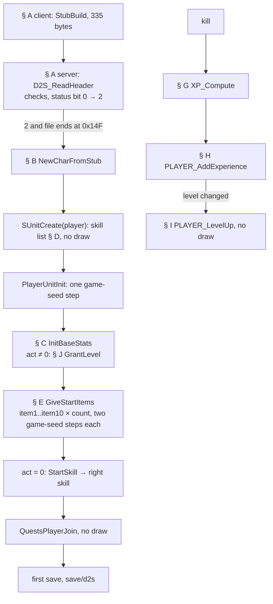
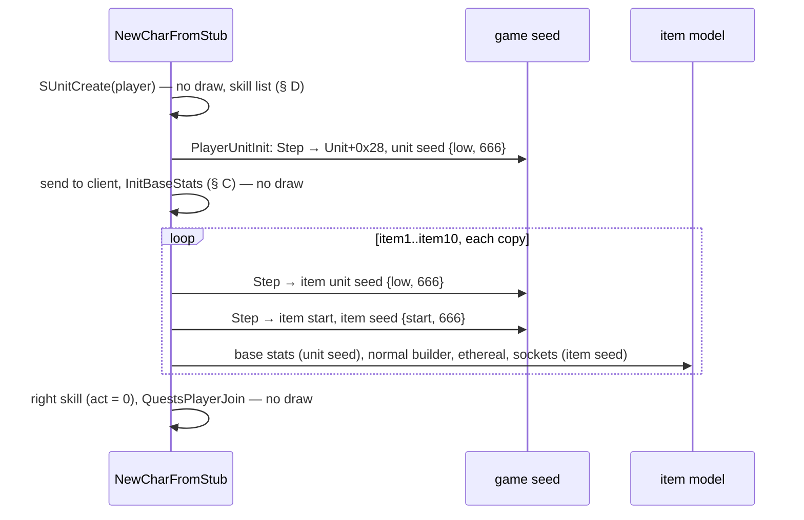
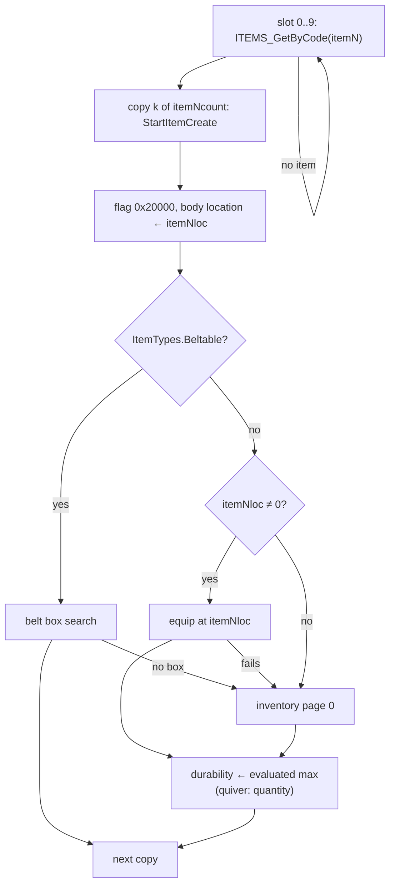
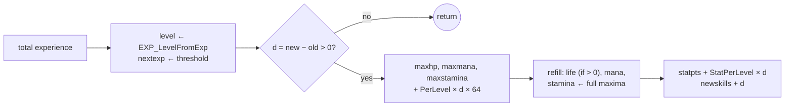

# New character, starting items, experience and level-up

## Purpose

When a single-player character is created, the client writes a 335-byte header-only save (the *stub*); the server
reads it, sees the "new" status bit, and builds the character from its `CharStats` row: attributes, life, mana and
stamina, the skill list, the starting items (each an ordinary normal-quality item creation seeded from the game seed)
and the right mouse skill. This spec gives that path in order, with every game-seed step, then how experience becomes a
level (`Experience`), what a kill is worth to the player (`XP_Compute`), and what a level-up changes. A level-up draws
nothing.

Names of functions and fields are ours ([re/symbols.csv](../../../re/symbols.csv), `re/types/player.h`). Stat ids are
ItemStatCost rows: 0 `strength`, 1 `energy`, 2 `dexterity`, 3 `vitality`, 4 `statpts`, 5 `newskills`, 6/7
`hitpoints`/`maxhp`, 8/9 `mana`/`maxmana`, 10/11 `stamina`/`maxstamina`, 12 `level`, 13 `experience`, 29 `lastexp`,
30 `nextexp`, 70 `quantity`, 72/73 `durability`/`maxdurability`, 85 `item_addexperience`, 107 `item_singleskill`.
Life, mana and stamina are stored with 8 fraction bits (`points << 8`). "Game seed" is `Game+0xD0`, "unit seed" a
unit's `Unit+0x20`, "item seed" the item data's seed ([glossary](../../glossary.md)); `Step`, `Range` and `Init` are
the primitives of [rng](../rng/README.md#algorithm). Seeds are written `low:high` in hex.



## Entry points

| When | Function | Tag |
|---|---|---|
| A player joins with a version 92..96 save whose status has bit 0 set and which ends at the header | fn:D2S_ReadSaveV92@0x0056B180 → fn:sub_00569F80_NewCharFromStub@0x00569F80, run:2026-10-16-player (35 characters) | [C] |
| The same steps from the version < 92 reader and from `sub_005345A0_PlayerLoad` | 0x00532590 (`sub_00532590_NewCharLegacy`), reached from 0x00534020 and 0x00534607 | [I] |
| The game was started with `-act N` (N = 2..5): inside `PLAYER_InitBaseStats` | fn:PLAYER_GrantLevel@0x0057EB10, run:2026-10-16-player (6 characters) | [C] |
| A monster is killed: experience to the credited player | fn:XP_OnMonsterKill@0x0057E990 → fn:XP_PartyShare@0x0057E6C0, run:2026-10-16-player (32 kills, one player) | [C] |
| Any experience change that changes the level | fn:PLAYER_AddExperience@0x0057E510 → fn:PLAYER_LevelUp@0x00570880, run:2026-10-16-player (20 level-ups) | [C] |
| The Ancients' reward (quest a5q5, Rite of Passage): a capped grant of 1.4M / 20M / 40M experience | fn:sub_0058C9A0_A5Q5_AncientDeath@0x0058C9A0 → fn:sub_0058C5C0_ExpGrantCapped@0x0058C5C0 | [I] |
| Death, unless the killer is a player or a player's monster; the corpse's share returns on its pickup | fn:sub_00580EC0_PlayerDeath@0x00580EC0 → fn:sub_00535AB0_PlayerDeathExpLossGate@0x00535AB0 → fn:PLAYER_DeathExpLoss@0x005359F0; fn:PLAYER_CorpseCreate@0x0057F700, fn:PLAYER_CorpsePickup@0x0057FB70 | [I] |
| An attribute point is spent | fn:PLAYER_SpendStatPoint@0x00570D60 | [I] |

## Inputs

### Tables

| Anchor | Used for |
|---|---|
| tbl:CharStats.txt:str, `dex`, `int`, `vit`, `stamina`, `hpadd` | starting attributes, life, mana, stamina (§ C) |
| tbl:CharStats.txt:LifePerLevel, `ManaPerLevel`, `StaminaPerLevel`, `StatPerLevel` | level-up gains (§ I), quarter points |
| tbl:CharStats.txt:LifePerVitality, `StaminaPerVitality`, `ManaPerMagic` | attribute spending only (§ J), never at creation |
| tbl:CharStats.txt:Skill 1, … `Skill 10`, `StartSkill` | skill list and right skill (§ D) |
| tbl:CharStats.txt:ToHitFactor, `BlockFactor` | not read at creation; read at every attack by [combat/to-hit](../combat/to-hit.md) |
| tbl:CharStats.txt:item1, `item1loc`, `item1count` … `item10…` | starting items (§ E) |
| tbl:Experience.txt:ExpRatio and the seven class columns | thresholds, level lookup, gain ratio (§ F, § G) |
| tbl:ItemTypes.txt:Beltable | belt placement (§ E) |
| tbl:Skills.txt:Id | valid skill ids (§ D) |
| tbl:DifficultyLevels.txt:DeathExpPenalty | death loss (§ J) |
| `belts.txt` row 2 (the default belt, 4 boxes) | belt box search (§ E) |

The record index of CharStats is the class id 0..6 (`Expansion` marker row not compiled); Experience record 0 is the
`MaxLvl` row and record *L* + 1 the row labelled *L* ([CharStats](../../tables/CharStats.md),
[Experience](../../tables/Experience.md)).

### Runtime state

| State | Type | Source |
|---|---|---|
| game seed | `Seed` at `Game+0xD0` | [rng/seeds](../rng/seeds.md) step 1; the same at the start of every new character of one game process |
| client class, status word, name | u8 at client `+0x08`, u16 at `+0x0A`, string at `+0x0D` | the stub's header (§ A) |
| client act | `client+0x1AC` | `g_StartAct` at client creation: 0, or `N − 1` under `-act N` |
| game item version | `game+0x78` | 101 in an expansion game |
| player unit | `Unit`, class id `unit->classId` | `SUnitCreate(UNIT_PLAYER, class, …)` |
| right / left skill | player data `+0x70` / `+0x74` | § B |
| base and total stats | stat lists of the unit | `STATS_GetUnitStat` reads the total, "base" the unit's own entry |
| full maxima | `UnitGetMaxHp/Mana/Stamina` | base maximum plus item bonuses, **named value inputs** of § I; how they add up is [stats/aggregate § G](../stats/aggregate.md#g-the-maxima-the-rescale-and-the-stat-callback) |

### Constants

| Name | Value | Anchor | Tag |
|---|---|---|---|
| stub size, version, magic | `0x14F`, 96, `0xAA55AA55` | fn:sub_0043C540_StubBuild@0x0043C540, run:2026-10-16-player (35 stubs) | [C] |
| default graphics bytes | 16 bytes at `0x0070CCC8` | fn:sub_0043C540_StubBuild@0x0043C540, run:2026-10-16-player (35 stubs) | [C] |
| act start levels | `{1, 15, 20, 26, 32}` | data:g_ActStartLevel@0x006E1520 | [C] |
| level-difference factors, monster at or below | `256 ×6, 207, 159, 110, 61, 13` (/256) | data:g_XpPenaltyBelow@0x006E1668 | [C] |
| level-difference factors, monster above | `256 ×6, 225, 174, 92, 38, 5` (/256) | data:g_XpPenaltyAbove@0x006E1694 | [C] |
| kill experience clamp | `0x7FFFFF` | 0x0057E480 | [I] |
| party distance², party bonus | 6400, `89/256` per extra member | fn:XP_PartyShare@0x0057E6C0, fn:sub_0057E5A0_PartyXpCollect@0x0057E5A0 | [I] |
| starting item creation record | ilvl = level, `+0x18` 4, `+0x28` 1, quality 2, flags `0x0A` | fn:ITEMS_CreateForStore@0x00559CE0 | [C] |
| starter item flag | `0x20000` (save flag bit 17) | 0x00534DB6 | [C] |

### Inputs and oracles

| Input | Kind | Where it is specified | Tag |
|---|---|---|---|
| `ITEMS_RollStaffMods` at the end of the normal builder (the Sorceress's `sst`, the Necromancer's `wnd`) | seed oracle of the item model: its exit seed and its `item_singleskill` entries are the logged ones | [items/affixes § I](../items/affixes.md#i-staff-mods--items_rollstaffmods) | [C] (fn:ITEMS_RollStaffMods@0x005C1260, run:2026-10-16-player: 11 of 269 creations) |
| full maxima `UnitGetMaxHp/Mana/Stamina` when items add to them | value input of the level-up refill; the sum is specified in [stats/aggregate § G](../stats/aggregate.md#g-the-maxima-the-rescale-and-the-stat-callback), and this run's values stay oracles (plan 0041 P2 review: none replaced, the logs hold no item lists) | § I, I3 | [C] (fn:sub_00625D10_UnitGetMaxHp@0x00625D10, run:2026-10-16-player: 7 of 20 level-ups) |

## Algorithm

All arithmetic is 32-bit. CharStats fields are unsigned bytes unless a step says otherwise. Experience values are
`u32` and compared unsigned.

### A. The stub and the server's checks

```
A1. Client, StubBuild(name, status, class) → 335-byte image:          [C] (fn:sub_0043C540_StubBuild@0x0043C540, run:2026-10-16-player: 35 stubs)
      0x00 u32 0xAA55AA55;  0x04 u32 96;  0x08 u32 0x14F
      0x14 name;  0x24 status | 1, then | 0x20 when class ∈ {5, 6};  0x28 class
      0x29 16;  0x2A 30;  0x2B level 1;  0x2C and 0x30 time(NULL)
      0x88..0x97 the 16 bytes at 0x0070CCC8;  0x98..0xA7 0xFF
      everything else 0 (so act bytes 0xA8..0xAA and map seed 0xAB are 0)
    the checksum at 0x0C is added when the stub is written            [I] (fn:sub_0043C6B0_StubWrite@0x0043C6B0)
A2. Server, D2S_ReadHeader, in this order:                            [I] (fn:D2S_ReadHeader@0x0056A090, 0x0056A0AF–0x0056A1B1)
      length < 0x14F → fail 4
      checksum (0x0C zeroed) ≠ u32[0x0C] → fail 6
      u32[0x08] ≠ length → fail 5
      version ∉ 92..96 → fail 7
      client name null → fail 3;  name ≠ client name ignoring case → fail 7
      D2S_CheckStatus(status) ≠ 0 → its code                          ; save/d2s § D1
      class byte > 7 → fail 4;  CLIENT_SetClass(class)
A3.   if status & 1:                                                  [C] (fn:D2S_ReadHeader@0x0056A090, run:2026-10-16-player)
        clear bit 0 in the buffer and in the client;  return 2        ; before act, map seed, hot keys are read
A4. D2S_ReadSaveV92: return 2 and the cursor at the file's end        [C] (fn:D2S_ReadSaveV92@0x0056B180, run:2026-10-16-player)
      → NewCharFromStub(client, game)  (§ B)
    return 2 with bytes after the header → internal 2 → load error 9  [I] (0x0056B1C6–0x0056B1E2, data:g_D2sLoadErrorMap@0x006E1208)
```

Step notes:

- A1. Hardcore is bit 2 (`0x04`) of the status word the character screen passes; the screen also ORs `0x20` for class
  5 or 6 before the call. [I] (0x00436360–0x004363CE)
- A1. **Where the screen's status bits come from.** In an expansion install (`HasExpansionMpq`), selecting any class
  sets `0x20` (`or word [status+0x1EF], 0x20`); the "expansion" checkbox toggles it (`xor 0x20`, only with the
  expansion MPQ present), and class 5 or 6 forces it again. So a classic character of classes 0–4 is the default
  with the box cleared. The hardcore and ladder checkboxes toggle `0x04` and `0x40`, and the class select also sets
  `0x40` by default when the screen's mode word `0x007795EC` is 1 (set at 0x00435B31 on a path the finding places on
  Battle.net by its context, not read further). The stub then copies the word (A1). [I] (0x00433F72–0x00433FF1,
  fn:sub_00433BF0_CreateClassSelect@0x00433BF0, fn:sub_00430770_CreateToggleExpansion@0x00430770,
  fn:sub_00408F20_HasExpansionMpq@0x00408F20, fn:sub_00430730_CreateToggleHardcore@0x00430730,
  fn:sub_00430750_CreateToggleLadder@0x00430750; [player/0001 § Plan 0039 batch P1c](../../findings/player/0001-creation.md#plan-0039-batch-p1c-2026-10-17))
- A2. Every stub of the run passed these checks, so none of the failure codes was observed. Class 7 passes the class
  test although CharStats has records 0..6 only; see § J. [I] (0x0056A172)

### B. `NewCharFromStub`: the order of a new character



```
B1. client.flags3D4 |= 1                                                 [I] (0x00537970)
B2. unit ← SUnitCreate(UNIT_PLAYER, client.class, game)                  [C] (fn:sub_00555230_SUnitCreate@0x00555230, run:2026-10-16-player)
      ; type 0: no unit seed, no game-seed draw (rng/seeds 7a); the skill list of § D is built here
B3. PlayerUnitInit(game, unit, client):                                  [C] (fn:sub_00569F20_PlayerUnitInit@0x00569F20, 0x00569F53, run:2026-10-16-player)
      link client ↔ unit;  copy the name into the player data
      Step(game.seed)                                                    ; game-seed draw#1 of the character
      unit[+0x28] ← game.seed.low;  Init(unit.seed, game.seed.low)       ; {low, 666}
      UNIT_SetMode(unit, 1)                                              ; no draw for a player
      player data +0x50, +0x54, +0x58, +0x5C ← 0
B4. send the unit to the client (0x00571F90)                             [C] no draw (run:2026-10-16-player)
B5. act: i32 ← client.act                                                [I] (fn:CLIENT_GetAct@0x005382B0, 0x0056A1F7)
B6. PLAYER_InitBaseStats(game, unit, act)                                ; § C
B7. PLAYER_GiveStartItems(unit, game, act)                               ; § E
B8. pd.leftSkill ← 0;  pd.rightSkill ← 0                                 [C] (fn:sub_00569F80_NewCharFromStub@0x00569F80, run:2026-10-16-player, all of B8–B9)
B9. cs ← CharStats[unit.classId]   (none when classId ≥ 7)
    if act = 0 and cs and cs.StartSkill ≠ 0 and SKILLS_GetUnitSkill(unit, cs.StartSkill):
      PlayerSetSkill(unit, right, cs.StartSkill);  pd.rightSkill ← cs.StartSkill
B10. QuestsPlayerJoin(game, unit, 1)                                     [C] no draw (fn:sub_00546270_QuestsPlayerJoin@0x00546270, run:2026-10-16-player)
```

Step notes:

- B3–B10. **The game-seed budget of a new character is `1 + 2 × (number of item copies)`.** The game seed logged
  after `SUnitCreate`, after the unit is sent, after `PLAYER_InitBaseStats`, after the items and after
  `QuestsPlayerJoin` matched the model on all 35 characters; no RNG-function call inside `NewCharFromStub` is on the
  game seed or the player's unit seed (all 142 are on item unit seeds or item seeds). [C]
  (fn:sub_00569F80_NewCharFromStub@0x00569F80, run:2026-10-16-player)
- B5. The act is not read from the stub (A3 returns first). The client record gets `g_StartAct` at creation, which is 0
  unless `-act N` set it to `N − 1`. [I] (data:g_StartAct@0x00883D44, fn:sub_0044D5A0_ApplyActOption@0x0044D5A0,
  0x0052FB90)
- B9. A blank `StartSkill` is −1 (`0xFFFF`), so it passes the `≠ 0` test and fails in `SKILLS_GetUnitSkill`. Only
  the Sorceress (36 Fire Bolt) and the Necromancer (70 Raise Skeleton) have one in stock data; under `-act N` the
  right skill stays Attack. [C] (fn:SKILLS_GetUnitSkill@0x006439F0, run:2026-10-16-player)
- B. Within one game process every new character starts from the same game seed (the game is re-created from the
  same `-seed`), so the characters of a batch share their item seeds. [C] (run:2026-10-16-player)

### C. Starting attributes — `PLAYER_InitBaseStats`

```
C1. act ← min(act, 4)                                                    [C] (fn:PLAYER_InitBaseStats@0x005706D0, run:2026-10-16-player, all of C1–C4)
    cs ← CharStats[unit.classId];  if none: return                        ; classId ≥ g_nCharStats
C2. SetStat 0 ← cs.str;  1 ← cs.int;  2 ← cs.dex;  3 ← cs.vit;  19 ← 0;  20 ← 0
    hp: i32 ← (cs.hpadd + cs.vit) << 8;   SetStat 6 ← hp;  7 ← hp
    mp: i32 ← cs.int << 8;                 SetStat 8 ← mp;  9 ← mp
    st: i32 ← cs.stamina << 8;             SetStat 10 ← st; 11 ← st
C3. SetStat 12 ← 1;  SetStat 30 ← EXP_GetThreshold(classId, 1)          ; 500 in stock data
    SetStat 68 ← 100;  67 ← 100;  69 ← 100
C4. if act ≠ 0: PLAYER_GrantLevel(game, unit, g_ActStartLevel[act])      ; § J, J1
```

Step notes:

- C2. **No per-point factor applies at creation.** Life is `vit + hpadd` points, mana `int` points, stamina `stamina`
  points; `LifePerVitality`, `ManaPerMagic` and `StaminaPerVitality` are not read here. [C]
  (fn:PLAYER_InitBaseStats@0x005706D0, run:2026-10-16-player)
- C4. The `act ≥ 5 → 0` test that follows C1's clamp can never fire. [I] (0x007326B4)

**Starting values per class** (stock CharStats, the formulas of C2; the stored value is the points `<< 8`). Every
class was created three times in run:2026-10-16-player and each row was reproduced; the per-level columns are the
CharStats quarter points that § I adds `× 64`.

| Class | id | str | dex | int (energy) | vit | hpadd | life = vit + hpadd (stored) | mana = int (stored) | stamina (stored) | life / mana / stamina per level, ¼ pt → pt | Tag |
|---|---:|---:|---:|---:|---:|---:|---|---|---|---|---|
| Amazon | 0 | 20 | 25 | 15 | 20 | 30 | 50 (12800) | 15 (3840) | 84 (21504) | 8 / 6 / 4 → 2 / 1.5 / 1 | [C] (fn:PLAYER_InitBaseStats@0x005706D0, struct:CharStatsRec+0x30, run:2026-10-16-player) |
| Sorceress | 1 | 10 | 25 | 35 | 10 | 30 | 40 (10240) | 35 (8960) | 74 (18944) | 4 / 8 / 4 → 1 / 2 / 1 | [C] (fn:PLAYER_InitBaseStats@0x005706D0, run:2026-10-16-player) |
| Necromancer | 2 | 15 | 25 | 25 | 15 | 30 | 45 (11520) | 25 (6400) | 79 (20224) | 6 / 8 / 4 → 1.5 / 2 / 1 | [C] (fn:PLAYER_InitBaseStats@0x005706D0, run:2026-10-16-player) |
| Paladin | 3 | 25 | 20 | 15 | 25 | 30 | 55 (14080) | 15 (3840) | 89 (22784) | 8 / 6 / 4 → 2 / 1.5 / 1 | [C] (fn:PLAYER_InitBaseStats@0x005706D0, run:2026-10-16-player) |
| Barbarian | 4 | 30 | 20 | 10 | 25 | 30 | 55 (14080) | 10 (2560) | 92 (23552) | 8 / 4 / 4 → 2 / 1 / 1 | [C] (fn:PLAYER_InitBaseStats@0x005706D0, run:2026-10-16-player) |
| Druid | 5 | 15 | 20 | 20 | 25 | 30 | 55 (14080) | 20 (5120) | 84 (21504) | 6 / 8 / 4 → 1.5 / 2 / 1 | [C] (fn:PLAYER_InitBaseStats@0x005706D0, run:2026-10-16-player) |
| Assassin | 6 | 20 | 20 | 25 | 20 | 30 | 50 (12800) | 25 (6400) | 95 (24320) | 8 / 6 / 5 → 2 / 1.5 / 1.25 | [C] (fn:PLAYER_InitBaseStats@0x005706D0, run:2026-10-16-player) |

Every class has `StatPerLevel` 5, `nextexp` 500 and level 1 at creation. [C] (struct:CharStatsRec+0x50,
tbl:Experience.txt:Amazon, run:2026-10-16-player)

### D. Starting skills

```
D1. SKILLS_InitPlayerSkills(unit), inside SUnitCreate:                   [C] (fn:SKILLS_InitPlayerSkills@0x00647EE0, fn:SKILLS_AddSkill@0x00647110, run:2026-10-16-player, all of D1–D2)
      unless the list already holds skill 0 with item ref −1:
        AddSkill(0)                                                      ; Attack
        for k in 1 ... 10: id ← cs."Skill k";  if 0 ≤ id < skills count: AddSkill(id)
      left skill unset → Attack;  right skill unset → Attack
D2. AddSkill(id): append a 0x40-byte entry, level 1, item ref −1,
      entry +0x08 ← the Skills record's byte +0x10 (16 for class 6, skill 5)
D3. StartItemCreate on item1's copies: item_singleskill(StartSkill) ← 1  ; § E, E4
D4. once item1 is equipped, StartSkill appears as the last list entry, base level 0   [C] (run:2026-10-16-player)
```

Step notes:

- D1. An existing entry is raised by 1 while below the skill's maximum level instead of appended. [I]
  (fn:SKILLS_AddSkill@0x00647110)
- D1. Stock lists: every class gets Attack (0), Throw (2), Kick (1), the scrolls and books of Identify and Town Portal
  (217–220) and Unsummon (3); the Barbarian adds Left Hand Throw (4) and Left Hand Swing (5), the Assassin Left Hand
  Swing. A new character's class-skill bytes in the save are all 0. [C] (struct:CharStatsRec+0xAE,
  run:2026-10-16-player)
- D4. The `-act` Sorceress and Necromancer also get the level-0 entry; only the right skill differs (B9). [C]
  (run:2026-10-16-player)

### E. Starting items — `PLAYER_GiveStartItems`



```
E1. for slot in 0 ..< 10:                                                [C] (fn:PLAYER_GiveStartItems@0x00534F10, fn:sub_00534D60_StartItemSlot@0x00534D60, run:2026-10-16-player, all of E1–E2)
      it ← cs.items[slot]                                                ; code, loc (u8 bodylocs row), count
      if not ITEMS_GetByCode(it.code, &idx): continue                    ; "0" is no item
      for k in 0 ..< it.count:
        item ← StartItemCreate(player, game, slot, idx)                  ; E3–E5
        set item flag 0x20000;  item.data[+0x44] ← it.loc
        Place(item, it.loc)                                              ; E6
E2.     if not Beltable(item):
          durability (72) ← the evaluated max durability                 ; items/properties § G
E3. StartItemCreate: ilvl ← the player's base level (1; 16/21/27/33 under -act 2..5)   [C] (fn:sub_00534C70_StartItemCreate@0x00534C70, fn:sub_00558200_UnitDropLevel@0x00558200, run:2026-10-16-player, all of E3–E5)
    rec ← zeroed 0x84-byte creation record:                              ; ITEMS_CreateForStore
      source = player, ilvl, item index idx, +0x18 = 4, +0x28 = 1, +0x2A = game item version,
      quality 2 (normal), no row, no forced affixes, no seed override, flags 0x08 | 0x02
    item ← ItemCreate(game, rec)                                         ; items/uniques-sets § A onward
      ; game draw: Step(game.seed) → item unit seed {low, 666}, Unit+0x28 ← low
      ; game draw: Step(game.seed) → item start, item seed {start, 666}
      ; base stats on the unit seed, normal builder, ethereal and socket steps on the item seed
    set item flag 0x10 (identified)
E4. if the item has a stat list with flag 0x40: remove it
    if slot = 0 and 0 ≤ cs.StartSkill < skills count:
      new list, flags 0x40: item_singleskill(param StartSkill) ← 1
E5. if the base is stackable: quantity (70) ← its max stack
```

```
E6. Place(item, loc):
      if Beltable(item):                                                 [C] (fn:sub_0055E9B0_ItemToBelt@0x0055E9B0, fn:sub_0063C790_BeltPlace@0x0063C790, fn:sub_0063C600_BeltFreeSlot@0x0063C600, run:2026-10-16-player)
        box ← BeltFreeSlot on the default belt (4 boxes)                 ; E6 notes
        if box found: belt box ← item;  return
        else: inventory (below)                                          [I] (fn:sub_00534D60_StartItemSlot@0x00534D60)
      else if loc ≠ 0:
        ItemEquip(player, item, loc): mode 1, page 0xFF, cell (loc, 0), item flag 0x1   [C] (fn:sub_00534BB0_StartItemEquip@0x00534BB0, fn:sub_005606B0_ItemEquip@0x005606B0, run:2026-10-16-player)
        if it fails: inventory (below)                                   [I] (fn:sub_00534D60_StartItemSlot@0x00534D60)
      inventory: page 0, the spot search below                           [C] (fn:sub_00534B30_StartItemToInventory@0x00534B30, fn:sub_00560200_InvPlaceItem@0x00560200, run:2026-10-16-player)
```

Step notes:

- E1–E5. **Order of draws.** Items are created in slot order, the copies of a slot in copy order; each copy takes
  exactly two game-seed steps (unit seed, then start seed), and everything else it draws is on its own unit seed and
  item seed. Each of the 269 item copies of the run reproduced through the item model from the game seed. [C]
  (fn:sub_00558D90_ItemCreate@0x00558D90, fn:sub_00552E90_ItemSeedInit@0x00552E90, run:2026-10-16-player)
- E3. **What a normal starting item draws.** The base stats of [items/properties § A](../items/properties.md#a-base-stats-on-the-unit-seed)
  on the unit seed (a weapon's durability, a shield's durability then defense, nothing for a potion or scroll); then on
  the item seed the normal builder ([items/affixes § H](../items/affixes.md#h-the-normal-builder--items_buildnormal),
  which ends in `ITEMS_RollStaffMods`, an oracle); the ethereal roll returns at flag `0x02` before its draw; the socket
  roll ([items/properties § F](../items/properties.md#f-ethereal-and-sockets), F4) **draws** `Range(item.seed, 100)`
  for a base that can have sockets and only then returns at flag `0x08`, so the draw is consumed and the item gets no
  sockets. [C] (fn:sub_00556CA0_ItemRollEthereal@0x00556CA0, fn:sub_00556B60_ItemRollSockets@0x00556B60,
  run:2026-10-16-player)
- E3. Under `-act 2..5` the player is already level 16, 21, 27 or 33 when the items are made (C4 runs first), so the
  items get that ilvl. [C] (fn:sub_00558200_UnitDropLevel@0x00558200, run:2026-10-16-player)
- E4. On `item1` every copy gets the `item_singleskill` list (stock: the Sorceress's staff, the Necromancer's wand;
  the other classes have no `StartSkill`). [C] (fn:sub_00534C70_StartItemCreate@0x00534C70, run:2026-10-16-player)
- E6. **Belt.** `BeltFreeSlot` first looks for a column whose box among 0..3 already holds the same item and takes the
  first free box down that column, below the belt's box count; failing that, when the item record's byte `+0x131` is
  set, the first free box of 0..3. On the default belt the column search never finds room, so the four `hp1` land in
  boxes 0, 1, 2, 3. [C] for the box 0..3 path; the column path is as read [I]. (fn:sub_0063C600_BeltFreeSlot@0x0063C600,
  run:2026-10-16-player)
- E6. **Inventory spot.** An item one cell high is placed by `InvSpotFindRow` (columns from the right, rows from the
  bottom), any other by `InvSpotFind` (rows from the top, columns from the left); each candidate that fits is scored by
  `InvSpotScore` (the occupied or outside cells along its four sides, 255 when enclosed), a spot replaces the best only
  when its score is strictly greater, and the search stops at 255. Stock kits: `tsc` at (9, 3), then `isc` at (9, 2).
  [C] (fn:sub_0063B490_InvSpotFindRow@0x0063B490, fn:sub_0063B620_InvSpotFind@0x0063B620,
  fn:sub_0063B340_InvSpotScore@0x0063B340, fn:sub_0063A8A0_InvGridFree@0x0063A8A0, run:2026-10-16-player)
- E2. A quiver (item type 5) gets `quantity` 250 instead of durability, and 100 when it was not equipped. No stock kit
  has one. [I] (fn:sub_00534D60_StartItemSlot@0x00534D60)
- E6. Body locations are `bodylocs` rows: 4 `rarm`, 5 `larm`, 0 none. Stock kits: the class weapon in `rarm`, a
  buckler in `larm` for all but the Sorceress and the Necromancer, four `hp1` to the belt, `tsc` and `isc` to the
  inventory. [C] (struct:CharStatsRec+0x5C, run:2026-10-16-player)
- E6. The equip flag `0x1` is clear again in the first save. [C] (fmt:d2s#flags, run:2026-10-16-player)

### F. The experience table

```
F1. EXP_GetThreshold(class, L) = Experience[L + 1].col[c]                [C] (fn:EXP_GetThreshold@0x00611800, run:2026-10-16-player)
      ; the experience at which level L + 1 starts; no bound check on L
    c ← class if 0 ≤ class ≤ 6 else 0                                    [I] (fn:EXP_GetThreshold@0x00611800)
F2. MaxLvl(class) = Experience[0].col[c]                                 [I] (fn:sub_00611830_ExpMaxLevel@0x00611830)
F3. EXP_LevelFromExp(class, exp: u32) → i32:                             [C] (fn:EXP_LevelFromExp@0x00611860, run:2026-10-16-player)
      n ← 0
      while n < MaxLvl(class) and exp ≥ Experience[n + 1].col[c]:  n ← n + 1    ; unsigned compare
      return n
F4. EXP_GetRatio(L) → u32:                                               [C] (fn:EXP_GetRatio@0x00613E60, run:2026-10-16-player)
      if L ≤ 0: return Experience[0].ExpRatio                            ; 10, the shift
      if L > Experience[0].col[0]: return 0                              ; Amazon's MaxLvl
      return Experience[L + 1].ExpRatio
```

Step notes:

- F3. With stock data level 1 is 0..499, level 2 starts at 500, level 99 at 3 520 485 254; values from the row
  labelled 93 on exceed 2³¹, so a signed compare would break the top levels. [C] (fn:EXP_LevelFromExp@0x00611860,
  tbl:Experience.txt:Amazon, run:2026-10-16-player: level 98 reached at 3 229 426 756)
- F4. `ExpRatio` is 1024 for levels 0–69 and falls to 5 at 99; the run used 1024, 8 (level 97) and 6 (level 98). [C]
  (tbl:Experience.txt:ExpRatio, run:2026-10-16-player)

### G. Kill experience — `XP_Compute`

```
G0. XP_OnMonsterKill credits the killer, or the player owning a minion;  [C] (fn:XP_OnMonsterKill@0x0057E990, run:2026-10-16-player)
    XP_PartyShare collects the members (J4); with one member:
      add ← XP_Compute(exp, clvl, mlvl);  PLAYER_AddExperience(add)      ; § H
    exp is the killed monster's experience (monsters/stats)              [I] (fn:XP_OnMonsterKill@0x0057E990)
G1. XP_Compute(exp: i32, clvl: i32, mlvl: i32) → i32:
      if exp > 0x7FFFFF: exp ← 0x7FFFFF                                  [I] (0x0057E480–0x0057E4FF, all of G1–G2)
      else if exp ≤ 0: return 1
G2.   if clvl ≥ MaxLvl(class): return 0
G3.   XP_LevelDiffPenalty:                                               [C] (fn:XP_LevelDiffPenalty@0x0057E2F0, run:2026-10-16-player, all of G3)
        if mlvl ≤ clvl:            f ← g_XpPenaltyBelow[min(clvl − mlvl, 10)]
        else if clvl ≥ 25 and mlvl > 0:  exp ← MulDiv(exp, clvl, mlvl);  f ← 256
        else:                      f ← g_XpPenaltyAbove[min(mlvl − clvl, 10)]
        if f ≠ 256: exp ← MulDiv(exp, f, 256)
G4.   XP_ApplyExpRatio:  r ← EXP_GetRatio(clvl);  s ← EXP_GetRatio(0)    [C] (fn:XP_ApplyExpRatio@0x0057E390, run:2026-10-16-player)
        if 1 ≤ s ≤ 31:
          exp ← (exp × r) >> s                                           ; signed, arithmetic shift
          but if exp > (0x7FFFFFFF >> ((r >> s) + s)): exp ← (exp >> s) × r    [I] (0x0057E390–0x0057E3E7)
G5.   s85 ← stat 85 (item_addexperience) of the player                   [I] (0x0057E480–0x0057E4FF)
      if s85 ≠ 0: exp ← exp + MulDiv(exp, s85, 100)
G6.   0x0057E3F0: no change for a player (it caps a mercenary's gain)    [I] (0x0057E3F0)
      return exp
```

Step notes:

- G3. `MulDiv` is the signed, truncating one of [monsters/stats § A](../monsters/stats.md#a-muldiv-and-monlvlstats). The
  run reproduced the factors `Below[0]`, `[1]`, `[8]`, `[9]`, `[10]`, `Above[10]` (a level-1 character in Hell) and
  the `exp × clvl / mlvl` branch (levels 49 and 50 against a level-67 monster). [C]
  (fn:sub_00483360_MulDiv@0x00483360, run:2026-10-16-player)
- G3. **Use the /256 factors, not percentages.** 207/256 is 80.9 %, 13/256 is 5.1 %; the community's rounded
  percentages give different integers. [C] (data:g_XpPenaltyBelow@0x006E1668, run:2026-10-16-player)
- G1, G2, G4 overflow branch, G5. No kill of the run reached the clamp, a non-positive experience, the level cap, the
  overflow test or a non-zero stat 85 (largest input 18 713, stat 85 always 0). [I] (run:2026-10-16-player)

### H. Adding experience — `PLAYER_AddExperience`

```
H1. PLAYER_AddExperience(game, oldLevel, add), player in ESI:            [C] (fn:PLAYER_AddExperience@0x0057E510, run:2026-10-16-player: 38 calls)
      exp: u32 ← stat 13;  new: u32 ← exp + add                          ; wraps mod 2^32
      cap: u32 ← EXP_GetThreshold(class, MaxLvl(class) − 1)               [I] (0x0057E522–0x0057E540)
      new ← min(new, cap)                                                ; unsigned; a wrapped sum is not caught
      SetStat 29 (lastexp) ← new − exp;  SetStat 13 ← new
H2.   if EXP_LevelFromExp(class, new) ≠ oldLevel:
        PLAYER_LevelUp(unit)                                             ; § I
        0x005C0C30(unit, 0, 0)
```

Step notes:

- H1. The cap is the threshold of level `MaxLvl` (3 520 485 254 for 99). No run reached it. [I]
  (fn:PLAYER_AddExperience@0x0057E510)

### I. Level-up — `PLAYER_LevelUp`



```
I1. old: i32 ← base stat 12                                              [C] (fn:PLAYER_LevelUp@0x00570880, run:2026-10-16-player: 20 calls, all of I1–I5)
    lvl: i32 ← EXP_LevelFromExp(class, total stat 13)                    ; STATS_GetUnitStat, not the base
    SetStat 12 ← lvl;  SetStat 30 ← EXP_GetThreshold(class, lvl)
    d: i32 ← lvl − old;  if d ≤ 0: return
I2. cs ← CharStats[class]
    SetStat 7  ← base 7  + cs.LifePerLevel    × d × 64
I3. if stat 6 > 0: SetStat 6 ← UnitGetMaxHp(unit)                        ; full maximum, named input
    SetStat 9  ← base 9  + cs.ManaPerLevel    × d × 64
    SetStat 8  ← UnitGetMaxMana(unit)                                    ; 0x00625D60
    SetStat 11 ← base 11 + cs.StaminaPerLevel × d × 64
    SetStat 10 ← UnitGetMaxStamina(unit)                                 ; 0x00625DB0
I4. AddStat 4 (statpts)   ← (i8) cs.StatPerLevel × d                     ; signed byte
    AddStat 5 (newskills) ← d                                            ; one skill point per level, hardcoded
I5. then: a level message per proxy (0x00536850), UnitSetEvent, 0x005538D0, 0x0055F500, 0x0055FDE0(1),
    the host callback (class, lvl) when present                          ; no draw
```

Step notes:

- I1–I5. **A level-up draws nothing.** Over the 20 level-ups no RNG function was called and none of the 852 LCG
  multiplier sites executed between the handler's entry and its return (the same breakpoints fired 127 times inside
  `NewCharFromStub`), and the game seed and the player's unit seed were unchanged across it. [C]
  (fn:PLAYER_LevelUp@0x00570880, run:2026-10-16-player)
- I1. Several levels gained at once are one call with `d > 1`: `-act 2..5` gives 15, 20, 26 or 32 levels in one call.
  [C] (fn:PLAYER_GrantLevel@0x0057EB10, run:2026-10-16-player)
- I2. The gains multiply the quarter-point columns by 64, so `× 64` is `÷ 4 << 8`: a Barbarian's `LifePerLevel` 8 adds
  512, 2 life points. [C] (struct:CharStatsRec+0x43, run:2026-10-16-player)
- I3. **The refill reads the full maxima.** Without item bonuses they equal the new base maxima (13 level-ups); with
  item bonuses (7 level-ups, the Sorceress's gear) the run took them as logged value inputs, so this spec states that
  the refill reads `UnitGetMaxHp/Mana/Stamina`, not how the bonuses sum. Current life is refilled only when it is
  above 0; mana and stamina always. [C] (fn:sub_00625D10_UnitGetMaxHp@0x00625D10, run:2026-10-16-player)
- I2–I3. **What the refill reads.** Each write of I2 reaches the unit's cached full stat at once, and the stat
  callback rescales the current value against the new maximum before I3 overwrites it; `UnitGetMaxHp` then returns
  the cached full stat 7 (and 9, 11), that is the new base plus every item, set and state term
  ([stats/aggregate § C, § G](../stats/aggregate.md#g-the-maxima-the-rescale-and-the-stat-callback)). [I]
  (fn:STATLIST_Propagate@0x00626920, fn:sub_0055B800_MonStatCallback@0x0055B800, fn:sub_00625D10_UnitGetMaxHp@0x00625D10)
- I1–I4. The level-up arithmetic adds to whatever base it finds: the level-up characters of the run were built saves
  (8 000 life, level 1 attributes at levels 9, 49 and 97), so the run backs the arithmetic, `XP_Compute` and the
  no-draw result, not what a natural level-*N* character's attributes or life would be. [C] (run:2026-10-16-player)

### J. Other level and experience changes

```
J1. PLAYER_GrantLevel(game, unit, lvl):                                  [C] (fn:PLAYER_GrantLevel@0x0057EB10, run:2026-10-16-player)
      if the player's level < lvl:
        PLAYER_AddExperience(EXP_GetThreshold(class, lvl) − stat 13)    ; reaches level lvl + 1
      ; -act 2, 3, 4, 5 → levels 16, 21, 27, 33, before the starting items
J2. ExpGrantCapped: grant 1 400 000 (Normal), 20 000 000 (Nightmare),    [I] (fn:sub_0058C5C0_ExpGrantCapped@0x0058C5C0, 0x0058C5C0–0x0058C6A0)
      40 000 000 (Hell), at most one level span per step, filling the current level and calling
      PLAYER_LevelUp per level until the grant is used or MaxLvl
J3. PLAYER_DeathExpLoss (character level lvl > 1):                       [I] (fn:PLAYER_DeathExpLoss@0x005359F0, tbl:DifficultyLevels.txt:DeathExpPenalty)
      ; not called when the killer is a player or a monster owned by one (note J3)
      span: u32 ← Exp[lvl] − Exp[lvl − 1]                                ; Exp[n] = EXP_GetThreshold(class, n)
      loss: u32 ← DeathExpPenalty × span ÷ 100
      if loss ≠ 0:
        new ← exp − loss;  kept ← loss
        if new ≤ Exp[lvl − 1]: new ← Exp[lvl − 1] + 1;  kept ← max(0, exp − Exp[lvl − 1])
        client.deathLoss ← kept                                          ; client +0x508, before the stat write
        exp ← new
      ; the level never drops
J4. XP_PartyShare with n ≥ 2 members (alive, same level, distance² ≤ 6400, at most 8):   [I] (fn:XP_PartyShare@0x0057E6C0, fn:sub_0057E5A0_PartyXpCollect@0x0057E5A0, 0x0057E736–0x0057E79D)
      total: i32 ← exp + ((n − 1) × exp × 89) ÷ 256
      q: f32 ← (f32) total / (f32) Σ levels
      for each member i in collection order:
        PLAYER_AddExperience(XP_Compute(ftol((f32) level_i × q), level_i, mlvl))   ; CRT_ftol2 truncates
J5. PLAYER_SpendStatPoint(unit, which): needs statpts ≠ 0; statpts −= 1; [I] (fn:PLAYER_SpendStatPoint@0x00570D60, fn:PLAYER_SpendEnergy@0x00570A80, fn:PLAYER_SpendVitality@0x00570B60)
      strength or dexterity + 1
      energy + 1:   maxmana += ManaPerMagic × 64;  mana likewise, clamped to maxmana
      vitality + 1: maxhp += LifePerVitality × 64;  maxstamina += StaminaPerVitality × 64;  current values likewise
```

Step notes:

- J1. The `-act` grants run on game-made characters (no built save), through `PLAYER_AddExperience` and one
  `PLAYER_LevelUp` call each. [C] (fn:PLAYER_GrantLevel@0x0057EB10, run:2026-10-16-player)
- J2–J5. Not run: party share needs two clients; death loss, the experience cap and the capped grant were not reached.
  [I] (run:2026-10-16-player)
- J2. **The trigger is the Ancients' reward** (quest record word 39, `a5q5`). The quest's monster-death callback acts on
  classes 540–542 (`ancientbarb1`–`3`) and counts them down; when the last dies and the quest is active, the grant goes
  first to the killing player, then to each player standing in level 120 (the Arreat Summit), and, for a player there in
  a party, to each party member in an Act V level. Each player is granted only when its word-39 bit 0 is clear and its
  base level is at least 20·(d + 1) (20, 40, 60), and bit 0 is set before the grant, so a player gets it once per
  difficulty. With the one-span cut of J2, the reward is at most one level. [I]
  (fn:sub_0058C9A0_A5Q5_AncientDeath@0x0058C9A0, fn:sub_0058C7E0_A5Q5_SummitExpGrant@0x0058C7E0,
  fn:sub_0058C6D0_A5Q5_PartyExpGrant@0x0058C6D0, fn:sub_0058CE30_A5Q5_Init@0x0058CE30, fn:QUESTRECORD_GetState@0x0065C310;
  [player/0001 § Plan 0039 batch P1c](../../findings/player/0001-creation.md#plan-0039-batch-p1c-2026-10-17))
- J3. **When the loss is taken.** `PlayerDeath` calls the gate with the killer; the gate skips the loss when the killer is
  a player (type 0) or a monster whose owner is a player, and otherwise calls `PLAYER_DeathExpLoss`. When the clamp
  applies, the amount kept is `exp − Exp[lvl − 1]` (floored at 0), not `loss`; it is stored at client `+0x508` before the
  stat write. [I] (0x00535A61–0x00535A8A, fn:sub_00535AB0_PlayerDeathExpLossGate@0x00535AB0,
  fn:sub_0058F0D0_MonsterOwner@0x0058F0D0, fn:CLIENT_SetDeathExpLoss@0x005391E0)
- J3. **75 % goes on the corpse.** When the death mode ends, `PLAYER_CorpseCreate` makes the corpse unit and writes its
  stat 13 (experience) from `v` = the stored amount: `v·75/100` when `v` ≤ `0x100000`, `(v/100)·75` above it (signed,
  truncating); it then clears the stored amount and moves the items and gold onto the corpse. [I]
  (0x0057F80F–0x0057F875, fn:PLAYER_CorpseCreate@0x0057F700, fn:CLIENT_GetDeathExpLoss@0x00539210,
  fn:sub_0057FCA0_PlayerDeathModeEnd@0x0057FCA0)
- J3. **It returns only to the owner.** `PLAYER_CorpsePickup` needs the permission test and a corpse whose owner id is
  the picker's; a non-zero stat 13 is then zeroed and added with `sub_0057EAB0_AddExperienceDirect`. Another player's
  pickup returns nothing. [I] (fn:PLAYER_CorpsePickup@0x0057FB70, fn:sub_0057EAB0_AddExperienceDirect@0x0057EAB0)
- J. **Class 7** passes the header check (A2), but every CharStats reader tests `class < 7`, so it gets no attributes,
  no items and no start skill, and the experience lookups read class 0's column. [I] (0x005706FD, 0x00611808)

## Outputs

- A player unit with the § C stats, the § D skill list, the § E items placed, the right skill of B9, and the game seed
  advanced by `1 + 2 × copies` steps (stock kits: 7 copies for the Sorceress and Necromancer, 8 for the others, so
  15 or 17 steps). [C] (fn:sub_00569F80_NewCharFromStub@0x00569F80, run:2026-10-16-player)
- The first save after *Save and Exit*, written by [save/d2s](../save/d2s.md): status without bit 0, level, the map
  seed of the game it was made in (the stub stores 0 and returns before the map-seed reuse), act byte `0x80 | act`,
  mouse skills Attack / `StartSkill`, no mercenary, the § C stats, class-skill bytes 0, every item with seed =
  `Unit+0x28`, ilvl, quality 2, durability and quantity as above; the quest, waypoint and NPC sections are the same
  bytes for every new character of a game type. [C] (fn:D2S_WriteHeader@0x00568F20, fmt:d2s#flags,
  run:2026-10-16-player: 35 first saves predicted field by field)
- From an experience change: stats 13, 29, and on a level change 12, 30, 7/9/11, 6/8/10, 4 and 5. [C]
  (fn:PLAYER_LevelUp@0x00570880, run:2026-10-16-player)

## Worked example

All from run:2026-10-16-player, batch 34101 (expansion, Normal, act 0): every character of the batch starts from game
seed `5389700c:0f9a1148`. The model reproduces each line. [C] (run:2026-10-16-player)

### Example 1: an expansion Sorceress (staff with the staff-mods oracle)

| Step | Seeds and values |
|---|---|
| B2 `SUnitCreate` | game seed unchanged `5389700c:0f9a1148` |
| B3 `PlayerUnitInit` | Step → `48ac0a84:22d7b3ef`; player `Unit+0x28` = `0x48ac0a84`, unit seed `48ac0a84:0000029a` |
| C | strength 10, energy 35, dexterity 25, vitality 10; life = max = 40 × 256 = 10240; mana 35 × 256 = 8960; stamina 74 × 256 = 18944; level 1, nextexp 500 |
| E `sst` (slot 0) | game Steps → unit seed `9f3e0b83:0000029a`, start `b4da2652`; unit seed: durability `10 + Range(10)` = 15 (max 20), unit seed after `968a8e69:426b34ce`; item seed `b4da2652:0000029a` → `ITEMS_RollStaffMods` **oracle**, join seed `78d99fb4:4b6e9add` and no staff-mod entry, as logged; ethereal no draw; socket `Range(100)` = 85, discarded (flag `0x08`) → exit `c1f3c061:3267d8c9`; list `0x40`: `item_singleskill(36)` = 1; equipped `rarm`, flags `0xA2011`, durability ← 20 |
| E `hp1` ×4 (slot 1) | unit seeds `bb44d1e8`, `450d87c4`, `61ad922c`, `6cd49484`; starts `86e6a265`, `21a3dbbd`, `20da2c9a`, `e6ec5b5e`; no draw on either seed; belt boxes 0, 1, 2, 3, flags `0xA2010` |
| E `tsc` (slot 2) | unit `6b5f9eca`, start `3e73ccac`; no draw; inventory (9, 3) |
| E `isc` (slot 3) | unit `e40e20c9`, start `20d2ae4d`; no draw; inventory (9, 2) |
| exit | game seed `20d2ae4d:5f1ebd78` (15 steps); right skill 36; skill list 0, 2, 1, 217, 218, 219, 220, 3 at level 1, then 36 at base level 0 |

### Example 2: an expansion Barbarian (no oracle)

Same batch and the same game seed at entry, so the player and the *n*-th item copy get the same seeds as in Example 1;
the Barbarian has one copy more (the buckler), so only its eighth copy (`isc`) takes new seeds and its exit seed differs.

| Step | Seeds and values |
|---|---|
| B3 | game seed `48ac0a84:22d7b3ef`; player unit seed `48ac0a84:0000029a` |
| C | strength 30, energy 10, dexterity 20, vitality 25; life 55 × 256 = 14080; mana 10 × 256 = 2560; stamina 92 × 256 = 23552 |
| E `hax` (slot 0) | unit `9f3e0b83`, start `b4da2652`; unit seed: durability `14 + Range(14)` = 21 (max 28) → `968a8e69:426b34ce`; item seed: normal builder draws nothing; socket `Range(100)` = 16, discarded although below 33 → exit `78d99fb4:4b6e9add`; equipped `rarm`, durability ← 28 |
| E `buc` (slot 1) | unit `bb44d1e8`, start `86e6a265`; unit seed: durability 10 (max 12), then defense 6 → `817aac35:18cdd4ab`; socket `Range(100)` = 7, discarded → exit `f6f1ca53:384421e8`; equipped `larm`, durability ← 12 |
| E `hp1` ×4 (slot 2) | units `450d87c4`, `61ad922c`, `6cd49484`, `6b5f9eca`; belt boxes 0..3 |
| E `tsc`, `isc` | units `e40e20c9`, `d4d82eb9`; starts `20d2ae4d`, `2f6ab60b`; inventory (9, 3), (9, 2) |
| exit | game seed `2f6ab60b:58c69aea` (17 steps); right skill 0 (Attack); skill list 0, 2, 1, 217–220, 4, 5, 3 |

### Example 3: a Barbarian level-up, 9 → 10 (built save `LvBarB`, session 34421)

| Step | Values |
|---|---|
| G | monster level 1, experience 18; clvl 9: `Below[8]` = 110 → `MulDiv(18, 110, 256)` = 1980 ÷ 256 = 7; `ExpRatio[9]` = 1024: `(7 × 1024) >> 10` = 7; stat 85 = 0 → 7 |
| H | 57 714 + 7 = 57 721 ≥ 57 715 (level 10's threshold) → level 10 ≠ 9; lastexp 7 |
| I1 | level 10, nextexp `EXP_GetThreshold(4, 10)` = 72 144; d = 1 |
| I2–I3 | maxhp 2 048 000 + 8 × 64 = 2 048 512; life 2 047 669 > 0 → 2 048 512; maxmana 128 000 + 256 → mana 128 256; maxstamina 128 000 + 256 → stamina 128 256 (was 127 000) |
| I4 | statpts 0 + 5 = 5; newskills + 1 |
| seeds | game seed `cfef1ae5:26e5b235` and unit seed `88a0c5ac:5b12a22c` unchanged |

### Example 4: a Sorceress level-up in Hell, 97 → 98 (built save `LvSorD`, session 34414)

| Step | Values |
|---|---|
| G | monster level 67, experience 17 376; clvl 97 ≥ mlvl: `Below[10]` = 13 → `MulDiv(17376, 13, 256)` = 882; `ExpRatio[97]` = 8: `(882 × 8) >> 10` = 6 |
| H | 3 229 426 755 + 6 = 3 229 426 761 ≥ 3 229 426 756 → level 98; nextexp 3 520 485 254 (unsigned) |
| I2–I3 | maxhp 2 048 000 + 256; maxmana 2 048 000 + 512; maxstamina 70 400 + 256; refill from the **logged** full maxima (item bonuses): life 2 055 936, mana 2 276 402, stamina 74 496, each above its base maximum |

## Reimplementation notes

- **The socket draw of a starting item is consumed.** Flag `0x08` is tested after `Range(item.seed, 100)`, so a
  weapon or shield still advances its item seed by one step; a reimplementation that skips the roll gets every later
  draw on that item wrong (and the saved seed is the unit's, so the save will not show it). [C]
  (fn:sub_00556B60_ItemRollSockets@0x00556B60, run:2026-10-16-player)
- **The player unit seed is not in the save.** The only seed of the header is `map_seed`; the player's `Unit+0x28` is
  drawn at creation and lost. Items keep their `Unit+0x28` as the saved seed. [C] (0x00569F53, fn:D2S_ReadHeader@0x0056A090,
  run:2026-10-16-player)
- **`StartSkill` is not a skill point.** It is a skill granted by `item1`'s `item_singleskill`, appearing at base level
  0; the class-skill bytes stay 0. [C] (fn:sub_00534C70_StartItemCreate@0x00534C70, run:2026-10-16-player)
- **Experience is unsigned.** Thresholds above 2³¹ and the `nextexp` stat (stored as a 32-bit entry) must be compared
  and stored as `u32`. [C] (fn:EXP_LevelFromExp@0x00611860, run:2026-10-16-player)
- **The level is recomputed from the total experience stat**, not the base entry, and `level`/`nextexp` are written
  even when `d ≤ 0`. [C] (fn:PLAYER_LevelUp@0x00570880, run:2026-10-16-player)
- **`XP_Compute` returns 1, not 0, for a non-positive input**, and 0 at the level cap. [I] (fn:XP_Compute@0x0057E480)
- With stock `ExpRatio` (≤ 1024) and shift 10, the shift count `(r >> s) + s` of G4 is 10 or 11. [I]
  (fn:XP_ApplyExpRatio@0x0057E390, tbl:Experience.txt:ExpRatio)
- **`ToHitFactor` is an attack-rating term, not a level bonus.** The class constant (Amazon 5, Sorceress −15,
  Necromancer −10, Paladin 20, Barbarian 20, Druid 5, Assassin 15) is added to the player's base attack rating
  `(dex − 7)·5 + stat 19` before the percent, and the chance to hit's level term has no class constant
  ([combat/to-hit § A](../combat/to-hit.md#a-the-chance-to-hit-combat_tohitroll)). This contradicts
  src:arreat-summit-character-basics. [C] (fn:sub_00622560_PlayerBaseToHit@0x00622560, struct:CharStatsRec+0x3C,
  run:2026-10-16-combat) `BlockFactor` is added to stat 20 in the block chance. [C]
  (fn:sub_00622720_UnitBlockChance@0x00622720, run:2026-10-16-combat)
- **`StatPerLevel` is signed.** It is read as an `i8`; stock data holds 5 for every class. [I] (struct:CharStatsRec+0x50)

## Evidence

- [findings/player/0001-creation.md](../../findings/player/0001-creation.md): summary, §§ 1–7 and § 11 (the
  reproduction), the Functions table.
- [findings/player/experiments.md § run:2026-10-16-player](../../findings/player/experiments.md#run2026-10-16-player):
  35 new characters, 269 item copies (11 `ITEMS_RollStaffMods` oracles), 32 kills, 20 level-ups, 0 mismatches; its
  *Answers* and *Observed* bullets.
- [tables/CharStats.md](../../tables/CharStats.md), [tables/Experience.md](../../tables/Experience.md).
- Upstream: [rng](../rng/README.md), [rng/seeds](../rng/seeds.md) step 7a, [items/uniques-sets § A](../items/uniques-sets.md#a-the-item-seed-at-entry),
  [items/properties §§ A, F](../items/properties.md), [items/affixes §§ H–J](../items/affixes.md),
  [monsters/stats](../monsters/stats.md) (the monster's experience, `MulDiv`).
- Downstream: [save/d2s](../save/d2s.md) (§ D1 bit 0, the first save).

## Open questions

- ~~What triggers `ExpGrantCapped`~~, ~~whether the corpse returns part of the death loss~~ and ~~which UI path sets
  status bits `0x20` and `0x40`~~: answered from the code in J2, J3 and A1 ([player/0001 § Plan 0039 batch P1c](../../findings/player/0001-creation.md#plan-0039-batch-p1c-2026-10-17)). None was run. The corpse's 75 %
  agrees in substance with a community page; its *Leads used* verdict waits for a re-fetch (reverser backlog).
- [L] Whether a corpse saved with its character keeps its stat 13 (the corpse record's first u32 is not initialised,
  [save/d2s](../save/d2s.md)); and what sets the create screen's mode word `0x007795EC` (the default ladder bit). Not read (reverser backlog, the P1c residues (c) and (d)).
- ~~How `UnitGetMaxHp/Mana/Stamina` add item bonuses to the base maxima (the I3 inputs).~~ Specified in
  [stats/aggregate § G](../stats/aggregate.md#g-the-maxima-the-rescale-and-the-stat-callback) (plan 0041): the
  cached full stats 7, 9 and 11, with item vitality and energy through op 9 and op 8. The I3 values of
  run:2026-10-16-player stay value oracles.
- [L] The header's `appearance` bytes of the first save (the client's graphics) are not predicted.
