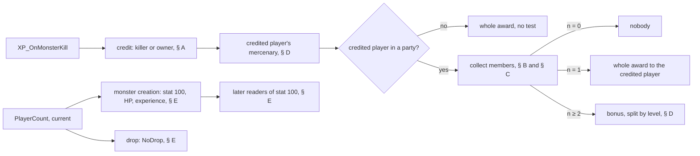
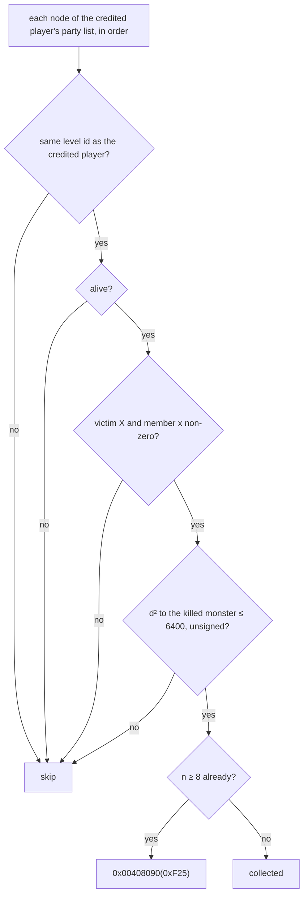
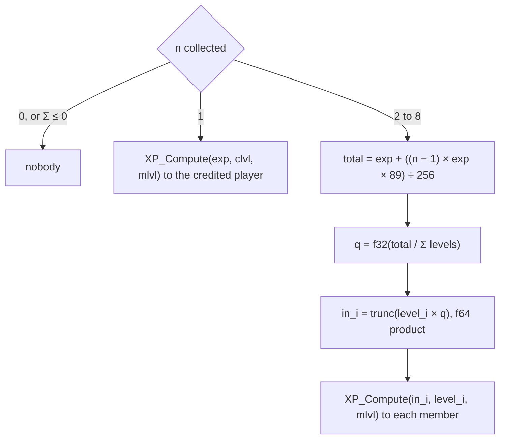
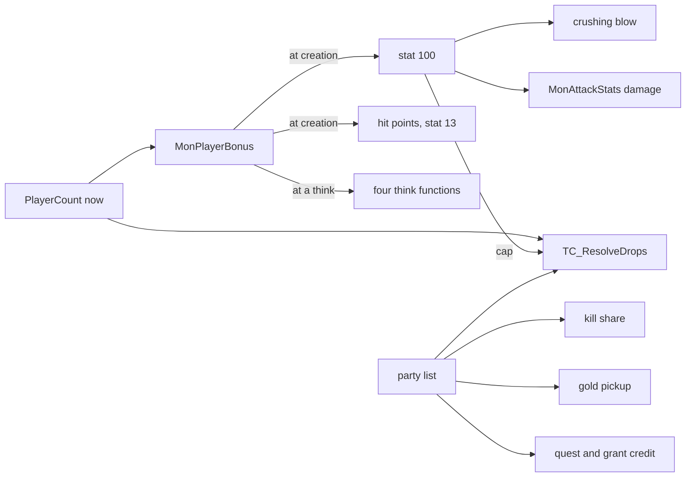

# Party and player count

## Purpose

A kill's experience goes to one credited player and, through that player's party, to the members near the killed
monster. Separately, the number of players changes monsters at their creation and drops at their event. This page
composes those rules in one place: who is credited, who shares, how much each gets, and every reader of the player
count with its input. **It owns nothing:** each rule is restated with its tag and a link, and the linked section wins on
any disagreement. The pseudocode of the credit and the share is [player/creation § G](creation.md#g-kill-experience--xp_compute)
(G0) and [§ J](creation.md#j-other-level-and-experience-changes) (J4).

## Entry points

| When | Function | Tag |
|---|---|---|
| A unit is killed: the gate, then the award; read, not run | fn:sub_005A4EF0_KillExpGate@0x005A4EF0, 0x0057CD51 | [I] |
| The award, from its entry | fn:XP_OnMonsterKill@0x0057E990, run:2026-11-03-party-emu | [C] |
| A monster is created: the player count frozen | fn:sub_00573930_MonPlayerBonus@0x00573930, run:2026-10-15-mon-stats | [C] |
| A treasure class resolves: the count at the event | fn:TC_ResolveDrops@0x0055A6D0, run:2026-10-12-tc-party | [C] |

## Inputs

### Tables

| Anchor | Used for |
|---|---|
| tbl:States.txt:exp | the three states that move the credit (§ A) |
| tbl:MonStats.txt:Align | `Align` 0 takes the player bonus, any other gets `players` 1 (§ E) |

### Runtime state

| State | Type | Source |
|---|---|---|
| party root | game `+0x1D2C`, first record at its `+0x04` | § B |
| the monster's player count | stat 100, frozen at creation | [monsters/stats § C](../monsters/stats.md#c-the-player-count-sub_00573930_monplayerbonus) |
| the current player count | `PlayerCount(game)`, read at the call | [items/tc § F](../items/tc.md#f-nodrop-scaling) |
| `/players` setting | u32 global of the server's process | data:g_PlayersOverride@0x00883D70 |

### Constants

| Name | Value | Anchor | Tag |
|---|---|---|---|
| party distance² | 6400, from the killed monster, inclusive | 0x0057E654, 0x0057E65A, run:2026-11-03-party-emu | [C] |
| party bonus | `89/256` per extra member | fn:XP_PartyShare@0x0057E6C0, run:2026-10-20-two-clients, run:2026-11-03-party-emu | [C] |
| member cap | 8 collected | 0x0057E662, 0x0057E665, run:2026-11-03-party-emu | [C] |
| monster hit points and experience | + 50 % per player beyond the first | data:g_PlayerHpPct@0x006E1590, data:g_PlayerXpPct@0x006E15B4, run:2026-10-15-mon-stats | [C] |

## Algorithm

Every `[C]` of §§ A to D marked "the code's map" is that under ADR-0015: emulated from a declared memory image in
run:2026-11-03-party-emu, 6 166 kills, 0 mismatches against `tools/player.py`, entering at `XP_OnMonsterKill` or
`XP_PartyShare`. It covers what the code does with the bytes it reads, not what the game stores there or how often play reaches
it, and it does not cover a callee past a declared boundary (`PLAYER_LevelUp`, the fatal call).
[player/0002 § 9](../../findings/player/0002-party.md#9-scope-reached-and-not-reached).

### A. Who is credited

Full form: [player/creation G0](creation.md#g-kill-experience--xp_compute).

- [C] The code's map: a player killer is credited itself and a state on the victim is not read. (fn:sub_0057E7B0_XpCreditPlayer@0x0057E7B0, run:2026-11-03-party-emu)
- [C] The code's map: a monster killer's owner link is credited. A state in the `exp` mask (53 `conversion`, 57 `attract`, 59 `confuse`) on the killer, then on the
  victim, replaces it with the owner of a stat list with flag `0x800`; the victim's test wins even when it finds no list. The result counts only if it is a player.
  (fn:sub_0058F0D0_MonsterOwner@0x0058F0D0, fn:sub_0063A690_UnitHasExpState@0x0063A690, fn:sub_00625760_StatListFindFlag@0x00625760, tbl:States.txt:exp, run:2026-11-03-party-emu)
- [C] In the game's own logs, 40 mercenary kills credit the owner. (fn:XP_OnMonsterKill@0x0057E990, run:2026-10-20-two-clients)
- [I] What holds the `0x800` list in play, and what the gate's flag bit 26 of `+0xC4` means, are not settled by this code. (0x005A4EFE–0x005A4F0A, [player/0002 § 4](../../findings/player/0002-party.md#4-g0-the-credit-sub_0057e7b0_xpcreditplayer))
- [C] The code's map: a player victim passes this code, its base stat 13 as the experience and its base stat 12 as the monster's level. (0x0057CD28–0x0057CD51, run:2026-11-03-party-emu)
  Whether play reaches that is not read. [I] (fn:sub_005A4EF0_KillExpGate@0x005A4EF0)

### B. What a party is

- [C] The code's map: the party id is found by a guid search over every party's list: the guid is the unit's `+0x0C`, or inventory `+0x24` when the unit has an inventory whose `+0x00` is
  `0x01020304`; the first list holding it gives the record's word `+0x00`. A unit that is not a player or has no game word is 0xFFFF. The list walked is then the **first record of that id**, which may not
  be the one the guid was found in. (fn:sub_00554630_UnitPartyId@0x00554630, fn:sub_00540710_PartyIdOfUnit@0x00540710, fn:sub_00540290_PartyFind@0x00540290, fn:INV_GetOwnerId@0x0063D450, run:2026-11-03-party-emu)
- [I] The writers of the list, what makes two players one party, and whether a list can hold nine players were not read. (0x005408CB, 0x005408F4, 0x0054091E, [player/0002 § 2](../../findings/player/0002-party.md#2-the-party-definition))

### C. Who shares

Full form: [player/creation J4](creation.md#j-other-level-and-experience-changes).

- [C] The code's map: **a credited player in no party has no test at all** and takes the whole award at its own level. (0x0057EA64–0x0057EAA1, fn:XP_OnMonsterKill@0x0057E990, run:2026-11-03-party-emu)
- [C] The code's map: **the distance is to the killed monster**, and the credited player is tested like every member. No logged kill separates this from the old reading, because the two distances decide all 431 logged pairs alike.
  (0x0057EA6D–0x0057EA75, 0x0057E6DA, 0x0057E6E7, 0x0057E5BE–0x0057E620, run:2026-11-03-party-emu, run:2026-10-20-two-clients)
- [C] The code's map: the edge is inclusive and unsigned (d² = 6400 in, 6401 out), and d² is 32-bit, so it wraps. (0x0057E654, 0x0057E65A, 0x0057E64C, run:2026-11-03-party-emu)
- [C] The code's map: the party and the level are the credited player's; the victim's level is not read. (fn:sub_005405A0_PartyForEachInLevel@0x005405A0, 0x005405C7–0x00540636, run:2026-11-03-party-emu)
- [C] The code's map: a ninth member that passes every test reaches `0x00408090(0xF25)` at 0x0057E66C; a member failing a test first does not count. (0x0057E662, 0x0057E665, run:2026-11-03-party-emu)
- [I] What follows that call is the fatal path, not run, and whether a list can hold nine was not read, so this is the code's path and not a game outcome. (0x0057E671–0x0057E681, 0x005408CB)
- [C] For two players, the member sets of plan 0044's session are predicted, in order, for 689 of 690 kills (the other cut off by the session's end). (fn:sub_0057E5A0_PartyXpCollect@0x0057E5A0, run:2026-10-20-two-clients, run:2026-11-03-party-emu)

### D. How much

- [C] The code's map: **n = 1 pays the credited player, whoever the sole member was**, at its own level, with no bonus. n = 0 pays nobody. No logged kill separates this: all 648 partied credited players of the logs were in range. (0x0057E70D–0x0057E733, 0x0057E6FB–0x0057E707, run:2026-11-03-party-emu, run:2026-10-20-two-clients)
- [I] What the origin and the n = 1 credit lead to in play: a partied player whose hireling or summon kills more than 80 sub-tiles from it takes the whole award alone when one other member is near the victim, and with no member near nobody gets any, while an unpartied player in the same place gets it all. A dead killer with one living member in range is paid, and the living member is not. (0x0057E6FB–0x0057E733, 0x0057E654–0x0057E65A)
- [C] The code's map for n up to 8: `total: i32 ← exp + ((n − 1) × exp × 89) ÷ 256`, every product i32, truncating; past the wrap the total may go negative and each input is then ≤ 0, for which `XP_Compute` returns 1. (0x0057E739–0x0057E74B, 0x0057E4A1–0x0057E4AA, run:2026-11-03-party-emu)
- [C] For n = 2: `q` is the f32 quotient and each input is `trunc((f64) level × (f64) q)`, never rounded to f32. (fn:XP_PartyShare@0x0057E6C0, fn:CRT_ftol2@0x00682FD0, run:2026-10-20-two-clients)
- [I] For n ≥ 3 those float steps are the same instructions and agree in every emulated case, but ADR-0015 (5) keeps x87 results out of emulation's evidence. (0x0057E754–0x0057E77B, fn:CRT_ftol2@0x00682FD0)
- [C] Each input then goes through `XP_Compute` at that member's level, with the level-difference factor and the ratio of [creation G3, G4](creation.md#g-kill-experience--xp_compute). (fn:XP_LevelDiffPenalty@0x0057E2F0, fn:XP_ApplyExpRatio@0x0057E390, run:2026-10-16-player, run:2026-11-03-party-emu)
- [C] The code's map: a member's level is the evaluated stat 12, `clvl` the base stat 12; they differ only if a list changes stat 12. (0x0057E68F, 0x0057EA53, run:2026-11-03-party-emu)
- [C] The code's map: **the mercenary's award runs first and does not depend on the share**: only the credited player's own pet of type 7, at the monster's full experience and its own level, capped by `MERC_CapExpGain`, cut to `gain × 86 ÷ 256` unless it is the killer. Other members' mercenaries get nothing. ([creation G6 note](creation.md#g-kill-experience--xp_compute), [hirelings § G](../hirelings/README.md#levelling-in-play-merc_addexp), 0x0057E9F9–0x0057EA46, run:2026-11-03-party-emu)

The death loss and the corpse's share are [creation J3](creation.md#j-other-level-and-experience-changes); they read no party.

### E. Every player-count reader, with its input

`PlayerCount` is one function; a reader takes it **now** (the current count) or **frozen** (the monster's stat 100, written from it at creation). A third group reads the party and no count at all.

- [C] `PlayerCount` counts live players, and the `/players` setting is a maximum, not an addition, in single player and on a TCP/IP host, where only the server's setting counts. ([items/tc F2](../items/tc.md#f-nodrop-scaling), fn:sub_00535790_PlayerCount@0x00535790, run:2026-10-11-tc-drops, run:2026-10-20-two-clients, run:2026-10-20-sweep-items-tc)
- [I] Game type 1 also takes it, and other types do not; the set of states and modes that excludes a player is the code's reading. (fn:sub_00535790_PlayerCount@0x00535790, fn:sub_00535780_SetPlayersOverride@0x00535780)

| Reader | Input | Read when | What it changes | Tag | Owning section |
|---|---|---|---|---|---|
| `MonPlayerBonus` in `MonStatsInit` | count now | at the monster's creation | stat 100 ← `max(1, players)`, where `Align` 0 takes the count and any other 1 | [C] (fn:sub_00573930_MonPlayerBonus@0x00573930, 0x0057396C, run:2026-10-15-mon-stats) | [monsters/stats C1](../monsters/stats.md#c-the-player-count-sub_00573930_monplayerbonus) |
| a monster's hit points | count at creation, frozen in the value | at creation; never rescaled | `+50 %` per player beyond the first | [C] (data:g_PlayerHpPct@0x006E1590, run:2026-10-15-mon-stats) | [monsters/stats C1, C2](../monsters/stats.md#c-the-player-count-sub_00573930_monplayerbonus) |
| a monster's experience, stat 13 | count at creation, frozen in the value | at creation; `XP_OnMonsterKill` reads the stat | `+50 %` per player beyond the first | [C] (data:g_PlayerXpPct@0x006E15B4, run:2026-10-15-mon-stats) | [monsters/stats C1, C2](../monsters/stats.md#c-the-player-count-sub_00573930_monplayerbonus) |
| crushing blow divisor | frozen stat 100 | at the stat event | `k + MulDiv(k, PlayerHpPct(n), 100)` | [C] (fn:STATEVENT_CrushingBlow@0x005BFFC0, fn:sub_005738F0_PlayerHpPct@0x005738F0, run:2026-10-16-combat) | [combat/delivery E1](../combat/delivery.md#e-the-stat-events-crushing-blow-open-wounds-freeze), [combat § D](../combat/README.md#d-branches) |
| `MonAttackStats` damage | frozen stat 100 | at each attack | expansion, Nightmare and Hell: `+ value × b ÷ 128`, `b = 8(n − 1)` for `n < 9` | [I] (fn:sub_005A4F50_MonAttackStats@0x005A4F50, fn:sub_005A4F20_PlayerDmgBonus@0x005A4F20) | [monsters/stats H1](../monsters/stats.md#h-to-hit-and-damage-at-attack-time-reference-only), [combat § D](../combat/README.md#d-branches) |
| NoDrop | count now, and the party count now | at each resolve | `n = party + (PlayerCount − party) ÷ 2`, scaled through the x87 formula | [C] (fn:TC_ResolveDrops@0x0055A6D0, run:2026-10-12-tc-party, run:2026-10-20-two-clients) | [items/tc F](../items/tc.md#f-nodrop-scaling) |
| NoDrop's cap | frozen stat 100 of a monster source; an object source has none | at each resolve | `n ← min(n, max(1, stat 100))`; it never acted in a logged call | [I] for the cap's effect (0x0055A926); [C] for no cap on an object source (0x0055A926, run:2026-10-20-sweep-items-tc) | [items/tc F2](../items/tc.md#f-nodrop-scaling) |
| four think functions | count now, through `MonPlayerBonus` | at their own run | re-reads a changed `/players`; which word each uses: below | [I] (0x005E8D61, 0x005E9C82, 0x005F0B32, 0x005FC542) | [monsters/stats C3](../monsters/stats.md#c-the-player-count-sub_00573930_monplayerbonus), [player/0002 § 7](../../findings/player/0002-party.md#7-the-player-count-players-and-the-kill) |
| kill share | party list and positions; no count | at the kill | §§ C, D | [C] the code's map: no traced read touches the count (data:g_PlayersOverride@0x00883D70, run:2026-11-03-party-emu) | [creation J4](creation.md#j-other-level-and-experience-changes) |
| NoDrop's party count | party list, same level, alive, no distance test; clamp at 8 | at each resolve | the `party` above | [C] two players (fn:sub_005408E0_PartyCountInLevel@0x005408E0, run:2026-10-12-tc-party, run:2026-10-20-two-clients); [I] the clamp (0x0055A8E4) | [items/tc F1, F3](../items/tc.md#f-nodrop-scaling) |
| gold pickup | party list, through `PartyGoldShare` | at the pickup | a split by the party count; not run; no direct reference to `PlayerCount`, its callees past the party walk not followed | [I] (fn:sub_00540900_PartyGoldShare@0x00540900) | [items/economy G4](../items/economy.md#g-gold-payment-caps-piles-and-the-death-loss) |
| quest credit | party list, member's current act | at the quest event | the same bits to each member with bits 0 and 1 clear whose level is in the quest's act | [I] the shape (fn:sub_00540510_PartyForEach@0x00540510, fn:DRLG_ActFromLevelId@0x006427F0); [C] one partied member in the Rogue Encampment (0x00590175, run:2026-10-20-two-clients) | [quests/progression § D](../quests/progression.md#d-shared-shapes-of-the-quest-scripts) |
| the Ancients' grant | killer, players in level 120, their party members in an Act V level | at the last Ancient's death | who gets the grant | [I] (fn:sub_0058C6D0_A5Q5_PartyExpGrant@0x0058C6D0, fn:sub_0058C7E0_A5Q5_SummitExpGrant@0x0058C7E0) | [creation J2](creation.md#j-other-level-and-experience-changes) |
| the forge's `n`, Baal's and the chests' loops | a script's own count of players | at the script | per-player counts, not `PlayerCount` | [I] (fn:sub_005537D0_GameForEachUnit@0x005537D0, fn:sub_00540510_PartyForEach@0x00540510) | [items/quest-drops § Inputs](../items/quest-drops.md#inputs) |

What does **not** read it:

- [C] Group size, minions and density do not scale with players, over passes at `/players` 1, 3 and 8. (fn:sub_0054EC90_RoomPopulate@0x0054EC90, run:2026-10-15-mon-stats, [monsters/spawn § I](../monsters/spawn.md#i-monstats-minions))
- [C] A hireling has `Align` 1, so it gets `players` 1 and no bonus. (0x0057396C, tbl:MonStats.txt:Align, run:2026-10-16-sweep-monsters-b, [hirelings](../hirelings/README.md))

**Who calls the count.**

- [I] `PlayerCount` has 2 direct references: `TC_ResolveDrops` (0x0055A8F4, at the event) and `MonPlayerBonus` (0x00573974). `MonPlayerBonus` has 5: `MonStatsInit` (0x00573DBC, frozen at creation) and the four think functions. `g_PlayersOverride` is named by two instructions, the setter 0x00535785 and the reader 0x005357B9. Indirect calls not followed. (fn:sub_00535790_PlayerCount@0x00535790, fn:sub_00573930_MonPlayerBonus@0x00573930, data:g_PlayersOverride@0x00883D70)
- [C] **`/players` changed mid-game** changes nothing on a live monster: 302 live monsters kept stats 7, 12, 13 and 100 over 13 changes; monsters created later get the new count. (fn:sub_00535790_PlayerCount@0x00535790, run:2026-10-15-mon-stats) So a change reaches the next creation, the next drop's `PlayerCount`, and the four think functions at their next run. [I] (0x0055A8F4, 0x005E8D61, 0x005F0B32)
- [I] The four: `sub_005E8810_AiDiabloDecide`, `sub_005FC450_AiBaalDecideRanged`, `sub_005F0B00_AiCorruptRogue` and `sub_005E9750_AiDiabloDecideUnref`, which has no reference. `AiCorruptRogue` uses the difficulty word only ([ai/0002 § 2.9](../../findings/ai/0002-pool-a.md#29-row-10-corruptrogue-0x005f0b00)). What the two decision functions use is the open question below. (fn:sub_005E8810_AiDiabloDecide@0x005E8810, fn:sub_005FC450_AiBaalDecideRanged@0x005FC450, fn:sub_005F0B00_AiCorruptRogue@0x005F0B00, fn:sub_005E9750_AiDiabloDecideUnref@0x005E9750)

## Outputs

Experience on the credited player or the members, a mercenary's award, and the values of the readers of § E. This page adds no output of its own.

## Worked example

| Case | Inputs | Steps | Result | Tag |
|---|---|---|---|---|
| n = 2, the f32 trap | `exp` 63, levels 81, 81 | total `63 + (63 × 89) ÷ 256` = 84; `q` = f32(84 / 162) = 0.51851851; 81 × `q` = 41.999999 | each input **41**, where an f32 product gives 42 | [C] (run:2026-10-20-two-clients) |
| n = 3, the integer step | `exp` 100, levels 30, 20, 10 | total `100 + (2 × 100 × 89) ÷ 256` | 169 | [C] (0x0057E739–0x0057E74B, run:2026-11-03-party-emu) |
| n = 3, the float steps | the same, Σ 60 | `q` = f32(169 / 60) = 2.8166666; the products 84.499998, 56.333332, 28.166666 | inputs 84, 56, 28 (`tools/player.py` `xp_share_inputs`) | [I] (0x0057E754–0x0057E77B) |
| n = 8, the wrap | `exp` 3 447 005 | `7 × exp × 89` wraps to −2 147 483 181; ÷ 256 truncates | total **−4 941 601**; each input ≤ 0; `XP_Compute` returns 1 | [C] (0x0057E739–0x0057E74B, run:2026-11-03-party-emu) |

## Reimplementation notes

- **Measure the party distance from the killed monster**, not from the killer or the credited player. The logs cannot tell them apart. [C] the code's map (fn:sub_0057E5A0_PartyXpCollect@0x0057E5A0, 0x0057E6E7, run:2026-11-03-party-emu, run:2026-10-20-two-clients)
- **With one member collected, pay the credited player**, not that member, at the credited player's level, even when the credited player failed the tests. [C] the code's map (0x0057E70D–0x0057E733, run:2026-11-03-party-emu)
- What that gives in play is odd and is to be kept: a far hireling's kill can pay its far owner alone, and a dead killer can be paid while the living member is not. [I] (0x0057E6FB–0x0057E733, 0x0057E654–0x0057E65A)
- **A player in no party has no alive or distance test**; only the party branch has them. [C] the code's map (0x0057EA64–0x0057EAA1, run:2026-11-03-party-emu)
- **Eight is not a clip.** A ninth that passes every test reaches the fatal call; do not stop at eight quietly. [C] the code's map, to the call (0x0057E662, 0x0057E665, run:2026-11-03-party-emu) Past the call, and whether a list can hold nine, is unread. [I] (0x0057E671–0x0057E681, 0x005408CB)
- **The edge and the wraps:** `d² ≤ 6400` unsigned and inclusive, d² and the total's product wrap at 32 bits. [C] the code's map (0x0057E654, 0x0057E65A, 0x0057E739–0x0057E74B, run:2026-11-03-party-emu)

## Evidence

- [findings/player/0002-party.md](../../findings/player/0002-party.md), [run:2026-11-03-party-emu](../../findings/player/experiments.md#run2026-11-03-party-emu).
- [multiplayer/0001 § 6](../../findings/multiplayer/0001-cases.md#6-phase-2-results-run2026-10-20-two-clients) (run:2026-10-20-two-clients).
- [findings/ai/0002-pool-a.md](../../findings/ai/0002-pool-a.md), [findings/ai/0012-batch11.md](../../findings/ai/0012-batch11.md) (the think functions).
- The owning specs linked in each section: [player/creation](creation.md), [monsters/stats](../monsters/stats.md), [items/tc](../items/tc.md), [combat/delivery](../combat/delivery.md), [items/economy](../items/economy.md), [quests/progression](../quests/progression.md), [items/quest-drops](../items/quest-drops.md), [hirelings](../hirelings/README.md).

## Open questions

- [L] Does a player killing a player get an award in play? The code path exists (§ A); no log holds one, and the gate's flag was not traced on such a victim. A later two-client case, not blocking.
- [L] A live case of the corrected reading: a partied killer's far mercenary or summon with one member near the victim. The logs have none; `KILL` already gives the monster's position. Routed by the plan 0058 review.
- [L] Which word of `MonPlayerBonus` do `AiDiabloDecide` and `AiBaalDecideRanged` use? ai/0012 calls `b+0x0C` "the player count", while `re/types/monstats.h` and monsters/stats C1 have `+0x0C` as the difficulty and `+0x10` as the players, and ai/0002 reads the same `+0x0C` as the difficulty in `AiCorruptRogue`. If it is the difficulty, a changed `/players` has no effect there beyond the call. Filed to the reverser ([backlog](../../backlog/2026-11-03-spec-writer-reverser-ai-0012-monplayerbonus-word.md)).
- [L] The party gold split in a game: [items/economy's question](../items/economy.md#open-questions).
