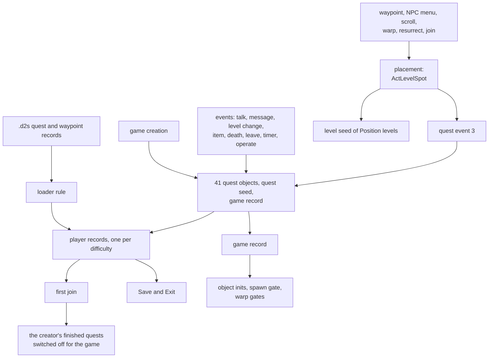

# Quests and travel: the game rules that move a character through the acts

## Purpose

This subsystem specifies the quest state machines and travel of the server
([ADR-0017](../../adrs/0017-scope-quests-travel-economy.md)): which event sets, clears or reads each bit of a player's
quest record, what the game-wide record holds, which quest events draw on which seed, how a waypoint is activated and
used, how a player changes act, how a town portal opens, works and closes, and where a player lands after any level
change. Quest logic is hardcoded: no excel table the game loads holds quest data, so the specs describe code, with the
tables it reads named where they enter. This page is the map and the shared model; the algorithms are in the two files
below.

## Files

| File | Covers | Status |
|---|---|---|
| [progression.md](progression.md) | the quest record and its load rule, the 41 quest objects and the event dispatch, the join's game-wide pass, timers, NPC interaction, the quest-seed and player-seed draws, a section per quest (bit table and state diagram), the warp and portal gates, the creation-path readers | reviewed |
| [travel.md](travel.md) | placement (`ActLevelSpot`, the level-point lookup, the free-cell search), waypoint activation and travel, act change through an NPC, the Durance and other travel portals, town portals (open, use, close), warps, resurrection and join placement, the real-time gates | reviewed |

Not covered: the quest drops, rewards and item services ([items/quest-drops](../items/quest-drops.md)), the dialogue
text and the quest log's presentation, the AI and combat that decide when a boss dies (inputs here). The two-client
cases are [plan 0044](../../plans/0044-multiplayer-branches.md)'s; its run reached the Den's party credit
([progression § Word 1](progression.md#word-1-the-level-8-monster-region-and-the-hell-respec-offer-quest-object-1)),
hostility and the two gates with a declared stamp ([travel § J](travel.md#j-operate-gates-and-real-time-gates)).

## Data flow

## Shared model

- [C] **The record.** A player has one quest record per difficulty, 48 words of 16 bits, block *d* for difficulty *d*;
  the loader clears bits 13 and 14 of words 0–41 and sets bit 15 where bit 1 is set, copies words 42–47, and Save and
  Exit writes the record as it stands ([progression § A](progression.md#a-the-quest-record)). (fn:D2S_ReadQuests@0x0056A370,
  fn:QUESTRECORD_LoadBytes@0x0065C4D0, run:2026-10-18-quests2)
- [I] **The bit grammar.** Bit 0 done, bit 1 done with a reward pending, bits 2–11 log steps, bit 12 seen in the log,
  bit 13 done in this game, bit 14 failed in this game, bit 15 a reward pending from an earlier game; each quest adds its
  own bits ([progression § A](progression.md#a-the-quest-record)). (fn:QUESTRECORD_SetState@0x0065C360)
- [C] **The events reach quests in a fixed order**, from quest object 40 down to row 0, and the talk, message and
  level-change events are forced, so they reach a quest the join switched off
  ([progression § B](progression.md#b-events-and-dispatch)). (fn:QUESTS_DispatchEvent@0x005438E0, run:2026-10-17-quests)
- [C] **The game creator's history shapes the game**: at the first join every quest the joining player had finished is
  switched off for the game and marked in the game record
  ([progression § C](progression.md#c-the-join-and-the-game-creators-history)). (fn:sub_00546270_QuestsPlayerJoin@0x00546270,
  run:2026-10-17-quests)
- [I] **Draws.** Quest events draw on the quest seed (NPC 331, the eclipse, the cairn order, Anya's reward, the Dark
  Wanderer, the Zoo, and the item draws of [items/quest-drops](../items/quest-drops.md)) and on the player's unit seed
  (NPCs 266 and 377); travel draws on the destination level's seed, the game seed of the portal objects and, for five
  waypoint rows, the object's seed ([progression § G](progression.md#g-the-draws),
  [travel § Draws by event kind](travel.md#draws-by-event-kind)). (fn:QUESTS_GetSeed@0x005438B0,
  fn:sub_0066AC40_LevelPointPick@0x0066AC40)
- [C] The quest-seed draws the runs reached (NPC 331's talk, the eclipse arm, the cairn order on the `bkd ` use, the
  Dark Wanderer timer, Anya's reward in the three difficulties) and NPC 266's two player-seed draws were each predicted
  from the seed before them ([progression § G](progression.md#g-the-draws)). (run:2026-10-17-quests,
  run:2026-10-18-quests2, run:2026-10-19-quests3)
- [I] The Zoo's quest-seed draws and NPC 377's player-seed draw are not reached on stock data: object 567 and NPC 377
  are placed by no stock DS1 ([progression § G](progression.md#g-the-draws)). (fn:sub_0058E830_A5Q6_ZooInit@0x0058E830,
  0x0059E1CE)
- [C] **One placement routine.** The waypoint, NPC and join arrivals and the portals' town ends the runs logged went
  through `ActLevelSpot`: a level point, the subtile `5·t + 3`, then the nearest free cell (124 placements)
  ([travel § A](travel.md#a-placement)). (fn:sub_0061B060_ActLevelSpot@0x0061B060, run:2026-10-17-quests)
- [C] A resurrection places the player the same way, at the town's type-0 point with one level-seed step: three in
  Hell ([travel § I](travel.md#i-death-resurrection-and-joining)). (fn:sub_0054C0E0_Pkt41Resurrect@0x0054C0E0,
  run:2026-10-19-quests3)
- [I] The Durance portal places the player the same way, read from the code. (fn:sub_00546AC0_DuranceActTravel@0x00546AC0)

## Inputs and oracles

| Item | Kind | Tag |
|---|---|---|
| the trigger of a quest step (a kill, an operate, a level change, the client's dialogue message) and of a travel (a click, a packet) | input | [C] for the talk steps (run:2026-10-18-quests2: 41 steps predicted from the logged message) |
| party membership, the players' rooms and near lists, held items | input | [I] (fn:sub_00540510_PartyForEach@0x00540510) |
| `GetTickCount()` at the two travel gates and in Diablo's end timer | input, real time | [C] for the travel gates, one client (run:2026-10-17-quests) |
| units, objects, portals and items a quest creates; levels, acts and rooms built on arrival; a town room's first population | oracle | [C] (run:2026-10-17-quests: the portal's population oracle, 9 opens) |
| the collision grid read by a free-cell search | input, logged | [C] (run:2026-10-17-quests: 545 searches) |

## Evidence and status

The reading is [quests/0001](../../findings/quests/0001-progression.md) and [quests/0002](../../findings/quests/0002-travel.md);
three runs reproduce it with 0 mismatches: [run:2026-10-17-quests](../../findings/quests/experiments.md#run2026-10-17-quests)
(16 199 checks, 11 sessions), [run:2026-10-18-quests2](../../findings/quests/experiments.md#run2026-10-18-quests2)
(23 348 checks, 21 sessions) and [run:2026-10-19-quests3](../../findings/quests/experiments.md#run2026-10-19-quests3)
(6 167 checks, 13 sessions). `[C]`: the talk steps reached, the record's load and save, the dispatch order, the join's
pass, the quest timers (one-shots), the quest-seed draws of NPC 331, the eclipse arm, the cairn order on the `bkd ` use,
the Dark Wanderer and Anya's reward, the NPC 266 draws, the level-entry and item-use steps reached, the portal's three
draws and its refusal in a town, placement, Meshif's stepping type-5 return, the Harrogath portal, packet 0x48's clear,
the resurrection's move and the "no draw" travel rows. `[I]` for this plan: the steps triggered by kills, boss events
and far operates, the timer re-arm and wrap, the Zoo (placed by no stock DS1), the mode-0 waypoint activation, NPC 367's
travel branch, the unreached level-entry rows and the Dark Wanderer's 7-try branch.

## Cross-references

| Spec | What it takes from here |
|---|---|
| [items/quest-drops](../items/quest-drops.md) | the quest bits at kill time and the quest seed's non-item draws ([progression § G](progression.md#g-the-draws)) |
| [objects](../objects/README.md) | the quest `InitFn`s' game-record and private-state reads ([progression § Creation-path readers](progression.md#creation-path-readers)) |
| [monsters/spawn](../monsters/spawn.md) | the Chaos Sanctuary gate ([progression § Word 26](progression.md#word-26-diablo-the-seals-and-the-harrogath-portal-quest-object-23)) |
| [monsters/special](../monsters/special.md) | the forced death list and quest hooks ([progression § B](progression.md#b-events-and-dispatch)) |
| [rng/seeds](../rng/seeds.md) | act `+0x094` as the true tomb ([progression § Creation-path readers](progression.md#creation-path-readers)) |
| [items/cube](../items/cube.md) | the cow-portal gate words ([progression § Word 4](progression.md#word-4-cain-the-cairn-stones-tristram-and-the-cow-king-quest-object-4)) |
| [drlg/collision](../drlg/collision.md), [drlg/warps](../drlg/warps.md) | the level-point lookup and warp pairing used by placement ([travel § A](travel.md#a-placement), [travel § H](travel.md#h-warps)) |
| [save/d2s](../save/d2s.md) | the record's load rule and the saved words ([progression § A](progression.md#a-the-quest-record)) |

## Open questions

- [L] The two-client cases not reached by run:2026-10-20-two-clients (plan 0044): party credit beyond the Den's partied
  member in town, the portal's party and quest-word gates, and the un-declare path.
- [L] The per-file open questions: [progression](progression.md#open-questions), [travel](travel.md#open-questions).
