# Quest progression: the record, the events, every quest's bits and the quest draws

## Purpose

The game keeps one 48-word quest record per player and difficulty and one game-wide record per game. Quest logic is
hardcoded (no excel table holds it): 41 quest objects receive server events (NPC talks and messages, level changes,
item events, hooked monster deaths, joins, leaves, timers, object operates) and write record bits, create units and
items, and draw on the quest seed or the player's unit seed. This spec gives the record's bit grammar and load rule,
the event dispatch and its order, the join's game-wide pass, the timers, every quest's bit table with its triggers and
a state diagram, the draws, and the creation code that reads the result. When a trigger happens (a kill, a click, the
dialogue line the client reports) is an input; what the server does with it is specified here. Travel is
[quests/travel](travel.md); the overview is [quests](README.md).

## Entry points

| When | Function | Tag |
|---|---|---|
| game creation: 41 quest objects, the quest seed, the game record | `QUESTS_InitGame` | [C] (fn:QUESTS_InitGame@0x00545D80, run:2026-10-16-quest-drops) |
| an NPC talk starts / ends (e0 / e2) | `sub_00572C10_NpcInteractStart` / `sub_00572F20_NpcInteractRemove` → `QUESTS_DispatchEvent` | [C] (fn:QUESTS_DispatchEvent@0x005438E0, run:2026-10-17-quests) |
| the client reports a dialogue message (packet `0x31`, 9 bytes) (e11) | `sub_0054BA90_Pkt31NpcMessage` → `QUESTS_RaiseNpcMessage` | [C] (fn:QUESTS_RaiseNpcMessage@0x005443B0, run:2026-10-17-quests) |
| the player's room changes level (e3) | `sub_005380D0_ClientRoomSync`, and a portal use from a town | [C] (fn:sub_005380D0_ClientRoomSync@0x005380D0, run:2026-10-17-quests) |
| an item is placed / dropped (e4 / e5) | `0x00543D80` (7 sites) / `0x00543DB0` → `QUESTS_DispatchUnitEvent` | [I] (fn:QUESTS_DispatchUnitEvent@0x005439A0) |
| a hooked monster dies (e8) | `sub_0057CCB0_UnitKilled` → `QUESTS_MonsterDeathEvent` | [I] (fn:QUESTS_MonsterDeathEvent@0x00543A30) |
| a player leaves (e9 per quest item carried, then e10) | `sub_00543BD0_QuestsInvItemEvent` | [I] (fn:sub_00543BD0_QuestsInvItemEvent@0x00543BD0) |
| a player joins (e13 first, e14 later) | `sub_00546270_QuestsPlayerJoin` | [C] (fn:sub_00546270_QuestsPlayerJoin@0x00546270, run:2026-10-17-quests) |
| every 20th game frame | `QUESTS_TimersRun` from `sub_0052D870_GameTick` | [I] (fn:QUESTS_TimersRun@0x00543E10, fn:sub_0052D870_GameTick@0x0052D870) |
| a quest object is operated, or its timed object event 7 fires | `g_ObjOperateFns[OperateFn]`, `QUESTS_ObjectEvent` | [I] (data:g_ObjOperateFns@0x00732D18, fn:QUESTS_ObjectEvent@0x005449E0) |
| an NPC menu service (imbue, socket, personalise, Hell respec, travel) | `NPC_MenuAction` | [I] (fn:NPC_MenuAction@0x00579D60) |
| the client opens a quest-log entry (packet `0x58`) | `sub_0054C9C0_Pkt58QuestSeen` | [C] (fn:sub_0054C9C0_Pkt58QuestSeen@0x0054C9C0, run:2026-10-17-quests) |

## Inputs

### Tables

| Anchor | Used for |
|---|---|
| tbl:MonStats.txt:TCQuestId, tbl:MonStats.txt:TCQuestCP | the quest TC switch reads the killer's bits ([items/quest-drops § B](../items/quest-drops.md#b-the-quest-tc-switch-itemstc-b6)) |
| tbl:MonStats.txt:zoo | the Zoo's class draw (word 40) |
| tbl:Levels.txt:QuestFlag, tbl:Levels.txt:QuestFlagEx | the portal quest gate ([quests/travel § G](travel.md#g-town-portals)) |
| tbl:Misc.txt:quest | the quest an item belongs to (e9) |
| tbl:Objects.txt:InitFn, tbl:Objects.txt:OperateFn | which quest handler an object runs |

Not a table: `data:g_QuestDescs@0x00731510` (37 rows of 0x18 bytes, count at `0x00731888`) and a second table at
`0x0073188C` (4 rows of 8 bytes) are code data; § B lists them.

### Runtime state

| State | Type | Source |
|---|---|---|
| player quest record | 48 × u16 bit field (bit `16q + s` = word *q* bit *s*), player data `+0x10 + 4·difficulty` | [save/d2s](../save/d2s.md); § A |
| game record | 48 × u16, `QuestControl+0x0C` (`struct:QuestControl+0x0C`) | `QUESTS_InitGame`; § A |
| quest object | 0xF8 bytes (`struct:QuestObject+0x00`): `+0x09` active, `+0x0A` gets events, `+0x0B`/`+0x0C` log state, `+0xA0 + 4·e` callbacks, `+0xE0` word, private data | `QUESTS_InitGame`; § B |
| quest seed | Seed, `QuestControl+0x18`-area (`struct:QuestControl+0x18`) | game-seed draw 4 ([items/quest-drops § A](../items/quest-drops.md#a-the-quest-record-and-the-quest-seed)) |
| player's unit seed | Seed, `Unit+0x20` | the player unit |
| control tick and timer list | u32, list of `{fn, quest, due, period}` | § E |
| difficulty `game+0x6D`, expansion `game+0x70`, game type `game+0x6A` | u8 | the game |

### Constants

| Name | Value | Anchor | Tag |
|---|---|---|---|
| quest objects | 37 main-table + 4 NPC-introduction objects (ids 37–40) | data:g_QuestDescs@0x00731510 | [I] |
| record words | 48 per record; words 0–41 under the loader rule, 42–47 copied | fn:QUESTRECORD_LoadBytes@0x0065C4D0 | [C] (run:2026-10-18-quests2) |
| timer cadence | every 20th frame (`frame mod 20 = 0`) | fn:sub_0052D870_GameTick@0x0052D870 0x0052D912–0x0052D920 | [I] |
| LCG multiplier | `0x6AC690C5` ([rng](../rng/README.md) step 1) | fn:RNG_Step@0x0045C370 | [C] (run:2026-10-11-rng-emu) |

### Inputs and oracles

| Item | Kind | What it is | Tag |
|---|---|---|---|
| the trigger: a kill, an operate, a level change, a packet | input | game simulation decides when it happens | [I] (fn:QUESTS_DispatchEvent@0x005438E0) |
| the client's dialogue message id (packet `0x31`) | input | the client picks the line from the message index the server sent at e0 | [C] (run:2026-10-18-quests2: 41 talk steps predicted from the logged message) |
| party membership, the players' rooms and near lists, held items | input | read by credit passes and item tests | [I] (fn:sub_00540510_PartyForEach@0x00540510) |
| units and items a quest creates (spawns, objects, portals, rewards, hirelings) | oracle | they draw on their own seeds: [monsters/spawn](../monsters/spawn.md), [objects](../objects/README.md), [items/quest-drops](../items/quest-drops.md), [quests/travel § G](travel.md#g-town-portals) | [C] (run:2026-10-18-quests2: 13 dispatches whose game-seed change is a created unit) |
| the log state bytes `+0x0B`/`+0x0C` where they gate no bit | oracle | presentation of the quest log | [I] (fn:QUESTS_SetState@0x00544300) |
| `GetTickCount()` in Diablo's end timer | input | real time | [I] (fn:sub_005B4BE0_A4Q2_Timer@0x005B4BE0) |

## Algorithm

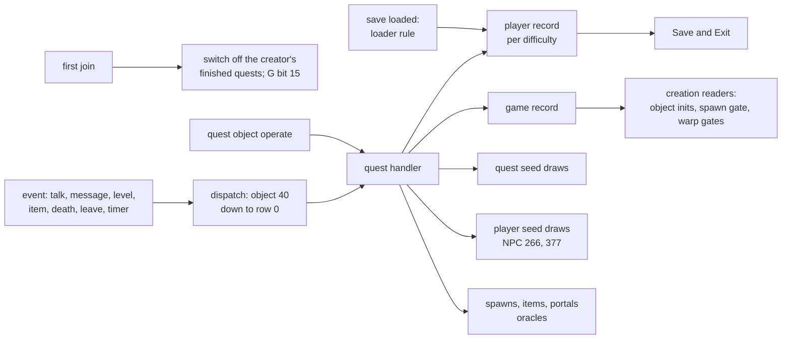

### A. The quest record

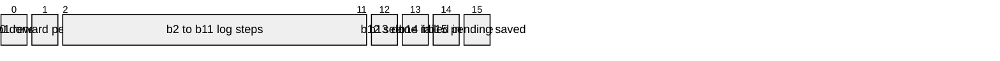

```
A1. GetState(rec, q, s) = bit 16q + s of rec;  SetState / ClearState set or clear it   [I] (fn:QUESTRECORD_GetState@0x0065C310, fn:QUESTRECORD_SetState@0x0065C360, fn:QUESTRECORD_ClearState@0x0065C3A0)
A2. ClearSteps(rec, q): for s in 2 ... 11: clear bit 16q + s       [C] (fn:QUESTRECORD_ClearSteps@0x0065C3E0, run:2026-10-18-quests2)
A3. Load(rec, bytes) — QUESTRECORD_LoadBytes(…, 0x60, flag 1):     [C] (fn:D2S_ReadQuests@0x0056A370, fn:QUESTRECORD_LoadBytes@0x0065C4D0, run:2026-10-18-quests2)
      for q in 0 ..< 42:
        w: u16 ← saved word q
        clear bits 13 and 14 of w
        if bit 1 of w: set bit 15 of w
        rec[q] ← w
      for q in 42 ..< 48: rec[q] ← saved word q                      ; copied
A4. Save: each record is written as it stands at Save and Exit      [C] (run:2026-10-18-quests2)
A5. Packet 0x58 {u16 q}: if q < 42: SetState(rec, q, 12)            [C] (fn:sub_0054C9C0_Pkt58QuestSeen@0x0054C9C0, run:2026-10-17-quests)
```

| bit | meaning in the code | set by | cleared by | Tag |
|---|---|---|---|---|
| 0 | done (reward taken, or no reward) | the reward message or the completing event | only word 9's first-join check | [I] (fn:QUESTRECORD_SetState@0x0065C360, 0x0059927F) |
| 1 | done in a game, reward not yet taken | the completing event (`QUESTS_ListSetPending` sets 13 and 1 together) | the reward | [I] (fn:QUESTS_ListSetPending@0x005455F0) |
| 2–11 | log steps (quest-log progress) | each quest's StepBits by log state | `ClearSteps` at most rewards | [I] (fn:QUESTRECORD_ClearSteps@0x0065C3E0) |
| 12 | the quest-log entry was seen | packet `0x58` | never | [C] (fn:sub_0054C9C0_Pkt58QuestSeen@0x0054C9C0, run:2026-10-17-quests) |
| 13 | done in this game | with bit 1 or bit 0 | the loader | [C] (fn:QUESTRECORD_LoadBytes@0x0065C4D0, run:2026-10-18-quests2) |
| 14 | failed in this game (another player finished it) | each quest's FailOthers | the loader; word 11 at 0x0059AAB7 | [C] for the loader (run:2026-10-18-quests2); [I] for the writers (0x0059AAB7) |
| 15 | reward pending from an earlier game | the loader, from a saved bit 1; in the game record, the join | word 9's first-join check (0x00599293) | [C] for the loader (run:2026-10-18-quests2); [I] for word 9 (0x00599293) |

Step notes:

- A2. [C] `ClearSteps` clears bits 2–11 with `BITFIELD_Clear` and calls no `QUESTRECORD_ClearState`; the saved words match
  only with it applied. (fn:QUESTRECORD_ClearSteps@0x0065C3E0, run:2026-10-18-quests2)
- A3. [C] The join's logged record equalled the loader rule's in all 16 compared sessions, for all three records.
  (fn:D2S_ReadQuests@0x0056A370 0x0056A3B7, run:2026-10-18-quests2)
- A4. [C] The written save holds, word by word in all three difficulties, the loaded record after every logged server
  write to the player's record (`SetState`, `ClearState`, `ClearSteps`), in order: 16 sessions, 2 304 word checks, 115
  writes applied. The other two difficulties' records are written as loaded. (fn:QUESTRECORD_SetState@0x0065C360,
  run:2026-10-18-quests2)
- A5. [C] The handler tests nothing but `q < 42`: 53 packets set bit 12 of the word named, for the 26 words the stock
  client's quest log shows (words 1–6, 10–14, 17–22, 25–27, 35–40). Word 33 has no quest-log entry, so the stock client
  never sends it. (fn:sub_0054C9C0_Pkt58QuestSeen@0x0054C9C0, run:2026-10-17-quests)
- A6. [I] **The game record** has the same shape. It is written only through `GameQuestSet` (and the join, § C) and read
  through `GameQuestGet`, both fatal before the first join. Bit 13 of word *w* marks "this game's step done" for that
  quest (set at the same event as the players' bits), bit 15 "the creator had it done" (§ C), and word 4 bit 11 "the cow
  portal was opened". It is sent to the clients after every NPC message. (fn:sub_00544720_GameQuestSet@0x00544720,
  fn:sub_00544760_GameQuestGet@0x00544760, fn:QUESTS_SendGameRecord@0x00544520)
- A7. [I] Words written by no quest object: 7, 15, 23, 28 (the act-travel words, [quests/travel § E](travel.md#e-act-change-through-an-npc)),
  34, 41 (the Hell respec, § Word 41), 42 (carried by the introduction objects, never written); 43–47 are never
  addressed. No quest script writes word 33 (only packet `0x58` could). (fn:QUESTRECORD_SetState@0x0065C360,
  data:g_QuestDescs@0x00731510)

### B. Events and dispatch

#### The registry

| row | quest object | act | word (`+0xE0`) | init | Tag |
|---|---|---|---|---|---|
| 0 | 0 | I | 0 | `0x0058FB80` | [I] (data:g_QuestDescs@0x00731510) |
| 1–6 | 1–6 | I | 1–6 | `0x00590720`, `0x00591210`, `0x00591F70`, `0x005971B0`, `0x00595920`, `0x00596990` | [I] (data:g_QuestDescs@0x00731510) |
| 7 | 30 | I | 29 (descriptor word 41) | `0x00596C40` | [C] (run:2026-10-18-quests2, 0x00596C7E) |
| 8 | 7 | II | 8 | `0x00598810` | [I] (data:g_QuestDescs@0x00731510) |
| 9–14 | 8–13 | II | 9–14 | `0x00599340`, `0x0059EB00`, `0x0059EEA0`, `0x0059F2A0`, `0x0059C280`, `0x0059D5B0` | [I] (data:g_QuestDescs@0x00731510) |
| 15, 16 | 26, 27 | II | 30, 31 | `0x0059E330`, `0x0059E530` | [I] (data:g_QuestDescs@0x00731510) |
| 17 | 14 | III | 16 | `0x005B7010` | [I] (data:g_QuestDescs@0x00731510) |
| 18–23 | 15–20 | III | 17–22 | `0x005B7E90`, `0x005BDA30`, `0x005B9850`, `0x005BAA70`, `0x005BBEB0`, `0x005BCDC0` | [I] (data:g_QuestDescs@0x00731510) |
| 24 | 28 | III | 16 in `+0xE0`; the code uses word 32 | `0x005BD300` | [I] (0x005BD368) |
| 25 | 21 | IV | 24 | `0x005B3780` | [I] (data:g_QuestDescs@0x00731510) |
| 26–28 | 22–24 | IV | 25–27 | `0x005B42B0`, `0x005B54C0`, `0x005B6610` | [I] (data:g_QuestDescs@0x00731510) |
| 29 | 25 | I | 29 | `0x00596C40` | [C] (run:2026-10-18-quests2, 0x00596C7E) |
| 30 | 29 | IV | 33 | `0x005B6A70` | [I] (data:g_QuestDescs@0x00731510) |
| 31–36 | 31–36 | V | 35–40 | `0x005876E0`, `0x00588510`, `0x0058A410`, `0x0058BB20`, `0x0058CE30`, `0x0058E500` | [I] (data:g_QuestDescs@0x00731510) |
| second table | 37, 38, 39, 40 | I, II, III, V | 42, never written | `0x0058FA20`, `0x005985D0`, `0x005B6E60`, `0x0058EA50` | [I] (0x0073188C) |

- B1. [I] `QUESTS_InitGame` builds one object per main-table row, then one per second-table row (ids 37–40), each linked
  at the head, so **the list runs from quest object 40 down to row 0's object**. Main-table objects start active
  (`+0x09` = 1); second-table ones start with `+0x09` = 0 and `+0x0A` = 1. Each init fills its callbacks, `+0xE0`,
  `+0x0A` = 1 and its private data. Rows 7 and 29 share one init, which writes `+0xE0` = 29 for both objects; descriptor
  word 41 is used only by the join's bit-15 pass (§ C). Row 24's `+0xE0` = 16 clashes with word 16's quest only in the
  quest log. (fn:QUESTS_InitGame@0x00545D80 0x00545DB0–0x00545F5F, 0x00596C40, 0x005BD368)

#### Events

| event | slot | raiser | dispatch | block (`struct:QuestEvent+0x00`) | Tag |
|---|---|---|---|---|---|
| e0 talk start | `+0xA0` | `NpcInteractStart`; re-dispatched by quest scripts (`QUESTS_RedispatchNpcTalk`, which then sends the game record) | all quests, forced, act filter | `+0x08` NPC, `+0x0C` player | [C] (fn:QUESTS_DispatchEvent@0x005438E0, run:2026-10-17-quests) |
| e2 talk end | `+0xA8` | `NpcInteractRemove` | all, forced, act filter | `+0x08` NPC | [C] (run:2026-10-17-quests) |
| e3 level change | `+0xAC` | room sync; the portal operate from a town | all, forced, any act | `+0x0C` player, `+0x14` level left, `+0x18` level entered | [C] (fn:sub_005380D0_ClientRoomSync@0x005380D0, run:2026-10-17-quests) |
| e4 item placed | `+0xB0` | 7 sites | the item's hooks, unforced | `+0x08` item, `+0x0C` player | [I] (0x00543D80) |
| e5 item dropped | `+0xB4` | `0x00558AA0` | the item's hooks, unforced | `+0x08` item | [I] (0x00543DB0) |
| e8 hooked death | `+0xC0` | `QUESTS_MonsterDeathEvent` after the drop | the monster's hooks; forced for a fixed list | `+0x08` monster, `+0x0C` killer player | [I] (fn:QUESTS_MonsterDeathEvent@0x00543A30) |
| e9 quest item of a leaving player | `+0xC4` | client removal | that item's quest (`Misc.quest` − 1), direct call | `+0x08` item, `+0x0C` player | [I] (fn:sub_00543BD0_QuestsInvItemEvent@0x00543BD0) |
| e10 player leaves | `+0xC8` | the same, after the item loop | all, forced, any act | `+0x0C` player | [I] (0x00543C96) |
| e11 NPC message | `+0xCC` | packet `0x31` `{u32 npc id, u16 message}` | all, forced, act filter | `+0x08` NPC, `+0x0C` player, `+0x14` NPC class, `+0x18` u16 message | [C] (fn:QUESTS_RaiseNpcMessage@0x005443B0, run:2026-10-17-quests) |
| e13 first join / e14 later join | `+0xD4` / `+0xD8` | `QuestsPlayerJoin`, direct | every quest | the player | [C] (fn:sub_00546270_QuestsPlayerJoin@0x00546270, run:2026-10-17-quests) |

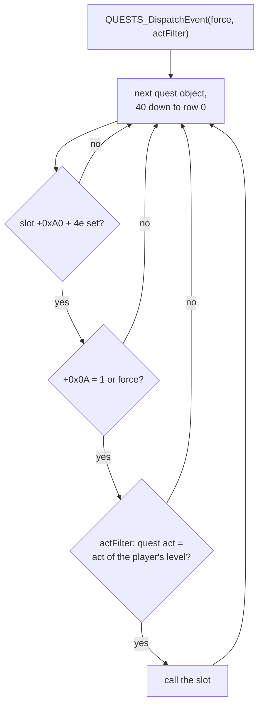

```
B2. QUESTS_DispatchEvent(block, force: bool, actFilter: bool):      [C] (fn:QUESTS_DispatchEvent@0x005438E0, run:2026-10-17-quests)
      for quest in the object list (40 down to row 0):
        slot ← quest.callbacks[block.event]
        if slot = none: continue
        if not force and quest.+0x0A ≠ 1: continue
        if actFilter and quest.act ≠ act of the player's level: continue
        call slot(block)                                             ; each call guarded by IsBadCodePtr
B3. QUESTS_DispatchUnitEvent(block, force): the same over the unit's hook list (+0x74, head-inserted)   [I] (fn:QUESTS_DispatchUnitEvent@0x005439A0)
```

Step notes:

- B2. [C] The order, the slot test, the act filter and "a forced event runs a quest whatever its `+0x0A`" held in 503
  dispatches (e0 103, e2 101, e3 235, e11 64; the act filter on in 268) with 8203 callbacks; every raiser of e0, e2, e3
  and e11 pushes force 1 (4631 callbacks of switched-off quests ran). The unforced half (a `+0x0A` = 0 quest skipped by
  e4, e5 and e8 outside the forced list) was not logged and stays `[I]`. (fn:QUESTS_DispatchEvent@0x005438E0
  0x00543934–0x0054393E, 0x00543D2A, 0x00543D5C, 0x00543BA2, 0x005443FA, run:2026-10-17-quests)
- B2. [I] e10 (0x00543C96) and the re-dispatched e0 (0x005457BF) also push force 1; e4 and e5 push force 0 (0x00543D8A).
  (fn:QUESTS_DispatchEvent@0x005438E0)
- B4. [I] **Forced deaths.** `QUESTS_MonsterDeathEvent` forces the dispatch when the dead monster is a superunique whose
  row's `+0x08` index is 26, 27, 29, 36–39, 42–45 or 60, or its class is 242, 243, 391 or 544; other hooked deaths reach
  only quests with `+0x0A` = 1. A pet or hireling killer is first resolved to its owner (`0x0058F090`), and in a game of
  type 3 with no killer the event takes a client's player. (fn:QUESTS_MonsterDeathEvent@0x00543A30 0x00543A5D–0x00543B4B,
  fn:sub_0058F090_MonsterOwnerRef@0x0058F090)
- B5. [I] **Hooks.** `QUESTS_HookMonster(questId, unit)` adds the quest to the unit's list (for quest 4 with object class
  61, quest 8 with monster 229 and quest 12 with 250 it first records the unit); `QUESTS_LevelHookMonster` hooks every
  monster of a room to the quest named by its level's Levels `+0x30` byte; item hooks are made by the script that creates
  the item. (fn:QUESTS_HookMonster@0x005436B0, fn:QUESTS_LevelHookMonster@0x00545CD0)
- B6. [I] Events 1, 6, 7 and 12 have no live raiser (the wrappers `0x00543CE0` and `0x00543DE0` have no caller or
  pointer), so the `+0xB8` handlers of words 3 and 4 are dead. Object operates reach quest code through
  `g_ObjOperateFns` and timed object event 7 through `QUESTS_ObjectEvent` ([items/quest-drops § D](../items/quest-drops.md#d-special-drops)).
  (data:g_ObjOperateFns@0x00732D18, fn:QUESTS_ObjectEvent@0x005449E0)

### C. The join and the game creator's history

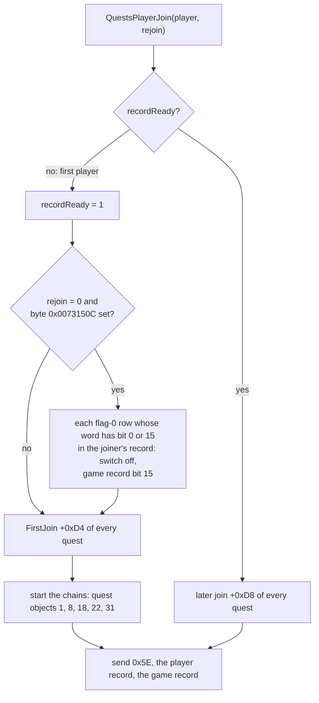

```
C1. QuestsPlayerJoin(game, player, rejoin: u32):                    [C] (fn:sub_00546270_QuestsPlayerJoin@0x00546270, run:2026-10-17-quests, run:2026-10-18-quests2)
      if control.recordReady = 0:                                    ; the game's first player
        control.recordReady ← 1
        if rejoin = 0 and byte 0x0073150C ≠ 0:                       ; 1 in the image; its one writer has no caller
          for each descriptor in table order with flag +0x0C = 0:
            w ← its descriptor word
            if bit 0 or bit 15 of the player's word w:
              QUESTS_Deactivate(its quest)                           ; +0x09 = +0x0A = +0x0B = 0
              GameQuestSet(w, 15)
        for each quest: call +0xD4(player)                           ; FirstJoin
        start the chains: +0xF0 of quest objects 1, 8, 18, 22, 31     ; fatal if one is missing
      else:
        for each quest: call +0xD8(player)                           ; later join
      send 0x5E (+0x09 of every main-table quest), the player record, the game record
      if quest 1 exists and 0x00590810(): send 0x89
```

Step notes:

- C1. [C] **The creator's finished quests are switched off for the game.** In 11 first joins with `rejoin` 0 and the byte
  set, every flag-0 row whose word had bit 0 or 15 in the joiner's record was switched off and its game-record word got bit
  15, in descriptor order: 176 quests (26 for a creator with every quest done, 0 for fresh creators); run 2 switched off 464
  more the same way. Later players' records never feed this pass. (fn:sub_00546270_QuestsPlayerJoin@0x00546270
  0x005462C0–0x0054634A, run:2026-10-17-quests, run:2026-10-18-quests2)
- C1. [I] The branches with the byte clear or a rejoin were not met with a deactivation pass. (fn:sub_00546270_QuestsPlayerJoin@0x00546270)
- C2. [C] **What "switched off" means.** The forced events (e0, e2, e3, e10, e11, the forced deaths) still reach a
  switched-off quest's handlers; only the item hooks and unforced deaths skip it. Whether a handler then writes depends on
  its own tests. Quest 11's NPC-331 message handler tests only the NPC class and the message and writes word 12 bit 8 with
  the quest off (44 writes, one per talk), and the NPC-talk reward handlers test the word's own bits, not `+0x09`, and write
  the same with the quest off (every reward talk of run 2 ran so). `[C]` for the handlers and branches the runs reached;
  per handler `[I]` for the rest. (fn:sub_0059AF50_A2Q4_NpcMessage@0x0059AF50 0x0059AF84–0x0059AFC3, 0x0058FE6D,
  run:2026-10-17-quests, run:2026-10-18-quests2)
- C3. [C] **`rejoin` means "made just now".** It is 1 at the two new-character builders and 0 at the two save readers; a
  character made from a header stub joins twice: first from `NewCharFromStub` with `rejoin` 1 and `recordReady` 0, then
  from the save reader with `rejoin` 0 and `recordReady` 1, so neither call runs the deactivation pass and the second runs
  the later-join callbacks. (fn:sub_00569F80_NewCharFromStub@0x00569F80 0x0056A072, fn:sub_005344B0_PlayerLoadFromFile@0x005344B0
  0x005344EF, run:2026-10-18-quests2)
- C3. [I] The version < 92 reader joins twice the same way; `PlayerLoad`'s own no-save branch joins once.
  (fn:sub_00532590_NewCharLegacy@0x00532590, fn:sub_005345A0_PlayerLoad@0x005345A0 0x00534607)
- C4. [I] The FirstJoin callbacks restore each quest's log state from the creator's step bits (bit 4 → `+0x0B` = 2,
  `+0x0C` = 3; bit 3 → 1/3; bit 2 → 1/2) when the creator has neither bit 0 nor 15, and several write bits (per quest
  below). (fn:sub_00546270_QuestsPlayerJoin@0x00546270)

### D. Shared shapes of the quest scripts

Each quest has its own copy of these helpers; the per-quest tables below name them by their effect.

- D1. [I] **StepBits** (per player, when bits 0 and 1 are clear): set the step bit chosen by the quest's log state
  (state 2 → bit 2; state 3 → bit 3 or 4 by `+0x0B`; …). Steps gate nothing outside the quest's own log code.
  (fn:sub_0058FC90_A1Q1_StepBits@0x0058FC90)
- D2. [I] **Near credit**: every player whose room is the event's room or in that room's near list
  (`DUNGEON_GetNearRooms`), with the quest's bits clear, gets the credit bits. **Level credit**: every player in a named
  level. (fn:sub_00590C40_A1Q2_CreditNearBoss@0x00590C40)
- D3. [I] **PartyCredit**: for a credited player in a party, each member whose bits 0 and 1 are clear **and whose current
  level is in the quest's act** (`DRLG_ActFromLevelId`) gets the same bits. (fn:sub_00540510_PartyForEach@0x00540510,
  fn:DRLG_ActFromLevelId@0x006427F0, fn:sub_00598D40_A2Q1_PartyCredit@0x00598D40)
- D4. [I] **FailOthers**: every other player whose bits 0 and 1 are clear gets bit 14 and a message (`QUESTS_SendFailMsg`).
  (fn:sub_00590080_A1Q1_FailOthers@0x00590080, fn:QUESTS_SendFailMsg@0x00545920)
- D5. [I] **ChainNext** (`+0xF0`): if the quest is active and below its last log state, start it (`+0x0C` ← 1) and
  return 1; else call `+0xF0` of the quest whose id it holds (`+0x10`). The join starts one chain per act (§ C), so each
  act's next quest is offered when the previous one finishes. (fn:sub_00593D70_A1Q4_ChainNext@0x00593D70)
- D6. [I] **The NPC gate** (`+0xEC`): when a talk starts with an NPC whose MonStats `+0x0D` bit 1 is set,
  `QUESTS_NpcHasQuest` asks `+0xEC` of each quest of the player's act whether it has something for that NPC class; the
  first yes sends the "quest available" mark. Presentation. (fn:QUESTS_NpcHasQuest@0x00544590)
- D7. [I] **Reward pattern** (most quests): a completing event sets bits 13 and 1 (or 13 and 0 when there is no reward
  talk), and the reward message, with bit 1 set, sets bit 0, clears bit 1 and calls `ClearSteps`.
  (fn:QUESTS_ListSetPending@0x005455F0, fn:QUESTRECORD_ClearSteps@0x0065C3E0)

### E. Timers

```
E1. QUESTS_TimerAdd(fn, quest, period: u32):                        [C] for the append (fn:QUESTS_TimerAdd@0x00543F10 0x00543F78–0x00543F80, run:2026-10-19-quests3)
      append {fn, quest, due ← control.tick + period, period}; adding while the list runs is fatal   ; the fatal case: read, not run
E2. QUESTS_TimersRun, when frame mod 20 = 0:                        [C] for one-shot timers (fn:QUESTS_TimersRun@0x00543E10 0x00543E62–0x00543ED1, fn:sub_0052D870_GameTick@0x0052D870 0x0052D912–0x0052D920, run:2026-10-19-quests3)
      control.tick ← control.tick + 1
      for each timer: if due < control.tick:
        if fn(quest) = 1: remove the timer
        else: due ← control.tick + period                            ; not reached: E4
      when control.tick reaches 0xFFFFFFFF: every due ← −1 − due      ; not reached: E4
```

- E3. [C] A timer first runs at `control.tick = due + 1`, on a frame with `frame mod 20 = 0`, so *p* + 1 boundaries after
  the last 20-frame boundary before it was added; a run returning 1 is not repeated. Seven timer runs in four games (the
  eclipse timer three times, the Dark Wanderer's four) held this. (run:2026-10-19-quests3; fn:QUESTS_TimersRun@0x00543E10)
- E4. [I] A timer whose run returns 0 runs again every *p* + 1 boundaries (20·(*p* + 1) frames), and the tick wrap
  rewrites every `due`; the two quest timers reached are one-shots, so neither branch ran. (fn:QUESTS_TimersRun@0x00543E10)

### F. NPC interaction, server side

- F1. [I] A talk raises e0 at the start (after the hireling list and the store), e11 for each message the client reports,
  and e2 at the end. Quest state changes in e11 handlers keyed by `{NPC class, message id}`; each checks the NPC class, the
  player's bits and often a held item. The client picks which message to report from the quest-message index the server
  sent at e0 (`QUESTS_SetNpcMessage`); no dialogue text is involved. (fn:QUESTS_RaiseNpcMessage@0x005443B0,
  fn:QUESTS_SetNpcMessage@0x00543790)
- F2. [C] Each NPC-talk step of the per-quest tables tagged confirmed fired at its call site from the logged NPC class, message
  and word, and wrote nothing when its condition was off: 41 talk steps over 20 rows, in Normal and Hell expansion and
  classic Normal. (fn:QUESTRECORD_SetState@0x0065C360, run:2026-10-18-quests2)
- F3. [I] Item services and the Hell respec are `NPC_MenuAction` actions: imbue (word 3 bit 1), socket (word 35 bit 1),
  personalise (word 38 bit 1), the Hell respec (word 41), and the act travel ([quests/travel § E](travel.md#e-act-change-through-an-npc)).
  The services' item effects are [items/quest-drops § F](../items/quest-drops.md#f-npc-item-services-and-given-items).
  (fn:NPC_MenuAction@0x00579D60)

### G. The draws

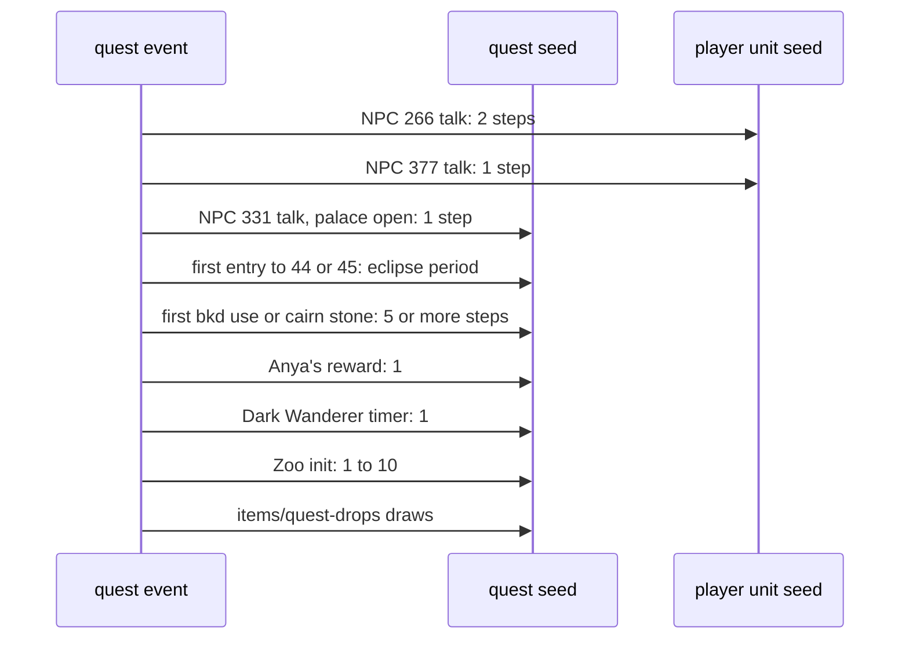

| event | draw | seed | site | Tag |
|---|---|---|---|---|
| e0 talk to NPC 266 | two runs of one handler (quest objects 25 and 30), each one draw: `Range(2)` or an inline `Step` (§ Word 29) | player unit seed | 0x00596B23, 0x00596B48 | [C] (run:2026-10-18-quests2) |
| e0 talk to NPC 377 | one draw per talk (§ Word 30) | player unit seed | 0x0059E1CE–0x0059E257 | [I] (0x0059E1CE) |
| e0 talk to NPC 331 with the palace open | one inline `Step`, message `low mod 3 + 8` | quest seed | 0x0059B229 | [C] (run:2026-10-17-quests) |
| e3 entry to level 44 or 45 with word 11's state 0 | `RandLoHi(15, 17)`: one `Step`, period `15 + (low & 1)` (15 or 16), once per game by the state (W11) | quest seed | 0x0059EDE1 | [C] for level 44 (run:2026-10-19-quests3; fn:sub_0059EDC0_A2Q3_EclipseArm@0x0059EDC0) |
| first use of `bkd ` (or first cairn-stone operate, `[I]`) | inline `Step`s, `low mod 5`, until five distinct slots are filled (W4) | quest seed | 0x00592E90 | [C] for the `bkd ` use (run:2026-10-19-quests3; fn:sub_00592E90_A1Q4_StoneOrderDraw@0x00592E90) |
| e11 Anya's reward | `Range(count[class])` (W37) | quest seed | 0x00589937 | [C] (run:2026-10-19-quests3: Normal, Nightmare, Hell) |
| the Dark Wanderer timer | one inline `Step` (W32) | quest seed | 0x005BD3E6 | [C] (run:2026-10-19-quests3; fn:sub_005BD390_A3Q7_AfterglowTimer@0x005BD390) |
| the Zoo (`InitFn` 79) | 1–10 `RandLoHi(1, nMonStats)` (W40; object 567 is placed by no stock DS1) | quest seed | 0x0058E87C | [I] (fn:sub_0058E830_A5Q6_ZooInit@0x0058E830) |
| quest chests, Wirt, Andariel, Baal, the Hellforge, the Cow King | [items/quest-drops](../items/quest-drops.md#draw-order-on-the-quest-seed) | quest seed | — | as there |
| every other quest event | none in quest code | — | — | [I] (fn:QUESTS_DispatchEvent@0x005438E0; § 11 of [quests/0001](../../findings/quests/0001-progression.md#11-which-events-draw-all-acts)) |

```
G1. The quest seed: Init(questSeed, game seed low after one Step at QUESTS_InitGame)   [C] (fn:QUESTS_InitGame@0x00545D80, run:2026-10-16-quest-drops)
G2. QuestPick(n) = Step(questSeed); return questSeed.low mod n       [C] (fn:QUESTS_GetSeed@0x005438B0, run:2026-10-16-quest-drops)
G3. RandLoHi(s, lo, hi) = lo + Range(s, hi − lo)                    [I] (fn:RNG_RandLoHi@0x004BC500)
```

Step notes:

- G1. [C] The quest seed and its start value are [items/quest-drops § A](../items/quest-drops.md#a-the-quest-record-and-the-quest-seed)'s
  (game-seed draw 4, `{low, 666}`). (fn:QUESTS_InitGame@0x00545D80, run:2026-10-16-quest-drops)
- G4. [C] The NPC 331 step chained: 44 talks, 42 chained pairs, one step per talk, each talk's exit seed the next talk's
  entry in Normal and Nightmare. (0x0059B229, run:2026-10-17-quests)
- G4a. [C] The eclipse arm, the cairn order on the `bkd ` use, the Dark Wanderer timer and Anya's reward were each
  predicted from the quest seed before it (W11, W4, W32, W37). (run:2026-10-19-quests3; quests/0001 § 11)
- G5. [I] **Chaining.** The quest seed is one object per game: its value at any draw depends on which of the drawing
  events above, and the item draws of [items/quest-drops](../items/quest-drops.md), ran before. The player-seed draws of
  NPCs 266 and 377 chain with every other user of the player's unit seed. A reimplementation asserts the quest seed on
  entry to each drawing event. (fn:QUESTS_GetSeed@0x005438B0, 0x00596B23, 0x0059E1CE)
- G6. [I] Spawns, objects, portals and items that quest events create draw on their own seeds (`SpawnAtPos` and the
  monster spawners, `SUnitCreate`'s game seed, `PortalObjectCreate`, item creation) and are oracles here.
  (fn:sub_005B2F20_SpawnAtPos@0x005B2F20, fn:sub_00555230_SUnitCreate@0x00555230, fn:sub_0056D130_PortalObjectCreate@0x0056D130)

### H. The quests

Conventions: "rec" is the event player's record for the game's difficulty; "w*q* b*s*" is bit *s* of word *q*; "G w*q*
b*s*" is the game record. "Steps" are bits 2–11 (§ D1); "near", "party", "fail others" and the reward pattern are § D.
NPC, monster and object numbers are `monstats`, `objects` and `levels` rows; the names in brackets are table row names,
labels only. A row tagged confirmed holds for the branch the run reached (the condition shown); every other row is read from
the code, and every write site was checked at the pushed constants of its call (fn:QUESTRECORD_SetState@0x0065C360).

Each state diagram shows the record bits of the event player's word; the log state bytes and private flags are left out
unless they gate a bit.

#### Act I

##### Word 0: Warriv's introduction (quest object 0)

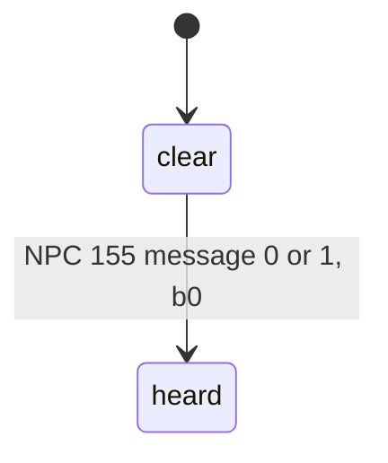

| bit | set/clear | trigger and condition | site | Tag |
|---|---|---|---|---|
| b0 | set | e11 NPC 155 (`warriv1`), message 0 | 0x0058FAC1 | [C] (run:2026-10-18-quests2: x-talk1, h-talk1, c-talk1) |
| b0 | set | e11 NPC 155, message 1 | 0x0058FAC1 | [I] (fn:sub_0058FA90_A1Q0_NpcMessage@0x0058FA90) |

- [I] Word 0 bit 0 gates only NPC 155's quest message (e0 and the NPC gate). It is no act-travel gate: `NpcActTravel`
  tests word 7. (fn:sub_0058FB50_A1Q0_NpcGate@0x0058FB50, fn:sub_005467E0_NpcActTravel@0x005467E0)

##### Word 1: the level-8 monster region, and the Hell respec offer (quest object 1)

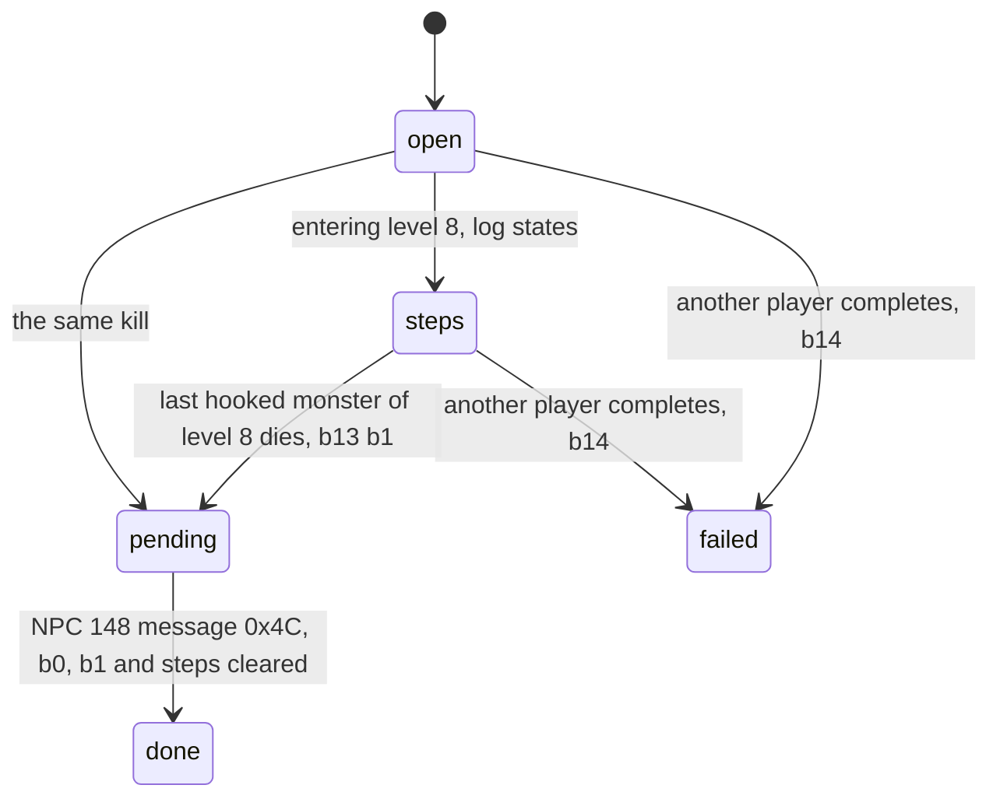

| bit | set/clear | trigger and condition | site | Tag |
|---|---|---|---|---|
| b13, b1 | set | e8: the level-8 monster region has every monster dead (`+0x2D0` = `+0x2CC`) and every room counted (`0x0061ABF0(act, 8)` ≤ region `+0x04`); each player of the quest's private list (players who killed a hooked monster) with b0, b1 clear | 0x00590387 | [I] (fn:sub_00590260_A1Q1_MonsterDeath@0x00590260, fn:sub_00547BB0_MonRegionGet@0x00547BB0) |
| b13, b1 | set | the same kill: party members in Act I | 0x00590175, 0x0059017F | [I] (fn:sub_00590120_A1Q1_PartyCreditMember@0x00590120) |
| b14 | set | the same kill: fail others | 0x005900B8 | [I] (fn:sub_00590080_A1Q1_FailOthers@0x00590080) |
| G b13 | set | the same kill | 0x00590375 | [I] (fn:sub_00590260_A1Q1_MonsterDeath@0x00590260) |
| b0; b1 clear; steps clear | set / clear | e11 NPC 148 (`akara`) message 0x4C with b1 set | 0x0058FF11, 0x0058FF20, 0x0058FF4B | [C] (run:2026-10-18-quests2: x-talk1, h-talk1, c-talk1) |
| w41 b13, w41 b1 | set | the same message (word `+0xE4` = 41): the respec offer | 0x0058FF2F, 0x0058FF3E | [C] (run:2026-10-18-quests2: in the saved words) |
| b2, b3, b4 | set | StepBits by log state (2; 3; 4 when `+0x0B` ≠ 1) | 0x0058FCDD, 0x0058FCF9, 0x0058FD0A | [I] (fn:sub_0058FC90_A1Q1_StepBits@0x0058FC90) |

- [I] The reward also adds 1 to stat 5 of the player (`UnitAddStat(player, 5, 1, 0)` at 0x0058FF5A). The kill registers
  timer `0x00590230` (period 8) once, a log-state change only. No draw. (fn:sub_0058FDD0_A1Q1_NpcMessage@0x0058FDD0,
  fn:sub_006272B0_UnitAddStat@0x006272B0, fn:sub_00590230_A1Q1_DoneTimer@0x00590230)

##### Word 41: the Hell respec (no quest object writes it)

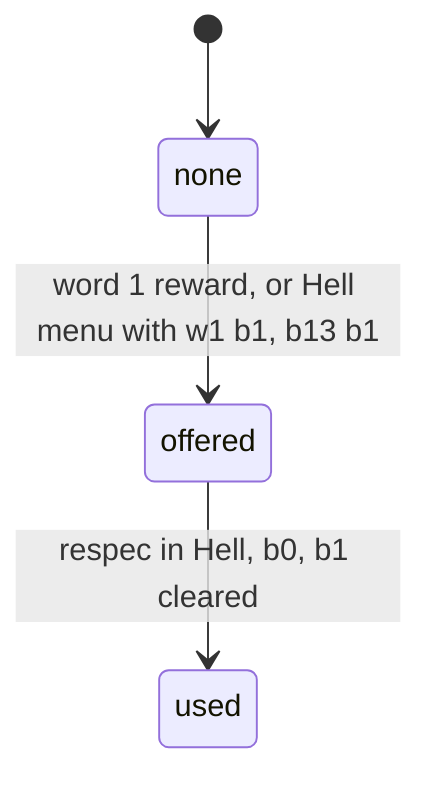

| bit | set/clear | trigger and condition | site | Tag |
|---|---|---|---|---|
| b13, b1 | set | word 1's reward (above) | 0x0058FF2F, 0x0058FF3E | [C] (run:2026-10-18-quests2) |
| b13, b1 | set | `NPC_MenuAction` in Hell (`game+0x6D` = 2): w1 b1 set and w41 b0, b1 clear | 0x0057A21E (`0x0058FD20`) | [I] (fn:sub_0058FD20_A1Q1_RespecOffer@0x0058FD20) |
| b0; b1 clear | set / clear | `NPC_MenuAction` in Hell with w41 b1 set: the respec runs (`0x00570360`, `0x00570C80`), then this write; if b15 is clear, quest object 30's `+0x0A` ← 0 | `0x0058FD50` | [I] (fn:sub_0058FD50_A1Q1_RespecDone@0x0058FD50, fn:NPC_MenuAction@0x00579D60 0x0057A1D0–0x0057A266) |

##### Word 2: the hooked Act I boss and the free hireling (quest object 2)

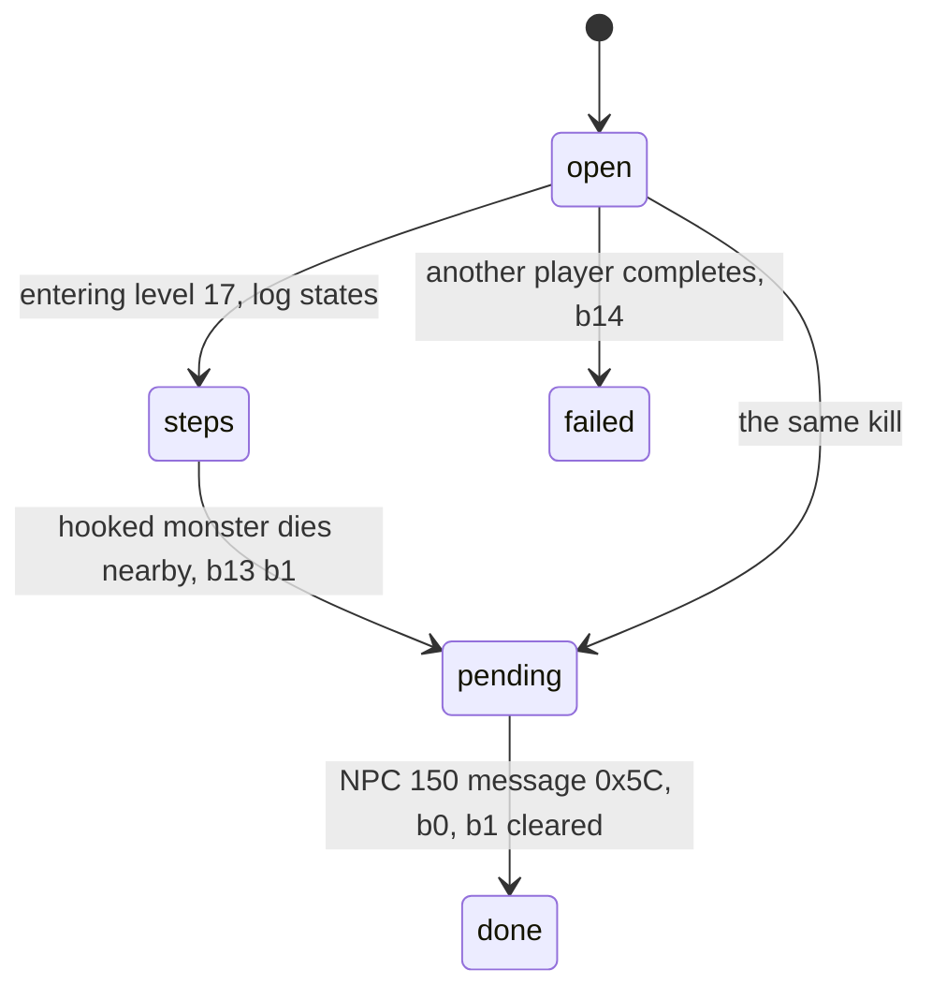

| bit | set/clear | trigger and condition | site | Tag |
|---|---|---|---|---|
| b13, b1 | set | e8 hooked monster: near credit (the dead monster's room or its near list), b0, b1 clear | 0x00590D3C, 0x00590D46 | [I] (fn:sub_00590C40_A1Q2_CreditNearBoss@0x00590C40) |
| b13, b1 | set | party members in Act I | 0x00590DB5, 0x00590DBF | [I] (fn:sub_00590D60_A1Q2_PartyCreditMember@0x00590D60) |
| b14 | set | fail others | 0x00590E07 | [I] (fn:sub_00590DD0_A1Q2_FailOthers@0x00590DD0) |
| G b13 | set | e8 | 0x00590F8F | [I] (fn:sub_00590EC0_A1Q2_MonsterDeath@0x00590EC0) |
| b0; b1 clear | set / clear | e11 NPC 150 (`kashya`) message 0x5C with b1 set; then `HIRE_GiveFreeMerc(150)` (game seed: oracle); no `ClearSteps` | 0x00590AB3, 0x00590AC2 | [C] (run:2026-10-18-quests2: x-talk1, h-talk1, c-talk1) |
| b2, b3, b4 | set | StepBits | 0x005908DD, 0x005908F9, 0x0059090A | [I] (fn:sub_00590890_A1Q2_StepBits@0x00590890) |

- [I] The death registers timer `0x00590BF0` (period 15). No draw in the quest. (fn:sub_00590EC0_A1Q2_MonsterDeath@0x00590EC0,
  fn:HIRE_GiveFreeMerc@0x00579180)

##### Word 3: the Malus and the imbue (quest object 3)

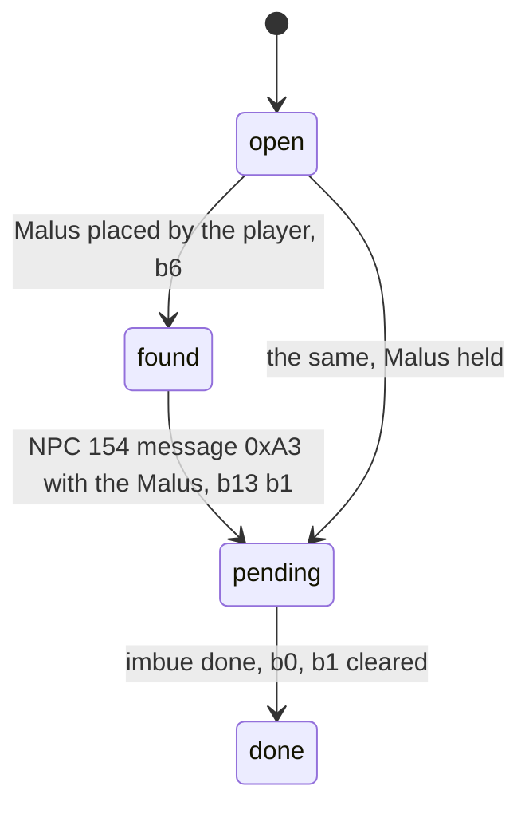

| bit | set/clear | trigger and condition | site | Tag |
|---|---|---|---|---|
| b6 | set | e4 on the hooked `hdm ` (Malus), first time | 0x0059198D | [I] (fn:sub_00591960_A1Q3_MalusPickup@0x00591960) |
| b13, b1 | set | e11 NPC 154 (`charsi`) message 0xA3, b0 clear, the player holds `hdm ` (then removed) | 0x00591532, 0x0059153F | [I] (fn:sub_00591490_A1Q3_NpcMessage@0x00591490, fn:sub_00558110_PlayerFindItemByCode@0x00558110) |
| b13, b1 | set | party members in Act I | 0x00591476, 0x00591480 | [I] (fn:sub_00591430_A1Q3_PartyCreditMember@0x00591430) |
| G b13 | set | the same message when the log state `+0x0C` = 4 | 0x005915B9 | [I] (fn:sub_00591490_A1Q3_NpcMessage@0x00591490) |
| b0; b1 clear | set / clear | `NPC_MenuAction` imbue done ([items/quest-drops § F](../items/quest-drops.md#f-npc-item-services-and-given-items)); if b15 is clear, quest object 3's `+0x0A` ← 0 | 0x005917A7, 0x005917B1 | [I] (fn:sub_00591790_A1Q3_ImbueDone@0x00591790) |
| b2, b3 | set | StepBits | 0x0059138C, 0x005913A5 | [I] (fn:sub_00591340_A1Q3_StepBits@0x00591340) |

- [I] The talk offers the hand-in (message 3) only at clvl (stat 12) > 7 with the Malus held and b0 clear; the e11
  handler tests only the Malus and b0, so the level gate is the dialogue the client is given. (fn:sub_005916A0_A1Q3_NpcTalk@0x005916A0)

##### Word 4: Cain, the cairn stones, Tristram and the Cow King (quest object 4)

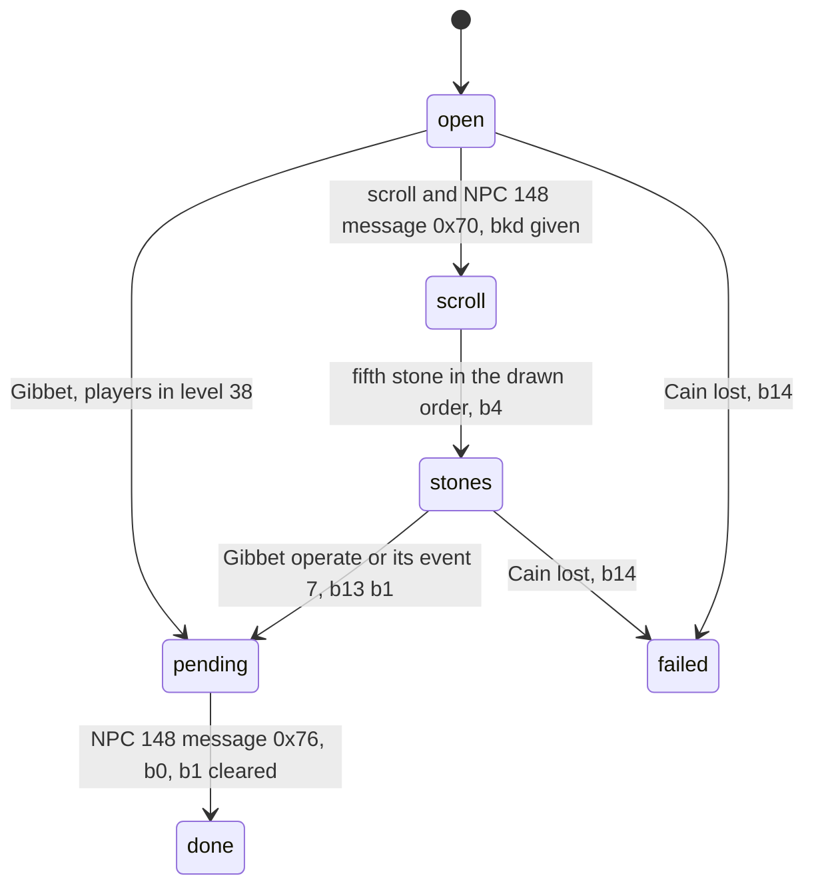

| bit | set/clear | trigger and condition | site | Tag |
|---|---|---|---|---|
| b4 | set | operate of the fifth cairn stone in the drawn order (W4 below) while holding `bkd `, only if `+0x0B` < 4; also party members in Act I with b0, b1 clear | 0x00593A92, 0x00593705 | [I] (fn:sub_00593710_A1Q4_StoneOperate@0x00593710) |
| b13, b1 | set | `Gibbet` operate (object 26, `OperateFn` 10) by a player with b0, b1 clear; party members in Act I | 0x00593587, 0x00593591 | [I] (fn:sub_00593480_A1Q4_GibbetOperate@0x00593480) |
| b13, b1 | set | the Gibbet's object event 7 (frame + 17): every player in level 38 with b0, b1 clear, and their Act I party | 0x0059317D, 0x00593187 | [I] (fn:sub_00593130_A1Q4_CreditTristram@0x00593130) |
| b14 | set | the same event: fail others | 0x005931F7 | [I] (fn:sub_005931C0_A1Q4_FailOthers@0x005931C0) |
| b14, G b13 | set | Cain lost, the `TownLevelLeave` path: the first arrival in level 40 from Act I with word 4 = 0 runs `0x00597310` from `TownLevelLeave` inside `PlayerChangeLevel`: G w4 b13, then b14 for the player (one client; the pass over every player with b0, b1 clear is read from the code); the e3 level-40 branch then finds state 7 and writes nothing, and later arrivals in 40 write nothing | 0x005973D2, 0x00592B46 | [C] (run:2026-10-19-quests3: x-entry, x-entry2, h-entry, and c-wp in the part 1 re-check; fn:sub_00597310_A1Q4_FailOnActLeave@0x00597310, 0x0053743D) |
| b14, G b13 | set | Cain lost, the other paths: e3 entry to level 40 by a player with b0, b1 clear while Cain is not rescued (`+0x50` = 0, `+0x0C` < 6), and `0x00597310` from the Warriv travel branch | 0x00592B46, 0x00597005 | [I] (fn:sub_00592B10_A1Q4_FailPlayer@0x00592B10, fn:sub_005467E0_NpcActTravel@0x005467E0 0x00546A35, 0x00546AA9) |
| b0; b1 clear | set / clear | e11 NPC 148 message 0x76 with b1 set; the ring reward (oracle) | 0x005923AC, 0x005923B6 | [C] (run:2026-10-18-quests2: x-talk1, h-talk1, c-talk1) |
| G b13 | set | the same message: if G w4 b13 was clear (then `+0xF0`), and if the creator had b15 | 0x00592483, 0x005924D8 | [I] (fn:sub_00592250_A1Q4_NpcMessage@0x00592250) |
| G b13 | set | FirstJoin when the creator has b0 | 0x00597081 | [I] (fn:sub_00597030_A1Q4_FirstJoin@0x00597030) |
| b10 | set | the Cow King's death: the killer has b10 clear **and** w26 b0 (classic, `game+0x70` = 0) or w40 b0 (expansion) | 0x00593EF6 | [I] (fn:sub_00593E70_A1Q4_CowKingDeath@0x00593E70) |
| b10 | set | the same death: every player then in level 39 | 0x00593E5E | [I] (fn:sub_00593E30_A1Q4_CowLevelCredit@0x00593E30) |
| G b11 | set | the cow portal opened ([items/cube](../items/cube.md)) | 0x0059423A | [I] (fn:CUBE_CowPortalOpen@0x00594140) |
| b2, b3 | set | StepBits | 0x0059217C, 0x00592195 | [I] (fn:sub_00592130_A1Q4_StepBits@0x00592130) |

```
W4. StoneOrderDraw (first use of the decoded scroll `bkd `, or first stone operate; once per game, private +0x4A):
                                                                    [C] for the `bkd ` use (fn:sub_00592E90_A1Q4_StoneOrderDraw@0x00592E90 0x00592E90–0x00592F61, run:2026-10-19-quests3)
      QUESTS_GetSeed once (0x00592EE1)
      order[0 ..< 5] ← empty;  next: i32 ← 17                        ; stone classes 17–21
      while some slot is empty:
        Step(questSeed)                                              ; draw (inline LCG)
        i: u32 ← questSeed.low mod 5
        if order[i] is empty: order[i] ← next;  next ← next + 1
      ; then each operated stone whose class = order[k] advances k; the fifth: dummy 61 to mode 6,
      ; bkd removed, 0x0056EDE0(0, 1, 0x120, x + 6, y − 3) at stone 21, its room pinned
```

- W4. [C] The draw count is at least 5 and variable (draws that hit a filled slot are spent); the slot drawn takes the
  next class of 17…21, so the classes go in fill order. In three first uses of `bkd ` the logged order and the quest seed
  after it were predicted from the seed before (28 steps in all: 15, 6, 7), and a second use (private `+0x4A` set) drew
  nothing and left the order. (run:2026-10-19-quests3: x-entry, x-entry2, h-entry; 0x00592E90–0x00592F61)
- W4a. [C] The trigger reached is the item use: the client's use of `bkd ` reaches `0x00544840` (from the packet code at
  0x0054C060, after the player-near test), which looks the item up by id and dispatches on its code; `bkd ` →
  `0x00593CB0`, which draws the order (W4) and sends packet `0x50` with it. (run:2026-10-19-quests3;
  fn:sub_00544840_QuestsItemUseCode@0x00544840, fn:sub_00593CB0_A1Q4_SendStoneOrder@0x00593CB0 0x00593CD5–0x00593CE1)
- W4b. [I] The first stone operate draws the order the same way (not reached), and `0x00544840`'s `trs ` branch
  calls `0x0059D6A0` (not run). (fn:sub_00593710_A1Q4_StoneOperate@0x00593710, fn:sub_00544840_QuestsItemUseCode@0x00544840)
- [I] **Items.** Message 0x70 with `bks ` held removes it and gives `bkd ` (`QUESTS_GiveItem(bkd, 0, 2, 1)`); message 0x76
  gives the ring of [items/quest-drops § F](../items/quest-drops.md#f-npc-item-services-and-given-items); the Inifuss
  tree drops `bks `; Wirt's gold draws `RandLoHi(questSeed, 10, 20)`. (fn:sub_00592250_A1Q4_NpcMessage@0x00592250,
  fn:sub_00594630_A1Q4_WirtGold@0x00594630)
- [I] **Tristram in a later game.** The stones' init (object class 17) registers timer `0x00592D50` (period 1) once when
  quest 4 is switched off (the creator had it done) or its private `+0x4C` is set; the timer creates
  `PortalObjectCreate(room, x + 4, y + 4, dest 38, 0, class 60, noSearch 1)` at stone 17. (fn:sub_005935E0_A1Q4_StoneInit@0x005935E0
  0x00593646–0x00593677, fn:sub_00592D50_A1Q4_TristramPortalTimer@0x00592D50)
- [I] **Cain.** The Gibbet event spawns monster 146 at the gibbet (+3, +3) by `SpawnAtPos`, retried once at a free spot,
  and opens a class-59 portal to level 1 at (+6, +6) if both fail; in town, the e3 entry to level 1 spawns monster 265
  near the dummy-189 position (up to 22 tries, radius 5, 10, 15). Oracles. (fn:sub_00593290_A1Q4_GibbetEvent7@0x00593290,
  fn:sub_00592960_A1Q4_CainTownSpawn@0x00592960)

##### Word 5: the Countess (quest object 5)

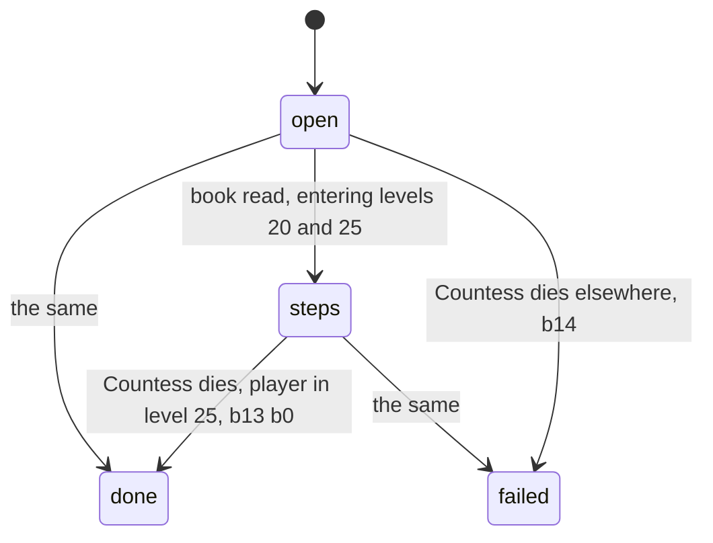

| bit | set/clear | trigger and condition | site | Tag |
|---|---|---|---|---|
| b13, b0; b1 clear | set / clear | e8 the Countess: every player in level 25 with b0 clear (done at once, no reward step) | 0x00594F52, 0x00594F5C, 0x00594F66 | [I] (fn:sub_00594F10_A1Q5_CreditAtDeath@0x00594F10) |
| b14 | set | the same death: players elsewhere; fail others | 0x00594FBA, 0x00595348 | [I] (fn:sub_00595320_A1Q5_FailOthers@0x00595320) |
| b0, b13 | set | the same death: players in level 25 with b0, b1 clear | 0x00594E54, 0x00594E5E | [I] (fn:sub_00594DD0_A1Q5_CreditInLevel@0x00594DD0) |
| b13, b0 | set | the same death: players in the private list `+0x80` with b0 clear | 0x0059547A, 0x00595483 | [I] (fn:sub_00595420_A1Q5_CreditList@0x00595420) |
| b13, b0 | set | party members in Act I | 0x005953B6, 0x005953C0 | [I] (fn:sub_00595370_A1Q5_PartyCreditMember@0x00595370) |
| G b13 | set | the same death (twice) | 0x0059578D, 0x005957C7 | [I] (fn:sub_00595710_A1Q5_CountessDeath@0x00595710) |
| b2–b6 | set | StepBits by log state | 0x005948E1–0x0059493D | [I] (fn:sub_00594890_A1Q5_StepBits@0x00594890) |

- [I] The tower book (`OperateFn` 6) puts the object in mode 1 and sends message 0x7F; `0x00595160` (bit 1) is dead code.
  The death registers timer `0x005954C0` (period 7) and spawns monster 326 at the death position and calls
  `0x0056EDE0(0, 1, 0x14C, x, y)` at each recorded chest 371 (oracles). (fn:sub_00594E70_A1Q5_BookOperate@0x00594E70,
  fn:sub_005954F0_A1Q5_DeathSpawn@0x005954F0)

##### Word 6: Andariel (quest object 6)

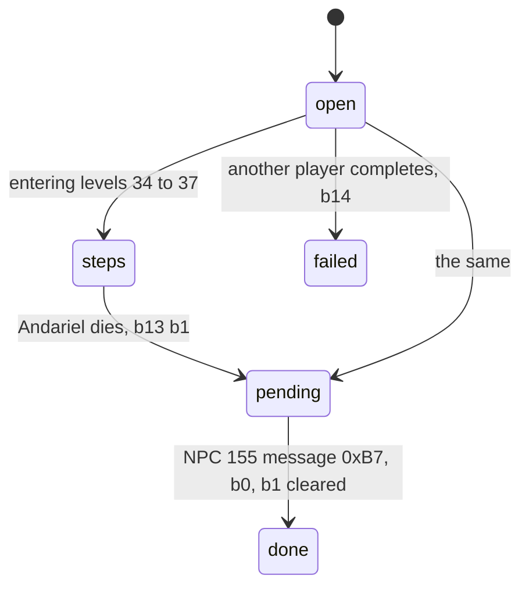

| bit | set/clear | trigger and condition | site | Tag |
|---|---|---|---|---|
| b13, b1 | set | e8 Andariel: the killer (b0, b1 clear); then every player in level 37 with b0 and b15 clear; then party members in Act I | 0x00596218, 0x00596222 | [I] (fn:sub_00596210_A1Q6_SetKilled@0x00596210, fn:sub_005965A0_A1Q6_AndarielDeath@0x005965A0) |
| b14 | set | fail others | 0x00596417 | [I] (fn:sub_005963E0_A1Q6_FailOthers@0x005963E0) |
| b1 clear; b0 | clear / set | e11 NPC 155 message 0xB7 with b1 set | 0x00595D92, 0x00595D9C | [C] (run:2026-10-18-quests2: x-talk1, h-talk1, c-talk1) |
| G b13 | set | the same message when b13 is set | 0x00595D88 | [I] (fn:sub_00595C60_A1Q6_NpcMessage@0x00595C60) |
| b2, b3, b4 | set | StepBits | 0x00595C1D, 0x00595C39, 0x00595C4A | [I] (fn:sub_00595BD0_A1Q6_StepBits@0x00595BD0) |

- [I] After the death a timer (period 1) gives each player in level 37 a class-59 portal to level 1 at his position
  (`PortalObjectCreate(room, x, y, 1, 0, 59, 0)`); the chain timer `0x00596580` has period 20. Andariel's gems draw on
  the quest seed ([items/quest-drops](../items/quest-drops.md)). (fn:sub_00596500_A1Q6_DeathTimer@0x00596500,
  fn:sub_00596490_A1Q6_PortalForPlayer@0x00596490)

##### Word 29: NPC 266's talk (quest objects 25 and 30)

No record bit is written: the two objects are dialogue selectors whose one handler draws on the player's unit seed.

```
W29. NpcTalk266(event) — the e0 handler 0x00596A90, run once for each of quest objects 25 and 30:   [C] for the draws (0x00596A90, run:2026-10-18-quests2); [I] for the branch test
       if event.npc class ≠ 266: return
       if G w1 b13 clear and this quest object is active and the player's w1 b0, b13 and b1 are clear:
         msg ← Range(player.unitSeed, 2)                              ; draw: 1 Step
       else:
         Step(player.unitSeed);  msg ← player.unitSeed.low mod 3 + 2   ; draw: 1 Step (inline)
       QUESTS_SetNpcMessage(266, msg)                                 ; presentation
```

- W29. [C] **Two draws per talk.** The dispatch runs the handler once for each object, and each run steps the player's
  unit seed once: 23 talks, 22 chained pairs (each talk's exit seed the next one's entry). (0x00596B23, 0x00596B48,
  run:2026-10-18-quests2)
- W29. [I] Which branch a run takes (the conditions above) does not change the draw count. (0x00596A90)
- [C] NPC 266 (`navi`) is in the server unit list only once the Blood Moor's border preset room near the camp
  ([drlg/preset](../drlg/preset.md) step note 1, `Def` 4–7, file index 3) is active, for the map seed met (45).
  (run:2026-10-18-quests2)

##### Word 42: the Act I introductions (quest object 37)

- [I] No record bit is written (its `+0xE0` = 42 is never passed to a setter). e0 sends NPCs 147, 148, 150, 154 and 155
  a greeting index while the player's per-NPC introduction flag is clear; e11 sets that flag (`0x00572360`, the save's
  NPC section). No draw. (fn:sub_0058F870_A1Intro_NpcMessage@0x0058F870, fn:sub_00572360_NpcIntroBitSet@0x00572360)

#### Act II

##### Word 8: Jerhyn's introduction (quest object 7)

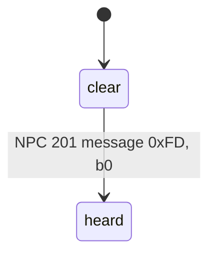

| bit | set/clear | trigger and condition | site | Tag |
|---|---|---|---|---|
| b0 | set | e11 NPC 201 (`jerhyn`) message 0xFD | 0x00598671 | [C] (run:2026-10-18-quests2: x-talk2) |
| G b13 | set | the same message; first join of a player with b0 | 0x0059867F, 0x005987FE | [I] (fn:sub_00598640_A2Q0_NpcMessage@0x00598640, fn:sub_005987D0_A2Q0_FirstJoin@0x005987D0) |

- [I] G w8 b13 is read by Jerhyn's placement (word 12). NPC 244's e0 reacts to w4 b14 (Cain lost in Act I).
  (fn:sub_005986B0_A2Q0_NpcTalk@0x005986B0, fn:sub_0059F380_A2Q4_JerhynSpawn@0x0059F380)

##### Word 9: Radament and the Book of Skill (quest object 8)

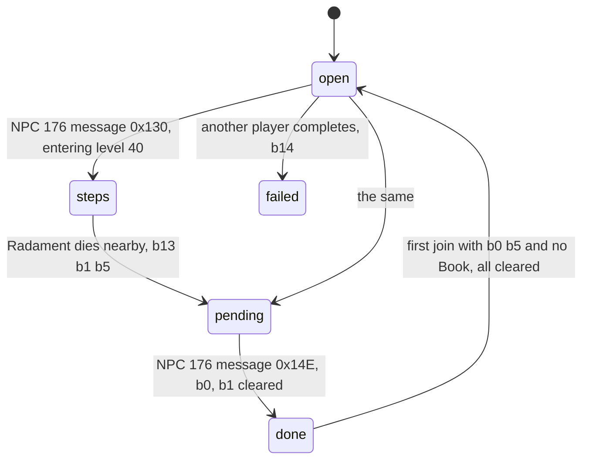

| bit | set/clear | trigger and condition | site | Tag |
|---|---|---|---|---|
| b2, b3, b4 | set | per player with b0, b1 clear, by log state (2; 3 with `+0x0B` = 1; 3 otherwise) | 0x00598A2D, 0x00598A49, 0x00598A5A | [I] (0x005989E0) |
| b13, b1, b5 | set | e8 Radament: near credit, b0, b1 clear; party members in Act II | 0x00598D96, 0x00598DA0, 0x00598DAA | [I] (fn:sub_00598E20_A2Q1_NearCredit@0x00598E20, fn:sub_00598D40_A2Q1_PartyCredit@0x00598D40) |
| b14 | set | e8: every other player with b0, b1 clear | 0x00598DF7 | [I] (0x00598DC0) |
| b0; b1 clear | set / clear | e11 NPC 176 (`atma`) message 0x14E with b1 set | 0x00598BFE, 0x00598C0D | [C] (run:2026-10-18-quests2: x-talk2) |
| b0, b1, b15, b5 | clear | e13: the first joiner has b0 and b5 and holds no `ass ` | 0x0059927F–0x0059929D | [I] (fn:sub_00599230_A2Q1_FirstJoin@0x00599230) |
| b5 | clear | the player uses the item `ass ` (Book of Skill): the item-use code tests the code, removes the book and clears b5 when set | 0x0055E3FB | [C] for the branch reached, b5 set (run:2026-10-19-quests3: x-book; 0x0055E3D0–0x0055E3FB) |
| G b13 | set | Radament's death; message 0x14E while the quest is off; first joiner with b0 | 0x0059906E, 0x00598BB1, 0x005992AC | [I] (fn:sub_00599020_A2Q1_RadamentDeath@0x00599020) |

- [I] So a creator who saved with the Book unread **loses the quest** at his next first join and can redo it. Radament's
  death drops one `ass ` per player with b5 and no Book (the drop is [items/quest-drops § E](../items/quest-drops.md#e-quest-items));
  timer `0x00598F70` (period 12). No draw. (fn:sub_00599230_A2Q1_FirstJoin@0x00599230, fn:sub_00598F70_A2Q1_Timer@0x00598F70)

##### Word 10: the Horadric Staff (quest object 9)

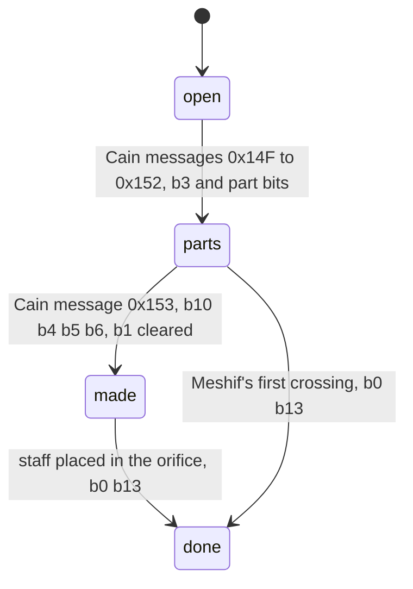

| bit | set/clear | trigger and condition | site | Tag |
|---|---|---|---|---|
| b3 | set | e11 NPC 244 (`cain2`) messages 0x14F–0x153 (0x14F removes `tr1 `) | 0x00599857, 0x00599876, 0x00599899 | [I] (fn:sub_005997F0_A2Q2_NpcMessage@0x005997F0) |
| b4, b5, b6 | set | e11 messages 0x150–0x152 (`SetState(10, msg − 0x14C)`); 0x153 sets all three | 0x0059986C, 0x005998C6 | [I] (fn:sub_005997F0_A2Q2_NpcMessage@0x005997F0) |
| b10; b1 clear | set / clear | e11 message 0x153 | 0x005998BC, 0x0059988F | [I] (fn:sub_005997F0_A2Q2_NpcMessage@0x005997F0) |
| b4 / b5 / b6 | clear | e5: `vip ` / `msf ` / `box ` dropped on the ground; e13: the part not held (b0 clear, quest active, no `hst `) | 0x00599B7D, 0x00599BC6, 0x00599BA1; 0x0059E935, 0x0059E945, 0x0059E955 | [I] (fn:sub_00599B30_A2Q2_ItemToGround@0x00599B30, fn:sub_0059E850_A2Q2_FirstJoin@0x0059E850) |
| b11 | set | the cube makes `hst ` | 0x0059E614 | [I] (fn:sub_0059E5C0_QuestStaffMade@0x0059E5C0) |
| b0, b13 | set | the staff placed in the orifice: the placer | 0x0059DD9C, 0x0059DDB4 | [I] (fn:sub_0059DD80_A2Q6_StaffPlaced@0x0059DD80) |
| b0, b13 | set | party members in Act II with b0 clear; removes `hst `, `vip `, `msf ` unless `0x005678A0(1)` | 0x0059DC13, 0x0059DC1D | [I] (fn:sub_0059DBD0_A2Q6_StaffPartyCredit@0x0059DBD0) |
| b0, b13 | set | `NpcActTravel`, NPC 210, the first crossing (w15 b0 clear) with w10 b0 clear; removes `msf `, `vip ` (not `hst `) | 0x005468FB, 0x00546905 | [I] (fn:sub_005467E0_NpcActTravel@0x005467E0) |
| b9 | clear | word 14's e13 and e14 (every join); no constant setter found | 0x0059D50D, 0x0059D4E9 | [I] (fn:sub_0059D4F0_A2Q6_FirstJoin@0x0059D4F0) |

- [I] The three quest chests (`OperateFn` 39–41, objects 354–356) take one quest-seed step each for their gold count
  ([items/quest-drops](../items/quest-drops.md)); no record write. (fn:sub_00599C10_A2Q2_ScrollChest@0x00599C10)

##### Word 11: the altar and the eclipse (quest object 10)

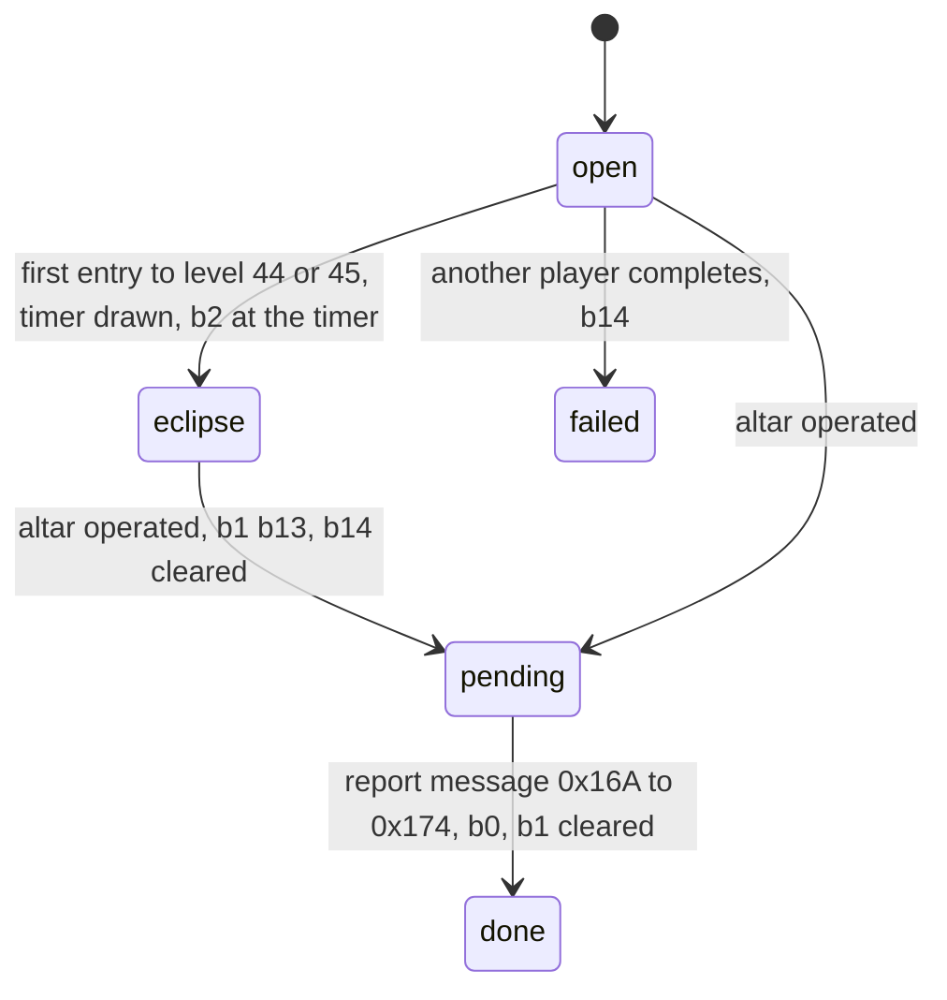

| bit | set/clear | trigger and condition | site | Tag |
|---|---|---|---|---|
| b2 | set | per player with b0, b1 clear, at quest state ≥ 1: reached from the eclipse timer at state 1, one client | 0x0059A53D | [C] (run:2026-10-19-quests3: x-entry, x-entry2, h-entry; 0x0059A4F0, fn:sub_0059A350_A2Q3_EclipseOn@0x0059A350) |
| b3, b4 | set | the same pass at quest state = 2, = 3 | 0x0059A54E, 0x0059A563 | [I] (0x0059A4F0) |
| b1, b13; b14 clear | set / clear | altar operate (`OperateFn` 24, object 149), the operator with b0 clear | 0x0059AAA3, 0x0059AAAD, 0x0059AAB7 | [I] (fn:sub_0059A7E0_A2Q3_ViperChest@0x0059A7E0) |
| b13, b1 | set | the same: every player in the altar's level with b0, b15 clear; party | 0x0059A6E5, 0x0059A6EF | [I] (fn:sub_0059A680_A2Q3_LevelCredit@0x0059A680) |
| b14 | set | other players with b0, b1 clear | 0x0059A017 | [I] (0x00599FE0) |
| b0; b1 clear | set / clear | e11 report (messages 0x16A–0x174, any NPC) with b1 set | 0x0059ED3D, 0x0059ED47 | [I] (fn:sub_0059EBE0_A2Q3_NpcMessage@0x0059EBE0) |
| G b13 | set | altar; first join with b0 or b1; report | 0x0059AAFF, 0x0059A66C, 0x0059ED73 | [I] (fn:sub_0059A5D0_A2Q3_FirstJoin@0x0059A5D0) |

```
W11. EclipseArm — e3, entering level 44 or 45 while the quest is active and its state is 0:
                                                                    [C] for level 44 (fn:sub_0059EDC0_A2Q3_EclipseArm@0x0059EDC0 0x0059EDC0–0x0059EDF3, 0x0059EE26–0x0059EE32, run:2026-10-19-quests3)
       if private +0x01 ≠ 0: return                                   ; set here, cleared by the timer: guards only between the two
       private +0x01 ← 1
       Step(questSeed)                                                ; QUESTS_GetSeed, one draw
       period: u32 ← 15 + (questSeed.low & 1)                        ; RandLoHi(15, 17), power-of-two path: 15 or 16, never 17
       QUESTS_TimerAdd(0x0059ED80, period)
W11a. EclipseTimer, one shot:                                       [C] (fn:sub_0059ED80_A2Q3_EclipseTimer@0x0059ED80 0x0059ED80–0x0059EDB3, run:2026-10-19-quests3)
       private +0x01 ← 0
       eclipse on (game +0xC0) and per player 0x0059A4F0, through 0x0059A350: QUESTS_SetStep(1), so state 1
       return 1                                                       ; removed from the timer list
```

- W11. [C] Three arms (x-entry and x-entry2 in Normal, h-entry in Hell; periods 15, 16, 16): the draw and the period were
  predicted from the quest seed at the e3 entry to level 44 by waypoint, the timer ran once at `tick = due + 1`, the
  eclipse started and b2 was set at state 1. A second entry to 44 in the same game drew nothing: what keeps the arm once
  per game is the state (1, and the e3 test needs 0), not private `+0x01`, which the timer cleared. (run:2026-10-19-quests3;
  fn:sub_0059EDC0_A2Q3_EclipseArm@0x0059EDC0, fn:sub_0059A350_A2Q3_EclipseOn@0x0059A350)
- [I] The level-45 entry takes the same branch (not logged), and the b3/b4 branches (states 2, 3) and the altar's
  states were not reached. (fn:sub_0059EE00_A2Q3_LevelChange@0x0059EE00)

- [I] The altar refuses (unit event) a player who already has b1 or b0 and (w10 b0, or holds `vip ` or `hst `);
  otherwise it turns the eclipse off, takes one quest-seed step for 5–9 gold piles and registers timer `0x0059A700`
  (period 10). The eclipse flag is re-armed on act entry while the private flag is set. (fn:sub_0059A7E0_A2Q3_ViperChest@0x0059A7E0,
  fn:sub_0059AC40_A2Q3_ActEnter@0x0059AC40)

##### Word 12: the palace, Horazon's journal and the Canyon portal (quest object 11)

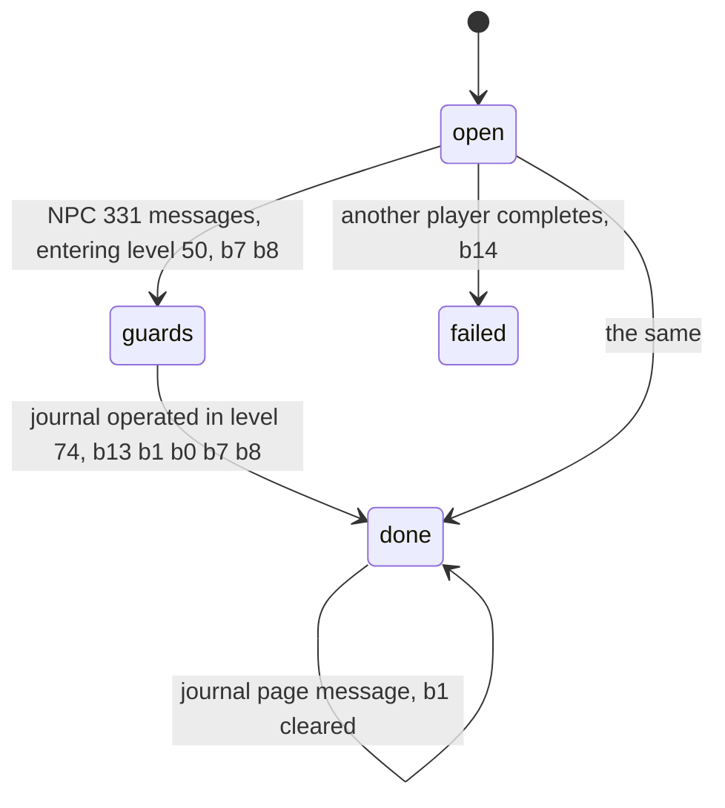

| bit | set/clear | trigger and condition | site | Tag |
|---|---|---|---|---|
| b8 | set | e11 NPC 331 (`act2guard2`) messages 0xBB–0xBD; no `+0x09` test, so also with the quest switched off | 0x0059AFB2 | [C] (run:2026-10-17-quests: 44 writes, quest off) |
| b7 | set | e11 NPC 331 message 0xBA | 0x0059AFC3 | [I] (fn:sub_0059AF50_A2Q4_NpcMessage@0x0059AF50) |
| b8, b7 | set | e3 entering level 50, b8 then b7; no state, bit or `+0x09` test on the path (reached with quest 11 active, word 12 = 0, and in part 2's development log switched off) | 0x0059F155, 0x0059F173 | [C] (run:2026-10-19-quests3: x-entry, x-entry2; fn:sub_0059F0C0_A2Q4_LevelChange@0x0059F0C0 0x0059F136–0x0059F173) |
| b2–b5 | set | per player with b0, b1 clear, by quest state | 0x0059ADFD, 0x0059AE13, 0x0059AE49, 0x0059AE38 | [I] (0x0059ADB0) |
| b13, b1, b0, b8, b7; steps clear | set / clear | the journal operate (`OperateFn` 42, object 357): every player in level 74 with b0, b1 clear; party members in Act II | 0x0059B3D1–0x0059B46D | [I] (fn:sub_0059B970_A2Q4_JournalOperate@0x0059B970, fn:sub_0059B3F0_A2Q4_JournalCredit@0x0059B3F0) |
| b14 | set | the journal: every other player with b0, b1 clear | 0x0059B354 | [I] (fn:sub_0059B970_A2Q4_JournalOperate@0x0059B970) |
| b1 | clear | e11 journal pages, messages 0x18D–0x197 | 0x0059B035 | [I] (fn:sub_0059AF50_A2Q4_NpcMessage@0x0059AF50) |
| G b13 | set | the Canyon portal made; first joiner with b0 or b1 | 0x0059B0FE, 0x0059B643 | [I] (fn:sub_0059B530_A2Q4_FirstJoin@0x0059B530) |

```
W12. NpcTalk331 — e0 for NPC 331:                                   [C] for the open branch (fn:sub_0059B1C0_A2Q4_NpcTalk@0x0059B1C0 0x0059B229, run:2026-10-17-quests); [I] for msg 7
       if private +0x0E = 0: msg ← 7                                   ; no draw
       else: Step(questSeed);  msg ← questSeed.low mod 3 + 8           ; one draw
```

- W12. [C] One quest-seed step per talk with the palace open (private `+0x0E` = 1, set by the join from w11 b0): 44
  talks, 42 chained pairs. (0x0059B229, run:2026-10-17-quests)
- [I] b0 and b1 are set together at the journal, so the quest completes on reading; message 0x18C (journal read), once
  and in the journal's room, opens the Canyon portal: a free spot (`0x00545340`, size 2, mask `0xBE11`, 8 tries) and
  `PortalObjectCreate(room, x, y, level 46, 0, class 60, 0)`. (fn:sub_0059AF50_A2Q4_NpcMessage@0x0059AF50)
- [I] No word-12 bit gates level 74's waypoint or the Arcane portal 298, and the palace is opened by removing the harem
  blocker object 318 (NPC 177 message 0x175, or e13 with w11 b0, w12 b0/b1, a held `hst `, b2–b5, or w10 b0).
  (fn:sub_0059BA40_A2Q4_ArcanePortalInit@0x0059BA40, fn:sub_0059AEF0_A2Q4_PalaceOpen@0x0059AEF0)

##### Word 13: the Summoner (quest object 12)

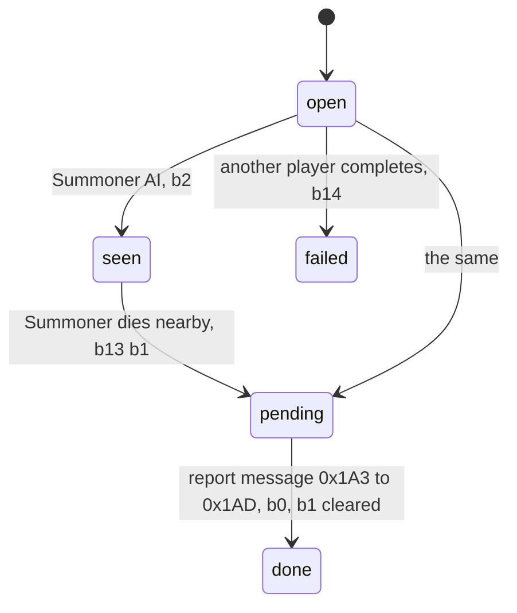

| bit | set/clear | trigger and condition | site | Tag |
|---|---|---|---|---|
| b13, b1 | set | e8 the Summoner: near credit, b0, b1 clear; party | 0x0059BF4E, 0x0059BF58, 0x0059C083, 0x0059C08D | [I] (fn:sub_0059BE70_A2Q5_NearCredit@0x0059BE70) |
| b14 | set | e8: other players | 0x0059C127 | [I] (fn:sub_0059C150_A2Q5_SummonerDeath@0x0059C150) |
| b2 | set | per player at the state broadcast of the Summoner AI hook | 0x0059BD5B | [I] (fn:sub_0059C330_A2Q5_BossSeen@0x0059C330) |
| b0; b1 clear | set / clear | e11 report with b1 set | 0x0059BE4A, 0x0059BE54 | [I] (fn:sub_0059BD70_A2Q5_NpcMessage@0x0059BD70) |
| G b13 | set | the report when b13 is set | 0x0059BE13 | [I] (fn:sub_0059BD70_A2Q5_NpcMessage@0x0059BD70) |

- [I] The death registers timer `0x0059BFD0` (period 3, two runs). No draw. (fn:sub_0059BFD0_A2Q5_Timer@0x0059BFD0)

##### Word 14: Tal Rasha's tomb and Duriel (quest object 13)

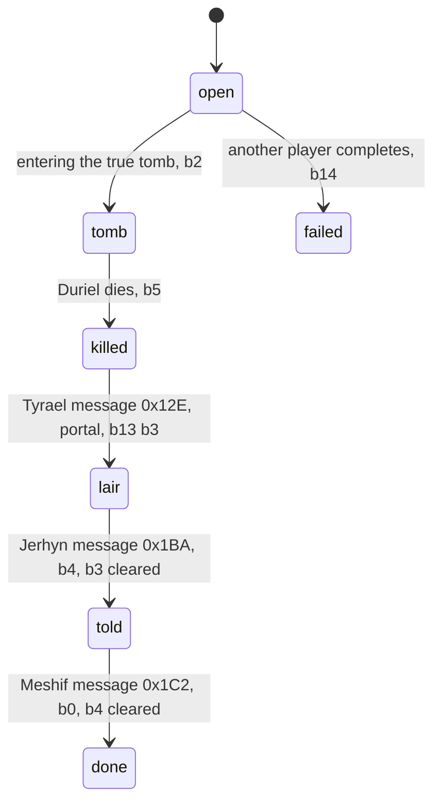

| bit | set/clear | trigger and condition | site | Tag |
|---|---|---|---|---|
| b2 | set | e3 entering the true tomb `T = act+0x094`, or e2, with b0 clear and state > 1 | 0x0059C6FC | [I] (fn:sub_0059C6C0_A2Q6_CanyonCredit@0x0059C6C0, fn:sub_0059D1C0_A2Q6_LevelChange@0x0059D1C0) |
| b5 | set | e8 Duriel: the killer, party in Act II, players in level 73; each with b0, b3, b4, b5 clear | 0x0059D0F0, 0x0059CF9D, 0x0059D017 | [I] (fn:sub_0059D050_A2Q6_DurielDeath@0x0059D050) |
| b13, b3 | set | e11 NPC 251 (`tyrael1`) message 0x12E, once: the portal made; players in level 73 with b13, b3, b4 clear; their party | 0x0059C818, 0x0059C822 | [I] (fn:sub_0059C810_A2Q6_LairCredit@0x0059C810) |
| b14 | set | the same: others with b0, b3, b4 clear | 0x0059CA36 | [I] (fn:sub_0059CB20_A2Q6_NpcMessage@0x0059CB20) |
| b4; b3 clear | set / clear | e11 NPC 201 message 0x1BA with b3 set | 0x0059CD2F, 0x0059CD39 | [C] (run:2026-10-18-quests2: x-talk2) |
| b0; b4 clear | set / clear | e11 NPC 210 (`meshif1`) message 0x1C2 with b4 set | 0x0059CE06, 0x0059CE1B | [C] (run:2026-10-18-quests2: x-talk2) |
| — | — | the same message with w10 b0 set removes `hst `, `vip `, `msf ` | 0x0059CB20 | [I] (fn:sub_0059CB20_A2Q6_NpcMessage@0x0059CB20) |
| b6–b11 | set | e11 messages 0x1BD, 0x1BE, 0x1C1, 0x1BC, 0x1C4, 0x1BF ("talked to NPC") | 0x0059CE50–0x0059CEA5 | [I] (fn:sub_0059CB20_A2Q6_NpcMessage@0x0059CB20) |
| G b13 | set | e11 NPC 210 with b13 | 0x0059CDCD | [I] (fn:sub_0059CB20_A2Q6_NpcMessage@0x0059CB20) |

- [I] Tyrael's portal is class 59 to level 40, opened at the player (`PortalObjectCreate(room, x, y, 40, 0, 59, 0)`); its
  town end goes to level 40's point type 12 while private `+0x3C` = 1 ([quests/travel § G](travel.md#g-town-portals)).
  (fn:sub_0059DFD0_A2Q6_TownPortalPos@0x0059DFD0)
- [I] Placing the staff registers timer `0x0059D870` with period `(Missiles[338]+0x96 − 75) ÷ 20` (period 1 from the
  orifice's init when the staff was already placed): it opens the chamber door and creates object 100 (Duriel's lair
  portal) at the orifice's x − 13, y + 3. The death registers timer `0x0059CEE0` (period 8). No draw.
  (fn:sub_0059D870_A2Q6_LairPortalTimer@0x0059D870, fn:sub_0059DB50_A2Q6_OrificeInit@0x0059DB50)
- [I] Word 14's code reads act `+0x094` as the true tomb (e3, the tomb message to the client, the join's tomb index);
  no quest code reads act `+0x484`. (0x0061AEB0, fn:sub_0059D6A0_A2Q6_SendTomb@0x0059D6A0)

##### Word 30: NPC 377's talk (quest object 26)

```mermaid
stateDiagram-v2
  [*] --> clear
  clear --> b13set: NPC 377 messages 0x3B or 0x3C, b13
  clear --> b0set: other NPC 377 messages, b0
  b13set --> b0set: other NPC 377 messages, b0
```

| bit | set/clear | trigger and condition | site | Tag |
|---|---|---|---|---|
| b13 | set | e11 NPC 377 (`act2guard4`) messages 0x3B, 0x3C | 0x0059E0E0 | [I] (fn:sub_0059E0E0_A2Q7_NpcMessage@0x0059E0E0) |
| b0 | set | e11 NPC 377, other messages | 0x0059E0E0 | [I] (fn:sub_0059E0E0_A2Q7_NpcMessage@0x0059E0E0) |

```
W30. NpcTalk377 — e0, one draw per talk:                            [I] (fn:sub_0059E140_A2Q7_NpcTalk@0x0059E140 0x0059E1C5–0x0059E273)
       if b0, or w9 b0, b13 or b1, or G w9 b13:  Step(player.unitSeed);  msg ← low mod 3 + 2
       else if quest object 8 is switched off:   msg ← Range(player.unitSeed, 3) + 2
       else if b13 clear:                         msg ← Range(player.unitSeed, 2)
       else:                                       Step(player.unitSeed);  msg ← low mod 3 + 2
```

- [I] **No stock data places NPC 377**: no DS1 that a LvlPrest row names holds it or its placeholders, no Levels or
  SuperUniques column names it, and no code spawns class 377. So the draw above is unreachable on stock data.
  (run:2026-10-18-quests2 `npcplace` scan, 0x0059E1CE)

##### Word 31: NPC 378 (quest object 27)

| bit | set/clear | trigger and condition | site | Tag |
|---|---|---|---|---|
| b0 | set | e11 NPC 378 (`act2guard5`) message 0x12F | 0x0059E3E9 | [I] (fn:sub_0059E3C0_A2Q8_NpcMessage@0x0059E3C0) |

```mermaid
stateDiagram-v2
  [*] --> clear
  clear --> set: NPC 378 message 0x12F, b0
```

- [I] The message is offered while quest object 13 is active below state 2, G w11 b13 is set and w14 b1, b0 are clear.
  No draw. (fn:sub_0059E4B0_A2Q8_NpcGate@0x0059E4B0)

##### Word 42: the Act II introductions (quest object 38)

- [I] As quest object 37: per-NPC introduction flags only, no record bit, no draw. (fn:sub_005984C0_A2Intro_NpcTalk@0x005984C0)

#### Act III

##### Word 16: Hratli's place (quest object 14)

```mermaid
stateDiagram-v2
  [*] --> clear
  clear --> heard: NPC 253 message 0x1D1 or 0x1D2, b0
```

| bit | set/clear | trigger and condition | site | Tag |
|---|---|---|---|---|
| b0 | set | e11 NPC 253 (`hratli`) message 0x1D2 | 0x005B6F09 | [C] (run:2026-10-18-quests2: x-talk3, h-talk3) |
| b0 | set | e11 NPC 253 message 0x1D1 | 0x005B6F09 | [I] (fn:sub_005B6ED0_A3Q0_NpcMessage@0x005B6ED0) |
| G b13 | set | the same messages; first joiner with b0 | 0x005B6F18, 0x005B6FFE | [I] (fn:sub_005B6FD0_A3Q0_FirstJoin@0x005B6FD0) |

- [I] **Creation reader.** Two object `InitFn`s spawn Hratli once per game at the object (`SpawnAtPos(x, y, 253, 1, −1,
  0)`): `InitFn` 49 only while G w16 b13 is clear, `InitFn` 50 only while it is set (and then ORs `+0xC4 |= 0x3000000` on
  him). So the game record picks which of two preset places he starts at. (fn:sub_005B70B0_A3Q0_HratliSpawnA@0x005B70B0,
  fn:sub_005B7160_A3Q0_HratliSpawnB@0x005B7160)

##### Word 17: Lam Esen's tome (quest object 15)

```mermaid
stateDiagram-v2
  [*] --> open
  open --> steps: leaving town, entering level 79
  steps --> done: NPC 254 message 0x234 with the tome, b13 b0, stat bonus
  open --> done: the same, player in Act III
  open --> failed: tome handed in elsewhere, b14
  steps --> failed: the same
```

| bit | set/clear | trigger and condition | site | Tag |
|---|---|---|---|---|
| b2 | set | e3 leaving town 75 in state 2 or 3, or e11 message 0x225: players with b0, b1 clear | 0x005B73F3 | [I] (fn:sub_005B73A0_A3Q1_SetBit2@0x005B73A0) |
| b13, b0, b1 | set | e11 NPC 254 (`alkor`) message 0x234 with `bbb ` held (removed): **every player in Act III** with b0, b1 clear; once per game | 0x005B753A, 0x005B7544, 0x005B754E | [I] (fn:sub_005B74E0_A3Q1_SetDone@0x005B74E0) |
| b1 | clear | right after: each player with b1 gets `UnitAddStat(player, 4, 5, 0)` (+5 to stat 4) and a message, then b1 cleared | 0x005B75C0 | [I] (fn:sub_005B7580_A3Q1_StatReward@0x005B7580) |
| b14 | set | the same pass: each player still with b0, b1 clear (not in Act III) | 0x005B7604 | [I] (fn:sub_005B75D0_A3Q1_SetMissed@0x005B75D0) |
| G b13 | set | the reporter has b13; first joiner with b0 | 0x005B7902, 0x005B7C41 | [I] (fn:sub_005B7740_A3Q1_NpcMessage@0x005B7740) |

- [I] The tome object (193) refuses a player with b0 ([items/quest-drops § E](../items/quest-drops.md#e-quest-items)). No
  draw. (fn:sub_005B7A60_A3Q1_TomeDrop@0x005B7A60)

##### Word 18: Khalim's Will (quest object 16)

```mermaid
stateDiagram-v2
  [*] --> open
  open --> told: Cain messages 0x21F to 0x224, b2 to b7
  told --> done: second counted orb hit with qf2, b0 b13
  open --> done: the same
```

| bit | set/clear | trigger and condition | site | Tag |
|---|---|---|---|---|
| b2 | set | e11 NPC 245 (`cain3`) message 0x21F | 0x005B80C6 | [I] (fn:sub_005B8060_A3Q2_NpcMessage@0x005B8060) |
| b6 / b3 / b4 / b5 / b7 | set | e11 Cain messages 0x220 / 0x221 / 0x222 / 0x223 / 0x224 | 0x005B80F9, 0x005B80E8, 0x005B810A, 0x005B811B, 0x005B812C | [I] (fn:sub_005B8060_A3Q2_NpcMessage@0x005B8060) |
| b0, b13 | set | Compelling Orb operate (object 404, `OperateFn` 53) in mode 0 with `qf2 ` as primary weapon: the second counted hit | 0x005BB9F7, 0x005BBA14 | [C] (run:2026-10-18-quests2: x-orb, 2 operates) |
| b0, b13 | set | the same hit: party members in Act III (a member who had b0 only loses the five items) | 0x005BB8E7, 0x005BB8F1 | [I] (fn:sub_005BB850_A3Q5_OrbPartyPass@0x005BB850) |

```
W18. CompellingOrbOperate(object, operator):                        [C] for the counted half (fn:sub_005BB980_A3Q5_CompellingOrbOperate@0x005BB980, run:2026-10-18-quests2)
       if the operator's primary weapon is not qf2: return            ; 0x005BB9B3, before the counter
       private +0x38 ← +0x38 + 1
       if +0x38 = 2:
         SetState(rec, 18, 0);  SetState(rec, 18, 13);  remove qf2
         if the operator's w21 b4: SetState(rec, 21, 0)
         kill the orb monster (oracle);  object mode 1, object event 1;  council "orb broken" ← 1
         send every record;  +0xF0;  the party pass
```

- W18. [C] Each operate in mode 0 with `qf2 ` grew the counter by one; the second wrote b0 and b13 and left the object in
  mode 1; the game seed moved inside the completing hit (the orb monster's death, an oracle). (0x005BB9CD,
  run:2026-10-18-quests2)
- W18. [I] An operate without `qf2 ` counts nothing; it was not reached on the server (the client sent no operate).
  (fn:sub_005BB980_A3Q5_CompellingOrbOperate@0x005BB980 0x005BB9B3)
- [I] The five items `qey qhr qbr qf1 qf2` are removed for each party member on completion unless `0x005678A0(1)`; the
  Khalim chests take one quest-seed step each ([items/quest-drops](../items/quest-drops.md)); the sewer lever (367) and
  stairs (366) belong to this quest object but write no bit. (fn:sub_005BB850_A3Q5_OrbPartyPass@0x005BB850,
  fn:sub_005B8530_A3Q2_SewerLeverOperate@0x005B8530)

##### Word 19: the Gidbinn (quest object 17)

```mermaid
stateDiagram-v2
  [*] --> open
  open --> handed: Ormus message 0x24B with the Gidbinn, b6
  handed --> ring: Ormus message 0x251, b8
  handed --> merc: Asheara message 0x24D, b7
  ring --> done: Asheara message 0x24D, b7 b13 b0
  merc --> done: Ormus message 0x251, b8 b13 b0
  open --> failed: handed in by another player, b14
```

| bit | set/clear | trigger and condition | site | Tag |
|---|---|---|---|---|
| b2–b5 | set | per player: b5 holding `g33 `; b4 (and b2 if b3 clear) when the dagger is out; b3 at quest state 2 | 0x005B8BC1, 0x005B8BDC, 0x005B8BA9, 0x005B8B89 | [I] (fn:sub_005B8B20_A3Q3_SetProgressBits@0x005B8B20) |
| b6 | set | e11 NPC 255 (`ormus`) message 0x24B with `g33 ` held (removed), b5 set, b8 clear; party members in Act III with b0, b6, b7, b8 clear | 0x005B92EC, 0x005B9229 | [I] (fn:sub_005B9240_A3Q3_NpcMessage@0x005B9240) |
| b14 | set | the same message: every player with b0, b6, b7, b8 clear and no `g33 ` | 0x005B9194 | [I] (fn:sub_005B9130_A3Q3_SetMissed@0x005B9130) |
| b8 | set | e11 Ormus message 0x251 with b6 set, b8 clear (and b7 clear); `QUESTS_GiveItem('rin', ilvl 21/35/75, quality 6)` (oracle) | 0x005B93EE | [C] (run:2026-10-18-quests2: x-talk3, h-talk3) |
| b13, b0 | set | after b8 when b7 is already set | 0x005B943B, 0x005B9445 | [I] (fn:sub_005B9240_A3Q3_NpcMessage@0x005B9240) |
| b7, b13, b0 | set | e11 NPC 252 (`asheara`) message 0x24D with b7 clear and b8 set; `HIRE_GiveFreeMerc(252)` (oracle) | 0x005B94BE, 0x005B94E6, 0x005B94F0 | [C] (run:2026-10-18-quests2: h-talk3) |
| b7 | set | the same message with b8 clear | 0x005B94BE | [I] (fn:sub_005B9240_A3Q3_NpcMessage@0x005B9240) |
| b0 | set | e13: the first joiner has b6, b7, b8 and not b0 | 0x005B97C7 | [I] (fn:sub_005B9700_A3Q3_FirstJoin@0x005B9700) |
| b9 | set | e4 on `g33 `, once per player | 0x005B95AC | [I] (fn:sub_005B9520_A3Q3_ItemEvent@0x005B9520) |
| G b13 | set | message 0x24B, quest active | 0x005B9332 | [I] (fn:sub_005B9240_A3Q3_NpcMessage@0x005B9240) |

- [I] The Gidbinn altar (`OperateFn` 31, object 252) with b0, b7, b8 clear goes to mode 1 and registers timer
  `0x005B9A30` (period 7) once; the timer, with a player near the altar, spawns the guardian (`SpecialMonSpawn(0, 0x197,
  …)`) and installs the e8 that drops `g33 ` from the next unique or boss death (oracles). No draw in the quest.
  (fn:sub_005B9B40_A3Q3_AltarOperate@0x005B9B40, fn:sub_005B9A30_A3Q3_GuardianTimer@0x005B9A30)

##### Word 20: the Golden Bird (quest object 18)

```mermaid
stateDiagram-v2
  [*] --> open
  open --> told: Cain messages 0x20F and 0x213, b2 b4
  told --> pending: Alkor message 0x216 with the golden bird, b1
  pending --> done: Alkor message 0x21A, b0 b13 b5, b1 and steps cleared
```

| bit | set/clear | trigger and condition | site | Tag |
|---|---|---|---|---|
| b2 | set | e11 Cain message 0x20F (and party) | 0x005BA382 | [I] (fn:sub_005BA320_A3Q4_NpcMessage@0x005BA320) |
| b4 | set | e11 Cain message 0x213 (and party) | 0x005BA408 | [I] (fn:sub_005BA320_A3Q4_NpcMessage@0x005BA320) |
| b1 | set | e11 NPC 254 message 0x216 with `g34 ` held (removed), b0, b1 clear (and party) | 0x005BA4C9 | [I] (fn:sub_005BA320_A3Q4_NpcMessage@0x005BA320) |
| b1 clear; b0, b13; steps clear; b5 | clear / set | e11 NPC 254 message 0x21A with b1 set, b0 clear; `QUESTS_GiveItem('xyz', 0, 2, 1)` (oracle) | 0x005BA52B, 0x005BA535, 0x005BA53F, 0x005BA54C, 0x005BA556 | [C] (run:2026-10-18-quests2: x-talk3b, h-talk3) |
| b6 | set | e4 on `j34 `, once per player | 0x005BA78B | [I] (fn:sub_005BA6A0_A3Q4_ItemEvent@0x005BA6A0) |
| G b13 | set | after message 0x21A when the reporter has b13 | 0x005BA5CA | [I] (fn:sub_005BA320_A3Q4_NpcMessage@0x005BA320) |

- [I] NPC 264's (`meshif2`) message 0x211 with `j34 ` held turns it into `g34 ` (no bit). The figurine `j34 ` drops from the
  first Act III pack monster hooked while the quest is active ([items/quest-drops § E](../items/quest-drops.md#e-quest-items)).
  No draw. (fn:sub_005BAC70_A3Q4_FigurineArm@0x005BAC70)

##### Word 21: the High Council (quest object 19)

```mermaid
stateDiagram-v2
  [*] --> open
  open --> steps: entering level 82, leaving town
  steps --> pending: last council member dies, orb not broken, b4 b13
  steps --> done: last council member dies, orb broken, b0 b13
  pending --> done: Cain message 0x272 or the orb, b0, b4 cleared
  open --> failed: another player completes, b14
```

| bit | set/clear | trigger and condition | site | Tag |
|---|---|---|---|---|
| b2 / b3 | set | per player at quest state 2–3; b3 when the council was seen | 0x005BAE01, 0x005BAE14 | [I] (fn:sub_005BADC0_A3Q5_SetProgressBits@0x005BADC0) |
| b4 or b0, and b13 | set | the last council member's death: every Act III player in its room or near list; b0 if w18 b0 is set, else b4 | 0x005BAF53, 0x005BAF5D | [I] (fn:sub_005BAE20_A3Q5_CouncilDoneNear@0x005BAE20) |
| b4, b13 | set | party members in Act III | 0x005BB6A7, 0x005BB6B1 | [I] (fn:sub_005BB640_A3Q5_PartySetBit4@0x005BB640) |
| b14 | set | players with b0 and b4 clear | 0x005BB747 | [I] (fn:sub_005BB710_A3Q5_SetMissed@0x005BB710) |
| b0; b4 clear | set / clear | e11 Cain message 0x272 with b4 set (the five Khalim items removed if w18 b0) | 0x005BB3B6, 0x005BB3C0 | [I] (fn:sub_005BB210_A3Q5_NpcMessage@0x005BB210) |
| b0 | set | the orb's completing operate (operator, party) when b4 is set | 0x005BBA6F, 0x005BB96B | [I] (fn:sub_005BB980_A3Q5_CompellingOrbOperate@0x005BB980) |
| G b13 | set | Cain message 0x272 (reporter has b13), first join, the last council death | 0x005BB343, 0x005BB53A, 0x005BBE09 | [I] (fn:sub_005BBC00_A3Q5_CouncilDeath@0x005BBC00) |

- [I] Up to six council members (levels below 108) are recorded by the council hook; on each non-council death the quest
  drops once per game `qf1 ` (quality 7) and then `box ` to each Act III player lacking them (oracles). No draw.
  (fn:sub_005BB550_A3Q5_CouncilHook@0x005BB550, fn:sub_005BBC00_A3Q5_CouncilDeath@0x005BBC00)

##### Word 22: Mephisto and the Durance portal (quest object 20)

```mermaid
stateDiagram-v2
  [*] --> open
  open --> steps: leaving town, levels above 97, 100, 102
  steps --> killed: Mephisto dies, b13 b0 b11
  open --> killed: the same
  killed --> reported: any NPC message 0x291 to 0x297, b11 cleared
  open --> failed: another player completes, b14
```

| bit | set/clear | trigger and condition | site | Tag |
|---|---|---|---|---|
| b2–b9 | set | every player at the state pass: state 2 → b2, 3 → b3, 4 with `+0x0B` 2/3/4 → b4/b5/b6, 5 with 2/3/4 → b7/b8/b9 | 0x005BC088–0x005BC11D | [I] (fn:sub_005BC020_A3Q6_SetProgressBits@0x005BC020) |
| b13, b0, b11 | set | e8 Mephisto: the killer if b0 clear; every player on level 102 with b0, b11 clear; party members in Act III of credited players | 0x005BC148, 0x005BC152, 0x005BC15C | [I] (fn:sub_005BC8B0_A3Q6_MephistoDeath@0x005BC8B0, fn:sub_005BC190_A3Q6_SetDoneLevel102@0x005BC190) |
| b14 | set | players with b0 and b11 clear | 0x005BC847 | [I] (fn:sub_005BC810_A3Q6_SetMissed@0x005BC810) |
| b11 | clear | e11 any NPC message 0x291–0x297 (the kill reported) | 0x005BC6D1 | [I] (fn:sub_005BC5A0_A3Q6_NpcMessage@0x005BC5A0) |
| G b13 | set | the death (always); first joiner with w22 b0, b11 or w23 b0 | 0x005BC9F0, 0x005BCDAA | [I] (fn:sub_005BCC80_A3Q6_FirstJoin@0x005BCC80) |

- [I] The Durance portal reads w22 b13 or b0 ([quests/travel § F](travel.md#f-the-durance-portal-and-the-other-travel-objects));
  b13 is cleared at load, so a reloaded character passes through b0. Mephisto's death opens the portal object (mode 1)
  and arms the bridge object 341, which lowers (mode 0 → 1 → 2) as a player comes within distance 18, re-queued every 24
  frames. (fn:sub_005BCBF0_A3Q6_PortalInit@0x005BCBF0, fn:sub_005BCAC0_A3Q6_BridgeEvent7@0x005BCAC0)
- [I] **Creation reader.** `InitFn` 52 spawns NPC 297 at the object while G w22 b13 is clear, once per game. The death
  registers timer `0x005BC720` (period 12). No draw. (fn:sub_005BCE80_A3Q6_NpcSpawnInit@0x005BCE80,
  fn:sub_005BC720_A3Q6_DeathTimer@0x005BC720)

##### Word 32: the Dark Wanderer (quest object 28)

```mermaid
stateDiagram-v2
  [*] --> unseen
  unseen --> seen: the timer fires, players in Act III, b0
```

| bit | set/clear | trigger and condition | site | Tag |
|---|---|---|---|---|
| b0 | set | the Dark Wanderer timer fires: every player in Act III with b0 clear, before the step | 0x005BD2AB | [C] for one player (run:2026-10-19-quests3: x-entry, x-entry2, h-entry, x-wpact3r-0; fn:sub_005BD260_A3Q7_SetSeen@0x005BD260) |
| G b13 | set | e13: the first joiner has b0 (and then no Dark Wanderer this game) | 0x005BD2EE | [I] (fn:sub_005BD2C0_A3Q7_FirstJoin@0x005BD2C0) |

```
W32. AfterglowTimer — registered once, period 2, by the darkwanderer AI (0x005BD4A0); runs once:
                                                                    [C] for the 8-try branch (fn:sub_005BD390_A3Q7_AfterglowTimer@0x005BD390 0x005BD390–0x005BD486, run:2026-10-19-quests3)
       SetSeen on every player
       if the Dark Wanderer unit still exists:
         Step(questSeed)                                              ; one draw (inline LCG)
         for i in (questSeed.low & 1) ... 7:                          ; 8 objects, or 7
           target ← his position + T[i]
           free spot 0x00545340(3, 0x3F11, …, 11, 100)                 ; no draw
           SUnitCreate(object 131 at the spot)                         ; game seed (oracle)
       T = (−3,−3), (−3,0), (−3,3), (0,−3), (0,3), (3,−3), (3,0), (−3,3)   ; the last repeats the third
```

- W32. [C] Four games (a save with word 32 = 0, the Kurast Docks by waypoint, the player next to the Dark Wanderer at
  the Spider Forest edge): the timer ran once at `tick = due + 1`, b0 was set, the quest seed stepped once (the logged
  low word one step of the seed before, `QUESTS_GetSeed` at 0x005BD3DD) and the targets were tried from `low & 1` in
  order, one free-spot search each. `low & 1` was 0 in all four (8 tries). (run:2026-10-19-quests3: x-entry, x-entry2,
  h-entry, x-wpact3r-0; fn:sub_005BD390_A3Q7_AfterglowTimer@0x005BD390)
- [I] The 7-try branch (`low & 1` = 1) was not reached. (fn:sub_005BD390_A3Q7_AfterglowTimer@0x005BD390)
- [I] The init writes `+0xE0` = 16 although the code uses word 32; only the quest log is affected. `InitFn` 43 spawns the
  Dark Wanderer at (x + 7, y) while the private flag is set. (fn:sub_005BD300_A3Q7_Init@0x005BD300,
  fn:sub_005BD1F0_A3Q7_WandererSpawnInit@0x005BD1F0)

##### Word 42: the Act III introductions (quest object 39)

- [I] Per-NPC introduction flags only (player data `+0x60 + 4·difficulty`), no record bit, no draw.
  (fn:sub_005B6C60_A3Q0x_NpcMessage@0x005B6C60)

#### Act IV

##### Word 24: Tyrael's introduction (quest object 21)

```mermaid
stateDiagram-v2
  [*] --> clear
  clear --> heard: NPC 367 message 0x298, b0
```

| bit | set/clear | trigger and condition | site | Tag |
|---|---|---|---|---|
| b0 | set | e11 NPC 367 (`tyrael2`) message 0x298 | 0x005B36C9 | [C] (run:2026-10-18-quests2: x-talk4, h-talk4, c-talk4) |

##### Word 25: the hooked Act IV monster and the skill points (quest object 22)

```mermaid
stateDiagram-v2
  [*] --> open
  open --> steps: NPC 367 message 0x29E, entering level 103
  steps --> pending: the hooked monster dies, b13 b1
  open --> pending: the same
  pending --> done: NPC 367 message 0x2A4, b0, b1 and steps cleared
  open --> failed: another player completes, b14
```

| bit | set/clear | trigger and condition | site | Tag |
|---|---|---|---|---|
| b1, b13; steps clear | set / clear | e8 the hooked monster: the killer, near credit, party members in Act IV; b0, b1 clear | 0x005B40BA, 0x005B40C4, 0x005B3FFF, 0x005B4009, 0x005B3DC4, 0x005B3DCE | [I] (fn:sub_005B4020_A4Q1_IzualDeath@0x005B4020, fn:sub_005B3F20_A4Q1_NearCredit@0x005B3F20) |
| b14 | set | the rest of the game | 0x005B3D07 | [I] (fn:sub_005B4020_A4Q1_IzualDeath@0x005B4020) |
| b2, b3, b4 | set | log state 2 → b2; 3 → b3 or b4 | 0x005B38A0, 0x005B38CC, 0x005B38BB | [I] (fn:sub_005B3940_A4Q1_StepBits@0x005B3940) |
| b5 | set | e11 NPC 406 message 0x2A3 | 0x005B3B86 | [I] (fn:sub_005B39A0_A4Q1_NpcMessage@0x005B39A0) |
| b0; b1 clear; steps clear | set / clear | e11 NPC 367 message 0x2A4 with b1 set | 0x005B3AF8, 0x005B3B07, 0x005B3B14 | [C] (run:2026-10-18-quests2: x-talk4, h-talk4, c-talk4) |
| G b13 | set | the same message when the player also has b13 | 0x005B3AE9 | [I] (fn:sub_005B39A0_A4Q1_NpcMessage@0x005B39A0) |

- [I] The reward also adds 2 to stat 5 (`UnitAddStat(p, 5, 2)`, 0x005B3B1F). The death arms timer `0x005B3E60` (period 3)
  that spawns class 406 at the death position (oracle). No draw. (fn:sub_005B3E60_A4Q1_GhostTimer@0x005B3E60)

##### Word 26: Diablo, the seals and the Harrogath portal (quest object 23)

```mermaid
stateDiagram-v2
  [*] --> open
  open --> steps: entering levels 103 and 108
  steps --> done: Diablo dies nearby, b13 b0, classic also b6 b7
  done --> told: NPC 367 message 0x4E20 in expansion, b9, portal
  done --> told: NPC 246 message 0x4E21, b8
  open --> failed: another player completes, b14
```

| bit | set/clear | trigger and condition | site | Tag |
|---|---|---|---|---|
| b13, b0; steps clear | set / clear | e8 Diablo (class 243): near credit (Diablo's death room), b0, b1 clear; party members in Act IV with b0 clear | 0x005B4D28, 0x005B4D32, 0x005B4D3A | [I] (fn:sub_005B4D20_A4Q2_Credit@0x005B4D20, fn:sub_005B5140_A4Q2_NearCredit@0x005B5140) |
| b6, b7 | set | the same, classic games only (`game+0x70` = 0) | 0x005B4D4A, 0x005B4D54 | [I] (fn:sub_005B4D20_A4Q2_Credit@0x005B4D20) |
| b14 | set | the rest | 0x005B4998 | [I] (fn:sub_005B52E0_A4Q2_DiabloDeath@0x005B52E0) |
| b2, b3, b4 | set | log state 2 / 3 | 0x005B459E, 0x005B45BA, 0x005B45CB | [I] (fn:sub_005B4E40_A4Q2_StepBits@0x005B4E40) |
| b7 / b6 | clear | e11 NPC 367 message 0x2AC / NPC 246 message 0x2AD | 0x005B46EF, 0x005B474F | [I] (fn:sub_005B4670_A4Q2_NpcMessage@0x005B4670) |
| b9 | set | e11 NPC 367 message 0x4E20 in an expansion game (no `+0x09` test); then the Harrogath portal (oracle) unless private `+0x45` | 0x005B4715 | [C] (run:2026-10-18-quests2: x-talk4, h-talk4); the classic half [I] (0x005B4702) |
| b8 | set | e11 NPC 246 (`cain4`) message 0x4E21 | 0x005B4778 | [C] (run:2026-10-18-quests2: x-talk4, h-talk4) |
| b9 | clear | e13 and e14 in expansion: b9 set and w28 b0 clear | 0x005B506B, 0x005B50C3 | [I] (fn:sub_005B5080_A4Q2_FirstJoin@0x005B5080) |

```
W26a. DiabloSummon test (0x005B5230), called by a seal operate, a seal boss's death and InitFn 55:   [I] (fn:sub_005B5230_A4Q2_DiabloSummon@0x005B5230)
        if all five seal flags (private +0x0C ..< +0x11) are set and the seal-boss death count +0x48 = 3 and +0x13 = 0:
          +0x13 ← 1                                                   ; read by DiabloQuestFlag: the Chaos Sanctuary gate
          broadcast;  every live non-Diablo monster on level 108 with a clear stat list → mode 0
          arm timer 0x005B4BE0 (period 1): from its 10th run, spawn Diablo at the start point (oracle)
W26b. SealOperate (OperateFn 52; 54–56 first store a boss point and create object 131):   [I] (fn:sub_005B5630_A4Q2_SealOperate@0x005B5630)
        only a seal in mode 0: mode 1, object event 1, the seal's flag (class 392 → +0x0C … 396 → +0x10), then W26a
```

- [I] **The Chaos Sanctuary gate** ([monsters/spawn](../monsters/spawn.md)): once the fifth seal is open and the three
  seal bosses (superuniques 36–38, spawned by object 131's event 7) are dead, in either order, room population on level
  108 stops. (fn:sub_005B5210_DiabloQuestFlag@0x005B5210, fn:sub_005B5750_A4Q2_SealBossEvent@0x005B5750)
- [I] **The end timer reads real time.** Diablo's death re-arms the timer in end mode with `GetTickCount()`: after
  75 000 ms it calls `0x0052E2A0` once; after 90 000 ms, in a classic game, every player gets `+0x4C` = 1 and, with b13,
  `PlayerChangeLevel(103, 0)`; after 95 000 ms the flags clear and a classic game runs `0x00530590`. (fn:sub_005B4BE0_A4Q2_Timer@0x005B4BE0
  0x005B4C04–0x005B4C9A)
- [I] **Classic lock-out:** after Diablo dies in a classic game, the cube button and the trade and interaction packets are
  refused until the game ends. **Progression:** the classic credit raises the client's status progression to
  `step·d + 4` (step 5 with the expansion bit, else 4), never lowering it. (fn:sub_005B5810_A4Q2_ClassicEndLock@0x005B5810,
  fn:sub_00538680_PlayerProgressionRaise@0x00538680)
- [C] **The Harrogath portal** (object 566, expansion only) is created near NPC 367 by message 0x4E20; its operate is
  [quests/travel § F](travel.md#f-the-durance-portal-and-the-other-travel-objects)'s and writes w28 b0 then b13 on the
  first trip only (word 28 b0 clear): it, not NPC 367's menu, is the Act IV → V travel in stock play. (run:2026-10-19-quests3:
  x-tyrael3, five trips; fn:sub_005B45E0_A4Q2_HarrogathPortalCreate@0x005B45E0,
  fn:sub_005B5880_A4Q2_HarrogathPortalOperate@0x005B5880 0x005B590F, 0x005B5919)

##### Word 27: the Hellforge (quest object 24)

```mermaid
stateDiagram-v2
  [*] --> open
  open --> stone: NPC 246 messages 0x2A6 and 0x2A7, soulstone given
  stone --> pending: third forge strike, b13 b1
  open --> pending: the same, player in Act IV
  pending --> done: NPC 246 message 0x2A8, b0, b1 cleared
  open --> failed: another player completes, b14
```

| bit | set/clear | trigger and condition | site | Tag |
|---|---|---|---|---|
| b13, b1; steps clear | set / clear | the third strike: the striker, and every player in Act IV with b0, b1 clear (each loses `hfh ` and `mss `) | 0x005B5D3C, 0x005B5D49, 0x005B5B72, 0x005B5B7C | [I] (fn:sub_005B5C10_A4Q3_ForgeOperate@0x005B5C10, fn:sub_005B5B00_A4Q3_ForgeCredit@0x005B5B00) |
| b14 | set | the rest | 0x005B5BE7 | [I] (fn:sub_005B5B00_A4Q3_ForgeCredit@0x005B5B00) |
| b2 / b5 / b3 | set | log state 2 → b5 with the soulstone given, else b2; state 3 → b3 | 0x005B6027, 0x005B6016, 0x005B603D | [I] (fn:sub_005B59C0_A4Q3_StepBits@0x005B59C0) |
| b0; b1 clear | set / clear | e11 NPC 246 message 0x2A8 with b1 set | 0x005B6287, 0x005B6296 | [C] (run:2026-10-18-quests2: x-talk4, h-talk4, c-talk4) |

- [I] The forge, its strikes and its draws are [items/quest-drops § D](../items/quest-drops.md#d-special-drops).
  (fn:sub_005B6100_A4Q3_NpcMessage@0x005B6100)

##### Word 33: NPC 408's dialogue (quest object 29)

- [I] A dialogue selector for class 408 (reading w27 and w26); no quest script writes word 33, and the stock client never
  sends packet `0x58` for it. No draw. (fn:sub_005B6940_A4Q4_NpcTalk@0x005B6940, fn:sub_005B69F0_A4Q4_NpcGate@0x005B69F0)

#### Act V

##### Word 35: the siege boss and Larzuk's socket (quest object 31)

```mermaid
stateDiagram-v2
  [*] --> open
  open --> steps: NPC 511 message 0x4E6D, levels 110 to 112
  steps --> pending: the siege boss dies nearby, b1 b13
  open --> pending: the same
  pending --> offered: NPC 511 message 0x4E7A, b5, steps cleared
  offered --> done: socket done, b0, b1 cleared
  open --> failed: another player completes, b14
```

| bit | set/clear | trigger and condition | site | Tag |
|---|---|---|---|---|
| b1, b13 | set | e8 superunique 42: near credit (b0 clear); party members in Act V with b0, b1, b13 clear | 0x0058719E, 0x005871A8, 0x00587224, 0x0058722E | [I] (fn:sub_00587100_A5Q1_NearCredit@0x00587100, fn:sub_005871C0_A5Q1_PartyCredit@0x005871C0) |
| b14 | set | the rest | 0x005872D6 | [I] (fn:sub_00587330_A5Q1_ShenkDeath@0x00587330) |
| G b13 | set | e8 | 0x005873A8 | [I] (fn:sub_00587330_A5Q1_ShenkDeath@0x00587330) |
| b2, b3, b4 | set | log states | 0x00586E2D, 0x00586E5A, 0x00586E49 | [I] (fn:sub_00586DE0_A5Q1_StepBitsByState@0x00586DE0) |
| steps clear; b5 | clear / set | e11 NPC 511 (`larzuk`) message 0x4E7A with b1 set | 0x00586F27, 0x00586F36 | [C] (run:2026-10-18-quests2: x-talk5) |
| b0; b1 clear | set / clear | the socket service done ([items/quest-drops § F](../items/quest-drops.md#f-npc-item-services-and-given-items)) | 0x005877D7, 0x005877E1 | [I] (fn:sub_005877C0_A5Q1_SocketDone@0x005877C0) |

- [I] Larzuk is spawned once by object `InitFn` 70/71 (`SpawnAtPos(x, y, 511, 1, 5, 0)`, oracle). No draw.
  (fn:sub_00587840_A5Q1_LarzukSpawn@0x00587840)

##### Word 36: the prisoners (quest object 32)

```mermaid
stateDiagram-v2
  [*] --> open
  open --> freeing: a cage freed, rescue incomplete, b4
  freeing --> pending: three cages open, at least 12 rescued, b13 b1 and b5 b6 or b7
  open --> failed: more than 4 killed, or under 12 rescued, b14
  freeing --> failed: the same
  pending --> done: NPC 515 message 0x4E8E, runes given, b0, b1 and steps cleared
```

| bit | set/clear | trigger and condition | site | Tag |
|---|---|---|---|---|
| b4 | set | a cage freed with the rescue not complete (prisoner AI) | 0x00588C0C | [I] (fn:sub_005888D0_A5Q2_CageFreed@0x005888D0) |
| b4 | clear | every join (e13, e14) | 0x00588496 | [I] (fn:sub_00588040_A5Q2_MonsterDeath@0x00588040) |
| b13, b1 | set | rescue complete: spawned = killed + rescued, all 3 cages open, rescued ≥ 12; the triggering player and party members in Act V | 0x00588B81, 0x00588B8B, 0x00587EBA, 0x00587EC4 | [I] (fn:sub_00587E60_A5Q2_PartyCredit@0x00587E60) |
| b5 / b6 / b7 | set | the same: rescued 15 → b5, 14 → b6, 12–13 → b7 | 0x00588BAD, 0x00587EE8, 0x00587EFD, 0x00587F0D | [I] (fn:sub_00587E60_A5Q2_PartyCredit@0x00587E60) |
| b14 | set | rescue complete with fewer than 12 rescued, or more than 4 prisoners killed | 0x00587FA6 | [I] (fn:sub_00587F60_A5Q2_FailBit@0x00587F60) |
| b0; b1, steps clear | set / clear | e11 NPC 515 message 0x4E8E with b1 set, after at least one rune was made (3 runes with b5, 2 with b6, 1 with b7) | 0x00587CAB, 0x00587CBA, 0x00587CC7 | [I] (fn:sub_00587B00_A5Q2_NpcMessage@0x00587B00) |
| b2, b3 | set | log states | 0x00587ADC, 0x00587AF1 | [I] (fn:sub_005879D0_A5Q2_StepBits@0x005879D0) |

- [I] Each cage (`InitFn` 62, object 473) spawns its 5 prisoners with up to 25 `SpawnAtPos` tries, each hooked to the
  quest (oracles). No draw. (fn:sub_005886A0_A5Q2_CageInit@0x005886A0, fn:sub_00588600_A5Q2_CageSpawnPrisoners@0x00588600)

##### Word 37: Anya (quest object 33)

```mermaid
stateDiagram-v2
  [*] --> open
  open --> pending: Frozen Anya operated with the potion, b13 b1
  pending --> scroll: NPC 513 message 0x4EA4, b8
  pending --> reward: NPC 512 message 0x4EA8, b9 b10, item drawn
  scroll --> done: the second of the two talks, b0, b1 cleared
  reward --> done: the same
  done --> used: the scroll used, b7
  open --> failed: thawed by another, or levels 121 to 124 entered first, b14
```

| bit | set/clear | trigger and condition | site | Tag |
|---|---|---|---|---|
| b13, b1 | set | `OperateFn` 67 on object 558 by a player with b0, b1 clear **holding `ice `** (removed); party members in Act V | 0x0058ACD3, 0x0058ACE0, 0x00589055, 0x0058905F | [I] (fn:sub_0058ABC0_A5Q3_FrozenAnyaOperate@0x0058ABC0) |
| b14 | set | e3 entering level 123 (Halls of Pain) at state below 5: `0x00589AA0`, state 6 | 0x00589AE6 | [C] (run:2026-10-19-quests3: x-entry2, h-entry; fn:sub_00589D80_A5Q3_LevelChange@0x00589D80 0x00589D80–0x00589EFE) |
| b14 | set | the rest of the game at the thaw; entering 121, 122 or 124 at state below 5 | 0x00589AE6 | [I] (fn:sub_00589D80_A5Q3_LevelChange@0x00589D80) |
| b3 | set | e3 entering level 113 (state to 3): `0x00588F10` for the player; the entry into 112 before it moves the state to 1 with no write | 0x00588F71 | [C] (run:2026-10-19-quests3: x-entry, x-entry2, h-entry; 0x00589D80–0x00589EFE) |
| b2 | set | log state | 0x00588F5C | [I] (fn:sub_00588EB0_A5Q3_StepBits@0x00588EB0) |
| b3 | set | e3 entering 114, or the old-level-109 branch (not reached) | 0x00588F71 | [I] (fn:sub_00589D80_A5Q3_LevelChange@0x00589D80) |
| b8 | set | e11 NPC 513 message 0x4EA4 with b1 set, b0 clear: `tr2 ` given | 0x005896F1 | [I] (fn:sub_00589580_A5Q3_NpcMessage@0x00589580) |
| b9, b10 | set | e11 NPC 512 message 0x4EA8 with b1 set, b0 and b10 clear, no `+0x09` test: the reward item made (W37), then b9, and b10 last; a second talk gives nothing (b10) | 0x005899BA, 0x005899E6 | [C] (run:2026-10-19-quests3: x-anya, nm-anya, h-anya, quest 33 switched off; fn:sub_00589580_A5Q3_NpcMessage@0x00589580) |
| b0; b1 clear | set / clear | the reward talk coming second (b8 already set): b1 cleared, b0 set, between b9 and b10 | 0x005899D2, 0x005899DC | [C] (run:2026-10-19-quests3: x-anya, nm-anya, h-anya) |
| b0; b1 clear | set / clear | the NPC 513 talk coming second (b9 already set) | 0x0058973A, 0x00589744 | [I] (fn:sub_00589580_A5Q3_NpcMessage@0x00589580) |
| b7 | set | the player uses `tr2 ` with b8 set and b7 clear; then `0x0058A0A0` builds the resistance list | 0x0055E4F5 | [C] for the branch reached (run:2026-10-19-quests3: x-anya; 0x0055E4CC–0x0055E501) |

```
W37. AnyaReward — e11 NPC 512 message 0x4EA8:                        [C] (fn:sub_00589580_A5Q3_NpcMessage@0x00589580 0x00589883–0x005899E6, run:2026-10-19-quests3)
       QUESTS_GetSeed                                                 ; 0x00589929
       table ← Nightmare if d = 1 and (game+0x6A = 3 or clvl > 45); Hell if d = 2 and (game+0x6A = 3 or clvl > 65); else Normal
       k ← Range(questSeed, count[class] of table)                    ; one draw
       QUESTS_GiveItem(table[class][k], UnitDropLevel, quality 6, 1)  ; items/quest-drops § F
```

- W37. [C] One reward in each difficulty (Normal, Nightmare, Hell; clvl 80, so each difficulty's own table): the table,
  the count, the draw and the item code were predicted from the quest seed before the talk. The `game+0x6A` = 3 branch
  of the table choice was not separated by the run. (run:2026-10-19-quests3: x-anya, nm-anya, h-anya)
- [I] **The scroll's bonus.** `0x0058A0A0` counts the difficulty records (Normal, Nightmare, Hell) whose word 37 has b7
  and puts 10 per record into stats 39, 41, 43 and 45 of a stat list linked to the player, at the scroll use and on the
  player load path; so +10/+20/+30 in every difficulty. (fn:sub_0058A0A0_A5Q3_ResistBonusApply@0x0058A0A0)
- [I] **Creation reader.** `InitFn` 69 (object 462) spawns Nihlathak's superunique only while the quest's private
  `+0x88` = 1, set by Anya's return to town or by a first joiner with b0 or b15. (fn:sub_0058A6C0_A5Q3_NihlathakBossSpawn@0x0058A6C0,
  fn:sub_0058A110_A5Q3_FirstJoin@0x0058A110)
- [I] A later joiner with w37 b0, b1, b6 clear while quest 34 is active and quest 33 is done or off gets **w38 b14**.
  (fn:sub_0058A1E0_A5Q3_LaterJoin@0x0058A1E0)

##### Word 38: Nihlathak and the personalisation (quest object 34)

```mermaid
stateDiagram-v2
  [*] --> open
  open --> steps: NPC 512 message 0x4EA9, red portal
  steps --> pending: Nihlathak dies nearby, b1 b13
  open --> pending: the same
  pending --> done: personalisation done, b0, b1 cleared
  open --> failed: another player completes, b14
```

| bit | set/clear | trigger and condition | site | Tag |
|---|---|---|---|---|
| b1, b13 | set | e8 Nihlathak (superunique 60): near credit with w37 b0 or b1 and w38 b14, b0 clear; party | 0x0058B596, 0x0058B5A0, 0x0058B663, 0x0058B66D | [I] (fn:sub_0058B4A0_A5Q4_NearCredit@0x0058B4A0) |
| G b13 | set | the same death | 0x0058B81C | [I] (fn:sub_0058B7A0_A5Q4_NihlathakDeath@0x0058B7A0) |
| b14 | set | the rest at the kill; a joiner as in word 37 | 0x0058B716, 0x0058A267 | [I] (fn:sub_0058B7A0_A5Q4_NihlathakDeath@0x0058B7A0) |
| b2, b3 | set | log states | 0x0058B118, 0x0058B12D | [I] (fn:sub_0058AEA0_A5Q4_StepBits@0x0058AEA0) |
| b4 | set | e11 NPC 512 message 0x4EB4 | 0x0058B24E | [I] (fn:sub_0058B1C0_A5Q4_NpcMessage@0x0058B1C0) |
| b0; b1 clear | set / clear | the personalise service done | 0x0058BC16, 0x0058BC20 | [I] (fn:sub_0058BC00_A5Q4_PersonalizeDone@0x0058BC00) |

- [I] **The red portal** to level 121: `PortalObjectCreate(room, x + 10, y + 5, 121, 0, class 60, 1)` at the town Anya
  placeholder, once per game, after message 0x4EA9 (talk end) or object 459's event 7 (every 12 frames until it succeeds);
  a monster-AI path makes it when the first joiner lacked level 123's waypoint. (fn:sub_0058AF90_A5Q4_RedPortalCreate@0x0058AF90,
  fn:sub_0058BC80_A5Q4_RedPortalCreateAI@0x0058BC80)

##### Word 39: the Ancients (quest object 35)

```mermaid
stateDiagram-v2
  [*] --> open
  open --> armed: altar operated, no portal on 120
  armed --> open: a portal opened on 120, or 120 empty
  armed --> done: the third Ancient dies, b0 b13, experience
  done --> told: NPC talks, b4 to b9
  open --> failed: another player completes, b14
```

| bit | set/clear | trigger and condition | site | Tag |
|---|---|---|---|---|
| b0, b13 | set | e8 the third Ancient (540–542): the killer, each player on level 120, their party in Act V; each needs clvl ≥ 20·(d + 1) and b0 clear; each credit grants experience | 0x0058CA96, 0x0058CAA0, 0x0058C885, 0x0058C897, 0x0058C731, 0x0058C73B | [I] (fn:sub_0058C9A0_A5Q5_AncientDeath@0x0058C9A0, fn:sub_0058C7E0_A5Q5_SummitExpGrant@0x0058C7E0, fn:sub_0058C6D0_A5Q5_PartyExpGrant@0x0058C6D0) |
| b14 | set | the rest | 0x0058C7B7 | [I] (fn:sub_0058C9A0_A5Q5_AncientDeath@0x0058C9A0) |
| b2 / b3 | set | log state 2 / 3, players with clvl ≥ 20·(d + 1) | 0x0058C26C, 0x0058C282 | [I] (fn:sub_0058C210_A5Q5_StepBitsByLevel@0x0058C210) |
| b4 | set | e11 message 0x4EC9 (`OperateFn` 69, object 561, with b0 set and b4 clear) | 0x0058C39C | [I] (fn:sub_0058C290_A5Q5_NpcMessage@0x0058C290) |
| b5–b9 | set | e11 from NPC 511 → b5, 520 → b6, 512 → b7, 513 → b8, 515 → b9 | 0x0058C40B | [I] (fn:sub_0058C290_A5Q5_NpcMessage@0x0058C290) |

- [I] **Experience**: 1 400 000 (Normal), 20 000 000 (Nightmare), 40 000 000 (Hell), capped at the experience between the
  current and the next level. (fn:sub_0058C5C0_ExpGrantCapped@0x0058C5C0)
- [I] **Arming and resets.** The altar (`OperateFn` 65) with no town portal on 120 and all statues in mode 0 puts the
  three statues in mode 3 and queues their event 7 (each spawns an Ancient, oracle); with a portal on 120 it instead
  closes every player's portal there. A town portal created on 120 before the quest is done, or no living player left
  on 120, resets the fight. (fn:sub_0058D310_A5Q5_AltarOperate@0x0058D310, fn:sub_0058C000_A5Q5_AncientsReset@0x0058C000,
  fn:sub_0058D560_A5Q5_SummitEmptyReset@0x0058D560)
- [C] **The summit door** (object 564, `OperateFn` 71) reads only quest 35's private "done in this game" byte and refuses
  (message 0x13) while it is 0, whatever the creator had done: 88 refused operates by a creator without w39 b0 and by one
  with every quest done. (fn:sub_0058D6A0_A5Q5_SummitDoorOperate@0x0058D6A0 0x0058D6DC–0x0058D711,
  run:2026-10-17-quests, run:2026-10-18-quests2)
- [I] The Worldstone Keep door (`OperateFn` 66) refuses a player with b0 and b1 clear, and everyone while the quest is
  active and not done in this game; a first joiner with b0 or b15 makes it start open. (fn:sub_0058D400_A5Q5_KeepDoorOperate@0x0058D400)

##### Word 40: Baal, the Worldstone and the Zoo (quest object 36)

```mermaid
stateDiagram-v2
  [*] --> open
  open --> steps: levels above 130, log states
  steps --> done: Baal dies, players on 132, b13 b0
  open --> done: the same
  done --> left: the last portal, or a join, b10
  open --> failed: another player completes, b14
```

| bit | set/clear | trigger and condition | site | Tag |
|---|---|---|---|---|
| b13, b0 | set | e8 Baal: each player on level 132 with b0, b1 clear; party members in Act V | 0x0058DD38, 0x0058DD42, 0x0058DCB6, 0x0058DCC0 | [I] (fn:sub_0058DD30_A5Q6_Credit@0x0058DD30, fn:sub_0058DC60_A5Q6_PartyCredit@0x0058DC60) |
| b14 | set | the rest | 0x0058DE08 | [I] (fn:sub_0058DF20_A5Q6_BaalDeath@0x0058DF20) |
| b2 / b3 | set | log state 2 / 3, players in Act V | 0x0058D91D, 0x0058D933 | [I] (fn:sub_0058D8B0_A5Q6_StepBitsByState@0x0058D8B0) |
| b4 | set | e11 message 0x4ED2 (jump table at 0x0058D9D0, index `msg − 0x4ECF`; no NPC or `+0x09` test) | 0x0058D9C7 | [C] (run:2026-10-18-quests2: x-talk5) |
| b9, b6 | set | e11 messages 0x4ED0 (Anya's talk), 0x4ED3 (Malah's talk) by the same table | 0x0058D9C7 | [C] (run:2026-10-19-quests3: x-anya, nm-anya, h-anya; one Malah talk) |
| b7, b5, b8 | set | e11 messages 0x4ECF, 0x4ED1, 0x4ED4 by the same table | 0x0058D9C7 | [I] (fn:sub_0058D940_A5Q6_NpcMessage@0x0058D940) |
| b10 | set | the last portal (object 565) used by a player with b13; a first join or a later join with b0 (or b15 at the first) | 0x0058E7FC, 0x0058E4CB, 0x0058E424 | [I] (fn:sub_0058E740_A5Q6_LastPortalOperate@0x0058E740, fn:sub_0058E430_A5Q6_PlayerJoin@0x0058E430) |

```
W40. ZooInit — InitFn 79 (object 567), once per game (private +0xA0):   [I] (fn:sub_0058E830_A5Q6_ZooInit@0x0058E830 0x0058E830–0x0058E90B)
       cls: i32 ← 0
       for t in 0 ..< 10:
         c ← RandLoHi(questSeed, 1, nMonStats)                        ; one draw each
         if MonStats[c].zoo: cls ← c;  break
       private +0xA4 ← cls;  message 0x0058E120 to every player
```

- [I] Every Baal credit, and the first join of a player with b0 or b15, raises the client's status progression to at least
  `5d + 5`. Baal's gold draws on the quest seed ([items/quest-drops](../items/quest-drops.md)). The consumer of the Zoo's
  class beyond its message is not traced. (fn:sub_00538680_PlayerProgressionRaise@0x00538680, tbl:MonStats.txt:zoo)
- [I] **The Zoo does not run on stock data**: no DS1 places object 567 (2 274 DS1 files scanned) and no immediate in the
  code creates class `0x237`, so W40 and its 1–10 quest-seed draws are not reached by stock play (a computed class is
  not excluded), and `+0xA4` stays 0 for the level-109 message. (fn:sub_0058E830_A5Q6_ZooInit@0x0058E830,
  data:g_ObjInitFns@0x00731BC0; quests/0001 § 10, `objplace`)
- [I] The Worldstone Chamber portal (objects 563, 569) moves a player from 131 to 132 only after Baal's AI opened it; the
  warp gate into 132 refuses until then ([quests/travel § F](travel.md#f-the-durance-portal-and-the-other-travel-objects)).
  (fn:sub_0058E640_A5Q6_ChamberWarpBlocked@0x0058E640)
- [I] The join of a player with w40 b0 sets b10 at the first-join callback; the run's save loads logged that write in
  every save with word 40 done, outside the checked rules. (fn:sub_0058E430_A5Q6_PlayerJoin@0x0058E430 0x0058E4D0,
  run:2026-10-17-quests)

##### Word 42: the Act V introductions (quest object 40)

- [I] Per-NPC introduction flags for NPCs 512–520 only, no record bit; messages 0x4E45–0x4E47 also move quest 31 from log
  state 0 to 1. No draw. (fn:sub_0058E990_A5Q0_NpcMessage@0x0058E990)

### Warp and portal gates

| Gate | Reads | Refuses when | Tag |
|---|---|---|---|
| warp into 73 | an Act II quest object's private byte `+0x0B` | the object is active with that byte 0 | [I] (0x0059DB20, fn:QUESTS_WarpGate@0x00545B80) |
| warp into 100 | quest 19's "orb broken" byte; the player's room level | the orb is whole and the player is not on 101 | [I] (fn:sub_005BBFA0_A3Q5_DuranceWarpGate@0x005BBFA0) |
| warp into 118 or 128 from 120 | quest 35's `+0x09` and private "done in this game" byte | quest 35 is active and not done in this game | [I] (fn:sub_0058D090_A5Q5_SummitWarpBlocked@0x0058D090 0x0058D09A) |
| warp into 132 | quest 36's chamber flag | Baal has not opened the chamber | [I] (fn:sub_0058E640_A5Q6_ChamberWarpBlocked@0x0058E640) |
| another player's town portal | `Levels.QuestFlag`/`QuestFlagEx` of the destination | the user's word bit 0 is clear | [I] (fn:OBJOP_Portal@0x00584870, tbl:Levels.txt:QuestFlagEx) |
| Durance portal | w22 b13, b0 | both clear | [I] (fn:sub_00584750_DurancePortalOperate@0x00584750) |
| NPC act travel | w6, w14, w26 bit 0 | clear | [I] (fn:NPC_MenuAction@0x00579D60) |
| the summit door | quest 35's private "done in this game" byte | it is 0 | [C] (fn:sub_0058D6A0_A5Q5_SummitDoorOperate@0x0058D6A0, run:2026-10-17-quests) |

- [I] The orb-broken byte is set game-wide by the orb's completing operate or by a first joiner with w18 b0, so the
  Durance entrance opens for everyone once any player breaks the orb. (fn:sub_005BB480_A3Q5_FirstJoin@0x005BB480)
- [I] The waypoint menu and waypoint travel read no quest word on the server; level 74's waypoint and the Arcane portal
  read none either. (fn:sub_00549570_WaypointTravelCheck@0x00549570, fn:sub_0059BA40_A2Q4_ArcanePortalInit@0x0059BA40)

### Creation-path readers

The quest state that the reviewed creation specs take as an input, and the code that reads it:

| Spec | Reader | State read | Tag |
|---|---|---|---|
| [items/quest-drops](../items/quest-drops.md) | the quest TC switch (B6) | the killer's `TCQuestId` word bits 15, 1 and `TCQuestCP`, read before the boss's script writes | [I] (fn:MONSTER_DropItems@0x005A6600) |
| [objects](../objects/README.md) | `InitFn` 49/50 (Hratli), 52 (NPC 297), 43 (Dark Wanderer), 55 (Diablo's start point), 69 (Nihlathak), 79 (the Zoo), 44 (hellgate 342), the cairn stones' init (Tristram portal) | G w16 b13, G w22 b13, quest private state | [I] (data:g_ObjInitFns@0x00731BC0) |
| [monsters/spawn](../monsters/spawn.md) | the Chaos Sanctuary gate | quest 23's private `+0x13` (word 26) | [I] (fn:sub_005B5210_DiabloQuestFlag@0x005B5210) |
| [monsters/special](../monsters/special.md) | superunique quest hooks, the forced death list | the hook lists (§ B) | [I] (fn:QUESTS_HookMonster@0x005436B0) |
| [rng/seeds](../rng/seeds.md) | act `+0x094` | the true tomb: word 14's level-change step, the join's tomb index, `OBJINIT_Portal`'s lair pair; act `+0x484` (maze only), `+0x474` (Kurast gates only) and the level-27 bit are read by no quest code | [I] (0x0061AEB0, fn:OBJINIT_Portal@0x0054FE70) |
| [items/cube](../items/cube.md) | the cow portal | w26 b0 (classic) or w40 b0 (expansion), G w4 b11 | [I] (fn:CUBE_CowPortalOpen@0x00594140) |
| [drlg/collision](../drlg/collision.md) | the Arcane Sanctuary waypoint | no quest bit gates level 74 or portal 298 | [I] (fn:sub_0059BA40_A2Q4_ArcanePortalInit@0x0059BA40) |
| [save/d2s](../save/d2s.md) | the quest record of difficulty *d* | `+0x10 + 4·d`; the loader rule A3 | [C] (fn:D2S_ReadQuests@0x0056A370, run:2026-10-18-quests2) |

## Outputs

- The player's quest records (all three difficulties) and the game record, word by word, as § A and the per-quest tables
  write them; what Save and Exit writes is the record of A4. [C] for the save (fn:QUESTRECORD_SetState@0x0065C360,
  run:2026-10-18-quests2)
- The quest objects' active flags (`+0x09`, `+0x0A`) after the join, read by the scripts. [C] for the branch reached
  (fn:sub_00546270_QuestsPlayerJoin@0x00546270, run:2026-10-17-quests)
- Draws on the quest seed and the player's unit seed (§ G); units, items, portals and timers created by the scripts.
  [I] (fn:QUESTS_GetSeed@0x005438B0)

## Worked example

Seeds are `low:high` in hex; `Step` is [rng](../rng/README.md) step 1. Values are from the logs of the sessions named,
pinned by each run's manifest and checked by `tools/quests.py check` with 0 mismatches.

### 1. Two talks to NPC 331 (session x-lut, run:2026-10-17-quests)

- [C] **Inputs.** Expansion Normal, `QuestBookLost`. At `QUESTS_InitGame` the game seed `b2799e07:619294cf` steps to low
  `41772032`, so the quest seed is `41772032:0000029a`. The join switches quest 11 off and sets its private `+0x0E` from
  w11 b0, so the palace is open. Nothing else draws on the quest seed before the first talk. (fn:QUESTS_InitGame@0x00545D80,
  run:2026-10-17-quests)
- [C] **Talk 1.** `Step(41772032:0000029a)` = `fd73e914:1b4e1a7c`; message `0xfd73e914 mod 3 + 8` = 8. (0x0059B229,
  run:2026-10-17-quests)
- [C] **Talk 2.** The entry seed is talk 1's exit; `Step(fd73e914:1b4e1a7c)` = `e613b6e0:69b6957c`; message
  `0xe613b6e0 mod 3 + 8` = 9. (0x0059B229, run:2026-10-17-quests)

### 2. One talk to NPC 266 (session x-navi, run:2026-10-18-quests2)

- [C] The player's unit seed on entry to the e0 dispatch is `d9ddb5fe:693e5c66`. Quest object 25's run steps it to
  `b5ae48dc:5adeca0a`, quest object 30's run to `a5209b56:4bc715b5`, the exit value; the e11 dispatch that follows draws
  nothing. The two runs take one `Step` each whichever branch of W29 they take. (0x00596B23, 0x00596B48,
  run:2026-10-18-quests2)

### 3. Word 1's reward and the saved words (session x-talk1, run:2026-10-18-quests2)

- [C] The save holds word 1 = `0x0002` (b1 only) and word 41 = `0x0000`. The loader turns word 1 into `0x8002` (A3). The
  first join switches quest 1 off and sets G w1 b15. Akara's message 0x4C (b1 set) then writes b0 → `0x8003`, clears b1 →
  `0x8001`, sets w41 b13 → `0x2000` and b1 → `0x2002`, and `ClearSteps` leaves `0x8001`. Save and Exit writes word 1 =
  `0x8001` and word 41 = `0x2002`; at the next load word 41 becomes `0x8002` (bit 13 cleared, bit 15 from bit 1).
  (0x0058FF11, 0x0058FF20, 0x0058FF2F, 0x0058FF3E, 0x0058FF4B, fn:QUESTRECORD_LoadBytes@0x0065C4D0, run:2026-10-18-quests2)

## Reimplementation notes

- **Dispatch order is observable.** Within one event the quests run from object 40 down to row 0, so later acts first; a
  handler that re-dispatches e0 (`QUESTS_RedispatchNpcTalk`) runs the whole list again inside the first pass.
- **"Switched off" is not "inert".** The forced events reach a switched-off quest, and handlers that test only the NPC,
  the message or the word's bits still write. Model each handler's own tests.
- **Two quest objects share one handler.** NPC 266's talk runs the same e0 handler twice and so draws twice.
- **Bit 15 survives.** The loader sets bit 15 from a saved bit 1 and never clears it; only word 9's first-join check
  does. A character that saved with a reward pending carries bit 15 forever after.
- **`ClearSteps` is not `ClearState`.** It clears bits 2–11 in one pass; a logger watching `ClearState` sees nothing.
- **The eclipse period is 15 or 16**, not up to 17: `RandLoHi(lo, hi)` is `lo + Range(hi − lo)`.
- **Real time in Diablo's end timer.** The 75/90/95-second steps compare `GetTickCount()`, not frames.
- **Word 32's object is labelled word 16.** Row 24's `+0xE0` is 16; use word 32 for its bits.

## Evidence

- Findings: [quests/0001](../../findings/quests/0001-progression.md) (§ 1–§ 14 the reading, § 15 run 1, § 16 run 2,
  § 17 run 3),
  [items/0010](../../findings/items/0010-quest-drops.md) (the quest seed and the item draws),
  [save/0002](../../findings/save/0002-quest-words.md) (the record and the loader).
- Runs: [run:2026-10-17-quests](../../findings/quests/experiments.md#run2026-10-17-quests),
  [run:2026-10-18-quests2](../../findings/quests/experiments.md#run2026-10-18-quests2),
  [run:2026-10-19-quests3](../../findings/quests/experiments.md#run2026-10-19-quests3); the quest seed's start from
  run:2026-10-16-quest-drops ([items/quest-drops](../items/quest-drops.md)).
- Tables: [MonStats](../../tables/MonStats.md), [Levels § Travel](../../tables/Levels.md#travel-plan-0042-phase-0),
  [Objects](../../tables/Objects.md), [Misc](../../tables/Misc.md).
- Symbols: subsystem `quests/progression` in `re/symbols.csv` (every per-quest function by name, quests/0001 § 14).

## Open questions

- [L] The monsters hooked to quests 1, 2, 5, 6 and 22 (Levels `+0x30` and superunique hooks) were not all re-read.
- [L] What `0x0056EDE0` creates with arguments `0x120` (the stones), `0x14C` (the Countess's chests) and 625 (Baal's death).
- [L] The descriptor's `+0x08` (100 or 0) has no reader in the code read.
- [L] The AI states that call `0x00599420` and `0x0059C330`, the game-type 3 test in `0x0059EA20`, and the Missiles column
  behind `+0x96` used by the staff timer.
- [L] Anya's party callback writes quest object 3's private `+0xE2` instead of quest 33's; whether that block is large
  enough, and whether anything reads it.
- [L] Word 10 bit 1 has no constant setter found; word 10 bit 9 is cleared at every join and never set.
