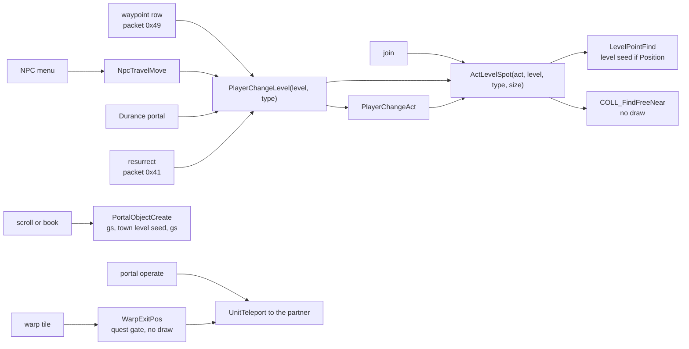
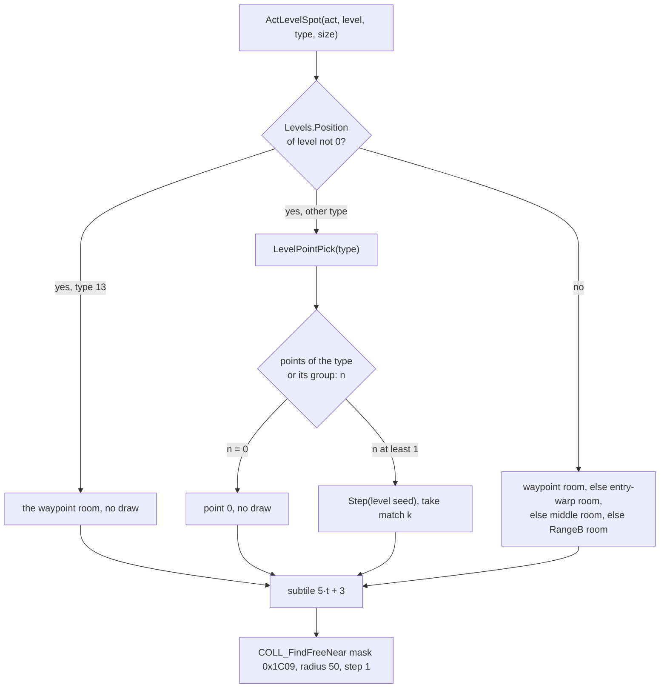
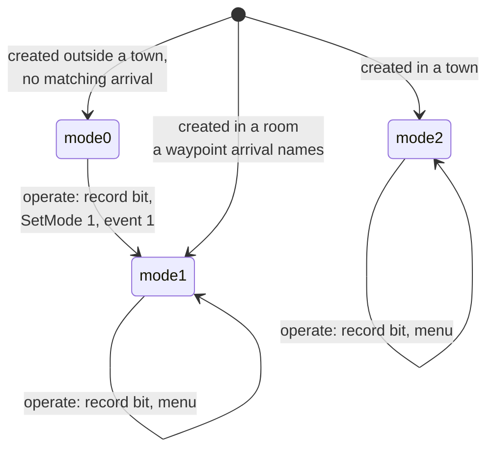
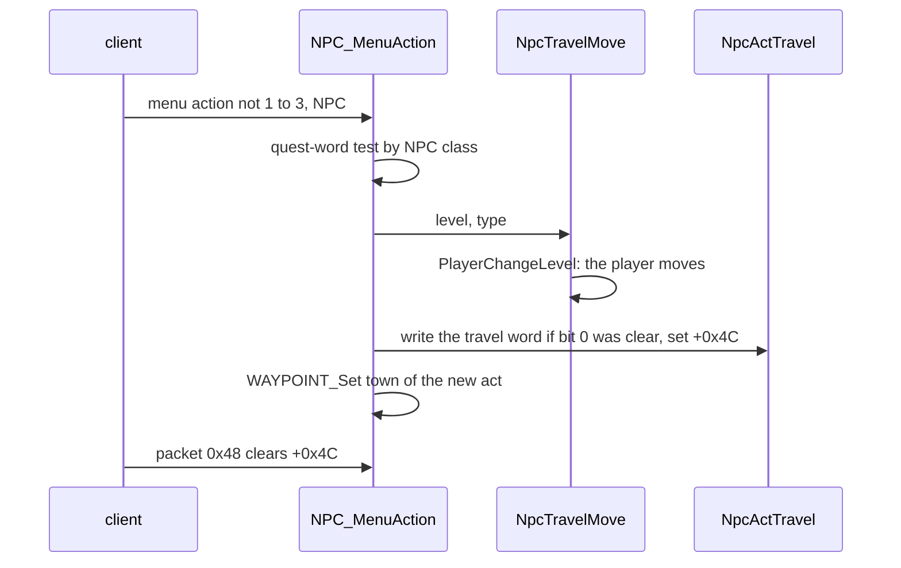
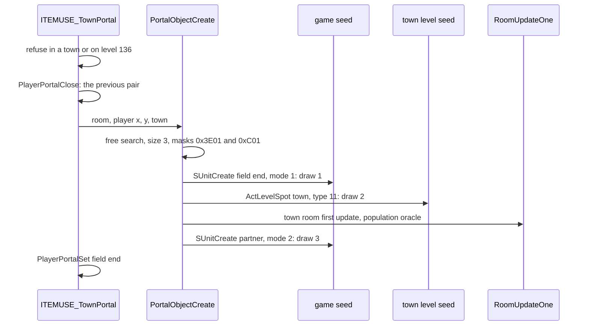

# Travel: waypoints, act changes, town portals, warps and placement

## Purpose

This spec covers how a player moves between levels on the server: activating and using a waypoint, changing act through
an NPC or the Durance portal, opening, using and closing a town portal, taking a warp tile, and where the player lands
after each of these and after a resurrection or a join. The inputs are a click or a client packet, the player's quest
and waypoint records and the tables. The outputs are the player's new room and position, the record writes and the
seed draws. Every placement goes through one routine (§ A), and the only draws are the destination level's seed, the
game seed of created portal objects and, for five waypoint rows, the object's own seed. The quest side of the same
events (quest words written, quest gates) is [quests/progression](progression.md); the overview is
[quests](README.md).

## Entry points

| When | Function | Tag |
|---|---|---|
| click on a waypoint, a portal or another object (packets `0x13`/`0x16`, object distance below `0x33`) | `sub_00548B00_UnitInteract` case 2 → `OBJ_OperateDispatch` → `g_ObjOperateFns[OperateFn]` | [I] (fn:sub_00548B00_UnitInteract@0x00548B00, fn:OBJ_OperateDispatch@0x00584420, data:g_ObjOperateFns@0x00732D18) |
| the client picks a waypoint row (packet `0x49`, `{u32 object id, u16 level}`) | `sub_0054C5D0_Pkt49WaypointTravel` → `sub_00584F60_WaypointTravel` | [I] (fn:sub_0054C5D0_Pkt49WaypointTravel@0x0054C5D0, fn:sub_00584F60_WaypointTravel@0x00584F60) |
| an NPC menu action other than 1–3 (13-byte packet) | `NPC_MenuAction` → `sub_0054B830_NpcTravelMove` | [I] (fn:NPC_MenuAction@0x00579D60, fn:sub_0054B830_NpcTravelMove@0x0054B830) |
| the player uses an item whose `Misc.pSpell` is 2 (`tsc`, `tbk`) | `g_ItemUseFns[2].use` = `ITEMUSE_TownPortal` | [I] (fn:ITEMUSE_TownPortal@0x005BE290, data:g_ItemUseFns@0x00741790, tbl:Misc.txt:pSpell) |
| click on a warp tile (unit type 5, distance below 5) | `sub_00548B00_UnitInteract` case 5 → `sub_005550B0_WarpExitPos` | [I] (fn:sub_00548B00_UnitInteract@0x00548B00, fn:sub_005550B0_WarpExitPos@0x005550B0) |
| the dead player presses "resurrect" (packet `0x41`, mode 17 only) | `sub_0054C0E0_Pkt41Resurrect` | [I] (fn:sub_0054C0E0_Pkt41Resurrect@0x0054C0E0) |
| a player joins the game | `sub_005394A0_PlayerPlaceInAct` (callers 0x00530237, 0x0053A3EB, 0x0053A4E6) | [I] (fn:sub_005394A0_PlayerPlaceInAct@0x005394A0) |
| the client reports its act loaded (packet `0x48`) | `sub_0054C590_Pkt48ActChangeClear` | [I] (fn:sub_0054C590_Pkt48ActChangeClear@0x0054C590, data:g_SrvPacketTable@0x006E0D18) |

## Inputs

### Tables

| Anchor | Used for |
|---|---|
| tbl:Levels.txt:Position | a non-zero value makes the level-point lookup draw on the level seed (§ A); 18 levels: 1, 38, 40, 46, 54, 73, 74, 75, 102, 103, 109, 121, 125, 126, 127, 132, 134, 135 |
| tbl:Levels.txt:Waypoint | the waypoint index of a level (`WAYPOINT_IndexFromLevel`): 39 indices, Act I 0–8, II 9–17, III 18–26, IV 27–29, V 30–38 |
| tbl:Levels.txt:QuestFlag, tbl:Levels.txt:QuestFlagEx | the quest word another player's portal into this level requires (classic, expansion) |
| tbl:Objects.txt:OperateFn, tbl:Objects.txt:InitFn | waypoints (`OperateFn` 23, `InitFn` 17), town portals (59: `OperateFn` 15, `InitFn` 11; 60: `InitFn` 12), the lair and Arcane portals (43, 34), the Durance portal (46) |
| tbl:Objects.txt:Sync, tbl:Objects.txt:FrameDelta | whether a mode change draws the object's seed, and its bound |
| tbl:Misc.txt:pSpell | 2 selects the town portal use function |
| tbl:LvlWarp.txt:ExitWalkX, tbl:LvlWarp.txt:ExitWalkY | the walk after a warp |

### Runtime state

| State | Type | Source |
|---|---|---|
| level seed (level `+0x1C4`) | Seed ([rng](../rng/README.md)) | [rng/seeds](../rng/seeds.md); drawn by `LevelPointPick` |
| game seed | Seed | drawn by `SUnitCreate` of every created object |
| object seed | Seed, `Init(game seed low)` at creation | drawn by `UNIT_AnimInit` for `Sync` 0 rows |
| player's unit seed (`Unit+0x20`) | Seed | drawn only by the walk command under state 42 (§ H) |
| waypoint record | 16-byte bit field, player data `+0x1C + 4·difficulty` | [save/d2s](../save/d2s.md) |
| quest record | 48 words × 16 bits, player data `+0x10 + 4·difficulty` | [quests/progression § A](progression.md#a-the-quest-record) |
| own portal id | u32, player data `+0x48` (`struct:PlayerTravel+0x48`) | `PlayerPortalSet` |
| act change in progress | u32, player data `+0x4C` (`struct:PlayerTravel+0x4C`) | § E |
| tick stamp | u32, player data `+0x160` (`struct:PlayerTravel+0x160`) | `PlayerTickSet`, only from the hostility declaration `0x005A5E50` |
| `GetTickCount()` | u32 milliseconds, real time | the OS: an input |
| difficulty `game+0x6D`, expansion `game+0x70` | u8 | the game |

### Constants

| Name | Value | Anchor | Tag |
|---|---|---|---|
| waypoint travel wait | 10 000 ms after the stamp | 0x0054C60F | [C] (run:2026-10-17-quests, one client; run:2026-10-20-two-clients, a declared stamp) |
| portal use wait | 5000 ms after the stamp | 0x005848CD | [C] (run:2026-10-17-quests, one client; run:2026-10-20-two-clients, a declared stamp) |
| placement mask, radius, step | `0x1C09`, 50, 1 | fn:sub_0061B060_ActLevelSpot@0x0061B060 | [I] |
| act-change second search | mask `0x1C89`, radius 50, step 5 | fn:sub_0053ACC0_PlayerChangeAct@0x0053ACC0 | [I] |
| portal field end search | size 3, masks `0x3E01`/`0xC01`, no fallback | fn:sub_0056D130_PortalObjectCreate@0x0056D130 | [I] |
| portal town end search | mask `0xBE11`, radius 50, step 5 | fn:sub_0056CF40_PortalPartnerCreate@0x0056CF40 | [I] |
| portal-use state | state 102 for 75 frames | fn:OBJOP_Portal@0x00584870 | [I] |
| point-type groups (`0x006EED88`, `{has, group}`) | type 0 → group 0; types 5–9 → group 1; type 11 → none | fn:sub_0066AC40_LevelPointPick@0x0066AC40 | [C] (run:2026-10-17-quests) |

### Inputs and oracles

| Item | Kind | What it is | Tag |
|---|---|---|---|
| the click, the packet, the NPC menu action | input | which travel the player asked for | [I] (fn:sub_00548B00_UnitInteract@0x00548B00) |
| `GetTickCount()` at the two gates | input | real time, never game frames | [C] (run:2026-10-17-quests: 61 and 122 gate reads) |
| the collision grid around a search | input (logged) | [drlg/collision](../drlg/collision.md)'s grid; the search reads it | [C] (run:2026-10-17-quests: 545 searches) |
| a level or act built on first arrival, a room activated by the lookup | DRLG oracle | its draws are [drlg](../drlg/README.md)'s and [drlg/collision § I](../drlg/collision.md#i-nearwarptestgame-room-x-y-and-its-side-effects)'s | [I] (fn:sub_0053AC70_ActCreate@0x0053AC70, fn:sub_0066B2B0_LevelPointFind@0x0066B2B0) |
| the town room's population when a portal's town end first updates it | boundary oracle (ADR-0004) | game-seed draws between the two portal creations | [C] (run:2026-10-17-quests: 41 draws in 9 opens) |
| party membership, hostility, a second player's portal | input | two-client cases, [plan 0044](../../plans/0044-multiplayer-branches.md) | [C] for hostility (run:2026-10-20-two-clients); [I] for the party and quest-word tests (fn:OBJOP_Portal@0x00584870) |

## Algorithm



### A. Placement



```
A1. ActLevelSpot(act, level: i32, type: i32, size: i32) → (room, x: i32, y: i32):   [C] (fn:sub_0061B060_ActLevelSpot@0x0061B060, run:2026-10-17-quests)
      (room, tx, ty) ← LevelPointFind(act, level, type)             ; A2
      x ← 5·tx + 3;  y ← 5·ty + 3                                    ; tile → subtile, centre offset
      room ← COLL_FindFreeNear(room, (x, y), other none, size, 0x1C09, 0x1C09, fallback 0, radius 50, step 1)   ; § B
      if room = none: fatal
      return (room, x, y)

A2. LevelPointFind(act, level, type) → (room, tx, ty):              [I] (fn:sub_0066B2B0_LevelPointFind@0x0066B2B0)
      ensure the level exists and is initialised                     ; DRLG oracle when absent
      if Levels[level].Position ≠ 0:
        if type = 13: room ← LevelWaypointRoom(level); the point is that room's waypoint
        else: (tx, ty) ← LevelPointPick(level, type)                 ; A3
      else:                                                          ; type is ignored
        room ← the room holding the waypoint, else the first DRLG room with a warp flag and a set warp id (0x0066B1F0),
               else the room holding the level's middle column, else 0x0066AE70: RangeB(level seed, level+0x08)
        the point is the room's centre when no point was given
      RoomActivateB(the room holding the point)                      ; drlg/collision § I2
      return

A3. LevelPointPick(level, type) → (tx, ty):                         [C] (fn:sub_0066AC40_LevelPointPick@0x0066AC40, run:2026-10-17-quests)
      g ← group of type (constants table); n: u32 ← count of the level's points whose type = type or whose group = g
      if n = 0: return point 0                                       ; no draw
      Step(level.seed);  r: u32 ← level.seed.low
      k ← r & (n − 1) if n is a power of two else r mod n            ; equal results
      return the k-th matching point (0-based, in point order)

A4. PlayerChangeLevel(level, type):                                  [C] (fn:sub_0053AEC0_PlayerChangeLevel@0x0053AEC0, run:2026-10-17-quests)
      if act(level) ≠ the player's act:
        TownLevelLeave(old level, level);  PlayerChangeAct(level, type);  return
      (room, x, y) ← ActLevelSpot(act, level, type, UnitSizeX(player))
      if room: UnitTeleport(player, room, x, y, noSearch 0, 0)       ; its own free search finds (x, y) free and returns

A5. PlayerChangeAct(level, type):                                    [C] (fn:sub_0053ACC0_PlayerChangeAct@0x0053ACC0, run:2026-10-17-quests)
      if the act does not exist: ActCreate                           ; DRLG oracle
      (room, x, y) ← ActLevelSpot(act, level, type, size)
      room ← COLL_FindFreeNear(room, (x, y), size, mask 0x1C89, radius 50, step 5)
      move the unit to the new act; client act; unit act byte; path flags 0x10000
```

Step notes:

- A1. [C] In 124 placements (81 `PlayerChangeLevel`, 32 `PlayerChangeAct`, 11 joins) the player ended on the cell of
  the last search, and `UnitTeleport`'s own search returned at once. (fn:sub_0061B060_ActLevelSpot@0x0061B060,
  fn:sub_00554EA0_UnitTeleport@0x00554EA0, run:2026-10-17-quests)
- A2. [C] The type-13 lookup on a `Position` level draws nothing: 28 waypoint arrivals in towns and on levels 46 and 74.
  (fn:sub_0066B2B0_LevelPointFind@0x0066B2B0 0x0066B303, run:2026-10-17-quests)
- A2. [C] On a level without `Position` the lookup draws nothing in the waypoint-room, warp-room and middle-room
  branches: 1958 lookups (waypoint arrivals and `NearWarpTest`'s type-11 lookups). (fn:sub_0066B2B0_LevelPointFind@0x0066B2B0,
  run:2026-10-17-quests)
- A2. [I] The last fallback, `RangeB(level seed, level+0x08)`, never ran in either run. (0x0066AE70)
- A3. [C] Types 0 and 11 step the level seed once on a `Position` level when a point matches: type 0 in 22 lookups,
  type 11 in 334, 343 chained pairs of one level's seed (each lookup's exit seed the next one's entry); the type-11
  case was already [drlg/collision § I2](../drlg/collision.md#i-nearwarptestgame-room-x-y-and-its-side-effects)'s
  `[C]`. (fn:sub_0066AC40_LevelPointPick@0x0066AC40, run:2026-10-17-quests, run:2026-10-14-collision)
- A3. [C] Type 5 with no point of group 1 takes point 0 with no draw: NPC 175's return to level 1, 11 lookups.
  (fn:sub_0066AC40_LevelPointPick@0x0066AC40 0x0066AC90, run:2026-10-17-quests)
- A3. [C] Type 5 with a group-1 point on the level steps the seed once, as types 0 and 11 do: Meshif's return to level
  40, six westward trips, each found a point, stepped Lut Gholein's level seed once and picked the point
  `LevelPointPick` predicts, the level seed chained from one trip to the next, no other seed moved.
  (fn:sub_0066B2B0_LevelPointFind@0x0066B2B0, fn:sub_0066AC40_LevelPointPick@0x0066AC40, run:2026-10-19-quests3: x-meshifw)
- A3. [C] Type 5 on Harrogath (109), whose one point is of type 0, takes that point with no draw (`LevelPointPick`'s
  n = 0 exit), the level seed unchanged: five trips through the Harrogath portal. (fn:sub_0066AC40_LevelPointPick@0x0066AC40
  0x0066AC90, run:2026-10-19-quests3: x-tyrael3)
- A5. [I] The act-change search uses step 5, so the player can land up to several cells from the point found by A1.
  (fn:sub_0053ACC0_PlayerChangeAct@0x0053ACC0, 0x0064E7E0)

### B. The free-cell search

```
B1. COLL_FindFreeNear(room, pos, other, size, maskA, maskB, fallback, radius: i32, step: i32) → room:   [I] (fn:COLL_FindFreeNear@0x0064DEA0 0x0064DF6B–0x0064E1F7)
      if CollisionTest(room at pos, pos, size, maskA) = 0 and the second footprint (other, maskB) passes:
        return that room                                             ; pos unchanged
      best: i32 ← −1
      (x0, y0) ← pos;  xl ← x0;  xh ← x0;  yl ← y0 − 1;  yh ← y0 + 1;  w: i32 ← 2
      while (xh − x0 + 1) < radius:
        for y in yl, yl + step, … while y ≤ yh:                       ; the two side columns
          for x in xl − 1, xl − 1 + w, … while x ≤ xh + 1:            ; left, then right
            if free(x, y) and (best = −1 or |x − x0| + |y − y0| < best): pos ← (x, y);  best ← |x − x0| + |y − y0|
        for x in xl, xl + step, … while x ≤ xh:                       ; the two end rows
          for y in yl, yl + w, … while y ≤ yh:                        ; top, then bottom
            if free(x, y) and (best = −1 or |x − x0| + |y − y0| < best): pos ← (x, y);  best ← …
        if best ≠ −1: break
        xl ← xl − step;  xh ← xh + step;  yl ← yl − step;  yh ← yh + step;  w ← w + 2·step
      if best = −1 and fallback = 0: return none
      return the room at pos                                         ; pos unchanged when nothing was found
```

Step notes:

- B1. [C] The first-cell test and the cases that moved the cell agree with this search: 545 searches inside travel
  events, 541 in place and 4 moved (run 1); 323 searches, 54 moved (run 2). (fn:COLL_FindFreeNear@0x0064DEA0,
  run:2026-10-17-quests, run:2026-10-18-quests2)
- B1. [I] The ring order beyond the first ring and the search with a second footprint (the portal field end) were not
  separated by either run; the strict `<` makes the first free cell found win a tie, and the distance is `|dx| + |dy|`.
  `free(x, y)` is `CollisionTest` of [drlg/collision § E](../drlg/collision.md#e-collisiontest-by-size) with `maskA`
  (and the second footprint with `maskB` when `other` is given). (fn:COLL_FindFreeNear@0x0064DEA0)
- B1. [C] The search draws nothing: the game, quest and player seeds were unchanged across every placement it ran in.
  (fn:COLL_FindFreeNear@0x0064DEA0, run:2026-10-17-quests)

### C. Waypoint activation



```
C1. WaypointOperate(game, object, player) (OperateFn 23):          [C] for modes 1 and 2 (fn:sub_00584E30_WaypointOperate@0x00584E30, run:2026-10-17-quests); [I] for mode 0
      n ← WAYPOINT_IndexFromLevel(level of the object's room)
      if n is valid: WAYPOINT_Set(player's waypoint record, n)       ; on every operate, before the mode test
      if object.mode = 0:
        SetMode(object, 1)                                           ; draws the object seed if Sync = 0 (C3)
        queue object event 1 at frame + (Objects[class].+0xDC >> 8) + 1
      else if object.mode ∈ {1, 2} and not PlayerIsBusy(player):
        send message 0x63 {object id, the 16-byte record};  the player interacts with the object (type 2)

C2. OBJINIT_Waypoint (InitFn 17):                                    [I] (fn:OBJINIT_Waypoint@0x00547210)
      for each entry {room, x, y} of the object region's arrival list (+0x1110):
        if entry.room = the object's room or (x, y) lies inside it:
          if object.mode = 0: SetMode(object, 1);  queue event 1 at frame + (Objects[class].+0xDC >> 8)
          free the entry;  arrival list ← empty;  return
      if RoomIsTown(the object's room): SetMode(object, 2)
```

Step notes:

- C1. [C] For a waypoint already in mode 2 the operate sets the record bit, keeps the mode and draws on no seed (the game,
  quest and player seeds and the object's seed): 61 operates in run 1 and 47 in run 2. (fn:sub_00584E30_WaypointOperate@0x00584E30,
  fn:WAYPOINT_Set@0x00660EC0, run:2026-10-17-quests, run:2026-10-18-quests2)
- C1. [I] For a waypoint in mode 0 the first operate both sets the bit and starts the animation (mode 1, object event 1),
  and the menu opens only from the next operate. No mode-0 operate was logged in the three runs: every waypoint met was
  already in mode 2, or the walk did not reach it (the Spider Forest and Great Marsh waypoints were logged in mode 0;
  run 3's three attempts, from the Rogue Encampment and the Kurast Docks, reached no mode-0 waypoint). This stays `[I]`
  in plan 0042. (fn:sub_00584E30_WaypointOperate@0x00584E30 0x00584E78–0x00584E81, run:2026-10-18-quests2,
  run:2026-10-19-quests3)
- C2. [I] Over the 45 logs of the three runs, a field waypoint first seen after a waypoint arrival in its level was in
  mode 1 (87) or already 2 (8), and one first seen with no arrival was in mode 0 (4); the object lines are periodic, so
  first seen is not the creation, and the reading of `InitFn` 17's creation mode is not raised. (fn:OBJINIT_Waypoint@0x00547210,
  run:2026-10-19-quests3, `quests.py wpmodes`)
- C1. [I] There is no proximity or touch test of the waypoint's own: activation is the operate, gated only by the generic
  operate tests (§ J). `WAYPOINT_IndexFromLevel` maps through `Levels.Waypoint`. (fn:OBJ_OperateDispatch@0x00584420,
  fn:WAYPOINT_IndexFromLevel@0x00660E00, tbl:Levels.txt:Waypoint)
- C2. [I] The arrival list is pushed only by `WaypointTravel` (§ D) and emptied by the first waypoint init that matches;
  freeing one node zeroes the head, so older nodes are dropped. (fn:sub_00547170_WaypointArrivalAdd@0x00547170, 0x00547290)
- C3. [I] **The draw.** `SetMode` → `UNIT_AnimInit` draws `RangeB(object seed, FrameDelta[mode] >> 3)` when the row's
  `Sync` is 0 ([objects § G](../objects/README.md#g-creation-sunitcreate-for-an-object) step G2). Five waypoint rows have
  `Sync` 0: 429, 494, 496, 511, 539 (`FrameDelta` 200 for mode 1, 100 for mode 2); the other eleven have `Sync` 1 and
  never draw. So operating one of the five in mode 0 draws once on its seed, and its later change to mode 2 draws again.
  (fn:UNIT_SetMode@0x00624690, fn:UNIT_AnimInit@0x00624390, tbl:Objects.txt:Sync, tbl:Objects.txt:FrameDelta)
- C4. [I] Other writers of the waypoint record: `NPC_MenuAction` after an NPC act change (levels 40, 75, 109; § E),
  `DurancePortalOperate` (103; § F) and the Harrogath portal (109; § F). (fn:WAYPOINT_Set@0x00660EC0,
  fn:NPC_MenuAction@0x00579D60, fn:sub_00584750_DurancePortalOperate@0x00584750, fn:sub_005B4FF0_A4Q2_HarrogathWaypointSet@0x005B4FF0)

### D. Waypoint travel

```
D1. Pkt49WaypointTravel(player, objectId: u32, level: u16):          [C] (fn:sub_0054C5D0_Pkt49WaypointTravel@0x0054C5D0, run:2026-10-17-quests)
      if GetTickCount() < PlayerTickGet(player, 0) + 10000: cancel;  return     ; u32, real time (§ J)
      r ← WaypointTravelCheck(objectId, level)
      if r ≠ 0: return r
      WaypointTravel(objectId, level)

D2. WaypointTravelCheck(objectId, level) → code:                     [I] (fn:sub_00549570_WaypointTravelCheck@0x00549570)
      object missing → 1;  object in another act → 2;  player not near the object (0x00548EF0) → its code
      level = 0 → 0, and no travel follows;  level ≥ the levels count or its waypoint bit clear → 2 or 3

D3. WaypointTravel(objectId, level):                                 [C] (fn:sub_00584F60_WaypointTravel@0x00584F60, run:2026-10-17-quests)
      require: the object's OperateFn slot is WaypointOperate; level ≠ the current level; level ≠ 0; its bit is set
      type ← 13 if LevelIsTown(level) or level ∈ {46, 74, 133, 134, 135, 136} else 0
      PlayerChangeLevel(level, type)                                 ; A4
      if the player's new room is the room of the target's type point: walk command, message 0x1072
      WaypointArrivalAdd(the player's room)                          ; C2
```

Step notes:

- D1. [C] With one client the stamp is 0 in every read and the gate passes when `stamp + 10000 ≤ GetTickCount()`
  (unsigned): 61 gate reads in run 1, 47 in run 2. A non-zero stamp needs a hostility declaration, a two-client case.
  (fn:sub_0054C5D0_Pkt49WaypointTravel@0x0054C5D0 0x0054C60F, run:2026-10-17-quests, run:2026-10-18-quests2)
- D1. [C] **With a declared stamp** the gate compares against `stamp + 10000` on every logged compare (4 of 4): the
  declarer's waypoint travel was refused 4.4 s after its declaration and passed 33 s after. (0x0054C60F,
  run:2026-10-20-two-clients, [multiplayer/0001 § 6](../../findings/multiplayer/0001-cases.md#6-phase-2-results-run2026-10-20-two-clients))
- D3. [C] Waypoint travel reads no quest word and draws nothing but the destination's level seed of § A: the game, quest
  and player seeds were unchanged across 108 travels (61 + 47). (fn:sub_00584F60_WaypointTravel@0x00584F60,
  run:2026-10-17-quests, run:2026-10-18-quests2)
- D3. [C] The arrival type is 13, with no draw, for the towns and levels 46 and 74 the runs reached; [I] for levels
  133–136 and for the type-0 rule on the other levels. (fn:sub_00584F60_WaypointTravel@0x00584F60, run:2026-10-17-quests)
- D3. [I] The act tabs of the waypoint menu are a client gate: the server tests only the target's waypoint bit
  ([save/d2s § E](../save/d2s.md#e-fixed-sections), [save/0002 § 5](../../findings/save/0002-quest-words.md#5-arcane-sanctuary-74-in-the-waypoint-menu-plan-0027-phase-2-2026-10-15)).
  (fn:sub_00549570_WaypointTravelCheck@0x00549570)

### E. Act change through an NPC



```
E1. NPC_MenuAction(action, npc, arg), action ∉ {1, 2, 3}, by NPC class:   [I] (fn:NPC_MenuAction@0x00579D60 0x0057A650–0x0057A7D6)
      155: if word 6 bit 0:  NpcTravelMove(40, 0);  NpcActTravel(npc);  WAYPOINT_Set(index of 40)
      175: NpcTravelMove(1, 5)
      210: if action = 0 and word 14 bit 0:  NpcTravelMove(75, 0);  NpcActTravel(npc);  WAYPOINT_Set(index of 75)
      264: if action = 0:  NpcTravelMove(40, 5)
      367: if action = 0 and expansion and word 26 bit 0:  NpcTravelMove(109, 0);  NpcActTravel(npc);  WAYPOINT_Set(index of 109)
                                                                     ; not reached by stock play (E1 notes); the Act IV → V travel is object 566 (§ F)
      520: if action = 0:  NpcTravelMove(103, 5)

E2. NpcTravelMove(level, type):                                      [I] (fn:sub_0054B830_NpcTravelMove@0x0054B830)
      if level = 0:  PlayerChangeLevel(ActTownLevel(the player's act), type)
      else if act(level) = the player's act:  PortalObjectCreate(class 59, player x − 5, player y, level)   ; § G
      else:  PlayerChangeLevel(level, type)

E3. NpcActTravel(npc):                                               [C] for word 7's branch (fn:sub_005467E0_NpcActTravel@0x005467E0, run:2026-10-17-quests); [I] for the rest
      w ← 7 for NPC 155, 15 for 210, 28 for 367
      if word w bit 0 is set: skip to the tail                       ; no write, +0x4C untouched
      else: set word w bits 0 and 13;  send the record;  send the new act's NPC flags (0x00544FA0);  +0x4C ← 1
      NPC 210, first crossing: if word 10 bit 0 clear: set word 10 bits 0 and 13, remove msf and vip (not hst)
      NPC 155: quest 6's event-3 callback when word 6 bits 13 and 0 are set;  0x00597310 (quests/progression § Word 4)

E4. Pkt48ActChangeClear(player, a2):                                 [C] for the clear branch (fn:sub_0054C590_Pkt48ActChangeClear@0x0054C590, fn:sub_005350B0_PlayerActChangeClear@0x005350B0, run:2026-10-19-quests3); [I] for returns 3 and 2
      if a2 ≠ 1: return 3
      if player data +0x4C = 0: return 2
      +0x4C ← 0;  return 0
```

Step notes:

- E1. [C] The player is moved before the travel word is written: 22 Warriv trips (11 east, 11 west) in run 1, and Meshif
  east in run 2. (fn:NPC_MenuAction@0x00579D60, fn:sub_005467E0_NpcActTravel@0x005467E0, run:2026-10-17-quests,
  run:2026-10-18-quests2)
- E1. [C] In the state logged (expansion, word 26 bit 0, after Tyrael's message 0x4E20), E1's 367 branch was not reached:
  the five Act IV → V trips each logged `NpcTravelMove(109, 5)` from the Harrogath portal's operate (object 566, § F),
  never the branch's `NpcTravelMove(109, 0)`. (run:2026-10-19-quests3: x-tyrael3; fn:sub_005B5880_A4Q2_HarrogathPortalOperate@0x005B5880
  0x005B598F, fn:sub_0054B830_NpcTravelMove@0x0054B830)
- E1. [I] The client's menus, as screenshotted in the run's development logs, explain it: NPC 367's has only *talk* and
  *cancel* in that state, and Meshif's Act III menu (NPC 264) *talk*, *sail west* and *cancel*. A screenshot is an
  observation of the client, whose menu builder was not read, so the menus' lines, that no stock state offers NPC 367's
  travel line and that the 367 branch is unreachable by stock play are `[I]`. (fn:NPC_MenuAction@0x00579D60
  0x0057A650–0x0057A7D6, run:2026-10-19-quests3: the two menu screenshots)
- E1. [I] The quest-word tests of NPCs 155, 210 and 367 were not run on their refusing side; NPCs 175, 264 and 520 test no
  quest word (264 and 520 only for action 0). The NPC classes are `monstats` rows; their names (Warriv, Meshif, Tyrael,
  Cain) are labels only. (fn:NPC_MenuAction@0x00579D60)
- E3. [C] Word 7's branch: bits 0 and 13 set only when bit 0 was clear, and `+0x4C` set only on that branch (10 of the 11
  eastward Warriv trips found bit 0 set, left `+0x4C` at 0 and sent no packet 0x48; the exit is at `0x00546991`, before
  the write at `0x005469CD`). Word 15's branch (`0x005468E4`) is `[C]` for its one case: the word set, `+0x4C` = 1.
  (fn:sub_005467E0_NpcActTravel@0x005467E0, run:2026-10-17-quests, run:2026-10-18-quests2)
- E3. [I] Word 28's branch (`0x0054684A`, reached only through NPC 367's menu branch) and E1's word 26 test for NPC 367
  were read, not run; word 28 is written in stock play by the Harrogath portal (§ F). (fn:sub_005467E0_NpcActTravel@0x005467E0 0x0054684A)
- E3. [I] While `+0x4C` = 1, `OBJ_OperateDispatch` and `PlayerIsBusy` refuse, so the player can operate nothing and open
  no waypoint menu until packet 0x48. The Durance portal (§ F) and the Act IV/V quest code that calls `0x0053D940`
  (`0x005B5880`, `0x0058E740`) set it too. (fn:OBJ_OperateDispatch@0x00584420, fn:sub_00535060_PlayerIsBusy@0x00535060)
- E4. [C] The clear branch has one case per travel word: word 7 (run 1), word 15 (run 2) and word 28 (the first trip
  through the Harrogath portal, run 3): `+0x4C` 1 → 0, return 0; trips that wrote no travel word set no `+0x4C` and
  sent no packet 0x48. (fn:sub_0054C590_Pkt48ActChangeClear@0x0054C590, run:2026-10-17-quests, run:2026-10-18-quests2,
  run:2026-10-19-quests3: x-tyrael3)
- E4. [I] The returns 3 (`a2` ≠ 1) and 2 (`+0x4C` already 0) were not reached. What the client sends 0x48 after is under
  *Open questions*. (fn:sub_0054C590_Pkt48ActChangeClear@0x0054C590)
- E2. [C] NPC 264's westward return (`NpcTravelMove(40, 5)`) steps Lut Gholein's level seed once per trip and NPC 175's
  return to level 1 draws nothing (A3). (fn:sub_0054B830_NpcTravelMove@0x0054B830, run:2026-10-17-quests,
  run:2026-10-19-quests3: x-meshifw)
- E2. [I] NPC 520's return uses type 5 too, with A3's draw rule (a draw only when the town has a group-1 point); not
  logged. (fn:sub_0054B830_NpcTravelMove@0x0054B830)
- E5. [I] `TownLevelLeave(old, new)` marks the old town's store stale ([items/vendors](../items/vendors.md)) and, on
  arrival in town 1, 40, 75 or 109, sends that act's NPC quest flags. (fn:sub_00537340_TownLevelLeave@0x00537340)
- E5. [C] Arrival in 40 also runs `0x00597310` (the "Cain lost" mark, [quests/progression § Word 4](progression.md#word-4-cain-the-cairn-stones-tristram-and-the-cow-king-quest-object-4)):
  logged on the first waypoint travel from Act I into 40 with word 4 = 0. (fn:sub_00597310_A1Q4_FailOnActLeave@0x00597310,
  0x0053743D, run:2026-10-19-quests3)

### F. The Durance portal and the other travel objects

```
F1. DurancePortalOperate (OperateFn 46):                             [I] (fn:sub_00584750_DurancePortalOperate@0x00584750 0x00584792–0x005847BF)
      if neither word 22 bit 13 nor word 22 bit 0: refuse
      DuranceActTravel(level of the object's room)
F2. DuranceActTravel(level):                                         [I] (fn:sub_00546AC0_DuranceActTravel@0x00546AC0)
      if level = 102: write word 23 (and word 18's removal branch, quests/progression § Word 18), set +0x4C,
                      WAYPOINT_Set(index of 103), PlayerChangeLevel(103, type 0)
      else: 0x005BCFD0: Mephisto's portal and bridge objects forced open; no one moves, no bit written
```

| Object (`OperateFn`) | Destination and point type | Quest test | Tag |
|---|---|---|---|
| Duriel's lair portal 100 (43) | class 100 → level 73; class 377 → its object byte; type 0 | none | [I] (fn:OBJOP_LevelPortal@0x00584D00) |
| Arcane portal 298 (34) | 74 → 54 at type 0; 54 → 74 at type 11; then the Act II mode sync | none | [I] (fn:OBJOP_ArcanePortal@0x005846B0) |
| Durance portal 342 (46) | 102 → 103 at type 0 | word 22 bit 13 or 0 | [I] (fn:sub_00584750_DurancePortalOperate@0x00584750) |
| Harrogath portal 566 (73), expansion only, made by Tyrael's message 0x4E20 | the player in Act IV; if word 28 bit 0 was clear: word 28 bit 0 then 13, the record sent, `+0x4C` = 1; then every time `NpcTravelMove(109, 5)` (no draw, A3) and the waypoint record | word 26 bit 0 or 13 (else message 0x13) | [C] for the passing side (run:2026-10-19-quests3: x-tyrael3, five trips, word 28 written on the first; fn:sub_005B5880_A4Q2_HarrogathPortalOperate@0x005B5880 0x005B5880–0x005B59A5) |
| Baal's portals 563/569 (70) | on 131 → 132 at type 11 once Baal opened it; elsewhere → 131 | quest 36's private flag | [I] (fn:sub_0058E6A0_A5Q6_BaalPortalOperate@0x0058E6A0) |
| the last portal 565 (72) | → 109, `+0x4C` = 1, word 40 bit 10 | word 40 bit 13 | [I] (fn:sub_0058E740_A5Q6_LastPortalOperate@0x0058E740) |

- F1. [I] Object 410 `Siege Control` shares `OperateFn` 46, but no DS1 id, `objgroup` cell or creation call names it, so
  it is never placed; on any level but 102 the handler moves no one. (fn:sub_005BCFD0_A3Q6_ForcePortalOpen@0x005BCFD0)
- F3. [I] Each of these objects in mode 0 goes to mode 1 and queues object event 1 when operated. Their destination
  point lookups draw as § A. (fn:OBJOP_LevelPortal@0x00584D00, fn:OBJOP_ArcanePortal@0x005846B0)

### G. Town portals

#### Opening



```
G1. ITEMUSE_TownPortal(player, item):                                [I] (fn:ITEMUSE_TownPortal@0x005BE290)
      player units only;  unit +0xC4 |= 0x40
      town ← ActTownLevel(act of the player's level)
      if RoomIsTown(the player's room) or level = 136: refuse
      PlayerPortalClose(player)                                      ; frees the previous class-59 pair (G3)
      if PortalObjectCreate(room, x, y, town, &field, class 59, noSearch 0):
        PlayerPortalSet(player, field)                               ; player data +0x48
        level 120 only: the summit hook 0x0058CF00 for both ends (quests/progression § Word 39)

G2. PortalObjectCreate(room, x, y, dest, &out, class, noSearch) → bool:   [C] for the draws and their order (fn:sub_0056D130_PortalObjectCreate@0x0056D130, run:2026-10-17-quests)
      if a player is given and RoomIsTown(room) and not (class = 60 and dest ∈ {39, 133, 134, 135, 136}): refuse
      act(dest) must equal act(room's level), else fatal
      unless noSearch: room ← COLL_FindFreeNear(room, (x, y), other (x, y), 3, 0x3E01, 0xC01, fallback 0)
      field ← SUnitCreate(object, class, x, y, mode 1)               ; draw 1: game seed; object seed ← Init(game seed low)
      SetMode(field, 1)                                              ; mode unchanged: no draw
      partner ← PortalPartnerCreate(field, dest, room's level)       ; G2a
      flags |= 3 on both;  RoomPinSet(each end's room, 0)
G2a. PortalPartnerCreate(field, dest, src):                          [C] for the draws and their order (fn:sub_0056CF40_PortalPartnerCreate@0x0056CF40, run:2026-10-17-quests); [I] for the level-73 branch
      (room, x, y) ← ActLevelSpot(act(dest), dest, type 11, size 3)   ; draw 2: dest's level seed (Position)
      RoomUpdateOne(room)                                            ; first update: population draws on the game seed (oracle)
      if src = 73 and QUESTS_PortalTownSpot(…):                      ; an Act II quest private byte +0x3C = 1
        (room, x, y) ← ActLevelSpot(Act II, 40, type 12, size 3), then a step-7 search with mask 0xBE11
      else: room ← COLL_FindFreeNear(room, (x, y), 3, 0xBE11, radius 50, step 5); if none, ActLevelSpot again
      partner ← SUnitCreate(object, class of field, x, y, mode 2)    ; draw 3: game seed
      partner data +4 ← src;  flags |= 3;  SetMode(partner, 2)       ; mode unchanged: no draw
      link field ↔ partner
```

Step notes:

- G2. [C] **Three draws, in order:** game seed (the field end's `SUnitCreate`), the town's level seed (`LevelPointPick`
  type 11), game seed (the partner's `SUnitCreate`). Both ends leave `SUnitCreate` already in their mode, with unit seed
  `Init(game seed low)`, so neither the creation nor the following `SetMode` draws on the objects' seeds:
  `UNIT_SetMode` returns without drawing when the mode is unchanged. The `[C]` rests on 57 of the 62 opens logged (53 with
  no population draw, 4 with the oracle's exit logged); in 5 opens the population's exit was not logged.
  (fn:sub_0056D130_PortalObjectCreate@0x0056D130 0x0056D237–0x0056D249, fn:sub_0056CF40_PortalPartnerCreate@0x0056CF40,
  fn:UNIT_SetMode@0x00624690 0x006246A9, run:2026-10-17-quests)
- G2a. [C] When the town end's room is updated for the first time (`RoomUpdateOne`, after the type-11 lookup), its
  population draws on the game seed between draws 1 and 3: 41 draws in 9 of the 62 opens. It is a boundary oracle
  ([drlg/lifecycle](../drlg/lifecycle.md)): a reimplementation asserts the game seed at its exit.
  (fn:sub_0052D0F0_RoomUpdateOne@0x0052D0F0, run:2026-10-17-quests)
- G2. [I] The field end's search uses a second footprint (the partner's), whose ring order is § B's `[I]`; with no free
  cell and no fallback the open fails. (fn:sub_0056D130_PortalObjectCreate@0x0056D130, fn:COLL_FindFreeNear@0x0064DEA0)
- G1. [C] The refusal in a town: six uses of the tome in the Rogue Encampment and in Harrogath returned at the town test
  (0x005BE2E2 → 0x005BE3CE) with no portal created, the player's portal unchanged and no draw on the game, quest or
  player seed. (fn:ITEMUSE_TownPortal@0x005BE290 0x005BE2DB–0x005BE2E2, run:2026-10-19-quests3: x-entry, x-entry2,
  h-entry, x-anya, nm-anya, h-anya)
- G1. [I] The refusal on level 136 was not reached. (fn:ITEMUSE_TownPortal@0x005BE290)
- G2a. [I] A portal from Duriel's lair (73) puts its town end at level 40's point type 12 when quest 13's private byte
  `+0x3C` is 1 ([quests/progression § Word 14](progression.md#word-14-tal-rashas-tomb-and-duriel-quest-object-13)).
  (fn:QUESTS_PortalTownSpot@0x00545830, fn:sub_0059DFD0_A2Q6_TownPortalPos@0x0059DFD0)

#### Using a portal

```
G3. OBJOP_Portal(game, object, operator) (OperateFn 15):             [I] (fn:OBJOP_Portal@0x00584870)
      if PlayerIsBusy(operator): refuse
      if 0x00535B10(game, operator) ≠ 0 and the owner is not the operator: refuse      ; the operator is hostile to someone
      if GetTickCount() < PlayerTickGet(operator, 0) + 5000: refuse                     ; the operator's own stamp (§ J)
      if the portal has an owner who is not the operator and their party ids differ: refuse
      partner ← PortalPartnerGet(object);  dest ← object data +4
      if class = 59 and object ≠ the operator's own portal and a partner exists and partner ≠ the operator's own portal:
        q ← Levels[dest].QuestFlagEx if expansion else Levels[dest].QuestFlag
        if q > 0 and word q bit 0 of the operator is clear: refuse
      target ← the partner's room and position, or with no partner ActLevelSpot(act(dest), dest, 0, size 3)
      object flags |= 5
      if RoomIsTown(the operator's room): raise quest event 3 (new level, operator)
      room ← COLL_FindFreeNear(target room, target, size, 0x1C09, fallback 0);  UnitTeleport(room, x, y, 0, 0)
      walk command to (x + 5, y + 5)                                 ; § H
      if no partner or class = 60: if the object is in mode 1, queue object event 1
      else if PlayerPortalGet(operator) = partner id:                 ; the owner, through the town end
        free both ends;  RoomPinSet(their rooms, 1);  summit hook 0x0058CF50
      timed state 102 on the operator for 75 frames
```

Step notes:

- G3. [C] A portal use draws on no seed of its own: the game, quest and player seeds were unchanged across 122 uses; a
  room activated by the arrival is an oracle. (fn:OBJOP_Portal@0x00584870, run:2026-10-17-quests)
- G3. [C] With one client the 5000 ms gate passes on every read: stamp 0, `stamp + 5000 ≤ GetTickCount()` (unsigned),
  122 reads. (fn:OBJOP_Portal@0x00584870 0x005848CD, run:2026-10-17-quests)
- G3. [C] **With a declared stamp** the gate compares against `stamp + 5000` on every logged compare (4 of 4): a
  portal use 2.4 s after a declaration and withdrawal was refused, and uses at 62 s and 84 s passed. (0x005848CD,
  run:2026-10-20-two-clients)
- G3. [C] **A hostile operator is refused on another player's portal before the gate**: the hostile joiner's click on
  the host's portal was refused with no gate compare, while the hostile host's use of its own portal went on to the
  gate. (0x0058488F, 0x00535B10–0x00535B44, run:2026-10-20-two-clients)
- G3. [I] The party and quest-word tests need a second player ([plan 0044](../../plans/0044-multiplayer-branches.md)).
  The stock `QuestFlag`/`QuestFlagEx` values: level 39 26 / 40; 46 and 66–73 13; 50–54 and 74 11; 100–102 21;
  128–132 39. The owner, and anyone using the owner's own end, is not tested. (fn:OBJOP_Portal@0x00584870 0x005849BB–0x00584A20,
  tbl:Levels.txt:QuestFlag, tbl:Levels.txt:QuestFlagEx)

#### Closing and permanent portals

- G4. [I] A player's class-59 pair is freed when (a) the owner goes through the town end; (b) the owner opens a new
  portal (`PlayerPortalClose` at the start of G1); (c) the owner unit is freed; (d) the hostility declaration
  `0x005A5E50` runs; (e) the Ancients' altar on level 120 closes every portal standing there
  ([quests/progression § Word 39](progression.md#word-39-the-ancients-quest-object-35)). Class-60 portals are never closed by these paths.
  (fn:sub_00535430_PlayerPortalClose@0x00535430, callers 0x005BE2FD, 0x00555674, 0x005A5F65, 0x0058D2F3;
  fn:sub_00555600_UnitFree@0x00555600)
- G4. [C] The owner's use of the town end is followed, at the next open, by a new pair being created, consistent with (a)
  and (b); the field end of a still-open pair was not re-checked. (fn:OBJOP_Portal@0x00584870, run:2026-10-17-quests)
- G5. [I] **Permanent portals (class 60).** `OBJINIT_Portal` (`InitFn` 12) sets the destination from the level the
  portal stands on: 1 ↔ 39, 4 ↔ 38, 46 ↔ 74, 109 ↔ 121, 111 ↔ 125, 112 ↔ 126, 117 ↔ 127, the true tomb (act `+0x094`) → 73
  and 73 → the true tomb; on 111, 112 and 117 a changed destination queues object event 11. They are created by
  `CUBE_CowPortalOpen` ([items/cube](../items/cube.md)), the quest scripts ([quests/progression](progression.md)) and
  `sub_005A9930_PermPortalAtUnit`. (fn:OBJINIT_Portal@0x0054FE70, fn:sub_005A9930_PermPortalAtUnit@0x005A9930)

### H. Warps

```
H1. UnitInteract case 5: a warp unit within distance 5 → WarpExitPos(player, warp)   [I] (fn:sub_00548B00_UnitInteract@0x00548B00)
H2. WarpExitPos(player, warp):                                       [C] for the placement with no draw (fn:sub_005550B0_WarpExitPos@0x005550B0, run:2026-10-18-quests2); [I] for the gate
      dest ← UnitWarpDestRoom(room, warp class): the paired warp unit  ; drlg/warps § F
      (x, y) ← its subtile position
      room ← COLL_FindFreeNear(dest room, (x, y), size, 0x1C09, fallback 1)
      if dest level ∈ {73, 100, 118, 128, 132} and QUESTS_WarpGate(src level, dest level) ≠ 0: refuse
      UnitTeleport(room, x, y, 0, 0);  walk command to (x + ExitWalkX, y + ExitWalkY)
H3. QUESTS_WarpGate(src, dest) → refuse:                             [I] (fn:QUESTS_WarpGate@0x00545B80)
      73 → 0x0059DB20: refuse while an Act II quest object is active with its private byte +0x0B = 0
      100 → DuranceWarpGate: refuse unless the player's room level is 101 or the orb is broken in this game
      118 or 128 with src 120 → 0x0058D090: refuse while quest 35 is active and not done in this game
      132 → 0x0058E640: refuse until Baal opened the chamber
      else 0
H4. The walk command PlayerModeCmd(0, 2, x, y, 0) first calls PlayerModeAllowed:   [I] (fn:sub_005809D0_PlayerModeCmd@0x005809D0, fn:sub_0057EEC0_PlayerModeAllowed@0x0057EEC0 0x0057EF6D–0x0057EF7C)
      if the player is in state 42 and the current skill's Skills flag byte +7 has bit 7:
        Range(player unit seed, 100) against stat 164 of that state's list
      otherwise no draw
```

Step notes:

- H2. [C] A warp draws on no seed: the game, quest and player seeds were unchanged across 106 warps (the sewer-dock pair,
  LvlWarp rows 20 and 21, 100 times; row 64 into 100; row 76 into 120; 2 in run 1), and the free search after each is
  § B's. (fn:sub_005550B0_WarpExitPos@0x005550B0, run:2026-10-18-quests2)
- H3. [I] The gates are quest code ([quests/progression § Warp and portal gates](progression.md#warp-and-portal-gates)).
  The gate into 100 was logged allowing once (after the orb broke) and never refusing; level 120's warp tiles (WRP rows 82
  and 83) were never taken, so the 118/128 branch never ran. (fn:sub_005BBFA0_A3Q5_DuranceWarpGate@0x005BBFA0,
  fn:sub_0058D090_A5Q5_SummitWarpBlocked@0x0058D090, run:2026-10-18-quests2)
- H3. [C] The way back from 120 that the runs met is the summit door (object 564, `OperateFn` 71), not a warp tile: it
  refused every operate while quest 35's private "done in this game" byte was 0, whatever the creator had done (88
  operates). (fn:sub_0058D6A0_A5Q5_SummitDoorOperate@0x0058D6A0, run:2026-10-17-quests, run:2026-10-18-quests2)
- H4. [I] The state-42 draw was not met in either run. (fn:sub_0057EEC0_PlayerModeAllowed@0x0057EEC0)

### I. Death, resurrection and joining

```
I1. Pkt41Resurrect(player), player in mode 17:                       [C] for the move and the draw (fn:sub_0054C0E0_Pkt41Resurrect@0x0054C0E0, run:2026-10-19-quests3); [I] for the writes
      life, mana and stamina ← their maxima;  unit +0xC4 |= 2;  state 54 set and cleared   ; not logged (I1 notes)
      PlayerChangeLevel(ActTownLevel(act of the player's level), type 0)   ; a town is a Position level: one level-seed step
      a mode command;  the skills re-selected
I2. PlayerPlaceInAct(player, given = 0):                              [C] (fn:sub_005394A0_PlayerPlaceInAct@0x005394A0, run:2026-10-17-quests)
      level ← act+0x08 of the player's act (ActStartLevel)
      (room, x, y) ← ActLevelSpot(act, level, type 0, size)
      the player's hireling: created there (MERC_Create), or moved to the town's type-0 spot if it exists
    with a given position: the player is put there
```

- I1. [C] Three resurrections in Hell (the character killed in the Cold Plains, Escape each time) each moved the player
  to level 1 by `PlayerChangeLevel(1, type 0)` with one step of the town's level seed, chained from one death to the
  next, the free search as predicted, and no game, quest or player seed draw across the handler.
  (fn:sub_0054C0E0_Pkt41Resurrect@0x0054C0E0, run:2026-10-19-quests3: h-death3)
- I1. [I] The life, mana, stamina and state-54 writes were not logged. The point type comes from `FUN_0053FDF0`, which
  returns 0 unconditionally. (fn:sub_0054C0E0_Pkt41Resurrect@0x0054C0E0)
- I2. [C] 11 joins placed the player at A1's cell; the hireling branch was not separated. (fn:sub_005394A0_PlayerPlaceInAct@0x005394A0
  0x005394E2–0x00539530, run:2026-10-17-quests)

### J. Operate gates and real-time gates

- J1. [I] `OBJ_OperateDispatch` refuses when the player is interacting with an NPC, has `+0x4C` set, or holds a cursor
  item (except class 267), and never operates classes 121, 122 and 22; it fetches the object-region seed before calling
  the handler. (fn:OBJ_OperateDispatch@0x00584420)
- J2. [C] Both real-time gates (waypoint travel, 10 000 ms; portal use, 5000 ms) read `GetTickCount` against the
  operator's own player data `+0x160` (`PlayerTickGet(player, 0)`), with one client (stamp 0) and with a stamp a
  declaration wrote (two clients). (fn:sub_0055B6C0_PlayerTickGet@0x0055B6C0, 0x0054C5F5, 0x005848BA,
  run:2026-10-17-quests, run:2026-10-20-two-clients)
- J2. [I] The stamp is written only by `PlayerTickSet`, whose one caller is the hostility declaration `0x005A5E50`
  ([multiplayer/0001 § 4](../../findings/multiplayer/0001-cases.md#4-the-hostility-declaration-and-the-two-travel-gates));
  no portal is exempt, the operator's own included. (fn:sub_0055B720_PlayerTickSet@0x0055B720)
- J3. [C] **The hostility declaration** (`0x005A5E50`, hostile = 1) writes the pair's stamp `now + 60000` and the
  declarer's `+0x160` ← `now`, and refuses a second declaration while the pair's stamp is ahead: in the two-client run
  both declarations wrote both stamps as predicted (2 of 2), and one made 50 s after the first was refused with the
  stamp 9.3 s ahead and no new stamp written. The community lead's single 10 s delay holds for waypoints and is
  contradicted for portals (5 s, G3). (0x005A5F20, 0x005A5F47, run:2026-10-20-two-clients,
  [multiplayer/0001 § 4, § 6](../../findings/multiplayer/0001-cases.md#4-the-hostility-declaration-and-the-two-travel-gates))
- J3. [I] Its other conditions and effects are read from the code: the declarer must stand in a town, and both
  players' base level (stat 12) must be 9 or more; toward a player not yet hostile the other's full level must be 9 or
  more too; it closes the declarer's portal pair (G4 d) and leaves the party when both share one. The stock client
  sends no declaration outside town ("Must be toggled in town."), so the server's town test is not reached with it, and
  the level-below-9 case was not run. (0x005A5E5F–0x005A5E9D, 0x005A5EE4–0x005A5EFF, 0x005A5F0F–0x005A5F96,
  run:2026-10-20-two-clients)
- J3. [I] **The withdrawal** (hostile = 0, 0x005A5FA4) left the declarer's `+0x160` unchanged in the one case run, so
  the 5 s portal gate still runs from the declaration after a withdrawal; that path's code is not read. (0x005A5FA4,
  run:2026-10-20-two-clients)

### Draws by event kind

| Event | Draws, in order | Chaining | Tag |
|---|---|---|---|
| waypoint operate, mode 2 | none | — | [C] (run:2026-10-17-quests, run:2026-10-18-quests2) |
| waypoint operate, mode 0 | rows 429, 494, 496, 511, 539: `RangeB(object seed, FrameDelta[1] >> 3)`; others none | the object's own seed | [I] (fn:UNIT_AnimInit@0x00624390) |
| waypoint travel | the destination level seed, one step if `Position` and type ≠ 13; a level or room build when absent (oracle) | per level seed, with the population pass's lookups | [C] (run:2026-10-17-quests) |
| NPC act change | the destination town's level seed, one step (type 0; type 5 only with a group-1 point) | per level seed | [C] for type 0 and Meshif's stepping type 5 (run:2026-10-17-quests, run:2026-10-19-quests3) |
| Harrogath portal | none: type 5 on 109 takes its one type-0 point with no draw (A3) | — | [C] (run:2026-10-19-quests3: x-tyrael3) |
| Durance, lair, Arcane portals | the destination level seed when `Position` | per level seed | [I] (fn:sub_00546AC0_DuranceActTravel@0x00546AC0) |
| town portal open | game seed, town level seed (type 11), game seed; population oracle between | game seed with every unit creation; level seed per town | [C] (run:2026-10-17-quests) |
| portal use | none | — | [C] (run:2026-10-17-quests) |
| warp | none (the state-42 walk aside) | — | [C] (run:2026-10-18-quests2) |
| resurrection | the town's level seed, one step | per level seed | [C] (run:2026-10-19-quests3: h-death3) |
| join | the start town's level seed, one step | per level seed | [C] (run:2026-10-17-quests) |

## Outputs

- The player's new room and subtile position, the client's act on an act change, and a walk command after a waypoint
  arrival, a portal use or a warp. [I] (fn:sub_0053AEC0_PlayerChangeLevel@0x0053AEC0, fn:sub_005809D0_PlayerModeCmd@0x005809D0)
- Record writes: the waypoint bit (operate, NPC act change, Durance and Harrogath portals); the act-travel words 7, 15,
  23 and 28 with word 10's first-crossing bits. [I] (fn:WAYPOINT_Set@0x00660EC0, fn:sub_005467E0_NpcActTravel@0x005467E0)
- Objects: the portal pair, player data `+0x48` and `+0x4C`, state 102 on a portal user. [I] (fn:ITEMUSE_TownPortal@0x005BE290,
  fn:OBJOP_Portal@0x00584870)
- Seed draws as tabulated above; quest event 3 for every level change ([quests/progression § B](progression.md#b-events-and-dispatch)).
  [I] (fn:QUESTS_DispatchEvent@0x005438E0)

## Worked example

Seeds are `low:high` in hex; `Step` is [rng](../rng/README.md) step 1 (multiplier `0x6AC690C5`). Values are from the
log of session c-wp (classic Nightmare, `QuestPortalC`, seed 4224) of run:2026-10-17-quests, pinned by that run's
manifest, and checked by `tools/quests.py check` with 0 mismatches.

### 1. A town portal opened on level 29, Act I

- [C] **Inputs.** The player stands at subtile (17764, 5102) on level 29; the act's town is level 1 (a `Position`
  level). Game seed on entry `c806df78:2ad0ed85`; level 1's seed `ffc121cf:119fbf81`; level 1's points are
  `(1132, 1162, type 0)`, `(1134, 1162, type 10)`, `(1136, 1169, type 11)`. (fn:ITEMUSE_TownPortal@0x005BE290, run:2026-10-17-quests)
- [C] **Draw 1.** The field-end search moves the portal to (17762, 5102); `SUnitCreate` steps the game seed to
  `7c9e64dd:536dfef6`, and the field end's seed is `Init(0x7c9e64dd)` = `7c9e64dd:0000029a`, created in mode 1.
  (fn:sub_0056D130_PortalObjectCreate@0x0056D130, run:2026-10-17-quests)
- [C] **Draw 2.** `LevelPointPick(1, type 11)`: one matching point (`n` = 1, type 11 has no group); `Step` takes level 1's
  seed to `605d33cc:6aac5801`, `k = low mod 1 = 0`, the point (1136, 1169), subtile (5·1136 + 3, 5·1169 + 3) =
  (5683, 5848); both free searches leave it there. (fn:sub_0066AC40_LevelPointPick@0x0066AC40, run:2026-10-17-quests)
- [C] **Draw 3.** The town room was already updated (no population draw); `SUnitCreate` steps the game seed to
  `d6fbed07:33fa3ebe`; the partner's seed is `d6fbed07:0000029a`, created in mode 2 at (5683, 5848).
  (fn:sub_0056CF40_PortalPartnerCreate@0x0056CF40, run:2026-10-17-quests)
- [C] **Chaining.** The next portal of the session opened from level 29 found level 1's seed at `605d33cc:6aac5801`, the
  value draw 2 left, and stepped it to `874ff3fd:28315607`: no other user of level 1's seed ran in between.
  (fn:sub_0066AC40_LevelPointPick@0x0066AC40, run:2026-10-17-quests)

## Reimplementation notes

- **Real time, not frames.** The two travel gates compare `GetTickCount()` with a stamp. With one player the stamp stays
  0 and both gates always pass; a reimplementation that models frames only must still keep the stamp and the
  millisecond clock for the multiplayer case.
- **The level-seed step is per placement.** Every arrival on a `Position` level (all towns) by waypoint at type 0, NPC,
  resurrection or join, and every town portal open, steps that level's seed once; the population pass's own waypoint
  lookups ([drlg/collision § I](../drlg/collision.md#i-nearwarptestgame-room-x-y-and-its-side-effects)) step the same
  seed. A waypoint arrival into a town (type 13) does **not**.
- **The portal pair draws three times, not five.** The objects are created already in their final mode; calling
  `SetMode` with the same mode must not draw.
- **Move first, write second.** An NPC act change moves the player before it writes the travel word; a reimplementation
  that writes first runs the arrival's quest event 3 against the wrong record.
- **`+0x4C` blocks operates** until the client sends packet 0x48; it is set only when a travel word was newly written.
- **Point 0 without a draw.** A type-5 lookup on a town without a group-1 point returns the first point and draws
  nothing; do not draw `Range(0)`.

## Evidence

- Findings: [quests/0002](../../findings/quests/0002-travel.md) (§ 1–§ 11 the reading, § 12 run 1, § 13 run 2, § 14
  run 3),
  [quests/0001](../../findings/quests/0001-progression.md) (the quest gates and objects), [drlg/0005 § 9](../../findings/drlg/0005-collision.md#9-nearwarptestgame-room-x-y-and-the-warp-points)
  (the type-11 lookup), [multiplayer/0001 § 4](../../findings/multiplayer/0001-cases.md#4-the-hostility-declaration-and-the-two-travel-gates)
  (the stamp) and [§ 6](../../findings/multiplayer/0001-cases.md#6-phase-2-results-run2026-10-20-two-clients) (the
  two-client run), [objects/0001](../../findings/objects/0001-object-population.md) (`UNIT_AnimInit`).
- Runs: [run:2026-10-17-quests](../../findings/quests/experiments.md#run2026-10-17-quests),
  [run:2026-10-18-quests2](../../findings/quests/experiments.md#run2026-10-18-quests2),
  [run:2026-10-19-quests3](../../findings/quests/experiments.md#run2026-10-19-quests3),
  [run:2026-10-20-two-clients](../../findings/multiplayer/experiments.md#run2026-10-20-two-clients).
- Tables: [Levels § Travel](../../tables/Levels.md#travel-plan-0042-phase-0), [Objects § Waypoints and
  portals](../../tables/Objects.md#waypoints-and-portals-plan-0042-phase-0), [Misc](../../tables/Misc.md),
  [LvlWarp](../../tables/LvlWarp.md).
- Upstream: [rng](../rng/README.md), [rng/seeds](../rng/seeds.md), [drlg/collision](../drlg/collision.md),
  [drlg/warps](../drlg/warps.md), [objects](../objects/README.md). Downstream: [quests/progression](progression.md).

## Open questions

- [L] What the client sends packet 0x48 after ("act loaded" is a reading, not code); the three runs logged the clear
  after each travel that wrote a travel word, not the client's trigger.
  ([quests/0002 § Open questions](../../findings/quests/0002-travel.md#open-questions))
- [L] The exact distance metrics of the operate (`0x00641530` below 51, `0x00623660`) and of the warp click (below 5).
- [L] The `Levels.Portal` column has no server reader found; `Levels.Teleport` is the skill's.
- [L] The un-declare path of the hostility toggle (`0x005A5E50`, hostile = 0): its code is not read. Narrowed by
  run:2026-10-20-two-clients: one withdrawal left the stamp unchanged (J3).
