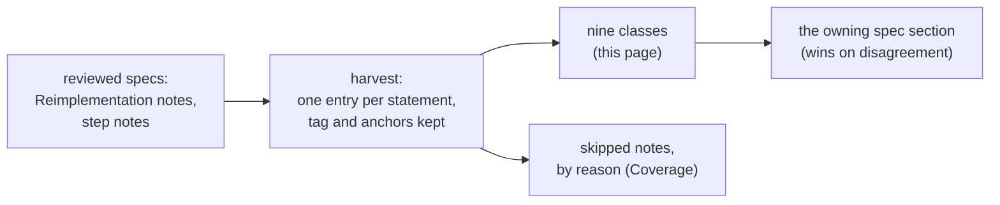

# Quirks: the behaviour a faithful reimplementation must keep

## Purpose

A careful reimplementer "fixes" some behaviour of the 1.14d `Game.exe` by accident: an unsigned divide made signed, a
draw skipped because its result is thrown away, a `≤` turned into `<`, a table edge read the "sensible" way. The reviewed
specs state these traps, scattered over their *Reimplementation notes* and step notes. This page lists them in one
place, by class, so that a reimplementation can be checked against the whole list.

This is an **index, not a spec of its own** ([plan 0057](../../plans/0057-quirks-catalogue.md), owner decision 1). Each
entry restates one statement of a reviewed spec, with that statement's tag and anchors, and links the section that
holds it. It claims nothing new. **The owning spec wins on any disagreement**: read the linked section before you
implement an entry, because the one-line restatement leaves out the conditions the spec gives in full.

## How to read an entry

| Column | Meaning |
|---|---|
| Id | `Q<n>`, stable within this page's revision; the classes below are in id order |
| Quirk | the behaviour to keep, restated in one or two sentences |
| Tag | the tag the source statement carries; a source note that holds two tags gives two entries |
| Anchors | anchors copied from the source statement (functions, addresses, runs, table columns) |
| Source | the owning spec's section; `nK` is the K-th bullet of that spec's *Reimplementation notes*, counted from 1 |

What counts as a quirk (owner decision 2): behaviour a reimplementer would plausibly "fix" or get wrong, in eight
classes, plus deliberate oddities that look like bugs and the community descriptions that 1.14d does not follow. Left
out: presentation (displayed names, strings, the quest log), wall-clock timing, and table-loading rules that the table
docs already own. Crash and hang paths are listed from the specs' code readings only (owner decision 5); none was
provoked for this page.

`python3 -I tools/quirks.py check` verifies the page mechanically: every entry's tag appears in each tagged source it
cites, every anchor of the entry appears in one of them, and the coverage table accounts for every note of every spec.

## Entries

| Class | Entries | C | I |
|---|---|---|---|
| [1. Arithmetic width and sign](#1-arithmetic-width-and-sign) | 22 | 16 | 6 |
| [2. Rounding and float](#2-rounding-and-float) | 19 | 14 | 5 |
| [3. Wrap and overflow](#3-wrap-and-overflow) | 9 | 2 | 7 |
| [4. Bounds, comparisons and table edges](#4-bounds-comparisons-and-table-edges) | 67 | 48 | 19 |
| [5. Draw order and dead draws](#5-draw-order-and-dead-draws) | 134 | 114 | 20 |
| [6. Data-dependent branches](#6-data-dependent-branches) | 122 | 96 | 26 |
| [7. Timing and frame edges](#7-timing-and-frame-edges) | 19 | 10 | 9 |
| [8. Multiplayer edges](#8-multiplayer-edges) | 11 | 9 | 2 |
| [9. Deliberate oddities that look like bugs](#9-deliberate-oddities-that-look-like-bugs) | 32 | 25 | 7 |
| **Total** | 435 | 334 | 101 |

### 1. Arithmetic width and sign

| Id | Quirk | Tag | Anchors | Source |
|---|---|---|---|---|
| Q1 | The RNG's `low` is `u32` and the range reduction divides unsigned; a signed `low` is wrong for `low ≥ 2^31`. | [C] | fn:RNG_Range@0x0045C390, run:2026-10-11-rng-emu | [rng/README](../rng/README.md#reimplementation-notes) n4 |
| Q2 | The seed's `high` word is not the constant 666 after `Init`: each step overwrites it with the carry word, so all 64 bits are state. | [C] | run:2026-10-11-rng-emu | [rng/README](../rng/README.md#reimplementation-notes) n3 |
| Q3 | The animation rate divides `(spd × X) mod 2³²` by 100 unsigned for cast, get-hit, block, attack and default; only the moving branch divides signed, so a negative factor gives the fastest rate (unreachable on stock data). | [I] | fn:UNIT_AnimSetRate@0x00623F50 | [anim/timing](../anim/timing.md#reimplementation-notes) n3 |
| Q4 | Calc opcode `04` reads its variable index unsigned (0–255): `04 80` is variable 128. | [C] | 0x006C0C0E, run:2026-10-16-calc | [data/calc § B](../data/calc.md#b-the-encoding); [data/calc](../data/calc.md#reimplementation-notes) n7 |
| Q5 | `manashift` shifts by `manashift & 31` (the processor's masking of a byte that can reach 255); mask explicitly where shifts past 31 are undefined or saturate. | [C] | 0x0064663E, 0x0064667A, 0x006468AA, run:2026-10-17-sweep-emu | [data/calc](../data/calc.md#reimplementation-notes) n9 |
| Q6 | The string-table hash takes key bytes as signed chars: a byte ≥ 0x80 gives another home slot than the unsigned ELF hash (a miss walks `max_probes` nodes whatever the slot). | [C] | fn:STRTABLE_Hash@0x005249E0, run:2026-10-15-strings | [data/strings](../data/strings.md#reimplementation-notes) n4 |
| Q7 | DR and MDR come before the resistance; a field they push negative skips the resistance and stays negative. | [C] | 0x0057BFB4, 0x0057C04D, run:2026-10-16-combat | [combat/reductions](../combat/reductions.md#reimplementation-notes) n1 |
| Q8 | Outdoor sizes, footprints and the mid cell divide signed; the preset rotation uses signed `%`. | [C] | fn:sub_00675360_OutdoorLevelBuild@0x00675360, fn:sub_00674320_OutPresetFileRotate@0x00674320, run:2026-10-15-drlg-outdoor | [drlg/outdoor](../drlg/outdoor.md#reimplementation-notes) n12 |
| Q9 | Trade prices divide the stat and staff-mod sums by `n` unsigned and the affix accumulators signed: with `n > 1` a negative stat sum divides as a large unsigned value. | [C] | 0x00628E9F, 0x006292D7, run:2026-10-17-economy | [items/economy](../items/economy.md#reimplementation-notes) n4 |
| Q10 | Unique and set `lvl` comparisons are signed 16-bit (`movsx`), against an ilvl raised to at least 1. | [I] | 0x005568E3, 0x005C263E | [items/uniques-sets](../items/uniques-sets.md#reimplementation-notes) n9 |
| Q11 | A region's `raritySum` is one byte. | [C] | struct:MonRegion+0x011, run:2026-10-12-mon-pool | [monsters/pool](../monsters/pool.md#reimplementation-notes) n7 |
| Q12 | The live special count `nSpecial` is an i32 compared through its low byte with `MonUMin`/`MonUMax`. | [C] | 0x005BE037, struct:MonRegion+0x2C8, run:2026-10-13-mon-spawn | [monsters/spawn](../monsters/spawn.md#reimplementation-notes) n11 |
| Q13 | Objects `Xspace`/`Yspace` are unsigned: a negative `.txt` value is a step of 249..255 subtiles. | [C] | tbl:Objects.txt:Xspace, fn:OBJPOP_Barrels@0x00551850, run:2026-10-15-objects | [objects](../objects/README.md#reimplementation-notes) n7 |
| Q14 | Experience is unsigned: thresholds above 2³¹ and `nextexp` compare and store as `u32`. | [C] | fn:EXP_LevelFromExp@0x00611860, run:2026-10-16-player | [player/creation](../player/creation.md#reimplementation-notes) n4 |
| Q15 | With stock `ExpRatio` and shift 10, the kill-experience shift count `(r >> s) + s` is 10 or 11 (11 on the 70 rows at 1024, 10 elsewhere and above `MaxLvl`). | [C] | fn:XP_ApplyExpRatio@0x0057E390, 0x0057E3B9, 0x0057E3C1, tbl:Experience.txt:ExpRatio | [player/creation](../player/creation.md#reimplementation-notes) n7 |
| Q16 | `StatPerLevel` is read as an `i8`. | [I] | struct:CharStatsRec+0x50 | [player/creation](../player/creation.md#reimplementation-notes) n9 |
| Q17 | The item bitstream's width clamp is unsigned: a negative value written into an `n`-bit field becomes `2^n − 1`, not 0. | [C] | fn:BITBUF_WriteClamped@0x0062AF50, run:2026-10-17-sweep-emu | [save/d2s](../save/d2s.md#reimplementation-notes) n8 |
| Q18 | The `gf` stats writer clamps signed instead: a negative value of an unsigned stat becomes 0. | [I] | 0x0056965B, 0x00569661 | [save/d2s](../save/d2s.md#reimplementation-notes) n8 |
| Q19 | An item property's param is read unsigned (a 9-bit 270 stays 270). | [C] | fn:ITEMS_ReadProperty@0x0062AC80, run:2026-10-27-sweep-d2s-load | [save/d2s](../save/d2s.md#reimplementation-notes) n13 |
| Q20 | `CSvParam` is read signed in the `gf` list; no stock row reads one. | [I] | fn:D2S_ReadStatsBits@0x0056A4F0 | [save/d2s](../save/d2s.md#reimplementation-notes) n13 |
| Q21 | Missile function numbers are tested as s16, `> 0` first, so row 568's hit function does not run. | [I] | 0x005ADA0D, 0x005ADA1F | [skills/missiles](../skills/missiles.md#reimplementation-notes) n1 |
| Q22 | The regeneration tick adds stat 74 whatever its sign: positive heals up to the maximum, negative (poison) bleeds the player. | [C] | fn:sub_00580610_LifeRegenTick@0x00580610, run:2026-10-17-stats | [stats/states § E](../stats/states.md#e-the-regeneration-tick) |

### 2. Rounding and float

| Id | Quirk | Tag | Anchors | Source |
|---|---|---|---|---|
| Q23 | `MulDiv` is signed and truncates toward zero in every branch; the 32-bit branch is the one every stock `MonLvlStats` call at creation takes. | [C] | fn:sub_00483360_MulDiv@0x00483360, run:2026-10-15-mon-stats | [monsters/stats § A](../monsters/stats.md#a-muldiv-and-monlvlstats) |
| Q24 | Kill-experience level penalties are /256 factors (207/256, 13/256 …), not the community's rounded percentages. | [C] | data:g_XpPenaltyBelow@0x006E1668, run:2026-10-16-player | [player/creation § G](../player/creation.md#g-kill-experience--xp_compute) |
| Q25 | The party share's quotient is stored as an f32, and each member's input is `trunc((f64) level × (f64) q_f32)`, the product never rounded to f32 (98 inputs of the run separate the two). | [C] | fn:XP_PartyShare@0x0057E6C0, fn:CRT_ftol2@0x00682FD0, run:2026-10-20-two-clients | [player/creation § J](../player/creation.md#j-other-level-and-experience-changes) |
| Q26 | The chance to hit truncates `100·AR/(AR+DEF)` to an integer before the level factor; one combined expression gives other values. | [C] | 0x0057DB01, 0x0057DB30, run:2026-10-16-combat | [combat/to-hit](../combat/to-hit.md#reimplementation-notes) n2 |
| Q27 | Calc `÷` is C division (toward zero), and a zero divisor gives 0 instead of a fault. | [C] | 0x006C0EC6, run:2026-10-17-sweep-emu | [data/calc](../data/calc.md#reimplementation-notes) n2 |
| Q28 | The hireling list entry floors (`>> 3`) where `MERC_SetLevel` truncates (`÷ 8`, `÷ 4`); they differ for the negative products every stock row gives below its first band. The skill level floors (`>> 5`) in both. | [C] | fn:HIRELING_RollEntry@0x006637F0, fn:MERC_SetLevel@0x00572840, run:2026-10-16-hirelings | [hirelings](../hirelings/README.md#reimplementation-notes) n4 |
| Q29 | A mercenary's experience: another unit's kill gives `(gain × 86) ÷ 256` truncating, its own kill the full gain, then `MERC_AddExp` adds twice that; at or above its owner's level it gains nothing. | [C] | fn:XP_OnMonsterKill@0x0057E990, fn:MERC_AddExp@0x0057E860, run:2026-10-27-sweep-hirelings | [hirelings](../hirelings/README.md#reimplementation-notes) n13 |
| Q30 | Trade prices carry three running values `P`, `S`, `R` through every step, including those the mode discards; the order of terms matters through the later truncations. | [C] | fn:ITEMS_TradePriceCore@0x0062EFB0, run:2026-10-17-economy | [items/economy](../items/economy.md#reimplementation-notes) n1 |
| Q31 | The skill-based price terms divide `S` by 4096 and `P`, `R` by 1024; all other terms divide all three by 1024. The tables' `Divide` columns are not read. | [C] | 0x00628F35, run:2026-10-17-economy | [items/economy](../items/economy.md#reimplementation-notes) n3 |
| Q32 | Quality-roll divisions truncate toward zero (`−3 ÷ 2 = −1`), not floor. | [I] | 0x0055872F, 0x00558733 | [items/quality](../items/quality.md#reimplementation-notes) n8 |
| Q33 | `NoDrop` is recomputed per pick in floating point; IEEE binary64 with round-to-nearest-even matches all 2 909 logged evaluations. | [C] | 0x0055A8A1, 0x0055A9D7, run:2026-10-11-tc-drops | [items/tc](../items/tc.md#reimplementation-notes) n3 |
| Q34 | The game computes `1 − q`, not the algebraically equal `p·T/(1 − p)`; on stock data the two never differ. | [I] | 0x0055A8A1, 0x0055A9D7 | [items/tc](../items/tc.md#reimplementation-notes) n3 |
| Q35 | Superior ethereal `dur%`: func 13 runs in the builder, then the ethereal roll halves the base stat 73 to `⌊max/2⌋ + 1` and stat 72 takes the re-evaluated 73. | [C] | fn:sub_00556CA0_ItemRollEthereal@0x00556CA0, 0x00556D41, 0x00556D6E, run:2026-10-15-items-chain-forced | [items/properties](../items/properties.md#reimplementation-notes) n13 |
| Q36 | So the `+1` comes before the percentage: `h + ⌊h · dur%/100⌋`, which differs by one from the other order for some values. | [I] | 0x00556D41, 0x00556D6E, fn:sub_00626200_StatEvaluate@0x00626200 | [items/properties](../items/properties.md#reimplementation-notes) n14 |
| Q37 | `MonHpAddPct` truncates before it multiplies once max HP × 256 exceeds `0x100000` (HP > 4 096). | [C] | fn:sub_005A0D20_MonHpAddPct@0x005A0D20, run:2026-10-15-mon-stats | [monsters/stats](../monsters/stats.md#reimplementation-notes) n4 |
| Q38 | Two hpregen formulas: creation `((hp << 8)·r) >> 12`, the stat callback `((new >> 8)·r) >> 4`; they can differ by one, and a group member keeps the callback's value. | [C] | 0x00573FF6, 0x00574058, fn:sub_0055B800_MonStatCallback@0x0055B800, run:2026-10-15-mon-stats | [monsters/stats](../monsters/stats.md#reimplementation-notes) n5 |
| Q39 | The life rescale truncates a float32, and never takes current life below 1. | [C] | fn:sub_0055B800_MonStatCallback@0x0055B800, run:2026-10-17-stats | [stats/aggregate](../stats/aggregate.md#reimplementation-notes) n5 |
| Q40 | A path step that would pass its point lands on the subtile centre, so frames per point are a ceiling and the next step starts from the centre. | [I] | fn:sub_00650090_PathStepSnap@0x00650090 | [anim/movement](../anim/movement.md#reimplementation-notes) n3 |
| Q41 | The missile step direction is a lookup in `g_PathDirTable`, not a trigonometric function. | [I] | data:g_PathDirTable@0x006EB7E0 | [skills/missiles](../skills/missiles.md#reimplementation-notes) n10 |

### 3. Wrap and overflow

| Id | Quirk | Tag | Anchors | Source |
|---|---|---|---|---|
| Q42 | The level seed is a `u32` sum that wraps, not a draw from the act seed. | [C] | fn:DRLG_LevelCreate@0x00642AE0, run:2026-10-11-seed-tree | [rng/seeds](../rng/seeds.md#reimplementation-notes) n3 |
| Q43 | `MulDiv` returns a 64-bit quotient outside the 32-bit range wrapped (its low 32 bits), not saturated. | [C] | fn:sub_00483360_MulDiv@0x00483360, fn:CRT_alldiv@0x00684240, run:2026-10-17-sweep-emu2 | [monsters/stats § A](../monsters/stats.md#a-muldiv-and-monlvlstats) |
| Q44 | Crash path: `MulDiv` faults when a 32-bit product wraps to `INT32_MIN` with `c` = −1 (`idiv` overflow). | [I] | 0x00483376, 0x0048338C | [monsters/stats § A](../monsters/stats.md#a-muldiv-and-monlvlstats) |
| Q45 | Crash path: calc `INT32_MIN ÷ −1` raises the processor's divide error; only an edited formula with a variable divisor reaches it. | [I] | 0x006C0EC6 | [data/calc § D](../data/calc.md#d-the-evaluator--calc_eval) |
| Q46 | `raritySum` wraps mod 256 with large `Rarity` values (13 × 2 at most on stock data). | [I] | fn:sub_005475E0_MonRegionPool@0x005475E0 | [monsters/pool](../monsters/pool.md#reimplementation-notes) n7 |
| Q47 | `XP_Compute` clamps an input above `0x7FFFFF` to `0x7FFFFF`; no kill reached it. | [I] | 0x0057E480, 0x0057E4FF | [player/creation § G](../player/creation.md#g-kill-experience--xp_compute) |
| Q48 | `XP_ApplyExpRatio` switches to `(exp >> s) × r` when `exp × r` would overflow the shift; no kill reached it. | [I] | 0x0057E390, 0x0057E3E7 | [player/creation § G](../player/creation.md#g-kill-experience--xp_compute) |
| Q49 | A gold add over a cap writes 0, not the cap; callers clip first, so only paths that skip the clip (the PvP death write) differ. | [I] | fn:sub_0053FF00_UnitAddGoldStat@0x0053FF00 | [items/economy](../items/economy.md#reimplementation-notes) n8 |
| Q50 | Hang and crash path: a progressive ring's step count is used untested; 0 never ends, a negative count reads below the direction tables until the index wraps. | [I] | 0x005D4657, 0x005D467D, 0x005D4D77, 0x005D4DAA | [combat/delivery](../combat/delivery.md#reimplementation-notes) n11 |

### 4. Bounds, comparisons and table edges

| Id | Quirk | Tag | Anchors | Source |
|---|---|---|---|---|
| Q51 | `-seed 0` is impossible: the option applies only when non-zero, so 0 takes the clock path. | [C] | fn:sub_0044D860_ApplySeedOption@0x0044D860, run:2026-10-11-seed-tree-p1 | [rng/seeds](../rng/seeds.md#reimplementation-notes) n2 |
| Q52 | The to-hit clamp tests `≤ 5` and `≥ 95`: a rolled attack is never certain and never impossible. | [C] | 0x0057DB22, 0x0057DB30, run:2026-10-16-combat | [combat/to-hit](../combat/to-hit.md#reimplementation-notes) n3 |
| Q53 | The damage maximum is exclusive: `lo + RangeB(hi − lo)` never reaches `hi`. | [C] | fn:COMBAT_RollPhysical@0x0057B420, run:2026-10-16-combat | [combat/damage](../combat/damage.md#reimplementation-notes) n5 |
| Q54 | Life below 256 is 0: a hit that leaves less than one life point kills. | [C] | 0x0057C852, 0x0057C874, run:2026-10-16-combat | [combat/delivery](../combat/delivery.md#reimplementation-notes) n6 |
| Q55 | Resistance: penalty before the cap (a player's 115 % fire in Hell is 15 %, not −15 %). | [C] | fn:COMBAT_ResistFor@0x0057BE00, run:2026-10-16-combat | [combat/reductions](../combat/reductions.md#reimplementation-notes) n2 |
| Q56 | The floor comes between the penalty and the cap; it changed no logged value. | [I] | fn:COMBAT_ResistFor@0x0057BE00 | [combat/reductions](../combat/reductions.md#reimplementation-notes) n2 |
| Q57 | Monster resistances are never capped: above 100 is immunity. | [C] | run:2026-10-16-combat | [combat/reductions](../combat/reductions.md#reimplementation-notes) n4 |
| Q58 | Pierce does not lower a monster's immunity. | [I] | fn:COMBAT_ResistFor@0x0057BE00 | [combat/reductions](../combat/reductions.md#reimplementation-notes) n4 |
| Q59 | The player-row reduction loop stops at the first monster-only row, so for a player or hireling attacker the steal percents are not scaled by P. | [I] | fn:COMBAT_ApplyReductions@0x0057C1E0 | [combat/reductions](../combat/reductions.md#reimplementation-notes) n6 |
| Q60 | No minimum damage: nothing in the reduction path keeps a hit above 0. | [I] | fn:COMBAT_ApplyReductions@0x0057C1E0 | [combat/reductions](../combat/reductions.md#reimplementation-notes) n7 |
| Q61 | The life tick floors a player at 256 (one point), not 0; a monster's tick can kill. | [I] | fn:sub_00580610_LifeRegenTick@0x00580610 | [stats/states](../stats/states.md#reimplementation-notes) n6 |
| Q62 | The TCEx loader stops at the first empty name, and the item loop at the first empty `ItemN` (an `Item5` after a blank `Item4` is ignored); `Picks` 0 becomes 1. | [I] | fn:TC_LoadTreasureClassEx@0x006547D0 | [data/excel § G](../data/excel.md#g-treasure-classes); [data/excel](../data/excel.md#reimplementation-notes) n5 |
| Q63 | Monster references after the duplicate `cr_lancer8` are off by one: a pool cell is a MonStats record position (723 is the second `cr_lancer8`), not a name to look up. | [C] | data:g_pMonStats@0x0096C6A8, run:2026-10-12-mon-pool, tbl:Levels.txt:mon1 | [monsters/pool](../monsters/pool.md#reimplementation-notes) n5; [data/excel § H](../data/excel.md#h-monster-references); [data/excel](../data/excel.md#reimplementation-notes) n7 |
| Q64 | Language id 13 is not `ENG`: ids 0–12 give their entry, only ids ≥ 14 map to entry 0. | [C] | fn:LNG_GetLanguageCode@0x00525260, run:2026-10-17-sweep-emu | [data/strings](../data/strings.md#reimplementation-notes) n8; [data/excel § I](../data/excel.md#i-string-table-keys) |
| Q65 | Crash path: a `use` byte of 13 reads the 0x18 bytes after the language table, and the string-table load would fault; only an edited `use` file holds 13. | [I] | 0x00525832, 0x005258E7, 0x00730514 | [data/excel § I](../data/excel.md#i-string-table-keys); [data/excel](../data/excel.md#reimplementation-notes) n10 |
| Q66 | A string key lookup returns the lowest entry of a duplicated key and `0xFFFF` for an absent key; an exact-match map can replace the probe walk only if it keeps both. | [C] | fn:STRTABLE_FindInTable@0x00524C60, fmt:tbl#hash-table | [data/strings](../data/strings.md#reimplementation-notes) n3 |
| Q67 | Entry 0 of `string` is indistinguishable from "not found" through `GetByKey`. | [C] | fn:STRTABLE_GetByKey@0x00524D30, run:2026-10-17-sweep-emu | [data/strings](../data/strings.md#reimplementation-notes) n7 |
| Q68 | Collision: a footprint cell outside every reachable room returns `0x27` or more whatever the mask, so it always rejects (this keeps monsters off rows next to an inactive neighbour). | [C] | fn:COLL_CellTest@0x0064D450, run:2026-10-14-collision | [drlg/collision](../drlg/collision.md#reimplementation-notes) n1 |
| Q69 | But a plus whose centre is in no room returns the mask itself; a mask of 0 then accepts. | [C] | fn:COLL_PlusTest@0x0064D100, run:2026-10-14-collision | [drlg/collision](../drlg/collision.md#reimplementation-notes) n2 |
| Q70 | "Reachable" means the hint room or its near list: a cell of an active room outside the hint's near list is "no room". | [C] | fn:sub_00463740_RoomAtSubtile@0x00463740, run:2026-10-14-collision | [drlg/collision](../drlg/collision.md#reimplementation-notes) n3 |
| Q71 | DT1 sub-tile rows are reversed: byte row 4 is the top row of the 5 × 5 block. | [C] | fn:COLL_StampTile@0x0064C4C0, run:2026-10-14-collision | [drlg/collision](../drlg/collision.md#reimplementation-notes) n5 |
| Q72 | `SpawnPosOnTile` never tests entry `i − 1`, turns `i = 0` into 1, and returns the tile centre, not the offset cell it tested. | [C] | fn:sub_005B2700_SpawnPosOnTile@0x005B2700, run:2026-10-14-collision | [drlg/collision](../drlg/collision.md#reimplementation-notes) n10 |
| Q73 | A tile pick sums at most 40 candidates, in DT1-list slot order (no stock key has more than 28). | [I] | fn:DRLG_PickTileByRarity@0x0066D820 | [drlg/room-tiles](../drlg/room-tiles.md#reimplementation-notes) n2 |
| Q74 | Read past an end: `Act1/Outdoors/Trees.ds1` is 12 bytes short, and `DS1_Parse` reads its last group's y, w, h past the exact-size buffer (uninitialised heap). | [I] | fn:DS1_Parse@0x00665950, fn:FILE_LoadWhole@0x00517079 | [drlg/room-tiles](../drlg/room-tiles.md#reimplementation-notes) n4 |
| Q75 | Read the missing `Trees.ds1` bytes as zeros: 26 of 27 logged loads held zeros there, and that group's draws (group, x, y) are reproduced with w = h = 0. | [C] | fn:sub_00670170_LvlSubApplyPick@0x00670170, run:2026-10-11-drlg-roomk | [drlg/room-tiles](../drlg/room-tiles.md#reimplementation-notes) n4 |
| Q76 | Without `KillEdge` a room walks (w+1) × (h+1) cells, so its right and bottom edges are built by both rooms that share them (the bit-2 scan merges the second build). | [C] | fn:sub_0066EC10_RoomCellsBuild@0x0066EC10, run:2026-10-11-drlg-roomk | [drlg/room-tiles](../drlg/room-tiles.md#reimplementation-notes) n7 |
| Q77 | The filler test is exclusive (`x < R.x + R.w`), the neighbour test inclusive (`x ≤ N.x + N.w`). | [C] | fn:sub_0066B980_RectContains@0x0066B980, fn:sub_0066B9D0_RectContainsIncl@0x0066B9D0, run:2026-10-11-drlg-roomk | [drlg/room-tiles](../drlg/room-tiles.md#reimplementation-notes) n8 |
| Q78 | The bit-2 merge table has stride 7 but 8 columns: index `row·7 + old orientation` (column 7 is the next row's column 0), and test `Tr ≥ 0`, `E.o ≤ 7` signed. | [I] | data:g_Bit2OrientMerge@0x006EF574, fn:sub_0066E740_Bit2TileMerge@0x0066E740 | [drlg/room-tiles](../drlg/room-tiles.md#reimplementation-notes) n9 |
| Q79 | For the based maze types an exit mask of 0 gives `base`, not "no change"; only a zero table value leaves the `Def` as it was. | [C] | fn:sub_006709B0_MazeRoomDefFromExits@0x006709B0, run:2026-10-15-drlg-maze | [drlg/maze](../drlg/maze.md#reimplementation-notes) n6 |
| Q80 | Displaced table bases: the jungle clearing offsets are indexed by level id from `0x006F2240`, the Act I river indices by the border `Def` from `0x006F2680` (rows 4–15 used). | [C] | data:g_JungleClearingOff@0x006F2370, data:g_A1RiverIdx@0x006F2680, run:2026-10-15-drlg-outdoor | [drlg/outdoor](../drlg/outdoor.md#reimplementation-notes) n10 |
| Q81 | The hireling list level is `playerLevel − 5 + (low mod 5)`, floor 2: 1 to 5 levels below the player, never above. | [C] | 0x00663874, 0x006638BB, run:2026-10-16-hirelings | [hirelings](../hirelings/README.md#reimplementation-notes) n6 |
| Q82 | A hireling AR or defence clamped to 0 is not in the stat list at all. | [C] | fn:MERC_SetLevel@0x00572840, run:2026-10-16-hirelings | [hirelings](../hirelings/README.md#reimplementation-notes) n10 |
| Q83 | The affix pick draws `Range(W + 1)`, so the last candidate in table order gets one extra unit of weight. | [C] | 0x005C1828, 0x005C189E, run:2026-10-14-affixes | [items/affixes](../items/affixes.md#reimplementation-notes) n2 |
| Q84 | Affix ids are merged indices + 1: subtract the block start and 1 for the `magicprefix` row. | [C] | fn:MAGICAFFIX_GetRecord@0x00633EE0, run:2026-10-14-affixes | [items/affixes](../items/affixes.md#reimplementation-notes) n12 |
| Q85 | A weighted-walk draw of exactly `W` takes the last candidate (the disassembly), not "no affix" (Ghidra's decompile). | [C] | 0x005C188B, run:2026-10-14-affixes | [items/affixes](../items/affixes.md#reimplementation-notes) n13 |
| Q86 | Cube forced affix ids are block rows + 1, taken with no weighted draw. | [C] | fn:ITEMS_PickMagicAffix@0x005C1560, run:2026-10-15-cube | [items/cube](../items/cube.md#reimplementation-notes) n9 |
| Q87 | A forced affix row skips the level window (row 17 took *of Spikes*, level 21, at alvl 19). | [C] | 0x005C16FE, 0x005C1713, fn:ITEMS_PickMagicAffix@0x005C1560, run:2026-10-27-sweep-cube | [items/cube](../items/cube.md#reimplementation-notes) n10 |
| Q88 | That it skips only the level window has no separating stock case: the 8 stock forced ids pass every other test. | [I] | 0x005C16D3, 0x005C17AD, tbl:CubeMain.txt:output | [items/cube](../items/cube.md#reimplementation-notes) n11 |
| Q89 | Crash path: on crafted rows 72, 83, 84 and 90 at a low output ilvl, a side with too few groups picks 0 against a filled slot and the duplicate test reads a NULL record; the 1.14d outcome stops there, it does not draw again. | [C] | 0x005C2460, run:2026-10-27-sweep-cube, tbl:MagicSuffix.txt:group | [items/cube](../items/cube.md#reimplementation-notes) n12 |
| Q90 | Cube `qty=` and `sock=` share one byte; the `sock` flag tells which. | [C] | 0x0056632A, run:2026-10-15-cube, run:2026-10-27-sweep-cube | [items/cube](../items/cube.md#reimplementation-notes) n14 |
| Q91 | The socket count is `start mod cap + 1`, not a draw; keep `ItemData+0x10`, which a fallback rewrites. | [C] | fn:ITEMS_SetSockets@0x0062BCB0, run:2026-10-14-props-forced | [items/properties](../items/properties.md#reimplementation-notes) n4 |
| Q92 | Durability and quantity draws never reach the top: `[⌊d/2⌋, 2⌊d/2⌋ − 1]` and `[lo, top − 1]`. | [C] | 0x00557C27, 0x00557C8D, run:2026-10-14-props-forced | [items/properties](../items/properties.md#reimplementation-notes) n8 |
| Q93 | Crash path: every quality `*Divisor` is a signed `idiv` with no zero test; reject a zero divisor at load or treat it as fatal, never substitute a value. | [I] | 0x0055872F, 0x00558733, tbl:ItemRatio.txt:NormalDivisor | [items/quality](../items/quality.md#reimplementation-notes) n9 |
| Q94 | `TCQuestId` is the quest word itself, not word + 1 (Andariel is word 6); the Misc/Weapons `quest` column is quest object id + 1. | [C] | tbl:MonStats.txt:TCQuestId, tbl:Misc.txt:quest, run:2026-10-16-quest-drops | [items/quest-drops](../items/quest-drops.md#reimplementation-notes) n3 |
| Q95 | A runeword row with one rune more than the sockets reads an unwritten `kids[n]` slot. | [I] | 0x0062BFA3, 0x0062BFCE | [items/sockets-runewords](../items/sockets-runewords.md#reimplementation-notes) n5 |
| Q96 | The TC item count `max` is global to the call (6 for monster drops): the 6th item ends the whole recursion and skips gold find. | [C] | 0x0055AEF2, 0x0055AF59, run:2026-10-20-sweep-items-tc | [items/tc](../items/tc.md#reimplementation-notes) n8 |
| Q97 | Unique durability is ×3 or ×2 of the current values, each capped at 255, only for a base with durability (`GetUnitStat` for 72, `GetUnitBaseStat` for 73). | [C] | 0x005576F7, 0x00557765, run:2026-10-14-uniques-forced | [items/uniques-sets](../items/uniques-sets.md#reimplementation-notes) n10 |
| Q98 | Set weight 0 counts as 1 and a negative weight is kept; a zero total returns before any draw, a negative total reaches `RangeB` (no draw, 0) and the walk may run off the end. | [C] | fn:ITEMS_BuildSetPick@0x005C25C0, 0x005C26B6, 0x005C2706, run:2026-10-17-sweep-emu2 | [items/uniques-sets](../items/uniques-sets.md#reimplementation-notes) n11 |
| Q99 | Vendor stock level is not clamped to 99 in Nightmare and Hell (`clvl` 99 gives 104), while the gamble `lvl` is clamped to 5..99. | [C] | fn:VENDOR_StockLevel@0x00576890, fn:GAMBLE_BuildInv@0x00578790, run:2026-10-27-sweep-vendors | [items/vendors](../items/vendors.md#reimplementation-notes) n7 |
| Q100 | A 33rd failure ends the whole vendor build, permanent items included, at the next limit test; no stock build reaches it. | [I] | 0x00576AA3, 0x00576BE5, 0x00576B74 | [items/vendors](../items/vendors.md#reimplementation-notes) n8 |
| Q101 | A level's monster candidate count is the number of leading non-negative slots (of 25), not the number of set slots. | [I] | fn:DRLG_LoadLevels@0x0061C540 | [monsters/pool](../monsters/pool.md#reimplementation-notes) n6 |
| Q102 | The variant duplicate check tests `tries = 0`, not `≤ 0`: two equal existing sets make one try cost two, `tries` passes 0, and the loop runs on (a `≤ 0` control differs in exactly those 192 of 3 000 calls). | [C] | fn:sub_005BDB20_MonVariantRoll@0x005BDB20, 0x005BDE28, 0x005BDE46, run:2026-10-17-sweep-emu2 | [monsters/pool](../monsters/pool.md#reimplementation-notes) n8 |
| Q103 | That loop ends with probability 1 but has no bound on its draws. | [I] | fn:sub_005BDB20_MonVariantRoll@0x005BDB20 | [monsters/pool](../monsters/pool.md#reimplementation-notes) n8 |
| Q104 | The critter count excludes `MaxGrp`: `RangeB(MaxGrp − MinGrp) + MinGrp`. | [C] | fn:sub_0046C460_ClientCritters@0x0046C460, run:2026-10-12-mon-pool | [monsters/pool](../monsters/pool.md#reimplementation-notes) n9 |
| Q105 | The spawn density test is `≤`: `r = monDen` passes. | [C] | 0x0054EDD4, run:2026-10-13-mon-spawn | [monsters/spawn](../monsters/spawn.md#reimplementation-notes) n7 |
| Q106 | Object comparisons differ by one: slot test `r ≤ ObjPrb`, member walk `r2 < sum`, urn drop `P100 < 21` (21 %), empty chest `r ≤ 24` (25 %). | [C] | fn:sub_00552610_RoomObjectsPopulate@0x00552610, fn:OBJOP_Urn@0x005866C0, fn:OBJOP_Chest@0x00585F60, run:2026-10-15-objects | [objects](../objects/README.md#reimplementation-notes) n4 |
| Q107 | `ShrinePick` keeps its eighth code when no try passes `LevelMin`: no always-allowed fallback, no ninth draw. | [C] | fn:OBJ_ShrinePick@0x0054F770, run:2026-10-15-objects | [objects](../objects/README.md#reimplementation-notes) n11 |
| Q108 | `XP_Compute` returns 0 at the level cap. | [C] | fn:XP_Compute@0x0057E480, run:2026-10-27-sweep-player | [player/creation](../player/creation.md#reimplementation-notes) n6 |
| Q109 | For a non-positive input `XP_Compute` returns 1, not 0. | [I] | fn:XP_Compute@0x0057E480 | [player/creation](../player/creation.md#reimplementation-notes) n6 |
| Q110 | The eclipse period is 15 or 16, not up to 17: `RandLoHi(15, 17)` is one `Step`, period `15 + (low & 1)` (run for level 44). | [C] | 0x0059EDE1 | [quests/progression § G](../quests/progression.md#g-the-draws); [quests/progression](../quests/progression.md#reimplementation-notes) n6 |
| Q111 | Simple items have no `n_filled`: their bit 108 is the realm flag. | [C] | fn:ITEMS_WriteCompact@0x0062AF80, 0x0062AF1F | [save/d2s](../save/d2s.md#reimplementation-notes) n10 |
| Q112 | Saved prefix ids are rebased, suffix ids are not. | [C] | 0x0062CEEA | [save/d2s](../save/d2s.md#reimplementation-notes) n11 |
| Q113 | Grouped properties (17, 48, 50, 52, 54, 57) carry one id, followed by the next ids' values with no id and no param. | [C] | fn:ITEMS_ReadProperty@0x0062AC80, fmt:d2s#property-lists | [save/d2s](../save/d2s.md#reimplementation-notes) n12 |
| Q114 | The save reader stops at 8 KiB (`0x2000` bytes). | [C] | fn:PLRSAVE_ReadFile@0x005343A0, run:2026-10-27-sweep-d2s-load | [save/d2s](../save/d2s.md#reimplementation-notes) n14 |
| Q115 | The writer's buffer is 8 KiB; no write passed it. | [I] | fn:PLRSAVE_Save@0x00532400 | [save/d2s](../save/d2s.md#reimplementation-notes) n14 |
| Q116 | Missile `LevRange` counts every level: `LevRange · lvl + Range`, not from level 2. | [C] | fn:sub_0059FA30_MissileCreate@0x0059FA30, run:2026-10-27-skills | [skills/missiles](../skills/missiles.md#reimplementation-notes) n8 |
| Q117 | The path's tenth subtile crossing is unchecked: a very fast step can pass a blocked subtile after ten free crossings. | [I] | 0x00650292, 0x006502AA | [anim/movement](../anim/movement.md#reimplementation-notes) n4 |

### 5. Draw order and dead draws

| Id | Quirk | Tag | Anchors | Source |
|---|---|---|---|---|
| Q118 | The `n < 1` guard is not everywhere: `Range`/`RangeB` return 0 without drawing for `n < 1`, but `RangePow2` and inlined constant-modulus draws (the `% 7` of `DRLG_ActCreate`) have no guard and step anyway; each consuming spec states the form per site. | [C] | fn:RNG_RangePow2@0x00472210, fn:DRLG_ActCreate@0x00642DA0, run:2026-10-11-rng-emu | [rng/README](../rng/README.md#reimplementation-notes) n1 |
| Q119 | Reduce the new `low`: the step comes first and the result is taken from the updated state. | [C] | run:2026-10-11-rng-emu | [rng/README](../rng/README.md#reimplementation-notes) n2 |
| Q120 | `RangePow2Plus` has no caller, and 14 inlined draw sites lie in 9 bodies with no static reference; a count of reachable draw sites leaves them out. | [I] | fn:RNG_RangePow2Plus@0x00472240 | [rng/README § Algorithm](../rng/README.md#algorithm) |
| Q121 | Two roots: maps derive from the map seed `game+0x7C`; the game seed `+0xD0` feeds every server unit, not the act → level chain. | [C] | fn:GAME_InitSeeds@0x0052C280, run:2026-10-11-seed-tree-p1 | [rng/seeds](../rng/seeds.md#reimplementation-notes) n1 |
| Q122 | The Act II tomb draws use an unguarded `mod 7`, not `Range`; every rejected pair costs two act draws and the loop is unbounded in principle. | [C] | fn:DRLG_ActCreate@0x00642DA0, run:2026-10-11-seed-tree | [rng/seeds](../rng/seeds.md#reimplementation-notes) n4 |
| Q123 | Activation re-seeds the DRLG room from `+0x04`; carrying the generation seed over is wrong. | [C] | fn:sub_0066EE40_DrlgRoomReseed@0x0066EE40, run:2026-10-11-seed-tree-p1 | [rng/seeds](../rng/seeds.md#reimplementation-notes) n5 |
| Q124 | A DRLG room failing the `RoomTile` data test is not activated and makes no activation draw. | [C] | fn:DRLG_RoomActivate@0x006422A0, run:2026-10-11-seed-tree-p1 | [rng/seeds](../rng/seeds.md#reimplementation-notes) n6 |
| Q125 | `InitOne` before `Init` is dead: it is overwritten at once and neither initialiser draws. | [I] | fn:GAME_InitSeeds@0x0052C280, fn:sub_00552DF0_UnitSeedInit@0x00552DF0 | [rng/seeds](../rng/seeds.md#reimplementation-notes) n8 |
| Q126 | The missile pierce count seeds a local stack seed with `Init(baseStat(owner, 328))` and steps it at most four times; it touches no game, unit or missile seed. | [I] | fn:sub_0059F940_MissilePierceCount@0x0059F940, fn:RNG_SeedInit@0x00650E40 | [rng/seeds](../rng/seeds.md#reimplementation-notes) n10 |
| Q127 | Skill and missile code re-seeds a missile's seed (or a local one) from creator values, positions or stored words, and Armageddon's period re-seeds the caster's seed from a word kept per skill entry; the version-0 set builder re-seeds an item seed from its saved low word. | [I] | fn:sub_005C8520_SkillDo146Armageddon@0x005C8520, fn:sub_005C2740_ItemBuildSetV0@0x005C2740, 0x005C276A | [rng/seeds](../rng/seeds.md#reimplementation-notes) n11 |
| Q128 | The callback `0x005C9290` sets the new missile's seed to `Init(w + arg)` and steps it before returning (20 steps for each of 442 Firestorm sub-missiles, 38 for each of 8 class-195 missiles). | [C] | fn:sub_005C9290_MissCbReseedPathXPlusArg@0x005C9290, run:2026-10-25-skills | [rng/seeds](../rng/seeds.md#reimplementation-notes) n11 |
| Q129 | Skill do 124 makes one `RNG_Range(caster+0x20, 0x10000)` on the caster's seed after its record, `aurastate` and used-skill tests and bit 6, before `STATLIST_Alloc` or `StatListSetEnd`. | [C] | fn:sub_005C8190_SkillDo124PeriodicState@0x005C8190, 0x005C8228, run:2026-10-21-cat-emu-dru | [rng/seeds](../rng/seeds.md#reimplementation-notes) n12 |
| Q130 | Do 124 stores that `r` on the used skill node, and Armageddon's first period re-seeds the caster from it when no other writer of `+0x18` runs between; Hurricane is stored the same `r` and does not re-seed. | [I] | 0x005C8299, fn:sub_00644560_UnitSkillSet18@0x00644560, fn:sub_005C8520_SkillDo146Armageddon@0x005C8520 | [rng/seeds](../rng/seeds.md#reimplementation-notes) n12 |
| Q131 | Two seeds per combat event: the attacker's draws to-hit, build, stat events, leech and stun; the defender's draws the defence rolls (the block) and the cold, every time a chill is applied. One combat RNG desynchronises both units. | [C] | run:2026-10-16-combat, fn:COMBAT_DefenceRoll@0x0057DFB0, 0x0057B0FA, 0x0057B124 | [combat/README](../combat/README.md#reimplementation-notes) n1; [combat/to-hit](../combat/to-hit.md#reimplementation-notes) n4; [combat/delivery](../combat/delivery.md#reimplementation-notes) n5 |
| Q132 | Draws whose results are discarded still happen: the player's build on a miss, the builder's `RangeB(1)` for players and monsters, the leech overlay `Range(2)` (only when both life and mana gains ran), the cold shatter roll on a monster that cannot shatter. | [C] | fn:SKILL_AttackDo@0x0056F070, 0x0057BC2F, 0x0057BC8A, 0x0057C560, 0x0057C568, run:2026-10-16-combat | [combat/README](../combat/README.md#reimplementation-notes) n2; [combat/damage](../combat/damage.md#reimplementation-notes) n1 n2; [combat/delivery](../combat/delivery.md#reimplementation-notes) n4 |
| Q133 | Draws that do not happen: a chance of 0 (block, dodge, deadly strike, crushing blow, open wounds) and a degenerate damage range `hi ≤ lo` draw nothing, on the paths the run checked; the monster HP roll differs (it draws `RangeB(hi − lo + 1)`). | [C] | fn:COMBAT_RollRange@0x0057A880, run:2026-10-16-combat | [combat/README](../combat/README.md#reimplementation-notes) n3; [combat/damage](../combat/damage.md#reimplementation-notes) n4 |
| Q134 | Elements are built in the order fire, lightning, cold, magic. | [C] | 0x0057B932, 0x0057BA4C, run:2026-10-16-combat | [combat/damage](../combat/damage.md#reimplementation-notes) n3 |
| Q135 | `COMBAT_PrgFinisher` peeks: it steps a copy of the attacker's seed and restores it, so advancing the real seed there shifts every later attacker draw. | [I] | fn:COMBAT_PrgFinisher@0x005D5220, 0x005D5368, 0x005D538C | [combat/delivery](../combat/delivery.md#reimplementation-notes) n8; [combat/README](../combat/README.md#reimplementation-notes) n4 |
| Q136 | The finisher's entries 37, 39, 41 and 143 step the attacker's seed once at entry, before their record test, even when they create nothing. | [C] | run:2026-10-21-cat-emu-ass, 0x005D4E80, 0x005D4F50 | [combat/delivery](../combat/delivery.md#reimplementation-notes) n9; [skills/dispatch](../skills/dispatch.md#reimplementation-notes) n4 |
| Q137 | Entry 38 draws two or three times on the attacker's seed after delivering the queued hit. | [I] | 0x0056E1C4 | [combat/delivery](../combat/delivery.md#reimplementation-notes) n9; [combat/README](../combat/README.md#reimplementation-notes) n4 |
| Q138 | A weapon-share missile steps its owner's seed at least once for stat 337, whatever its value. | [C] | fn:sub_0064A850_MissileCritRoll@0x0064A850, run:2026-10-25-skills | [skills/missiles](../skills/missiles.md#reimplementation-notes) n3 |
| Q139 | The missile's deadly strike and mastery steps still need a chance above 0. | [I] | fn:sub_0064A850_MissileCritRoll@0x0064A850, 0x0064A864, 0x0064A890 | [combat/README](../combat/README.md#reimplementation-notes) n5 |
| Q140 | Do not merge the two critical chains: the missile's (stat 337 first, drawn at 0) is not the melee build's. | [I] | fn:sub_0064A850_MissileCritRoll@0x0064A850, fn:COMBAT_BuildDamage@0x0057B7D0 | [skills/README](../skills/README.md#reimplementation-notes) n2 |
| Q141 | A stat-event handler draws on its own unit's seed: shiver armour (3) and skill on get-hit (21) on the defender's, skill on death (30) on the dying unit's, knockback, howl, stupidity, skill on attack or hit and reanimate on the attacker's. | [I] | data:g_StatEventFuncs@0x007325B0, 0x005BF9CF, 0x005C0603 | [combat/delivery](../combat/delivery.md#reimplementation-notes) n12 |
| Q142 | Defence comes before the block: a miss draws no block; a running defender skips the to-hit draw but still draws the block. | [I] | fn:COMBAT_MeleeHitTest@0x0057EC10 | [combat/to-hit](../combat/to-hit.md#reimplementation-notes) n6 |
| Q143 | Stat 328 (the request counter) rises on every skill request, before the checks, and seeds every pierce count: a refused request still changes later pierce counts. | [I] | 0x00549D50, fn:sub_0059F940_MissilePierceCount@0x0059F940 | [skills/dispatch](../skills/dispatch.md#reimplementation-notes) n1; [skills/README](../skills/README.md#reimplementation-notes) n3 |
| Q144 | Both ternary branches of a calc formula run: every read, call and `rand` draw of the unused branch still happens. | [C] | fn:sub_00643700_SkillsCalcRand@0x00643700, run:2026-10-17-sweep-emu | [data/calc](../data/calc.md#reimplementation-notes) n1 |
| Q145 | Re-initialise the level seed in `LevelInit`; continuing from `PresetLevelCreate`'s draw is off by one draw per preset level. | [C] | fn:sub_006424A0_LevelInit@0x006424A0, run:2026-10-12-drlg-gen | [drlg/README](../drlg/README.md#reimplementation-notes) n1 |
| Q146 | A preset with `Files = 1` still consumes one level draw (`Range(1)`); `Files ≤ 0` consumes none. | [C] | fn:sub_00666ED0_PresetInstanceCreate@0x00666ED0, run:2026-10-12-drlg-gen | [drlg/README](../drlg/README.md#reimplementation-notes) n2 |
| Q147 | Overwritten draws still count: an outdoor cell's preset index and a maze rotation replace the instance draw, which was still made. | [C] | fn:sub_006750F0_OutdoorRoomsCreate@0x006750F0, fn:sub_006738C0_MazePresetFile@0x006738C0, run:2026-10-12-drlg-gen | [drlg/README](../drlg/README.md#reimplementation-notes) n3 |
| Q148 | A rotating maze def's first use yields `(RangeB + 1) mod Files`, not the drawn value; reset the counters at every `LevelInit`. | [C] | fn:sub_006738C0_MazePresetFile@0x006738C0, run:2026-10-12-drlg-gen | [drlg/README](../drlg/README.md#reimplementation-notes) n4 |
| Q149 | `LvlSubRoll` draws on the room seed, at creation, before the activation re-seed; its draws never count in k. | [C] | fn:sub_006706A0_LvlSubRoll@0x006706A0, run:2026-10-12-drlg-gen | [drlg/README](../drlg/README.md#reimplementation-notes) n6 |
| Q150 | Lists are newest first: the maze growth pick indexes the list from the head, and the specials, merges, themes and the conversion walk it from the head; a maze level's activated rooms are all preset (type 2) rooms. | [C] | fn:sub_006711A0_MazeRoomPickRandom@0x006711A0, fn:sub_00673A60_MazeLevelRooms@0x00673A60, run:2026-10-15-drlg-maze | [drlg/maze](../drlg/maze.md#reimplementation-notes) n10; [drlg/README](../drlg/README.md#reimplementation-notes) n5 |
| Q151 | Maze growth takes its direction from the picked room's own seed, not the level seed. | [C] | fn:sub_00671210_MazeGrow@0x00671210, run:2026-10-12-drlg-gen | [drlg/maze](../drlg/maze.md#reimplementation-notes) n1 |
| Q152 | A failed or locked growth step still spends the level-seed pick, the room-seed direction and, for an unlocked parent, the `RoomCreate`. | [C] | fn:sub_00671210_MazeGrow@0x00671210, run:2026-10-15-drlg-maze | [drlg/maze](../drlg/maze.md#reimplementation-notes) n2 |
| Q153 | Maze probes create real rooms: each probe that passes the cheap tests spends a level draw, so the count depends on list order. | [C] | fn:sub_00672340_MazeProbe@0x00672340, run:2026-10-12-drlg-gen | [drlg/maze](../drlg/maze.md#reimplementation-notes) n3 |
| Q154 | `Merge` draws even at 0 (cannot link) and at 1000 (always links). | [C] | fn:sub_00670C70_MazeRoomMerge@0x00670C70, run:2026-10-15-drlg-maze | [drlg/maze](../drlg/maze.md#reimplementation-notes) n4 |
| Q155 | The hell start draws on R0's seed, not the level seed. | [C] | fn:sub_00671430_MazeHellStart@0x00671430, run:2026-10-15-drlg-maze | [drlg/maze](../drlg/maze.md#reimplementation-notes) n7 |
| Q156 | Unused draws: the Sewers A2 `a` on levels other than 47, and the 31 theme draws when nothing is themed. | [C] | fn:sub_00672810_MazeSpecialsSewerA2@0x00672810, fn:sub_006735F0_MazeThemes@0x006735F0, run:2026-10-15-drlg-maze | [drlg/maze](../drlg/maze.md#reimplementation-notes) n8 |
| Q157 | Outdoor presets: every first use draws, `Files` 1 included, and the first index is `(RangeB(Files) + 1) % Files`; reset the counters at every build. | [C] | fn:sub_00674320_OutPresetFileRotate@0x00674320, run:2026-10-15-drlg-outdoor | [drlg/outdoor](../drlg/outdoor.md#reimplementation-notes) n1 |
| Q158 | An overwritten border piece still drew: edge pieces placed where corners, seams, rivers and openings later go count their first uses. | [C] | fn:sub_00675850_OutBorderBuild@0x00675850, run:2026-10-15-drlg-outdoor | [drlg/outdoor](../drlg/outdoor.md#reimplementation-notes) n2 |
| Q159 | A failed placement still shuffles: `PlaceRandom`, `PlaceNear`, the waypoint and shrine passes make `2N` draws whether or not a cell fits; `PlaceNear` makes `4N` when it falls back. | [C] | fn:sub_00674730_OutPresetPlaceRandom@0x00674730, fn:sub_00674920_OutPresetPlaceNear@0x00674920, run:2026-10-15-drlg-outdoor | [drlg/outdoor](../drlg/outdoor.md#reimplementation-notes) n3 |
| Q160 | `Range(1)` draws in `PlaceList` and in `OutFillRandom` (`hi = lo`). | [C] | fn:sub_0067F470_OutA2PlaceList@0x0067F470, fn:sub_0067EED0_OutFillRandom@0x0067EED0, run:2026-10-15-drlg-outdoor | [drlg/outdoor](../drlg/outdoor.md#reimplementation-notes) n4 |
| Q161 | The outdoor shrine draw comes first, before the shuffle, even with no interior. | [C] | fn:sub_00674E40_OutShrinesPlace@0x00674E40, run:2026-10-15-drlg-outdoor | [drlg/outdoor](../drlg/outdoor.md#reimplementation-notes) n5 |
| Q162 | Act III's jungle layout steps the act seed itself, not the link builder's copy, at act creation. | [C] | fn:sub_00677880_JungleLayout@0x00677880, run:2026-10-11-seed-tree, run:2026-10-15-drlg-outdoor | [drlg/outdoor](../drlg/outdoor.md#reimplementation-notes) n8 |
| Q163 | Jungle walk: `Step(A) % 3` is drawn only when `run ≠ 0` and the row is not the top one (C short-circuit); on the unpaired branch both further steps are drawn whatever the first gives. | [C] | fn:sub_00677880_JungleLayout@0x00677880, run:2026-10-15-drlg-outdoor | [drlg/outdoor](../drlg/outdoor.md#reimplementation-notes) n9 |
| Q164 | Preset unit rolls draw in reverse file order: walk from the last file entry. | [C] | fn:DRLG_PresetUnitDropRolls@0x00667620, run:2026-10-13-drlg-preset | [drlg/preset](../drlg/preset.md#reimplementation-notes) n1 |
| Q165 | A kept `place_group` unit places nothing in `PresetMonSpawn`, but its roll is still made and moves the seed. | [I] | fn:sub_0054E600_PresetMonSpawn@0x0054E600 | [drlg/preset](../drlg/preset.md#reimplementation-notes) n2 |
| Q166 | Roll once per preset instance, on the first room that loads, and only when the map scan has not already rolled on the level seed. | [C] | 0x006678D2, run:2026-10-13-drlg-preset | [drlg/preset](../drlg/preset.md#reimplementation-notes) n3 |
| Q167 | With `Scan` or `Pops` set, each drawing unit costs one level draw before the instance's rooms are created, so later rooms' `+0x04` depend on the DS1's content. | [C] | fn:DRLG_PresetMapScan@0x00667970, run:2026-10-12-drlg-gen | [drlg/preset](../drlg/preset.md#reimplementation-notes) n4 |
| Q168 | The room-seed roll uses the creation-time room seed, not the re-seeded one, and decides the units of every room of the instance. | [C] | 0x0066B44A, run:2026-10-13-drlg-preset | [drlg/preset](../drlg/preset.md#reimplementation-notes) n5 |
| Q169 | A tile pick with one candidate of positive rarity still draws; a key whose candidates all have rarity 0 does not. | [C] | fn:DRLG_PickTileByRarity@0x0066D820, run:2026-10-11-drlg-roomk | [drlg/room-tiles](../drlg/room-tiles.md#reimplementation-notes) n1 |
| Q170 | `Range(1)` draws in the `LvlSub` group pick, `Range(n ≤ 0)` does not, and a group draw is made even when the group is then too big for the room. | [C] | fn:sub_00670170_LvlSubApplyPick@0x00670170, run:2026-10-11-drlg-roomk | [drlg/room-tiles](../drlg/room-tiles.md#reimplementation-notes) n3 |
| Q171 | The neighbour re-pick steps another room's seed: keep every built room's seed and entries live after its activation. | [C] | fn:sub_0066E740_Bit2TileMerge@0x0066E740, 0x0066E8F7, run:2026-10-11-drlg-roomk | [drlg/room-tiles](../drlg/room-tiles.md#reimplementation-notes) n5 |
| Q172 | Activation order is an input: server and client copies, or two players' walks, give different k for the same room; gameplay uses the server copy. | [C] | fn:sub_0066E580_NeighbourTileScan@0x0066E580, run:2026-10-11-drlg-roomk | [drlg/room-tiles](../drlg/room-tiles.md#reimplementation-notes) n6 |
| Q173 | Each `LevelLinkBuild` steps a fresh copy of the act seed; only level 27's draw touches the act seed itself. | [C] | fn:sub_006772C0_LevelLinkBuild@0x006772C0, run:2026-10-15-drlg-maze | [drlg/warps](../drlg/warps.md#reimplementation-notes) n1 |
| Q174 | A link pick draws only on its first try; a backtrack resets the entry, which draws again. Three picks draw on every call. | [C] | fn:sub_00676150_LinkPick@0x00676150, fn:sub_00676C00_LinkPick@0x00676C00, run:2026-10-15-drlg-maze | [drlg/warps](../drlg/warps.md#reimplementation-notes) n2 |
| Q175 | `NearWarpTest` can activate a room (its seed draws and grid) and step the level seed; call it exactly where the game does. | [C] | fn:sub_0066B2B0_LevelPointFind@0x0066B2B0, run:2026-10-14-collision | [drlg/collision](../drlg/collision.md#reimplementation-notes) n9 |
| Q176 | Release: one room-seed draw per mode-12 (dead) monster of a released room, taken before any other test; nothing else on the save path draws. | [C] | 0x00543260, run:2026-10-17-lifecycle | [drlg/lifecycle § Draw order](../drlg/lifecycle.md#draw-order-across-the-seeds); [drlg/lifecycle](../drlg/lifecycle.md#reimplementation-notes) n3 |
| Q177 | A restored item record takes two game-seed draws even though its start seed is then overwritten. | [C] | run:2026-10-17-lifecycle, fn:sub_00542B40_RoomInactiveUnitsRestore@0x00542B40 | [drlg/lifecycle § Draw order](../drlg/lifecycle.md#draw-order-across-the-seeds); [drlg/lifecycle](../drlg/lifecycle.md#reimplementation-notes) n6 |
| Q178 | A re-created monster is a new unit for the seeds: a new game-seed step, a new unit seed and a new `MonsterInit`, with only its id, class, cell, stats 13, 7 and 6 and its mods from the record. | [C] | fn:sub_005424F0_InactiveMonstersRestore@0x005424F0, run:2026-10-17-lifecycle | [chain](../chain/README.md#reimplementation-notes) n4; [drlg/lifecycle](../drlg/lifecycle.md#reimplementation-notes) n5 |
| Q179 | So a restored minion's stat 12 is its level plus the handlers of mods 1–4 and its saved mods (a first instance at the pool level comes back 3 higher, later restores unchanged), and a restored champion's is the flag-1 handlers' result (+ 2). | [C] | run:2026-10-17-lifecycle, fn:sub_005A46E0_MinionRestore@0x005A46E0, fn:sub_005A4440_SpecialMonRestore@0x005A4440 | [drlg/lifecycle § H](../drlg/lifecycle.md#h-the-restore) |
| Q180 | The player's walk is an input: two games from one seed agree on level and room seeds, but their game seed and `O` diverge once rooms activate or populate in another order. | [I] | fn:sub_00555230_SUnitCreate@0x00555230, fn:OBJRGN_Create@0x00546C60 | [chain](../chain/README.md#reimplementation-notes) n1 |
| Q181 | `O`, the object-region stream, is one seed for the whole game, starting at game-seed draw 2; every theme roll, handler, `InitFn`, `PreOperate`, operate and timer event advances it. | [C] | fn:OBJRGN_Create@0x00546C60, fn:OBJRGN_GetSeed@0x00546FA0, run:2026-10-15-objects | [chain](../chain/README.md#reimplementation-notes) n2; [objects](../objects/README.md#reimplementation-notes) n1 |
| Q182 | A room's seed outlives its pass: a later request on its tile, from another room's pass, draws from where the earlier pass left it. | [C] | fn:sub_005B2A00_MonSpawnTry@0x005B2A00 | [chain](../chain/README.md#reimplementation-notes) n3 |
| Q183 | The region append is chain state: a class appended outside the model rolls its sets then, and later creations of that class read them. | [C] | fn:sub_00547BC0_MonRegionFindAdd@0x00547BC0 | [chain](../chain/README.md#reimplementation-notes) n6 |
| Q184 | Vendors and hirelings share the store seed: the hire build draws on it, and it must run at a seller's first interaction start, before any menu action. | [C] | fn:NPCSTORE_GetSeed@0x00536B40, fn:HIRE_BuildStock@0x00576070, run:2026-10-15-vendors | [hirelings](../hirelings/README.md#reimplementation-notes) n1; [items/vendors](../items/vendors.md#reimplementation-notes) n5 |
| Q185 | A hire build draws a seed for every name before any pick: always `n + 10` draws. | [C] | fn:HIRE_BuildStock@0x00576070, run:2026-10-16-hirelings | [hirelings](../hirelings/README.md#reimplementation-notes) n2 |
| Q186 | Draw 1 of every affix pick is spent, even when `mustRoll` makes its bit irrelevant and even when no candidate exists. | [C] | 0x005C15FD, 0x005C1645, run:2026-10-14-affixes | [items/affixes](../items/affixes.md#reimplementation-notes) n1 |
| Q187 | A failed rare pick does not use up the slot: close that side and retry on the other, with no side step once a side is closed. | [C] | 0x005C1DA6, 0x005C1DB8, run:2026-10-14-affixes | [items/affixes](../items/affixes.md#reimplementation-notes) n6 |
| Q188 | Magic properties are rolled inside each pick, rare properties after all picks. | [C] | fn:ITEMS_BuildMagic@0x005565E0, fn:ITEMS_BuildRareAffixes@0x005C1BF0, run:2026-10-14-affixes | [items/affixes](../items/affixes.md#reimplementation-notes) n7 |
| Q189 | The automagic pick runs after the ethereal and socket rolls, on the same item seed and alvl. | [C] | 0x005579A8, 0x00557A0C, run:2026-10-14-affixes | [items/affixes](../items/affixes.md#reimplementation-notes) n9 |
| Q190 | The low-quality durability draw is not on the item seed. | [C] | fn:ITEMS_BuildLowPick@0x005C2D40, run:2026-10-14-affixes | [items/affixes](../items/affixes.md#reimplementation-notes) n10 |
| Q191 | That draw is a `RangeB` on the unit seed. | [I] | fn:RNG_RangeB@0x0045C3E0 | [items/affixes](../items/affixes.md#reimplementation-notes) n10 |
| Q192 | Superior draws are not a fixed count: redraw a tried row, stop when every row of the range is tried. | [C] | fn:ITEMS_BuildSuperiorPick@0x005C2970, run:2026-10-14-affixes | [items/affixes](../items/affixes.md#reimplementation-notes) n11 |
| Q193 | A quality-0 cube output still draws its quality roll, and its first fallback step draws it again from `{S, 666}`. | [C] | fn:sub_00556F60_ItemRollQualityCreate@0x00556F60, run:2026-10-15-cube | [items/cube](../items/cube.md#reimplementation-notes) n5 |
| Q194 | Cube copies (`useitem`, `mod`) take two game-seed steps and roll their mod lines on a new item seed; the unit seed comes back from the source's `Unit+0x28`; a copied child adds two more steps. | [C] | fn:sub_0055A2A0_ItemCopy@0x0055A2A0, run:2026-10-15-cube, run:2026-10-27-sweep-cube | [items/cube](../items/cube.md#reimplementation-notes) n6 |
| Q195 | Count two steps for each child of a copy with several (read from the child loop, not logged). | [I] | 0x0055A3A0, 0x0055A468 | [items/cube](../items/cube.md#reimplementation-notes) n6 |
| Q196 | A crafted item makes a side draw every slot, and its count is raised to the tier, never lowered. | [C] | fn:sub_005C21D0_ItemBuildCrafted@0x005C21D0, run:2026-10-15-cube | [items/cube](../items/cube.md#reimplementation-notes) n8 |
| Q197 | A sale's copy is created (2 game-seed steps) before a store page is sought, so a copy no page takes still moves the seed; a refused copy moves nothing. | [C] | fn:NPC_SellItem@0x00579510, run:2026-10-19-economy2 | [items/economy](../items/economy.md#reimplementation-notes) n7 |
| Q198 | The repair armour pick is cyclic from a random start (`u` the start slot, `w` the offset, empty slots skipped without weight); both draws happen whenever `W > 0`. | [C] | 0x0057D41A, 0x0057D4B4, run:2026-10-17-economy | [items/economy](../items/economy.md#reimplementation-notes) n9 |
| Q199 | Base stats step the item unit's seed (`Unit+0x20`); the property roll, ethereal and sockets step the item seed (`ItemData+0x04`). | [C] | fn:sub_00557AB0_ItemInitStats@0x00557AB0, run:2026-10-14-props-forced | [items/properties](../items/properties.md#reimplementation-notes) n1 |
| Q200 | A property block with `min = max` draws nothing. | [C] | fn:PROP_RollValue@0x0065E9E0, run:2026-10-14-props-forced | [items/properties](../items/properties.md#reimplementation-notes) n2 |
| Q201 | Charges always draw, even when `c ÷ 8` leaves a width of 1. | [C] | fn:PROP_Func19_Charged@0x0065F6A0, run:2026-10-14-props-forced | [items/properties](../items/properties.md#reimplementation-notes) n3 |
| Q202 | `sock` draws even when it then writes nothing (cap < 1), but not when the inventory size is 0. | [I] | fn:PROP_Func14_Sockets@0x0065F590 | [items/properties](../items/properties.md#reimplementation-notes) n5 |
| Q203 | The quality roll draws on the source unit's seed, interleaved with the TC picks; a TC walk cannot be reproduced without the quality model. | [C] | fn:ITEMS_DropRollQuality@0x00558640, run:2026-10-11-tc-drops | [items/quality](../items/quality.md#reimplementation-notes) n1; [items/tc](../items/tc.md#reimplementation-notes) n2 |
| Q204 | A quality chance below 1 wins without a draw; a chance of 1 to 128 wins with one. | [C] | 0x00558770, 0x0055878C, run:2026-10-12-quality, run:2026-10-13-quality | [items/quality](../items/quality.md#reimplementation-notes) n2 |
| Q205 | Always-magic types still run the unique, set and rare tests, with their draws, before returning 4. | [C] | 0x005588B1, 0x005588C5, run:2026-10-12-quality | [items/quality](../items/quality.md#reimplementation-notes) n7 |
| Q206 | TC picks and quality rolls step the source unit's seed; created items get their seeds from the game seed. | [C] | run:2026-10-11-tc-drops, fn:sub_0055A550_DropCreateItem@0x0055A550 | [items/tc](../items/tc.md#reimplementation-notes) n1 |
| Q207 | A sub-TC of total 1 with no NoDrop still steps the seed once per pick (`Range(1)`). | [C] | 0x0055AA03, run:2026-10-11-tc-drops | [items/tc](../items/tc.md#reimplementation-notes) n7 |
| Q208 | The unique pick is one draw on the item seed (created by a game-seed draw), not the source unit's seed. | [C] | fn:ITEMS_BuildUnique@0x005566B0, fn:ITEMS_GetSeed@0x00627D90, run:2026-10-14-uniques | [items/uniques-sets](../items/uniques-sets.md#reimplementation-notes) n1 |
| Q209 | A single unique candidate still draws (`Range(1)` returns 0 and steps), and the properties start from the stepped seed. | [C] | fn:RNG_RangeOffset@0x00472280, run:2026-10-14-uniques | [items/uniques-sets](../items/uniques-sets.md#reimplementation-notes) n2 |
| Q210 | The "made" test comes after the pick: made rows stay in the candidate list, and the build fails when one comes up. | [C] | fn:ITEMS_UniqueMarkMade@0x00556530, run:2026-10-14-uniques-forced | [items/uniques-sets](../items/uniques-sets.md#reimplementation-notes) n3 |
| Q211 | Each fallback step reinitialises the item seed to `{S, 666}` and rewrites `ItemData+0x10`; a failed builder's draws do not leak. | [C] | fn:RNG_SeedInit@0x00650E40, run:2026-10-14-uniques-forced | [items/uniques-sets](../items/uniques-sets.md#reimplementation-notes) n4 |
| Q212 | Scripted quest drops use a quest seed of their own, seeded from one game-seed step at game creation and kept across the game; the TC walk does not draw it. | [C] | fn:QUESTS_InitGame@0x00545D80, run:2026-10-16-quest-drops | [items/quest-drops](../items/quest-drops.md#reimplementation-notes) n4 |
| Q213 | Larzuk draws even when the bound is 1: a magic item with `max` 1 still costs one item-seed step. | [C] | fn:RNG_RangeB@0x0045C3E0, run:2026-10-27-sweep-quest-npc | [items/quest-drops](../items/quest-drops.md#reimplementation-notes) n5 |
| Q214 | The Khalim chests give their gold piles first and their part after; the Act II chests give the item, then the chest drop, then the gold. | [C] | fn:sub_005B8860_A3Q2_HeartChest@0x005B8860, run:2026-10-27-sweep-quest-items | [items/quest-drops](../items/quest-drops.md#reimplementation-notes) n6 |
| Q215 | The imbue is a fresh creation on two game-seed steps; only the base, the ethereal state and a personal name carry over. | [C] | fn:NPC_MenuAction@0x00579D60, run:2026-10-16-quest-drops | [items/quest-drops](../items/quest-drops.md#reimplementation-notes) n8 |
| Q216 | A runeword rolls on the seed of the child whose insert filled the last socket; a loaded rune's seed is `{startSeed, 666}`. | [C] | fn:ITEMS_GetSeed@0x00627D90, run:2026-10-15-sockets | [items/sockets-runewords](../items/sockets-runewords.md#reimplementation-notes) n2 |
| Q217 | Runeword charges: the func 19 draw is consumed, then the charges are refilled. | [C] | fn:sub_0055FE80_ItemRefillCharges@0x0055FE80, run:2026-10-15-sockets | [items/sockets-runewords](../items/sockets-runewords.md#reimplementation-notes) n3 |
| Q218 | A one-value vendor range still draws: `RandLoHi(S, 1, 2)` is `1 + R(S, 1)`; only `hi ≤ lo` skips the draw. | [C] | fn:RNG_RandLoHi@0x004BC500, run:2026-10-15-vendors | [items/vendors](../items/vendors.md#reimplementation-notes) n1 |
| Q219 | An expansion stock entry in a classic game still makes its count draw before it is skipped. | [C] | 0x00576A47, 0x00576A5C, run:2026-10-15-vendors | [items/vendors](../items/vendors.md#reimplementation-notes) n2 |
| Q220 | Ring and amulet slots 0 and 1 draw `lvl` and a pick, then replace the pick; their `lvl` is kept. | [C] | 0x0057893E, 0x00578950, run:2026-10-15-vendors | [items/vendors](../items/vendors.md#reimplementation-notes) n3 |
| Q221 | The upgrade draw comes before each stock item's creation, after its quality draw (normal copies) or the magic count (magic copies); permanent items make it too in Nightmare and Hell. | [C] | fn:VENDOR_CreateStockItem@0x00576330, run:2026-10-15-vendors | [items/vendors](../items/vendors.md#reimplementation-notes) n6 |
| Q222 | One region draw `R` runs through all levels in id order, appearance sets included: leaving out any drawing level shifts every later pool. | [C] | fn:sub_005479C0_MonRegionsBuild@0x005479C0, run:2026-10-12-mon-pool | [monsters/pool](../monsters/pool.md#reimplementation-notes) n1 |
| Q223 | The region init's single draw is one step of the game seed, which the object regions, the store, quests and every later server unit step after it. | [C] | fn:sub_00530BF0_GameCreate@0x00530BF0, run:2026-10-15-objects | [monsters/pool](../monsters/pool.md#reimplementation-notes) n3 |
| Q224 | A dropped class still costs a pick: `isSpawn` is tested after the pick and the slot removal. | [C] | fn:sub_005475E0_MonRegionPool@0x005475E0, run:2026-10-12-mon-pool | [monsters/pool](../monsters/pool.md#reimplementation-notes) n4 |
| Q225 | The `SpawnTypeRoll` result 1 is folded into 2 before dispatch, but the roll's last draw is kept. | [C] | 0x0054EE0B, run:2026-10-13-mon-spawn | [monsters/spawn](../monsters/spawn.md#reimplementation-notes) n1 |
| Q226 | Champion or unique is a separate `Range(boss.seed, 100) < 20` after the boss is placed, not part of the type roll. | [C] | 0x005A0817, run:2026-10-13-mon-spawn | [monsters/spawn](../monsters/spawn.md#reimplementation-notes) n2 |
| Q227 | The leader's seed serves its minions first: the MonStats minion count is drawn inside the leader's creation, before `SpawnGroup` draws the group size. | [C] | fn:sub_005B2830_MinionsSpawn@0x005B2830, fn:sub_0054DF80_SpawnGroup@0x0054DF80, run:2026-10-13-mon-spawn | [monsters/spawn](../monsters/spawn.md#reimplementation-notes) n5 |
| Q228 | A one-monster group still draws its size (`Range(x, 1)`); `Range(x, 0)` does not, so an exact placement costs 3 draws, not 4. | [C] | 0x0054E040, run:2026-10-13-mon-spawn | [monsters/spawn](../monsters/spawn.md#reimplementation-notes) n6 |
| Q229 | `SpawnPosPick` probes the point with a full radius −1 `MonSpawnTry` (3 room draws) and the caller creates there with a second one (3 more). | [C] | fn:sub_0054DC40_SpawnPosPick@0x0054DC40, run:2026-10-13-mon-spawn | [monsters/spawn](../monsters/spawn.md#reimplementation-notes) n8 |
| Q230 | A failed placement still consumes its ring draws and `SpawnPosPick` tries; failed members are simply missing. | [C] | fn:sub_005B2A00_MonSpawnTry@0x005B2A00, run:2026-10-13-mon-spawn | [monsters/spawn](../monsters/spawn.md#reimplementation-notes) n9 |
| Q231 | A unique's mod count is `Range(unit.seed, 1) + 1 + difficulty`: the `Range(1)` is a real draw. A superunique's extra picks have none. | [C] | fn:sub_005A0760_SpecialModsRoll@0x005A0760, run:2026-10-14-mon-special | [monsters/special](../monsters/special.md#reimplementation-notes) n2 |
| Q232 | MonPlace 2 skips the champion roll: draw no `Range(100)` for it. | [C] | 0x005A07E7, run:2026-10-14-mon-special | [monsters/special](../monsters/special.md#reimplementation-notes) n3 |
| Q233 | The minion count comes before `rndname`: the unique minions are made before the handlers run, so their creations fall between the boss's minion-count draw and its name-seed step. | [C] | fn:sub_005A2120_SpecialModsApply@0x005A2120, run:2026-10-14-mon-special | [monsters/special](../monsters/special.md#reimplementation-notes) n5 |
| Q234 | `rndname` runs for champions and pack members too (mods 1–4 always run): every special's unit seed steps once in `SpecialModsApply`, twice for a superunique whose `Mod1` is `rndname`. | [C] | data:g_UModAlwaysMods@0x006E2168, run:2026-10-14-mon-special | [monsters/special](../monsters/special.md#reimplementation-notes) n6 |
| Q235 | A superunique with `MinGrp` 0 still makes one `RangeB(1)` draw on its unit seed. | [C] | fn:sub_005A0C00_UniqueMinions@0x005A0C00, run:2026-10-14-mon-special | [monsters/special](../monsters/special.md#reimplementation-notes) n9 |
| Q236 | The aura draw `Range(Init(nameSeed), n)` is local and touches no seed of the game. | [C] | fn:sub_005A1650_UModAura@0x005A1650, run:2026-10-14-mon-special | [monsters/special](../monsters/special.md#reimplementation-notes) n10 |
| Q237 | The monster HP range draws `RangeB(hi − lo + 1)`, also when `hi = lo` (one step, result 0); only a reversed range makes no step. | [C] | fn:RNG_RangeB@0x0045C3E0, run:2026-10-15-mon-stats, run:2026-10-11-rng-emu | [monsters/stats](../monsters/stats.md#reimplementation-notes) n1 |
| Q238 | Object population draws every slot: a group-0 or failing slot costs one room draw, a passing slot two even when the `PROB` sum leaves nothing. | [C] | fn:sub_00552610_RoomObjectsPopulate@0x00552610, run:2026-10-14-objects-window | [objects](../objects/README.md#reimplementation-notes) n2 |
| Q239 | Draws whose result is not used: each object handler's `P100` against 100, `RandLoHi(S, 1, 2)` in the shrine placer, and the discarded `ShrinePick` of a forced conversion. | [C] | fn:OBJ_PlaceByOrientation@0x00550A30, fn:OBJ_ShrineClassSubst@0x00552AC0, run:2026-10-15-objects, run:2026-10-19-h5b-objects | [objects](../objects/README.md#reimplementation-notes) n5 |
| Q240 | `R(O, 0)` makes no draw: a cluster ring with `step` 0 (urns, classes 208/209) draws only the direction. | [C] | fn:RNG_RangeB@0x0045C3E0, fn:OBJPOP_Clusters@0x00550C20, run:2026-10-15-objects | [objects](../objects/README.md#reimplementation-notes) n6 |
| Q241 | A chest drops from its re-seeded unit seed, not from `O`. | [C] | fn:OBJINIT_Chest@0x0054FCB0, fn:TC_ResolveDrops@0x0055A6D0, run:2026-10-15-objects | [objects](../objects/README.md#reimplementation-notes) n9 |
| Q242 | A revisited object makes all its creation draws again, then its saved `interact`, mode and sparkle win. | [C] | fn:sub_00542B40_RoomInactiveUnitsRestore@0x00542B40, run:2026-10-15-objects | [objects](../objects/README.md#reimplementation-notes) n10 |
| Q243 | Of the trap effects, only types 8 and 9 draw the object-region seed, at the event (not reached). | [I] | fn:OBJTRAP_MonsterSpawn@0x005822F0 | [objects](../objects/README.md#reimplementation-notes) n14 |
| Q244 | A starting weapon or shield still draws its socket roll `Range(item.seed, 100)` before flag `0x08` is tested. | [C] | fn:sub_00556B60_ItemRollSockets@0x00556B60, run:2026-10-16-player | [player/creation](../player/creation.md#reimplementation-notes) n1 |
| Q245 | NPC 266's talk runs one e0 handler for two quest objects (25 and 30), so it draws twice. | [C] | 0x00596B23, 0x00596B48, run:2026-10-18-quests2 | [quests/progression § G](../quests/progression.md#g-the-draws); [quests/progression](../quests/progression.md#reimplementation-notes) n3 |
| Q246 | Each arrival on a `Position` level by waypoint (type ≠ 13), NPC act change, resurrection or join steps that level's seed once; a waypoint arrival into a town (type 13) does not. | [C] | run:2026-10-17-quests, run:2026-10-19-quests3 | [quests/travel § Draws](../quests/travel.md#draws-by-event-kind); [quests/travel](../quests/travel.md#reimplementation-notes) n2 |
| Q247 | A town portal open draws three times: game seed, the town's level seed (type 11), game seed. | [C] | run:2026-10-17-quests | [quests/travel § Draws](../quests/travel.md#draws-by-event-kind); [quests/travel](../quests/travel.md#reimplementation-notes) n3 |
| Q248 | The Harrogath portal's type-5 lookup takes its one type-0 point with no draw. | [C] | run:2026-10-19-quests3 | [quests/travel § Draws](../quests/travel.md#draws-by-event-kind); [quests/travel](../quests/travel.md#reimplementation-notes) n6 |
| Q249 | An object's opened mode is set without an animation start: no start draw at the operate end. | [I] | fn:sub_00581490_ObjEvOperateEnd@0x00581490 | [anim/timing](../anim/timing.md#reimplementation-notes) n6 |
| Q250 | A damaging aura's run consumes one draw on the caster's seed in each run that draws, even when the state code itself draws nothing. | [C] | fn:SKILLS_RollElemDamage@0x0056E0C0, run:2026-10-17-stats | [stats/states](../stats/states.md#reimplementation-notes) n7 |
| Q251 | Draw once per aura run, not once per unit hit: the one roll's packet is copied to every unit the run hits. | [I] | fn:sub_005CF3A0_AuraHitDo@0x005CF3A0, fn:sub_005CF2A0_AuraHitUnitCb@0x005CF2A0 | [stats/states](../stats/states.md#reimplementation-notes) n7 |

### 6. Data-dependent branches

| Id | Quirk | Tag | Anchors | Source |
|---|---|---|---|---|
| Q252 | Calc `02` (Fire Wall's unclosed `(`) ends the evaluation with the top of the stack, like `00`. | [C] | 0x006C1148, run:2026-10-16-calc | [data/calc § B](../data/calc.md#b-the-encoding); [data/calc](../data/calc.md#reimplementation-notes) n3 |
| Q253 | A calc compile can fail where a permissive parser succeeds (`min(-1,lvl)`, `- -5`, a lone space …): the game stores −1 and the formula evaluates to 0. | [C] | 0x006C18DE, fn:CALC_PushOperator@0x006C18A0, run:2026-10-17-sweep-emu | [data/calc](../data/calc.md#reimplementation-notes) n6 |
| Q254 | The monster `Crit` doubles every damage field, physical and elemental. | [C] | fn:sub_005A5560_MonCritDouble@0x005A5560, run:2026-10-16-combat | [combat/damage](../combat/damage.md#reimplementation-notes) n6 |
| Q255 | A player's critical or deadly strike doubles only physical damage. | [I] | 0x0057B8A9, 0x0057B92F | [combat/damage](../combat/damage.md#reimplementation-notes) n6 |
| Q256 | Leech uses the reduced, life-capped physical damage; elemental damage never leeches. | [C] | fn:COMBAT_Leech@0x0057C420, run:2026-10-16-combat | [combat/delivery](../combat/delivery.md#reimplementation-notes) n3 |
| Q257 | Absorb heals from percent absorb, and only a positive amount. | [C] | fn:COMBAT_Absorb@0x0057BF10, run:2026-10-16-combat | [combat/delivery](../combat/delivery.md#reimplementation-notes) n7 |
| Q258 | Flat absorb heals too. | [I] | fn:COMBAT_Absorb@0x0057BF10 | [combat/delivery](../combat/delivery.md#reimplementation-notes) n7 |
| Q259 | The assassin finishing moves (do 42, 46, 50, 52) call the finisher with their own queued hit and then deliver; the call sites and the calls of do 42, 46 (bad-id path) and 50 are confirmed. | [C] | run:2026-10-21-cat-emu-ass | [combat/delivery](../combat/delivery.md#reimplementation-notes) n10 |
| Q260 | Do 46 runs the finisher only on a hit but delivers on both paths (its valid-id calls and the deliveries after them). | [I] | 0x005D6386, 0x005D6405 | [combat/delivery](../combat/delivery.md#reimplementation-notes) n10 |
| Q261 | `SKILLS_PayCost` returns 0 for a row with `mana` and `lvlmana` both 0 (scrolls, books, Unsummon). | [C] | run:2026-10-21-cat-emu-item, fn:SKILLS_PayCost@0x0056BFE0 | [combat/delivery](../combat/delivery.md#reimplementation-notes) n13 |
| Q262 | None of its three callers tests that return: a failed or zero payment still casts, so a reimplementation that refuses on 0 refuses those skills. | [I] | 0x0056F7AF, 0x0056FA7F, 0x005D6B4D, 0x0056F7AA, 0x0056FA7A | [combat/delivery](../combat/delivery.md#reimplementation-notes) n13; [skills/dispatch](../skills/dispatch.md#reimplementation-notes) n2 |
| Q263 | An item Nova, Frost Nova or Chain Lightning runs its `ItemEffect` only from a skill-on-attack, -kill or -hit stat without `ItemTgtDo` (the effect flag only handler 20 sets); from other entries it runs the row's `srvdofunc`. | [I] | 0x005C054E, 0x0056FD29, 0x0056FD34 | [combat/delivery](../combat/delivery.md#reimplementation-notes) n14; [skills/dispatch](../skills/dispatch.md#reimplementation-notes) n7 |
| Q264 | Classic resistance penalties are the constants −20 (Nightmare) and −50 (Hell), not `DifficultyLevels`' `ResistPenalty`. | [C] | fn:COMBAT_ResistFor@0x0057BE00, run:2026-10-16-combat | [combat/reductions](../combat/reductions.md#reimplementation-notes) n3 |
| Q265 | Cold and freeze lengths use cold resistance; the poison length uses stat 110. | [C] | data:g_DamageResistTable@0x00732980, run:2026-10-16-combat | [combat/reductions](../combat/reductions.md#reimplementation-notes) n5 |
| Q266 | Neither the chance to hit nor the block chance has a difficulty branch; only the block form differs between classic and expansion. | [I] | fn:COMBAT_ToHitRoll@0x0057D9B0, fn:COMBAT_DefenceRoll@0x0057DFB0 | [combat/to-hit](../combat/to-hit.md#reimplementation-notes) n5 |
| Q267 | The collision grid depends on activation order: keep, per room, which near rooms were active at its activation, and never re-stamp a grid when a neighbour activates. | [C] | fn:COLL_MapBuild@0x0064C900, run:2026-10-14-collision | [drlg/collision](../drlg/collision.md#reimplementation-notes) n4 |
| Q268 | The monster bit does not block a default spawn; only the `0x1000` centre bits do. | [C] | fn:COLL_PatternMark@0x0064EA90, run:2026-10-14-collision | [drlg/collision](../drlg/collision.md#reimplementation-notes) n6 |
| Q269 | A wraith's creation pattern 5 lasts only until the refresh: mark it, then run the refresh before the next test. | [C] | fn:sub_00649CA0_PathPatternRefresh@0x00649CA0, run:2026-10-14-collision | [drlg/collision](../drlg/collision.md#reimplementation-notes) n7 |
| Q270 | Unmarks are not reference-counted: clearing one footprint clears the shared bits of an overlapping unit. | [C] | fn:COLL_PatternUnmark@0x0064EC10, run:2026-10-14-collision | [drlg/collision](../drlg/collision.md#reimplementation-notes) n8 |
| Q271 | `LogicBoxSingle` resets the level's region counter: flood ids after a single-box room restart from 1. | [C] | fn:sub_0066CCB0_LogicBoxSingle@0x0066CCB0, run:2026-10-14-collision | [drlg/collision](../drlg/collision.md#reimplementation-notes) n11 |
| Q272 | The collision grid changes as a spawn pass runs: each placed monster marks cells later members test. | [C] | fn:sub_0064D9B0_CollisionTest@0x0064D9B0, run:2026-10-13-mon-spawn | [monsters/spawn](../monsters/spawn.md#reimplementation-notes) n10 |
| Q273 | A re-created monster marks the grid like a pass creation, outside any window; leaving its marks out fails later position tests. | [C] | fn:COLL_WHTest@0x0064D800, run:2026-10-21-chain2 | [chain](../chain/README.md#reimplementation-notes) n5 |
| Q274 | A restored room is not populated again: the new-rooms walk populates once and restores once per activation. | [C] | fn:sub_0052D160_NewRoomsUpdate@0x0052D160, run:2026-10-17-lifecycle | [drlg/lifecycle § D](../drlg/lifecycle.md#d-the-new-rooms-walk-populate-once-restore-once-per-activation); [drlg/lifecycle](../drlg/lifecycle.md#reimplementation-notes) n4 |
| Q275 | A room reference counts paths, not rooms: a room reached through several near lists at one distance holds one reference per path. | [I] | fn:sub_0061B390_DrlgRefAddNear@0x0061B390, run:2026-10-17-lifecycle | [drlg/lifecycle § B](../drlg/lifecycle.md#b-activation-reference-counts-per-near-list-distance); [drlg/lifecycle](../drlg/lifecycle.md#reimplementation-notes) n7 |
| Q276 | `DefFromExits` unlocks: a locked parent that a later fixed room recomputes becomes unlocked again. | [C] | fn:sub_006709B0_MazeRoomDefFromExits@0x006709B0, run:2026-10-15-drlg-maze | [drlg/maze](../drlg/maze.md#reimplementation-notes) n5 |
| Q277 | The Temple rotation is `mod 3`, and the Tomb rotation comes from the Prev record, not a draw. | [C] | fn:sub_00673000_MazeSpecialsTemple@0x00673000, fn:sub_00672BE0_MazeSpecialsTomb@0x00672BE0, run:2026-10-15-drlg-maze | [drlg/maze](../drlg/maze.md#reimplementation-notes) n9 |
| Q278 | The seam opening is a cell write (index 3, 4 on level 17, into bits 16–19 after placement), not a rotation index. | [C] | fn:sub_00675850_OutBorderBuild@0x00675850, run:2026-10-15-drlg-outdoor | [drlg/outdoor](../drlg/outdoor.md#reimplementation-notes) n6 |
| Q279 | Use the link builder's size: Blood Moor and the Barricade levels are not their `Levels` size. | [C] | fn:sub_00676650_LinkPick@0x00676650, fn:sub_0067D830_LinkPick@0x0067D830, run:2026-10-15-drlg-outdoor | [drlg/outdoor](../drlg/outdoor.md#reimplementation-notes) n7 |
| Q280 | Preset path points stay absolute; only the unit's own position becomes room-relative. | [C] | fn:DRLG_PresetUnitsToRoom@0x00666710, run:2026-10-13-drlg-preset | [drlg/preset](../drlg/preset.md#reimplementation-notes) n6 |
| Q281 | `Populate` 0 does not suppress preset units. | [C] | run:2026-10-13-drlg-preset | [drlg/preset](../drlg/preset.md#reimplementation-notes) n7 |
| Q282 | A re-prepared room is not emptied: the second pass adds nothing and the previous unit list stays. | [C] | fn:DRLG_PresetUnitsToRoom@0x00666710, run:2026-10-13-drlg-preset | [drlg/preset](../drlg/preset.md#reimplementation-notes) n9 |
| Q283 | A released room keeps its DT1 list, neighbour list and `+0x04`, not its entries; neighbours keep what its first build merged into them. | [C] | fn:sub_0066F1A0_RoomTilesRelease@0x0066F1A0, run:2026-10-16-sweep-roomk | [drlg/room-tiles](../drlg/room-tiles.md#reimplementation-notes) n10 |
| Q284 | Hidden-warp picks are floor picks (orientation 0, key `(0, s & 0x3F, 4 + i)`) whatever the warp cell's orientation. | [C] | fn:sub_0066E360_HiddenWarpTilesAdd@0x0066E360, run:2026-10-11-drlg-roomk | [drlg/room-tiles](../drlg/room-tiles.md#reimplementation-notes) n11 |
| Q285 | Keep real tile chains (`+0x20` links that the warp steps re-set), not arrays of entries. | [C] | fn:sub_0066E260_WarpTileAdd@0x0066E260, fn:sub_0066E4C0_NeighbourTileFind@0x0066E4C0, run:2026-10-15-mon-stats | [drlg/room-tiles](../drlg/room-tiles.md#reimplementation-notes) n12 |
| Q286 | Cell bit `0x8` follows the merging cell's bit 31: `CellBits` clears it as well as sets it, and a merge runs `CellBits` again on the old word. | [C] | fn:sub_0066DB20_RoomTileSetFlags@0x0066DB20, run:2026-10-15-objects | [drlg/room-tiles](../drlg/room-tiles.md#reimplementation-notes) n13 |
| Q287 | Pre-fill the room flags with the seam bits (`Warp` −1 slots), even for instances with `Scan` and `Pops` 0, and do not make points of them. | [C] | fn:DRLG_PresetMapScan@0x00667970, fn:sub_006423D0_LevelWarpPointsBuild@0x006423D0, run:2026-10-15-drlg-maze | [drlg/warps](../drlg/warps.md#reimplementation-notes) n3 |
| Q288 | The waypoint flag does not carry to the next room in the warp point build. | [C] | fn:sub_006423D0_LevelWarpPointsBuild@0x006423D0, run:2026-10-15-drlg-maze | [drlg/warps](../drlg/warps.md#reimplementation-notes) n4 |
| Q289 | Warp pairing needs the fallback; rank alone mispairs the Durance and some caves. | [C] | fn:sub_0066C220_WarpPairLink@0x0066C220, run:2026-10-15-drlg-maze | [drlg/warps](../drlg/warps.md#reimplementation-notes) n5 |
| Q290 | Reset the warp points at every build: `LevelUnload` clears them and each `LevelInit` rebuilds them. | [C] | fn:sub_00642010_LevelUnload@0x00642010, fn:sub_006423D0_LevelWarpPointsBuild@0x006423D0, run:2026-10-15-drlg-maze | [drlg/warps](../drlg/warps.md#reimplementation-notes) n6 |
| Q291 | Two hireling rows: `RollEntry` always uses the type's first band (list price and stats), `MERC_SetLevel` the band holding the mercenary's level. | [C] | fn:HIRELING_RollEntry@0x006637F0, fn:MERC_SetLevel@0x00572840, run:2026-10-16-hirelings | [hirelings](../hirelings/README.md#reimplementation-notes) n3 |
| Q292 | A Nightmare or Hell hire list uses the Normal row's name range; only the type draw uses the game's difficulty. | [C] | fn:HIRE_GetNameRange@0x00575FF0, run:2026-10-16-hirelings | [hirelings](../hirelings/README.md#reimplementation-notes) n5 |
| Q293 | 1.14d has one `Resist`, `Resist/Lvl` pair, applied to the four resistances and divided by 4. | [C] | 0x00572A77, 0x00572ABD, run:2026-10-16-hirelings | [hirelings](../hirelings/README.md#reimplementation-notes) n8 |
| Q294 | A loaded mercenary's Id is the saved one: `PETS_SetInfo` overwrites the Id `MERC_Init` derived from the seed and difficulty. | [C] | fn:PETS_SetInfo@0x005749B0, run:2026-10-16-hirelings | [hirelings](../hirelings/README.md#reimplementation-notes) n11 |
| Q295 | A classic save's mercenary is not created outside its act; the header is kept in the save. | [C] | fn:MERC_Create@0x005774F0, run:2026-10-16-hirelings | [hirelings](../hirelings/README.md#reimplementation-notes) n12 |
| Q296 | `magic lvl` bases weight affixes by `frequency × level`, not `frequency`. | [C] | 0x005C17CE, 0x005C17EA, run:2026-10-14-affixes | [items/affixes](../items/affixes.md#reimplementation-notes) n4 |
| Q297 | `classspecific` does not keep a row off classless items; only the row's `itype` list does. | [C] | 0x005C1781, 0x005C179E, run:2026-10-14-affixes | [items/affixes](../items/affixes.md#reimplementation-notes) n8 |
| Q298 | The cube takes the first fitting row in table order, and the item count is exact: an extra item refuses every stock row, a stack counts as one. | [C] | fn:CUBE_Transmute@0x005665F0, run:2026-10-15-cube | [items/cube](../items/cube.md#reimplementation-notes) n1 |
| Q299 | A cube input claims every matching item, not `qty` of them, before the comparison. | [C] | fn:CUBE_MatchInput@0x00565010, run:2026-10-15-cube | [items/cube](../items/cube.md#reimplementation-notes) n2 |
| Q300 | Input 1 drives all three cube outputs, with output A's flags (its ilvl for `b ilvl`, `c ilvl`). | [I] | 0x0056533F | [items/cube](../items/cube.md#reimplementation-notes) n3 |
| Q301 | An ethereal cube upgrade writes the plain values on the re-based copy; the mod line's `ITEMS_MakeEthereal` applies ×3/2 afterwards. | [C] | fn:ITEMS_MakeEthereal@0x0065E4D0, run:2026-10-27-sweep-cube | [items/cube](../items/cube.md#reimplementation-notes) n7 |
| Q302 | A matching row that produces nothing (the Pandemonium rows, a refused cow portal) consumes nothing. | [C] | 0x00566400, run:2026-10-15-cube | [items/cube](../items/cube.md#reimplementation-notes) n13 |
| Q303 | The low quality replaces the automagic accumulators with the halves; it does not add. | [C] | 0x0062F391, 0x0062F994, run:2026-10-17-economy | [items/economy](../items/economy.md#reimplementation-notes) n5 |
| Q304 | A sale takes the lower of two prices when the item enters the store, so a damaged item does not sell above its repaired copy. | [C] | fn:NPC_SellItem@0x00579510, run:2026-10-17-economy | [items/economy](../items/economy.md#reimplementation-notes) n6 |
| Q305 | `ac%` raises the base defense to `maxac + 1` per block, before ethereal ×3/2. | [C] | 0x0065CCC0, run:2026-10-14-props-forced | [items/properties](../items/properties.md#reimplementation-notes) n7 |
| Q306 | Quivers ignore `spawnstack`; misc items honour it. | [C] | fn:sub_0062E740_ItemTypeQuiver@0x0062E740, run:2026-10-14-props-forced | [items/properties](../items/properties.md#reimplementation-notes) n9 |
| Q307 | A property value of 0 writes nothing, and slot 1 then hands prev 0 on, so a later reuse slot draws its own value. | [C] | fn:PROP_WriteStat@0x0065EA50, run:2026-10-14-props-forced | [items/properties](../items/properties.md#reimplementation-notes) n10 |
| Q308 | `op` is not applied at creation: the lists hold raw values (`<< ValShift`), and `…/lvl` stats hold `par`. | [C] | fn:PROP_WriteStat@0x0065EA50, run:2026-10-14-props-forced | [items/properties](../items/properties.md#reimplementation-notes) n11 |
| Q309 | The uber key matters for drops through `Normal`/`NormalDivisor` only. | [C] | tbl:ItemRatio.txt:Normal, run:2026-10-12-quality | [items/quality](../items/quality.md#reimplementation-notes) n5 |
| Q310 | Superior and normal/low ignore magic find and the TC ratio words. | [C] | 0x00558921, 0x00558986, run:2026-10-12-quality | [items/quality](../items/quality.md#reimplementation-notes) n6 |
| Q311 | The difficulty passed to `ITEMRATIO_Select` is unused: do not key rows by difficulty. | [I] | fn:ITEMRATIO_Select@0x00637910 | [items/quality](../items/quality.md#reimplementation-notes) n10 |
| Q312 | Bit 0 is not one of Duriel's tested quest bits: a character with bit 0 but no bit 5 still gets `Durielq`; only bit 5 (set at the kill) ends it. | [C] | tbl:MonStats.txt:TCQuestCP, run:2026-10-16-quest-drops | [items/quest-drops](../items/quest-drops.md#reimplementation-notes) n2 |
| Q313 | A scripted quality is not always the item's: a base with Misc `unique` 1 comes back at 7. | [C] | 0x005574E3, 0x00557567, run:2026-10-27-sweep-quest-npc | [items/quest-drops](../items/quest-drops.md#reimplementation-notes) n7 |
| Q314 | The forge's rune is one per game, and the hammer is found only with stat 356 ≥ the difficulty and must be equipped. | [C] | run:2026-10-16-quest-drops | [items/quest-drops](../items/quest-drops.md#reimplementation-notes) n9 |
| Q315 | Runeword properties are applied with the rune as "the item": the seed, the weapon and armour tests and func 23 look at the child; the parent is only the target list. | [C] | fn:RUNEWORD_Apply@0x006600A0, run:2026-10-11-d2s-samples, run:2026-10-15-sockets | [items/sockets-runewords](../items/sockets-runewords.md#reimplementation-notes) n1 |
| Q316 | Low quality qualifies for a runeword and ethereal is not tested; quality 9 is excluded with crafted. | [C] | 0x0062BEE7, 0x0062BEFD, run:2026-10-15-sockets | [items/sockets-runewords](../items/sockets-runewords.md#reimplementation-notes) n4 |
| Q317 | Classic games accept runes in sockets and apply their group like any rune. | [C] | fn:ITEMS_InsertSocket@0x00562660, run:2026-10-15-sockets | [items/sockets-runewords](../items/sockets-runewords.md#reimplementation-notes) n7 |
| Q318 | No runeword can form in a classic game: no stock row is classic-legal. | [I] | [Runes § Survey](../../tables/Runes.md#survey-of-the-stock-rows) | [items/sockets-runewords](../items/sockets-runewords.md#reimplementation-notes) n7 |
| Q319 | A loaded socket count is kept above the creation clamps (`SetSocketsOnLoad`). | [C] | fn:ITEMS_SetSocketsOnLoad@0x0062BE00, run:2026-10-15-sockets | [items/sockets-runewords](../items/sockets-runewords.md#reimplementation-notes) n8 |
| Q320 | The quality socket clamps belong to creation only (`SetSockets`); no run executed them. | [I] | fn:ITEMS_SetSockets@0x0062BCB0 | [items/sockets-runewords](../items/sockets-runewords.md#reimplementation-notes) n8 |
| Q321 | The TC level walk is forward-only from the base TC, which is kept even when its level is above mlvl. | [C] | fn:TC_GetByIndex@0x00654E00, run:2026-10-11-tc-drops | [items/tc](../items/tc.md#reimplementation-notes) n6 |
| Q322 | Classic games differ in the draw total, the entry selection, the throwable re-pick and the Long Sword; the classic sessions reproduce the total, its two clauses, the scan, the refund, and (forced) the bound of 10 and `lsd`. | [C] | fn:TC_ResolveDrops@0x0055A6D0, run:2026-10-13-quality, run:2026-10-21-throw-forced | [items/tc](../items/tc.md#reimplementation-notes) n10 |
| Q323 | Classic item rejection and the ratio raises differ too; the expansion-only skip, the scan off the end and the `version` reject have no stock case. | [I] | 0x0055AAED, 0x0055AB33, 0x0055AC5F, 0x0055AF59 | [items/tc](../items/tc.md#reimplementation-notes) n10 |
| Q324 | Set items take their version from their set and have no `enabled`, ladder or once-per-game test. | [C] | 0x005C2630, 0x005C26A2, tbl:Sets.txt:version, run:2026-10-14-props-forced | [items/uniques-sets](../items/uniques-sets.md#reimplementation-notes) n8 |
| Q325 | Item version 0 builds by other rules (first match, no draw, ×5 durability for uniques; a set membership walk for sets); drops never reach them. | [I] | 0x005566DE, 0x00556849, fn:sub_005C2740_ItemBuildSetV0@0x005C2740 | [items/uniques-sets](../items/uniques-sets.md#reimplementation-notes) n12 |
| Q326 | Equal-level gamble order is data: use the game's table, not a stable sort of Gamble.txt. | [C] | data:g_GambleList@0x0096CAB0, run:2026-10-15-vendors | [items/vendors](../items/vendors.md#reimplementation-notes) n4 |
| Q327 | `MagicLvl` is a gate, not a cap: the affix level is not clamped to it. | [C] | 0x00576AEA, run:2026-10-15-vendors | [items/vendors](../items/vendors.md#reimplementation-notes) n9 |
| Q328 | The monster pool is fixed per game at creation, from the game seed and the difficulty only; map seed and level entry order do not affect it. | [C] | fn:sub_00547D20_MonRegionsInit@0x00547D20, run:2026-10-12-mon-pool, run:2026-10-12-mon-pool-p2 | [monsters/pool](../monsters/pool.md#reimplementation-notes) n2 |
| Q329 | The no-record fallback of the monster level (1) has no stock case. | [I] | fn:sub_0061DCA0_LevelMonLvl@0x0061DCA0 | [monsters/pool](../monsters/pool.md#reimplementation-notes) n10 |
| Q330 | Hirelings are created at normal's MonStats `Level` (`d` forced to 0), then levelled by `MERC_SetLevel`; class 560 has no `Hireling` row. | [C] | fn:sub_0063EE90_HirelingType@0x0063EE90, tbl:Hireling.txt:Class, run:2026-10-12-mon-pool-p2, run:2026-10-16-hirelings | [monsters/pool](../monsters/pool.md#reimplementation-notes) n11 |
| Q331 | When the first pick of a spawn attempt returns no class record, the pass returns at once and does not count the room as populated. | [I] | 0x0054EDF9 | [monsters/spawn](../monsters/spawn.md#reimplementation-notes) n12 |
| Q332 | The spawn pass has no expansion branch; the flag enters only through the region and the champion mod pick (399 classic passes reproduced by the same model). | [C] | fn:sub_0054EC90_RoomPopulate@0x0054EC90, fn:sub_005A0500_ChampionModPick@0x005A0500, run:2026-10-14-mon-special, run:2026-10-15-mon-stats | [monsters/spawn](../monsters/spawn.md#reimplementation-notes) n13 |
| Q333 | A pack member is not rolled: every member and every MonPlace 3 champion gets mod 16, not the boss's champion mod. | [C] | fn:sub_005A48C0_ChampionMemberMark@0x005A48C0, run:2026-10-14-mon-special | [monsters/special](../monsters/special.md#reimplementation-notes) n4 |
| Q334 | Copy the boss's `xfer` mods when each minion is created, from the minion's own first free slot, not after the handlers. | [C] | fn:sub_005A0930_ModsXferCopy@0x005A0930, run:2026-10-14-mon-special | [monsters/special](../monsters/special.md#reimplementation-notes) n7 |
| Q335 | A superunique's extra mod picks ignore its post-create mods: `have` holds only the fixed mods. | [C] | 0x005A4ABB, run:2026-10-14-mon-special | [monsters/special](../monsters/special.md#reimplementation-notes) n8 |
| Q336 | The expansion flag enters the special path only through `ModEligible`'s `version` test, leaving classic champions `champion` (16) as their only candidate. | [C] | struct:Game+0x070, run:2026-10-14-mon-special | [monsters/special](../monsters/special.md#reimplementation-notes) n11 |
| Q337 | Stat 6 follows stat 7 through the callback, also in the classic halving. | [C] | fn:sub_0055B800_MonStatCallback@0x0055B800, run:2026-10-15-mon-stats | [monsters/stats](../monsters/stats.md#reimplementation-notes) n6 |
| Q338 | Classic Nightmare and Hell use two levels: the base-stat MonLvl row from `Level(N)`/`Level(H)`, the level stat (enchant `DM` row, `leveladd`, aura level) from `Level + 25·d`. | [C] | fn:sub_0063EEF0_MonClassicDiffAdjust@0x0063EEF0, run:2026-10-15-mon-stats | [monsters/stats](../monsters/stats.md#reimplementation-notes) n7 |
| Q339 | Mod order matters: the `resist` count `k` is taken when each handler runs, and `stoneskin` doubles defence before it tests `k`. | [C] | fn:sub_005A1370_UModResist@0x005A1370, run:2026-10-15-mon-stats | [monsters/stats](../monsters/stats.md#reimplementation-notes) n8 |
| Q340 | A champion-pack member is not a group member of its leader: its own flag-1 pass, the champion HP %. | [C] | fn:sub_005A2120_SpecialModsApply@0x005A2120, run:2026-10-15-mon-stats | [monsters/stats](../monsters/stats.md#reimplementation-notes) n11 |
| Q341 | Object handler 1 tests with the member's size, whatever class the list draw gave. | [C] | fn:OBJPOP_Clusters@0x00550C20, run:2026-10-19-h5b-objects | [objects](../objects/README.md#reimplementation-notes) n12 |
| Q342 | A revisit restores objects oldest first, as the plain class: a DS1 580/581 chest comes back without its pseudo-object draws. | [C] | fn:sub_00542B40_RoomInactiveUnitsRestore@0x00542B40, run:2026-10-15-objects | [objects](../objects/README.md#reimplementation-notes) n13 |
| Q343 | Trap level remap: a type-4 trap in level 35 fires firebolts. | [C] | fn:OBJ_TrapEvent@0x005817A0, run:2026-10-19-h5b-objects | [objects](../objects/README.md#reimplementation-notes) n15 |
| Q344 | The other remaps: below level 40 types 1 and 4, and type 3 outside level 25, fire firebolts; from level 75 a type-8 trap does too. Take the function from the event's level. | [I] | fn:OBJ_TrapEvent@0x005817A0 | [objects](../objects/README.md#reimplementation-notes) n15 |
| Q345 | The player unit seed is not in the save (its only seed is `map_seed`); items keep their `Unit+0x28` as the saved seed. | [C] | 0x00569F53, fn:D2S_ReadHeader@0x0056A090, run:2026-10-16-player | [player/creation](../player/creation.md#reimplementation-notes) n2 |
| Q346 | `StartSkill` is a skill granted by `item1`'s `item_singleskill` at base level 0, not a skill point. | [C] | fn:sub_00534C70_StartItemCreate@0x00534C70, run:2026-10-16-player | [player/creation](../player/creation.md#reimplementation-notes) n3 |
| Q347 | The level is recomputed from the total experience stat, and `level`/`nextexp` are written even when `d ≤ 0`. | [C] | fn:PLAYER_LevelUp@0x00570880, run:2026-10-16-player | [player/creation](../player/creation.md#reimplementation-notes) n5 |
| Q348 | Within one event the quests run from object 40 down to row 0's object (later acts first). | [I] | fn:QUESTS_InitGame@0x00545D80 | [quests/progression § B](../quests/progression.md#b-events-and-dispatch); [quests/progression](../quests/progression.md#reimplementation-notes) n1 |
| Q349 | "Switched off" is not inert: the forced events still reach a switched-off quest, and handlers that test only the NPC, the message or the word's own bits still write (for the handlers and branches the runs reached). | [C] | run:2026-10-17-quests | [quests/progression § C](../quests/progression.md#c-the-join-and-the-game-creators-history); [quests/progression](../quests/progression.md#reimplementation-notes) n2 |
| Q350 | The loader sets quest bit 15 from a saved bit 1 (and clears 13 and 14). | [C] | fn:QUESTRECORD_LoadBytes@0x0065C4D0, run:2026-10-18-quests2 | [quests/progression § A](../quests/progression.md#a-the-quest-record); [quests/progression](../quests/progression.md#reimplementation-notes) n4 |
| Q351 | Checksum before size: a save with both wrong fails with 6, not 5. | [C] | fn:D2S_ReadHeader@0x0056A090, 0x0056A0E6, 0x0056A104, run:2026-10-27-sweep-d2s-load | [save/d2s](../save/d2s.md#reimplementation-notes) n2 |
| Q352 | The save checksum sums the whole file with `0x00C`–`0x00F` as 0, after `file_size` is filled; the reader zeroes the stored copy before summing. | [C] | fn:D2S_Checksum@0x00411130, run:2026-10-12-d2s-io | [save/d2s](../save/d2s.md#reimplementation-notes) n1 |
| Q353 | The header `level` is output only: write it from stat 12, ignore it on load. | [C] | 0x0056904D, run:2026-10-11-d2s-edit | [save/d2s](../save/d2s.md#reimplementation-notes) n3 |
| Q354 | Max life and mana come from the file (stats 7 and 9 are not recomputed at load); current life and mana are restored as read. | [C] | fn:D2S_LoadFinish@0x0056AF80, run:2026-10-12-d2s-io | [save/d2s](../save/d2s.md#reimplementation-notes) n5 |
| Q355 | Item flags change on the way: the writer clears bit 19 and sets 23; the reader strips 25, sets 19 and clears 13. | [C] | fn:sub_00558CB0_ItemCreateFromSave@0x00558CB0, fn:ITEMS_SerializeBits@0x006312B0, run:2026-10-12-d2s-io | [save/d2s](../save/d2s.md#reimplementation-notes) n6 |
| Q356 | The saved item seed is the unit seed's initial value: the loaded unit seed is `RNG_SeedInit`'s `{seed, 666}`, whatever state it had reached. | [C] | fn:RNG_SeedInit@0x00650E40, run:2026-10-12-d2s-io | [save/d2s](../save/d2s.md#reimplementation-notes) n7 |
| Q357 | Fixed item fields apply `Save Add`. | [C] | 0x00630F5B, 0x00630FA3 | [save/d2s](../save/d2s.md#reimplementation-notes) n9 |
| Q358 | Neither fixed fields nor followers apply `ValShift`. | [I] | 0x00630F5B, 0x00630FA3, 0x00630A19, 0x00630CF3 | [save/d2s](../save/d2s.md#reimplementation-notes) n9 |
| Q359 | One delay state blocks all delayed skills, not only the one cast. | [I] | fn:SKILLS_DelayOk@0x006478F0 | [skills/dispatch](../skills/dispatch.md#reimplementation-notes) n5 |
| Q360 | A monster's bit 6 is set by its AI, so its do runs only through the attack-frame handler and the mode-14 `Unit+0x4E = 4` case. | [I] | 0x005DEB08 | [skills/dispatch](../skills/dispatch.md#reimplementation-notes) n6 |
| Q361 | A missed piercing missile has spent a pierce. | [C] | run:2026-10-25-skills | [skills/missiles](../skills/missiles.md#reimplementation-notes) n6 |
| Q362 | A used pierce keeps the missile: stat 328 falls by 1 and it flies on. | [C] | fn:sub_005ADA80_MissilePierceUse@0x005ADA80, run:2026-10-27-skills | [skills/missiles](../skills/missiles.md#reimplementation-notes) n7 |
| Q363 | A freed missile at a bit-0 or bit-2 own cell does not explode. | [I] | fn:sub_005AE1F0_MissileMoveCollide@0x005AE1F0 | [skills/missiles](../skills/missiles.md#reimplementation-notes) n9 |
| Q364 | Do not sum stat lists at read time: model the cache and its propagation order, which is stale by design in places. | [C] | fn:sub_006266C0_StatRecompute@0x006266C0, run:2026-10-17-stats | [stats/aggregate](../stats/aggregate.md#reimplementation-notes) n1 |
| Q365 | op 11 is a percentage of the flat sum, and op 8/9 count only the non-base part of energy and vitality. | [C] | fn:sub_00626200_StatEvaluate@0x00626200, run:2026-10-17-stats | [stats/aggregate](../stats/aggregate.md#reimplementation-notes) n3 |
| Q366 | A target is written twice when its source recomputes it; the second write changes nothing and fires no callback unless the target is itself a source whose own target took (no stock case). | [C] | fn:sub_006266C0_StatRecompute@0x006266C0, 0x00626786, run:2026-10-17-stats | [stats/aggregate](../stats/aggregate.md#reimplementation-notes) n4 |
| Q367 | A state refresh does not rewrite the stats; only the end frame moves. | [C] | fn:STATE_ApplyTimed@0x0056E970, run:2026-10-17-stats | [stats/states](../stats/states.md#reimplementation-notes) n1 |
| Q368 | A lower level of a held state is refused, not queued. | [C] | fn:STATE_ApplyTimed@0x0056E970, run:2026-10-17-stats | [stats/states](../stats/states.md#reimplementation-notes) n3 |
| Q369 | The group test is not in the apply: only callers that run `STATE_GroupClear` exclude a group. | [I] | fn:STATE_GroupClear@0x0056C740, fn:STATE_ApplyTimed@0x0056E970 | [stats/states](../stats/states.md#reimplementation-notes) n4 |
| Q370 | Shrines share the curse slot: a shrine removes the player's curse, and the next curse removes the shrine's state. | [I] | tbl:States.txt:curse, fn:STATE_ApplyTimed@0x0056E970 | [stats/states](../stats/states.md#reimplementation-notes) n5 |
| Q371 | A player's run speed is the walk base plus a +50 stat-67 list that lives while the run lasts; a monster runs at its walk path speed unless its AI command carries a velocity. | [I] | fn:sub_00620E80_RunVelocityStat@0x00620E80, fn:sub_005A6380_MonModeVelocity@0x005A6380 | [anim/movement](../anim/movement.md#reimplementation-notes) n1 |
| Q372 | Two bases: the path speed moves the unit, the animation base only paces the animation; both take the same factor `X`. | [I] | fn:UNIT_AnimSetRate@0x00623F50 | [anim/movement](../anim/movement.md#reimplementation-notes) n2 |
| Q373 | A shapeshifted player takes the form's record, start frame and rate, with the mode mapped through `g_PlrToMonMode` and the MonStats2 fallback. | [I] | fn:UNIT_AnimTransform@0x00645270 | [anim/timing](../anim/timing.md#reimplementation-notes) n4 |

### 7. Timing and frame edges

| Id | Quirk | Tag | Anchors | Source |
|---|---|---|---|---|
| Q374 | A scheduled mode's end is `n` frames after its start; the community breakpoint tables count `N = n − 1`. With the stock client a held normal action restarts at `T + N`, held Lightning at `T + n`; the server starts the next action in the frame its request arrives. | [C] | fn:SUNIT_ScheduleModeEvents@0x005539B0, run:2026-10-27-anim | [anim/timing](../anim/timing.md#reimplementation-notes) n1 |
| Q375 | A scheduled mode does not follow a rate change: its events stay where its start put them; an every-frame monster takes the new rate at its next advance. | [I] | fn:UNIT_AnimSetRate@0x00623F50 | [anim/README](../anim/README.md#reimplementation-notes) n1 |
| Q376 | Two rate calls per server start: the first, before `+0x48` is written, sees the previous mode's length; the schedule uses the second. | [I] | fn:UNIT_AnimInit@0x00624390, fn:SUNIT_AnimInit@0x005533D0 | [anim/timing](../anim/timing.md#reimplementation-notes) n2 |
| Q377 | A monster's frame-function result is ignored: an every-frame attack or skill mode with no end call of its own lasts until another command. | [I] | fn:sub_005A7BA0_MonModeFrameEvent@0x005A7BA0 | [anim/timing](../anim/timing.md#reimplementation-notes) n5 |
| Q378 | A frozen monster loses its scheduled events (dropped and freed), its mode end among them. | [I] | fn:sub_005A7F80_MonEventDispatch@0x005A7F80 | [anim/timing](../anim/timing.md#reimplementation-notes) n7 |
| Q379 | A monster attack and its `MonAttackStats` are two moments: the `El` draws at the attack mode start, to-hit and build at the hit frame, with the monster's AI drawing in between. | [C] | fn:sub_005A4F50_MonAttackStats@0x005A4F50, run:2026-10-16-combat | [combat/README](../combat/README.md#reimplementation-notes) n6 |
| Q380 | A start-built hit (Bash and the other start-32 rows) rolls to-hit, defence and damage when the mode starts and delivers on the action frame; Jab (do 7) does everything at the action frame. | [I] | fn:sub_005D7EA0_SkillSt32Hit@0x005D7EA0, fn:SKILL_MeleeDeliverDo@0x0056F1F0 | [skills/dispatch](../skills/dispatch.md#reimplementation-notes) n3 |
| Q381 | A missile steps first on the frame after its creation. | [C] | run:2026-10-25-skills | [skills/missiles](../skills/missiles.md#reimplementation-notes) n5 |
| Q382 | The frame pass runs missiles, players, monsters, objects, then the fifth list, so a missile steps before any unit acts in its frame. | [I] | fn:sub_005414D0_GameRunUnitEvents@0x005414D0 | [skills/README](../skills/README.md#reimplementation-notes) n1; [skills/missiles](../skills/missiles.md#reimplementation-notes) n5 |
| Q383 | A missile's weapon terms are frozen at creation: its damage does not follow a weapon swap. | [I] | fn:sub_0064B860_MissileDamageBlock@0x0064B860 | [skills/missiles](../skills/missiles.md#reimplementation-notes) n2 |
| Q384 | Rooms are released one by one as their own idle counts run out, per room, not per level. | [C] | fn:sub_0061A3F0_RoomReleaseAllowed@0x0061A3F0, run:2026-10-17-lifecycle | [drlg/lifecycle § E](../drlg/lifecycle.md#e-release); [drlg/lifecycle](../drlg/lifecycle.md#reimplementation-notes) n1 |
| Q385 | Count release passes, not frames: a visit between two passes leaves the idle count running. | [C] | run:2026-10-17-lifecycle | [drlg/lifecycle § E](../drlg/lifecycle.md#e-release); [drlg/lifecycle](../drlg/lifecycle.md#reimplementation-notes) n2 |
| Q386 | The first kill always gets the quest TC: the drop runs inside the death mode change, before the quest scripts receive the death. | [C] | fn:sub_0057CCB0_UnitKilled@0x0057CCB0, run:2026-10-16-quest-drops | [items/quest-drops](../items/quest-drops.md#reimplementation-notes) n1 |
| Q387 | An act change by waypoint does not reset the old act's stores in single player; it marks those older than 240 s stale. A waypoint within the act resets them at once. | [C] | fn:NPCSTORE_ActStale@0x00537230, run:2026-10-15-vendors | [items/vendors](../items/vendors.md#reimplementation-notes) n10 |
| Q388 | A trap fires later: `OBJ_TrapFire` only queues event 4, and the effect comes 35 frames later among the timer events. | [C] | fn:OBJ_TrapFire@0x00582510, fn:OBJ_TrapEvent@0x005817A0, run:2026-10-19-h5b-objects | [objects](../objects/README.md#reimplementation-notes) n14 |
| Q389 | An NPC act change moves the player before it writes the travel word. | [C] | fn:NPC_MenuAction@0x00579D60, fn:sub_005467E0_NpcActTravel@0x005467E0, run:2026-10-17-quests | [quests/travel § E](../quests/travel.md#e-act-change-through-an-npc); [quests/travel](../quests/travel.md#reimplementation-notes) n4 |
| Q390 | While `+0x4C` = 1 the player can operate nothing and open no waypoint menu until packet 0x48. | [I] | fn:OBJ_OperateDispatch@0x00584420, fn:sub_00535060_PlayerIsBusy@0x00535060 | [quests/travel § E](../quests/travel.md#e-act-change-through-an-npc); [quests/travel](../quests/travel.md#reimplementation-notes) n5 |
| Q391 | Equipment requirements are checked once per refresh, and the refresh also runs every 136 frames on its own. | [I] | fn:sub_0055DBC0_EquipReqRefresh@0x0055DBC0 | [stats/aggregate](../stats/aggregate.md#reimplementation-notes) n6 |
| Q392 | Queue one end event per state apply and per refresh, and let a stale one fire: it frees only lists whose end frame has passed. | [C] | fn:EVENT_TimedListExpire@0x00580800, run:2026-10-17-stats | [stats/states](../stats/states.md#reimplementation-notes) n2 |

### 8. Multiplayer edges

| Id | Quirk | Tag | Anchors | Source |
|---|---|---|---|---|
| Q393 | The player count raises the crushing-blow divisor through the monster's stat 100 (its creation count). | [C] | fn:sub_005738F0_PlayerHpPct@0x005738F0, run:2026-10-16-combat | [combat/delivery](../combat/delivery.md#reimplementation-notes) n2; [combat/README](../combat/README.md#reimplementation-notes) n7 |
| Q394 | The player count is frozen at a monster's creation: `/players` changes nothing on live monsters, and stat 100 keeps the creation count. | [C] | run:2026-10-15-mon-stats | [monsters/stats](../monsters/stats.md#reimplementation-notes) n3 |
| Q395 | Single player reads the `L-` MonLvl columns (3 954 creations). | [C] | run:2026-10-15-mon-stats | [monsters/stats](../monsters/stats.md#reimplementation-notes) n2 |
| Q396 | The TC party rule is "same level", not "two screens". | [C] | fn:sub_005405A0_PartyForEachInLevel@0x005405A0, run:2026-10-12-tc-party | [items/tc](../items/tc.md#reimplementation-notes) n4 |
| Q397 | `/players` is a floor on the player count, not an addition, in single player (type 3) and on a TCP/IP host (type 2), where only the server's setting counts. | [C] | fn:sub_00535790_PlayerCount@0x00535790, run:2026-10-11-tc-drops, run:2026-10-20-two-clients | [items/tc](../items/tc.md#reimplementation-notes) n5 |
| Q398 | Game type 1 also takes `/players`; other types do not. | [I] | fn:sub_00535790_PlayerCount@0x00535790 | [items/tc](../items/tc.md#reimplementation-notes) n5 |
| Q399 | Ladder uniques drop in single player and TCP/IP: the one `ladder` bit is ignored whenever `Game+0x6A` ≠ 0. | [C] | 0x005568C3, 0x005568D8, run:2026-10-14-uniques-forced | [items/uniques-sets](../items/uniques-sets.md#reimplementation-notes) n5 |
| Q400 | The forge makes `n` gems per wave, per credited player. | [I] | fn:sub_005B5C10_A4Q3_ForgeOperate@0x005B5C10 | [items/quest-drops](../items/quest-drops.md#reimplementation-notes) n9 |
| Q401 | Server units do not use the room seed: the room-seed rule is the client's, and a server-side reimplementation seeds monsters, objects, NPCs and items from the game seed. | [C] | fn:sub_00555230_SUnitCreate@0x00555230, run:2026-10-11-seed-tree-p1 | [rng/seeds](../rng/seeds.md#reimplementation-notes) n7 |
| Q402 | The client copy of a preset room has more units: the river objects are added only with the client flag (`flags` bit 0). | [C] | fn:DRLG_PresetClientObjects@0x006663C0, run:2026-10-13-drlg-preset | [drlg/preset](../drlg/preset.md#reimplementation-notes) n8 |
| Q403 | The saved map seed survives only in single player, without `-seed`, and only for the difficulty saved in. | [C] | 0x0056A1FC, 0x0056A217, run:2026-10-12-d2s-io | [save/d2s](../save/d2s.md#reimplementation-notes) n4 |

### 9. Deliberate oddities that look like bugs

These are faithful 1.14d behaviour that reads as a mistake, or that contradicts a community description. Keep them.

| Id | Quirk | Tag | Anchors | Source |
|---|---|---|---|---|
| Q404 | No bias correction: the RNG takes `low mod n` directly, with no rejection of the top partial range. | [C] | run:2026-10-11-rng-emu | [rng/README](../rng/README.md#reimplementation-notes) n5 |
| Q405 | `ToHitFactor` is a class constant added to the base attack rating before the percent; the chance to hit's level term `2·alvl/(alvl + dlvl)` has no class term (contradicts the community description). `BlockFactor` is added to stat 20 in the block chance. | [C] | fn:sub_00622560_PlayerBaseToHit@0x00622560, fn:sub_00622720_UnitBlockChance@0x00622720, run:2026-10-16-combat | [combat/to-hit](../combat/to-hit.md#reimplementation-notes) n1; [player/creation](../player/creation.md#reimplementation-notes) n8; [combat/README](../combat/README.md#reimplementation-notes) n7 |
| Q406 | Crushing blow is a share of the defender's current life before this hit's damage, 1/4 on uniques and champions, not the community's 1/8 (52 crushing blows on champions took 1/4). | [C] | fn:STATEVENT_CrushingBlow@0x005BFFC0, run:2026-10-16-combat, run:2026-10-20-shortfalls | [combat/delivery](../combat/delivery.md#reimplementation-notes) n1; [combat/README](../combat/README.md#reimplementation-notes) n7 |
| Q407 | Burning never applies from a plain attack: the builder leaves `burn = 2` with `burnLen = 0`. | [I] | 0x0057BC2F, 0x0057BC8A | [combat/delivery](../combat/delivery.md#reimplementation-notes) n15 |
| Q408 | The fire length is overwritten by the burn length in stat 315. | [I] | 0x0064AE2F | [skills/missiles](../skills/missiles.md#reimplementation-notes) n4 |
| Q409 | `dm78` lacks the `lvl < 1` guard of the other `dm` codes: at level 0 it gives `min(Par7, Par8)` rather than 0. | [C] | 0x0064651F, run:2026-10-17-sweep-emu | [data/calc](../data/calc.md#reimplementation-notes) n8 |
| Q410 | The outdoor road search's step cost is always 2; the 3 for a diagonal step is never taken by its 4-neighbour moves. | [C] | fn:sub_00681630_A1PathSearchStep@0x00681630, run:2026-10-15-drlg-outdoor | [drlg/outdoor](../drlg/outdoor.md#reimplementation-notes) n11 |
| Q411 | `place_group25` keeps 3/4 and `place_group75` keeps 1/4; do not swap them to match the names. | [C] | 0x00667687, 0x00667794, run:2026-10-15-acts-3-5 | [drlg/preset](../drlg/preset.md#reimplementation-notes) n2 |
| Q412 | The hireling experience curve is cubic, `(L + 1)·L²·Exp/Lvl`, not quadratic. | [C] | fn:HIRELING_ExpForLevel@0x00663790, run:2026-10-12-mon-pool-p2 | [hirelings](../hirelings/README.md#reimplementation-notes) n7 |
| Q413 | Affixes use alvl, not ilvl, for the level window and weights; the community "qlvl ≤ ilvl + 2, uniform" rule describes only the version-0 body. | [C] | 0x005C1664, 0x005C16C2, run:2026-10-14-affixes | [items/affixes](../items/affixes.md#reimplementation-notes) n3 |
| Q414 | Rares have 3 to 6 affixes, not 2 to 6, and both names are drawn first, independent of the affixes. | [C] | data:g_RareAffixCountTable@0x006E3014, run:2026-10-14-affixes | [items/affixes](../items/affixes.md#reimplementation-notes) n5 |
| Q415 | Ladder cube rows work offline; op 28 is ≥ the difficulty; the rune socket rows roll 1..6 for every class; the Pandemonium portals do nothing. Each contradicts a community description. | [C] | 0x00566679, 0x005652FD, fn:CUBE_PandemoniumPortalStub@0x00594270, run:2026-10-15-cube | [items/cube](../items/cube.md#reimplementation-notes) n4 |
| Q416 | NPC `sell mult` scales `P`, what the player pays (the buy price); `buy mult` scales `S`, what the NPC pays. | [C] | 0x0062FAAC, 0x0062FAE2, run:2026-10-17-economy | [items/economy](../items/economy.md#reimplementation-notes) n2 |
| Q417 | Superior is not "max": funcs 1, 2 and 13 roll in mode 1 (a D2R-era description does not describe 1.14d). | [C] | fn:PROP_Func01_Roll@0x0065EB30, run:2026-10-14-props-forced | [items/properties](../items/properties.md#reimplementation-notes) n6 |
| Q418 | Magic find is linear up to 10 (`F = mf + 100` for `mf ≤ 10`) in all four tests, `mf·k/(mf + k)` only above; the 1.10/1.11 formula has no linear branch. | [C] | 0x00558613, 0x0055861B, run:2026-10-13-quality | [items/quality](../items/quality.md#reimplementation-notes) n3 |
| Q419 | Classic drops use the `Version` 1 ItemRatio rows, not the two `Version` 0 rows of the 1.10 description. | [C] | 0x005586D7, run:2026-10-13-quality | [items/quality](../items/quality.md#reimplementation-notes) n4 |
| Q420 | `gemoffset` is the child's in 1.14d, not the later "starting index into `gems`" reading of the parent's column. | [C] | fn:ITEMS_AttachToOwner@0x0055C2C0, tbl:Weapons.txt:gemoffset, run:2026-10-15-sockets | [items/sockets-runewords](../items/sockets-runewords.md#reimplementation-notes) n6 |
| Q421 | Unique `rarity` weights in classic games too; no version test touches the weight. | [C] | 0x00556910, 0x00556920, run:2026-10-14-uniques-forced | [items/uniques-sets](../items/uniques-sets.md#reimplementation-notes) n6 |
| Q422 | A TC-named unique still needs `enabled` and `lvl` ≤ ilvl; a disabled row falls to the ordinary weighted pick (D2R's documentation says otherwise). | [I] | 0x005568AD, 0x005568FC | [items/uniques-sets](../items/uniques-sets.md#reimplementation-notes) n7 |
| Q423 | Monster level ignores `Levels.MonLvl1..3`: logged classic Nightmare and Hell take MonStats `Level*`, expansion and classic Normal MonStats `Level`. | [C] | fn:sub_00573CB0_MonStatsInit@0x00573CB0, run:2026-10-12-mon-pool-p2, run:2026-10-15-mon-stats | [monsters/pool](../monsters/pool.md#reimplementation-notes) n10 |
| Q424 | `MonUMax` is per attempt and 6/100: the roll is made for each attempt that passed density, succeeds for `r ≤ 5`, and compares the cap with the live special count. | [C] | 0x005BE0DB, run:2026-10-13-mon-spawn | [monsters/spawn](../monsters/spawn.md#reimplementation-notes) n3 |
| Q425 | `MonWndr` gates only the wanderer roll, not a roam/stand behaviour. | [C] | 0x0054F0AA, fn:sub_005479C0_MonRegionsBuild@0x005479C0, run:2026-10-13-mon-spawn | [monsters/spawn](../monsters/spawn.md#reimplementation-notes) n4 |
| Q426 | Dead code: the type-1 champion group (`0x0054EEE4` branch, `FormationGroup`) is never dispatched; do not implement it. | [C] | 0x0054EE0B, fn:sub_0054E190_FormationGroup@0x0054E190, run:2026-10-13-mon-spawn | [monsters/spawn](../monsters/spawn.md#reimplementation-notes) n1 |
| Q427 | Spectral Hit is + 20, and a unique's `strong` uses `ChampionDamageBonus`; 1.14d differs from the community pages. | [C] | run:2026-10-15-mon-stats | [monsters/stats](../monsters/stats.md#reimplementation-notes) n9 |
| Q428 | `UniqueDamageBonus` is not read. | [I] | fn:sub_00611D30_DifficultyRec@0x00611D30 | [monsters/stats](../monsters/stats.md#reimplementation-notes) n9 |
| Q429 | `MonPlayerBonus` writes the game's difficulty byte to 2 when it is ≥ 3. | [I] | fn:sub_00573930_MonPlayerBonus@0x00573930 | [monsters/stats](../monsters/stats.md#reimplementation-notes) n10 |
| Q430 | The forced-slot bug: the rule reads `Objects[groupIndex].SubClass`, not a member's; testing the member or the group's `SHRINES` flag changes which slots are suppressed. | [C] | 0x005526CC, run:2026-10-15-objects | [objects](../objects/README.md#reimplementation-notes) n3 |
| Q431 | Objects use `MonLvl1` in every difficulty, and shrines test `LevelMin` against the level Id; neither is the difficulty's monster level. | [C] | tbl:Levels.txt:MonLvl1, tbl:Shrines.txt:LevelMin, run:2026-10-15-objects | [objects](../objects/README.md#reimplementation-notes) n8 |
| Q432 | The guide's numbers 1.14d does not follow: urns drop at 21 %, not 20 %; gold piles are 1–9, not 1–10; a sparkle chest uses the act chest TC. | [C] | run:2026-10-15-objects | [objects](../objects/README.md#reimplementation-notes) n16 |
| Q433 | Quest bit 15 survives: only word 9's first-join check clears it, so a character that saved with a reward pending carries it on. | [I] | 0x00599293 | [quests/progression § A](../quests/progression.md#a-the-quest-record) |
| Q434 | The ally test of `StartUsedSkill` is dead: do not add a refusal there. | [I] | 0x0056FBB2, 0x0056FBC4 | [skills/dispatch](../skills/dispatch.md#reimplementation-notes) n8 |
| Q435 | The stat take test for ops 2–5 reads the source row's `+0x0DE + 6k` word, `strength` (0) on every stock source; do not "fix" it to `op base`. | [C] | 0x006267C0, run:2026-10-17-stats | [stats/aggregate](../stats/aggregate.md#reimplementation-notes) n2 |

## Crash and hang paths

From the specs' code readings and runs; none was provoked for this page, and the harness never provokes one (owner
decision 5). The entries are in their classes above: Q44, Q45, Q50, Q65, Q74, Q89, Q93.

## Coverage

One row per spec with a *Reimplementation notes* section: its note count, the notes taken (cited by at least one entry),
and the skipped ones by reason. "Weaker duplicate" is a note that restates, at a weaker tag, a statement another spec
holds raised; the entry takes the raised statement and the disagreement is routed to the spec-writer's backlog
([entry](../../backlog/2026-10-30-spec-writer-spec-writer-quirks-harvest-tag-disagreements.md)). Skipped: 29 notes,
presentation 5, table rule 12, not a trap 9, wall-clock 2, weaker duplicate 1.

| Spec | Notes | Taken | Presentation | Table rule | Not a trap | Wall-clock | Weaker duplicate |
|---|---|---|---|---|---|---|---|
| [anim/README](../anim/README.md#reimplementation-notes) | 2 | 1 | — | — | — | — | n2 |
| [anim/movement](../anim/movement.md#reimplementation-notes) | 4 | 4 | — | — | — | — | — |
| [anim/timing](../anim/timing.md#reimplementation-notes) | 7 | 7 | — | — | — | — | — |
| [chain/README](../chain/README.md#reimplementation-notes) | 6 | 6 | — | — | — | — | — |
| [combat/README](../combat/README.md#reimplementation-notes) | 7 | 7 | — | — | — | — | — |
| [combat/damage](../combat/damage.md#reimplementation-notes) | 6 | 6 | — | — | — | — | — |
| [combat/delivery](../combat/delivery.md#reimplementation-notes) | 15 | 15 | — | — | — | — | — |
| [combat/reductions](../combat/reductions.md#reimplementation-notes) | 7 | 7 | — | — | — | — | — |
| [combat/to-hit](../combat/to-hit.md#reimplementation-notes) | 6 | 6 | — | — | — | — | — |
| [data/calc](../data/calc.md#reimplementation-notes) | 9 | 7 | — | n4, n5 | — | — | — |
| [data/excel](../data/excel.md#reimplementation-notes) | 11 | 3 | — | n1, n2, n3, n4, n6, n8, n9, n11 | — | — | — |
| [data/strings](../data/strings.md#reimplementation-notes) | 8 | 4 | n5, n6 | — | n1, n2 | — | — |
| [drlg/README](../drlg/README.md#reimplementation-notes) | 6 | 6 | — | — | — | — | — |
| [drlg/collision](../drlg/collision.md#reimplementation-notes) | 11 | 11 | — | — | — | — | — |
| [drlg/lifecycle](../drlg/lifecycle.md#reimplementation-notes) | 8 | 7 | — | — | n8 | — | — |
| [drlg/maze](../drlg/maze.md#reimplementation-notes) | 10 | 10 | — | — | — | — | — |
| [drlg/outdoor](../drlg/outdoor.md#reimplementation-notes) | 12 | 12 | — | — | — | — | — |
| [drlg/preset](../drlg/preset.md#reimplementation-notes) | 10 | 9 | — | — | n10 | — | — |
| [drlg/room-tiles](../drlg/room-tiles.md#reimplementation-notes) | 13 | 13 | — | — | — | — | — |
| [drlg/warps](../drlg/warps.md#reimplementation-notes) | 6 | 6 | — | — | — | — | — |
| [hirelings/README](../hirelings/README.md#reimplementation-notes) | 14 | 12 | — | n9 | n14 | — | — |
| [items/affixes](../items/affixes.md#reimplementation-notes) | 13 | 13 | — | — | — | — | — |
| [items/cube](../items/cube.md#reimplementation-notes) | 14 | 14 | — | — | — | — | — |
| [items/economy](../items/economy.md#reimplementation-notes) | 10 | 9 | — | — | n10 | — | — |
| [items/properties](../items/properties.md#reimplementation-notes) | 14 | 13 | — | n12 | — | — | — |
| [items/quality](../items/quality.md#reimplementation-notes) | 10 | 10 | — | — | — | — | — |
| [items/quest-drops](../items/quest-drops.md#reimplementation-notes) | 10 | 9 | n10 | — | — | — | — |
| [items/sockets-runewords](../items/sockets-runewords.md#reimplementation-notes) | 8 | 8 | — | — | — | — | — |
| [items/tc](../items/tc.md#reimplementation-notes) | 10 | 9 | — | — | n9 | — | — |
| [items/uniques-sets](../items/uniques-sets.md#reimplementation-notes) | 12 | 12 | — | — | — | — | — |
| [items/vendors](../items/vendors.md#reimplementation-notes) | 10 | 10 | — | — | — | — | — |
| [monsters/pool](../monsters/pool.md#reimplementation-notes) | 11 | 11 | — | — | — | — | — |
| [monsters/spawn](../monsters/spawn.md#reimplementation-notes) | 13 | 13 | — | — | — | — | — |
| [monsters/special](../monsters/special.md#reimplementation-notes) | 11 | 10 | n1 | — | — | — | — |
| [monsters/stats](../monsters/stats.md#reimplementation-notes) | 11 | 11 | — | — | — | — | — |
| [objects/README](../objects/README.md#reimplementation-notes) | 16 | 16 | — | — | — | — | — |
| [player/creation](../player/creation.md#reimplementation-notes) | 9 | 9 | — | — | — | — | — |
| [quests/progression](../quests/progression.md#reimplementation-notes) | 8 | 5 | n8 | — | n5 | n7 | — |
| [quests/travel](../quests/travel.md#reimplementation-notes) | 6 | 5 | — | — | — | n1 | — |
| [rng/README](../rng/README.md#reimplementation-notes) | 5 | 5 | — | — | — | — | — |
| [rng/seeds](../rng/seeds.md#reimplementation-notes) | 12 | 11 | — | — | n9 | — | — |
| [save/d2s](../save/d2s.md#reimplementation-notes) | 14 | 14 | — | — | — | — | — |
| [skills/README](../skills/README.md#reimplementation-notes) | 3 | 3 | — | — | — | — | — |
| [skills/dispatch](../skills/dispatch.md#reimplementation-notes) | 8 | 8 | — | — | — | — | — |
| [skills/missiles](../skills/missiles.md#reimplementation-notes) | 10 | 10 | — | — | — | — | — |
| [stats/aggregate](../stats/aggregate.md#reimplementation-notes) | 6 | 6 | — | — | — | — | — |
| [stats/states](../stats/states.md#reimplementation-notes) | 7 | 7 | — | — | — | — | — |
| **Total** | 439 | 410 | — | — | — | — | — |

Step notes taken beyond the *Reimplementation notes*: player/creation § G (the /256 factors, the `0x7FFFFF` clamp,
the ratio shift's overflow branch) and § J (the party share's f32 quotient), monsters/stats § A (`MulDiv`), stats/states
§ E (stat 74's sign), data/calc § D (the `INT32_MIN ÷ −1` fault), rng/README § Algorithm (`RangePow2Plus`), and the
sections that hold the tagged form of an untagged note (data/calc § B, data/excel § G–I, drlg/lifecycle § B, D, E, H and
its draw-order list, quests/progression § A–C and G, quests/travel § E and its draw list).

## Evidence

Every entry links its owning spec section; the specs carry the findings, runs and table docs. The harvest and the
coverage check: `tools/quirks.py` (`harvest`, `check`).

## Open questions

- Whether the index needs a machine-readable form (one line per quirk: class, tag, anchor) for the golden traces of
  plan 0059; decided at the Phase 1 review (plan 0057).
- The step notes of the reviewed specs were not swept beyond the ones named under Coverage; a later pass may add
  entries from them.
- Community-known bugs are compared against the code in plan 0057 Phase 2 and enter this index in Phase 3.
