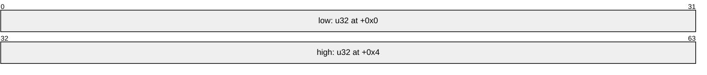
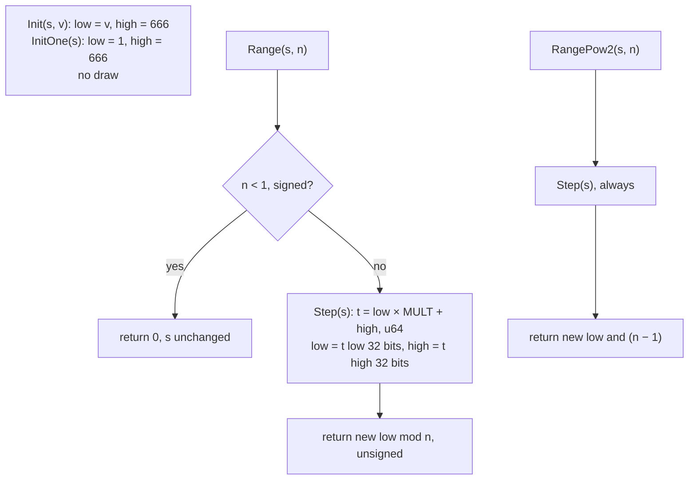

# RNG: seed state, step, range reduction, initialisers

## Purpose

Every random decision in the game is a draw from a **seed object**: 8 bytes of state owned by
one game object (game, act, level, room, unit…). This spec defines the state, the step, the two
range reductions and the two initialisers. Every other spec writes its draws in terms of these.
How seeds are created and passed from parent to child is in [seeds.md](seeds.md).

## Entry points

The primitives exist as out-of-line functions, but most call sites **inline** the step. A spec that
documents a call site states which form it uses (see *Reimplementation notes*).

| Primitive | Function | Static callers | Tag |
|---|---|---|---|
| step | fn:RNG_Step@0x0045C370 | 1 | [C] |
| guarded range | fn:RNG_Range@0x0045C390 | 154 | [C] |
| guarded range (second compile) | fn:RNG_RangeB@0x0045C3E0 | 114 | [C] |
| power-of-two range | fn:RNG_RangePow2@0x00472210 | 8 | [C] |
| power-of-two range plus base | fn:RNG_RangePow2Plus@0x00472240 | 0, dead code | [I] |
| init with value | fn:RNG_SeedInit@0x00650E40 | 103 calls in 76 functions, both initialisers combined | [C] |
| init to one | fn:RNG_SeedInitOne@0x00650E30 | (counted with `init with value`) | [C] |
| inlined step | 852 multiplier immediates, all inside functions (e.g. fn:DRLG_ActCreate@0x00642DA0, fn:DRLG_RoomCreate@0x0066B3E0) | — | [I] |

All 852 occurrences of the multiplier bytes `C5 90 C6 6A` in the file are `mov r32, imm32` instructions inside
functions, so each one is a draw site: 837 in 427 functions found at first, 4 outside any function Ghidra had
defined, and 11 in nine DRLG level-link callbacks reached only through data tables (`sub_…_LinkPick`). [I]
(fn:DRLG_ActCreate@0x00642DA0, fn:DRLG_RoomCreate@0x0066B3E0, fn:sub_00676150_LinkPick@0x00676150,
[0001](../../findings/rng/0001-rng-core.md#answer-summary))

Every out-of-line primitive except `RangePow2Plus` takes the seed pointer in ECX and `n` (or the
init value) in EDX. [C] (run:2026-10-11-rng-emu) `RangePow2Plus` takes the seed in ECX, `base` in EDX
and `n` on the stack. [I] (fn:RNG_RangePow2Plus@0x00472240)

## Inputs

### Tables

None. The RNG reads no table. [I] (fn:RNG_Step@0x0045C370, fn:RNG_Range@0x0045C390, fn:RNG_RangeB@0x0045C3E0,
fn:RNG_RangePow2@0x00472210, fn:RNG_SeedInit@0x00650E40, fn:RNG_SeedInitOne@0x00650E30, run:2026-10-11-rng-emu,
[0001](../../findings/rng/0001-rng-core.md#data-touched))

### Runtime state



| State | Type | Source |
|---|---|---|
| `Seed` | `{ low: u32 @+0x0, high: u32 @+0x4 }`, little-endian, 8 bytes | embedded in its owner; see [seeds.md](seeds.md) for each owner's offset |

### Constants

| Name | Value | Anchor | Tag |
|---|---|---|---|
| `MULT` | `0x6AC690C5` (1791398085) | fn:RNG_Step@0x0045C370 | [C] |
| `INIT_HIGH` | `666` (`0x29A`) | fn:RNG_SeedInit@0x00650E40 | [C] |

## Algorithm



```
type Seed { low: u32; high: u32 }

1. Step(s: Seed):                                              [C] (fn:RNG_Step@0x0045C370, run:2026-10-11-rng-emu)
     t: u64 ← (u64) s.low × MULT + (u64) s.high               ; exact, no overflow: max < 2^64
     s.low  ← (u32) (t & 0xFFFFFFFF)
     s.high ← (u32) (t >> 32)

2. Range(s: Seed, n: i32) → u32:                               [C] (fn:RNG_Range@0x0045C390, fn:RNG_RangeB@0x0045C3E0, run:2026-10-11-rng-emu)
     if n < 1:                                                 ; signed test
       return 0                                                ; NO draw: s is unchanged
     Step(s)                                                   ; draw
     return s.low mod (u32) n                                  ; unsigned

3. RangePow2(s: Seed, n: u32) → u32:                           [C] (fn:RNG_RangePow2@0x00472210, run:2026-10-11-rng-emu)
     Step(s)                                                   ; draw, always
     return s.low & (n − 1)                                    ; u32 arithmetic; callers pass a power of two

4. RangePow2Plus(s: Seed, base: i32, n: u32) → i32:            [I] (fn:RNG_RangePow2Plus@0x00472240)
     Step(s)                                                   ; draw
     return (s.low & (n − 1)) + base

5. Init(s: Seed, v: u32):                                      [C] (fn:RNG_SeedInit@0x00650E40, run:2026-10-11-rng-emu)
     s.low ← v;  s.high ← INIT_HIGH                            ; no draw

6. InitOne(s: Seed):                                           [C] (fn:RNG_SeedInitOne@0x00650E30, run:2026-10-11-rng-emu)
     s.low ← 1;  s.high ← INIT_HIGH                            ; no draw
```

Step notes:

2. When `n` is a power of two the binary computes `s.low & (n − 1)` instead of the division. The
   result is identical, so a reimplementation may use `mod` throughout. [C] (fn:RNG_Range@0x0045C390,
   run:2026-10-11-rng-emu). `n` arrives as a register value: `0x80000000`–`0xFFFFFFFF` are negative
   and return 0 without a draw. [C] (run:2026-10-11-rng-emu edge cases)
4. This helper is dead code in 1.14d: no absolute pointer to it exists anywhere in the file, and no `call` or `jmp`
   rel32 at any `.text` offset reaches it. No spec depends on it, and a reimplementation can omit it. It is defined
   here only for completeness. [I] (fn:RNG_RangePow2Plus@0x00472240, [0001](../../findings/rng/0001-rng-core.md#dead-ends))

**What counts as one draw.** In every spec, "draw#k" means one call of `Step` on a named seed
object, whether it happens inside `Range`, `RangePow2`, or inline. A draw is one step of one specific seed
object, and every consumer of that object interleaves in call order. Many seed objects exist (game `+0xD0`,
act, level, DRLG room, active room, unit…), and several consumers share some of them. For example, every
server unit constructor, the object-region and monster-region code and the per-room population pass all step
the game seed `+0xD0`, so a reimplementation must reproduce the order of those calls, not just each formula.
A draw on one seed never changes another seed. [C] (fn:sub_00552DF0_UnitSeedInit@0x00552DF0,
fn:sub_0054EC90_RoomPopulate@0x0054EC90, run:2026-10-11-seed-tree-p1,
[0001](../../findings/rng/0001-rng-core.md#answer-summary), [seeds.md](seeds.md))

## Outputs

`Step` and `Init*` return nothing. `Range` returns a `u32` in `[0, n)` for `n ≥ 1` and `0` otherwise.
`RangePow2` returns a `u32` in `[0, n)`. Each primitive mutates only the seed it is given. [C]
(run:2026-10-11-rng-emu)

## Worked example

Source: `tools/rng.py`, which matches the binary's own functions bit for bit on 5,000 cases
(run:2026-10-11-rng-emu). Values in hex unless noted.

| # | Operation | Result | `low` after | `high` after |
|---|---|---|---|---|
| 0 | `Init(s, 12345)` | — | `00003039` | `0000029A` |
| 1 | `Range(s, 100)` | 87 (dec) | `015B2E77` | `0000141D` |
| 2 | `Range(s, 0)` | 0, no draw | `015B2E77` | `0000141D` |
| 3 | `Range(s, −5)` | 0, no draw | `015B2E77` | `0000141D` |
| 4 | `Range(s, 8)` | 0 | `8B57C5B0` | `0090CE87` |
| 5 | `Range(s, 7)` | 3 | `606EEEF7` | `3A1E6C8A` |

Step 1 in full: `0x3039 × 0x6AC690C5 + 0x29A = 0x0000141D_015B2E77`, and `0x015B2E77 mod 100 = 87`.

## Reimplementation notes

- **The guard isn't everywhere.** `Range` returns 0 *without drawing* for `n < 1`. Inlined draws
  with a constant modulus (for example `% 7` in fn:DRLG_ActCreate@0x00642DA0, compiled as a multiply
  by `0x24924925` plus a correction, which is an exact unsigned `mod 7`) have no guard, and neither
  has `RangePow2`. A table-driven `n` that can be 0 (an empty pool, a zero weight sum) therefore
  draws or doesn't draw depending on the call site. Each consuming spec states the form per site.
  [I] ([0001](../../findings/rng/0001-rng-core.md#answer-summary))
- **Reduce the new `low`, not the old one.** The step happens first, and the result is taken from
  the updated state. [C] (run:2026-10-11-rng-emu)
- **`high` is not a constant.** `Init` sets it to 666, but each step overwrites it with the carry
  word, so the full 64 bits must be kept. [C] (run:2026-10-11-rng-emu)
- **Unsigned modulus.** `low` is `u32` and the division is unsigned. Using a signed 32-bit `low`
  gives wrong results for `low ≥ 2^31`. [C] (fn:RNG_Range@0x0045C390, run:2026-10-11-rng-emu)
- **No bias correction.** The game takes `low mod n` directly, with no rejection of the top
  partial range. Do not "fix" it. [C] (run:2026-10-11-rng-emu)

## Evidence

- [findings/rng/0001-rng-core.md](../../findings/rng/0001-rng-core.md): state, step, range, initialisers (answered).
- [findings/rng/experiments.md § run:2026-10-11-rng-emu](../../findings/rng/experiments.md#run2026-10-11-rng-emu):
  5,000-case emulator comparison of every primitive except `RangePow2Plus`.
- [findings/rng/experiments.md § run:2026-10-11-seed-tree-p1](../../findings/rng/experiments.md#run2026-10-11-seed-tree-p1):
  shared game-seed consumers interleaving at runtime (the "draw" definition).
- `tools/rng.py`: the reference model used for the comparison and for the worked example.
- [seeds.md](seeds.md): who owns which seed, and how children are seeded.

## Open questions

- [L] Which of the 427 inlining functions use a guarded or an unguarded reduction is answered per
  subsystem, as each spec reads its own call sites.
