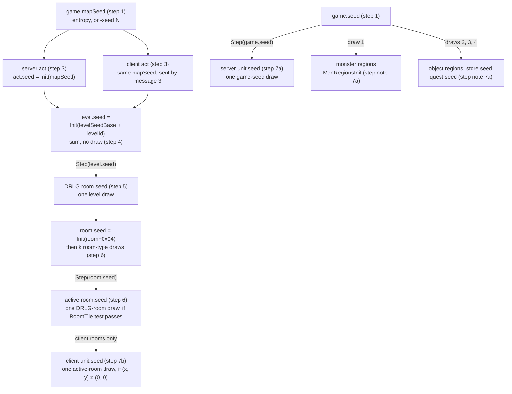
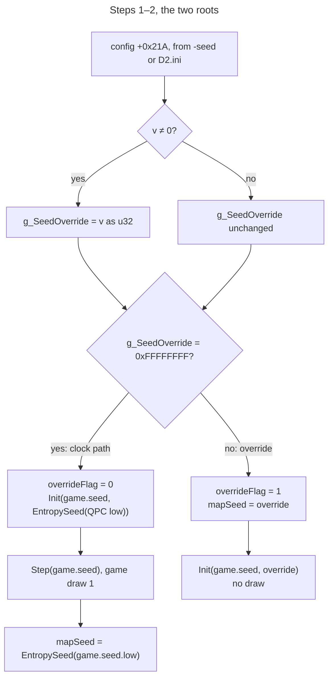
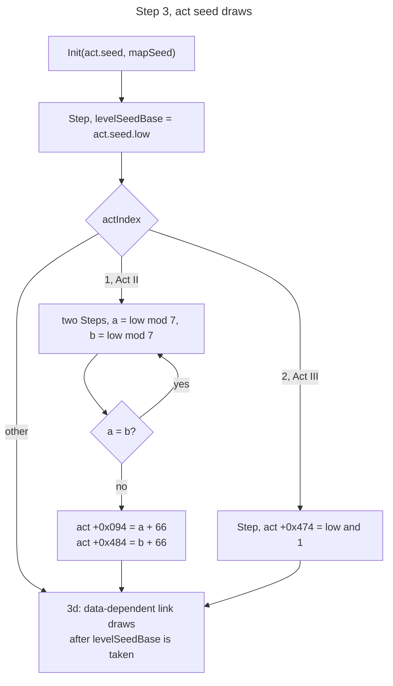
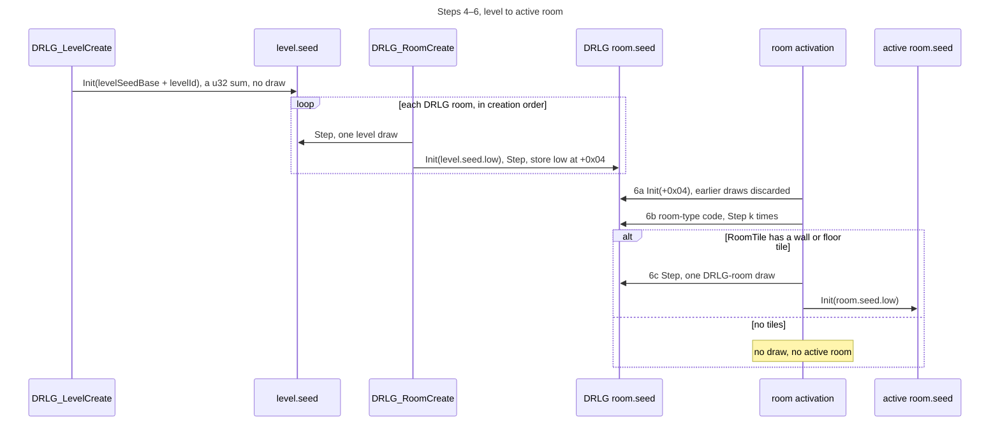
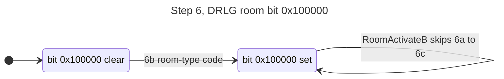
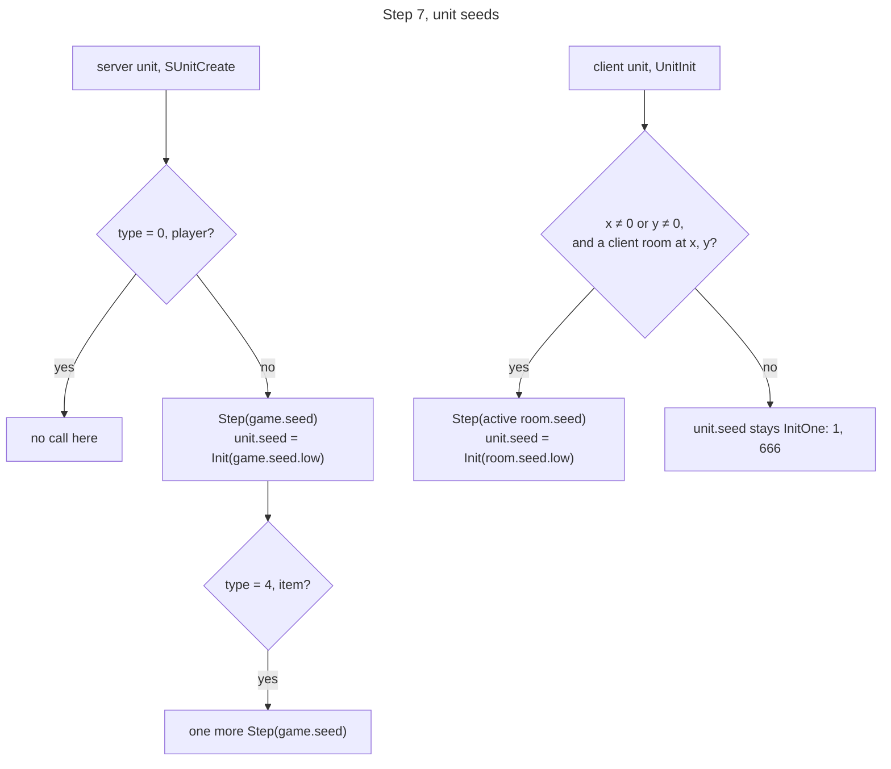

# Seed tree: game → act → level → room → unit

## Purpose

Defines where each seed object is created and what its initial value is, from the game root down
to the units of a game. With a fixed map seed, this chain fixes every act's and level's starting
seed, and therefore the inputs of the DRLG generators. Two roots exist: the **map seed** feeds
acts, levels and rooms, and the **game seed** feeds server units. What happens *inside* item
creation, monster spawning and the DRLG room-type code is left to those specs. Primitives (`Step`,
`Range`, `Init`, `InitOne`) are defined in [README.md](README.md).

## Entry points

| When | Function | Tag |
|---|---|---|
| Game created | fn:GAME_InitSeeds@0x0052C280 | [C] |
| `-seed N` on the command line, or `D2.ini` | fn:sub_0044D860_ApplySeedOption@0x0044D860 → fn:GAME_SetSeedOverride@0x0052C320 | [C] |
| Act created, server copy | fn:sub_0053AC70_ActCreate@0x0053AC70 → fn:DUNGEON_ActCreate@0x006194A0 → fn:DRLG_ActCreate@0x00642DA0 | [C] |
| Act created, client copy | client message handler 3 fn:sub_0045C8E0_PktLoadAct@0x0045C8E0 → fn:sub_0044E100_ClientActLoad@0x0044E100 → fn:DUNGEON_ActCreate@0x006194A0 | [C] |
| Level created | fn:DRLG_LevelCreate@0x00642AE0, from `DRLG_ActCreate` or one of six get-or-create callers | [C] |
| DRLG room created | fn:DRLG_RoomCreate@0x0066B3E0 | [C] |
| Room activated | fn:sub_0061B190_RoomActivateA@0x0061B190 or fn:sub_0061B730_RoomActivateB@0x0061B730 → fn:sub_0066EE40_DrlgRoomReseed@0x0066EE40 → fn:DRLG_RoomActivate@0x006422A0 → fn:DUNGEON_RoomCreate@0x00619890 | [C] |
| Server unit created (every type but players) | fn:sub_00555230_SUnitCreate@0x00555230 → fn:sub_00552DF0_UnitSeedInit@0x00552DF0 | [C] |
| Client unit created | fn:sub_00465FD0_UnitInit@0x00465FD0, fn:sub_00466200_UnitInitB@0x00466200 | [C] |

## Inputs

### Tables

| Anchor | Used for |
|---|---|
| tbl:Levels.txt:Id | level IDs 66–72 are the seven Act II Tal Rasha tombs, the range of the Act II draw (step 3c) |
| tbl:Levels.txt:DrlgType | generator dispatch after the level seed is set (step 4) |

### Runtime state

Owner names are ours, taken from the source path each allocation passes to the allocator
(`Drlg.cpp`, `Dungeon.cpp`, `DrlgRoom.cpp`, `SUnit.cpp`, `CUnit.cpp`). Offsets are byte offsets into
the owner. No struct in `re/types/` exists yet.

| Seed / value | Type | Owner offset | Source |
|---|---|---|---|
| game seed | `Seed` | game `+0xD0` | step 1 |
| map seed | `u32` | game `+0x7C` | step 1 |
| override flag | `u32` | game `+0x84` | step 1 |
| seed option | `i32`, 4-byte slot | config `+0x21A` | step 2 |
| seed override | `u32`, `0xFFFFFFFF` = none | data:g_SeedOverride@0x00731004 | step 2 |
| act seed | `Seed` | DRLG act `+0x000` | step 3 |
| act map seed copy | `u32` | DRLG act `+0x458` | step 3 |
| level seed base | `u32` | DRLG act `+0x470` | step 3 |
| act index | `u8`, 0-based | DRLG act `+0x480` | step 3 |
| level seed | `Seed` | level `+0x1C4` | step 4 |
| DRLG room seed | `Seed` | DRLG room `+0x14` | steps 5, 6 |
| DRLG room first draw | `u32` | DRLG room `+0x04` | step 5 |
| DRLG room type | `u32` | DRLG room `+0x48` | step 6 |
| `RoomTile` record | pointer | DRLG room `+0x54` | step 6 |
| active room seed | `Seed` | active room `+0x6C` | step 6 |
| active room flags | `u32` | active room `+0x34` | step 6 |
| unit seed | `Seed` | unit `+0x20` | step 7 |
| unit initial seed value | `u32` | unit `+0x28` | step 7 |

### Constants

| Name | Value | Anchor | Tag |
|---|---|---|---|
| no-override sentinel | `0xFFFFFFFF` (`−1`), the initial value of `g_SeedOverride` | data:g_SeedOverride@0x00731004 | [I] |
| entropy LCG multiplier | `0x19660D` | fn:RNG_EntropySeed@0x00650DE0 | [C] |
| entropy LCG increment | `0x3C6EF35F` | fn:RNG_EntropySeed@0x00650DE0 | [C] |
| first tomb level ID | `66` | fn:DRLG_ActCreate@0x00642DA0, tbl:Levels.txt:Id | [C] |

## Algorithm













```
1. CreateGameSeeds(game):                                         [C] (fn:GAME_InitSeeds@0x0052C280, run:2026-10-11-seed-tree, run:2026-10-11-seed-tree-p1)
     if g_SeedOverride = 0xFFFFFFFF:
       game.overrideFlag ← 0
       InitOne(game.seed)
       Init(game.seed, EntropySeed(salt: QPC low dword))
       Step(game.seed)                                            ; game draw#1
       game.mapSeed ← EntropySeed(salt: game.seed.low)
     else:
       game.overrideFlag ← 1
       game.mapSeed ← g_SeedOverride
       InitOne(game.seed)
       Init(game.seed, g_SeedOverride)                            ; no draw

   EntropySeed(salt: u32) → u32:                                  [C] (fn:RNG_EntropySeed@0x00650DE0, 0x00650DF6–0x00650E1C, run:2026-10-11-seed-tree-p1)
     x: u32 ← GetTickCount() + _time32(NULL) + salt               ; every operation wraps mod 2^32
     repeat 3 times: x ← x × 0x19660D + 0x3C6EF35F
     return x & 0x7FFFFFFF                                        ; 31-bit result

2. ApplySeedOption(config):                                       [C] (fn:sub_0044D860_ApplySeedOption@0x0044D860, fn:GAME_SetSeedOverride@0x0052C320, run:2026-10-11-seed-tree-p1)
     v: i32 ← config[+0x21A]                                      ; option {DEBUG, SEED, seed}, type 1 (integer)
                                                                  ; filled by atol(text) from -seed, or
                                                                  ; GetPrivateProfileIntA from D2.ini
     if v ≠ 0: g_SeedOverride ← (u32) v                           ; 0 is never applied

3. CreateAct(actIndex: u8, mapSeed: u32) → act:                   [C] (fn:DRLG_ActCreate@0x00642DA0, run:2026-10-11-seed-tree)
   3a. Init(act.seed, mapSeed);  act.mapSeedCopy ← mapSeed
   3b. Step(act.seed)                                             ; act draw#1
       act.levelSeedBase ← act.seed.low                           ; +0x470
   3c. if actIndex = 1:                                           ; Act II (index is 0-based)
         repeat:
           Step(act.seed);  a: u32 ← act.seed.low mod 7          ; act draw#2k,   unguarded
           Step(act.seed);  b: u32 ← act.seed.low mod 7          ; act draw#2k+1, unguarded
         until a ≠ b
         act[+0x094] ← a + 66;  act[+0x484] ← b + 66
       else if actIndex = 2:                                      ; Act III
         Step(act.seed)                                           ; act draw#2
         act[+0x474] ← act.seed.low & 1
   3d. further act-seed draws inside DRLG_ActCreate,             [I] (fn:sub_00678AD0_ActLinkInit@0x00678AD0, fn:sub_006772C0_LevelLinkBuild@0x006772C0)
       data-dependent; see step note 3
   The mapSeed argument is game.mapSeed for every act, and every [C] (fn:sub_0053AC70_ActCreate@0x0053AC70, fn:sub_0044E100_ClientActLoad@0x0044E100, run:2026-10-11-seed-tree-p1)
   act is created twice with it: a server copy and a client copy.

4. CreateLevel(act, levelId: u32) → level:                        [C] (fn:DRLG_LevelCreate@0x00642AE0, 0x00642B50, run:2026-10-11-seed-tree)
     Init(level.seed, (u32) (act.levelSeedBase + levelId))        ; a u32 sum that wraps, NOT a draw
     dispatch on Levels[levelId].DrlgType:                        [C] (fn:DRLG_LevelCreate@0x00642AE0, tbl:Levels.txt:DrlgType, run:2026-10-12-drlg-gen)
       1 → 0x00673B10 (maze), 2 → 0x00667430 (preset), 3 → 0x00675320 (outdoors)
     rooms come later, after LevelInit re-seeds the level with the same value:
     see drlg/overview (../drlg/README.md) steps 1–2

5. CreateDrlgRoom(level, type: u32) → room:                      [C] (fn:DRLG_RoomCreate@0x0066B3E0, run:2026-10-11-seed-tree)
     Step(level.seed)                                             ; one level draw
     Init(room.seed, level.seed.low)
     Step(room.seed)                                              ; room draw#1
     room[+0x04] ← room.seed.low
     dispatch on type: 1 → 0x0067D6D0, 2 → 0x00666630, else none [I] (fn:sub_0067D6D0_OutRoomAlloc@0x0067D6D0, fn:sub_00666630_PresetRoomAlloc@0x00666630)
                                                                  ; allocation only, no draw

6. ActivateRoom(act, R: DRLG room) → activeRoom or none:          [C] (fn:sub_0061B190_RoomActivateA@0x0061B190, fn:sub_0061B730_RoomActivateB@0x0061B730, run:2026-10-11-seed-tree-p1)
   6a. Init(R.seed, R[+0x04])                                     [C] (fn:sub_0066EE40_DrlgRoomReseed@0x0066EE40, run:2026-10-11-seed-tree-p1)
                                                                  ; re-seed: earlier room-seed draws are discarded
   6b. room-type code for R[+0x48] (1 → 0x0067D2D0, 0x0067D710;  [C] (fn:sub_0066EE40_DrlgRoomReseed@0x0066EE40, fn:sub_0066EE70_DrlgRoomTypeInit@0x0066EE70, run:2026-10-11-seed-tree-p1)
       2 → 0x006667D0, 0x00666AC0); sets R[+0x28] |= 0x100000
       Step(R.seed) k times                                       ; k: drlg/room-tiles § k (../drlg/room-tiles.md#k)
   6c. DRLG_RoomActivate(act, R):                                 [C] (fn:DRLG_RoomActivate@0x006422A0, fn:DUNGEON_RoomCreate@0x00619890, run:2026-10-11-seed-tree-p1)
         T ← R[+0x54]                                             ; RoomTile record
         if T[+0x18] = 0 and T[+0x20] = 0:
           return none                                            ; no draw, no active room
         flags: u32 ← 4 if R[+0x28] & 0x40000                     [I] (fn:DRLG_RoomActivate@0x006422A0)
                      else 1 if R[+0x60] & 1
                      else 0
         Step(R.seed)                                             ; one DRLG-room draw (inlined)
         Init(activeRoom.seed, R.seed.low)                        ; +0x6C
         activeRoom[+0x34] ← flags

7a. ServerUnitSeed(game, unit, type: u32):                       [C] (fn:sub_00555230_SUnitCreate@0x00555230, fn:sub_00552DF0_UnitSeedInit@0x00552DF0, 0x00555306, run:2026-10-11-seed-tree-p1)
     if type = 0: return                                          ; players: see step note 7a
     InitOne(unit.seed)
     Step(game.seed)                                              ; one game-seed draw
     unit[+0x28] ← game.seed.low
     Init(unit.seed, game.seed.low)
     if type = 4:                                                 ; items
       Step(game.seed)                                            ; one more game-seed draw [C] (fn:sub_00552E90_ItemSeedInit@0x00552E90, run:2026-10-11-seed-tree-p1)
                                                                  ; its low word is the item's start seed,
                                                                  ; item.seed = {low, 666} (items/uniques-sets A2)

7b. ClientUnitSeed(unit, x: i32, y: i32):                        [C] (fn:sub_00465FD0_UnitInit@0x00465FD0, fn:sub_00466200_UnitInitB@0x00466200, run:2026-10-11-seed-tree-p1)
     room ← none
     if x ≠ 0 or y ≠ 0:                                           ; literal predicate: the two position
       room ← the client act's active room at (x, y)              ; arguments are not both zero
                                                                  [I] (0x00466027, fn:sub_00465420_ClientRoomAt@0x00465420)
     InitOne(unit.seed)
     if room ≠ none:
       Step(room.seed)                                            ; one active-room draw
       unit[+0x28] ← room.seed.low
       Init(unit.seed, room.seed.low)
```

Step notes:

1. Without an override, both the game seed and the map seed depend on the tick count, the clock
   and the performance counter, so they can't be reproduced. A reimplementation that wants
   determinism takes the override branch. [C] (fn:RNG_EntropySeed@0x00650DE0, run:2026-10-11-seed-tree-p1)
2. `config+0x21A` is a 4-byte signed integer slot: the next option's slot starts at `+0x21E`, and
   the reader loads it as one dword. A `-seed` value wider than 16 bits arrives intact (`34844169` →
   `+0x7C = 0x0213AE09`). [C] (fn:sub_004058A0_ConfigParseCmdLine@0x004058A0,
   fn:sub_00405450_ConfigLoadIni@0x00405450, run:2026-10-11-seed-tree) Because step 1 tests
   `g_SeedOverride = 0xFFFFFFFF`, `-seed -1` is applied by step 2 but still means "no override", and
   negative values are stored as their two's-complement `u32`. The reproducible seeds are therefore
   every 32-bit value except `0` and `0xFFFFFFFF`. What `atol` does with `-seed` text above 2³¹−1
   depends on the CRT and was not checked, so a seed ≥ 2³¹ is given as its negative decimal
   (`0x80000000` as `-2147483648`). [I] (fn:GAME_InitSeeds@0x0052C280,
   fn:sub_004058A0_ConfigParseCmdLine@0x004058A0)
3. All acts of one game get the same map seed, so all acts share the same `levelSeedBase`.
   Act-specific draws (3c, 3d) come after `levelSeedBase` is taken and don't change it. [C]
   (fn:DRLG_ActCreate@0x00642DA0, run:2026-10-11-seed-tree) The Act II loop draws two distinct tomb
   level IDs in 66–72. Which of the two fields is the real tomb is open. [C] (tbl:Levels.txt:Id,
   run:2026-10-11-seed-tree) Step 3d: the level-link setup copies the act seed into a local
   link-builder struct, and the link callbacks step **the copy**, which is then discarded. The act
   seed itself is stepped only by the level-link builder when its loop reaches level 6 with link
   value 1 or 3, and by the Act III link code. [I] (fn:sub_006772C0_LevelLinkBuild@0x006772C0,
   0x00677493–0x006774F9) Observed act-seed steps after 3c: Act I 0 (seed 12345) and 1 (seed 777),
   Act III 119 (seed 12345), Acts II, IV and V 0. [C] (run:2026-10-11-seed-tree) These draws matter
   only to later consumers of the act seed, never to level seeds.
   Server copy: `sub_0053AC70_ActCreate` passes `game+0x7C`. Client copy: `sub_0044E100_ClientActLoad`
   gets the map seed from the 12-byte message 3 (act `u8 +1`, map seed `u32 +2`) and stores the act
   in `0x007A0634`. On game entry both are created, server first, with seed N. [C]
   (fn:sub_0045C8E0_PktLoadAct@0x0045C8E0, data:g_ClientPktHandlers@0x007114D0, run:2026-10-11-seed-tree-p1)
   The two copies have identical DRLG seed trees up to room activation (step 6). [C] (run:2026-10-11-seed-tree,
   run:2026-10-11-seed-tree-p1)
4. A level's seed depends only on the map seed and the level ID, never on the order in which levels
   are built or on which caller builds them. Besides `DRLG_ActCreate`, six functions get a level by
   ID and create it only if it is absent from the act's list. [C] for the sum
   (run:2026-10-11-seed-tree, 197 level creations), [I] for the six callers
   (fn:sub_00642BB0_LevelEnsure@0x00642BB0, fn:sub_00642BE0_LevelRoomCount@0x00642BE0,
   fn:sub_00642C30_RoomFromCoords@0x00642C30, fn:sub_00642D10_LevelSetPosition@0x00642D10,
   fn:sub_00642F70_LevelAddRef@0x00642F70, fn:sub_00643060_LevelUnloadCheck@0x00643060)
5. Each DRLG room takes exactly one draw from its level's seed, so the order in which a level's
   rooms are created matters. [C] (fn:DRLG_RoomCreate@0x0066B3E0, run:2026-10-11-seed-tree, 3102 room creations)
6. The active-room seed is `Init(Step^(k+1)(Init(R[+0x04])).low)`. It doesn't depend on any draw
   made on the room seed between creation and activation, because 6a restarts it from `+0x04`, but
   it does depend on k. Observed in that run: k = 50–376 over 157 activations. [C]
   (run:2026-10-11-seed-tree-p1) k is the number of room-seed draws of the `LvlSub` substitutions (type 1
   only) and of the tile picks whose candidates have a positive rarity sum, plus rare oracle draws; it
   is defined in [drlg/room-tiles § k](../drlg/room-tiles.md#k), which predicts it for all 520
   activations of its run (k = 0–388). [C] (fn:sub_0066EE70_DrlgRoomTypeInit@0x0066EE70,
   run:2026-10-11-drlg-roomk) `T[+0x18]`/`T[+0x20]` are the room's wall and floor tile counts after the
   build, so 6c draws iff the room got at least one wall or floor tile. [I]
   (fn:DRLG_RoomActivate@0x006422A0, [drlg/room-tiles](../drlg/room-tiles.md) step note 12)
   `sub_0061B730_RoomActivateB` runs 6a–6c only while `R[+0x28]` bit `0x100000` is clear, the bit 6b
   sets. [C] (fn:sub_0061B730_RoomActivateB@0x0061B730, run:2026-10-11-seed-tree-p1) `flags` bit 0
   marks the active room as already populated: the population pass runs only for rooms whose bit 0
   is clear. [I] (fn:sub_0052D160_NewRoomsUpdate@0x0052D160, 0x0052D1C9) In the runs every
   server-act room got `flags` 0 and every client-act room got 4. [C] (run:2026-10-11-seed-tree-p1)
   **The server and client copies of one DRLG room can get different active-room seeds**, because
   their k can differ: of the 9 rooms activated in both copies, 6 (seed 12345) and 8 (seed 777) got
   different seeds. Gameplay uses the server copy. [C] (run:2026-10-11-seed-tree-p1) The cause is the
   bit-2 tile path, which reads the neighbours already built in that act copy, so k depends on the
   activation order. [C] (fn:sub_0066E580_NeighbourTileScan@0x0066E580, run:2026-10-11-drlg-roomk)
   On the server, every room of a new-rooms walk gets one wanderer-tick draw on its active-room seed, and
   on its first activation the DS1 presets, the object population and then the population pass follow.
   The pass draws its class picks, type roll and every position from the active-room seed, and its density
   rolls, the `sparsePopulate` roll and one step per creation from the game seed
   ([monsters/spawn](../monsters/spawn.md)). [C] (fn:sub_0054EC90_RoomPopulate@0x0054EC90,
   fn:sub_0054F060_RoomWandererTick@0x0054F060, run:2026-10-13-mon-spawn) The `0x005BDFF0` room-seed step it
   contains is on the type-1 branch, which never runs: the pass maps type 1 to 2. [C]
   (fn:sub_005BDFF0_ARoomSeedStep@0x005BDFF0, 0x0054EE0B, run:2026-10-13-mon-spawn)
7a. **Server units, monsters included, seed from the game seed `+0xD0`, not from a room.** [C]
   (run:2026-10-11-seed-tree-p1: 114 server unit seeds, parent always `game+0xD0`, type 1 units among them)
   `SUnitCreate` skips the call for type 0. The five other callers of `UnitSeedInit` (player creation
   and re-seeding paths) also pass `game+0xD0`. [I] (0x0053254E, 0x005338D8, 0x00569F53, 0x0056A95E,
   0x0057F7E5) At runtime the player's seed is the 5th game-seed draw from `Init(N)`, and the starting
   items follow at draws 6, 8, 10…, two draws each. [C] (run:2026-10-11-seed-tree-p1) Other consumers
   of the game seed draw in between, so a unit's seed depends on the full call order of every
   game-seed consumer. Draw 1 from `Init(N)` is the monster-region build: `sub_00547D20_MonRegionsInit`
   steps the game seed once, keeps the low word at `game+0xEC` and builds every level's pool from a
   local seed `Init(low)` (see [monsters/pool](../monsters/pool.md)). [C]
   (fn:sub_00547D20_MonRegionsInit@0x00547D20, fn:sub_00530BF0_GameCreate@0x00530BF0, run:2026-10-12-mon-pool)
   The game-creation calls after it, in `sub_00530BF0_GameCreate`'s call order, take one game-seed draw each,
   so draws 2–4 are fixed. [C] (fn:sub_00530BF0_GameCreate@0x00530BF0, run:2026-10-15-objects,
   run:2026-10-15-vendors, run:2026-10-16-quest-drops, [rng/0002 § Other seed sites](../../findings/rng/0002-seed-tree.md#other-seed-sites-seen-not-yet-followed))
   The object region takes exactly draw 2: `OBJRGN_Create` steps the game seed once and seeds the game-wide
   object-region seed with `Init(low)` ([objects § A](../objects/README.md#a-the-object-region-seed-and-level-records-game-creation)). [C]
   (fn:OBJRGN_Create@0x00546C60, run:2026-10-15-objects)
   Draw 3 is `NPCSTORE_CtlCreate`: it seeds the store seed, which is also the hirelings' NPC seed, with `Init(low)`
   ([items/vendors](../items/vendors.md) A1). [C] (fn:NPCSTORE_CtlCreate@0x00536070, run:2026-10-15-vendors,
   run:2026-10-16-hirelings)
   Draw 4 is `QUESTS_InitGame`: it seeds the quest seed `QuestControl+0x18` with `Init(low)`
   ([items/quest-drops](../items/quest-drops.md) A1); in all 53 games of its run the game seed at its entry was three
   steps past `Init(N)`. [C] (fn:QUESTS_InitGame@0x00545D80, run:2026-10-16-quest-drops)
   The rest of the order belongs to the item, monster and object specs. A monster created by the
   population pass carries a unit seed 2 steps past `Init(game.seed.low)` by the time the pass draws on it
   (914 of 916 logged creations; 6 and 15 on the other two); the steps happen inside `SUnitCreate`, and
   [monsters/spawn § J](../monsters/spawn.md#j-creation-and-the-unit-seed) takes that seed as an input from
   `monsters/stats`. [C] (fn:sub_00555230_SUnitCreate@0x00555230, run:2026-10-13-mon-spawn) With a null parent
   pointer, `UnitSeedInit` uses `RNG_EntropySeed(2 × counter)` instead, a non-reproducible path no
   run hit. [I] (fn:sub_00552DF0_UnitSeedInit@0x00552DF0, data:g_UnitSeedSaltCounter@0x008846E8)
7b. **These are the client constructors** (`CUnit.cpp`). They store the client act at `unit+0x1C`,
   and every logged client unit drew from a room of the client act (739 seeds). They don't decide
   drops or spawns. [C] (fn:sub_00465FD0_UnitInit@0x00465FD0, run:2026-10-11-seed-tree-p1) The two
   arguments tested are (x, y): the room lookup `0x00465420` takes them as a position, returns no room
   for (0, 0), and its error message names them `nX`, `nY`. A client unit created at (0, 0) gets no
   room draw and keeps `{1, 666}`. [I] (fn:sub_00465420_ClientRoomAt@0x00465420) Type 4 does nothing
   that draws before the room draw. [I] (fn:sub_00627C90_ItemDataAlloc@0x00627C90,
   fn:sub_00627DC0_ItemDataSeedInitOne@0x00627DC0) Type 1 (monsters) never goes through
   `0x00465FD0`: its case reaches the error path. [I] (0x004660A4)

## Outputs

A seed object, initialised as above, in each act (server and client copy), level, DRLG room,
active room, server unit and client unit. The parent seed advances by exactly the draws listed,
except that step 6a overwrites the DRLG room seed. [C] (run:2026-10-11-seed-tree, run:2026-10-11-seed-tree-p1)

## Worked example

**Observed.** Every value below was logged by the runtime harness with `-seed 12345` (map seed
`0x3039`) and is reproduced by `tools/rng.py seedtree` from N alone (run:2026-10-11-seed-tree,
run:2026-10-11-seed-tree-p1). The last block uses `-seed 34844169`. Seeds are `low:high`, hex unless noted.

| Step | Operation | Value |
|---|---|---|
| 1 | game: override flag, map seed, game seed | `1`, `00003039`, `00003039:0000029A` |
| 3a | `Init(act.seed, 12345)` | `00003039:0000029A` |
| 3b | `Step`, `levelSeedBase ←` low | `015B2E77` (act seed `015B2E77:0000141D`) |
| 3c | Act II pair 1: `low mod 7` twice | `3, 3` → equal, retry |
| 3c | Act II pair 2 | `6, 5` → `act[+0x094] = 72`, `act[+0x484] = 71` (dec); act seed `B7A5C418:63A93A78` |
| 4 | level 1 seed | `015B2E78:0000029A` |
| 5 | level 1, rooms 1–3: level seed after each draw | `F61E44F2`, `F3CFFCC1`, `6B277FA8` |
| 5 | room 3: `Init(6B277FA8)`, step, `+0x04` | room seed `F923BEE2:2CB17800`, `+0x04 = F923BEE2` |
| 6a | room 3 activated on the server: re-seed | `F923BEE2:0000029A` |
| 6b | k = 64 room-type draws | `2CE81EC1:55A43D6F` |
| 6c | activation draw, active-room seed | DRLG room `28D677F4:12BAF1A9`, active `28D677F4:0000029A`, flags 0 |
| 7a | player (type 0), seeded by a player-creation caller of `UnitSeedInit` (step note 7a), not by 7a's pseudocode: game-seed draw#5 | unit seed `B7A5C418:0000029A`, `+0x28 = B7A5C418` |
| 7a | first starting item (type 4): draw#6, then draw#7 | unit seed `8F16A0F0:0000029A`; game seed then `FD29EDF2:3BAE5B0E` |
| 3b, 4 | `-seed 34844169`: `levelSeedBase`, level 134 seed | `FFFFFF87`, `0000000D:0000029A` (u32 wrap) |

Under an override, the game seed and the act seed start from the same `Init(N)`, so their sequences
coincide (the player's draw#5 equals the Act II act seed after its five draws). They remain two
separate objects.

## Reimplementation notes

- **Two different roots.** Maps derive from the **map seed** `game+0x7C`. The game seed `+0xD0` is a
  separate object that doesn't feed the act → level chain, but does feed every server unit. [C]
  (fn:GAME_InitSeeds@0x0052C280, run:2026-10-11-seed-tree-p1)
- **`-seed 0` is impossible.** The option is applied only when non-zero, so `0` takes the clock
  path. [C] (fn:sub_0044D860_ApplySeedOption@0x0044D860, run:2026-10-11-seed-tree-p1)
- **The level seed is a sum, and it wraps.** Don't implement it as a draw from the act seed, and add
  in `u32`. [C] (fn:DRLG_LevelCreate@0x00642AE0, run:2026-10-11-seed-tree)
- **The Act II tomb draws use an unguarded `mod 7`**, not `Range`. The loop count is unbounded in
  principle, and every rejected pair consumes two act draws. [C] (fn:DRLG_ActCreate@0x00642DA0,
  run:2026-10-11-seed-tree)
- **Activation re-seeds the DRLG room.** Carrying the room seed over from level generation gives
  wrong active-room seeds. Restart it from `+0x04`. [C] (fn:sub_0066EE40_DrlgRoomReseed@0x0066EE40,
  run:2026-10-11-seed-tree-p1)
- **No `RoomTile` data, no draw.** A DRLG room failing the `T[+0x18]`/`T[+0x20]` test is not activated
  and consumes no activation draw. [C] (fn:DRLG_RoomActivate@0x006422A0, run:2026-10-11-seed-tree-p1)
- **Server units don't use the room.** The room-seed rule of step 7b is the client's. A server-side
  reimplementation seeds monsters, objects, NPCs and items from the game seed. [C]
  (fn:sub_00555230_SUnitCreate@0x00555230, run:2026-10-11-seed-tree-p1)
- **`InitOne` before `Init` is dead.** It is overwritten immediately, and neither initialiser draws,
  so it has no observable effect. [I] (fn:GAME_InitSeeds@0x0052C280, fn:sub_00552DF0_UnitSeedInit@0x00552DF0)

## Evidence

- [findings/rng/0002-seed-tree.md](../../findings/rng/0002-seed-tree.md): the seed tree, [§ Active room](../../findings/rng/0002-seed-tree.md#active-room), [§ Units](../../findings/rng/0002-seed-tree.md#units).
  [§ Other seed sites](../../findings/rng/0002-seed-tree.md#other-seed-sites-seen-not-yet-followed): game creation's
  draws 1–5, with [items/0009 § 1](../../findings/items/0009-vendors.md#1-store-records-and-the-store-seed-game-creation)
  (draw 3) and [items/0010 § 1](../../findings/items/0010-quest-drops.md#1-quest-objects-events-and-the-quest-seed) (draw 4).
- [findings/rng/0001-rng-core.md](../../findings/rng/0001-rng-core.md): the "draw" definition, `0x005BDFF0`.
- [findings/monsters/0001-level-pool.md § 1](../../findings/monsters/0001-level-pool.md#1-where-and-when-game-creation): game-seed draw 1 and the game-creation call order (step note 7a).
- [findings/rng/experiments.md § run:2026-10-11-seed-tree](../../findings/rng/experiments.md#run2026-10-11-seed-tree):
  8 runs, 3353/3353 game, act, level and DRLG-room values predicted.
- [findings/rng/experiments.md § run:2026-10-11-seed-tree-p1](../../findings/rng/experiments.md#run2026-10-11-seed-tree-p1):
  active rooms, server and client units, act copies, clock path; 5954/5954 values predicted over all logs.
- [findings/data/0001-excel-loader.md](../../findings/data/0001-excel-loader.md): level definition `+0x30` = `Levels.txt:DrlgType`.
- [README.md](README.md): primitives (`[C]`).
- [drlg/room-tiles](../drlg/room-tiles.md) and [findings/drlg/0002-room-build-draws.md](../../findings/drlg/0002-room-build-draws.md):
  k (step 6b), from run:2026-10-11-drlg-roomk; [drlg/overview](../drlg/README.md): the dispatch of step 4 and the room-creation order.

## Open questions

- ~~The k room-type draws of step 6b~~: defined in [drlg/room-tiles § k](../drlg/room-tiles.md#k)
  (plan 0008). Its own open questions (the `Orient89Unit` draw, the merge orientation tables, the
  `Trees.ds1` overread) carry over there.
- [L] What DRLG room `+0x60` bit 0 (→ flags 1) means, and where `+0x28` bit `0x40000` (→ flags 4, the
  client-act flag drlg/0002 names) is set. The `RoomTile` counts are answered in step note 6. Owner:
  `drlg/overview`.
- [L] Meaning of act `+0x094` vs `+0x484` (which tomb is the real one), the Act III bit `+0x474`, what
  the Act III act-seed consumers under `0x006789B0` decide, and the level-27 bit set at level 6. They are
  placed as entry points in [drlg/overview](../drlg/README.md#act-seed-consumers). Owner:
  `drlg/warps` and the quest work.
- [L] **The order of game-seed consumers**, narrowed again: game creation's draws 1–5 are fixed (step note 7a:
  monster regions, object region, store seed, quest seed, the player). Still open: the gaps between later units.
  The population pass's own game-seed draws are in [monsters/spawn](../monsters/spawn.md). Owners: items
  (plan 0004), monster and object plans.
- ~~The server population pass `sub_0054EC90_RoomPopulate`~~: answered in step note 6 and in
  [monsters/spawn](../monsters/spawn.md) (plan 0014, run:2026-10-13-mon-spawn).
- [L] The item seeds, narrowed: `sub_00552E90_ItemSeedInit`'s draw gives the item's start seed
  ([items/uniques-sets § A](../items/uniques-sets.md#a-the-item-seed-at-entry)); still open is which creation paths
  pass non-zero creation-parameter seeds `+0x48`/`+0x4C` at `0x00558D90` (drops pass none; the imbue copies the old
  item's and does not use them, [items/quest-drops](../items/quest-drops.md) F1). Owner: plan 0004.
- [L] Other initialiser sites not followed: `LvlTbls.cpp` (`0x0061FCF0`, a global seed `init(0)`); `QUESTS.CPP`
  (`0x00545D80`) is followed (the quest seed, step note 7a). About 20 of the 76 initialiser-calling functions are
  covered.
