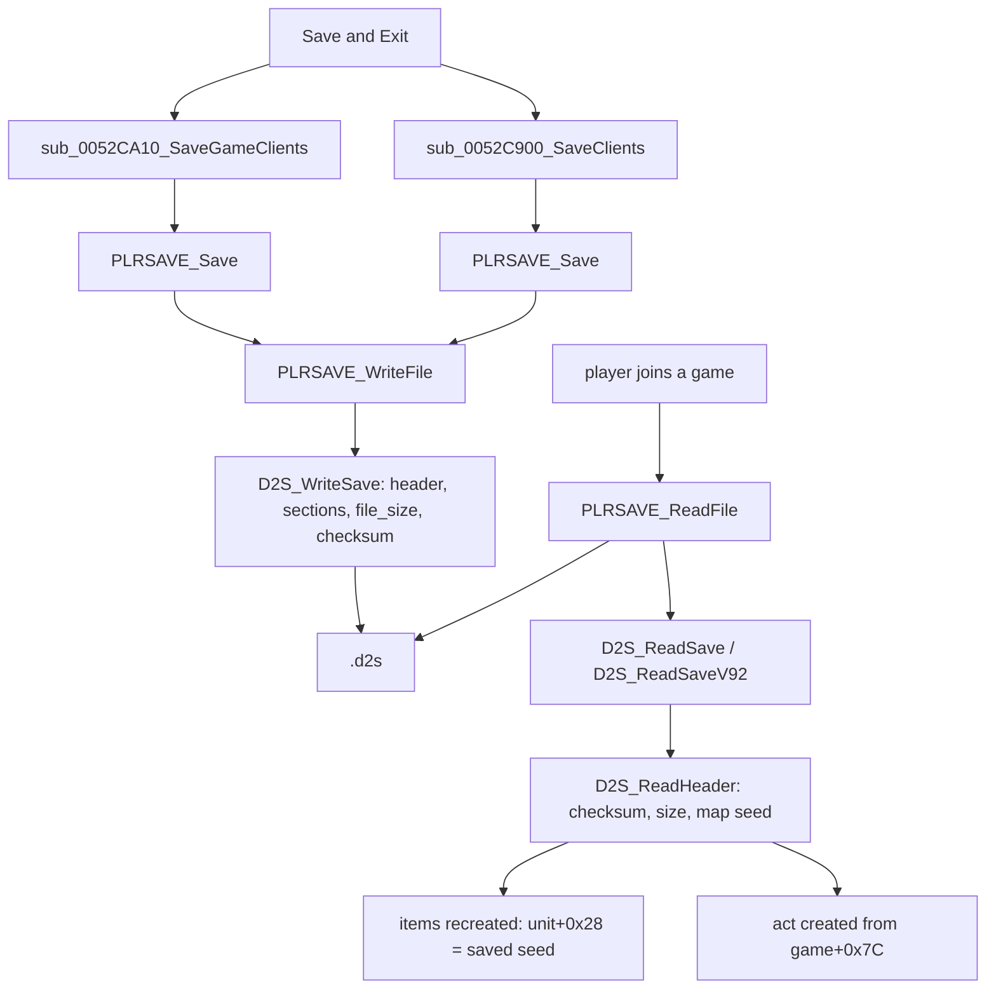

# Saves: when the game writes and reads a character

## Purpose

This subsystem specifies the single-player character save (`.d2s`): when the server writes it, what runtime state
each part comes from, how it is read back, and what a load changes in the game. It is an **enabler**
([ADR-0002](../../adrs/0002-scope-creation-paths-and-enablers.md)) for two reasons. A saved item carries the
item unit's seed, quality and ilvl, so the `items/*` specs can be checked against saves. A saved character also
fixes the map seed of its next game. This page is the map; the algorithm is in [d2s.md](d2s.md), the bytes in
[formats/d2s.md](../../formats/d2s.md).

## Files

| File | Covers | Status |
|---|---|---|
| [d2s.md](d2s.md) | write and read order, checksum, header field sources and targets, `gf` stats, skills, item lists, the item bitstream as a function of the runtime item, property-list framing | reviewed |

Not covered here: what each item property means (`items/properties`), the runeword and affix id mappings
(`items/sockets-runewords`, `items/affixes`), and how the saved values were rolled (`items/*`). Network
(Battle.net) characters are out of scope (ADR-0002).

## Data flow

- [C] **Two writes per exit.** In single player, *Save and Exit* writes the file twice with the same bytes, once
  from each of two save walks; no save is written during play. (fn:sub_0052CA10_SaveGameClients@0x0052CA10,
  fn:sub_0052C900_SaveClients@0x0052C900, run:2026-10-12-d2s-io; [d2s.md § Entry points](d2s.md#entry-points))
- [C] **The checksum is enforced at join, not at character select.** A wrong checksum fails the load with internal
  code 6, a wrong size field with 5, both shown as code 14 and a return to the main menu. The select screen lists
  the save regardless. (fn:D2S_ReadHeader@0x0056A090, fn:D2S_Checksum@0x00411130, run:2026-10-12-d2s-io,
  run:2026-10-11-d2s-edit; [d2s.md § D3–D5](d2s.md#d3d5-reading-a-save))
- [C] **A save can carry its maps.** The writer stores the game's map seed; a single-player game started without
  `-seed` loads it back when the save's byte for that difficulty has bit 7 set, and builds its acts from it.
  (0x0056A1FC–0x0056A217, run:2026-10-12-d2s-io; [d2s.md § D3–D5](d2s.md#d3d5-reading-a-save))
- [C] **A saved item keeps its unit seed.** The extended item's 32-bit seed is the item unit's `+0x28`, the draw of
  [rng/seeds](../rng/seeds.md) step 7a for a dropped item; the reader re-initialises the unit RNG from it. Its
  quality and ilvl are the runtime ones. (fn:ITEMS_ReadFull@0x0062CBE0, fn:ITEMS_WriteFull@0x0062FFF0,
  run:2026-10-12-d2s-io; [d2s.md § I](d2s.md#i-one-item))
- [C] **Property lists are framed, not interpreted.** The save code writes each saved stat as a 9-bit id, an optional
  param and a value offset by `Save Add`, with id groups sharing one id; it attaches no meaning to them. The framing
  decodes every list of 25 game-written saves (44 ids, groups 17, 48, 50, 54); the other ids and groups 52 and 57
  rest on the code read. (fn:ITEMS_ReadProperty@0x0062AC80, fmt:d2s#property-lists, run:2026-10-12-d2s-io;
  [d2s.md § J](d2s.md#j-property-list-framing))

## Glossary

`.d2s`, simple item and property list are in [glossary.md](../../glossary.md).

## Open questions

- [L] Property semantics and the runeword/affix id mappings: `items/properties`, `items/sockets-runewords`,
  `items/affixes` ([d2s.md § Open questions](d2s.md#open-questions)).
