# Character save (`.d2s`): writer, reader, header and item bitstream

## Purpose

A `.d2s` file is one single-player character. The server writes it from the runtime player (the client
object, the player unit and its stats, its item units) when the character leaves a game, and reads it back
when the character joins one. This spec gives the write order, the checksum, the source and destination of
every header field, the item bitstream as a function of the runtime item, and the framing of the stat and
property lists. How a dropped item's stats are rolled and stored before they are saved is
[items/properties](../items/properties.md); the stat ids are rows of [ItemStatCost](../../tables/ItemStatCost.md). The bytes are documented in
[d2s.md](../../formats/d2s.md); this spec is about the code that produces and consumes them. Seed primitives
are those of [rng](../rng/README.md), and the seeds written here come from [rng/seeds](../rng/seeds.md).

Names (client, player data, item data) follow [save/0001](../../findings/save/0001-d2s-io.md): the **client**
is the server's per-connection client object, **player data** is `unit+0x14` of a player unit, and **item
data** is `unit+0x14` of an item unit (partial types in `re/types/save.h`).

## Entry points

| When | Function | Tag |
|---|---|---|
| *Save and Exit* in single player, first write (every client of the game) | fn:sub_0052CA10_SaveGameClients@0x0052CA10 → fn:PLRSAVE_Save@0x00532400 | [C] |
| *Save and Exit* in single player, second write, same bytes | fn:sub_0052C900_SaveClients@0x0052C900 → fn:PLRSAVE_Save@0x00532400 | [C] |
| Single-player file write | fn:PLRSAVE_WriteFile@0x00532240 → fn:D2S_WriteSave@0x00569AD0 | [C] |
| Server shutdown, every client of every game | fn:sub_0052E9C0_SaveAllOnShutdown@0x0052E9C0 | [I] |
| Periodic save: none while the host callback is 0 | fn:sub_0052D350_AutosaveTick@0x0052D350 | [C] |
| Periodic save with a host callback set | fn:sub_0052D350_AutosaveTick@0x0052D350 | [I] |
| Hosted save through the callback, skipped when unchanged | fn:sub_00531EB0_SaveViaCallback@0x00531EB0 | [I] |
| Player join: load (logged returns) | fn:sub_00539760_ClientAddPlayerToGame@0x00539760 → fn:sub_005345A0_PlayerLoad@0x005345A0 → … → fn:PLRSAVE_ReadFile@0x005343A0 → fn:D2S_ReadSave@0x00534330 | [C] |
| Version 92–96 reader | fn:D2S_ReadSaveV92@0x0056B180 | [C] |
| New character (client side, 335-byte stub) | fn:sub_0043C540_StubBuild@0x0043C540, fn:sub_0043C6B0_StubWrite@0x0043C6B0 | [C] |

- [C] *Save and Exit* in single player writes the file **twice**, byte-identical: `PLRSAVE_Save` is called from
  `0x0052CA5F` and then from `0x0052C940`, and both calls reach `PLRSAVE_WriteFile`. Nothing was written during
  play in run:2026-10-12-d2s-io. (fn:sub_0052CA10_SaveGameClients@0x0052CA10, run:2026-10-12-d2s-io;
  [save/0001 §1](../../findings/save/0001-d2s-io.md#1-when-a-save-is-written))
- [C] **Single player also writes the file at a death.** In run:2026-10-27-sweep-d2s-play (hell-r3) `PLRSAVE_Save`
  was called once from the death path `sub_0057FCA0_PlayerDeathModeEnd` (return 0x0057FD88), the write before the
  respawn, with status word `0x0F28` (bit 3 set). This is an event save, not an autosave.
  (fn:sub_0057FCA0_PlayerDeathModeEnd@0x0057FCA0,
  run:2026-10-27-sweep-d2s-play, [save/0001 § Plan 0038 batch H1b](../../findings/save/0001-d2s-io.md#plan-0038-batch-h1b-run2026-10-27-sweep-d2s-play))
- [C] **No autosave runs in single player.** `sub_0052D350_AutosaveTick` was called throughout every session of
  run:2026-10-27-sweep-d2s-play with the host callback `0x00883D50` at 0, and no `PLRSAVE_Save` returned into it. That
  is the outcome only: the logger breaks at the entry, so which test stopped the save is not shown.
  (fn:sub_0052D350_AutosaveTick@0x0052D350, run:2026-10-27-sweep-d2s-play)
- [I] The tests, in code order: the entry test of `0x00730FFC` (0x0052D353, returns at once when it is 0), the
  per-client time and pending-count tests (0x0052D3A8–0x0052D3D7) and the callback test (0x0052D3D9). With a
  callback set it would save after 10 s with a pending-change counter above 10, after 45 s, or when forced. The
  callback is never set on this image: its only writer, `sub_0052C0E0_SetHostSaveCallback`, has no call, jump or
  pointer that reaches it in the image (Ghidra references and a raw byte scan), and `0x00883D50` lies in
  zero-filled `.data`. So the callback-gated paths (this one, C1's `SaveViaCallback` branch, the D1 ladder test)
  are readings that nothing runs. (0x0052D3BA, 0x0052D3D9, fn:sub_0052C0E0_SetHostSaveCallback@0x0052C0E0,
  [save/0001 § Plan 0038 r1h](../../findings/save/0001-d2s-io.md#plan-0038-r1h-the-host-callback-setter-and-the-d2sio-model-2026-10-27))
- [I] The other callers of `PLRSAVE_Save` are client removal (through `sub_0052C900_SaveClients`), server shutdown
  (`SaveAllOnShutdown` was entered once per game exit in run:2026-10-27-sweep-d2s-play and saved nothing; why is a
  reading), quest and act events in game types 1 and 2 (`0x0052E2A0`, not reached), and the wrapper
  `sub_00534630_PlrSaveWrapper`, which nothing in the image reaches. With the host callback 0 the death path saves
  with no further test (0x0057FD4B–0x0057FD62); with a callback set it would save only when status test 4
  (0x00538670) is non-zero. (0x0057FD3F, fn:sub_00534630_PlrSaveWrapper@0x00534630,
  fn:sub_0052E9C0_SaveAllOnShutdown@0x0052E9C0)
- [C] **The join's load chain.** Every single-player load of run:2026-10-27-sweep-d2s-play logged, in order,
  `ClientAddPlayerToGame` ← 0x005301E9, `PlayerLoad` ← 0x00539809, `PLRSAVE_ReadFile` ← 0x005344E0 and `D2S_ReadSave`
  ← 0x0053447A; a TCP/IP host's load called `D2S_ReadSave` from 0x00534563 with no `PLRSAVE_ReadFile` (the
  client-buffer path). (run:2026-10-27-sweep-d2s-play)
- [I] Between `PlayerLoad` and the logged returns is one more frame on each path: 0x005344E0 is inside
  `sub_005344B0_PlayerLoadFromFile` and 0x00534563 inside `sub_00534520_PlayerLoadFromClient`, each called once by
  `PlayerLoad` (0x005345DB, 0x005345FB). (fn:sub_005344B0_PlayerLoadFromFile@0x005344B0,
  fn:sub_00534520_PlayerLoadFromClient@0x00534520)
- [C] The client's stub is the 335-byte header alone: the 35 stubs the server read in run:2026-10-16-player each have a
  valid checksum over 335 bytes and `file_size` 335, status bit 0 and level 1; [player/creation](../player/creation.md)
  gives the stub's fields. (fn:sub_0043C540_StubBuild@0x0043C540, run:2026-10-16-player)
- [C] The character-select screen does not verify the checksum. `D2S_Checksum` has four callers (the
  writer, the server reader, the client stub writer and the client expansion converter), and the select-screen
  readers of `"%s%s.d2s"` (`0x00431F70`, `0x0043C8A0`, `0x00478040`, `0x0045C520`) are not among them. A
  corrupt save is listed there with its header level. (fn:D2S_Checksum@0x00411130, run:2026-10-11-d2s-edit)

## Inputs

### Tables

`ItemStatCost` has no table doc yet. Its record (`0x144` bytes, at `DataTables+0xBCC + 0x144·id`, count at
`DataTables+0xBD4`) is anchored through `struct:ItemStatCostRec`.

| Anchor | Used for |
|---|---|
| struct:ItemStatCostRec+0x0A | `CSvBits`: character-stat value width; 0 means the stat is not saved |
| struct:ItemStatCostRec+0x0B | `CSvParam`: character-stat param width |
| struct:ItemStatCostRec+0x05 | bit 5 = `CSvSigned` |
| struct:ItemStatCostRec+0x19 | `Save Bits`: item-property value width; 0 means the property is not saved |
| struct:ItemStatCostRec+0x1C | `Save Add` (s32) |
| struct:ItemStatCostRec+0x24 | `Save Param Bits` |
| struct:ItemStatCostRec+0x18 | `ValShift` |
| struct:ItemStatCostRec+0x1A, struct:ItemStatCostRec+0x20 | `1.09-Save Bits`, `1.09-Save Add`: read only for a save version older than 93 (`ITEMS_ReadFull`'s version argument, the file's `0x004`) |
| tbl:Weapons.txt:compactsave | record byte `+0x143`: a simple (compact) item, flags bit 21 (the same record layout serves armor and misc) |
| tbl:Weapons.txt:questdiffcheck | record byte `+0x12B`: a simple quest item carries stat 356 |
| tbl:Runes.txt:Name | the runeword field (u16): `Runes` record `+0x82`, the string index of `Name` ([items/sockets-runewords § G](../items/sockets-runewords.md#g-in-the-save)) |
| `SetItems`, `UniqueItems` record counts | id validation on load ([SetItems](../../tables/SetItems.md), [UniqueItems](../../tables/UniqueItems.md)) |

- [C] The save code reads only the in-memory `ItemStatCost` record. Under `-txt` that record is compiled from
  `.txt` into the same layout, so the code cannot tell `.bin` from `.txt`: the pinned game's own `-direct -txt`
  compile in run:2026-10-15-cube-saves wrote an `itemstatcost.bin` byte-identical to the shipped one, and the save
  widths at the offsets the code reads equal the `.txt` columns on all 359 records, with which all 144 game-written
  saves of the plan 0038 S1a corpus decode. (fn:D2S_WriteStats@0x00569540, fn:D2S_ReadStatsBits@0x0056A4F0,
  fn:DATATBLS_LoadTable@0x006122F0, run:2026-10-15-cube-saves,
  [save/0001 § Plan 0038 batch S1a](../../findings/save/0001-d2s-io.md#plan-0038-batch-s1a-2026-10-16))

### Runtime state

| State | Type | Source |
|---|---|---|
| game type | u8 at `game+0x6A`; 3 = single player, 1 and 2 = client-buffer games | game creation |
| difficulty | u8 at `game+0x6D` (0 normal, 1 nightmare, 2 hell) | game creation |
| expansion | u32 at `game+0x70`, non-zero in an expansion game | game creation |
| ladder | `game+0x74` | game creation |
| item version | u16 at `game+0x78`: 101 expansion, 2 classic | game creation |
| map seed | u32 at `game+0x7C` | [rng/seeds](../rng/seeds.md) step 1 |
| seed override flag | `game+0x84`, non-zero under `-seed N` | [rng/seeds](../rng/seeds.md) step 2 |
| client | `struct:Client` (class `+0x08`, status `+0x0A`, name `+0x0D`, act `+0x1AC`, weapon switch `+0x45C`, `+0x480`, `+0x488`) | join, then the reader |
| player data | `struct:PlayerData` (quests `+0x10`, waypoints `+0x1C`, NPC records `+0x60`, mouse skills `+0x70`–`+0x8C`) | player unit `+0x14` |
| base stat list | player unit `+0x5C`, ≤ 512 entries `{u16 param, u16 id, s32 value}` | unit stats |
| item unit | mode `+0x10`, RNG `+0x20`, initial seed `+0x28` (`struct:Unit+0x28`) | item creation, [rng/seeds](../rng/seeds.md) step 7a |
| item data | `struct:ItemData` (quality `+0x00`, flags `+0x18`, ilvl `+0x2C`, version `+0x30`, automagic `+0x36`, prefixes `+0x38`, suffixes `+0x3E`, body `+0x44`, page `+0x45`, gfx `+0x49`, name `+0x4A`) | item unit `+0x14` |

### Constants

| Name | Value | Anchor | Tag |
|---|---|---|---|
| `MAGIC` | `0xAA55AA55` | fn:D2S_WriteHeader@0x00568F20 | [C] |
| `VERSION` | 96 written; 92..96 accepted by the v92 reader | fn:D2S_WriteHeader@0x00568F20, fn:D2S_ReadHeader@0x0056A090 | [C] |
| `HEADER_SIZE` | `0x14F` bytes (`0x000`–`0x14E`): `push 0x14f`; `Woo!` at `0x14F` in 144 game-written saves | fn:D2S_WriteHeader@0x00568F20, 0x00568FCE | [C] |
| `READ_CAP` | `0x2000` bytes read at most: an 8 392-byte file is read as its first 8 192 | fn:PLRSAVE_ReadFile@0x005343A0, run:2026-10-27-sweep-d2s-load | [C] |
| `WRITE_BUF` | 8 KiB stack buffer (no write above 8 KiB was made) | fn:PLRSAVE_Save@0x00532400 | [I] |
| `LIST_END` | `0x1FF` (9 bits): end of a stat or property list; ends every `gf` list and property list of 144 saves | fn:D2S_WriteStats@0x00569540, 0x005696BA, 0x00631245 | [C] |
| `ITEM_TAG` | `JM` (16 bits): `push 0x10; push 0x4d4a`; all 1 853 saved items start with it | fn:ITEMS_SerializeBits@0x006312B0, 0x00631339 | [C] |
| `INIT_HIGH` | 666, the high word `RNG_SeedInit` sets | fn:RNG_SeedInit@0x00650E40 | [C] |

## Algorithm

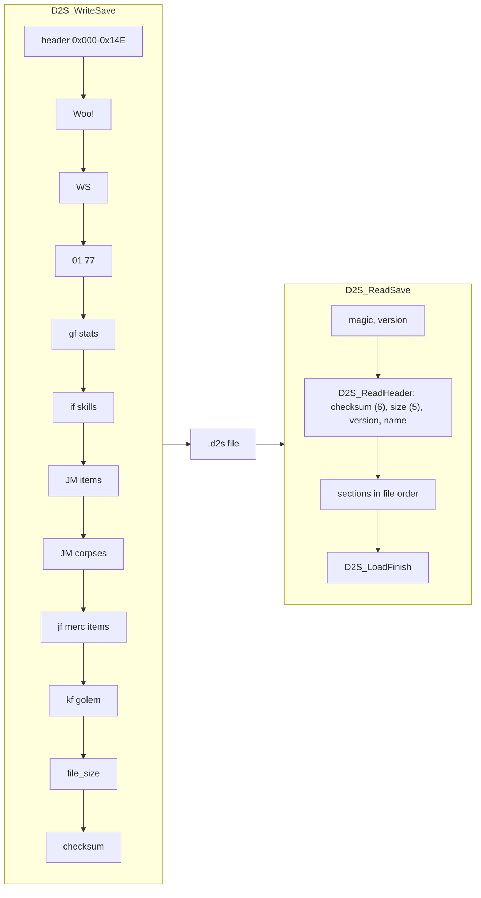

### A. Bit buffer

```
A1. Write(bb, value: u32, n: 1..32):                             [C] (fn:BITBUF_Write@0x00410EB0, note A)
      for k in 0 ..< n:
        bit (bb.pos + k) of the stream ← bit k of value
      bb.pos ← bb.pos + n
    ; stream bit p is bit (p mod 8) of byte (p ÷ 8): LSB first, bytes in order
    ; each newly entered byte is zeroed before bits are ORed into it
A2. Read(bb, n) → u32: the inverse, unsigned                       [C] (fn:BITBUF_Read@0x00410F60, run:2026-10-12-d2s-io, run:2026-10-16-player)
    ReadSigned(bb, n) → i32: Read, then sign-extend when n < 32     [C] (fn:BITBUF_ReadSigned@0x00411030, 0x00411041–0x00411062; note A)
A3. AlignByte(bb): bb.pos ← next multiple of 8 (padding bits are 0 on write)   [C] (fn:BITBUF_AlignByte@0x00411070, 0x0041109A)
A4. An overrun sets a sticky error flag (bb+0x10); a truncated read returns what fits.
    The item serialiser then returns 0 bytes for that item.         [I] (fn:BITBUF_Read@0x00410F60, fn:ITEMS_Serialize@0x006313E0)
```

- A. [C] **Second sources** ([save/0001 § Plan 0038 batch S1a](../../findings/save/0001-d2s-io.md#plan-0038-batch-s1a-2026-10-16)):
  A1 by bit-exact reproduction: `tools/d2s.py`'s LSB-first writer, which zeroes each new byte, re-encodes the 144
  game-written saves of the S1a corpus byte for byte. A2 `Read`: in 67 full loads the game's reader consumed exactly
  the bytes that decode gives each item (747 items) and set the stats it decodes (803). `ReadSigned` by its
  writer/reader pair: the only writer of a signed save field, `D2S_WriteStats`, clamps to the signed range and writes
  the low n bits, and its reader takes it back with `ReadSigned`; no stock save exercises the signed path (no
  `ItemStatCost` row has `CSvSigned` or `CSvParam`). A3: the padding of all 1 853 items and 144 `gf` lists is 0.
  (fn:BITBUF_Write@0x00410EB0, 0x00410F48, fn:D2S_WriteStats@0x00569540, fn:D2S_ReadStatsBits@0x0056A4F0,
  run:2026-10-12-d2s-io, run:2026-10-16-player)

### B. Checksum

```
B1. Checksum(buf, len) → u32:                                    [C] (fn:D2S_Checksum@0x00411130, run:2026-10-12-d2s-io)
      sum: u32 ← 0
      for i in 0 ..< len:
        sum ← rotl32(sum, 1) + buf[i]          ; mod 2^32; the code computes 2·sum + byte + (sum < 0 as i32)
      return sum
```

The checksum field (`0x00C`) holds 0 while the sum is computed, both on write (the header image is zeroed) and on
read (the reader saves and zeroes it). See step C3 and D3.

### C. Writing a save

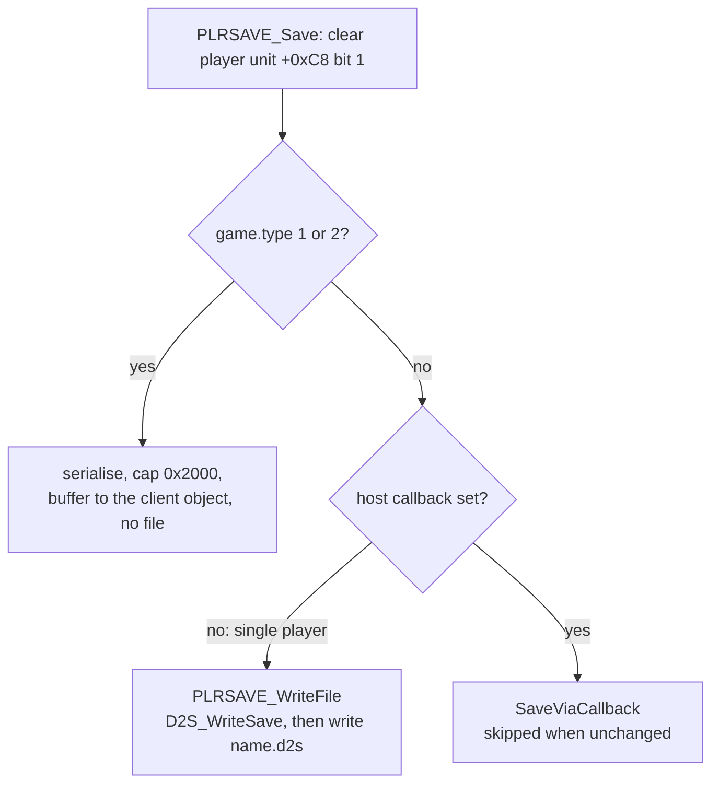

```
C1. PLRSAVE_Save(game, player):                                  [I] (fn:PLRSAVE_Save@0x00532400)
      clear player unit +0xC8 bit 1
      if game.type ∈ {1, 2}:  serialise (cap 0x2000), hand the buffer to the client object (0x00532340); no file
                                                                   [C] game type 2 (run:2026-10-27-sweep-d2s-play)
      else if no host callback (0x00883D50 = 0):  PLRSAVE_WriteFile      ; single player   [C] (fn:PLRSAVE_WriteFile@0x00532240, run:2026-10-12-d2s-io)
      else:  sub_00531EB0_SaveViaCallback                          [I] (fn:sub_00531EB0_SaveViaCallback@0x00531EB0; never set on this image, § Entry points)
C2. PLRSAVE_WriteFile: D2S_WriteSave into the 8 KiB buffer, then
      fopen("<save dir><name>.d2s", "wb") and write the bytes      [C] (fn:PLRSAVE_WriteFile@0x00532240, run:2026-10-12-d2s-io)
C3. D2S_WriteSave(client, player) → bytes:                        [C] (fn:D2S_WriteSave@0x00569AD0, 0x00569D2F–0x00569D38, run:2026-10-12-d2s-io)
      a. header image (0x14F bytes, zeroed, then filled per § D)    ; checksum field stays 0
      b. Woo! quests (§ E1)
      c. WS waypoints (§ E2)
      d. 01 77 NPCs (§ E3)
      e. gf character stats (§ F)
      f. if skills (§ G)
      g. JM item list of the player (§ H1)
      h. JM corpses (§ H2)
      i. if expansion game: jf, then the mercenary's item list if a mercenary exists; kf and the golem byte (§ H3)
      j. u32[0x08] ← bytes written
      k. u32[0x0C] ← Checksum(buffer, bytes written)
```

Step notes:

- C1. [C] The client-buffer branch: a one-client TCP/IP host (game type 2) saved through `0x00532340` and the server
  wrote no file; every single-player write took the file branch with the callback 0. Game type 1 is read from the
  code only. (fn:PLRSAVE_Save@0x00532400, run:2026-10-27-sweep-d2s-play)
- C1. [I] `sub_00531EB0_SaveViaCallback` compares the new buffer with the previous one with `checksum`,
  `last_played`, `unk_34` and `map_seed` masked to 0 in both, and skips the callback when nothing else changed. It
  runs only with the host callback set, which nothing in the image sets (§ Entry points). (0x00532001–0x0053210E)
- C3i. [C] `jf` and `kf` are written only in an expansion game: the 112 expansion saves of the plan 0038 S1a corpus
  carry them after the corpses and the 32 classic ones end at the corpse list. (fn:D2S_WriteMercItems@0x005699A0,
  [save/0001 § Plan 0038 batch S1a](../../findings/save/0001-d2s-io.md#plan-0038-batch-s1a-2026-10-16))
- C3i. [I] The mercenary list follows `jf` only when the player has a pet of type 7; the saves with a hired
  mercenary carry it (§ H3). (fn:D2S_WriteMercItems@0x005699A0, fn:D2S_WriteGolem@0x00569A00)
- C3. [C] Steps a–i are the section writers `D2S_WriteHeader`, `D2S_WriteQuests`, `D2S_WriteWaypoints`,
  `D2S_WriteNpcs`, `D2S_WriteStats`, `D2S_WriteSkills`, `D2S_WriteItemList`, `D2S_WriteCorpses`,
  `D2S_WriteMercItems`, `D2S_WriteGolem` (`0x00568F20`–`0x00569A00`), and the mercenary header fields
  `0x0AF`–`0x0BE` come from `D2S_WriteMercHeader`: in every write of run:2026-10-27-sweep-d2s-play the final pass's
  cursor at each writer's entry is the offset of its section in the written file, and the scratch pass's sizes equal
  the final pass's. (fn:D2S_WriteSave@0x00569AD0, fn:D2S_WriteMercHeader@0x00568E60, run:2026-10-27-sweep-d2s-play)

### D. Header fields

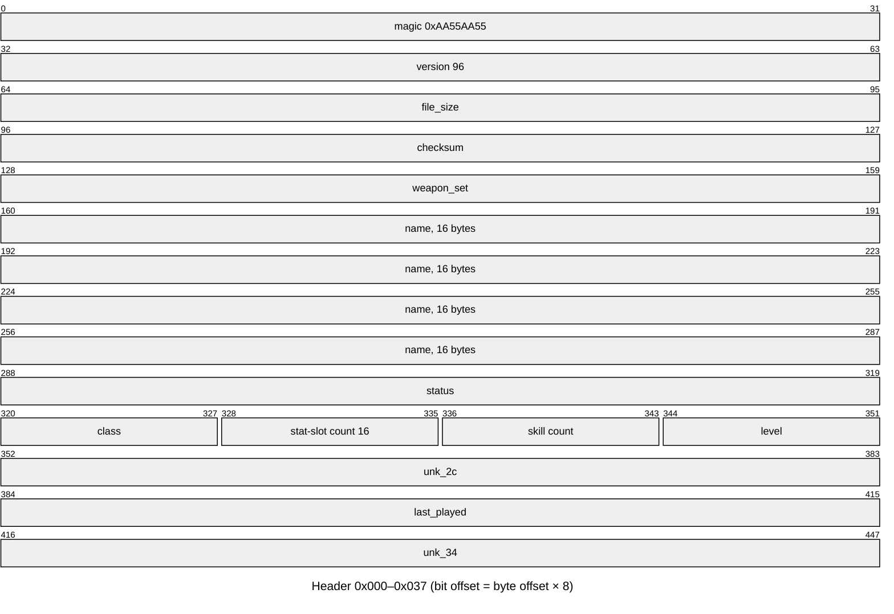

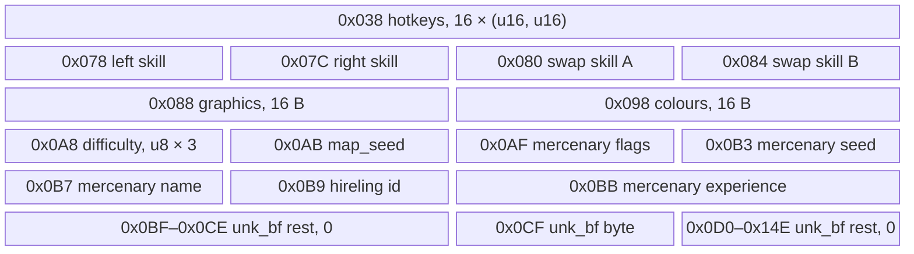

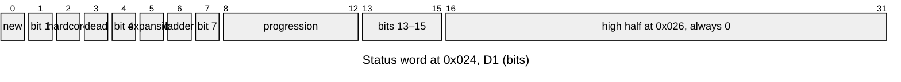

Each row gives the runtime source the writer reads and the runtime field the reader fills. "Write" and
"Read" carry their own tags. In the read column, a code in parentheses is the reader's internal error code.

| Offset | Width | Field | Written from | Write | Read into | Read | Anchors |
|---|---|---|---|---|---|---|---|
| `0x000` | u32 | `magic` | `0xAA55AA55` | [C] | checked by `D2S_ReadSave` (9, returned unmapped) | [C] | fn:D2S_WriteHeader@0x00568F20, fn:D2S_ReadSave@0x00534330, run:2026-10-12-d2s-io, run:2026-10-27-sweep-d2s-load |
| `0x004` | u32 | `version` | 96 | [C] | < 92 → legacy reader `0x00534020`; 92..96 accepted; else (7) | [C] 71, 87, 91, 92, 94, 96, 97; [I] 93, 95 | fn:D2S_WriteHeader@0x00568F20, fn:D2S_ReadSave@0x00534330, 0x0056A117, run:2026-10-12-d2s-io, run:2026-10-27-sweep-d2s-load, run:2026-10-27-sweep-d2s-legacy |
| `0x008` | u32 | `file_size` | bytes written | [C] | must equal bytes read (5) | [C] | fn:D2S_WriteHeader@0x00568F20, fn:D2S_ReadHeader@0x0056A090, run:2026-10-12-d2s-io |
| `0x00C` | u32 | `checksum` | `Checksum` (§ B) | [C] | recomputed and compared (6) | [C] | fn:D2S_WriteHeader@0x00568F20, fn:D2S_ReadHeader@0x0056A090, run:2026-10-12-d2s-io |
| `0x010` | u32 | `weapon_set` | bit 0 = client `+0x45C` ≠ 0 (swap set active) | [C] | bit 0 → client `+0x45C` | [C] | fn:D2S_WriteHeader@0x00568F20, fn:D2S_ReadHeader@0x0056A090, run:2026-10-16-player, run:2026-10-27-sweep-d2s-play |
| `0x014` | 16 B | `name` | client name `+0x0D`, NUL within 16 bytes | [C] | byte `0x23` forced 0, then `_stricmp` with the client's name (case ignored), else (7) | [C] | fn:D2S_WriteHeader@0x00568F20, fn:D2S_ReadHeader@0x0056A090, 0x0056A12B, run:2026-10-12-d2s-io, run:2026-10-27-sweep-d2s-load |
| `0x024` | u32 | `status` | client `+0x0A` (u16, zero-extended) `\| 0x20` if expansion game `\| 0x40` if ladder game | [C] | low u16 → client `+0x0A` after `D2S_CheckStatus` | [C] | fn:D2S_WriteHeader@0x00568F20, fn:D2S_ReadHeader@0x0056A090, run:2026-10-12-d2s-io |
| `0x028` | u8 | `class` | client `+0x08` | [C] | ≤ 7 (unsigned) → client `+0x08`, the class of the new player unit; > 7 → (4) (note below the table) | [C] | fn:D2S_WriteHeader@0x00568F20, fn:D2S_ReadHeader@0x0056A090, run:2026-10-12-d2s-io |
| `0x029` | u8 | stat-slot count | 16 | [C] | used only by the version ≤ 94 stat reader (F2) | [C] | fn:D2S_WriteHeader@0x00568F20, fn:D2S_ReadStats@0x0056A620, run:2026-10-12-d2s-io, run:2026-10-27-sweep-d2s-load |
| `0x02A` | u8 | skill count | `DataTables+0xBA8` (30) | [C] | number of skill bytes `D2S_ReadSkills` reads | [C] | fn:D2S_WriteHeader@0x00568F20, fn:D2S_ReadSkills@0x0056A710, run:2026-10-12-d2s-io, run:2026-10-27-sweep-d2s-load |
| `0x02B` | u8 | `level` | stat 12 of the player (`0x00625480(unit, 12)`) | [C] | not read | [C] | fn:D2S_WriteHeader@0x00568F20, fn:D2S_ReadHeader@0x0056A090, run:2026-10-12-d2s-io |
| `0x02C` | u32 | `unk_2c` | client `+0x488` | [C] | → client `+0x488` | [C] | fn:D2S_WriteHeader@0x00568F20, fn:D2S_ReadHeader@0x0056A090, run:2026-10-12-d2s-io |
| `0x030` | u32 | `last_played` | `time(NULL)` at the write | [C] | not read | [C] | fn:D2S_WriteHeader@0x00568F20, fn:D2S_ReadHeader@0x0056A090, run:2026-10-12-d2s-io, run:2026-10-27-sweep-d2s-load |
| `0x034` | u32 | `unk_34` | `0xFFFFFFFF` | [C] | not read | [C] | fn:D2S_WriteHeader@0x00568F20, fn:D2S_ReadHeader@0x0056A090, run:2026-10-12-d2s-io, run:2026-10-27-sweep-d2s-load |
| `0x038` | 16 × (u16, u16) | hotkeys | per slot: skill `\| 0x8000` if the slot flag, 1-based item ref (`0x005390D0`) | [C] skill and flag; [I] ref | `0xFFFF` = empty, skill = `& 0xFFF`, ref 0 = none (`0x00569EC0` → `0x005390A0`) | [C] empty; [I] mask, ref | fn:D2S_WriteHeader@0x00568F20, 0x00568F5C, fn:D2S_ReadHeader@0x0056A090, run:2026-10-16-calc, run:2026-10-27-sweep-d2s-play |
| `0x078` | (u16, u16) | left skill | skill id, item ref (`0x00620190`) | [C] | → player data `+0x74` / `+0x7C` | [C] | fn:D2S_WriteHeader@0x00568F20, fn:D2S_ReadHeader@0x0056A090, run:2026-10-12-d2s-io |
| `0x07C` | (u16, u16) | right skill | skill id, item ref (`0x006201D0`) | [C] | → player data `+0x70` / `+0x78` | [C] | fn:D2S_WriteHeader@0x00568F20, fn:D2S_ReadHeader@0x0056A090, run:2026-10-12-d2s-io |
| `0x080` | (u16, u16) | swap skill A | `0x00623220` (player data `+0x84`) | [C] | → player data `+0x84` / `+0x8C` | [C] | fn:D2S_WriteHeader@0x00568F20, 0x005691C2, fn:D2S_ReadHeader@0x0056A090, run:2026-10-27-sweep-d2s-play |
| `0x084` | (u16, u16) | swap skill B | `0x00623290` (player data `+0x80`) | [C] | → player data `+0x80` / `+0x88` | [C] | fn:D2S_WriteHeader@0x00568F20, 0x005691FB, fn:D2S_ReadHeader@0x0056A090, run:2026-10-27-sweep-d2s-play |
| `0x088` | 16 B | graphics | fn:sub_0063E510_CompositeFromEquip@0x0063E510, default `0xFF` | [C] | not read by the server | [C] | fn:D2S_WriteHeader@0x00568F20, 0x00569283, fn:D2S_ReadHeader@0x0056A090, run:2026-10-27-sweep-d2s-play, run:2026-10-27-sweep-d2s-load |
| `0x098` | 16 B | colours | the same call | [C] | not read by the server | [C] | fn:D2S_WriteHeader@0x00568F20, fn:D2S_ReadHeader@0x0056A090, run:2026-10-27-sweep-d2s-play, run:2026-10-27-sweep-d2s-load |
| `0x0A8` + d | u8 × 3 | `difficulty` | byte d = game difficulty (`game+0x6D`): client act `+0x1AC` `\| 0x80`; the other two bytes 0 | [C] | `b & 0x7F` → client act (out-of-range act clamp: note below the table); `b & 0x80` gates the map-seed reuse | [C] | fn:D2S_WriteHeader@0x00568F20, fn:D2S_ReadHeader@0x0056A090, run:2026-10-12-d2s-io |
| `0x0AB` | u32 | `map_seed` | `game+0x7C` | [C] | → `game+0x7C` under the condition of D4 | [C] | fn:D2S_WriteHeader@0x00568F20, fn:D2S_ReadHeader@0x0056A090, run:2026-10-12-d2s-io |
| `0x0AF` | u32 | mercenary flags | 0, bit 16 if the mercenary is dead | [C] | bit 16 → dead flag of the recreated mercenary | [C] | fn:D2S_WriteMercHeader@0x00568E60, fn:D2S_ReadMercHeader@0x0056AA50, run:2026-10-27-sweep-d2s-play |
| `0x0B3` | u32 | mercenary seed | mercenary info `+0x00` | [C] | the hire entry's seed, back into the pet info; it does not reach the stats | [C] | fn:D2S_WriteMercHeader@0x00568E60, fn:D2S_ReadMercHeader@0x0056AA50, run:2026-10-16-hirelings, run:2026-10-27-sweep-d2s-play |
| `0x0B7` | u16 | mercenary name | name id − hireling record `+0x114` | [C] | + `+0x114` of the Id's first row (the reset above `+0x116`: note below) | [C] | fn:D2S_WriteMercHeader@0x00568E60, fn:D2S_ReadMercHeader@0x0056AA50, run:2026-10-16-hirelings, run:2026-10-27-sweep-d2s-play |
| `0x0B9` | u16 | hireling id | mercenary info `+0x08` | [C] | `Hireling` rows looked up by id (`0x006562F0`): class, name range, the band row of each level; overwrites the Id `MERC_Init` derives | [C] | fn:D2S_WriteMercHeader@0x00568E60, fn:D2S_ReadMercHeader@0x0056AA50, run:2026-10-16-hirelings, run:2026-10-27-sweep-d2s-play |
| `0x0BB` | u32 | mercenary experience | mercenary stat 13 | [C] | stat 13; level = highest level ≤ 99 whose threshold `(L+1)·L²·Exp/Lvl` it reaches | [C] | fn:D2S_WriteMercHeader@0x00568E60, fn:D2S_ReadMercHeader@0x0056AA50, run:2026-10-16-hirelings, run:2026-10-27-sweep-d2s-play |
| `0x0CF` | u8 | `unk_bf` byte | client `+0x480` | [C] | → client `+0x480` (`+0x481`, `+0x482` set to 0) | [C] | fn:D2S_WriteHeader@0x00568F20, fn:D2S_ReadHeader@0x0056A090, 0x0056A339–0x0056A343, run:2026-10-27-sweep-d2s-load |
| `0x0BF`–`0x0CE`, `0x0D0`–`0x14E` | | `unk_bf` rest | 0 | [C] | not read | [C] | fn:D2S_WriteHeader@0x00568F20, fn:D2S_ReadHeader@0x0056A090, run:2026-10-16-player, run:2026-10-27-sweep-d2s-load |

Scope of the confirmed rows (run:2026-10-12-d2s-io, every write compared with the logged runtime source, the read
side with the logged client and player-data fields after `D2S_ReadHeader`; [save/0001 §2](../../findings/save/0001-d2s-io.md#walkthrough)):

- [C] `status`: expansion games only, never ladder. `class`: the classes of the run saves. `left`/`right skill`:
  the skill id, and item ref 0 only. `difficulty`: Normal, act 0 only; the Nightmare byte rests on the load test of
  run:2026-10-11-tc-drops (a Nightmare save holds `00 80 00`). (fn:D2S_WriteHeader@0x00568F20,
  fn:D2S_ReadHeader@0x0056A090, run:2026-10-12-d2s-io, run:2026-10-11-tc-drops)
- [C] **The rows raised by plan 0038 H1b and H1a**, scoped to their cases
  ([save/0001 § Plan 0038 batch H1b](../../findings/save/0001-d2s-io.md#plan-0038-batch-h1b-run2026-10-27-sweep-d2s-play),
  [§ Plan 0038 batch H1a](../../findings/save/0001-d2s-io.md#plan-0038-batch-h1a-run2026-10-27-sweep-d2s-load)):
  `weapon_set` written after a swap (`w`: bit 0 = 1 in rt-r2's four writes, equal to the logged client `+0x45C`) and
  read back (bit 0 = 1 stored at client `+0x45C`); the hotkey `0x8000` flag written for a
  left-button skill (slot 2 `left:Teleport` → `0x8036`), the skill alone otherwise, and the empty slots coming back
  `0xFFFF` after a load and a write; swap skills A and B (54/48 after the swap, 42/43 before) written and read back;
  graphics and colour bytes equal to the image `0x0063E510` left, with non-`0xFF` bytes present; the mercenary header
  written from its sources in three cases (two tool-built, one hired in play) and the dead flag written and read (a
  tool-built dead mercenary and one killed in play); `fields`' edited `last_played`, `unk_34`, graphics, colours and
  `unk_bf` rest ignored by the load and each written back from its own source; `0xCF` = `0x5A` carried to client
  `+0x480`–`+0x482` as `5a 00 00` and written back; a 15-character name with byte `0x23` = `Z` loaded, and `QITSOR`
  for the client's `qitsor`. (fn:D2S_WriteHeader@0x00568F20, fn:D2S_ReadHeader@0x0056A090,
  fn:D2S_WriteMercHeader@0x00568E60, fn:D2S_ReadMercHeader@0x0056AA50, run:2026-10-27-sweep-d2s-play,
  run:2026-10-27-sweep-d2s-load)
- [C] **A class byte above 7 is a read error, not a clamp.** The reader compares the byte as unsigned (`cmp al, 7;
  ja`) and, above 7, returns error code 4 through its shared error exit: the class is not set and the read stops.
  A file with class 8 gave 4 (mapped 9) after `D2S_CheckStatus` had passed. (fn:D2S_ReadHeader@0x0056A090,
  0x0056A16F–0x0056A174, 0x0056A0C4–0x0056A0CF, run:2026-10-27-sweep-d2s-load;
  [save/0001](../../findings/save/0001-d2s-io.md) header row `0x028`)
- [C] **Class 7 passes the class test, and no class-7 character loads.** A full save and a stub with class byte 7
  pass the header; when the player unit is made, `sub_00553180_PlayerSetClient`'s null-unit test (line 1210, `0x4BA`)
  halts the game both ways in, so no class-7 player is made (raised by H1a as player/creation's row 11; the readings
  that need a class-7 player, in the next note, have no case). (fn:sub_00553180_PlayerSetClient@0x00553180, 0x00553185–0x00553187,
  0x0056A22C–0x0056A23B, run:2026-10-27-sweep-d2s-load)
- [I] So the class clamp of `EXP_GetThreshold` (D5's stat 30) is reached by no class-7 player. Its other out-of-range
  input is the −1 that its callers' inlined null-unit test passes (0x005342DE, 0x00535A0A, 0x0056B13D), and no run or
  reading shows a null unit there. (fn:EXP_GetThreshold@0x00611800, 0x00611806–0x0061180F,
  [player/0001 § Plan 0038 batch H1a](../../findings/player/0001-creation.md#plan-0038-batch-h1a-run2026-10-27-sweep-d2s-load))
- [I] **Reach in single player.** The character screen lists only the files `sub_0043C8A0_CharListReadInfo` accepts (at
  least 8 bytes, the magic, a version from 71 to 96 with enough bytes) and makes the game from the listed file's
  status, expansion bit and difficulty. So `D2S_ReadSave`'s 9, the version code 7 and the `D2S_CheckStatus` codes 8
  to 14 reach the server in single player only when the file changes between the list being read and *OK*. The H1a
  cases were swapped in that way (a stock path that edits no table, memory or code). A bad checksum or size, a name
  that is not the file name, a class byte above 7 and the section readers' codes are reached by a listed file too.
  (fn:sub_0043C8A0_CharListReadInfo@0x0043C8A0, fn:sub_00438F70_CharListBuild@0x00438F70, 0x0043C93E–0x0043C9C4,
  [save/0001 § Plan 0038 batch H1a](../../findings/save/0001-d2s-io.md#plan-0038-batch-h1a-run2026-10-27-sweep-d2s-load))
- [C] **The mercenary header's read side** (`0x0B3`–`0x0BE`) is run-checked: in run:2026-10-16-hirelings, 33 headers
  were read (expansion and classic, every hireling class and difficulty); 23 mercenaries were created with the saved
  seed, name (+ `+0x114`) and Id passed to `MERC_Init` (compared 23 of 23 against the logged header at the review),
  the class of the Id's row and the level from the experience, and their stats reproduced; 10 classic ones were
  refused by `MERC_Create`'s act test. The algorithm is [hirelings § H](../hirelings/README.md#h-the-mercenary-from-a-save-d2s_readmercheader-merc_create).
  (fn:D2S_ReadMercHeader@0x0056AA50, fn:MERC_Create@0x005774F0, run:2026-10-16-hirelings)
- [C] **The mercenary header's write side and the empty header.** The write side and the dead flag are the H1b
  rows above. The all-zero header gives no mercenary and the load goes on: its result is not tested (hire's first
  read). (fn:D2S_WriteMercHeader@0x00568E60, fn:D2S_ReadMercHeader@0x0056AA50, 0x0056B318–0x0056B32A,
  run:2026-10-27-sweep-d2s-play)
- [C] **A name past `+0x116` is reset to `+0x114`.** A tool-built save with a saved name id of 50 (the Rogue range is
  0..40) gave `3411 + 50 = 3461 > 3451` and was reset to 3411; the in-range loads kept `3411 + name`.
  (0x0056AAA0–0x0056AABB, run:2026-10-27-sweep-hirelings; [hirelings § H](../hirelings/README.md#h-the-mercenary-from-a-save-d2s_readmercheader-merc_create), H3)
- [I] The widths of that test are read, not separated (a name of 50 gives the same result under any width): the add
  is a u16 add and the compare unsigned, so a name equal to `+0x116` is kept and one past `0xFFFF − first` wraps
  (hirelings H3). (0x0056AAA0–0x0056AABB)
- [C] **The act is clamped.** An act (`b & 0x7F`) of 5 or more is read as 0: bytes `0x85` and `0x86` both gave act 0
  (6 rules out a modulo 5), and both writes stored `80 00 00`. (fn:D2S_ReadHeader@0x0056A090, 0x0056A1E8–0x0056A1F1,
  run:2026-10-27-sweep-d2s-load)
- [I] **`0x0CF` and client `+0x480`–`+0x482` are host bytes the game only carries.** The reader stores the byte through
  `ClientSetHostBytes` (and the join path sets the three bytes from a join record); the writer reads them back through
  `ClientGetHostBytes`; the two save callers hand them to the host callback, with the status word and the experience,
  only in a ladder game (`Game+0x74` ≠ 0); the client-removal report sends them (0 as `0xFF`). No game rule reads them,
  so their meaning is the host's, not determinable from `Game.exe`. A reimplementation reads, carries and writes them
  back unchanged. (0x0056A343, 0x00532997, 0x005692A9, 0x0052C9AB, 0x0052CA84, 0x00539D0C–0x00539D38,
  fn:sub_00539190_ClientGetHostBytes@0x00539190, fn:sub_005391C0_ClientSetHostBytes@0x005391C0,
  fn:sub_0052C900_SaveClients@0x0052C900, fn:D2S_ReadHeader@0x0056A090,
  [save/0001 § Plan 0039 batch P1b](../../findings/save/0001-d2s-io.md#q25-the-save-fields-left-open))
- [I] **Status bit 1** is set only by the client's creation screen (`0x0043C6A0`, called with 1 from 0x004360A4, on the
  stub's status word); `D2S_CheckStatus` tests bits 2, 3, 5 and 6, never bit 1. (0x00569D80–0x00569F00,
  [save/0001 § Plan 0039 batch P1b](../../findings/save/0001-d2s-io.md#q25-the-save-fields-left-open))
- [C] `level` is written from stat 12 and never read back: a save with header level 2 and stat 12 = 1 was rewritten
  with level 1. (0x0056904D, run:2026-10-11-d2s-edit)
- [C] `unk_2c` is a pass-through: an edited `0x0BADF00D` survived two load/save cycles, and the only instructions
  that touch client `+0x488` are its accessors `0x00538760`/`0x00538790`. A character's first full save writes the
  client's initial value, 0 in every sample. (fn:D2S_ReadHeader@0x0056A090, run:2026-10-12-d2s-io)

```
D1. Status word (client +0x0A), checked by D2S_CheckStatus:       [C] (fn:D2S_CheckStatus@0x00569D80, run:2026-10-27-sweep-d2s-load) (bits 0–5 and the expansion bounds)
      bit 0   new character (stub): cleared; if the file ends at the header, build a fresh character
              (sub_00569F80_NewCharFromStub) instead of reading sections
      bit 2   hardcore: must equal the game's hardcore flag (0x0053FD40() & 0x800), else (11) or (12)
      bit 3   dead: refused when hardcore (10)
      bit 5   expansion: must equal game+0x70 ≠ 0, else (8) or (9)
      bit 6   ladder: tested (codes 25, 26) only when the host flag 0x00883D54 is set, never on this image   [I] (0x00569DBC)
      bits 8–12  progression: Nightmare needs ≥ 5 (expansion) / ≥ 4 (classic); Hell needs ≥ 10 / ≥ 8, else (13) or (14)
                                                                   [I] the classic bounds 4 and 8 (fn:D2S_CheckStatus@0x00569D80)
D2. The u16 at 0x026 is the high half of the status u32: always 0.  [C] (0x00569012–0x0056901B; 0 in 144 game-written saves)
```

- D1. [C] Each code met in run:2026-10-27-sweep-d2s-load, with a file swapped into the listed file's game: a
  hardcore file in a softcore game 11, softcore in hardcore 12, dead hardcore 10, classic file in an expansion game 9,
  expansion file in a classic game 8, progression 4 in Nightmare 13, progression 0 in Hell 14; progression 5 in
  Nightmare and 10 in Hell pass, so the expansion bounds are met from both sides. Single-player reach of codes 8 to
  14: the note after the header table. The stub path of bit 0 ran in run:2026-10-16-player (35 stubs). The ladder test
  is gated by the same setter as the host callback (§ Entry points). (fn:D2S_CheckStatus@0x00569D80,
  run:2026-10-27-sweep-d2s-load, run:2026-10-16-player)

The new-character path that D1's bit 0 leads to (the stub, `NewCharFromStub`, the starting stats, skills and items,
and the first save they produce) is specified in [player/creation](../player/creation.md#a-the-stub-and-the-servers-checks).

### D3–D5. Reading a save

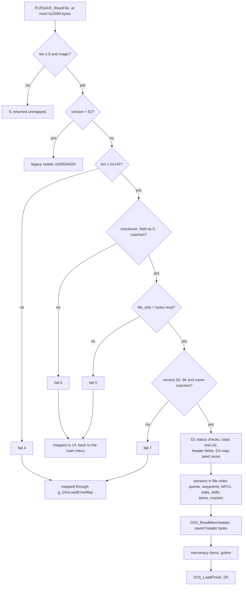

```
D3. Load(client):                                                 
      a. bytes ← PLRSAVE_ReadFile: fopen("<save dir><name>.d2s", "rb"), at most 0x2000 bytes      [C] (fn:PLRSAVE_ReadFile@0x005343A0, 0x0053441F, run:2026-10-27-sweep-d2s-load)
      b. D2S_ReadSave: len < 8 or u32[0x00] ≠ MAGIC → 9, returned as is (not mapped)               [C] (fn:D2S_ReadSave@0x00534330, 0x0053433C, 0x0053435A, run:2026-10-27-sweep-d2s-load)
         u32[0x04] < 92 → legacy reader 0x00534020; else D2S_ReadSaveV92
      c. D2S_ReadHeader:                                                                          [C] (fn:D2S_ReadHeader@0x0056A090, 0x0056A0D2–0x0056A104, run:2026-10-12-d2s-io, run:2026-10-27-sweep-d2s-load)
           if len < 0x14F: fail (4)
           stored: u32 ← u32[0x0C];  u32[0x0C] ← 0
           if Checksum(bytes, len) ≠ stored: fail (6)
           if u32[0x08] ≠ len: fail (5)
      d.   version ∉ 92..96 → (7); name test → (7); D1 → (8)..(14); class > 7 → (4);                [C] (fn:D2S_ReadHeader@0x0056A090, 0x0056A0B7–0x0056A174, run:2026-10-27-sweep-d2s-load)
           then the other header fields of § D and D4
      e. section readers in file order: quests, waypoints, NPCs, stats, skills, items, corpses   [C] (fn:D2S_ReadSaveV92@0x0056B180, run:2026-10-27-sweep-d2s-play)
         (stats 6 and 8 are kept after the stats section, for D5)
      e2. D2S_ReadMercHeader(header + 0x0AF): from the header bytes already read, not the stream;  [C] (fn:D2S_ReadMercHeader@0x0056AA50, 0x0056B313, run:2026-10-27-sweep-d2s-play)
          its result is not checked for an error
      e3. mercenary items (given the mercenary e2 returned); 0x005726C0(1) when a mercenary exists;   [C] (0x0056B32D, fn:D2S_ReadSaveV92@0x0056B180, fn:sub_005726C0_MercSendStats@0x005726C0, run:2026-10-27-sweep-d2s-play)
          golem
      f. D2S_LoadFinish (§ D5)                                                                     [C] (fn:D2S_LoadFinish@0x0056AF80, run:2026-10-12-d2s-io, run:2026-10-16-player)
    on a failure inside D2S_ReadSaveV92: code ← g_D2sLoadErrorMap[internal code];                  [C] (data:g_D2sLoadErrorMap@0x006E1208, fn:sub_00539760_ClientAddPlayerToGame@0x00539760, run:2026-10-27-sweep-d2s-load)
      the join fails ("[PLAYER LOAD] … Error Loading")
```

- D3. [C] **The order of the header tests**, each case failing one test or two so that the code names the first
  (run:2026-10-27-sweep-d2s-load): the first 0x100 bytes of a save give 4 (the length first); version 97 with a bad
  checksum 6 (the checksum before the version); a bad checksum and size 6 (before the size); version 97 alone 7; a
  wrong name with a hardcore status 7 (the name before the status); class 8 with a hardcore status 11 (the status
  before the class); class 8 alone 4. (fn:D2S_ReadHeader@0x0056A090, run:2026-10-27-sweep-d2s-load)
- D3a. [C] An 8 392-byte file whose first 8 192 bytes are a valid save of `file_size` 8 192 loads; a valid 8 392-byte
  save fails 6 (the checksum over the 8 192 bytes read). (fn:PLRSAVE_ReadFile@0x005343A0, run:2026-10-27-sweep-d2s-load)
- D3b. [C] A 7-byte file and a file with a bad magic were each read whole and refused with 9 before
  `D2S_ReadHeader`; the 9 comes from `D2S_ReadSave` itself, not through the failure exit and the map, and
  `PlayerLoad` passes it to the join as is. Version 91 went to the legacy reader, which refused the version-96 body
  with 14. (fn:D2S_ReadSave@0x00534330, fn:sub_00534020_ReadSaveLegacy@0x00534020, run:2026-10-27-sweep-d2s-load)
- D3b. [C] **The legacy reader on real layouts.** Tool-built files of versions 87 and 71 in the legacy layout
  ([d2s.md § Legacy versions](../../formats/d2s.md#legacy-versions-7191)) reached `sub_00534020_ReadSaveLegacy` and returned 0 with no
  `D2S_ReadHeader` call, so a file with no checksum and no size field was accepted. Its section readers ran in the
  layout's order (header, quests, waypoints, NPCs, stats, skills, items, corpses, the mercenary, the hotkey tail, which
  version 71 lacks), each returning 0, and the game's version-96 write-back held as built the name, class, level,
  stats 0–3 and 6–15, the skills, the mouse skills, hotkey slots 0–7 (and at version 87 slots 8 and 9 and the swap
  skills, from the tail) and the items. A version-87 file whose header status has bit 0 called the header section
  only, then `sub_00532590_NewCharLegacy`: the character was built new
  ([player/creation](../player/creation.md#entry-points)). (fn:sub_00534020_ReadSaveLegacy@0x00534020,
  fn:sub_00532690_ReadHeaderLegacy@0x00532690, fn:sub_00533350_ItemListReadV71@0x00533350,
  fn:sub_00532590_NewCharLegacy@0x00532590, run:2026-10-27-sweep-d2s-legacy,
  [save/0001 § Plan 0038 batch H1c](../../findings/save/0001-d2s-io.md#plan-0038-batch-h1c-run2026-10-27-sweep-d2s-legacy))
- D3b. [I] Not run on the legacy layouts: the failures of the item, corpse and mercenary sections, the legacy header's
  status tests and act bound, a corpse list with items, the ear, magic, rare and crafted records of the version-71
  form, versions 72–86 and 88–91. (fn:sub_00534020_ReadSaveLegacy@0x00534020)
- D3c. [C] Internal codes 6 and 5 are both mapped to **14**, and the player is back at the main menu. The checksum
  test comes first: a file with a wrong size field and a correct checksum fails with 5, a file with a wrong checksum
  fails with 6, and a file with both wrong fails with 6. The map as met: 2 → 9, 4 → 9, 6 → 14, 7 → 1, 8 → 24, 9 → 23,
  10 → 21, 11 → 20, 12 → 19, 13 → 17, 14 → 18, 16 → 3, each equal to the table read from the image, each followed by
  the main menu. (data:g_D2sLoadErrorMap@0x006E1208, run:2026-10-12-d2s-io, run:2026-10-11-d2s-edit,
  run:2026-10-27-sweep-d2s-load)
- D3c. [I] Internal codes 3, 15 and 17–19 and the ladder codes 25 and 26 were not met; their map entries are read
  from the image. (data:g_D2sLoadErrorMap@0x006E1208)

```
D4. Map-seed reuse, in D2S_ReadHeader:                            [C] (0x0056A1FC–0x0056A217, run:2026-10-12-d2s-io)
      b: u8 ← byte[0x0A8 + game.difficulty]
      if game.type = 3 and game+0x84 = 0 and (b & 0x80) ≠ 0:
        game+0x7C ← u32[0x0AB]
```

- D4. [C] Act creation follows the load in the join (`0x00530190` → `0x0052C210` → `0x0053AFB0` →
  `sub_0053AC70_ActCreate`), so a reused map seed rebuilds the saved maps: a `-seed 0` game (no override) saved its
  clock map seed, and the next load in the same process replaced its own clock map seed with it, giving the same
  Act I seed. With bit 7 clear, or under `-seed 7`, the game kept its own value. (fn:sub_00530190_SrvJoinAct@0x00530190,
  run:2026-10-12-d2s-io)

```
D5. D2S_LoadFinish(player), after the item lists:                [C] (fn:D2S_LoadFinish@0x0056AF80, run:2026-10-27-sweep-d2s-play) (all but the "< 0" tests)
      if stat14 (gold) < 0 or > level maximum (0x00622E70): stat14 ← 0
      if stat15 (goldbank) < 0 or > its maximum (0x00623460): stat15 ← 0      ; "< 0": [I], no save had it
      stat10 (stamina) ← maximum (0x00625DB0)
      stat6, stat8 ← the values read before the items were attached
      stat67, stat68, stat69 ← 100
      stat30 (nextexp) ← EXP_GetThreshold(class, L), L = stat 12 (level)
          ; the experience.txt row whose Level is L, the experience to reach level L + 1;
          ; with the MaxLvl row counted as index 0 that is row index L + 1 (dword class + 8·L + 8, 0x00611814)
```

- D5. [C] Gold 900 000 above the level-80 maximum 800 000 became 0, a bank of 3 000 000 above 2 500 000 became 0,
  500 000 was kept; stamina was set to its maximum; stats 6 and 8 were restored; 67–69 were 100; stat 30 was
  `EXP_GetThreshold(class, L)`: level 80 gave 742 730 244 for a character with experience 750 000 000, so it is not
  the experience, and level 1 gave 500, the row whose `Level` is 1, not the 1 500 of `Level` 2.
  (fn:EXP_GetThreshold@0x00611800, tbl:Experience.txt:Level, run:2026-10-27-sweep-d2s-play)

- D5. [C] Stats 7 and 9 (maximum life and mana) are **not** recomputed: an edited stat 9 = `8000 << 8` was the same
  at the entry and exit of `D2S_LoadFinish`, shown as maximum mana in game and saved unchanged.
  (fn:D2S_LoadFinish@0x0056AF80, run:2026-10-12-d2s-io)

### E. Fixed sections

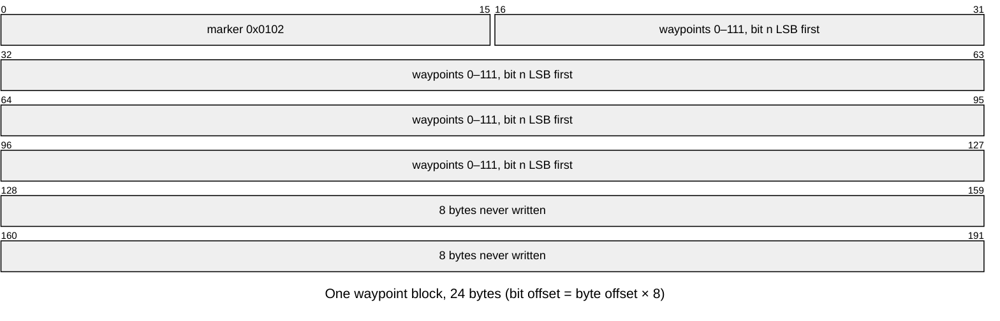

```
E1. Quests: "Woo!", u32 6, u16 0x12A, then three 96-byte blocks copied from player data
    +0x10, +0x14, +0x18 in index order (0x0065C560).                [C] (fn:D2S_WriteQuests@0x00569320, note E)
    On load (0x0065C4D0), per block of 48 u16 quest words: words 0–41 get bits 13 and 14
    cleared always and bit 15 set if bit 1 is set; words 42–47 are copied unchanged.
                                                                     [C] (fn:D2S_ReadQuests@0x0056A370, fn:QUESTRECORD_LoadBytes@0x0065C4D0, run:2026-10-18-quests2)
E2. Waypoints: "WS", u32 1, u16 0x50, then three 24-byte blocks: 16 bytes from the waypoint
    record at player data +0x1C, +0x20, +0x24 (WAYPOINT_Save) and 8 bytes never written;   [C] (fn:D2S_WriteWaypoints@0x005693E0, fn:WAYPOINT_Save@0x006610B0, note E)
    WAYPOINT_Save first stores the marker 0x0102 into a record whose marker is 0 or 0x0101 (0x006610EB);
      the 0 case met, 0x0101 at a write from the code only [I] (0x006610EB; a load zeroes a 0x0101 record)
    record = u16 marker 0x0102, then 7 u16 words; waypoint n (< 112) is word 1 + n ÷ 16,
    mask 1 << (n mod 16), i.e. bit n LSB first from block byte +0x02.                    [C] (data:g_WaypointBits@0x00746428, run:2026-10-11-d2s-waypoints)
    Reader: D2S_ReadWaypoints tests the marker: 0x0102, 0x0101 or 0 accepted, else (16),     [C] (fn:D2S_ReadWaypoints@0x0056A3E0, fn:WAYPOINT_Load@0x00661030, run:2026-10-27-sweep-d2s-load)
    before WAYPOINT_Load, whose own fatal marker test (0x00661065) is therefore not reached from a save;
    with 0x0101 or 0 the whole record is zeroed, the marker included; then waypoint 0 is forced on.
E3. NPCs: 01 77, u16 0x34, then 3 × 8 bytes (first record of player data +0x60 + 4·d)
    and 3 × 8 bytes (second record), d = 0, 1, 2; read back in the same order.            [C] (fn:D2S_WriteNpcs@0x00569490, fn:D2S_ReadNpcs@0x0056A470, note E)
```

- E. [C] **Second sources** ([save/0001 § Plan 0038 batch S1a](../../findings/save/0001-d2s-io.md#plan-0038-batch-s1a-2026-10-16), and the H1a waypoint cases): the quest
  tag, version 6 and size `0x12A` in all 144 game-written saves, no quest bit of 192 blocks lost over 64 built and
  written pairs, and block 0 the played Normal game's; the waypoint version 1 and size `0x50` in all 144 saves, all 432
  blocks starting `02 01` and ending with 8 zero bytes; the waypoint bits read by the game's menu as `tools/d2s.py
  setwp` set them (two saves); the NPC tag and size in all 144 saves, and the NPC section of the 64 pairs back
  byte-identical. Markers: a Normal record with marker `0x0102`, waypoint 0 clear and 1 set read as `0x0003`; a
  `0x0101` and a 0 record each read as 16 zero bytes with waypoint 0 set (the marker 0 too: `WAYPOINT_Load` stores
  `0x0102` at 0x00661086 and the zero dword at 0x0066108B overwrites it); the next write stored `0x0102` back; marker
  `0x0303` gave 16 (mapped 3). (fn:WAYPOINT_Load@0x00661030, fn:WAYPOINT_Save@0x006610B0,
  run:2026-10-11-d2s-waypoints, run:2026-10-27-sweep-d2s-load)

- E1. The quest load rule as the quest runs check it, and what the game writes into the record before Save and Exit,
  are [quests/progression § A](../quests/progression.md#a-the-quest-record).
- E1–E3. [I] **Slot d is difficulty d** for all three sections. For quests and waypoints this is
  [save/0002](../../findings/save/0002-quest-words.md); for the NPC records, the three game-time readers index player
  data `+0x60 + 4·d` with the game's difficulty byte `Game+0x6D`. (0x0057236C–0x00572370, 0x005723CC–0x005723D0,
  0x005724CC–0x005724D0, struct:Game+0x6D, fn:D2S_WriteNpcs@0x00569490,
  [save/0001 § Plan 0039 batch P1b](../../findings/save/0001-d2s-io.md#q25-the-save-fields-left-open))

### F. Character stats (`gf`)

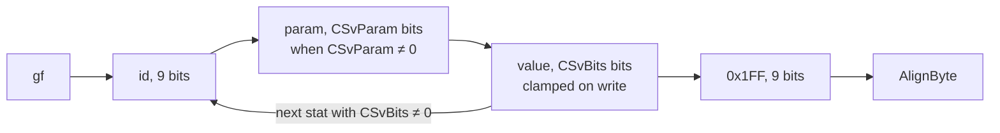

```
F1. WriteStats(player, bb):                                      [C] (fn:D2S_WriteStats@0x00569540, run:2026-10-12-d2s-io)
      Write "gf"
      for each entry e in player.baseStats (unit+0x5C), in list order:
        if e.id ≥ statCount: continue
        rec ← ItemStatCost[e.id]
        if rec.CSvBits = 0: continue
        Write(bb, e.id, 9)
        if rec.CSvParam ≠ 0: Write(bb, e.param, rec.CSvParam)
        v: i32 ← e.value
        if rec.CSvBits < 32:
          if rec+0x05 bit 5 (CSvSigned): v ← clamp(v, −2^(CSvBits−1), 2^(CSvBits−1) − 1)
          else:                          v ← clamp(v, 0, 2^CSvBits − 1)
        Write(bb, v, rec.CSvBits)
      Write(bb, 0x1FF, 9)
      AlignByte(bb)
```

- F1. [C] The run covers the list order and the `CSvBits` skip (the base lists of 11 and 13 written stats, the
  others having `CSvBits` 0), with no param and no clamp hit; the param branch is read from the code only.
  There is no zero test: a stat absent from the base list is absent from the file. (0x00569540–0x005696DF,
  run:2026-10-12-d2s-io)
- F1. [C] **The unsigned clamp is hit by high life and mana.** Stats 6–11 (life, mana, stamina and their maxima) have
  `CSvBits` 21, so a base value of `0x1FFFFF` or more (8191.99 points with the 8 fraction bits) is written as
  `0x1FFFFF`. The base list carries the item bonuses, so the written value can be below the character's base entry.
  Second source: in the 14 level-up logs of run:2026-10-16-player, all 364 written entries (26 save writes) equal
  `min(base, 2^CSvBits − 1)` of the header-time base list, and the 10 that differ from the base are exactly those with a
  base ≥ `0x1FFFFF` (stat 6 of two Hell Barbarian and Paladin saves, stat 8 of three Sorceress saves). Experience
  (stat 13, `CSvBits` 32) is not clamped. `D2S_WriteHeader` has no stat pass of its own; the header writes only stat
  12. (0x00569605–0x00569698, fn:D2S_WriteStats@0x00569540, tbl:ItemStatCost.txt:CSvBits, run:2026-10-16-player,
  [save/0001 § Plan 0039 batch P1b](../../findings/save/0001-d2s-io.md#b10-the-hell-0x1fffff-life-is-the-writers-clamp))
- F1. [I] Since `D2S_LoadFinish` sets stats 6 and 8 back to the values read, a character saved with more than 8191
  life or mana comes back with 8191.99 until it is recomputed. Not run. (fn:D2S_WriteStats@0x00569540, fn:D2S_LoadFinish@0x0056AF80,
  [save/0001 § Plan 0039 batch P1b](../../findings/save/0001-d2s-io.md#b10-the-hell-0x1fffff-life-is-the-writers-clamp))
- F1. [I] The clamp is inline and compares the value as a signed s32, so a negative value of an unsigned stat is
  written as 0 (0x0056965B–0x00569661). It is not `BITBUF_WriteClamped`, whose unsigned compare in the item writer
  turns the same value into `2^n − 1` (J). (fn:D2S_WriteStats@0x00569540,
  [save/0001 §4](../../findings/save/0001-d2s-io.md#4-character-stats-gf))

```
F2. ReadStatsBits(player, bb), version ≥ 95:                     [C] (fn:D2S_ReadStatsBits@0x0056A4F0, run:2026-10-12-d2s-io)
      loop:
        id ← Read(bb, 9);  if id = 0x1FF: break
        if id ≥ statCount or ItemStatCost[id].CSvBits = 0: fail (18)
        param ← ReadSigned(bb, CSvParam)          ; signed; 0 when CSvParam = 0
        if CSvBits < 32 and CSvSigned: value ← ReadSigned(bb, CSvBits)
        else:                          value ← Read(bb, CSvBits)
        SetStat(player, id, value, param)         ; 0x00627260, value stored as is
```

- F2. [C] The `SetStat` calls of 5 loads equal the file's list in order; life, mana and stamina keep their 8
  fraction bits. The param path, the signed path and code 18 were not exercised and rest on the code read. (0x0056A4F0,
  run:2026-10-12-d2s-io)
- F2. [C] Versions ≤ 94 use another format (`D2S_ReadStats`): a bitmask of `byte[0x029]` bits, then one u32 per set
  bit, for stats 0 … n−1. 1.14d never writes it. Version 95 was not loaded: the bound is `cmp eax, 0x5E; jbe`
  (0x0056A627), [I] for 95. A version-94 file with count 16 gave one `SetStat` per stat 0..15 (the
  u32 or 0) and the skills section 2 + 2 + 4 × 11 bytes on; with count 12 only stats 0..11 were set, so stat 12
  (`level`) was not, and the next write held no stat 12 and header level 0; a version-96 file with count 8 read its
  whole `gf` list, and the write's count was 16 again. (fn:D2S_ReadStats@0x0056A620, 0x0056A627–0x0056A640,
  run:2026-10-27-sweep-d2s-load)

### G. Skills (`if`)

```
G1. "if", then for i in 0 ..< skillCount(class): one u8 = the player's base level of the
    class's i-th skill (0x006460F0(class, i), count 0x00646140(class)).   [C] (fn:D2S_WriteSkills@0x005696F0, note G)
G2. Reader: byte[0x02A] bytes; each non-zero one is set (0x0056DEB0).     [C] (fn:D2S_ReadSkills@0x0056A710, run:2026-10-16-calc, run:2026-10-27-sweep-d2s-load)
```

- G. [C] `if` and 30 bytes then `JM` in all 144 game-written saves, and the 1 920 skill bytes of 64 built and written
  pairs back unchanged ([save/0001 § Plan 0038 batch S1a](../../findings/save/0001-d2s-io.md#plan-0038-batch-s1a-2026-10-16)). In the calc hover sessions every class skill with formula cells is evaluated
  at its saved byte, a 0 byte at level 1 only; with the bytes shifted by one skill the check fails in all 7 classes.
  A file with skill count 29 had 29 bytes read, and the item list's tag was found after them.
  (fn:D2S_ReadSkills@0x0056A710, 0x0056A7C3–0x0056A7D0, run:2026-10-16-calc, run:2026-10-27-sweep-d2s-load)

### H. Item lists

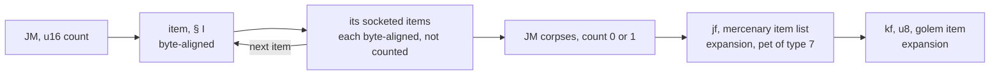

```
H1. WriteInventoryList(owner, bb):                               [C] (fn:ITEMS_WriteInventoryList@0x005317B0, note H1)
      Write "JM", u16 count
      for each item of the inventory list, except the two hand slots (body 4, 5) of the equipped
      list and the cursor item, then those items:                 ; the cursor item: [I] (fn:ITEMS_WriteInventoryList@0x005317B0)
        n ← sub_005316D0_WriteOneItem(item)       ; § I, then its socketed items
        if n = 0: count ← count − 1               ; ITEMS_Serialize refused it (unit +0xC8 bit 15)   [I] (fn:ITEMS_Serialize@0x006313E0)
      ; socketed items follow their parent, each starting on a byte boundary, not counted
H2. Corpses: "JM", u16 count (0 or 1), per corpse: u32, u32, u32, then an item list   [C] (fn:D2S_WriteCorpses@0x005697F0, fn:D2S_ReadCorpses@0x0056A830, run:2026-10-27-sweep-d2s-play)
    count ≥ 2 refused (0x68); the first u32 is uninitialised stack (note), the other two
    the position getters 0x0045ADF0 / 0x0045AE20                                          [I] (fn:D2S_WriteCorpses@0x005697F0)
H3. Expansion only: "jf", then the mercenary's item list with a hired mercenary (the test, C3i);   [C] (fn:D2S_WriteMercItems@0x005699A0, fn:D2S_ReadMercItems@0x0056AC10, run:2026-10-27-sweep-d2s-play)
    "kf", then u8 1 and the golem's item if the player owns a pet of type 3 whose class is 291
    (irongolem) and that golem holds an item, else u8 0.                             [I] (fn:D2S_WriteGolem@0x00569A00, fn:D2S_ReadGolem@0x0056AE50)
H4. Reader: "JM", count, then count items, each followed by its n_filled socketed items.   [C] (fn:ITEMS_ReadInventoryList@0x005335E0, run:2026-10-15-socket-saves)
```

- H1. [C] In all 200 logged writes of the S1a corpus no other top-level item follows a hand-slot item, while the
  earlier, non-final serialiser passes of the same writes walk the list with the hand items first, so the order is the
  writer's; the count equals the items written. No write had an item on the cursor or a refused item.
  ([save/0001 § Plan 0038 batch S1a](../../findings/save/0001-d2s-io.md#plan-0038-batch-s1a-2026-10-16), run:2026-10-12-d2s-io, run:2026-10-16-player)
- H2–H4. [C] One corpse (hell-r3, a death in Hell): count 1, 12 bytes, a list of 11 equipped items, written five times
  and read back; the mercenary's item list (a short bow) written after `jf` and read back. No golem item was made.
  Socketed children: 4 parents with filled sockets and their 6 children read and written back unchanged, and 5
  parents and 7 children of the S1a pairs. (run:2026-10-27-sweep-d2s-play, run:2026-10-15-socket-saves)

- H2. [I] **The corpse record's 12 bytes are not read on load.** The writer's first u32 is `[ebp−0x2C]`, a local of its
  frame that no instruction writes, so it holds whatever an earlier call left on the stack; the reader checks that 12
  bytes remain and skips all three u32s (the corpse unit is created fresh). A reimplementation may write anything
  there. (0x0056994E–0x00569954, 0x0056A900–0x0056A91B, fn:D2S_WriteCorpses@0x005697F0, fn:D2S_ReadCorpses@0x0056A830,
  [save/0001 § Plan 0039 batch P1b](../../findings/save/0001-d2s-io.md#q25-the-save-fields-left-open))
- H2. [I] **Which corpse is written.** With more than one corpse of the player, the writer keeps the one whose items
  have the highest summed `ItemTradePrice(…, mode 3, …)` over items that are not gold, ties going to the later corpse.
  (0x00569835–0x005698EA, 0x005698CE, fn:D2S_WriteCorpses@0x005697F0)

### I. One item

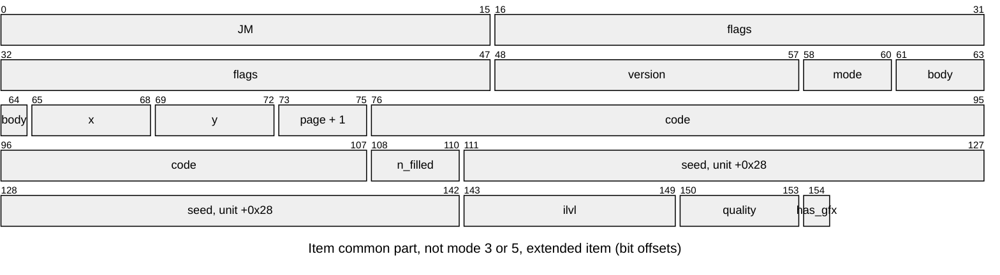

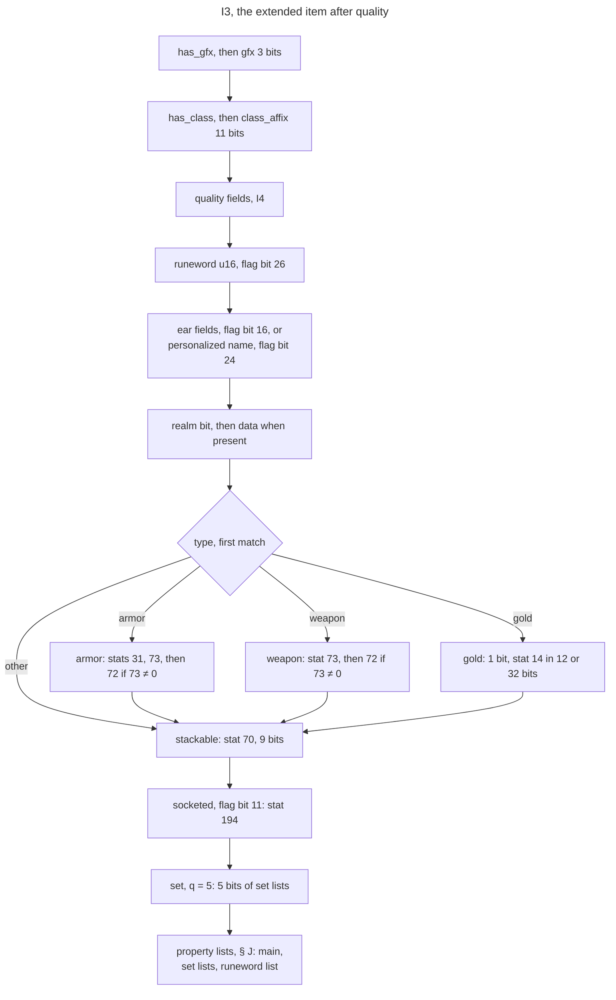

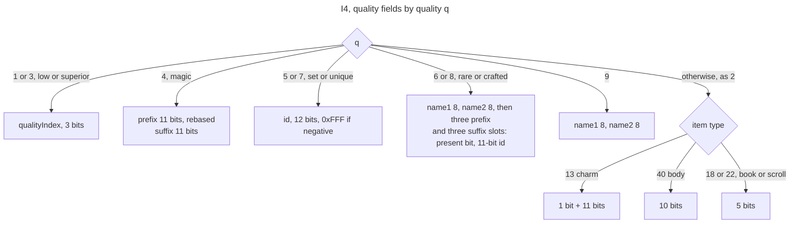

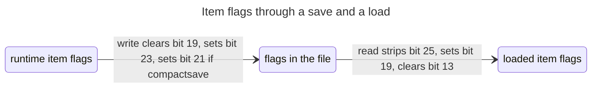

The item starts on a byte boundary and ends at the next one (zero padding).

```
I1. SerializeItem(item, bb):                                     [C] (fn:ITEMS_SerializeBits@0x006312B0, note I1)
      d ← item.data ; rec ← the item's Weapons/Armor/Misc record
      Write(bb, "JM", 16)                                        ; read back signed and compared
      f: u32 ← (d.flags & ~0x00080000) | 0x00800000              [C] (0x006312D1–0x006312D6, run:2026-10-12-d2s-io)
      if rec.compactsave (+0x143): f ← f | 0x00200000            [C] (0x00631312, 0x0063131B, note I1)
      Write(bb, f, 32)
      Write(bb, d.version, 10)                                   [C] (run:2026-10-12-d2s-io)
      Write(bb, item.mode, 3)                                    [C] (run:2026-10-12-d2s-io)
      if item.mode ∈ {3, 5}: world position as two 16-bit values   [I] (fn:ITEMS_SerializeBits@0x006312B0)
                             ; no body and no store              [I] (0x0063008E, 0x0063009C, fn:ITEMS_WriteCompact@0x0062AF80, fn:ITEMS_PeekHeader@0x0062AE20)
      else:
        Write(bb, d.bodyLoc, 4)                                  [C] (run:2026-10-12-d2s-io)
        Write(bb, grid x, 4); Write(bb, grid y, 4)               [C] (fn:ITEMS_SerializeBits@0x006312B0, note I1)
        Write(bb, d.invPage + 1, 3)                              [C] (run:2026-10-12-d2s-io)
      if f bit 21 (simple) and f bit 16 (ear):                    [C] (0x0062B1D3, 0x0062AEE9–0x0062AEF1, run:2026-10-27-sweep-d2s-load)
        Write(bb, ear class, 3); Write(bb, ear level, 7)         ; in place of the code
        ear name, 7 bits per char including the terminating 0
      else:
        Write(bb, rec.code, 32)                                  [C] (0x00628590, run:2026-10-12-d2s-io)
      if f bit 21 (simple): WriteCompact (I2); return
      Write(bb, number of socketed items, 3)       ; n_filled, 0x0062A900   [C] (fn:ITEMS_WriteFull@0x0062FFF0, run:2026-10-15-socket-saves)
      WriteFull (I3)
    every width-limited value x is written as ClampU(x, n):     [C] (fn:BITBUF_WriteClamped@0x0062AF50, 0x00630F38–0x00630F4E, run:2026-10-17-sweep-emu; note I1)
      ClampU(x, n) = x if n = 32, else min((u32) x, 2^n − 1)     ; a negative s32 saturates to all ones

I2. WriteCompact (simple item):                                  (fn:ITEMS_WriteCompact@0x0062AF80)
      if item is gold (type 4): Write(1 bit "amount > 4095"), then the amount (12 or 32 bits)   [I] (fn:ITEMS_WriteCompact@0x0062AF80)
      if rec.quest and rec.questdiffcheck: stat 356 in its Save Bits    [C] (run:2026-10-27-sweep-d2s-play)
      realm flag (1 bit; 97 bits when set)                       [I] (0x0062B36E–0x0062B387; no realm game)
    ; no n_filled: bit 108 of a simple item is the realm flag

I3. WriteFull (extended item, save flag set):                    [C] (fn:ITEMS_WriteFull@0x0062FFF0, note I3)
      Write(bb, item.unit+0x28, 32)                 ; seed      [C] (0x006302CF, run:2026-10-12-d2s-io)
      Write(bb, clamp(d.ilvl, 1, 99), 7)            ; ilvl      [C] (run:2026-10-12-d2s-io)
      q ← d.quality (2 if the item has no item data); Write(bb, q, 4)   [C] (run:2026-10-12-d2s-io)
      has_gfx: 1 bit (variable graphics, 0x0062E8D0); if 1: Write(bb, d.gfx, 3)   gfx [C] (run:2026-10-12-d2s-io); has_gfx [C] (0x0062E8D0, tbl:ItemTypes.txt:VarInvGfx)
      has_class: 1 bit = (d.autoAffix (+0x36) ≠ 0); if 1: Write(bb, class_affix, 11)   0 [C] (0x00630408–0x0063043A, run:2026-10-12-d2s-io); 1 [I]
        class_affix = d.autoAffix − automagicBase when above it    [C] (data:g_MagicAffixInfo@0x0096CA7C, 0x00630413–0x00630417, note I3)
      quality fields (I4)
      if f bit 26 (runeword): Write(bb, Runes[rw]+0x82 as u16, 16), 0xFFFF if none   [C] +0x82 (0x00630887, run:2026-10-27-sweep-d2s-play); 0xFFFF [I] (0x0062BED0)
      if f bit 16 (ear; only a non-compactsave ear reaches here, none in the shipped data):   [I] (fn:ITEMS_WriteFull@0x0062FFF0)
        class 3 bits, level 7 bits (d+0x48), name
      else if f bit 24 (personalized): name, 7 bits per char including the terminating 0 (d+0x4A)   [C] (fn:ITEMS_WriteFull@0x0062FFF0, 0x0062D288–0x0062D2A7, run:2026-10-27-sweep-d2s-load)
      realm: 1 bit; when present (0x00629E40), then u32, u32, u32 0   [C] (0x00629E40, 0x0062D2AF–0x0062D2EA, run:2026-10-27-sweep-d2s-load)
      Fixed(v, id) = ClampU(v + SaveAdd[id], SaveBits[id]), in SaveBits[id] bits   [C] (0x00630A19–0x00630CF3, note I3)
          ; no ValShift: [I], stats 31, 72, 73 have ValShift 0 in the shipped table (tbl:ItemStatCost.txt:ValShift)
      if ItemIsType(50) (armor): Fixed(base stat 31, 31) (armorclass),            [C] (fn:ITEMS_WriteFull@0x0062FFF0, fn:STATS_GetUnitBaseStat@0x006253B0, fn:STATS_GetUnitStat@0x00625480, note I3)
          then Fixed(base stat 73, 73) (maxdurability),
          then Fixed(stat 72, 72) (durability) if base stat 73 ≠ 0
      else if ItemIsType(45) (weapon): stat 73, then 72 if 73 ≠ 0, as for armor  [C] (fn:ITEMS_WriteFull@0x0062FFF0, note I3)
      else if ItemIsType(4) (gold): 1 bit (stat 14 ≥ 0x1000), then stat 14 in 12 bits, or 32 when the bit is set; no SaveAdd   [I] (0x00630C2F–0x00630C44)
      if stackable (0x006289F0): stat 70 (quantity), a fixed 9 bits, no SaveAdd   [C] (0x006289F0, note I3)
      if f bit 11 (socketed): base stat 194 in SaveBits[194] bits, no SaveAdd    [C] (0x0062BE00, run:2026-10-15-socket-saves)
      if q = 5 (set): 5 bits, bit i set when the item holds the stat list of set state 0x006E90B8[i]   [C] (fn:ITEMS_WriteFull@0x0062FFF0, note I3)
      property lists (§ J): the main list (state 0, flag 0x40), then each set list whose bit is set,
      then, if f bit 26, the runeword list (state 171)                           [C] (fn:ITEMS_WriteFull@0x0062FFF0, note I3)
```

```
I4. Quality fields, written only when the item is identified (f bit 4) or the save flag is set;
    a save always sets it:                                       [C] (0x0063048F, note I3)
      q ∈ {1, 3} (low, superior): Write(qualityIndex, 3)          ; 0x00629DA0
      q = 4 (magic):     Write(StorePrefix(d.prefix[0]), 11); Write(d.suffix[0], 11)
      q ∈ {5, 7} (set, unique): Write(id, 12)                     ; id < 0 → 0xFFF; 0x00629DA0
      q ∈ {6, 8} (rare, crafted): Write(name1, 8); Write(name2, 8)
                         for k in 0 ..< 3:
                           prefix slot k (d+0x38 + 2k): present bit, then StorePrefix(id) in 11 bits if present
                           suffix slot k (d+0x3E + 2k): present bit, then id in 11 bits if present
      q = 9:             Write(name1, 8); Write(name2, 8)
      otherwise (handled as 2, normal):
        type 13 (charm):          1 bit + 11 bits
        type 40 (body):           10 bits
        type 18 or 22 (book, scroll): 5 bits
    StorePrefix(id) = id − firstPrefix if id > firstPrefix, else id (cmp; jle), which for every   [C] (0x00630688–0x0063068F, 0x0062CEEA, 0x0062CFBA, 0x0062D0A3, note I3)
    prefix id is "≠ 0"; firstPrefix = 747, the MagicSuffix record count (the merged index);
    the reader adds firstPrefix back to a non-zero value; suffix ids are stored unchanged.
```

- I4. [C] **What the ids index.** Every affix pick returns the merged index + 1: magic affixes over `MagicSuffix`, then
  `MagicPrefix`, then `AutoMagic` (stock: suffix row r is id r + 1, prefix row r id 748 + r, automagic row r id
  1417 + r), rare names over `RareSuffix` then `RarePrefix` (rare suffix row r id r + 1, rare prefix row r id 156 + r).
  The item-data setters keep these ids, so the saved suffix and rare-name fields are merged ids, the saved prefix is
  rebased by `StorePrefix`, and `class_affix` (I3) by the automagic base. (fn:MAGICAFFIX_GetRecord@0x00633EE0,
  fn:RAREAFFIX_GetRecord@0x00634260, data:g_MagicAffixInfo@0x0096CA7C, data:g_RareAffixInfo@0x0096CAA0,
  run:2026-10-14-affixes, [items/0005 § 1](../../findings/items/0005-affixes.md#1-the-merged-affix-arrays-and-the-ids-0x00633730-0x00633f40),
  [items/affixes](../items/affixes.md); the save side: rows 87 and 101 of
  [save/0001 § Plan 0038 batch S1a](../../findings/save/0001-d2s-io.md#plan-0038-batch-s1a-2026-10-16), note I3)

- I1. [C] **Second sources for I1** ([save/0001 § Plan 0038 batch S1a](../../findings/save/0001-d2s-io.md#plan-0038-batch-s1a-2026-10-16), [save/0001 § Plan 0038 batch S1e](../../findings/save/0001-d2s-io.md#plan-0038-batch-s1e-2026-10-17)): the
  common part decodes all 1 853 items of the 146 game-written saves and re-encodes them byte for byte, and in 200
  logged writes each of the 1 960 final-pass items is the file item at its logged offset; bit 21 equals the base
  record's `compactsave` on all of them (1 372 set, 588 clear); the 419 stored items of 64 built and written pairs come
  back at the same `x`, `y`. `ClampU` by emulated reproduction ([ADR-0015](../../adrs/0015-emulated-reproduction.md)):
  2 500 calls of `BITBUF_WriteClamped` give the model bit for bit (1 092 negative values written as all ones). The
  property writer's inlined copy at 0x00630F38–0x00630F4E computes the same map with other register roles (it zeroes
  EDX and compares it with the value in ESI, where the function zeroes EAX and compares it with EDX): an equivalent
  sequence, not an identical one, compared under that operand map over 69 531 cases with 0 differences. The copy is
  covered as the same computation, not as a second source. (fn:BITBUF_WriteClamped@0x0062AF50, 0x0062AF53–0x0062AF6E,
  run:2026-10-17-sweep-emu, run:2026-10-12-d2s-io, run:2026-10-16-player)
- I1. [C] **The serialiser's arguments.** `ITEMS_SerializeBits` takes three arguments, and every save write passes
  (1, 1, 0): all 1 960 final-pass items of the 200 logged writes. (fn:ITEMS_SerializeBits@0x006312B0,
  run:2026-10-12-d2s-io, run:2026-10-16-player)
- I1. [I] The other forms are not a save's, and a reimplementation of the save applies neither: a non-zero third
  argument clears flags bit 22 and sets bit 25 (0x00631321–0x0063132D), and a first argument of 0 skips the `JM` tag
  and clears bit 11 of an unidentified item (0x00631333–0x0063134D). The reader's strip of bit 25 matches the
  non-save form. (fn:ITEMS_SerializeBits@0x006312B0)
- I1. [C] An ear (flags bits 4, 16, 21, 23; class 3, level 42, name `earname`) was read into item data `+0x28`, `+0x48`
  and `+0x4A`, the next item started where it ended, and the write gave the same bytes back.
  (0x0062B1D3–0x0062B277, run:2026-10-27-sweep-d2s-load)
- I1. [C] Over 8 writes (14 or 11 items each, no socketed item) the saved `flags`, `version`, `location`, `body`,
  `store` and `code` equal the runtime item, and the 5 loads put them back: `version` = item data `+0x30` = 101 in
  an expansion game (`game+0x78` = 101); `location` = unit mode, modes 0, 1 and 2 seen. A classic game's item
  version 2 is read from the code only. (0x00530D49, run:2026-10-12-d2s-io)
- I3. [C] The saved `seed` is the item unit's `+0x28`, the value its RNG was initialised from. For a server-created
  item that is the game-seed draw of [rng/seeds](../rng/seeds.md) step 7a; one Blood Moor drop picked up and saved
  had at its creation the `+0x28`, quality and ilvl it was saved with. The item-data seed (`+0x04`) is not saved.
  `ilvl` values 1 and 99 and qualities 1, 2, 4 and 7 were compared. (fn:sub_00552DF0_UnitSeedInit@0x00552DF0,
  run:2026-10-12-d2s-io)
- I3. [C] **Second sources for I3 and I4** ([save/0001 § Plan 0038 batch S1a](../../findings/save/0001-d2s-io.md#plan-0038-batch-s1a-2026-10-16)): all 649 extended items
  decode by I3 and re-encode byte for byte, with seed, ilvl, quality and gfx equal to the logged item in the 200
  writes; `has_gfx` = the base type's `VarInvGfx` ≠ 0 on all 649 (`0x0062E8D0` returns `ItemTypes +0x23`); the
  armour, weapon and stackable fields of 3 saved props-forced items and 269 starting items equal their logged stats
  (`Save Add` and `Save Bits` applied); the sockets of 24 socketed items come back; the one set item of the corpus
  has bits `0b11` and exactly two set lists, and the reader takes the lists in one loop over the five bits with the
  same body for each (`1 << i` tested, state `[0x006E90B8 + 4i]`, 165–169, 0x0062D8D4–0x0062D8F0); the runeword list
  is that loop's extra pass with state 171 when the runeword flag is set (0x0062D8BB–0x0062D8CF); 7 unidentified
  items carry their quality fields. Prefix and suffix ids by data over every magic, rare and crafted item with a main
  list (85 items, 127 ids) with failing counterfactuals, and the writer's `cmp`/`jle`/`sub` read in the code.
  (run:2026-10-12-d2s-io, run:2026-10-14-props-forced, run:2026-10-16-player, run:2026-10-15-socket-saves)
- I3. [C] **`class_affix`, by its writer/reader pair.** Both compute the automagic base as
  `(+0x10 − +0x04) / 0x90` of `g_MagicAffixInfo` (0x006303D5, 0x0062CD9C); the writer subtracts it when `+0x36` is above
  it, the reader adds it back to a non-zero 11-bit value (0x0062CE45) and stores `+0x36` (0x0062CE57). For a save
  version ≤ 88 the reader returns 0, and at version 89 it adds 1 before adding the base (0x0062CE2A–0x0062CE3D);
  1.14d writes 96. No stock save holds `has_class` 1, so no stock save reaches the pair. (data:g_MagicAffixInfo@0x0096CA7C)
- I3. [I] For save versions 72–88 the reader lowers both the prefix base and the automagic base by a per-version
  constant through a jump table (0x0062CDC4–0x0062CE10, e.g. 0x295 and 0x4EE); version 96 takes no case. Only an
  old-format file reaches it. (0x0062CDC4–0x0062CE10)
- I3. [C] Weapon damage (stats 21–24, 159, 160), speed (67, 68) and block (20) are not saved; the reader rebuilds
  them from the item record: 43 weapon reads (qualities 2, 4, 7; 4 ethereal reads, the ×3/2 branch) each equal the
  table. (0x0062D397–0x0062D6B7, tbl:Weapons.txt:mindam, tbl:Weapons.txt:speed, tbl:Armor.txt:block,
  run:2026-10-27-sweep-d2s-play)
- I3. [I] The low-quality ×3/4 branch of that rebuild: no low-quality item was read. (0x0062D397–0x0062D6B7)
- I3. [C] An item with no automagic affix has `+0x36` = 0 and `has_class` 0: the 588 extended items of the 200 logged
  writes and the 252 extended items loaded. (0x00630408–0x0063043A, run:2026-10-12-d2s-io, run:2026-10-16-player)
- I3. [I] **`has_class`** is set exactly when item data `+0x36` holds an automagic affix. `ITEMS_SetAutoAffix` writes
  it: 0 at the start of `sub_00557450_ItemCreateByQuality`, then the rolled affix when the item version is ≥ 100 (an
  expansion item), the quality is 1, 2, 3, 4, 6, 8 or 9 (not 5 set, not 7 unique), the base record's `auto prefix`
  (`+0x0F8`) is non-zero and the roll returns a non-zero affix. So a classic item, a set or unique item, or a base
  without `auto prefix` has `has_class` 0. The roll is `items/affixes`. (fn:ITEMS_SetAutoAffix@0x00627F50,
  fn:sub_00557450_ItemCreateByQuality@0x00557450, fn:sub_0062A670_ItemGetVersion@0x0062A670, 0x005579B3, 0x005579F2)
- I3. [C] **The fixed fields use `Save Add`.** `armorclass` has `Save Bits` 11 and `Save Add` 10 in the shipped table,
  so the format doc's `Save Add` decoding of armor class is the game's: the defense and durability of the saved
  props-forced items and of 269 starting items equal their logged stats. (0x00630A19–0x00630CF3,
  run:2026-10-14-props-forced, run:2026-10-16-player)
- I3. [I] They do not apply `ValShift`, and gold, `quantity` and `sockets` are written without `Save Add`: `ValShift`
  is 0 for all six stats and `Save Add` 0 or blank for 14, 70 and 194 in the shipped table, so neither has an
  observable. (0x00630A19–0x00630CF3, [save/0001 §8](../../findings/save/0001-d2s-io.md#8-plan-0015-phase-3-framing-details-and-item-flag-bit-13))
- I1–I2. [C] **Ears take the simple form.** The shipped `ear` record has `compactsave` 1, so a saved ear is a simple
  item whose ear fields replace the 32-bit code; the peek reader takes the code `'ear '` without reading 32 bits and
  reads no `n_filled` (bit 21 is set): the ear above was read and written back so. (0x0062B1D3,
  fn:ITEMS_PeekHeader@0x0062AE20, 0x0062AEE9–0x0062AEF1, run:2026-10-27-sweep-d2s-load)
- I1. [I] A code `nec ` read from a save of version ≤ 92 is replaced by `neg `. (fn:ITEMS_PeekHeader@0x0062AE20)

```
I5. Reading an item (sub_00558CB0_ItemCreateFromSave → ITEMS_ReadFull / ITEMS_ReadCompact):
      flags → d.flags with bit 25 stripped; then bit 19 (0x80000) set and bit 13 (0x2000) cleared   [C] (fn:sub_00558CB0_ItemCreateFromSave@0x00558CB0, 0x00558D46–0x00558D4C, run:2026-10-12-d2s-io)
      extended: unit+0x28 ← seed; RNG_SeedInit(unit+0x20, seed) → {seed, 666}                      [C] (0x0062CD13–0x0062CD16, fn:RNG_SeedInit@0x00650E40, run:2026-10-12-d2s-io)
                d.ilvl ← max(ilvl, 1); d.quality ← quality                                         [C] (fn:ITEMS_ReadFull@0x0062CBE0, run:2026-10-12-d2s-io)
      simple:   unit+0x28 ← 0, d.ilvl ← 1, d.quality ← 2                                            [C] (0x0062AC3E–0x0062AC45, run:2026-10-12-d2s-io)
      unique id ≥ unique count (DataTables+0xC28) → −1 (written back as 0xFFF, I4)                  [C] (0x0062D0DC–0x0062D103, 0x0062D0F1, run:2026-10-27-sweep-d2s-load)
      set id (version ≥ 93): d ← SETITEMS_GetRecord(id)+0x00 (s16);                                 [C] (fn:SETITEMS_GetRecord@0x00483440, 0x0062D11C–0x0062D1A3, run:2026-10-27-sweep-d2s-load)
        no record: that item is dropped (its unit freed) and the load goes on
      runeword u16 → d+0x38                                                                          [C] (0x0062D1CB, run:2026-10-27-sweep-d2s-play)
      save version ≤ 95 (the argument at [ebp+0x1C]): stat 72 (durability) in 8 bits, not SaveBits[72]   [C] 94 (8 bits) and 96 (SaveBits); [I] 95 (0x0062D425–0x0062D433, 0x0062D759–0x0062D764, run:2026-10-27-sweep-d2s-load)
      the peek reader takes n_filled only when flags bits 21 and 25 are clear                        [C] (fn:ITEMS_PeekHeader@0x0062AE20, 0x0062AF1F, note I5)
```

- I5. [C] An amulet with unique id 4000 was read with item data `+0x28` = −1, written as `0xFFF`, and the game went
  on. Gloves as a set item with id 4000 were read (31 bytes), their unit freed, the list went on and the load passed;
  both writes held 13 items and no set item. A version-94 file's three durabilities (7, 8, 20) read in 8 bits came back
  in the write. The game's reader consumed exactly the decoded length of all 495 simple items it loaded (no
  `n_filled`), and 2 simple quest items have non-zero bits 108–110 that an `n_filled` read would have taken for
  socketed children. (fn:ITEMS_ReadFull@0x0062CBE0, 0x00558D2D, 0x00558D6C, run:2026-10-27-sweep-d2s-load, run:2026-10-12-d2s-io,
  run:2026-10-16-player)

Runewords: how flag bit 26, the runeword u16 at `ItemData+0x38` and the state-171 list come to be, why a loaded
runeword is not rolled again, and how the reader re-inserts the socketed children are in
[items/sockets-runewords § E and § G](../items/sockets-runewords.md#g-in-the-save).

#### Item flag bit 13 (`0x2000`)

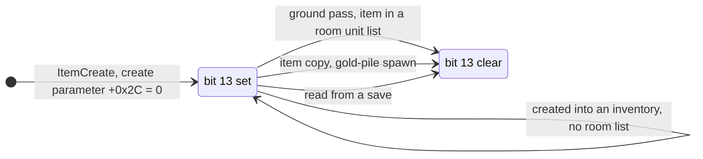

```
I6. Who sets and clears item flags bit 13 (all through ITEMS_SetFlag(item, 0x2000, set)):        [I] (fn:ITEMS_SetFlag@0x006280D0)
      set:   sub_00558D90_ItemCreate, when its create parameters have +0x2C = 0 (a drop)            [C] (fn:sub_00558D90_ItemCreate@0x00558D90, 0x00558E95–0x00558EA3, 0x00558EA8, run:2026-10-27-sweep-d2s-play)
      clear: sub_00553220_UnitFrameReset, for every item unit in a room unit list of an act         [C] (fn:sub_00553220_UnitFrameReset@0x00553220, 0x00553351, 0x0055335C, run:2026-10-27-sweep-d2s-play)
             from the server game tick (sub_0052D870_GameTick → sub_0053B000_ActUnitsFrameReset)   [C] (fn:sub_0053B000_ActUnitsFrameReset@0x0053B000, 0x0053B049, run:2026-10-27-sweep-d2s-play)
             ; the pass runs for an act whose dword +0x00 is non-zero, then act+0x00 ← 0           [I] (fn:sub_0052D870_GameTick@0x0052D870)
      clear: sub_00559300_DropGoldPile, on the new gold pile                                         [I] (fn:sub_00559300_DropGoldPile@0x00559300, 0x00559482)
      clear: sub_0055A2A0_ItemCopy, on the copy                                                      [C] (fn:sub_0055A2A0_ItemCopy@0x0055A2A0, 0x0055A360, run:2026-10-27-sweep-d2s-play)
             and on each socketed copy                                                               [I] (0x0055A438)
      clear: the reader (I5)
```

- I6. [C] **The ground pass clears the bit.** In run:2026-10-27-sweep-d2s-play five drops (two `gld`, `mp3`, `hp5`,
  `cm3`) each had `0x2000` set at creation through `ITEMS_SetFlag` from `ItemCreate` with create parameters `+0x2C` = 0,
  and each was cleared on the ground (mode 3) by `UnitFrameReset` inside the tick's `ActUnitsFrameReset` call; the
  11 corpse items recreated at a death were each cleared by `ItemCopy`. (fn:ITEMS_SetFlag@0x006280D0, run:2026-10-27-sweep-d2s-play,
  [save/0001 § Plan 0038 batch H1b](../../findings/save/0001-d2s-io.md#plan-0038-batch-h1b-run2026-10-27-sweep-d2s-play))
- I6. [I] **The pickup does not clear bit 13.** None of the four clear sites is on a pickup path, and no item still
  carrying the bit was picked up in a run. A drop lies in a room until it is picked up, so the first game-frame pass
  over its act clears the bit; an item created into an inventory (starting items, cube outputs) is in no room list and
  keeps it, which matches the samples. That every set and clear goes through `ITEMS_SetFlag` is a code reading (the
  run's write watchpoint was not live). How soon that pass runs after a drop (who sets `act+0x00`) is not read (Open
  questions). (fn:sub_00553220_UnitFrameReset@0x00553220, fn:sub_0053B000_ActUnitsFrameReset@0x0053B000, [save/0001 §8](../../findings/save/0001-d2s-io.md#8-plan-0015-phase-3-framing-details-and-item-flag-bit-13))

### J. Property-list framing

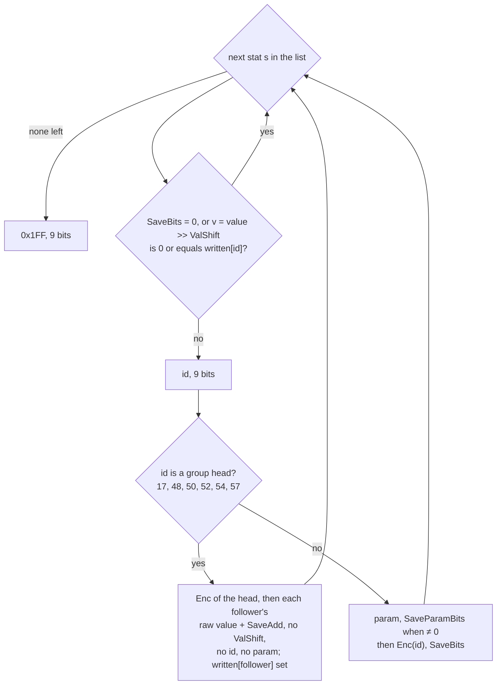

```
J1. WritePropertyList(list, bb):                                 [C] framing, scope in note J (fn:ITEMS_WriteFull@0x0062FFF0, 0x00630E3B–0x00631245, fmt:d2s#property-lists)
      written: i32[511] ← 0                    ; per list                                 [I] (0x00630E53)
      for each stat s in list (up to 511):
        rec ← ItemStatCost[s.id]
        if rec.SaveBits = 0: continue
        v: i32 ← s.value >> rec.ValShift                                                   [C] (0x00630ED9, run:2026-10-27-sweep-d2s-play)
                                                 ; arithmetic shift (sar)                  [I] (0x00630ED9)
        if v = 0 or v = written[s.id]: continue                                            [C] (0x00630EDB, 0x00630EE5, note J)
        Write(bb, s.id, 9)
        if s.id ∈ GROUP:                       ; head → followers, values only, no ids, no param
          Write(bb, ClampU(v + SaveAdd[s.id], SaveBits[s.id]), SaveBits[s.id])
          for each follower g in GROUP[s.id]:                                              [C] (0x00630F5B–0x00630FA3, 0x0063105D–0x006311AB, note J)
            f: i32 ← GetStat(list, g, param 0)   ; 0 when g is absent; raw, NO ValShift
            written[g] ← f
            Write(bb, ClampU(f + SaveAdd[g], SaveBits[g]), SaveBits[g])
        else:                                  ; every other id, a follower without its head included   [C] (0x006311B2, note J)
          if rec.SaveParamBits ≠ 0: Write(bb, ClampU(s.param, rec.SaveParamBits), rec.SaveParamBits)
          Write(bb, ClampU(v + rec.SaveAdd, rec.SaveBits), rec.SaveBits)
      Write(bb, 0x1FF, 9)
    ClampU as in I1                                               [C] (fn:BITBUF_WriteClamped@0x0062AF50, run:2026-10-17-sweep-emu)
    GROUP = { 17: [18], 48: [49], 50: [51], 52: [53], 54: [55, 56], 57: [58, 59] }
    groups 57 and 52, one item each                               [C] (0x00630E3B–0x00631245, note J)

J2. ITEMS_ReadProperty:                                          [C] framing, scope in note J (fn:ITEMS_ReadProperty@0x0062AC80, fmt:d2s#property-lists)
      id ← Read(9); 0x1FF ends the list
      param ← Read(SaveParamBits[id])           ; non-grouped ids
      value ← (Read(SaveBits[id]) − SaveAdd[id]) << ValShift[id]
      grouped ids (17, 48, 50, 52, 54, 57): the followers' values as in J1
      a follower id read on its own (no head before it) takes the default path above   [I] (0x0062D99C, 0x0062E1A1)
      after the 57 group, stat 326 (poison_count) ← 1                [C] (fn:ITEMS_ReadProperty@0x0062AC80, run:2026-10-27-sweep-d2s-play)
      save version < 93: 1.09-Save Bits / 1.09-Save Add instead, plus per-id width overrides   [C] (0x0062D9AE–0x0062E1A9, run:2026-10-27-sweep-d2s-legacy)
```

- J. [C] **Scope of the framing `[C]`** (code anchor plus data behaviour, evidence rule 2): `tools/d2s.py` decodes
  every property list of 25 game-written saves (the 21 full samples of [d2s.md](../../formats/d2s.md#samples) and the
  4 saves written in run:2026-10-12-d2s-io) with J2's framing, and each list ends at `0x1FF` and its item at the next
  item's first byte with only zero padding. That is 140 extended items, 143 lists (140 main, 2 set bonus, 1 runeword),
  137 properties (18 with a param) and 44 distinct ids: 0, 1, 2, 3, 7, 9, 16, 17, 19, 21, 22, 23, 24, 28, 31, 39, 41,
  43, 45, 48, 50, 54, 60, 62, 74, 75, 79, 80, 83, 89, 91, 93, 99, 107, 119, 135, 148, 153, 159, 160, 201, 204, 224, 254.
  Groups seen: 17 (5 times), 50 (2), 48 (1), 54 (1). The `[C]` covers the 9-bit id, `Save Param Bits` then
  `Save Bits`, the `Save Add` offset, the four groups seen and the terminator, for these ids.
  (fn:ITEMS_ReadProperty@0x0062AC80, fn:ITEMS_WriteFull@0x0062FFF0, run:2026-10-12-d2s-io, run:2026-10-11-d2s-samples)
- J. [C] **Runtime lists against saved lists.** Three drops picked up and saved by *Save and Exit* in
  run:2026-10-14-props-forced (a rare, a unique and a quiver) hold, read back, the main lists logged at their creation
  (each value `>> ValShift`), with their defense, durability, quantity and flags. What the lists hold at creation is
  [items/properties § G](../items/properties.md#g-stat-storage). (fn:PROP_WriteStat@0x0065EA50, run:2026-10-14-props-forced,
  [items/0006 § 9](../../findings/items/0006-properties.md#9-phase-2-reproduction-run2026-10-14-props-run2026-10-14-props-forced))
- J. [C] **The wider survey** ([save/0001 § Plan 0038 batch S1a](../../findings/save/0001-d2s-io.md#plan-0038-batch-s1a-2026-10-16)): every property list of the 146
  game-written saves of plan 0038 S1a (652 lists, 1 687 properties, 90 with a param, 77 distinct ids, 33 beyond the
  list above) decodes by J2's framing and ends at the next item, with the round trip byte-exact. None of the 1 687
  saved properties outside the groups has a value of 0, and no follower is listed after its head. The 73 groups seen
  (17 ×14, 48 ×17, 50 ×26, 54 ×15, 57 ×1) carry their followers' values with no id and no param, and the 1 614
  non-group properties carry param then value. (run:2026-10-12-d2s-io, run:2026-10-16-player)
- J. [C] `ValShift` is non-zero for two of the ids seen, 7 (`maxhp`) and 9 (`maxmana`), both 8: the reader shifts
  the stored value left by 8 (J2), so the file holds the in-memory value without its 8 fraction bits. On 13 items of
  run:2026-10-27-sweep-d2s-play the full stat was the file value << 8 (5 → 1 280, 1 → 256) and the written value the
  full stat >> 8. A Septic dagger (group 57) had stat 326 = 1 after the read. (fn:ITEMS_ReadProperty@0x0062AC80,
  tbl:ItemStatCost.txt:ValShift, run:2026-10-27-sweep-d2s-play)
- J. [C] **Group 52.** Ginther's Rift (`9cr`, 52/53 = 50/120) was read three times in run:2026-10-27-sweep-d2s-play
  (rt-r2 reads 1 and 2, drop) with stats 52 and 53 equal to the file's group values, and rt-r2's second read took
  the file the game had written at the first *Save and Exit*: head value, then the follower's, no id, no param, as
  J1 and J2 frame the other groups. Scope: that one item. (0x0063105D–0x006311AB, 0x0062D99C,
  run:2026-10-27-sweep-d2s-play, [save/0001 § Plan 0038 batch H1b](../../findings/save/0001-d2s-io.md#plan-0038-batch-h1b-run2026-10-27-sweep-d2s-play))
- J. [I] The writer's shift is arithmetic, not logical: no negative value was shifted. A non-zero value that shifts
  to 0 (a `maxhp` or `maxmana` below 256) is skipped too; no stock item stat holds one. (0x00630ED9, 0x00630EDB)
- J. [I] **Followers.** A follower is written raw, without `ValShift` (all eight followers have `ValShift` 0 in the
  shipped table), and `GetStat` is asked with param 0. A follower missing from the list while its head is present is
  written as `ClampU(0 + Save Add)`, which is 0 for every follower in the shipped table. A follower that is also in the
  list with the value its head wrote is skipped when its own entry comes up (`written[]`, zeroed per list); no saved
  item repeats a follower's value in two lists. A follower present without its head (18, 49, 51, 53, 55, 56, 58, 59 in
  a list without 17, 48, 50, 52, 54, 57) is written as an ordinary property, with its own id, its param if `Save Param
  Bits` > 0, and its value, and the reader's id switch, which has cases for the six heads only, reads it the same way;
  the save builder refuses such an item, so no run met one. (0x00630F5B–0x00630FA3, 0x006311B2, 0x0062D99C, 0x0062E1A1)
- J. [C] **The clamp saturates as unsigned.** `ClampU` compares the value as a u32, so a sum that is negative as an
  s32 is written as `2^n − 1`, not as 0: emulated reproduction of `BITBUF_WriteClamped` and the inlined copy's operand
  map (note I1). (fn:BITBUF_WriteClamped@0x0062AF50, 0x00630F38–0x00630F4E, run:2026-10-17-sweep-emu)
- J. [C] **The version < 93 widths.** A tool-built version-92 save went to `D2S_ReadSaveV92`, and its cap, built with
  stats 0, 7 and 39 in the 1.09 widths and the per-id encodings of stats 83, 107, 126, 188 and 195, was read to exactly
  those stats and written back with the same list; no item after the cap changed, where a wrong width or a missing
  override would shift every later field. (fn:ITEMS_ReadFull@0x0062CBE0, fn:ITEMS_ReadProperty@0x0062AC80,
  run:2026-10-27-sweep-d2s-legacy, [save/0001 § Plan 0038 batch H1c](../../findings/save/0001-d2s-io.md#plan-0038-batch-h1c-run2026-10-27-sweep-d2s-legacy))
- J. [I] The clamp at the bounds (the only stored value at a bound is a 1-bit stat 153 = 1, which tests
  nothing) rests on the code read, and so does a version < 93 set item reading a `Sets` id (the built set item's row
  is 0 in both tables). (0x00630E3B–0x00631245, 0x0062D9AE–0x0062E1A9)

Reproduce the bit accounting with

```
python3 -I tools/d2s.py survey workspace/merged/data/global/excel workspace/samples/d2s/*.d2s \
    workspace/samples/d2s-edited/{smpbar,smpsor-fixed,smpbar-resaved,smpsor-resaved}.d2s workspace/runtime/d2sio/written/*.d2s
    # SURVEY d2s files=27 full=25 stubs=2 errors=0 items=278 leftover_bytes=0
```

Its summary lines tally every property list (main, set bonus, runeword): lists, properties, those with a param,
distinct ids and the grouped ids, which are the counts above (plan 0015 Phase 1).

## Outputs

- Write: a byte string of `file_size` bytes (at most 8 KiB, the buffer: [I], § Constants) with a valid checksum, written twice per *Save and Exit*
  in single player. [C] (fn:D2S_WriteSave@0x00569AD0, run:2026-10-12-d2s-io)
- Read: the client fields and player-data fields of § D, the base stat list of § F, the skills of § G, one item unit
  per saved item (with `+0x28` and `+0x20` as in I5), and possibly `game+0x7C` (D4); or an error code. [C]
  In 67 full loads the stats set and the items created are the file's, in order. (fn:D2S_ReadSaveV92@0x0056B180,
  run:2026-10-12-d2s-io, run:2026-10-16-player)

## Worked example

A save written by the game in [run:2026-10-12-d2s-io](../../findings/save/experiments.md#run2026-10-12-d2s-io), case 5:
`workspace/runtime/d2sio/written/save3-seedtest-drop.d2s` (1113 bytes, sha256 `2dad064f…16e8`), the first of the
two identical writes of one *Save and Exit*, with the runtime values logged at that write
(`workspace/logs/d2sio-7-drop.log`: `WHDR`, `WLVL`, `WTIME`, `SBIT` lines; `CPOST` at the drop). Both are under
`workspace/`, not in git. The game ran with `-seed 12345`, Normal, expansion.

**Header**, file bytes `0x000`–`0x02F`:

```
55 aa 55 aa 60 00 00 00 59 04 00 00 bf 15 f8 db 00 00 00 00 73 65 65 64 74 65 73 74 00 00 00 00
00 00 00 00 20 05 00 00 04 10 1e 47 00 00 00 00
```

| Offset | Bytes | Value | Runtime source logged at the write |
|---|---|---|---|
| `0x000` | `55 aa 55 aa` | `0xAA55AA55` | constant |
| `0x004` | `60 00 00 00` | 96 | constant |
| `0x008` | `59 04 00 00` | 1113 | bytes written (`WDONE size 1113`) |
| `0x00C` | `bf 15 f8 db` | `0xDBF815BF` | `Checksum`, below |
| `0x010` | `00 00 00 00` | 0 | client `+0x45C` = 0 |
| `0x014` | `seedtest`, NUL-padded | | client name |
| `0x024` | `20 05 00 00` | `0x0520`: bit 5 expansion, progression 5 (bits 8–12) | client status `0x0520` (1312) `\| 0x20` |
| `0x028` | `04` | 4 (Barbarian) | client class 4 |
| `0x029`, `0x02A` | `10 1e` | 16, 30 | constants |
| `0x02B` | `47` | 71 | stat 12 read by the writer (`WLVL 71`) |
| `0x02C` | `00 00 00 00` | 0 | client `+0x488` = 0 |
| `0x030` | `6b b2 cc 6a` | 1791799915 | `time()` in the writer (`WTIME`) |
| `0x078` | `00 00 00 00` | left skill 0, ref 0 | player data `+0x74` = 0 |
| `0x07C` | `9a 00 00 00` | right skill 154 (War Cry), ref 0 | player data `+0x70` = 154, no item |
| `0x0A8` | `80 00 00` | Normal byte = act 0 `\| 0x80` | difficulty 0, client act 0 |
| `0x0AB` | `39 30 00 00` | 12345 | `game+0x7C` = 12345 (`game+0x84` = 1: the next load did not reuse it) |

The `gf` list holds 13 stats (0–3, 6–14): the logged base list has 20 entries, and the seven others (29, 30, 67, 68,
69, 95, 328) have `CSvBits` 0 in `itemstatcost.txt`, so F1 skips them.

**Checksum** (B1) over the 1113 bytes with `0x00C`–`0x00F` taken as 0:

| i | byte | sum after |
|---|---|---|
| 0 | `55` | `0x00000055` |
| 1 | `aa` | `0x00000154` |
| 2 | `55` | `0x000002FD` |
| 3 | `aa` | `0x000006A4` |
| 4 | `60` | `0x00000DA8` |
| 8 | `59` | `0x0000DAD9` |
| 15 | `00` (checksum byte, as 0) | `0x006D6D80` |
| 1112 | `00` | `0xDBF815BF` = the stored value |

**One item: the dropped staff** at file offset `0x403` (1027), 29 bytes:

```
4a 4d 10 00 80 00 65 00 02 32 37 47 07 02 c5 3b 52 d1 40 10 06 05 d6 90 c8 1a 13 f9 0f
```

Runtime item logged at the write (`SBIT`, final pass, `off 1027`): unit id 11, mode 0, `+0x28` = 2728687498,
item-data flags `0x00080010`, version 101, page 0, body 0, quality 1, ilvl 1, code `sst `.

| Bits | Width | Field | Value | From |
|---|---|---|---|---|
| 0 | 16 | `JM` | `0x4D4A` | constant |
| 16 | 32 | flags | `0x00800010` | `0x00080010 & ~0x80000 \| 0x800000` (I1) |
| 48 | 10 | version | 101 | item data `+0x30` |
| 58 | 3 | location | 0 | unit mode 0 |
| 61 | 4 | body | 0 | item data `+0x44` |
| 65 | 4 | x | 1 | grid position (not logged) |
| 69 | 4 | y | 0 | grid position (not logged) |
| 73 | 3 | store | 1 | page 0 + 1 |
| 76 | 32 | code | `sst ` | item record code |
| 108 | 3 | n_filled | 0 | no socketed item |
| 111 | 32 | seed | 2728687498 (`0xA2A4778A`) | unit `+0x28` |
| 143 | 7 | ilvl | 1 | item data `+0x2C` |
| 150 | 4 | quality | 1 (low) | item data `+0x00` |
| 154 | 1 | has_gfx | 0 | |
| 155 | 1 | has_class | 0 | |
| 156 | 3 | low-quality index | 1 | I4 |
| 159 | 1 | realm | 0 | |
| 160 | 8 | stat 73 (maxdurability) | 6 | weapon branch of I3 |
| 168 | 9 | stat 72 (durability) | 5 | stat 73 ≠ 0 |
| 177 | 9 + 9 + 3 | property 107, param 36, value 1 | | J1 (`Save Param Bits` 9, `Save Bits` 3, `Save Add` 0) |
| 198 | 9 + 9 + 3 | property 107, param 38, value 1 | | J1 |
| 219 | 9 | end | `0x1FF` | |
| 228 | 4 | padding | 0 | A3; the next item starts at `0x420` |

The drop's creation (`CPOST`, after `sub_0055A550_DropCreateItem`) logged the same unit id, `+0x28` =
2728687498, quality 1 and ilvl 1, so the saved seed, quality and ilvl are the drop's. On the reload
(`save3` read) the item came back with `+0x28` = 2728687498 and `+0x20` = `a2a4778a:0000029a` = `{seed, 666}` (I5).

Reproduce (needs the run's files under `workspace/`):

```
python3 -I tools/d2s.py checksum workspace/runtime/d2sio/written/save3-seedtest-drop.d2s
    # stored DBF815BF computed DBF815BF
python3 -I tools/d2s.py dump workspace/merged/data/global/excel workspace/runtime/d2sio/written/save3-seedtest-drop.d2s
    # header fields above; item 'off': 1027 … 'seed': 2728687498, 'ilvl': 1, 'quality': 1, 'qdata': 1,
    # 'maxdur': 6, 'dur': 5, 'props': [(107, 36, [1]), (107, 38, [1])], 'pad_bits': 4, 'end': 1056 … flags=00800010
python3 -I tools/d2sio.py check workspace/merged/data/global/excel workspace/logs/d2sio-7-drop.log \
    workspace/runtime/d2sio/written/save3-seedtest-drop.d2s workspace/runtime/d2sio/written/save4-seedtest-reload.d2s
    # dropped item sst id 11 at 0x403: drop seed 2728687498 q 1 ilvl 1; saved seed 2728687498 q 1 ilvl 1
    # TOTAL 664 comparisons, 0 mismatches
```

- [C] Every header value and every item common-part value in the tables above, except `x` and `y`, is one of the
  comparisons `tools/d2sio.py check` makes for this log, and the check reports 0 mismatches.
  (fn:PLRSAVE_WriteFile@0x00532240, run:2026-10-12-d2s-io)

## Reimplementation notes

- **Checksum last, field zeroed.** Fill `file_size` first, then sum the whole file with `0x00C`–`0x00F` as 0. The
  reader zeroes the stored copy before summing; a reimplementation that sums the stored bytes never matches. [C]
  (fn:D2S_Checksum@0x00411130, run:2026-10-12-d2s-io)
- **Checksum before size.** A file with both wrong fails with 6, not 5. [C] (fn:D2S_ReadHeader@0x0056A090,
  0x0056A0E6–0x0056A104, run:2026-10-27-sweep-d2s-load)
- **The header `level` is output only.** Write it from stat 12 and ignore it on load. [C] (0x0056904D,
  run:2026-10-11-d2s-edit)
- **The map seed survives only in single player, without `-seed`, and only for the difficulty saved in.** The
  bit-7 byte is the one of the game's difficulty: a save made in Nightmare reuses its seed in a Nightmare game
  only. [C] (0x0056A1FC–0x0056A217, run:2026-10-12-d2s-io)
- **Max life and mana come from the file.** Don't recompute stats 7 and 9 at load; current life and mana (6, 8) are
  restored to the values read. [C] (fn:D2S_LoadFinish@0x0056AF80, run:2026-10-12-d2s-io)
- **Flag bits that change on the way.** The writer clears bit 19 and sets bit 23; the reader strips bit 25, sets bit
  19 and clears bit 13. A reimplementation that round-trips `flags` unchanged writes different bytes after a
  load. [C] (fn:sub_00558CB0_ItemCreateFromSave@0x00558CB0, fn:ITEMS_SerializeBits@0x006312B0, run:2026-10-12-d2s-io)
- **The saved item seed is the unit seed's initial value, not the item-data seed.** Restore it with
  `RNG_SeedInit`, so the loaded unit seed is `{seed, 666}` whatever state the unit seed had reached when saved. [C]
  (fn:RNG_SeedInit@0x00650E40, run:2026-10-12-d2s-io)
- **The item writer's width clamp is unsigned.** In the item bitstream (I1, J), `BITBUF_WriteClamped` turns a
  negative value written into an `n`-bit field into `2^n − 1`, not 0. [C] (fn:BITBUF_WriteClamped@0x0062AF50,
  run:2026-10-17-sweep-emu) The `gf`
  stats writer (F1) has its own signed clamp: there a negative value of an unsigned stat becomes 0. [I]
  (0x0056965B–0x00569661, [save/0001 §4](../../findings/save/0001-d2s-io.md#4-character-stats-gf))
- **Fixed fields and followers apply `Save Add`.** [C] for the fixed fields (I3). Neither applies `ValShift`, followers
  included. [I] (0x00630F5B–0x00630FA3, 0x00630A19–0x00630CF3)
- **Simple items have no `n_filled`.** Their bit 108 is the realm flag; reading 3 bits there works only while the
  realm flag and the next two bits are 0. [C] (fn:ITEMS_WriteCompact@0x0062AF80, 0x0062AF1F, note I5)
- **Prefix ids are rebased, suffix ids are not.** [C] (0x0062CEEA, note I3)
- **Grouped properties carry one id.** 17, 48, 50, 52, 54 and 57 are followed by the next ids' values with no id and no
  param; reading them as one id each desynchronises the rest of the item. [C] (fn:ITEMS_ReadProperty@0x0062AC80,
  fmt:d2s#property-lists, note J)
- **An item property's param is read unsigned:** a 9-bit param of 270 came back as 270 (a signed read gives −242). [C]
  (fn:ITEMS_ReadProperty@0x0062AC80, run:2026-10-27-sweep-d2s-load) **`CSvParam` is read signed** in the `gf` list; no `ItemStatCost` row with
  `CSvBits` has a `CSvParam`, so stock data never reads one. [I] (fn:D2S_ReadStatsBits@0x0056A4F0)
- **The reader stops at 8 KiB.** `PLRSAVE_ReadFile` reads at most `0x2000` bytes. [C] (fn:PLRSAVE_ReadFile@0x005343A0,
  run:2026-10-27-sweep-d2s-load) The writer's buffer is 8 KiB; no write passed it. [I] (fn:PLRSAVE_Save@0x00532400)

## Evidence

- [findings/save/0001-d2s-io.md](../../findings/save/0001-d2s-io.md): the writer, reader, checksum, bit I/O, header
  table, stat stream, item serialiser and property framing; every code anchor above. [save/0001 §8](../../findings/save/0001-d2s-io.md#8-plan-0015-phase-3-framing-details-and-item-flag-bit-13) (plan 0015
  Phase 3): followers, shift kind, the unsigned clamp, the fixed fields, `has_class`, modes 3/5, ears, the
  mercenary header's place in the reader, bit 13. § Plan 0039 batch P1b: the life/mana clamp (B10, with
  run:2026-10-16-player), the NPC slots, the host bytes, the corpse record, status bit 1.
- [findings/save/experiments.md § run:2026-10-12-d2s-io](../../findings/save/experiments.md#run2026-10-12-d2s-io):
  8 writes and 7 loads under gdb, 1625 comparisons, 0 mismatches; reader codes 6 and 5; map-seed reuse with a
  `-seed 7` control; the picked-up drop; stat 9 through `D2S_LoadFinish`.
- Plan 0038 ([save/0001](../../findings/save/0001-d2s-io.md) § Plan 0038 batch S1a, S1e, H1b, r1h, H1a): the S1a
  corpus of 146 game-written saves and the logged writes and loads (writer/reader pairs, data over every row, the
  round trip); `BITBUF_WriteClamped` under emulation (run:2026-10-17-sweep-emu);
  [run:2026-10-27-sweep-d2s-play](../../findings/save/experiments.md#run2026-10-27-sweep-d2s-play) (who saves, the
  section cursors, the swap skills, the mercenary header and items, one corpse, `D2S_LoadFinish`, bit 13);
  [run:2026-10-27-sweep-d2s-load](../../findings/save/experiments.md#run2026-10-27-sweep-d2s-load) (the reader's
  codes and their order on tool-built saves, the fields not read, the waypoint markers, the old stat form, ears,
  personalized names, realm data, bad unique and set ids, class 7); the host-callback setter with no caller (r1h).
- run:2026-10-11-d2s-edit (archivist, [formats/experiments.md](../../formats/experiments.md#run2026-10-11-d2s-edit)):
  the refused corrupt save, the select screen showing it, the header level rewrite.
- run:2026-10-11-tc-drops, fifth session ([items/experiments.md](../../findings/items/experiments.md#run2026-10-11-tc-drops)):
  the right-skill slot, the Nightmare `difficulty` byte, `progression` 5.
- [formats/d2s.md](../../formats/d2s.md): the byte layout, decoded over 23 sample saves; the encoding the code above
  produces.
- [rng/seeds](../rng/seeds.md) step 7a: the draw behind an item unit's `+0x28`.

## Open questions

- ~~**Property semantics** (how values are rolled)~~: [items/properties](../items/properties.md) (plan 0024) specifies
  the roll and the lists it writes; this spec stays at the framing of § J. The research-map status follows that spec's review.
- ~~**Property framing details**: a follower without its head, a missing follower, the shift kind~~: answered in
  § J from [save/0001 §8](../../findings/save/0001-d2s-io.md#8-plan-0015-phase-3-framing-details-and-item-flag-bit-13) (plan 0015). Three saved lists were compared with logged runtime lists in run:2026-10-14-props-forced (§ J).
- ~~**Runeword field** (backlog D2S (d))~~: `Runes` `+0x82` is the string index of the row's `Name`, set at load;
  flag bit 26, the field (read into `ItemData+0x38`) and the state-171 list are specified from the runeword side in
  [items/sockets-runewords § E and § G](../items/sockets-runewords.md#g-in-the-save).
- ~~**Affix and name ids** (backlog D2S (e)).~~ Answered (plan 0039 P1b, stale): the merged-id mapping is I4's note from
  [items/0005 § 1](../../findings/items/0005-affixes.md#1-the-merged-affix-arrays-and-the-ids-0x00633730-0x00633f40); the
  rebasing and `class_affix` are rows 101 and 87 of [save/0001 § Plan 0038 batch S1a](../../findings/save/0001-d2s-io.md#plan-0038-batch-s1a-2026-10-16),
  whose re-tag of I3/I4 is plan 0038 Phase 3's.
- [L] **Item flags bit 13**, narrowed (plan 0015 Phase 3, I6): the set and clear sites are read and the pickup is ruled
  out. Open: who sets `act+0x00`, so how soon the ground pass runs after a drop, and what the bit means. Named run case
  for the next save run: `break *0x00553357` (the `0x2000` clear call in `sub_00553220_UnitFrameReset`, ESI = the unit)
  with `if *(int*)$esi == 4`, printing the unit id `*(int*)($esi+0x0C)` and the flags before the clear
  `*(int*)(*(int*)($esi+0x14)+0x18)`, matched with the drop's `CPOST` line; as a cross-check, `watch -l` on the drop's
  item-data `+0x18` armed at `CPOST`. ([save/0001 §8](../../findings/save/0001-d2s-io.md#8-plan-0015-phase-3-framing-details-and-item-flag-bit-13))
  *Plan 0038 H1b ran the case:* five drops cleared by that pass on the ground (I6); the watchpoint logged no write, not
  even the logged clear, so it was not live, and whether anything writes the bit outside `ITEMS_SetFlag` is untested
  ([save/0001 § Plan 0038 batch H1b](../../findings/save/0001-d2s-io.md#plan-0038-batch-h1b-run2026-10-27-sweep-d2s-play)).
- [L] **Not exercised** (after plan 0038 H1b, H1a and H1c): ground positions (modes 3, 5; no item record in those modes is
  written or read), an item-ref hotkey, realm data in a simple item, gold items, the golem section, a corpse count of
  2 or more, reader codes 3, 15, 17–19 and 25/26, the legacy reader's failures and the layouts of versions 72–86 and
  88–91 (D3b), a version < 93 set item (J), signed and param
  character stats (none in the shipped table), a write above 8 KiB, a classic game's item version 2, stats past the
  runs' lists.
- ~~**The condition for `has_class`** and the encoder of the fixed stat fields~~: answered in I3 from [save/0001 §8](../../findings/save/0001-d2s-io.md#8-plan-0015-phase-3-framing-details-and-item-flag-bit-13)
  (plan 0015).
- ~~Which quest, waypoint and NPC slot is which difficulty.~~ Answered: slot d is difficulty d (§ E note).
- ~~The meaning of client `+0x480`–`+0x482` (`0x0CF`) and of the corpse record's first u32.~~ Answered as far as
  `Game.exe` can: host bytes carried unchanged (§ D notes), and uninitialised stack never read (§ H note).
  [L] **Status bit 1**, narrowed: set only by the client's creation screen and never tested by `D2S_CheckStatus`
  (§ D notes); what the screen means by it is client presentation, outside plan 0039.
