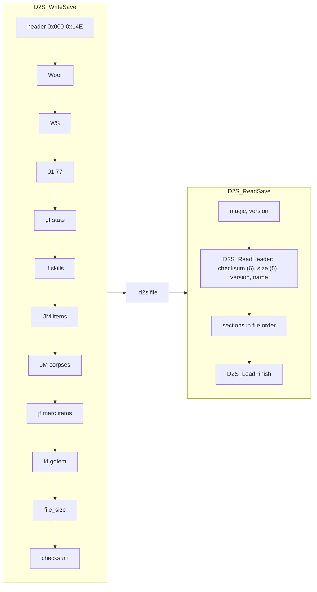

# Character save (`.d2s`): writer, reader, header and item bitstream

## Purpose

A `.d2s` file is one single-player character. The server writes it from the runtime player (the client
object, the player unit and its stats, its item units) when the character leaves a game, and reads it back
when the character joins one. This spec gives the write order, the checksum, the source and destination of
every header field, the item bitstream as a function of the runtime item, and the framing of the stat and
property lists. Each property's meaning belongs to `items/properties`. The bytes are documented in
[d2s.md](../../formats/d2s.md); this spec is about the code that produces and consumes them. Seed primitives
are those of [rng](../rng/README.md), and the seeds written here come from [rng/seeds](../rng/seeds.md).

Names (client, player data, item data) follow [save/0001](../../findings/save/0001-d2s-io.md): the **client**
is the server's per-connection client object, **player data** is `unit+0x14` of a player unit, and **item
data** is `unit+0x14` of an item unit (partial types in `re/types/save.h`).

## Entry points

| When | Function | Tag |
|---|---|---|
| *Save and Exit* in single player, first write (every client of the game) | fn:sub_0052CA10_SaveGameClients@0x0052CA10 → fn:PLRSAVE_Save@0x00532400 | [C] |
| *Save and Exit* in single player, second write, same bytes | fn:sub_0052C900_SaveClients@0x0052C900 → fn:PLRSAVE_Save@0x00532400 | [C] |
| Single-player file write | fn:PLRSAVE_WriteFile@0x00532240 → fn:D2S_WriteSave@0x00569AD0 | [C] |
| Server shutdown, every client of every game | fn:sub_0052E9C0_SaveAllOnShutdown@0x0052E9C0 | [I] |
| Periodic save, only with a host callback | fn:sub_0052D350_AutosaveTick@0x0052D350 | [I] |
| Hosted save through the callback, skipped when unchanged | fn:sub_00531EB0_SaveViaCallback@0x00531EB0 | [I] |
| Player join: load | fn:sub_00539760_ClientAddPlayerToGame@0x00539760 → fn:sub_005345A0_PlayerLoad@0x005345A0 → fn:PLRSAVE_ReadFile@0x005343A0 → fn:D2S_ReadSave@0x00534330 | [I] |
| Version 92–96 reader | fn:D2S_ReadSaveV92@0x0056B180 | [C] |
| New character (client side, 335-byte stub) | fn:sub_0043C540_StubBuild@0x0043C540, fn:sub_0043C6B0_StubWrite@0x0043C6B0 | [I] |

- [C] *Save and Exit* in single player writes the file **twice**, byte-identical: `PLRSAVE_Save` is called from
  `0x0052CA5F` and then from `0x0052C940`, and both calls reach `PLRSAVE_WriteFile`. Nothing was written during
  play in the runs. (fn:sub_0052CA10_SaveGameClients@0x0052CA10, run:2026-10-12-d2s-io;
  [save/0001 §1](../../findings/save/0001-d2s-io.md#1-when-a-save-is-written))
- [I] No autosave runs in single player: `sub_0052D350_AutosaveTick` saves only when a host callback is set
  (after 10 s with a pending-change counter above 10, after 45 s, or when forced). The other callers of
  `PLRSAVE_Save` are client removal (through `sub_0052C900_SaveClients`), server shutdown, quest and act events
  in game types 1 and 2 (`0x0052E2A0`), and a death path in `PlrModes.cpp` (`0x0057FCA0`) that sets client
  status bit 3 and then saves. (0x0052D3BA, 0x0057FD3F)
- [C] The character-select screen does not verify the checksum. `D2S_Checksum` has four callers (the
  writer, the server reader, the client stub writer and the client expansion converter), and the select-screen
  readers of `"%s%s.d2s"` (`0x00431F70`, `0x0043C8A0`, `0x00478040`, `0x0045C520`) are not among them. A
  corrupt save is listed there with its header level. (fn:D2S_Checksum@0x00411130, run:2026-10-11-d2s-edit)

## Inputs

### Tables

`ItemStatCost` has no table doc yet. Its record (`0x144` bytes, at `DataTables+0xBCC + 0x144·id`, count at
`DataTables+0xBD4`) is anchored through `struct:ItemStatCostRec`.

| Anchor | Used for |
|---|---|
| struct:ItemStatCostRec+0x0A | `CSvBits`: character-stat value width; 0 means the stat is not saved |
| struct:ItemStatCostRec+0x0B | `CSvParam`: character-stat param width |
| struct:ItemStatCostRec+0x05 | bit 5 = `CSvSigned` |
| struct:ItemStatCostRec+0x19 | `Save Bits`: item-property value width; 0 means the property is not saved |
| struct:ItemStatCostRec+0x1C | `Save Add` (s32) |
| struct:ItemStatCostRec+0x24 | `Save Param Bits` |
| struct:ItemStatCostRec+0x18 | `ValShift` |
| struct:ItemStatCostRec+0x1A, struct:ItemStatCostRec+0x20 | `1.09-Save Bits`, `1.09-Save Add`: read only for item versions older than 93 |
| tbl:Weapons.txt:compactsave | record byte `+0x143`: a simple (compact) item, flags bit 21 (the same record layout serves armor and misc) |
| tbl:Weapons.txt:questdiffcheck | record byte `+0x12B`: a simple quest item carries stat 356 |
| `Runes` record `+0x82` | the runeword field (u16); no table doc |
| `SetItems`, `UniqueItems` record counts | id validation on load ([SetItems](../../tables/SetItems.md), [UniqueItems](../../tables/UniqueItems.md)) |

- [I] The save code reads only the in-memory `ItemStatCost` record. Under `-txt` that record is compiled from
  `.txt` into the same layout, so the code cannot tell `.bin` from `.txt`; the 0-mismatch `CSvBits` diff of
  d2s.md is the data side. (fn:D2S_WriteStats@0x00569540, fn:D2S_ReadStatsBits@0x0056A4F0,
  fn:DATATBLS_LoadTable@0x006122F0)

### Runtime state

| State | Type | Source |
|---|---|---|
| game type | u8 at `game+0x6A`; 3 = single player, 1 and 2 = client-buffer games | game creation |
| difficulty | u8 at `game+0x6D` (0 normal, 1 nightmare, 2 hell) | game creation |
| expansion | u32 at `game+0x70`, non-zero in an expansion game | game creation |
| ladder | `game+0x74` | game creation |
| item version | u16 at `game+0x78`: 101 expansion, 2 classic | game creation |
| map seed | u32 at `game+0x7C` | [rng/seeds](../rng/seeds.md) step 1 |
| seed override flag | `game+0x84`, non-zero under `-seed N` | [rng/seeds](../rng/seeds.md) step 2 |
| client | `struct:Client` (class `+0x08`, status `+0x0A`, name `+0x0D`, act `+0x1AC`, weapon switch `+0x45C`, `+0x480`, `+0x488`) | join, then the reader |
| player data | `struct:PlayerData` (quests `+0x10`, waypoints `+0x1C`, NPC records `+0x60`, mouse skills `+0x70`–`+0x8C`) | player unit `+0x14` |
| base stat list | player unit `+0x5C`, ≤ 512 entries `{u16 param, u16 id, s32 value}` | unit stats |
| item unit | mode `+0x10`, RNG `+0x20`, initial seed `+0x28` (`struct:Unit+0x28`) | item creation, [rng/seeds](../rng/seeds.md) step 7a |
| item data | `struct:ItemData` (quality `+0x00`, flags `+0x18`, ilvl `+0x2C`, version `+0x30`, automagic `+0x36`, prefixes `+0x38`, suffixes `+0x3E`, body `+0x44`, page `+0x45`, gfx `+0x49`, name `+0x4A`) | item unit `+0x14` |

### Constants

| Name | Value | Anchor | Tag |
|---|---|---|---|
| `MAGIC` | `0xAA55AA55` | fn:D2S_WriteHeader@0x00568F20 | [C] |
| `VERSION` | 96 written; 92..96 accepted by the v92 reader | fn:D2S_WriteHeader@0x00568F20, fn:D2S_ReadHeader@0x0056A090 | [C] |
| `HEADER_SIZE` | `0x14F` bytes (`0x000`–`0x14E`) | fn:D2S_WriteHeader@0x00568F20 | [I] |
| `READ_CAP` | `0x2000` bytes read at most | fn:PLRSAVE_ReadFile@0x005343A0 | [I] |
| `WRITE_BUF` | 8 KiB stack buffer | fn:PLRSAVE_Save@0x00532400 | [I] |
| `LIST_END` | `0x1FF` (9 bits): end of a stat or property list | fn:D2S_WriteStats@0x00569540, 0x00631245 | [I] |
| `ITEM_TAG` | `JM` (16 bits) | fn:ITEMS_SerializeBits@0x006312B0 | [I] |
| `INIT_HIGH` | 666, the high word `RNG_SeedInit` sets | fn:RNG_SeedInit@0x00650E40 | [C] |

## Algorithm



### A. Bit buffer

```
A1. Write(bb, value: u32, n: 1..32):                             [I] (fn:BITBUF_Write@0x00410EB0)
      for k in 0 ..< n:
        bit (bb.pos + k) of the stream ← bit k of value
      bb.pos ← bb.pos + n
    ; stream bit p is bit (p mod 8) of byte (p ÷ 8): LSB first, bytes in order
    ; each newly entered byte is zeroed before bits are ORed into it
A2. Read(bb, n) → u32: the inverse, unsigned                       [I] (fn:BITBUF_Read@0x00410F60)
    ReadSigned(bb, n) → i32: Read, then sign-extend when n < 32     [I] (fn:BITBUF_ReadSigned@0x00411030)
A3. AlignByte(bb): bb.pos ← next multiple of 8 (padding bits are 0 on write)   [I] (fn:BITBUF_AlignByte@0x00411070)
A4. An overrun sets a sticky error flag (bb+0x10); a truncated read returns what fits.
    The item serialiser then returns 0 bytes for that item.         [I] (fn:BITBUF_Read@0x00410F60, fn:ITEMS_Serialize@0x006313E0)
```

### B. Checksum

```
B1. Checksum(buf, len) → u32:                                    [C] (fn:D2S_Checksum@0x00411130, run:2026-10-12-d2s-io)
      sum: u32 ← 0
      for i in 0 ..< len:
        sum ← rotl32(sum, 1) + buf[i]          ; mod 2^32; the code computes 2·sum + byte + (sum < 0 as i32)
      return sum
```

The checksum field (`0x00C`) holds 0 while the sum is computed, both on write (the header image is zeroed) and on
read (the reader saves and zeroes it). See step C3 and D3.

### C. Writing a save

```
C1. PLRSAVE_Save(game, player):                                  [I] (fn:PLRSAVE_Save@0x00532400)
      clear player unit +0xC8 bit 1
      if game.type ∈ {1, 2}:  serialise (cap 0x2000), hand the buffer to the client object (0x00532340); no file
      else if no host callback (0x00883D50 = 0):  PLRSAVE_WriteFile      ; single player   [C] (fn:PLRSAVE_WriteFile@0x00532240, run:2026-10-12-d2s-io)
      else:  sub_00531EB0_SaveViaCallback
C2. PLRSAVE_WriteFile: D2S_WriteSave into the 8 KiB buffer, then
      fopen("<save dir><name>.d2s", "wb") and write the bytes      [C] (fn:PLRSAVE_WriteFile@0x00532240, run:2026-10-12-d2s-io)
C3. D2S_WriteSave(client, player) → bytes:                        [C] (fn:D2S_WriteSave@0x00569AD0, 0x00569D2F–0x00569D38, run:2026-10-12-d2s-io)
      a. header image (0x14F bytes, zeroed, then filled per § D)    ; checksum field stays 0
      b. Woo! quests (§ E1)
      c. WS waypoints (§ E2)
      d. 01 77 NPCs (§ E3)
      e. gf character stats (§ F)
      f. if skills (§ G)
      g. JM item list of the player (§ H1)
      h. JM corpses (§ H2)
      i. if expansion game: jf, then the mercenary's item list if a mercenary exists; kf and the golem byte (§ H3)
      j. u32[0x08] ← bytes written
      k. u32[0x0C] ← Checksum(buffer, bytes written)
```

Step notes:

- C1. [I] `sub_00531EB0_SaveViaCallback` compares the new buffer with the previous one with `checksum`,
  `last_played`, `unk_34` and `map_seed` masked to 0 in both, and skips the callback when nothing else changed.
  (0x00532001–0x0053210E)
- C3i. [I] `jf` and `kf` are written only in an expansion game; the mercenary list follows `jf` only when the player
  has a pet of type 7. (fn:D2S_WriteMercItems@0x005699A0, fn:D2S_WriteGolem@0x00569A00)
- C3. [I] Steps a–i are the section writers `D2S_WriteHeader`, `D2S_WriteQuests`, `D2S_WriteWaypoints`,
  `D2S_WriteNpcs`, `D2S_WriteStats`, `D2S_WriteSkills`, `D2S_WriteItemList`, `D2S_WriteCorpses`,
  `D2S_WriteMercItems`, `D2S_WriteGolem` (`0x00568F20`–`0x00569A00`), and the mercenary header fields
  `0x0AF`–`0x0BE` come from `D2S_WriteMercHeader`. (fn:D2S_WriteMercHeader@0x00568E60)

### D. Header fields

Each row gives the runtime source the writer reads and the runtime field the reader fills. "Write" and
"Read" carry their own tags. In the read column, a code in parentheses is the reader's internal error code.

| Offset | Width | Field | Written from | Write | Read into | Read | Anchors |
|---|---|---|---|---|---|---|---|
| `0x000` | u32 | `magic` | `0xAA55AA55` | [C] | checked by `D2S_ReadSave` (9) | [I] | fn:D2S_WriteHeader@0x00568F20, fn:D2S_ReadSave@0x00534330, run:2026-10-12-d2s-io |
| `0x004` | u32 | `version` | 96 | [C] | < 92 → legacy reader `0x00534020`; 92..96 accepted; else (7) | [I] | fn:D2S_WriteHeader@0x00568F20, fn:D2S_ReadSave@0x00534330, run:2026-10-12-d2s-io |
| `0x008` | u32 | `file_size` | bytes written | [C] | must equal bytes read (5) | [C] | fn:D2S_WriteHeader@0x00568F20, fn:D2S_ReadHeader@0x0056A090, run:2026-10-12-d2s-io |
| `0x00C` | u32 | `checksum` | `Checksum` (§ B) | [C] | recomputed and compared (6) | [C] | fn:D2S_WriteHeader@0x00568F20, fn:D2S_ReadHeader@0x0056A090, run:2026-10-12-d2s-io |
| `0x010` | u32 | `weapon_set` | bit 0 = client `+0x45C` ≠ 0 (swap set active) | [I] | bit 0 → client `+0x45C` | [I] | fn:D2S_WriteHeader@0x00568F20, fn:D2S_ReadHeader@0x0056A090 |
| `0x014` | 16 B | `name` | client name `+0x0D`, NUL within 16 bytes | [C] | byte `0x23` forced 0, then `_stricmp` with the client's name, else (7) | [I] | fn:D2S_WriteHeader@0x00568F20, fn:D2S_ReadHeader@0x0056A090, run:2026-10-12-d2s-io |
| `0x024` | u32 | `status` | client `+0x0A` (u16, zero-extended) `\| 0x20` if expansion game `\| 0x40` if ladder game | [C] | low u16 → client `+0x0A` after `D2S_CheckStatus` | [C] | fn:D2S_WriteHeader@0x00568F20, fn:D2S_ReadHeader@0x0056A090, run:2026-10-12-d2s-io |
| `0x028` | u8 | `class` | client `+0x08` | [C] | → client `+0x08`, the class of the new player unit (out-of-range clamp: note below the table) | [C] | fn:D2S_WriteHeader@0x00568F20, fn:D2S_ReadHeader@0x0056A090, run:2026-10-12-d2s-io |
| `0x029` | u8 | stat-slot count | 16 | [C] | used only by the version ≤ 94 stat reader | [I] | fn:D2S_WriteHeader@0x00568F20, fn:D2S_ReadHeader@0x0056A090, run:2026-10-12-d2s-io |
| `0x02A` | u8 | skill count | `DataTables+0xBA8` (30) | [C] | number of skill bytes `D2S_ReadSkills` reads | [I] | fn:D2S_WriteHeader@0x00568F20, fn:D2S_ReadHeader@0x0056A090, run:2026-10-12-d2s-io |
| `0x02B` | u8 | `level` | stat 12 of the player (`0x00625480(unit, 12)`) | [C] | not read | [C] | fn:D2S_WriteHeader@0x00568F20, fn:D2S_ReadHeader@0x0056A090, run:2026-10-12-d2s-io |
| `0x02C` | u32 | `unk_2c` | client `+0x488` | [C] | → client `+0x488` | [C] | fn:D2S_WriteHeader@0x00568F20, fn:D2S_ReadHeader@0x0056A090, run:2026-10-12-d2s-io |
| `0x030` | u32 | `last_played` | `time(NULL)` at the write | [C] | not read | [I] | fn:D2S_WriteHeader@0x00568F20, fn:D2S_ReadHeader@0x0056A090, run:2026-10-12-d2s-io |
| `0x034` | u32 | `unk_34` | `0xFFFFFFFF` | [C] | not read | [I] | fn:D2S_WriteHeader@0x00568F20, fn:D2S_ReadHeader@0x0056A090, run:2026-10-12-d2s-io |
| `0x038` | 16 × (u16, u16) | hotkeys | per slot: skill `\| 0x8000` if the slot flag, 1-based item ref (`0x005390D0`) | [I] | `0xFFFF` = empty, skill = `& 0xFFF`, ref 0 = none (`0x00569EC0` → `0x005390A0`) | [I] | fn:D2S_WriteHeader@0x00568F20, fn:D2S_ReadHeader@0x0056A090 |
| `0x078` | (u16, u16) | left skill | skill id, item ref (`0x00620190`) | [C] | → player data `+0x74` / `+0x7C` | [C] | fn:D2S_WriteHeader@0x00568F20, fn:D2S_ReadHeader@0x0056A090, run:2026-10-12-d2s-io |
| `0x07C` | (u16, u16) | right skill | skill id, item ref (`0x006201D0`) | [C] | → player data `+0x70` / `+0x78` | [C] | fn:D2S_WriteHeader@0x00568F20, fn:D2S_ReadHeader@0x0056A090, run:2026-10-12-d2s-io |
| `0x080` | (u16, u16) | swap skill A | `0x00623220` | [I] | → player data `+0x84` / `+0x8C` | [I] | fn:D2S_WriteHeader@0x00568F20, fn:D2S_ReadHeader@0x0056A090 |
| `0x084` | (u16, u16) | swap skill B | `0x00623290` | [I] | → player data `+0x80` / `+0x88` | [I] | fn:D2S_WriteHeader@0x00568F20, fn:D2S_ReadHeader@0x0056A090 |
| `0x088` | 16 B | graphics | `0x0063E510`, default `0xFF` | [I] | not read by the server | [I] | fn:D2S_WriteHeader@0x00568F20, fn:D2S_ReadHeader@0x0056A090 |
| `0x098` | 16 B | colours | the same call | [I] | not read by the server | [I] | fn:D2S_WriteHeader@0x00568F20, fn:D2S_ReadHeader@0x0056A090 |
| `0x0A8` + d | u8 × 3 | `difficulty` | byte d = game difficulty (`game+0x6D`): client act `+0x1AC` `\| 0x80`; the other two bytes 0 | [C] | `b & 0x7F` → client act (out-of-range clamp: note below the table); `b & 0x80` gates the map-seed reuse | [C] | fn:D2S_WriteHeader@0x00568F20, fn:D2S_ReadHeader@0x0056A090, run:2026-10-12-d2s-io |
| `0x0AB` | u32 | `map_seed` | `game+0x7C` | [C] | → `game+0x7C` under the condition of D4 | [C] | fn:D2S_WriteHeader@0x00568F20, fn:D2S_ReadHeader@0x0056A090, run:2026-10-12-d2s-io |
| `0x0AF` | u32 | mercenary flags | 0, bit 16 if the mercenary is dead | [I] | bit 16 → dead flag of the recreated mercenary | [I] | fn:D2S_WriteMercHeader@0x00568E60, fn:D2S_ReadMercHeader@0x0056AA50 |
| `0x0B3` | u32 | mercenary seed | mercenary info `+0x00` | [I] | creation seed of the mercenary | [I] | fn:D2S_WriteMercHeader@0x00568E60, fn:D2S_ReadMercHeader@0x0056AA50 |
| `0x0B7` | u16 | mercenary name | name id − hireling record `+0x114` | [I] | + `+0x114`; reset to `+0x114` if above `+0x116` | [I] | fn:D2S_WriteMercHeader@0x00568E60, fn:D2S_ReadMercHeader@0x0056AA50 |
| `0x0B9` | u16 | hireling id | mercenary info `+0x08` | [I] | record looked up by id (`0x006562F0`) | [I] | fn:D2S_WriteMercHeader@0x00568E60, fn:D2S_ReadMercHeader@0x0056AA50 |
| `0x0BB` | u32 | mercenary experience | mercenary stat 13 | [I] | stat 13; level = highest level whose threshold it reaches | [I] | fn:D2S_WriteMercHeader@0x00568E60, fn:D2S_ReadMercHeader@0x0056AA50 |
| `0x0CF` | u8 | `unk_bf` byte | client `+0x480` | [I] | → client `+0x480` (`+0x481`, `+0x482` set to 0) | [I] | fn:D2S_WriteHeader@0x00568F20, fn:D2S_ReadHeader@0x0056A090 |
| `0x0BF`–`0x0CE`, `0x0D0`–`0x14E` | | `unk_bf` rest | 0 | [I] | not read | [I] | fn:D2S_WriteHeader@0x00568F20, fn:D2S_ReadHeader@0x0056A090 |

Scope of the confirmed rows (run:2026-10-12-d2s-io, every write compared with the logged runtime source, the read
side with the logged client and player-data fields after `D2S_ReadHeader`; [save/0001 §2](../../findings/save/0001-d2s-io.md#walkthrough)):

- [C] `status`: expansion games only, never ladder. `class`: the classes of the run saves. `left`/`right skill`:
  the skill id, and item ref 0 only. `difficulty`: Normal, act 0 only; the Nightmare byte rests on the load test of
  run:2026-10-11-tc-drops (a Nightmare save holds `00 80 00`). (fn:D2S_WriteHeader@0x00568F20,
  fn:D2S_ReadHeader@0x0056A090, run:2026-10-12-d2s-io, run:2026-10-11-tc-drops)
- [I] **Read clamps no run exercised.** A class byte above 7 is read as 4, and an act (`b & 0x7F`) of 5 or more is
  read as 0; no run fed an out-of-range value. (fn:D2S_ReadHeader@0x0056A090)
- [C] `level` is written from stat 12 and never read back: a save with header level 2 and stat 12 = 1 was rewritten
  with level 1. (0x0056904D, run:2026-10-11-d2s-edit)
- [C] `unk_2c` is a pass-through: an edited `0x0BADF00D` survived two load/save cycles, and the only instructions
  that touch client `+0x488` are its accessors `0x00538760`/`0x00538790`. A character's first full save writes the
  client's initial value, 0 in every sample. (fn:D2S_ReadHeader@0x0056A090, run:2026-10-12-d2s-io)

```
D1. Status word (client +0x0A), checked by D2S_CheckStatus:       [I] (fn:D2S_CheckStatus@0x00569D80)
      bit 0   new character (stub): cleared; if the file ends at the header, build a fresh character
              (sub_00569F80_NewCharFromStub) instead of reading sections
      bit 2   hardcore: must equal the game's hardcore flag (0x0053FD40() & 0x800), else (11) or (12)
      bit 3   dead: refused when hardcore (10)
      bit 5   expansion: must equal game+0x70 ≠ 0, else (8) or (9)
      bit 6   ladder: checked only with a host
      bits 8–12  progression: Nightmare needs ≥ 5 (expansion) / ≥ 4 (classic); Hell needs ≥ 10 / ≥ 8, else (13) or (14)
D2. The u16 at 0x026 is the high half of the status u32: always 0.  [I] (0x00569012–0x0056901B)
```

### D3–D5. Reading a save

```
D3. Load(client):                                                 
      a. bytes ← PLRSAVE_ReadFile: fopen("<save dir><name>.d2s", "rb"), at most 0x2000 bytes      [I] (fn:PLRSAVE_ReadFile@0x005343A0)
      b. D2S_ReadSave: len < 8 or u32[0x00] ≠ MAGIC → (9)                                       [I] (fn:D2S_ReadSave@0x00534330)
         u32[0x04] < 92 → legacy reader 0x00534020; else D2S_ReadSaveV92
      c. D2S_ReadHeader:                                                                          [C] (fn:D2S_ReadHeader@0x0056A090, 0x0056A0D2–0x0056A104, run:2026-10-12-d2s-io)
           stored: u32 ← u32[0x0C];  u32[0x0C] ← 0
           if Checksum(bytes, len) ≠ stored: fail (6)
           if u32[0x08] ≠ len: fail (5)
      d.   version ∉ 92..96 → (7); name test → (7); then the header fields of § D, D1, D4             [I] (fn:D2S_ReadHeader@0x0056A090)
      e. section readers in file order: quests, waypoints, NPCs, stats, skills, items, corpses,
         mercenary items, golem                                                                    [I] (fn:D2S_ReadSaveV92@0x0056B180)
      f. D2S_LoadFinish (§ D5)                                                                     [I] (fn:D2S_LoadFinish@0x0056AF80)
    on failure: code ← g_D2sLoadErrorMap[internal code]; the join fails ("[PLAYER LOAD] … Error Loading")   [I] (data:g_D2sLoadErrorMap@0x006E1208, fn:sub_00539760_ClientAddPlayerToGame@0x00539760)
```

- D3c. [C] Internal codes 6 and 5 are both mapped to **14**, and the player is back at the main menu. The checksum
  test comes first: a file with a wrong size field and a correct checksum fails with 5, a file with a wrong checksum
  fails with 6. Only codes 0, 5, 6 (internal) and 14 (mapped) have been seen; the other codes in this spec are
  read from the code. (data:g_D2sLoadErrorMap@0x006E1208, run:2026-10-12-d2s-io, run:2026-10-11-d2s-edit)

```
D4. Map-seed reuse, in D2S_ReadHeader:                            [C] (0x0056A1FC–0x0056A217, run:2026-10-12-d2s-io)
      b: u8 ← byte[0x0A8 + game.difficulty]
      if game.type = 3 and game+0x84 = 0 and (b & 0x80) ≠ 0:
        game+0x7C ← u32[0x0AB]
```

- D4. [C] Act creation follows the load in the join (`0x00530190` → `0x0052C210` → `0x0053AFB0` →
  `sub_0053AC70_ActCreate`), so a reused map seed rebuilds the saved maps: a `-seed 0` game (no override) saved its
  clock map seed, and the next load in the same process replaced its own clock map seed with it, giving the same
  Act I seed. With bit 7 clear, or under `-seed 7`, the game kept its own value. (fn:sub_00530190_SrvJoinAct@0x00530190,
  run:2026-10-12-d2s-io)

```
D5. D2S_LoadFinish(player), after the item lists:                [I] (fn:D2S_LoadFinish@0x0056AF80)
      if stat14 (gold) < 0 or > level maximum (0x00622E70): stat14 ← 0
      if stat15 (goldbank) < 0 or > its maximum (0x00623460): stat15 ← 0
      stat10 (stamina) ← maximum (0x00625DB0)
      stat6, stat8 ← the values read before the items were attached
      stat67, stat68, stat69 ← 100
      stat30 (nextexp) ← experience table[level + 1]
```

- D5. [C] Stats 7 and 9 (maximum life and mana) are **not** recomputed: an edited stat 9 = `8000 << 8` was the same
  at the entry and exit of `D2S_LoadFinish`, shown as maximum mana in game and saved unchanged.
  (fn:D2S_LoadFinish@0x0056AF80, run:2026-10-12-d2s-io)

### E. Fixed sections

```
E1. Quests: "Woo!", u32 6, u16 0x12A, then three 96-byte blocks copied from player data
    +0x10, +0x14, +0x18 in index order (0x0065C560).                [I] (fn:D2S_WriteQuests@0x00569320)
    On load (0x0065C4D0), in each of the 43 u16 quest words of a block: if bit 1 is set,
    clear bits 13 and 14 and set bit 15.                             [I] (fn:D2S_ReadQuests@0x0056A370)
E2. Waypoints: "WS", u32 1, u16 0x50, then three 24-byte blocks: 16 bytes from the waypoint
    record at player data +0x1C, +0x20, +0x24 (WAYPOINT_Save) and 8 bytes never written.   [I] (fn:D2S_WriteWaypoints@0x005693E0, fn:WAYPOINT_Save@0x006610B0)
    record = u16 marker 0x0102, then 7 u16 words; waypoint n (< 112) is word 1 + n ÷ 16,
    mask 1 << (n mod 16), i.e. bit n LSB first from block byte +0x02.                    [I] (data:g_WaypointBits@0x00746428)
    Reader: marker 0x0102, 0x0101 or 0 accepted, else (16); with 0x0101 or 0 the record is
    zeroed; then waypoint 0 is forced on.                                                  [I] (fn:D2S_ReadWaypoints@0x0056A3E0, fn:WAYPOINT_Load@0x00661030)
E3. NPCs: 01 77, u16 0x34, then 3 × 8 bytes (first record of player data +0x60 + 4·d)
    and 3 × 8 bytes (second record), d = 0, 1, 2; read back in the same order.            [I] (fn:D2S_WriteNpcs@0x00569490, fn:D2S_ReadNpcs@0x0056A470)
```

### F. Character stats (`gf`)

```
F1. WriteStats(player, bb):                                      [C] (fn:D2S_WriteStats@0x00569540, run:2026-10-12-d2s-io)
      Write "gf"
      for each entry e in player.baseStats (unit+0x5C), in list order:
        if e.id ≥ statCount: continue
        rec ← ItemStatCost[e.id]
        if rec.CSvBits = 0: continue
        Write(bb, e.id, 9)
        if rec.CSvParam ≠ 0: Write(bb, e.param, rec.CSvParam)
        v: i32 ← e.value
        if rec.CSvBits < 32:
          if rec+0x05 bit 5 (CSvSigned): v ← clamp(v, −2^(CSvBits−1), 2^(CSvBits−1) − 1)
          else:                          v ← clamp(v, 0, 2^CSvBits − 1)
        Write(bb, v, rec.CSvBits)
      Write(bb, 0x1FF, 9)
      AlignByte(bb)
```

- F1. [C] The run covers the list order and the `CSvBits` skip (the base lists of 11 and 13 written stats, the
  others having `CSvBits` 0), with no param and no clamp hit; those two branches are read from the code only.
  There is no zero test: a stat absent from the base list is absent from the file. (0x00569540–0x005696DF,
  run:2026-10-12-d2s-io)

```
F2. ReadStatsBits(player, bb), version ≥ 95:                     [C] (fn:D2S_ReadStatsBits@0x0056A4F0, run:2026-10-12-d2s-io)
      loop:
        id ← Read(bb, 9);  if id = 0x1FF: break
        if id ≥ statCount or ItemStatCost[id].CSvBits = 0: fail (18)
        param ← ReadSigned(bb, CSvParam)          ; signed; 0 when CSvParam = 0
        if CSvBits < 32 and CSvSigned: value ← ReadSigned(bb, CSvBits)
        else:                          value ← Read(bb, CSvBits)
        SetStat(player, id, value, param)         ; 0x00627260, value stored as is
```

- F2. [C] The `SetStat` calls of 5 loads equal the file's list in order; life, mana and stamina keep their 8
  fraction bits. The param path, the signed path and code 18 were not exercised and rest on the code read. (0x0056A4F0,
  run:2026-10-12-d2s-io)
- F2. [I] Versions ≤ 94 use another format (`D2S_ReadStats`): a bitmask of `byte[0x029]` bits, then one u32 per set
  bit, for stats 0 … n−1. 1.14d never writes it. (fn:D2S_ReadStats@0x0056A620)

### G. Skills (`if`)

```
G1. "if", then for i in 0 ..< skillCount(class): one u8 = the player's base level of the
    class's i-th skill (0x006460F0(class, i), count 0x00646140(class)).   [I] (fn:D2S_WriteSkills@0x005696F0)
G2. Reader: byte[0x02A] bytes; each non-zero one is set (0x0056DEB0).     [I] (fn:D2S_ReadSkills@0x0056A710)
```

### H. Item lists

```
H1. WriteInventoryList(owner, bb):                               [I] (fn:ITEMS_WriteInventoryList@0x005317B0)
      Write "JM", u16 count
      for each item of the inventory list, except the two hand slots (body 4, 5) of the equipped
      list and the cursor item, then those items:
        n ← sub_005316D0_WriteOneItem(item)       ; § I, then its socketed items
        if n = 0: count ← count − 1               ; ITEMS_Serialize refused it (unit +0xC8 bit 15)
      ; socketed items follow their parent, each starting on a byte boundary, not counted
H2. Corpses: "JM", u16 count (0 or 1; ≥ 2 refused, 0x68); per corpse: u32 (meaning open),
    u32, u32 (position getters 0x0045ADF0 / 0x0045AE20), then an item list.           [I] (fn:D2S_WriteCorpses@0x005697F0, fn:D2S_ReadCorpses@0x0056A830)
H3. Expansion only: "jf", then the mercenary's item list if the player has a pet of type 7;
    "kf", then u8 1 and the golem's item if the player owns a pet of type 3 whose class is 291
    (irongolem) and that golem holds an item, else u8 0.                             [I] (fn:D2S_WriteMercItems@0x005699A0, fn:D2S_WriteGolem@0x00569A00, fn:D2S_ReadGolem@0x0056AE50)
H4. Reader: "JM", count, then count items, each followed by its n_filled socketed items.   [I] (fn:ITEMS_ReadInventoryList@0x005335E0)
```

### I. One item

The item starts on a byte boundary and ends at the next one (zero padding).

```
I1. SerializeItem(item, bb):                                     [I] (fn:ITEMS_SerializeBits@0x006312B0)
      d ← item.data ; rec ← the item's Weapons/Armor/Misc record
      Write(bb, "JM", 16)                                        ; read back signed and compared
      f: u32 ← (d.flags & ~0x00080000) | 0x00800000              [C] (0x006312D1–0x006312D6, run:2026-10-12-d2s-io)
      if rec.compactsave (+0x143): f ← f | 0x00200000            [I] (0x00631312)
      Write(bb, f, 32)
      Write(bb, d.version, 10)                                   [C] (run:2026-10-12-d2s-io)
      Write(bb, item.mode, 3)                                    [C] (run:2026-10-12-d2s-io)
      if item.mode ∈ {3, 5}: world position as two 16-bit values   [I] (fn:ITEMS_SerializeBits@0x006312B0)
      else:
        Write(bb, d.bodyLoc, 4)                                  [C] (run:2026-10-12-d2s-io)
        Write(bb, grid x, 4); Write(bb, grid y, 4)               [I] (fn:ITEMS_SerializeBits@0x006312B0)
        Write(bb, d.invPage + 1, 3)                              [C] (run:2026-10-12-d2s-io)
      Write(bb, rec.code, 32)                                    [C] (0x00628590, run:2026-10-12-d2s-io)
      if f bit 21 (simple): WriteCompact (I2); return
      Write(bb, number of socketed items, 3)       ; n_filled, 0x0062A900   [I] (fn:ITEMS_WriteFull@0x0062FFF0)
      WriteFull (I3)
    every value is clamped to its width before it is written.   [I] (fn:ITEMS_SerializeBits@0x006312B0)

I2. WriteCompact (simple item):                                  [I] (fn:ITEMS_WriteCompact@0x0062AF80)
      if item is gold (type 4): Write(1 bit "amount > 4095"), then the amount (12 or 32 bits)
      if rec.quest and rec.questdiffcheck: stat 356 in its Save Bits
      realm flag (1 bit; 97 bits when set)
    ; no n_filled: bit 108 of a simple item is the realm flag

I3. WriteFull (extended item, save flag set):                    [I] (fn:ITEMS_WriteFull@0x0062FFF0)
      Write(bb, item.unit+0x28, 32)                 ; seed      [C] (0x006302CF, run:2026-10-12-d2s-io)
      Write(bb, clamp(d.ilvl, 1, 99), 7)            ; ilvl      [C] (run:2026-10-12-d2s-io)
      q ← d.quality (2 if the item has no item data); Write(bb, q, 4)   [C] (run:2026-10-12-d2s-io)
      has_gfx: 1 bit (variable graphics, 0x0062E8D0); if 1: Write(bb, d.gfx, 3)   gfx [C] (run:2026-10-12-d2s-io); has_gfx [I] (0x0062E8D0)
      has_class: 1 bit; if 1: Write(bb, class_affix, 11)
        class_affix = d.autoAffix − automagicBase when above it    [I] (data:g_MagicAffixInfo@0x0096CA7C)
      quality fields (I4)
      if f bit 26 (runeword): Write(bb, Runes[rw]+0x82 as u16, 16), 0xFFFF if none   [I] (0x00630887, 0x0062BED0)
      if f bit 24 (personalized): name, 7 bits per char including the terminating 0 (d+0x4A)   [I] (fn:ITEMS_WriteFull@0x0062FFF0)
      realm: 1 bit; when present (0x00629E40), then u32, u32, u32 0   [I] (0x00629E40)
      if ItemIsType(50) (armor): stat 31 (armorclass), then 73 (maxdurability), then 72 (durability) if stat 73 ≠ 0   [I] (fn:ITEMS_WriteFull@0x0062FFF0)
      if ItemIsType(45) (weapon): stat 73, then 72 if stat 73 ≠ 0                [I] (fn:ITEMS_WriteFull@0x0062FFF0)
      if ItemIsType(4) (gold): 1 bit, then stat 14 in 12 or 32 bits              [I] (fn:ITEMS_WriteFull@0x0062FFF0)
      if stackable (0x006289F0): stat 70 (quantity), 9 bits                     [I] (0x006289F0)
      if f bit 11 (socketed): stat 194 in Save Bits[194]                         [I] (0x0062BE00)
      if q = 5 (set): 5 bits, bit i set when the item holds the stat list of set state 0x006E90B8[i]   [I] (fn:ITEMS_WriteFull@0x0062FFF0)
      property lists (§ J): the main list (state 0, flag 0x40), then each set list whose bit is set,
      then, if f bit 26, the runeword list (state 171)                           [I] (fn:ITEMS_WriteFull@0x0062FFF0)
```

```
I4. Quality fields, written only when the item is identified (f bit 4) or the save flag is set;
    a save always sets it:                                       [I] (0x0063048F)
      q ∈ {1, 3} (low, superior): Write(qualityIndex, 3)          ; 0x00629DA0
      q = 4 (magic):     Write(StorePrefix(d.prefix[0]), 11); Write(d.suffix[0], 11)
      q ∈ {5, 7} (set, unique): Write(id, 12)                     ; id < 0 → 0xFFF; 0x00629DA0
      q ∈ {6, 8} (rare, crafted): Write(name1, 8); Write(name2, 8)
                         for k in 0 ..< 3:
                           prefix slot k (d+0x38 + 2k): present bit, then StorePrefix(id) in 11 bits if present
                           suffix slot k (d+0x3E + 2k): present bit, then id in 11 bits if present
      q = 9:             Write(name1, 8); Write(name2, 8)
      otherwise (handled as 2, normal):
        type 13 (charm):          1 bit + 11 bits
        type 40 (body):           10 bits
        type 18 or 22 (book, scroll): 5 bits
    StorePrefix(id) = id − firstPrefix if id ≠ 0, else 0; the reader adds firstPrefix back to a
    non-zero value; suffix ids are stored unchanged.             [I] (0x0062CEEA, 0x0062CFBA, 0x0062D0A3)
```

- I1. [C] Over 8 writes (14 or 11 items each, no socketed item) the saved `flags`, `version`, `location`, `body`,
  `store` and `code` equal the runtime item, and the 5 loads put them back: `version` = item data `+0x30` = 101 in
  an expansion game (`game+0x78` = 101); `location` = unit mode, modes 0, 1 and 2 seen. A classic game's item
  version 2 is read from the code only. (0x00530D49, run:2026-10-12-d2s-io)
- I3. [C] The saved `seed` is the item unit's `+0x28`, the value its RNG was initialised from. For a server-created
  item that is the game-seed draw of [rng/seeds](../rng/seeds.md) step 7a; one Blood Moor drop picked up and saved
  had at its creation the `+0x28`, quality and ilvl it was saved with. The item-data seed (`+0x04`) is not saved.
  `ilvl` values 1 and 99 and qualities 1, 2, 4 and 7 were compared. (fn:sub_00552DF0_UnitSeedInit@0x00552DF0,
  run:2026-10-12-d2s-io)
- I3. [I] Weapon damage (stats 21–24, 159, 160), speed (67, 68) and block (20) are not saved; the reader rebuilds
  them from the item record. (0x0062D397–0x0062D6B7)

```
I5. Reading an item (sub_00558CB0_ItemCreateFromSave → ITEMS_ReadFull / ITEMS_ReadCompact):
      flags → d.flags with bit 25 stripped; then bit 19 (0x80000) set and bit 13 (0x2000) cleared   [C] (fn:sub_00558CB0_ItemCreateFromSave@0x00558CB0, 0x00558D46–0x00558D4C, run:2026-10-12-d2s-io)
      extended: unit+0x28 ← seed; RNG_SeedInit(unit+0x20, seed) → {seed, 666}                      [C] (0x0062CD13–0x0062CD16, fn:RNG_SeedInit@0x00650E40, run:2026-10-12-d2s-io)
                d.ilvl ← max(ilvl, 1); d.quality ← quality                                         [C] (fn:ITEMS_ReadFull@0x0062CBE0, run:2026-10-12-d2s-io)
      simple:   unit+0x28 ← 0, d.ilvl ← 1, d.quality ← 2                                            [C] (0x0062AC3E–0x0062AC45, run:2026-10-12-d2s-io)
      unique id ≥ unique count (DataTables+0xC28) → −1                                              [I] (0x0062D0DC–0x0062D103)
      set id (version ≥ 93): d ← SETITEMS_GetRecord(id)+0x00 (s16); no record fails the item         [I] (fn:SETITEMS_GetRecord@0x00483440, 0x0062D11C–0x0062D1A1)
      runeword u16 → d+0x38                                                                          [I] (0x0062D1CB)
      the peek reader takes n_filled only when flags bits 21 and 25 are clear                        [I] (fn:ITEMS_PeekHeader@0x0062AE20, 0x0062AF1F)
```

### J. Property-list framing

```
J1. WritePropertyList(list, bb):                                 [C] framing, scope in note J (fn:ITEMS_WriteFull@0x0062FFF0, 0x00630E3B–0x00631245, fmt:d2s#property-lists)
      for each stat s in list:
        rec ← ItemStatCost[s.id]
        if rec.SaveBits = 0: continue
        if (s.value >> rec.ValShift) = 0: continue      ; shift kind (arithmetic or logical)   [I] (0x00630E3B–0x00631245)
        Write(bb, s.id, 9)
        if s.id ∈ GROUP:                       ; head → followers, values only, no ids, no param
          for each id g in [s.id] + GROUP[s.id]:
            Write(bb, Enc(g), SaveBits[g])
        else:
          if rec.SaveParamBits ≠ 0: Write(bb, s.param, rec.SaveParamBits)
          Write(bb, Enc(s.id), rec.SaveBits)
      Write(bb, 0x1FF, 9)
    Enc(id) = clamp((value(id) >> ValShift[id]) + SaveAdd[id], 0, 2^SaveBits[id] − 1)
    the clamp at the bounds                                       [I] (0x00630E3B–0x00631245)
    GROUP = { 17: [18], 48: [49], 50: [51], 52: [53], 54: [55, 56], 57: [58, 59] }
    groups 52 and 57                                              [I] (0x00630E3B–0x00631245)
    a follower present without its head, a follower missing from the list: not stated   (Open questions)

J2. ITEMS_ReadProperty:                                          [C] framing, scope in note J (fn:ITEMS_ReadProperty@0x0062AC80, fmt:d2s#property-lists)
      id ← Read(9); 0x1FF ends the list
      param ← Read(SaveParamBits[id])           ; non-grouped ids
      value ← (Read(SaveBits[id]) − SaveAdd[id]) << ValShift[id]
      grouped ids: the followers' values as in J1
      after the 57 group, stat 326 (poison_count) ← 1                [I] (fn:ITEMS_ReadProperty@0x0062AC80)
      item version < 93: 1.09-Save Bits / 1.09-Save Add instead, plus per-id width overrides   [I] (0x0062D9AE–0x0062E1A9)
```

- J. [C] **Scope of the framing `[C]`** (code anchor plus data behaviour, evidence rule 2): `tools/d2s.py` decodes
  every property list of 25 game-written saves (the 21 full samples of [d2s.md](../../formats/d2s.md#samples) and the
  4 saves written in run:2026-10-12-d2s-io) with J2's framing, and each list ends at `0x1FF` and its item at the next
  item's first byte with only zero padding. That is 140 extended items, 143 lists (140 main, 2 set bonus, 1 runeword),
  137 properties (18 with a param) and 44 distinct ids: 0, 1, 2, 3, 7, 9, 16, 17, 19, 21, 22, 23, 24, 28, 31, 39, 41,
  43, 45, 48, 50, 54, 60, 62, 74, 75, 79, 80, 83, 89, 91, 93, 99, 107, 119, 135, 148, 153, 159, 160, 201, 204, 224, 254.
  Groups seen: 17 (5 times), 50 (2), 48 (1), 54 (1). The `[C]` covers the 9-bit id, `Save Param Bits` then
  `Save Bits`, the `Save Add` offset, the four groups seen and the terminator, for these ids.
  (fn:ITEMS_ReadProperty@0x0062AC80, fn:ITEMS_WriteFull@0x0062FFF0, run:2026-10-12-d2s-io, run:2026-10-11-d2s-samples)
- J. [C] `ValShift` is non-zero for two of the ids seen, 7 (`maxhp`) and 9 (`maxmana`), both 8: the stored value is
  the whole-point amount, as the decoded properties of the samples match the items in game. The shift kind is
  not visible in the data and stays as tagged in J1. (fmt:d2s#property-lists, fn:ITEMS_ReadProperty@0x0062AC80)
- J. [I] Ids and groups not in that list (52, 57 and every other id), the clamp at the bounds (the only stored value
  at a bound is a 1-bit stat 153 = 1, which tests nothing), stat 326 after group 57, and the version < 93 paths rest on
  the code read. (0x00630E3B–0x00631245, 0x0062D9AE–0x0062E1A9)

Reproduce the bit accounting with

```
python3 -I tools/d2s.py survey workspace/merged/data/global/excel workspace/samples/d2s/*.d2s \
    workspace/samples/d2s-edited/{smpbar,smpsor-fixed,smpbar-resaved,smpsor-resaved}.d2s workspace/runtime/d2sio/written/*.d2s
    # SURVEY d2s files=27 full=25 stubs=2 errors=0 items=278 leftover_bytes=0
```

Its `property ids` line tallies the main lists only. The counts above, which include the set and runeword lists,
come from iterating `d2s.parse` + `d2s.all_items` over the same files (`props`, `set_props`, `rw_props` of every
extended item).

## Outputs

- Write: a byte string of `file_size` bytes, at most 8 KiB, with a valid checksum, written twice per *Save and Exit*
  in single player. [C] (fn:D2S_WriteSave@0x00569AD0, run:2026-10-12-d2s-io)
- Read: the client fields and player-data fields of § D, the base stat list of § F, the skills of § G, one item unit
  per saved item (with `+0x28` and `+0x20` as in I5), and possibly `game+0x7C` (D4); or an error code. [I]
  (fn:D2S_ReadSaveV92@0x0056B180)

## Worked example

A save written by the game in [run:2026-10-12-d2s-io](../../findings/save/experiments.md#run2026-10-12-d2s-io), case 5:
`workspace/runtime/d2sio/written/save3-seedtest-drop.d2s` (1113 bytes, sha256 `2dad064f…16e8`), the first of the
two identical writes of one *Save and Exit*, with the runtime values logged at that write
(`workspace/logs/d2sio-7-drop.log`: `WHDR`, `WLVL`, `WTIME`, `SBIT` lines; `CPOST` at the drop). Both are under
`workspace/`, not in git. The game ran with `-seed 12345`, Normal, expansion.

**Header**, file bytes `0x000`–`0x02F`:

```
55 aa 55 aa 60 00 00 00 59 04 00 00 bf 15 f8 db 00 00 00 00 73 65 65 64 74 65 73 74 00 00 00 00
00 00 00 00 20 05 00 00 04 10 1e 47 00 00 00 00
```

| Offset | Bytes | Value | Runtime source logged at the write |
|---|---|---|---|
| `0x000` | `55 aa 55 aa` | `0xAA55AA55` | constant |
| `0x004` | `60 00 00 00` | 96 | constant |
| `0x008` | `59 04 00 00` | 1113 | bytes written (`WDONE size 1113`) |
| `0x00C` | `bf 15 f8 db` | `0xDBF815BF` | `Checksum`, below |
| `0x010` | `00 00 00 00` | 0 | client `+0x45C` = 0 |
| `0x014` | `seedtest`, NUL-padded | | client name |
| `0x024` | `20 05 00 00` | `0x0520`: bit 5 expansion, progression 5 (bits 8–12) | client status `0x0520` (1312) `\| 0x20` |
| `0x028` | `04` | 4 (Barbarian) | client class 4 |
| `0x029`, `0x02A` | `10 1e` | 16, 30 | constants |
| `0x02B` | `47` | 71 | stat 12 read by the writer (`WLVL 71`) |
| `0x02C` | `00 00 00 00` | 0 | client `+0x488` = 0 |
| `0x030` | `6b b2 cc 6a` | 1791799915 | `time()` in the writer (`WTIME`) |
| `0x078` | `00 00 00 00` | left skill 0, ref 0 | player data `+0x74` = 0 |
| `0x07C` | `9a 00 00 00` | right skill 154 (War Cry), ref 0 | player data `+0x70` = 154, no item |
| `0x0A8` | `80 00 00` | Normal byte = act 0 `\| 0x80` | difficulty 0, client act 0 |
| `0x0AB` | `39 30 00 00` | 12345 | `game+0x7C` = 12345 (`game+0x84` = 1: the next load did not reuse it) |

The `gf` list holds 13 stats (0–3, 6–14): the logged base list has 20 entries, and the seven others (29, 30, 67, 68,
69, 95, 328) have `CSvBits` 0 in `itemstatcost.txt`, so F1 skips them.

**Checksum** (B1) over the 1113 bytes with `0x00C`–`0x00F` taken as 0:

| i | byte | sum after |
|---|---|---|
| 0 | `55` | `0x00000055` |
| 1 | `aa` | `0x00000154` |
| 2 | `55` | `0x000002FD` |
| 3 | `aa` | `0x000006A4` |
| 4 | `60` | `0x00000DA8` |
| 8 | `59` | `0x0000DAD9` |
| 15 | `00` (checksum byte, as 0) | `0x006D6D80` |
| 1112 | `00` | `0xDBF815BF` = the stored value |

**One item: the dropped staff** at file offset `0x403` (1027), 29 bytes:

```
4a 4d 10 00 80 00 65 00 02 32 37 47 07 02 c5 3b 52 d1 40 10 06 05 d6 90 c8 1a 13 f9 0f
```

Runtime item logged at the write (`SBIT`, final pass, `off 1027`): unit id 11, mode 0, `+0x28` = 2728687498,
item-data flags `0x00080010`, version 101, page 0, body 0, quality 1, ilvl 1, code `sst `.

| Bits | Width | Field | Value | From |
|---|---|---|---|---|
| 0 | 16 | `JM` | `0x4D4A` | constant |
| 16 | 32 | flags | `0x00800010` | `0x00080010 & ~0x80000 \| 0x800000` (I1) |
| 48 | 10 | version | 101 | item data `+0x30` |
| 58 | 3 | location | 0 | unit mode 0 |
| 61 | 4 | body | 0 | item data `+0x44` |
| 65 | 4 | x | 1 | grid position (not logged) |
| 69 | 4 | y | 0 | grid position (not logged) |
| 73 | 3 | store | 1 | page 0 + 1 |
| 76 | 32 | code | `sst ` | item record code |
| 108 | 3 | n_filled | 0 | no socketed item |
| 111 | 32 | seed | 2728687498 (`0xA2A4778A`) | unit `+0x28` |
| 143 | 7 | ilvl | 1 | item data `+0x2C` |
| 150 | 4 | quality | 1 (low) | item data `+0x00` |
| 154 | 1 | has_gfx | 0 | |
| 155 | 1 | has_class | 0 | |
| 156 | 3 | low-quality index | 1 | I4 |
| 159 | 1 | realm | 0 | |
| 160 | 8 | stat 73 (maxdurability) | 6 | weapon branch of I3 |
| 168 | 9 | stat 72 (durability) | 5 | stat 73 ≠ 0 |
| 177 | 9 + 9 + 3 | property 107, param 36, value 1 | | J1 (`Save Param Bits` 9, `Save Bits` 3, `Save Add` 0) |
| 198 | 9 + 9 + 3 | property 107, param 38, value 1 | | J1 |
| 219 | 9 | end | `0x1FF` | |
| 228 | 4 | padding | 0 | A3; the next item starts at `0x420` |

The drop's creation (`CPOST`, after `sub_0055A550_DropCreateItem`) logged the same unit id, `+0x28` =
2728687498, quality 1 and ilvl 1, so the saved seed, quality and ilvl are the drop's. On the reload
(`save3` read) the item came back with `+0x28` = 2728687498 and `+0x20` = `a2a4778a:0000029a` = `{seed, 666}` (I5).

Reproduce (needs the run's files under `workspace/`):

```
python3 -I tools/d2s.py checksum workspace/runtime/d2sio/written/save3-seedtest-drop.d2s
    # stored DBF815BF computed DBF815BF
python3 -I tools/d2s.py dump workspace/merged/data/global/excel workspace/runtime/d2sio/written/save3-seedtest-drop.d2s
    # header fields above; item 'off': 1027 … 'seed': 2728687498, 'ilvl': 1, 'quality': 1, 'qdata': 1,
    # 'maxdur': 6, 'dur': 5, 'props': [(107, 36, [1]), (107, 38, [1])], 'pad_bits': 4, 'end': 1056 … flags=00800010
python3 -I tools/d2sio.py check workspace/merged/data/global/excel workspace/logs/d2sio-7-drop.log \
    workspace/runtime/d2sio/written/save3-seedtest-drop.d2s workspace/runtime/d2sio/written/save4-seedtest-reload.d2s
    # dropped item sst id 11 at 0x403: drop seed 2728687498 q 1 ilvl 1; saved seed 2728687498 q 1 ilvl 1
    # TOTAL 664 comparisons, 0 mismatches
```

- [C] Every header value and every item common-part value in the tables above, except `x` and `y`, is one of the
  comparisons `tools/d2sio.py check` makes for this log, and the check reports 0 mismatches.
  (fn:PLRSAVE_WriteFile@0x00532240, run:2026-10-12-d2s-io)

## Reimplementation notes

- **Checksum last, field zeroed.** Fill `file_size` first, then sum the whole file with `0x00C`–`0x00F` as 0. The
  reader zeroes the stored copy before summing; a reimplementation that sums the stored bytes never matches. [C]
  (fn:D2S_Checksum@0x00411130, run:2026-10-12-d2s-io)
- **Checksum before size.** A file with both wrong fails with 6, not 5 (the run had one wrong at a time). [I] (fn:D2S_ReadHeader@0x0056A090,
  run:2026-10-12-d2s-io)
- **The header `level` is output only.** Write it from stat 12 and ignore it on load. [C] (0x0056904D,
  run:2026-10-11-d2s-edit)
- **The map seed survives only in single player, without `-seed`, and only for the difficulty saved in.** The
  bit-7 byte is the one of the game's difficulty: a save made in Nightmare reuses its seed in a Nightmare game
  only. [C] (0x0056A1FC–0x0056A217, run:2026-10-12-d2s-io)
- **Max life and mana come from the file.** Don't recompute stats 7 and 9 at load; current life and mana (6, 8) are
  restored to the values read. [C] (fn:D2S_LoadFinish@0x0056AF80, run:2026-10-12-d2s-io)
- **Flag bits that change on the way.** The writer clears bit 19 and sets bit 23; the reader strips bit 25, sets bit
  19 and clears bit 13. A reimplementation that round-trips `flags` unchanged writes different bytes after a
  load. [C] (fn:sub_00558CB0_ItemCreateFromSave@0x00558CB0, fn:ITEMS_SerializeBits@0x006312B0, run:2026-10-12-d2s-io)
- **The saved item seed is the unit seed's initial value, not the item-data seed.** Restore it with
  `RNG_SeedInit`, so the loaded unit seed is `{seed, 666}` whatever state the unit seed had reached when saved. [C]
  (fn:RNG_SeedInit@0x00650E40, run:2026-10-12-d2s-io)
- **Simple items have no `n_filled`.** Their bit 108 is the realm flag; reading 3 bits there works only while the
  realm flag and the next two bits are 0. [I] (fn:ITEMS_WriteCompact@0x0062AF80, 0x0062AF1F)
- **Prefix ids are rebased, suffix ids are not.** [I] (0x0062CEEA)
- **Grouped properties carry one id.** 17, 48, 50 and 54 are followed by the next ids' values with no id and no
  param; reading them as one id each desynchronises the rest of the item. [C] (fn:ITEMS_ReadProperty@0x0062AC80,
  fmt:d2s#property-lists) 52 and 57 are read the same way by the code. [I] (0x00630E3B–0x00631245)
- **`CSvParam` is read signed** in the `gf` list, while an item property's param is read with `Read`. [I]
  (fn:D2S_ReadStatsBits@0x0056A4F0, fn:ITEMS_ReadProperty@0x0062AC80)
- **The reader stops at 8 KiB.** `PLRSAVE_ReadFile` reads at most `0x2000` bytes, and the writer's buffer is 8 KiB. [I]
  (fn:PLRSAVE_ReadFile@0x005343A0)

## Evidence

- [findings/save/0001-d2s-io.md](../../findings/save/0001-d2s-io.md): the writer, reader, checksum, bit I/O, header
  table, stat stream, item serialiser and property framing; every code anchor above.
- [findings/save/experiments.md § run:2026-10-12-d2s-io](../../findings/save/experiments.md#run2026-10-12-d2s-io):
  8 writes and 7 loads under gdb, 1625 comparisons, 0 mismatches; reader codes 6 and 5; map-seed reuse with a
  `-seed 7` control; the picked-up drop; stat 9 through `D2S_LoadFinish`.
- run:2026-10-11-d2s-edit (archivist, [formats/experiments.md](../../formats/experiments.md#run2026-10-11-d2s-edit)):
  the refused corrupt save, the select screen showing it, the header level rewrite.
- run:2026-10-11-tc-drops, fifth session ([items/experiments.md](../../findings/items/experiments.md#run2026-10-11-tc-drops)):
  the right-skill slot, the Nightmare `difficulty` byte, `progression` 5.
- [formats/d2s.md](../../formats/d2s.md): the byte layout, decoded over 23 sample saves; the encoding the code above
  produces.
- [rng/seeds](../rng/seeds.md) step 7a: the draw behind an item unit's `+0x28`.

## Open questions

- [L] **Property semantics** (what each stat id and param means, how values are rolled) are `items/properties`.
  This spec stops at the framing of § J, and the research-map row stays `draft spec` until that row lands.
- [L] **Property framing details** the data cannot show: whether a group follower (18, 49 …) present without its
  head is skipped, what is written for a follower missing from the list, and whether `>> ValShift` is arithmetic.
  No property list was compared with a logged runtime list. Backlog → reverser.
- [L] **Runeword field** (backlog D2S (d)): the u16 is `Runes` record `+0x82`; what it holds (the *Steel* save stores
  `0x509F` = 20639; a string index in the 20000 block is the obvious candidate) is for `items/sockets-runewords`.
- [L] **Affix and name ids** (backlog D2S (e)): the prefix ids are rebased on `firstPrefix` of `g_MagicAffixInfo`;
  which `MagicPrefix`/`MagicSuffix` rows the stored ids index, which rows the rare `name1`/`name2` index, and what
  the low/superior 3-bit index and the automagic `class_affix` select are for `items/affixes` and `items/quality`.
- [L] **Item flags bit 13.** The reader clears it; what sets it is not known. The finding says a fresh drop is saved
  without it. In the raw log of the drop (`d2sio-7-drop.log`), the `CPOST` line records flags `0x00082010` (bit 13
  set) at creation, and `SBIT` records `0x00080010` at the save, while the run record quotes `0x80010` for `CPOST`.
  So bit 13 may be set at creation and cleared by the pickup or a later step. Backlog → reverser.
- [L] **Not exercised:** the item grid `x`/`y` and ground positions (modes 3, 5, and whether `body`/`store` are
  written with them), hotkeys, ears and personalized names (and the ear fields' exact position: the finding puts them
  in place of `code` for a simple item and after the runeword field in `ITEMS_WriteFull`), realm data,
  mercenary/golem/corpse sections, reader codes 2–4 and 7–18, signed and param character stats, a classic game
  (item version 2), stats past the run's lists.
- [L] **The condition for `has_class`** and the encoder of the fixed stat fields of I3 (armor class, durability,
  quantity, sockets: the format doc decodes armor class with `Save Add`), not stated by the finding. Backlog →
  reverser.
- [L] Which quest, waypoint and NPC slot (player data `+0x10/+0x14/+0x18`, `+0x1C/+0x20/+0x24`, `+0x60`) is which
  difficulty: the code saves them in index order; the format doc's runs place the Normal and Nightmare waypoint
  blocks by data only.
- [L] The meaning of client `+0x480`–`+0x482` (`0x0CF`), of status bit 1, of the corpse record's first u32, and where
  `D2S_ReadMercHeader` (`0x0056AA50`) runs in the reader's order.
