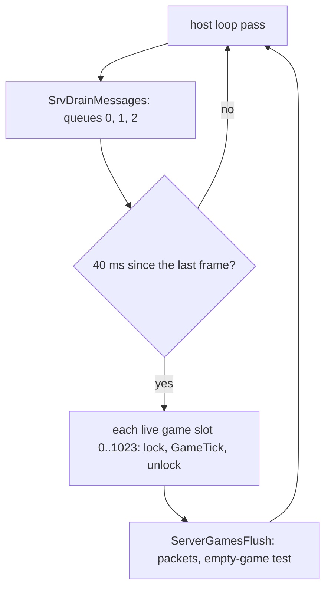
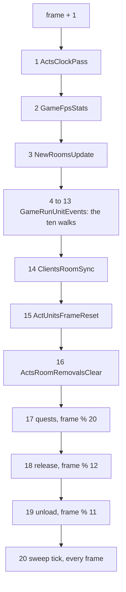
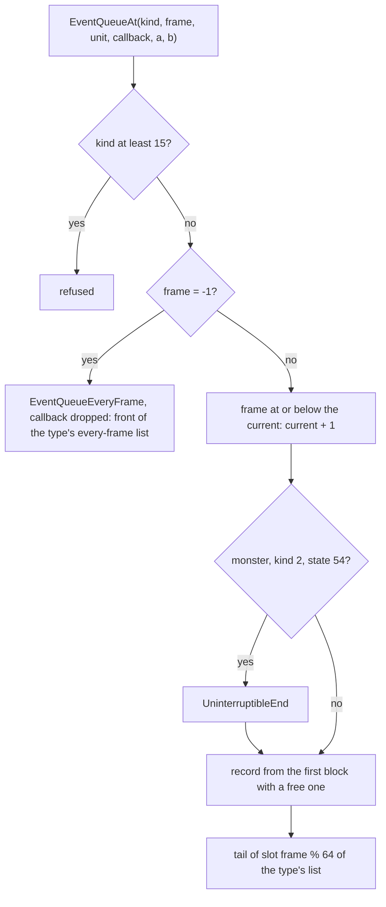
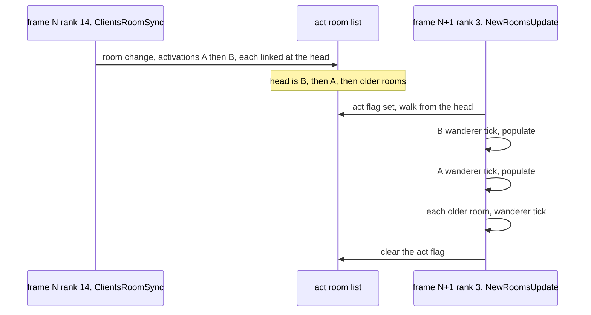
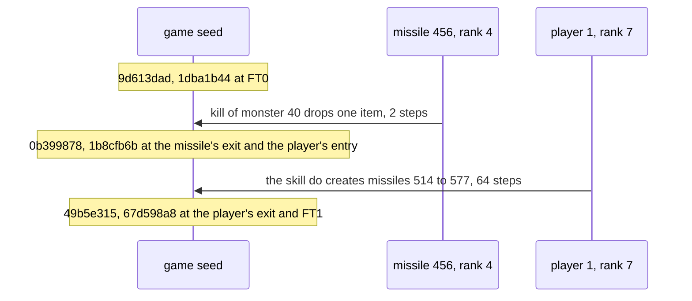

# The server frame: the tick, its passes, the unit events, the queue, the timers and the message drain

## Purpose

The server advances each game by one frame every 40 ms. This spec gives the order of everything inside a frame: the
passes of `GameTick`, the ten walks over the unit event lists, the order inside a list, how a record is queued, the
periodic timers, the order rooms are activated and populated in, where client messages are applied, and which pass can
draw on which seed. It answers the question that decides draws on a shared seed: *whose draws come first*. The content
of each event (a mode's frames, a think, a skill, a hit, a drop, a population) belongs to the spec that owns it; here it
is an opaque event in a known place. [§ K](#k-what-the-frame-windows-test) states what the windows run on the game test
and what they cannot: read it before relying on a confirmed statement.



## Entry points

| When | Function | Tag |
|---|---|---|
| Each pass of the client's main frame in game modes 0 and 1, or of the open-server thread | fn:sub_0044EFA0_ClientMainFrame@0x0044EFA0, fn:sub_0044CF20_OpenServerThread@0x0044CF20 | [I] |
| Before any frame of that pass | fn:sub_0052CFE0_SrvDrainMessages@0x0052CFE0 | [I] |
| One interval has passed | fn:sub_0052FC20_ServerGamesFrame@0x0052FC20 | [I] |
| Per live game, per frame | fn:sub_0052D870_GameTick@0x0052D870 | [I] |
| Pass 4 of the tick | fn:sub_005414D0_GameRunUnitEvents@0x005414D0 | [I]; its code's map [C] (§ D) |
| Any code queues an event | fn:sub_005417D0_UnitQueueEvent@0x005417D0, fn:sub_00541650_UnitQueueEveryFrame@0x00541650, fn:sub_00541800_UnitQueueEventCb@0x00541800 | [C] for their map (§ E) |

`GameTickAlt` is not an entry point: its one call (0x00564C97) lies in a stub at 0x00564C70 that no call, jump or pointer
reaches, so in this build every frame is run by `ServerGamesFrame`. [I] (fn:sub_005645E0_GameTickAlt@0x005645E0, [frame/0001 § 1](../../findings/frame/0001-tick-and-messages.md#1-the-frame-loop))

## Inputs

### Tables

| Anchor | Used for |
|---|---|
| tbl:PetType.txt:partysend | which pets player kind 11 reports (§ F4); it reads no other table |

No excel table is read by `GameTick`'s own code, the queue or the walks; each event's function reads its own.
[I] (fn:sub_0052D870_GameTick@0x0052D870, [frame/0001 § Data touched](../../findings/frame/0001-tick-and-messages.md#data-touched), [frame/0002 § Data touched](../../findings/frame/0002-unit-events-queue.md#data-touched))

### Runtime state

| State | Type | Owner offset | Source |
|---|---|---|---|
| frame counter | `i32`, only grows by one per tick | struct:Game+0xA8 | § B |
| game seed | `Seed` ([rng](../rng/README.md)) | struct:Game+0xD0 | [rng/seeds](../rng/seeds.md) |
| event control | `EventCtl`, 0xA20 bytes, § D | struct:Game+0xB8 | game create |
| acts | 5 pointers | struct:Game+0xBC | § G, § H |
| clients | list, next `+0x4A8`, newest first; count `+0x8C` | struct:Game+0x88 | § H3 |
| hit class counter | `u8`, process-wide | data:g_HitClassCounter@0x0088CAD0 | § J3 |
| act room list, new-rooms flag | list (next room `+0x7C`), `u32` | struct:DungeonActFrame+0x10, struct:DungeonActFrame+0x54 | § H1 |
| act dirty word, removal flag | `u32`, `u32` | struct:DungeonActFrame+0x00, struct:DungeonActFrame+0x58 | § G |
| room's updated list | list, next struct:Unit+0xE0 | struct:DungeonRoomLife+0x1C | § G3 |
| quest timers | list; running flag `+0x04`, head `+0x10`, tick `+0x14` of the quest control | struct:Game+0x10F4 | § I1 |
| wall clock | `timeGetTime() & 0x7FFFFFFF`, `u32` | data:g_ServerFrameLast@0x00883D58 | § A; time is outside the deterministic state (ADR-0014) |

### Constants

Each is a constant of the code; none is a table a rule could replace, and the one six-value list has its address and reader.

| Name | Value | Anchor | Tag |
|---|---|---|---|
| frames per second | 25 in the image; the setter `SetServerFps` has no reference | data:g_ServerFps@0x00731014, fn:sub_0052DF80_SetServerFps@0x0052DF80 | [I] |
| frame interval | `1000 ÷ 25` = 40 ms, computed by a static initializer at 0x006CAF10 | data:g_ServerFrameInterval@0x00883D60 | [I] |
| game slots | 1 024 dwords | data:g_GameSlots@0x00882D38 | [I] |
| event kinds | below 15, signed | 0x005416B7 | [C] code's map (run:2026-10-30-frame-emu-2) |
| slot ring | 64 per list; slot = `frame % 64`, signed C remainder | 0x005414EC, fn:sub_005416B0_EventQueueAt@0x005416B0 | [C] code's map (run:2026-10-30-frame-emu-2) |
| event lists | 5 | struct:EventCtl+0xA04 | [C] code's map (run:2026-10-30-frame-emu-2) |
| unit type → list | types 0..5: `0, 1, 3, 2, 4, −1`, read by `EventQueueAt` and `EventQueueEveryFrame` | data:g_UnitTypeEventList@0x006E0B9C | [I]; the five lists' use [C] code's map (run:2026-10-30-frame-emu-2) |
| record block | 600 records of 0x30 bytes, 0x7088 bytes in all | fn:sub_00540BB0_EventBlockNew@0x00540BB0 | [I] |
| quest timers period | `frame % 20 = 0` | 0x0052D920 | [C] (run:2026-11-04-frame2) |
| release pass period | `frame % 12 = 0` | 0x0052D938 | [C] (run:2026-11-04-frame2, run:2026-10-17-lifecycle) |
| level-unload period | `frame % 11 = 0` | 0x0052D95F | [C] (run:2026-11-04-frame2) |
| expiry sweep period | `frame % 1500 = 0` | 0x0052D316–0x0052D320 | [C] code's map (run:2026-10-30-frame-emu-3) |
| save test | `frame & 0x80001FFF = 0`, a signed `frame % 8192 = 0` | 0x0052D45C | [C] at frame 8192 (run:2026-11-04-frame2) |
| empty game close | 300 000 ms, or `1500 < frame < 7500` | 0x0052FD90–0x0052FE94 | [I] |
| player kind 11 | first at placement + 250, then every 30 frames | 0x00534B1D, 0x00580BF4–0x00580C08 | [I] |
| chat record life | `8·n + 125` frames, `n ≤ 254` characters | fn:sub_00661110_ChatRecordNew@0x00661110 | [I] |

## Algorithm

The ranks below number the frame's places, and § J and § K use them.

### A. The host loop and the frame clock

```
A1. HostLoopPass():                                               [I] (all of A1) (0x0044F136–0x0044F162, 0x0044CF5A–0x0044D01D)
      SrvDrainMessages()                                          ; § C
      ticked: u32 ← ServerGamesFrame(cap: 1)
      mode 0:  if ticked ≠ 0: ServerGamesFlush(1, 0)
      mode 1:  ServerGamesFlush(0, 0)
      the open-server thread: the same three calls while its run flag is set; sleeps 30 ms after a tick, else 10 ms

A2. ServerGamesFrame(cap: u32) → u32:                             [I] (all of A2) (0x0052FC38–0x0052FD35)
      now: u32 ← timeGetTime() & 0x7FFFFFFF
      if last = 0: last ← now                                     ; a word the store below keeps non-zero after first use
      if (i32)(now − last) < interval: return 0                   ; no game ticks
      debt: u32 ← now − last − interval
      if cap ≠ 0 and debt ≥ interval (unsigned): debt ← interval
      last ← now − debt
      for slot in 0 ..< 1024:
        id ← g_GameSlots[slot]
        if id ≠ 0 and id ≠ −1:
          game ← GameLockById(id)                                 ; game+0x18, per-game lock
          if game ≠ 0: GameTick(game);  leave game+0x18           ; no such game: the next slot
      return the performance-counter ticks spent if a game ticked, else 0
```

- A2. [I] Every caller passes `cap` = 1, so one call runs at most one frame per game and the clock owes at most one
  interval: after a stall of any length one call ticks, the next ticks again at once, and the third waits. A slowed game
  runs every frame in order, only later. (fn:sub_0052FC20_ServerGamesFrame@0x0052FC20)
- A3. [I] **The flush** returns at once when both arguments are 0 and under 40 ms (`GetTickCount`) have passed since its
  last run. Otherwise, per live game in slot order: every client's queued packets are sent, and a game with no clients
  starts a timer at `Game+0x1DC0` and is closed once 300 000 ms have passed **or while `1500 < frame < 7500`**; a game
  with clients clears the timer. This test is in the flush, after the frame, not in `GameTick`.
  (fn:sub_0052FD90_ServerGamesFlush@0x0052FD90, fn:sub_0052E770_GameClose@0x0052E770)
- A4. [I] The lag scale `Game+0x1DBC` always stores 0x400 (`g_ServerLagFixed` holds 1 and nothing writes it), and its one
  reader is a host statistics query. It has no game effect. (data:g_ServerLagFixed@0x0073100C, 0x0052FCAE–0x0052FD0D)

### B. `GameTick`



```
B1. GameTick(game):                                               [I] (all of B1) (0x0052D87B, 0x0052D8DF–0x0052D96C)
      game.frame: i32 ← game.frame + 1
      debug fault switch game+0x1DC8 (1–4)                        ; 0 in a normal game; see B3
  1   ActsClockPass(game)                                         ; § G1
  2   GameFpsStats(game)                                          ; § G2
  3   NewRoomsUpdate(game)                                        ; § H2
  4–13 GameRunUnitEvents(game)                                    ; § D
  14  ClientsRoomSync(game)                                       ; § H3
  15  ActUnitsFrameReset(game)                                    ; § G3
  16  ActsRoomRemovalsClear(game)                                 ; § G4
  17  if frame % 20 = 0: QUESTS_TimersRun(game)                   ; § I1. every % is a signed idiv on the incremented frame
  18  if frame % 12 = 0: RoomsDeactivate(game)                    ; § I2
  19  if frame % 11 = 0: for a in 0 ..< 5: if game.act[a]: ActLevelsUnloadTick(game.act[a])   ; § I3
  20  ExpirySweepTick(game)                                       ; § I4. every frame; works only when frame % 1500 = 0
```

Rank 21 is everything between tick N and tick N + 1, the drain first of all: `GameTick` raises the counter before its
first pass, so a line that reads the stamp N after tick N's passes is at rank 21 of stamp N. [I] This assumes one thread
runs both the client frame and the ticks, the single-player loop of A1; the open-server thread of modes 6 and 8 would
break it. (0x0052D87B, 0x0044F136–0x0044F162, [frame/0005 § 1](../../findings/frame/0005-dispatchers.md#1-how-the-reach-follows-a-table))

- B2. [I] The seven calls from 1 to 16 have no branch between them. (fn:sub_0052D870_GameTick@0x0052D870, 0x0052D8DF–0x0052D907)
- B3. [I] The debug switch's one identified writer has no reference of any kind, so the switch reads as unreachable in the
  stock image; one other function copies the same offset between objects of unread type. (fn:sub_0052F630_HostAbendMsg@0x0052F630,
  0x00450C99, [frame/0001 § 2](../../findings/frame/0001-tick-and-messages.md#2-gametick))
- B4. [C] **No order mismatch over the kept corpus.** Over the 331 frame-stamped corpus logs, 383 349 frames hold two or
  more events placed by a closed set; 3 713 293 placed events fall in rank order in every frame, 0 mismatches and 0
  nesting conflicts. **What tests it is less than that:** 17 254 consecutive pairs separate the order (16 935 of the anim
  logger, 319 of the skills logger, none of any other), 9 029 of them without anim's logged phase, each a prediction of both events' passes, where the phase is the logger's observation of the runner; the other placed frames agree trivially. Four wrong orders fail:
  monsters' walks before players' 42 148 events in 19 242 frames, slot before every-frame 9 608 in 7 924, missiles after
  items 8 885 in 729, the drain before the tick 95 in 95. Scope: where a set exists. 118 340 of the 501 689 frames with
  two or more events hold fewer than two with a closed set and cannot fail. (run:2026-11-03-frame-order-2,
  fn:sub_005414D0_GameRunUnitEvents@0x005414D0, [frame/0005 § 6](../../findings/frame/0005-dispatchers.md#6-the-replay))
- B5. [C] **A packet handled after tick N carries the stamp N,** scoped to the skill-request handlers: 87 `SKILLS_CanUse`
  calls from `PLRMSG_SkillAtXY` and `PLRMSG_SkillAtUnit` are logged after a missile frame of the same stamp; "the drain
  reads the frame it acts before" fails all 87. (run:2026-11-03-frame-order, fn:PLRMSG_SkillAtXY@0x00549AD0,
  fn:PLRMSG_SkillAtUnit@0x00549BA0)

### C. The message drain

```
C1. SrvDrainMessages():                                           [I] (all of C1) (0x0052CFFF–0x0052D06E)
      while (m ← pop queue 0): SrvClientMsgDispatch(m)            ; system: game create 0x67, join
      while (m ← pop queue 1): SrvProcessClientMessage(m)         ; in-game packets of every client of every game
      while (m ← pop queue 2): SrvHostMessage(m)                  ; host control: kinds 1, 0xFD callbacks; 0xFA, 0xFB, 0xFC counters and replies

C2. SrvProcessClientMessage(m):                                   [I] (all of C2) (0x0053F3D0–0x0053F46B)
      game ← the client's game, locked; a client in no game: logged and dropped
      client+0x3D8 ← GetTickCount()
      if the client's player exists and is a player unit (type 0):
        SrvPacketDispatch(packet, len)                            ; the handler of g_SrvPacketTable[opcode], opcode 1..0x66, at once
      unlock
```

- C3. [I] **Each queue is FIFO**: the pop takes the head under the context's lock and returns −1 when empty, and the
  enqueues append at the tail. A message arriving while its queue drains is drained in the same pass. **Which drain a
  message falls in is arrival**, a logged input and no claim of this spec (ADR-0022). (fn:sub_006BEAD0_NetQueuePop@0x006BEAD0,
  0x006BF493–0x006BF4BB)
- C4. [I] **Messages are applied between frames, never inside `GameTick`.** `SrvPacketDispatch` has one call site, in
  `SrvProcessClientMessage`, that function one, in the drain, and the drain's four call sites lie in three loops: the two of A1
  and `ClientWaitDrain`, which drains with no frame. A loop pass that does not tick still drains, so several drains can
  fall between two frames. A packet applied while the counter reads N takes effect in the state frame N + 1's passes
  start from. (0x0053F459, 0x0052D03E, fn:sub_0052CFE0_SrvDrainMessages@0x0052CFE0, fn:sub_0044BD20_ClientWaitDrain@0x0044BD20)
- C5. [I] The packets of all clients and all games share queue 1, so their order is their arrival order; the mode test
  `PlayerModeAllowed(1, 0, 0)` applies except for 0x14, 0x15, 0x3C, 0x43, 0x66, and 0x41 only in mode 0x11.
  (fn:sub_0054D750_SrvPacketDispatch@0x0054D750, data:g_SrvPacketTable@0x006E0D18)

### D. The unit events: the control, the pass, the runners

| `EventCtl` offset | Field |
|---|---|
| `+0x000` | current slot |
| `+0x004` | slot heads `[5][64]` |
| `+0x504` | slot tails `[5][64]` |
| `+0xA04` | the five every-frame heads |
| `+0xA18` | the walker's saved next |
| `+0xA1C` | the first record block |

[I] Created zeroed with its first block at game create, freed with every block at game free. A block holds 600 records,
free list `+0x7080` (initially in address order), next block `+0x7084`. The record is `UnitEvent` of `re/types/anim.h`.
(struct:EventCtl+0xA18, struct:UnitEvent+0x02, fn:sub_00541470_GameEventCtlCreate@0x00541470, fn:sub_00541400_GameEventCtlFree@0x00541400)

```mermaid
flowchart LR
  M0["4 missiles every-frame"] --> M1["5 missiles slot"] --> P0["6 players every-frame"] --> P1["7 players slot"]
  P1 --> O0["8 monsters every-frame"] --> O1["9 monsters slot"]
  O1 --> B0["10 objects every-frame"] --> B1["11 objects slot"] --> I0["12 items every-frame"] --> I1["13 items slot"]
```



```
D1. GameRunUnitEvents(game):                                      [I] (all of D1) (0x005414EC–0x00541589)
      ctl.curSlot: i32 ← game.frame % 64                          ; signed C remainder
  4   MissileEventsRun(mode 0, ctl.everyHead[2])
  5   MissileEventsRun(mode 1, ctl.slotHead[2][curSlot])
  6   PlayerEventsRun (mode 0, ctl.everyHead[0])
  7   PlayerEventsRun (mode 1, ctl.slotHead[0][curSlot])
  8   MonEventsRun    (mode 0, ctl.everyHead[1])
  9   MonEventsRun    (mode 1, ctl.slotHead[1][curSlot])
  10  ObjEventsRun    (mode 0, ctl.everyHead[3])
  11  ObjEventsRun    (mode 1, ctl.slotHead[3][curSlot])
  12  ItemEventsRun   (mode 0, ctl.everyHead[4])
  13  ItemEventsRun   (mode 1, ctl.slotHead[4][curSlot])

D2. Each runner (head, mode):                                     [C] (all of D2) code's map, ADR-0015 (fn:sub_00541060_MonEventsRun@0x00541060, run:2026-10-30-frame-emu-2)
      ctl.walkNext ← 0
      rec ← head
      while rec ≠ 0:
        ctl.walkNext ← rec.next                                   ; saved before the run
        if mode = 1 and rec.frame ≠ game.frame:                   ; a slot record due 64·k frames later
          rec ← ctl.walkNext;  continue
        rec.flags ← rec.flags | 1
        if rec.callback ≠ 0: rec.callback(game, rec.unit, rec.kind, rec.a, rec.b)
        else:                the type's dispatch (§ F1)
        rec.flags ← rec.flags & ~1
        if mode = 1 or (rec.flags & 8) ≠ 0: EventFree(rec)        ; § E3
        rec ← ctl.walkNext
```

- D3. [I] **A walk reads its list's head when it starts** (each head is loaded right before its call, 0x005414EE,
  0x005414FD, 0x0054150D, 0x0054151E, 0x0054152B, 0x0054153C, 0x0054154C, 0x0054155D, 0x0054156D, 0x0054157E), so a
  record queued during an earlier walk of the frame is found by a later walk of its own list.
  (fn:sub_005414D0_GameRunUnitEvents@0x005414D0)
- D4. [C] **The pass and the runners, emulated:** five runners and both modes (`run`, 300 cases, 169 records not due and
  passed over) and the whole pass (`tick`, 100 cases, 33 ending at the first dispatch reached), with the game's own
  `UnitQueueEveryFrame` as the re-entrant callback; "players before missiles" fails the 33 it separates, "next read after
  the run" the 96. This is the code's map (ADR-0015): it covers no dispatch or event function and no callback that frees
  another record. It is not the order in a game, which D5 and D6 give. (run:2026-10-30-frame-emu-2,
  fn:sub_00540F60_PlayerEventsRun@0x00540F60, fn:sub_00541160_ObjEventsRun@0x00541160,
  fn:sub_00541240_MissileEventsRun@0x00541240, fn:sub_00541320_ItemEventsRun@0x00541320)
- D5. [C] **In the counted windows, rank order among ranks 4, 7, 8 and 9 only.** Over 27 372 `UE0` of the five counted
  windows (§ K1), 1 844 adjacent walks of different ranks: 4 → 7 324, 7 → 8 1 129, 7 → 9 184, 8 → 9 207, none inverted.
  Scope: a Blood Moor pack and the Den of Evil, one player, Nova, oracles as § K3 names them.
  (run:2026-11-04-frame2, [frame/0007](../../findings/frame/0007-frame-batch.md#answer-summary), fn:sub_005414D0_GameRunUnitEvents@0x005414D0)
- D6. [I] **Ranks 5, 6 and 10 to 13 hold no event in any counted window,** so no window tests a missile slot walk, a
  player every-frame walk or an object or item walk. Their places are the read order D1, with D4's map under it; D7's corpus pairs put one object kind's event after two slot walks and give no object walk a rank.
  (0x005414FD, 0x0054150D, 0x0054154C–0x0054157E, run:2026-11-04-frame2)
- D7. [C] **The kept corpus adds pairs by logger phase and call site** (frame/0004): players' slot walk before monsters'
  (3 007 `PDS` → `MDS`, each placed by its dispatch site 0x00540FC4, 0x005410C4); monsters' every-frame walk before their
  slot walk (4 637 logged in phase 5 then `MDS`); missiles' walks before a player or monster event and before the drain
  (`MF0` → `SDO0` 6, `MF0` → `CU0` 81); one object event kind, `ObjEvOperateEnd` (`OEV`, placed by its reach from `g_ObjEventFns[1]`), after the players' slot walk (3 pairs) and the monsters' (1). These place
  a walk against a neighbour. They do not separate the objects' every-frame from their slot walk, the missiles' likewise,
  or anything of the items' walks, and they rank no object walk: D6 keeps that. (run:2026-11-03-frame-order, fn:sub_00581490_ObjEvOperateEnd@0x00581490, [frame/0004 § 2](../../findings/frame/0004-order-on-kept-logs.md#2-the-order-of-the-passes-and-walks))
- D8. [I] For a reimplementer: a unit's events in one frame run in the order (its type's place in the five) × (every-frame
  before timed) × (the list's order, § E). Two units of one type interleave by their records' places in the shared list,
  not by unit. What a unit is or where it stands plays no part. (fn:sub_005414D0_GameRunUnitEvents@0x005414D0,
  fn:sub_005415E0_EventQueueEveryFrame@0x005415E0, fn:sub_005416B0_EventQueueAt@0x005416B0)
- D9. [I] The frame counter holds for 2 147 483 647 frames (994.2 days at 25 per second); the next increment wraps
  negative, where the raise of E1 compares a positive frame against a negative current one and keeps it. No case emulates
  that. (0x0052D87B, fn:sub_005416B0_EventQueueAt@0x005416B0)

### E. The queue



```
E1. EventQueueAt(kind: i32, game, frame: i32, unit, callback, a, b):   [C] (all of E1) code's map, ADR-0015 and ADR-0021 (fn:sub_005416B0_EventQueueAt@0x005416B0, run:2026-10-30-frame-emu-2)
      if kind ≥ 15: return                                        ; signed: a negative kind passes, stored as a byte
      if frame = −1:
        EventQueueEveryFrame(kind, unit, game, callback: 0, a, b)  ; the callback is dropped
        return
      if frame ≤ game.frame: frame ← game.frame + 1               ; signed
      if unit ≠ 0 and unit.type = 1 and kind = 2 and UNIT_HasState(unit, 54):
        UninterruptibleEnd(unit, 0)                               ; [I] (0x00541701–0x00541712) past the UNIT_HasState boundary; E4, the one draw route in the queue
      rec ← EventRecordAlloc(game, unit)                          ; E3
      rec.a ← a;  rec.kind ← (u8) kind;  rec.frame ← frame;  rec.b ← b;  rec.callback ← callback
      lst ← g_UnitTypeEventList[rec.unitType];  s ← frame % 64
      rec.next ← 0;  rec.prev ← ctl.slotTail[lst][s]
      if rec.prev ≠ 0: rec.prev.next ← rec
      ctl.slotTail[lst][s] ← rec
      if ctl.slotHead[lst][s] = 0: ctl.slotHead[lst][s] ← rec

E2. EventQueueEveryFrame(kind, unit, game, callback, a, b):       [C] (all of E2) code's map (0x00541633–0x00541646, run:2026-10-30-frame-emu-2)
      if kind ≥ 15: return
      rec ← EventRecordAlloc(game, unit)
      rec.flags ← rec.flags | 4;  rec.frame ← −1;  rec.kind, callback, a, b as given
      push rec on the FRONT of ctl.everyHead[g_UnitTypeEventList[type]]    ; next = the old head, prev = 0

E3. EventFree(rec):                                               [C] (all of E3) code's map (fn:sub_00540CD0_EventFree@0x00540CD0, run:2026-10-30-frame-emu-2)
      if rec.flags & 1: rec.flags ← rec.flags | 8;  return        ; running: the walker frees it after the run
      if rec = ctl.walkNext: ctl.walkNext ← rec.next
      unlink rec from its list (prev.next or the list head; next.prev, or the slot tail when it was the tail)
      if rec.unit ≠ 0: unlink rec from the unit's chain (or Unit+0xDC ← rec.unitNext)
      rec.next ← firstBlock.free;  rec.prev ← 0;  firstBlock.free ← rec;  rec.flags ← 2   ; the FIRST block, always
```

- E1. [C] `qat`, 400 cases, 0 mismatches: 250 kept at their frame, 79 raised, 14 sent to the every-frame list (3 with a
  callback that is dropped), 20 refused, 37 more ending at `UNIT_HasState`, an observed boundary; 241 into a slot that
  already holds records, which "insert at the head" fails. `UnitQueueEvent` and `UnitQueueEventCb` only pass their
  arguments. (run:2026-10-30-frame-emu-2, fn:sub_005417D0_UnitQueueEvent@0x005417D0, fn:sub_00541800_UnitQueueEventCb@0x00541800)
- E2. [C] `qef`, 150 cases (138 queued, 12 refused); "append at the tail" fails the 36 it separates.
  (run:2026-10-30-frame-emu-2, fn:sub_005415E0_EventQueueEveryFrame@0x005415E0)
- E2a. [I] A frame-−1 request through `UnitQueueEventCb` would lose its callback; its one caller (`UnitTeleport`,
  0x00555046) passes a frame not read. A null unit is not a valid input: index 6 of the type list is string bytes, and type
  5 maps to −1, which indexes the tails into the item list's heads; the sites read pass a unit, their unit types not
  enumerated. (data:g_UnitTypeEventList@0x006E0B9C, 0x00555046)
- E2b. [I] Who queues every frame: `UnitQueueEveryFrame` has 3 sites, `SUNIT_ModeEveryFrame` (kind 0), `MissileUnitInit`
  (kind 0: every missile runs `MissileDoFrame` every frame) and `ImpAttach` (kind 5). `EventQueueAt`'s frame −1 path is the
  other route. (fn:SUNIT_ModeEveryFrame@0x00553F00, fn:sub_0059F8A0_MissileUnitInit@0x0059F8A0, 0x005416D7)
- E3. [C] `free`, 300 cases: 62 running records, 163 slot and 75 every-frame unlinks, 96 where the record is the walker's
  next, which "no advance of the walker" fails. The fields not named are left as they were. (run:2026-10-30-frame-emu-2,
  fn:sub_00540CD0_EventFree@0x00540CD0)
- E3a. [I] **Allocation.** `EventRecordTake` walks the blocks from `+0xA1C` to the first with a free record, pops its free
  list's head and zeroes 0x30 bytes; a new block is linked second, after the first (not emulated: no case used more than
  32 records). The record goes at the **head** of the unit's chain (`Unit+0xDC`, next `+0x24`, prev `+0x28`), with `unit`,
  `guid` (−1 with no unit) and `unitType` (6 with no unit). (fn:sub_00540C30_EventRecordTake@0x00540C30,
  fn:sub_00540DF0_EventRecordAlloc@0x00540DF0, 0x00540C5B–0x00540C73)
- E3b. [C] **Cancel and free-all, the code's map** (ADR-0015; `cancel`, 150 cases): `UNIT_CancelEvents(game, unit, kind, a)` frees, in chain order
  (newest first), each record whose kind byte equals `kind` and whose `a` equals `a` when `a` ≠ 0; `UnitCancelEventsByCb`
  the same on the callback, with no zero shortcut; `UnitFreeAllEvents` frees every record, clears its `unit` field and
  sets the chain head to 0. Thin but sufficient, as the finding says: `a` compared even when 0 separates 10, a callback of
  0 taken as "any" 3, the chain walked oldest first 5, and each fails all it separates. (run:2026-10-30-frame-emu-2,
  fn:UNIT_CancelEvents@0x00540E60, fn:sub_00540EA0_UnitCancelEventsByCb@0x00540EA0, fn:sub_00540EE0_UnitFreeAllEvents@0x00540EE0)
- E4. [I] **The state-54 branch:** `UninterruptibleEnd(unit, 0)` clears state 54 and, if the unit has a game, under state 92
  clears 92 and either kills the unit (`UnitKilled(0, 1)`, when `UnitStoredUnit9C` gives none) or applies a hit from that
  unit (a zeroed 0x70-byte hit with flag 2); then, for a monster, `UNIT_CancelEvents(2, 0)` frees its pending AI events.
  Only then is the new AI record allocated, so it replaces them. 118 RNG functions are reachable. (0x00541701–0x00541712,
  fn:sub_005544B0_UninterruptibleEnd@0x005544B0)
- E5. [I] **Queued during a pass.** A timed record never runs in the frame it is queued (its frame is at least the current plus 1).
  An every-frame record runs in this frame only if its type's list is walked later in the frame; queued into the list
  being walked or one already walked, it first runs next frame. (fn:sub_005416B0_EventQueueAt@0x005416B0, 0x005414EC–0x00541589)
- E5a. [C] That every-frame half, for **players and monsters**: 658 monster starts queued during the missile or player
  walks ran in that frame; 2 819 monster starts queued in or after the monster walks and all 6 205 player starts ran in
  the next (9 682 starts, 0 mismatched). Objects', items' and missiles' cases stay `[I]`: that log has no start of theirs, and the windows' `QF` lines for missiles are counted for order (E7), not for this.
  (run:2026-10-27-anim, fn:SUNIT_ModeEveryFrame@0x00553F00, 0x0054150D)
- E5b. [C] **Cross-type queues the kept logs hold:** 926 monster every-frame records queued in an earlier walk than the
  monsters' every-frame walk (79 in the missiles' every-frame walk, 847 in the players' slot walk); players none; no
  every-frame queue line for objects, items or missiles in the 331 corpus logs (the windows log `QF`, E7). The five counted windows hold 0 cross-type
  every-frame runs. (run:2026-11-03-frame-order, run:2026-11-04-frame2, fn:SUNIT_ModeEveryFrame@0x00553F00)
- E6. [I] **Freed during a walk.** A record freed is never run after it: the free moves the walker's saved next on. A unit
  freed during a pass loses all its records at once (`UnitFreeAllEvents`, from each type's free). A unit moved between rooms
  keeps its records: no record holds a room. (fn:sub_00540EE0_UnitFreeAllEvents@0x00540EE0, 0x00540CE8–0x00540CF3)
- E7. [C] **List order in the game's own runs, in the counted windows (§ K1):** slot events run in their `QE` order, 857
  adjacent events over 449 frames, 0 inverted; 326 of those pairs are one unit's and **104 run against ascending guid**, so
  the test separates queue order from guid order on those 104. Every-frame events run newest `QF` first, 21 482 adjacent
  events over 1 025 frames, 0 inverted; **572 run against descending guid**, the same separation. A guid order would pass
  the other pairs. (run:2026-11-04-frame2, fn:sub_005416B0_EventQueueAt@0x005416B0, fn:sub_005415E0_EventQueueEveryFrame@0x005415E0)
- E8. [C] The kept corpus agrees: 4 566 `MDS` and 13 `PDS` consecutive slot pairs matched to logged queue calls, 0 inverted,
  "newest queued first" failing all 4 579; 24 652 consecutive pairs of windowed missiles newest first in 4 710 frames,
  which a guid-descending order would also predict. (run:2026-11-03-frame-order, [frame/0004 § 3](../../findings/frame/0004-order-on-kept-logs.md#3-the-order-inside-a-list))

### F. Dispatch: the event tables, the freeze drop, kinds 6 and 11

| Kind | Players (`g_PlayerEventFuncs`) | Monsters (`g_MonEventFuncs`) | Objects (`g_ObjEventFns`) | Items (`g_ItemEventFuncs`) |
|---:|---|---|---|---|
| 0 | `PlayerModeFrameEvent` | `MonModeFrameEvent` | `0x00581700` | — |
| 1 | `PlayerModeEnd` | `MonModeEndEvent` | `ObjEvOperateEnd` | — |
| 2 | — | `MonAiEvent` | `0x00581510` | — |
| 3 | `RegenEvent` | `MonRegenEvent` | `0x005818B0` | `ITEMEVENT_Replenish` |
| 4 | — | — | `OBJ_TrapEvent` | `ItemEvent4Nop` |
| 5 | `StateDoFunc` | `StateDoFunc` | `ObjEvent5ShrineReset` | — |
| 6 | `PlrEvent6Expire` | `MonEvent6Expire` | `0x00581620` | — |
| 7 | — | `MonEvent7UMod` | `ObjEvent7Thunk` (quests) | — |
| 8 | `EVENT_SelectedAuraTick` | `EVENT_SelectedAuraTick` | `0x00581250` | — |
| 9 | `EVENT_ItemAuraTick` | `EVENT_ItemAuraTick` | `0x00585CE0` | — |
| 10 | — | `MonEvent10TargetClear` | `0x00586850` | — |
| 11 | `PlrEvent11Every30` | — | `0x00581410` | — |
| 12 | `EVENT_TimedListExpire` | `MonEvent12TimedExpire` | — | `ItemEvent12TimedExpire` |
| 13 | `TradeStateTick` | — | — | — |
| 14 | — | — | — | — |

- F1. [I] **The dispatches.** Players and monsters test `kind < 15` unsigned, so a negative kind that `EventQueueAt`
  accepted arrives zero-extended as 241..255 and is dropped, and they skip a null entry; objects and items have no kind
  bound and stop the process on a bad entry (`IsBadCodePtr`); an object's entries 12 to 14 are null. Every missile record, of any
  kind, runs `MissileFrameEvent` → `MissileDoFrame`. Kind 14 has no table entry and is queued only with a callback
  (`UnitTeleport`). The object handlers left as addresses are not read. (data:g_PlayerEventFuncs@0x006E1810,
  data:g_MonEventFuncs@0x006E2490, data:g_ObjEventFns@0x006E19B0, data:g_ItemEventFuncs@0x006E117C,
  fn:sub_00581220_PlayerEventDispatch@0x00581220, fn:OBJ_EventDispatch@0x00586AD0, fn:sub_00562DA0_ItemEventDispatch@0x00562DA0,
  fn:sub_005ADCC0_MissileFrameEvent@0x005ADCC0, 0x00581226, 0x005A7F89, 0x00586AD7, 0x00562DA7, 0x006E19E0)
- F2. [I] **The queue sites by kind:** all 269 push a constant kind: 265 `UnitQueueEvent` sites (kind 0: 18, 1: 60, 2: 30,
  3: 18, 4: 1, 5: 5, 6: 6, 7: 45, 8: 7, 9: 7, 10: 3, 11: 3, 12: 42, 13: 20), one `UnitQueueEventCb` at kind 14, and 3
  every-frame sites at kinds 0, 0 and 5. Which unit type each site queues for is not enumerated; a kind's meaning depends on
  it. (fn:sub_005417D0_UnitQueueEvent@0x005417D0, fn:sub_00541650_UnitQueueEveryFrame@0x00541650, fn:sub_00541800_UnitQueueEventCb@0x00541800)

```
F3. MonEventDispatch(game, unit, kind, a, b):                     [I] (all of F3) (fn:sub_005A7F80_MonEventDispatch@0x005A7F80)
      if (u32) kind > 14: return
      if kind ∉ {3, 4, 5, 8, 12} and UNIT_HasState(unit, 1) and not UnitIsDead(unit): return   ; the freeze drop
      if g_MonEventFuncs[kind] ≠ 0: g_MonEventFuncs[kind](game, unit, a, b)
```

- F3. [I] The drop is in the dispatch, after the runner set the running flag, so a dropped timed record is freed like a run
  one and a dropped every-frame record stays on its list and runs again once the freeze ends. A record with a callback is not
  dispatched, so never dropped. Players have no such drop. (fn:sub_00541060_MonEventsRun@0x00541060, fn:sub_005A7F80_MonEventDispatch@0x005A7F80)

```
F4. PlrEvent11Every30(game, player):                              [I] (all of F4) (fn:sub_00580BE0_PlrEvent11Every30@0x00580BE0)
      PlrPartyStatusSend(game, player)                            ; packets 0x7F, 0x90 to the player's own client
      PlrPetsStatusSend(game, player)                             ; prune dead pets with PetRemove(guid, 0), then 0x7F per partysend pet
      UnitQueueEvent(game, player, 11, frame + 30, 0, 0)

F5. Kind 6 (PlrEvent6Expire, MonEvent6Expire, the same code):     [C] (all of F5) the three branches, ADR-0021 (fn:sub_00580B70_PlrEvent6Expire@0x00580B70, fn:sub_005A7F00_MonEvent6Expire@0x005A7F00, run:2026-10-30-frame-emu-3)
      if no unit or no record at Unit+0xA4: return
      if record.endFrame ≤ game.frame (unsigned):
        ChatRecordFree(pool, record)                              ; the boundary; the writes below are [I] (0x00580B70)
        Unit+0xA4 ← 0;  UnitMarkUpdated(unit);  Unit+0xC4 ← Unit+0xC4 | 0x100
      else: UnitQueueEvent(game, unit, 6, record.endFrame, 0, 0)
```

- F4. [C] **Kind 11 is draw-free in the windows' scenes:** 85 runs in the five counted windows, entry and exit seeds equal
  on every seed logged and no `own` step in any. The windows hold no dead pet, so the prune branch is not run.
  (run:2026-11-04-frame2, fn:sub_00580BE0_PlrEvent11Every30@0x00580BE0, fn:sub_00575590_PetListPrune@0x00575590)
- F4a. [I] By its graph kind 11 reaches no RNG function (601 functions) with `PetUnitRelease` and `UninterruptibleEnd` as
  stops, the first reachable only under a non-zero `PetRemove` argument (kind 11 passes 0 at 0x005755FB) and the second only for
  a monster's kind 2. Its first run is queued 250 frames after a player's placement by `PlrPlaceEventsInit`, with kind 3 at
  frame + 1. (fn:sub_00534AD0_PlrPlaceEventsInit@0x00534AD0, fn:sub_00574450_PetUnitRelease@0x00574450, 0x00534B1D)
- F5. [I] **Kind 6 is untested in the game: 0 events in every window.** Its draw-free reading is by graph only (565 functions
  each with `UninterruptibleEnd` stopped, unreachable for kind 6). `Unit+0xA4` is the overhead chat record, whose lifetime
  is `8n + 125` frames, written by packet 0x14's handler, `UnitOverheadNumber`, `OBJOP_Shrine` and the object kind-6
  handler. (fn:sub_00661110_ChatRecordNew@0x00661110, fn:sub_0054A290_SrvPkt14OverheadChat@0x0054A290,
  fn:sub_005DE330_UnitOverheadNumber@0x005DE330, run:2026-11-04-frame2)

### G. The other per-frame passes

```
G1. ActsClockPass(game):                                          [I] (all of G1) (0x0052D7C6–0x0052D85B)
      for a in 0 ..< 5 with game.act[a] ≠ 0:
        if ActClockTick(act, a) ≠ 0:
          packet ← 0x53, u32 clock+0x00, u32 clock+0x08, u8 clock+0x30   ; 10 bytes
          for each client of game.clients whose player exists:
            PlayerEquipRefresh(game, player, 1)                   ; every client's player, on any act's clock change
            if client.state = 4 and client.act = a: ClientSendActClock(client, packet)

G1a. ActClockTick(act, a): on the dwords at [act+4]               [C] (all of G1a) code's map, ADR-0015 (fn:sub_0061C040_ActClockTick@0x0061C040, fn:sub_0061BEE0_ClockStep@0x0061BEE0, run:2026-10-30-frame-emu)
      p ← +0x00 (0..5);  v ← +0x04;  c ← +0x08;  k ← +0x28;  f ← +0x30;  b ← +0x34      ; a null clock returns 0
      c ← c + 1
      if f = 0:
        if a = 3: c ← c + 15
        else if T0[p].type = 2: c ← c + 1;  if a = 2: c ← c + 8
      if c ≥ k × 360: c ← 0                                       ; i32 compare, i32 product
      n: i32 ← 0 if p + 1 = 6, else p + 1
      T ← T0 if f = 0, else (T1 if a = 3, else T2)
      if c > T[n].start × k:                                      ; signed
        p ← n
        (v, c) ← (T0[p].type, T0[p].start × k) if f = 0, else (T2[p].type, T2[p].start × k)
      if k ≠ 0:
        q ← c ÷ k                                                 ; truncating
        if |q − b| > 16: b ← q;  return 1
      return 1 if (p, v) changed, else 0
```

- G1a. [C] `env`, 420 cases, 0 mismatches. The flag-set path compares against `T1` in act index 3 but takes the new values
  from `T2`, as the code does (0x0061BF4F–0x0061BFA7). (run:2026-10-30-frame-emu, data:g_ActClockTable0@0x007443F0,
  data:g_ActClockTable1@0x00744438, data:g_ActClockTable2@0x00744480)
- G1b. [I] `T0`, `T1`, `T2` are six rows of three dwords (start, type, a colour word), read only; their values are not written
  here ([backlog](../../backlog/2026-11-04-spec-writer-archivist-act-clock-tables.md)). The products are `i32`: `k × 360` fits up to
  `k` = 5 965 232 and `start × k`, at the largest start, 350, up to 6 135 667; past that the compare runs on the wrapped value, and the
  cases keep `k` below 5 000. The clock reads as the act's day-and-night light, from the colour word and the packet. (0x0061BF1F, 0x0061BF66,
  0x0061BF97, 0x0061BCE0, fn:sub_0061BEE0_ClockStep@0x0061BEE0)
- G2. [I] `GameFpsStats`: on 1 000 ms or more since `Game+0xB4`, it stores frames × 1000 ÷ elapsed (unsigned) and zeroes the
  frame count. Statistics only, no game effect and no draw. (fn:sub_0052D720_GameFpsStats@0x0052D720)

```
G3. UnitMarkUpdated(unit):                                        [C] (this function) code's map, ADR-0015 (fn:sub_0064C040_UnitMarkUpdated@0x0064C040, run:2026-10-30-frame-emu)
      r ← [[unit+0x2C]+0x00] for types 2, 4, 5, else [[unit+0x2C]+0x1C]     ; 0 when [unit+0x2C] is 0
      if r ≠ 0 and ([r+0x34] & 4) = 0 and bit 0x2000 of [unit+0xC4] is clear:
        set the bit;  [unit+0xE0] ← [r+0x1C];  [r+0x1C] ← unit;  [[r+0x2C]+0x00] ← 1

    ActUnitsFrameReset(game):                                     [I] (0x0053B02C–0x0053B079)
      for a in 0 ..< 5 whose act's dirty word is set:
        for each room from ActRoomsHead along +0x7C:
          for each unit of room+0x1C along +0xE0: UnitFrameReset(unit)     ; newest marked first
          RoomUpdatedClear(room)                                  ; [C] code's map, family clear (run:2026-10-30-frame-emu): every listed unit loses bit 0x2000 and its +0xE0 link, the head becomes 0, the act's word untouched
        dirty word ← 0
      0x0053FAE0(game)                                            ; clears bit 0x400 of [[game+0x1D28]+0x08] when game+0x1D28 is set
```

- G3. [I] Within a room the reset visits units in the reverse of the order they were first marked this frame, and rooms in
  list order. A unit taken out of a room's unit list is unlinked from the updated list and loses bit `0x2000`, so a unit that
  changes room is visited in the new room only. Flag 4 of the room is the client copy's bit, so only server rooms list their
  units. The 78 marking sites are not each read; the order holds for whatever marks a unit. (0x0053B044, 0x0064C42D–0x0064C432,
  fn:sub_00553220_UnitFrameReset@0x00553220, fn:sub_0064C160_RoomUpdatedClear@0x0064C160, fn:sub_0064C1B0_RoomUpdatedUnlink@0x0064C1B0)
- G3a. [I] `UnitFrameReset` is the per-frame flag clear: bits of `+0xC4` and `+0xC8` for every unit (0x0055325A, 0x00553269, 0x00553273), the inventory pass `0x00597B00`, and clears per unit type;
  an item's bit 13 is [save/d2s](../save/d2s.md#item-flag-bit-13-0x2000), the route to `UnitFree` § J's rank 15. No spec names each bit (*Open questions*). `UnitMarkUpdated` on a null unit is a fatal line.
  (fn:sub_00553220_UnitFrameReset@0x00553220, 0x0064C047, [frame/0001 § 3.3](../../findings/frame/0001-tick-and-messages.md#33-actunitsframereset-and-the-updated-unit-list))
- G4. [I] **Removal notes.** `RoomUnitOp` pushes a 12-byte note `{type, guid, next}` on `room+0x18` and sets the act's `+0x58`.
  `ClientRoomSync` sends each note of the client's near rooms as packet 0x0A, missiles skipped, the client's own player
  excepted. `ActsRoomRemovalsClear` then frees every room's notes of each flagged act. So a removal noted in frame N is sent
  in frame N's sync and gone before frame N + 1. (fn:sub_0053A820_ActsRoomRemovalsClear@0x0053A820,
  fn:sub_0053A770_ClientSendRoomRemovals@0x0053A770, fn:sub_0061A2C0_RoomRemovalsFree@0x0061A2C0)

### H. Rooms: list order, the new-room walk, the room sync, the activation record

The rooms' reference counts and population bodies are [drlg/lifecycle § B](../drlg/lifecycle.md#b-activation-reference-counts-per-near-list-distance)
and [§ D](../drlg/lifecycle.md#d-the-new-rooms-walk-populate-once-restore-once-per-activation); here is their order in the frame.



- H1. [I] **An act's room list is newest first.** `DUNGEON_RoomCreate`, called only by `DRLG_RoomActivate` (0x00642369), links
  the new room at the head and sets the act's flag `+0x54`; `ActiveRoomFree` unlinks a room in place. So every pass walking
  `ActRoomsHead` goes from the most recently created room to the oldest. (0x0061991F–0x00619925, 0x0061A93E–0x0061A975,
  fn:DUNGEON_RoomCreate@0x00619890, fn:sub_0061A910_ActiveRoomFree@0x0061A910, fn:sub_0061A180_ActRoomsHead@0x0061A180)

```
H2. NewRoomsUpdate(game):                                         [I] (all of H2) (0x0052D1A9–0x0052D21D)
      for a in 0 ..< 5 with game.act[a] ≠ 0 and act.newRooms ≠ 0:
        room ← act's list head                                    ; read once, 0x0052D1B0
        while room ≠ 0:
          RoomWandererTick(game, room)                            ; every room, one draw on its own seed, lifecycle § I
          if room.flags bit 0 clear: populate; set bits 0 and 1   ; lifecycle § D
          else if bit 1 clear: restore                            ; lifecycle § H
          room ← room.next
        act.newRooms ← 0                                          ; AFTER the walk, 0x0052D21D
```

- H2. [C] `nru`, 200 cases, a code's map: which act is walked first, the head room reached first and the flag cleared on an act
  with no room. The walk past the first room and the population calls are after the boundary. (run:2026-10-30-frame-emu-3,
  fn:sub_0052D160_NewRoomsUpdate@0x0052D160)
- H2a. [C] A client's new rooms are walked at the start of the next frame. (run:2026-10-17-lifecycle, fn:sub_0052D160_NewRoomsUpdate@0x0052D160)
- H2b. [I] **So in one frame's walk,** an act's rooms created since its last walk come first, newest first, then its older
  rooms, and each older room's wanderer tick steps its own seed once per frame in which any room of the act was created.
  `RoomUpdateOne`'s three callers populate one room at once, outside this order ([lifecycle § A](../drlg/lifecycle.md#a-the-frame)).
  (fn:sub_0052D0F0_RoomUpdateOne@0x0052D0F0, 0x0052D1C4)
- H2c. [I] **A room created during the walk** (`NearWarpTest`'s level-point lookup can activate one) is linked before the
  walk's position, so it is not visited, and its flag is cleared at the walk's end: it waits, unpopulated, for the next walk of
  its act, which needs another room of that act to be created, or `RoomUpdateOne`. That is a room of the act being walked; one
  created in a later act is walked in the same pass, one in an earlier act in the next frame. No kept log stamps both the
  activation and the population with a frame in a case that separates this; the pack window held 1 `RC` inside a walk
  ("in a `NewRoomsUpdate` walk: 1", counted, not traced to its population). (0x0052D1B0, 0x0052D21D, fn:sub_0054DB50_NearWarpTest@0x0054DB50,
  fn:sub_0061B730_RoomActivateB@0x0061B730, run:2026-11-04-frame2)
- H2d. [I] `DUNGEON_RoomCreate` calls the act's `+0x4C` with the new room when it is non-zero, before its return; its writer
  is not read, and this spec assumes it is 0 on the server. (0x0061994B–0x00619954, fn:DUNGEON_RoomCreate@0x00619890)

```
H3. ClientsRoomSync(game):                                        [I] (all of H3) (0x0052D453–0x0052D4D7)
      autosave: bool ← game.frame % 8192 = 0                      ; signed: the and with 0x80001FFF and its sign fix, 0x0052D45C–0x0052D470
      a fatal test (0x0053FCA0);  flag ← 0
      AutosaveTick(game, &flag)
      if autosave and flag = 0: SaveGameClients(...)              ; 0x0052D4BD
      for each client from game+0x88, next +0x4A8 read before the client's work:     ; newest client first
        state 3: ClientRoomSync; with a room and a player: the act start, packets
        state 4: ClientRoomSync
        state 5: ClientRoomSync; with a room: the act packets

    ClientRoomSync(game, client), with a player:                  [I] (fn:sub_005380D0_ClientRoomSync@0x005380D0)
      R ← UnitGetRoom(player)
      ClientSendRoomRemovals(...);  two client updates;  under unit +0xC8 bit 21 two calls not read
      client+0x1B0 ← client+0x1B0 + 1
      if R ≠ client+0x1B4:
        on a level change: QUESTS_RaiseLevelChange, TownLevelLeave
        ClientRoomChange(R)                                       ; the reference walk, activations, lifecycle § B
      0x0053FC20();  if the player still has a room: UnitMarkUpdated(player)
```

- H3. [C] **`SaveGameClients`' position at frame 8192:** in maze 5503 #2 and 5505 #2 one `SV0`/`SV1` pair each, after the
  frame's unit events and before `FT1`, its return address inside `ClientsRoomSync`. It is a boundary oracle: its seeds are
  taken as given, and the save's seed is not read. Those two windows are nearly empty (5.4 and 7.9 lines per frame, 517 and 726
  chained events) and test the position and little else. (run:2026-11-04-frame2, fn:sub_0052CA10_SaveGameClients@0x0052CA10, 0x0052D4BD)
- H3a. [I] The client order is `ClientCreate`'s front push; one client in single player. `AutosaveTick` does not save in single
  player (run:2026-10-27-sweep-d2s-play) and leaves the flag 0 when it returns at its `0x00730FFC` test, which is how H3's
  `SaveGameClients` comes to run there. (fn:sub_00539A30_ClientCreate@0x00539A30, 0x00539B42–0x00539B53,
  fn:sub_0052D350_AutosaveTick@0x0052D350, 0x0052D353, 0x0052D461)

**The activation-order record.**

- H4. [I] **Within one room change** rooms are created in the reference walk's order: `DrlgRefAdd(new, 0)` walks the new room's
  near list (which holds the room itself) in list order, each near room recursing to distance 3 before its own enter test, and a
  room is activated at its first enter-1 test that passes while it has no active room. So the creation order is the new room's
  near-list order restricted to rooms not yet active, with enter 2's tail call (a status-3 room whose files become ready) as the
  one other route. **Across one frame:** clients in list order, each client's room change, then the on-demand activations at their
  own passes. (fn:sub_0061B490_DrlgRefAdd@0x0061B490, fn:sub_0061B2D0_DrlgEnter1Activate@0x0061B2D0, fn:sub_0052D440_ClientsRoomSync@0x0052D440)
- H5. [I] **What a log-free build takes as input, per frame:** (a) for each client whose player's room at rank 14 is not its client
  room, the new DRLG room, the frame and the client's place in the list; (b) every `RoomActivateB` call (frame, pass, room) and
  every `RoomUpdateOne` call; (c) the room pins (`0x400000`), which hold a release back. From these the near lists, § H1, § H2 and
  § I2 give the creations, each act's list order, each frame's population order, the idle counts and the releases.
  (fn:sub_0061B730_RoomActivateB@0x0061B730, fn:sub_0052D0F0_RoomUpdateOne@0x0052D0F0, [frame/0003 § 5](../../findings/frame/0003-timers-activation.md#5-the-activation-order-record))
- H6. [I] **The limit.** The record is not derivable from client messages alone: the room a player stands in at rank 14 is the end
  of its movement in the walks, so (a) stays a logged input until a movement model exists (path and collision: plans 0050 and
  0054). With such a model (a) follows from the player's position each frame, and (b) still needs the warp and waypoint requests and
  the population's level-point lookups. This is the answer to the activation order of [chain § Runtime state](../chain/README.md#runtime-state).
  (fn:sub_005380D0_ClientRoomSync@0x005380D0, fn:sub_00537B50_ClientRoomChange@0x00537B50)

### I. The periodic calls

```
I1. QUESTS_TimersRun(game):                                       [C] (all of I1) code's map, given IsBadCodePtr returned 0 (ADR-0015, ADR-0021, ADR-0029 (b)) (fn:QUESTS_TimersRun@0x00543E10, run:2026-10-30-frame-emu-3, run:2026-11-04-lock-scan)
      if game+0x10F4 = 0: return                                  ; [I] (0x00543E17–0x00543E22) no quest control
      ctl.tick: u32 ← ctl.tick + 1
      if ctl.tick = 0xFFFFFFFF: for each timer: t.due ← −1 − t.due
      ctl.running ← 1
      prev ← 0;  t ← ctl.head
      while t ≠ 0:
        next ← t.next                                             ; read before the callback
        if t.due < ctl.tick (unsigned):
          if IsBadCodePtr(t.fn): fatal                            ; [I] (0x00543E79) the non-zero branch
          if t.fn(game, t.quest) = 1:                             ; AL
            unlink t from prev or the head;  free t               ; a case ends at the free
            t ← next;  continue                                   ; [I] (0x00543E10–0x00543EE6) prev unchanged
          t.due ← t.period + ctl.tick
        prev ← t;  t ← next
      ctl.running ← 0
```

- I1. [C] `timers`, 300 cases, each half with a wrong reading failing all it separates: from the tail 74, `≤` 47, signed 89, no wrap
  23, `due + period` 176, no unlink 76. Not covered: `QUESTS_TimerAdd`, what any real callback does, the free, and what the
  import returns for a registered callback; [I] the non-zero branch is a fatal line. (0x00543E73, 0x00543E79, run:2026-10-30-frame-emu-3, run:2026-11-04-lock-scan)
- I1a. [I] **`QUESTS_TimerAdd` pushes on the front,** so within a pass timers run newest registered first (read, not emulated); it is
  fatal while the list runs. A timer's first run is `p + 1` boundaries after registration, and its period `20·(p + 1)` frames
  ([quests](../quests/README.md)). 26 registration sites name 21 callbacks: 13 reach no RNG function, 2 only through a specified entry,
  6 draw through quest content: the A5Q3 thaw, Izual's ghost, Diablo and the A3Q3 guardians spawn monsters, the Tristram portal
  picks a level point, the Dark Wanderer steps the quest seed once and creates a unit. (fn:QUESTS_TimerAdd@0x00543F10,
  fn:QUESTS_GetSeed@0x005438B0, 0x00543F6D, 0x00543F83)
- I2. [C] **Release pass,** code's map up to the first room whose count passes 10: the idle counts, the act order and the boundary
  `RoomReleaseAllowed`. The body and its save rule are [drlg/lifecycle § E](../drlg/lifecycle.md#e-release) and
  [§ F](../drlg/lifecycle.md#f-the-save-rule). "At 10 or above" fails 86, "no reset" 263, acts 4..0 77. (run:2026-10-30-frame-emu-3,
  fn:sub_0052D240_RoomsDeactivate@0x0052D240, fn:sub_0061A790_RoomIdleCount@0x0061A790)
- I3. [I] **Level-unload tick.** Each level of the act's list with no reference and built rooms counts down `+0x1D4`; at 0,
  `LevelUnloadCheck` allows the unload or re-arms to 10. It can **build a neighbouring level's record** when one of the eight vis levels is
  not in the act's list (`DRLG_LevelCreate`, that level's seed and preset roll). The level seed does not depend on build order, so this
  creation is invisible to every other seed. (fn:sub_00643200_ActLevelsUnloadTick@0x00643200, fn:sub_00643060_LevelUnloadCheck@0x00643060,
  fn:DRLG_LevelCreate@0x00642AE0, 0x006430E9, run:2026-10-11-seed-tree)
- I4. [C] **The sweep's position:** the third town window and its frame 1500 hold the `S1500` line after that frame's `T20` and `D12`
  and before `FT1`. Scope: position only; that window has no `XS` lines, so it shows no touch. (run:2026-11-04-frame, 0x0052D322,
  fn:sub_0052D310_ExpirySweepTick@0x0052D310)
- I4a. [C] **Its code's map,** ADR-0021: the period 1 500, acts 0 to 4, an act's items (`expiry ≤ frame`, signed) before its inactive
  records (`expiry < frame`, signed), up to the first unit reached or record freed. (run:2026-10-30-frame-emu-3,
  fn:sub_00558B90_ActExpiredItemsFree@0x00558B90, fn:sub_00542AC0_ActInactiveItemRecsExpire@0x00542AC0)
- I4b. [I] **Beyond its position,** that the sweep unlinks, sends and frees in a game is a reading; the sweep is the one pass that
  removes units by a frame test alone, so its frames are where an item can disappear with no event. Its lifecycle is
  [drlg/lifecycle § A](../drlg/lifecycle.md#a-the-frame) and [items/inventory § K](../items/inventory.md#k-a-ground-items-life).
  (0x00558BE7, 0x00542AF0–0x00542AFF, fn:sub_00558B90_ActExpiredItemsFree@0x00558B90)
- I5. [C] **The periods in a game:** `T20`, `D12` and `U11` are seen at every due frame, complete, in every window of the batch;
  the town's first window 12 of 12, 21 of 21, 23 of 23. Scope: the line is at the call site, so it shows the call's frames,
  not what the call did. (run:2026-11-04-frame2, run:2026-11-04-frame, 0x0052D920, 0x0052D938, 0x0052D95F)
- I6. [I] Within a frame the four calls run in the order of B1, read from the call sites. (0x0052D912–0x0052D96C, fn:sub_0052D870_GameTick@0x0052D870)

### J. Draws per pass and the shared seeds

| Rank | Pass | Its own code | Route to a draw | Seeds | Tag |
|---|---|---|---|---|---|
| 21, before the tick | drain, packet handlers | none of the queue's | 135 RNG functions reached; per handler not computed; each subsystem's spec | as each spec names | [I] (data:g_SrvPacketTable@0x006E0D18) |
| 1 | `ActsClockPass` | none (564 functions) | `EquipReqRefresh` per client's player on a clock change, through it `PlayerSetSkill` → `AuraSelect` → `SKILLS_SrvDo`; whether a clock change can reach it is not read | [items/sockets-runewords](../items/sockets-runewords.md), [skills/dispatch](../skills/dispatch.md) | [I] (0x0055FDE8) |
| 2 | `GameFpsStats` | none (5 functions) | none | — | [I] (fn:sub_0052D720_GameFpsStats@0x0052D720) |
| 3 | `NewRoomsUpdate` | none | the wanderer tick, the population, the restore (2 draws per restored item); level-point lookups | room's own; a neighbour's room seed; game; level; object region | [I] (fn:sub_0052D160_NewRoomsUpdate@0x0052D160, [lifecycle § H](../drlg/lifecycle.md#h-the-restore)) |
| 4 to 13 | the ten walks | none (8 functions, the 10 callback calls unfollowed) | each event's function, [anim/timing § N](../anim/timing.md#n-draws-and-seeds-per-event-kind), [monsters/ai § A](../monsters/ai/README.md#a-the-event-kinds-and-their-seeds), [skills/dispatch § P](../skills/dispatch.md#p-draws-and-seeds-per-event-kind) | the unit's; another unit's (J2 kind 5); game; local | [I] (fn:sub_005414D0_GameRunUnitEvents@0x005414D0) |
| any | a queue call | none (563 functions) but E4 | a monster's kind 2 under state 54 | the kill's or hit's | [I] (0x00541701–0x00541712) |
| 14 | `ClientsRoomSync` | none (1 180 functions with `LevelInit`, `AutosaveTick`, `UninterruptibleEnd` stopped) | room activations, level builds, `DRLG_PresetUnitDropRolls` through enter 3; **the saves' seed is not read** | room's own, level's; never the game seed by direct reach with the saves stopped | [I] (data:g_DrlgRefEnterFns@0x00744384, fn:DRLG_PresetUnitDropRolls@0x00667620) |
| 15 | `ActUnitsFrameReset` | none (614 functions) | `UnitFree` for an inventory item with item flag 1 | the free's | [I] (0x00557FE7) |
| 16 | `ActsRoomRemovalsClear` | none (549 functions) | none | — | [I] (fn:sub_0053A820_ActsRoomRemovalsClear@0x0053A820) |
| 17 | `QUESTS_TimersRun` | none (548 functions) | six quest callbacks, § I1a | game, quest, level | [I] (fn:QUESTS_TimersRun@0x00543E10) |
| 18 | `RoomsDeactivate` | none (587 functions) | `InactiveUnitSaveTest`, `ActiveRoomFree` | [lifecycle § F](../drlg/lifecycle.md#f-the-save-rule) | [I] (fn:sub_0052D240_RoomsDeactivate@0x0052D240) |
| 19 | level-unload tick | none (572 functions) | `DRLG_LevelCreate` | that level's | [I] (0x006430E9) |
| 20 | `ExpirySweepTick` | none (587 functions) | `UnitFree` of an expired item | the free's | [I] (fn:sub_0052D310_ExpirySweepTick@0x0052D310) |

- J1. [I] Function counts are RNG call graphs with the later passes and specified entries as stops; indirect calls are not followed
  (54 and 57 in ranks 1 and 15, and so on). So "none" means by direct reach. A frame in which no act clock changes and no listed unit
  frees an item leaves ranks 1, 2, 15 and 16's seeds as they were. (fn:sub_0052D7B0_ActsClockPass@0x0052D7B0,
  fn:sub_0053B000_ActUnitsFrameReset@0x0053B000)

**The shared seeds**: a seed two units' or two rooms' draws in one frame can both step, so their order decides the values.

- J2. [I] Five kinds. (1) **The game seed:** every unit creation (`SUnitCreate`), in population and the inactive restore at rank 3,
  in the unit events, in the quest timers' spawns and in the drain's handlers. (2) **Each level's seed:** the DS1 preset rolls of the
  rooms its activations load (rank 14 and on-demand), the level-point lookups inside a population (rank 3) and the Tristram portal
  timer. (3) **The object-region seed,** carried across rooms, operates and timer events ([chain § Runtime state](../chain/README.md#runtime-state)).
  (4) **The quest seed,** A3Q7's step. (5) **A unit's own seed drawn in another unit's event:** a defender's in a hit, a dead monster's
  in its killer's event. A room's own seed is stepped by that room's activation, tiles and wanderer tick, and by a neighbour's population,
  as § K4 observes at the `room` sites. The saves at frames `≡ 0 (mod 8192)` are not read for their seed.
  (fn:sub_00555230_SUnitCreate@0x00555230, fn:DRLG_PresetUnitDropRolls@0x00667620, fn:sub_0054DB50_NearWarpTest@0x0054DB50,
  fn:OBJRGN_Create@0x00546C60, fn:QUESTS_GetSeed@0x005438B0, fn:sub_0054F060_RoomWandererTick@0x0054F060, [frame/0006 § 6](../../findings/frame/0006-frame-windows.md#6-the-reviews-attribution-of-the-8-2026-11-04-lanep55b))
- J3. [I] **`g_HitClassCounter` is process state.** It is a byte, 0 at load, whose one store is the increment in `HitClassPick`; no game
  create or close resets it. So the element nibble of a hit depends on the hits picked before it in the process, other games included,
  and only for a hit with two or more of cold, fire, lightning and poison above 0. `GetHitRoll` gives one divisor for every element
  nibble; the other readers of `Unit+0xB0` are not enumerated. A reimplementation carries its value in. Otherwise two games share no
  seed: in `GameTick`'s graph (2 550 functions, 205 draw sites, the 145 indirect calls unfollowed) no absolute address is a seed
  argument within six instructions of a draw, but for one salt store. Windows run in one fresh single-player process and log the counter at
  each `FT0`, 2 500 of 2 500, which shows it was logged and no more. (data:g_HitClassCounter@0x0088CAD0, fn:sub_0057CE30_HitClassPick@0x0057CE30, 0x0057CE4F, 0x00552E67, run:2026-11-04-frame2)
- J4. [C] **Hand-offs in the kept corpus:** 1 065 396 pairs of consecutive observations of one seed by two events of one frame, in logged
  order: 1 023 086 handed, 42 310 stepped 1 to 4 096 draws on, **0 reversed**, 0 off the stream. On the game seed 440 754 pairs, 4 675 of them
  stepped. A stepped pair says that something unlogged drew on that seed between the two events, and it separates the logged order from
  its reverse. (run:2026-11-03-frame-order, [frame/0004 § 4](../../findings/frame/0004-order-on-kept-logs.md#4-seed-hand-offs))
- J5. [C] **The resynchronised entries re-chained, and how few.** Of 281 player gaps, `tools/skills.py` walked 135 and the frame model 7 more
  (all "nested": an item cast's do event inside a delivery, whose outer exit equals the next entry), so 142, with 139 open. Of 331 monster
  gaps it re-chains **none**: those logs hold no AI line. Of part 1's 3 459 consecutive pairs, 3 155 chain at once, 90 by the walk, 0 more
  here, and 214 stay open. (run:2026-11-03-frame-order, run:2026-10-27-skills, [frame/0004 § 6](../../findings/frame/0004-order-on-kept-logs.md#6-the-resynchronised-entries))

### K. What the frame windows test

A **window** is a run of consecutive frames in one small scene in which every event, every queue call and every LCG step is logged,
each entry seed asserted against the chain and none resynchronised.

#### K1. The windows, as they stand

| Window | Scene | Frames | Chained events | Tag |
|---|---|---|---:|---|
| 5501 town #1 | Act I town | 501–750 | 413 | [C] (run:2026-11-04-frame) |
| 5501 town #2 | Act I town, a walk, 17 `MSG0` | 752–1001 | 573 | [C] (run:2026-11-04-frame) |
| 5501 town #3 | Act I town, frame 1500 | 1375–1624 | 557 | [C] (run:2026-11-04-frame) |
| 5501 pack1 #1 | Blood Moor, classes 5, 19, 63, Nova | 3486–3985 | 7 766 | [C] (run:2026-11-04-frame2) |
| 5503 maze1 #1 | Den of Evil, classes 5, 19, 58 | 1897–2396 | 9 973 | [C] (run:2026-11-04-frame2) |
| 5503 maze1 #2 | Den of Evil, cleared, frame 8192 | 7942–8441 | 517 | [C] (run:2026-11-04-frame2) |
| 5505 maze1 #2 | Den of Evil, 7 monsters, frame 8192 | 7942–8441 | 726 | [C] (run:2026-11-04-frame2) |
| 5507 mazeh #1 | Den of Evil | 2094–2593 | 6 775 | [C] (run:2026-11-04-frame2) |

- K1a. [C] **8 windows of the 10 the plan asks, one pack window of its two.** Each is whole (every `FT0`/`FT1` of its frames, 0 unparsed
  lines), carried, with 0 mismatches under the chain's rule of K2; the five of the batch hold 25 757 chained events and 27 372 `UE0`. The
  character is one Sorceress clvl 80 casting Nova, in single player, one fresh process per scene, five map seeds and one script: the same
  seed and script repeating confirms nothing. Two windows (5505 #1, on table sites missing; 5509 #1, on guid reuse across a level change) are
  whole and carried, traced with none to the logger, and uncounted; they hold 12 837 more chained events. The town's three logs hold no `XS` line
  and were read with no touch allowed. (run:2026-11-04-frame2, run:2026-11-04-frame,
  [frame/0007](../../findings/frame/0007-frame-batch.md#answer-summary))
- K1b. [C] **No counted window holds Corpsefire.** The plan's scene is "Den of Evil with Corpsefire"; he is `zombie1` with `Mod1` 27, the
  `MON` lines show that class and mod only in 5503, ids 102 to 107, between its first `WEND` and its second `WIN`, and no window's `UE0` holds
  those ids. So the maze scene is the Den's Fallen, shamans, zombies and brutes and no more. (tbl:SuperUniques.txt:Mod1, run:2026-11-04-frame2)

#### K2. What the reader asserts

```
K2. For each window, reader rev 2 (tools/frame_xs.py) keeps each chained seed's value:   [I] (all of K2) (run:2026-11-04-frame2)
      a chained seed is the game seed, or a unit's or room's seed from its first reading in the window
      for each XS line (one at each of the 852 LCG sites) whose low word matches a chained seed: apply Step
      arithmetic  every logged reading equals the kept value exactly
      class       own: that unit's event is open
                  game: the game seed, inside an open pair
                  touch: another unit's event, or a room's RU0, is open: its site and trigger must be listed (K4)
                  no pair open: the site must be listed as a pass draw
      KD          per KD, the game-seed steps at UnitSeedInit+0x41 and ItemSeedInit+0xF are even
      first       a missile's first reading is Init of a game-seed low stepped in that event
      order       walks in rank order, slot events in QE order, every-frame events newest QF first
      draw-free   no own step in kind 11 or kind 6
```

- K2a. [C] **The game seed is handed between logged events with no unlogged step on a chained seed,** in the counted windows: 0 arithmetic
  failures over 53 481 entry readings. Scope: chained seeds only, K3's limits applying, with a unit's own draws as oracles.
  (run:2026-11-04-frame2, fn:sub_00555230_SUnitCreate@0x00555230)
- K2b. [C] **A missile's first reading is `Init` of a game-seed low** predicted before its reading in 1 666 missiles of the counted windows;
  64 more were created before their window, and 1 is not an `Init`. This agrees with [skills/missiles C3](../skills/missiles.md#c-the-damage-the-missile-carries).
  (run:2026-11-04-frame2, fn:sub_00555230_SUnitCreate@0x00555230, fn:sub_00552DF0_UnitSeedInit@0x00552DF0)

#### K3. A large zero can test little

- K3a. [I] **Most events move nothing.** Of the 27 372 `UE0`, 27 133 (99.1%) moved neither the game seed nor their own, 211 moved their own,
  and **only 43 moved the game seed** (the player's skill do 26, a missile's event 15, a monster's every-frame event 2); 15 did both, so 239 moved either. So the 25 757 chained
  events mostly say that no seed moved unlogged, and say little about any draw's value. Per window 0 to 25 entries had a seed that moved,
  61 in all, against 53 420 that had not. (run:2026-11-04-frame2)
- K3b. [I] **A step on no chained seed is not tested at all:** 58 156 of the 67 441 `XS` lines: 52 629 between the ticks at no client row, 5 319 in the tick with
  no pair open (`LvlSubApplyPick` 3 844, `DRLG_PickTileByRarity` 1 436), 208 inside a pair (`MonStatsInit` 68, `OBJ_PlaceRandom` 30). The pass and
  touch tables bind only a step on a chained seed. (run:2026-11-04-frame2, fn:DRLG_PickTileByRarity@0x0066D820)
- K3c. [I] **99 readings accepted any of several values.** While a fresh seed shares a low word with a chained one, the reader holds every value
  the seed may have and a reading passes on any of them: 99 readings of the counted windows held more than one, 47 of them the game seed's,
  up to 185 at one reading. There a surplus `XS` is not seen, while a lost one still is. With the rule off, 9 readings fail. Dropping one in-tick
  `XS` at random is seen 24 of 25 in the two full maze windows and 4 of 25 in the pack, where most in-tick lines are on no chained seed.
  (run:2026-11-04-frame2)
- K3d. [I] **Oracles, not predictions:** a unit's own draws (AI, skill do, missile own), the number of drop draws on a dead monster, the 20 `pass`
  steps, the client steps, `SaveGameClients`, and the equality of kind 11's seeds. What is predicted is the arithmetic of every logged reading,
  K2b's 1 666 first readings, the class of every step, and the order. Every think in these windows is taken as given,
  whether its row is in plan 0052's tier or not: the windows' monsters are classes 5 `zombie1`, 19 `fallen1`, 28 `brute1`, 58 `fallenshaman1` and 63 `quillrat1`. (tbl:MonStats.txt:Id, run:2026-11-04-frame2, [frame/0007](../../findings/frame/0007-frame-batch.md#answer-summary))
- K3e. [I] **Per-`KD` even tests almost nothing.** Over 44 `KD` events the game-seed steps at the item constructor's two sites are 0 in 29 and 2 in 15, none
  odd. `SUnitCreate` calls `UnitSeedInit` for every unit it creates (0x0055530E) and `ItemSeedInit` for type 4 only (0x0055532A), so the evenness follows
  from one path: it shows that no other unit was created in those 44 segments, and no more. "2 per item" over a kill with several items and "0 on a
  NoDrop" are **not tested**: no segment holds two items, and neither the item count nor a NoDrop is logged. "Two per dropped item" is
  [items/tc H7](../items/tc.md#h-item-pick-and-hand-off)'s. (fn:sub_00552DF0_UnitSeedInit@0x00552DF0, fn:sub_00552E90_ItemSeedInit@0x00552E90,
  fn:sub_005A6830_MonDeathDrop@0x005A6830, run:2026-11-04-frame2)
- K3f. [I] **What the controls separate.** The reader has 26 `window-selftest` controls, and reversing each of its 13 tests turns one red. Control 12
  shows only that a log with no `XS` is read as rev 1, and control 13's site is synthetic, so it does not show that a real sub-missile passes.
  The order tests are the plan's own result and hold the separations of § D5 and § E7. (run:2026-11-04-frame2, [frame/0007](../../findings/frame/0007-frame-batch.md#answer-summary))

#### K4. Touches: another unit's event or a room's walk drawing on a seed

| Trigger | Sites hit in the seven windows | Counted windows | Spec | Tag |
|---|---|---:|---|---|
| kill | `TC_ResolveDrops` at 0x0055AA09; `ITEMS_DropRollQuality` at 0x0055879F, 0x00558822, 0x005588AA, 0x0055891A, 0x0055894F, 0x00558974 | 107 | [items/tc § D](../items/tc.md#d-the-resolver--tc_resolvedrops), [items/quality](../items/quality.md) | [I] (fn:TC_ResolveDrops@0x0055A6D0, fn:ITEMS_DropRollQuality@0x00558640, run:2026-11-04-frame2) |
| room | `RoomWandererTick`, `MonSpawnTry`, `SpawnPosPick`, `MonRegionPickClass`, `SpawnTypeRoll`, `RoomObjectsPopulate`, the object placement and `OBJPOP_` handlers | 172 | [lifecycle § I](../drlg/lifecycle.md#i-the-wanderer-tick), [monsters/spawn § H](../monsters/spawn.md#h-placement-spawnpospick-and-monspawntry), [objects § E](../objects/README.md#e-the-populatefn-handlers), [§ F](../objects/README.md#f-placement-and-the-position-tests) | [I] (fn:sub_0054F060_RoomWandererTick@0x0054F060, fn:sub_005B2A00_MonSpawnTry@0x005B2A00, run:2026-11-04-frame2) |
| owner | `sub_005A5560_MonCritDouble` at 0x005A55BA with a missile event open, 4 hits; `COMBAT_ToHitRoll` at 0x0057DB38 stepped 9 times, each with the monster's own event open; `COMBAT_ApplyStun` none | 3 | [combat/to-hit](../combat/to-hit.md), [combat/overview](../combat/README.md) | [I] (fn:COMBAT_ToHitRoll@0x0057D9B0, fn:sub_005A5560_MonCritDouble@0x005A5560, run:2026-11-04-frame2) |
| defender | `COMBAT_DefenceRoll`, `COMBAT_ApplyCold`, `COMBAT_DurabilityLoss`, `ITEMS_DurabilityLossRoll`, `GetHitRoll`, `HitClassPick`, `COMBAT_ApplyDamage` sites: **none hit** | 0 | [combat/to-hit § C](../combat/to-hit.md#c-the-hit-test-and-the-defence-rolls), [items/economy § H](../items/economy.md#h-wear-durability-quantity-charges-replenish) | [I] (fn:COMBAT_DefenceRoll@0x0057DFB0, fn:COMBAT_ApplyCold@0x0057AF80, fn:COMBAT_DurabilityLoss@0x0057D3D0, fn:ITEMS_DurabilityLossRoll@0x00559E30, run:2026-11-04-frame2) |
| `killev` | `UModPartyDeadDeath` sites: **none hit** | 0 | [items/quality](../items/quality.md) | [I] (fn:sub_005A2D10_UModPartyDeadDeath@0x005A2D10, run:2026-11-04-frame2) |

- K4a. [I] **A trigger matches event type and site, not the unit, for owner and defender:** the logger does not log the unit, so they
  separate "this site outside a combat event" from "inside one", not which unit. The kill trigger names its unit through its `KD` line; `killev`
  through a kind-12 `QE` line; `room` needs only an open `RU0`, not the neighbour relation, which the specs state for `MonSpawnTry` and at `[I]` for the
  rest. (run:2026-11-04-frame2, [chain § Inputs and oracles](../chain/README.md#inputs-and-oracles))
- K4b. [I] **No window tested the defender's or `killev`'s rows.** The defender half of J2's kind 5 therefore rests on the specs and on one uncounted
  pilot reading, monster 28's melee hit, block and wear on the player in the first pack window. Nova kills at range, so the player is rarely attacked.
  (run:2026-11-04-frame, [frame/0006 § 6](../../findings/frame/0006-frame-windows.md#6-the-reviews-attribution-of-the-8-2026-11-04-lanep55b),
  fn:COMBAT_DefenceRoll@0x0057DFB0)
- K4c. [I] **Step classes in the counted windows:** `own` 990, `game` 3 740, `pass` 20, `touch` 282 (kill 107, room 172, owner 3). `game` is the reader's class,
  not the seed's steps: the game seed's readings give 3 652 steps, and the other 88 are draws at other sites on a fresh seed sharing its low word.
  (run:2026-11-04-frame2)

#### K5. Shared-seed pairs

- K5. [I] **2 pairs in the counted windows,** both handed and in pass order, 0 reversed: frame 1961 of 5503 #1 and frame 2095 of 5507 #1 (the worked example
  has the first). Over every frame2, pilot and development log there are **8**: missile then player 3, missile then missile 4, player then monster 1. A
  pair is two top-level events of different units that each moved the game seed in one frame. **The plan's floor of 20 became the pairs measured, by the owner's decision of 2026-11-04 (option A),**
  so this count, at this tag, is the result and not a short; `lane/p55d`'s windows update the count. No `[C]` here rests on a pair: the rule whose draw comes first follows from
  every game-seed step being logged inside an open event and the events running in the tested order. What is thin is variety among drawing events: § K3a's 43.
  (run:2026-11-04-frame2, [plan 0055](../../plans/0055-server-frame.md))

#### K6. The hooks: where a function ran

- K6. [I] **Placements say where a hook ran, not where it can.** Of the 65 functions the static reach leaves `universal` (frame/0005), one Den window (5509 #1,
  uncounted for its arithmetic, whole and carried) places **27** at an event by its open-event rank histogram, **4** ran only with no event open (`EquipReqRefresh`,
  `ItemReqCheck`, `MonStatCallback`, `SKILLS_RefreshPassive`), and **34 are not reached, by name in [frame/0007](../../findings/frame/0007-frame-batch.md#answer-summary), and keep every
  rank.** A static reach cannot narrow them: it has no calling context, and a few hub functions carry every pass into each hook. (run:2026-11-04-frame2,
  run:2026-11-03-frame-order-2, fn:sub_0055DBC0_EquipReqRefresh@0x0055DBC0, fn:sub_0062EAF0_ItemReqCheck@0x0062EAF0, fn:sub_0055B800_MonStatCallback@0x0055B800, fn:SKILLS_RefreshPassive@0x00646D60)
- K6a. [C] **Three hooks' passes are separated by logged pairs,** each against its logged neighbours and not as a rank of its set: `PathStep` 3 820 (a monster's
  step after the players' slot walk; the player half stays `[I]`), `UNIT_AnimAdvance` 568, `RunStaminaDrain` 90. (run:2026-11-03-frame-order-2,
  fn:sub_00650840_PathStep@0x00650840, fn:UNIT_AnimAdvance@0x00623E00, fn:sub_0057F240_RunStaminaDrain@0x0057F240)

#### K7. Client steps are not evidence

- K7. [I] **Between the ticks the main loop runs client code on client copies of the seeds, outside the frame.** The 4 253 client steps at listed rows
  (`UnitInit`, `ClientMonCreate`, `ClientMonIsChampion`, `ClientCritters`, `UNIT_AnimInit`) are applied to no chained seed and counted apart; 78 have a low word
  equal to a chained seed's at that moment, and those 78 are what "not applied" separates. **They are no evidence of the server's frame order,** and the rows' `fn:`
  names are the neighbouring symbol's for a location past a function's end, not a read function: of the 8 extents' 48 locations 38 lie past it, 9 of those hit. Function 0x00473090 gets no claim: its
  46 055 pack-window lines lie between the ticks on no chained seed. (0x00473111, 0x004731FE, fn:sub_00465FD0_UnitInit@0x00465FD0,
  fn:sub_00466360_ClientMonCreate@0x00466360, run:2026-11-04-frame2)

### L. Inactive units and the room unlink

- L1. [I] A unit made inactive (released room, `InactiveUnitSaveTest` → `UnitFree`) loses its records with the unit. The saved record carries an event **only for a
  shrine**: the earliest positive kind-5 frame (`UnitEventFirstFrame`; every-frame records are skipped), its high half in record `+0x20` and low half in `+0x24`. At
  the restore, for a shrine whose record's `+0x14` is non-zero with `f = hi << 16 | lo`, `f ≠ 0` and `hi ≥ 0` as signed 16-bit:
  `UnitQueueEvent(5, max(f, frame + 1))`. Another object branch queues `n` kind-2 events at `frame + k·d`, k = 1..n, not read further. The monster restore has no queue
  site of its own, and where a restored monster's first events come from is not read. (0x00542FE4–0x00543005, 0x00542C60–0x00542C87, 0x00542D66–0x00542DB0,
  fn:sub_005415A0_UnitEventFirstFrame@0x005415A0, fn:sub_00542E30_InactiveUnitSave@0x00542E30, fn:sub_00542B40_RoomInactiveUnitsRestore@0x00542B40)
- L2. [I] `UnitRoomUnlink` takes a unit out of its room's unit list, lowers the room's player count for a player or a monster of alignment 2, always unlinks it from the
  updated list and clears bit `0x2000`, and clears the unit's room if it was found. Inside a frame it runs when a unit is freed, moves room on its path, goes into an
  inventory or is picked up, is removed by the expiry sweep, or leaves the room for an AI or quest reason; between frames, from the same functions under the packet
  handlers. "Reaches" comes from Ghidra's references; up to 500 functions of that walk have none listed, so it is a floor. (fn:sub_0064C370_UnitRoomUnlink@0x0064C370,
  fn:sub_00555580_UnitDetach@0x00555580, fn:sub_0064FAD0_PathRoomUpdate@0x0064FAD0, [frame/0002 § 7](../../findings/frame/0002-unit-events-queue.md#7-unitroomunlink-0x0064c370-and-its-callers))

## Outputs

- The order of a game's frame: the rank of each event and the order inside each list. [I] (fn:sub_0052D870_GameTick@0x0052D870)
- The game state after the frame; nothing else leaves the frame but queued packets, flushed after it. [I] (fn:sub_0052FD90_ServerGamesFlush@0x0052FD90)
- For the [chain](../chain/README.md): the activation-order record, § H5, as an input. [I] (fn:sub_0061B730_RoomActivateB@0x0061B730)

## Worked example

Frame 1961 of window 5503 #1, the first counted shared-seed pair, a test vector for the queue, the game-seed hand-off and a missile's seed. Source: run:2026-11-04-frame2,
`2026-11-04-frame2-s1-5503-maze1.log`, printed and checked by `python3 -I tools/frame_example.py <that log>` (kept output `check-2026-11-04-frame2-example.txt`: 66 steps from `FT0` to `FT1`, 64 of 64 first readings, 0 mismatches). Seeds are `low:high`. Step is [rng](../rng/README.md)'s. Values below are as logged, and each step is the LCG of the one before.



| Line | Event | Game seed | Note |
|---|---|---|---|
| `FT0` frame 1961 | tick starts | `9d613dad:1dba1b44` | |
| `UE0` type 3 id 456, `ef`, kind 0 | rank 4 | `9d613dad:1dba1b44` | own seed `d269b60f:0000029a` |
| `XS` at 0x00552E31, then 0x00552E9F | inside it, after `KD` type 1 id 40 | | `UnitSeedInit`+0x41 and `ItemSeedInit`+0xF: one item |
| `UE1` id 456 | | `0b399878:1b8cfb6b` | 2 steps on; the monster's kind 12 and kind 1 queued inside |
| `UE0` type 0 id 1, `slot`, kind 0, `a` 1 | rank 7 | `0b399878:1b8cfb6b` | handed |
| `XS` at 0x00552E31 × 64, each followed by a `QF` for a new missile, ids 514 to 577 | | | one step per creation |
| `UE1` id 1 | | `49b5e315:67d598a8` | 64 steps on: 66 from the frame's start |
| `FT1` frame 1961 | | `49b5e315:67d598a8` | |
| `UE0` frame 1962, type 3 id 577, then 576, 575, 574 … | rank 4 | `49b5e315:67d598a8` | newest `QF` first. Own seed of 577 `49b5e315:0000029a`, `Init` of the last step's low. Of 514 (`c172cfc3:0000029a`), `Init` of the first step's low: `Step(0b399878:1b8cfb6b)` = `c172cfc3:04ae8e06` |

- [I] The pair is one instance of the rules of § E7 and § K2a, named by count in § K5, and is not a separate proof of them. That the 2 steps are one item's is items/tc H7's reading. (run:2026-11-04-frame2, fn:sub_00552E90_ItemSeedInit@0x00552E90)

## Reimplementation notes

- [I] **The stamp a packet reads is the frame before the one it acts in.** Handlers run with `Game+0xA8 = N` after tick N, and their effect is seen by tick N + 1's passes. (0x0052D87B, fn:sub_0052CFE0_SrvDrainMessages@0x0052CFE0)
- [C] **The code's map (ADR-0015): `EventQueueAt` with frame −1 drops its callback,** and a frame at or below the current one is raised rather than refused. (0x005416D5, run:2026-10-30-frame-emu-2)
- [C] **The code's map (ADR-0015): a freed record returns to the first block's free list, last freed first,** whichever block it came from. Allocation order, not time, then decides which record a later queue reuses; that is invisible unless a reimplementation exposes record addresses. (fn:sub_00540CD0_EventFree@0x00540CD0, run:2026-10-30-frame-emu-2)
- [C] **The code's map (ADR-0015): a slot holds records of later multiples of 64:** a walk passes over a record whose frame is not the current one and keeps it. (fn:sub_00541060_MonEventsRun@0x00541060, run:2026-10-30-frame-emu-2)
- [I] So a record due at `F`, queued in frame `q`, is passed over `(F − q − 1) ÷ 64` times in the frames after `q`, and once more in frame `q` itself when `F ≡ q (mod 64)` and that frame's walk of its list reaches it. (fn:sub_005416B0_EventQueueAt@0x005416B0, 0x005414EC–0x00541589)
- [I] **The new-rooms flag is cleared after the walk,** so a room created during its own act's walk waits (§ H2c): do not "fix" this by re-walking. (0x0052D21D)
- [I] **The wanderer tick runs on every room of a walked act,** not only on new ones; a frame that creates one room steps every room seed of its act once. (0x0052D1C4)
- [I] **The AI has two entries:** at a mode end it runs inside that mode-end event, so its draws come at that event's place in the frame and not at the kind-2 record's ([monsters/ai](../monsters/ai/README.md#reimplementation-notes)). (fn:sub_005B1740_MonAiEvent@0x005B1740)
- [I] **Do not reset `g_HitClassCounter` per game.** (0x0057CE4F)
- [I] **`ActsClockPass` refreshes every client's player on any act's clock change,** not only that act's clients; only the packet goes to the act's. (0x0052D7C6–0x0052D85B)

## Evidence

- Findings: [frame/0001](../../findings/frame/0001-tick-and-messages.md) (tick, drain), [frame/0002](../../findings/frame/0002-unit-events-queue.md) (events, queue), [frame/0003](../../findings/frame/0003-timers-activation.md) (timers, activation), [frame/0004](../../findings/frame/0004-order-on-kept-logs.md) (order on kept logs), [frame/0005](../../findings/frame/0005-dispatchers.md) (dispatchers), [frame/0006](../../findings/frame/0006-frame-windows.md) (pilots), [frame/0007](../../findings/frame/0007-frame-batch.md) (batch), [experiments](../../findings/frame/experiments.md).
- Runs: run:2026-10-30-frame-emu, run:2026-10-30-frame-emu-2, run:2026-10-30-frame-emu-3 (emulated; the `timers` family reads "given the import returned 0", run:2026-11-04-lock-scan), run:2026-11-03-frame-order, run:2026-11-03-frame-order-2 (kept corpus, no game), run:2026-11-04-frame, run:2026-11-04-frame2 (windows), run:2026-10-27-anim, run:2026-10-17-lifecycle.
- Decisions: [ADR-0022](../../adrs/0022-scope-server-frame.md), [ADR-0004](../../adrs/0004-boundary-oracles-in-reproduction.md), [ADR-0014](../../adrs/0014-scope-game-simulation.md), [ADR-0015](../../adrs/0015-emulated-reproduction.md), [ADR-0021](../../adrs/0021-observed-boundaries-in-emulation.md), [ADR-0028](../../adrs/0028-case-and-process-in-experiment-records.md), [ADR-0029](../../adrs/0029-import-slots-and-import-boundaries-in-emulation.md), [ADR-0031](../../adrs/0031-constants-of-the-code-image.md); [plan 0055](../../plans/0055-server-frame.md).
- Specs the frame composes: [anim/timing § H](../anim/timing.md#h-the-event-queue-and-the-frame-order), [drlg/lifecycle](../drlg/lifecycle.md), [monsters/ai](../monsters/ai/README.md), [skills/dispatch § P](../skills/dispatch.md#p-draws-and-seeds-per-event-kind), [skills/missiles](../skills/missiles.md), [combat/overview](../combat/README.md), [items/tc](../items/tc.md), [chain](../chain/README.md).

## Open questions

- [I] **The 20-pair floor is decided, and no longer open.** The owner ruled on 2026-11-04, option A of [plan 0055's log](../../plans/0055-server-frame.md): the floor becomes the pairs measured, stated as § K5 states them. `lane/p55d` is adding, in a kept run, the pack's second window, a Corpsefire window and a standing-player window for the defender; it is not merged, and when it lands § K's counts take a small update. (run:2026-11-04-frame2)
- [L] **The act clock's values and its scale.** The tables' values ([backlog](../../backlog/2026-11-04-spec-writer-archivist-act-clock-tables.md)) and the server's scale `k` and flag, set at act load (`0x0061C240`, `0x0061C180`), and so how often the clock pass sends 0x53 ([backlog](../../backlog/2026-11-04-spec-writer-reverser-act-clock-scale.md)). Whether a clock change can change a usable item and so run `AuraSelect` is not read either: a window across a 0x53 packet settles it.
- [L] **Not read, each named in its finding:** the bits `UnitFrameReset` clears, by name, and which item has item flag 1 at the reset; `ClientRoomSync`'s calls under unit `+0xC8` bit 21 and what `0x0053FC20` does under `[[game+0x1D28]+0x08]` bit 0x400; the object handlers left as addresses, which unit type each queue site is for, `A5Q3_TownReturn`'s caller and the four unreferenced `UnitRoomUnlink` sites, the eleventh `ActRoomsHead` call at 0x0053B0BF, a dead mercenary's way out of its pet list, the 16 game-code indirect calls of the room sync's graph, the registrars behind frame/0005 § 7's 54 functions, whether a logged event of a universal kind is the server's or the client's.
- [L] **Client function 0x00473090,** active in some outdoor sessions and no Den window, fills records of the list at `0x007A8A04`+0x11C with five draws per call, beside `sub_00473910_WeatherTick`. That reads as rain particles, with no code read to say so. No spec depends on it; it is outside the server frame.
- [L] **The act's room-create callback `+0x4C`:** the client's `DUNGEON_ActCreate` call (0x0044E13D) passes two code pointers, 0x00459150 and 0x004591A0, as its last two arguments, where the server's (0x0053ACA0) passes 0; that `+0x4C` is one of them, so 0 on the server, is a lead.
- [L] **Sound:** every window ran with `-ns`; no figure here is known to depend on it, and none was run with sound.
