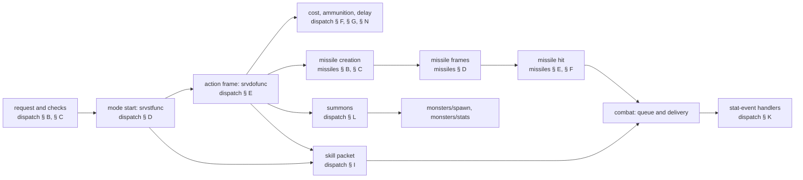

# Skills and missiles: the machinery

## Purpose

A skill use is a chain of server events: a request, its checks, a mode start that runs the skill's start function,
an action frame that runs its do function and creates its missile, the missile's frames, hits and end, the
stat-event handlers its hits fire, and the units it summons. This subsystem specifies that machinery, the third
simulation phase of [ADR-0014](../../adrs/0014-scope-game-simulation.md), part 1 under
[ADR-0020](../../adrs/0020-skills-phase-in-two-plans.md) ([plan 0045](../../plans/0045-skills-missiles-machinery.md)):
the dispatch tables, every check and its order, the costs and their rounding, the skill packet, progressive charges,
the handler table, summons, and the missile's life, with every draw named by its seed. What each numbered start, do,
progressive, missile do, hit and damage function does is the catalogue of plan 0046; here the tier-A rows are
specified and the rest are value oracles. Unit stats are inputs ([stats/aggregate](../stats/aggregate.md)); the combat
chain a skill hit enters is [combat](../combat/README.md).

## Files

| File | Covers | Status |
|---|---|---|
| [dispatch.md](dispatch.md) | the request, the checks, the start and do functions, costs, delay, periodic and aura skills, item skills and casts, the skill packet, progressive charges, the stat-event handlers, summons, monster skill use, ammunition and wear, the tier-A start and do functions | draft |
| [missiles.md](missiles.md) | creation, the damage block, the missile's seed, the frame pass and the do function, motion, collision, the hit and its packet, the function tables, the tier-A missile functions, the re-seed sites, the end of life | draft |

Names are ours ([skills/0001](../../findings/skills/0001-dispatch.md), [skills/0002](../../findings/skills/0002-missiles.md),
[skills/0003](../../findings/skills/0003-handlers.md), `re/types/skills.h`). Primitives (`Step`, `Range`, `RangeB`,
`RangePow2`, `Init`) are [rng](../rng/README.md)'s; a calc is [data/calc](../data/calc.md)'s. Divisions are signed and
truncate toward zero unless stated; life, mana and damage are in 1/256 points.

## Entry points

| When | Function | Tag |
|---|---|---|
| A player asks to use a skill | fn:PLRMSG_SkillAtXY@0x00549AD0, fn:PLRMSG_SkillAtUnit@0x00549BA0 | [I] |
| A skill mode starts | fn:SKILLS_SrvStart@0x0056F640 | [C] for the caster's seed (run:2026-10-25-skills: 1 142 start events) |
| A skill mode reaches its action frame | fn:SKILLS_SrvDo@0x0056F7F0 | [C] for the caster's seed (run:2026-10-25-skills: 1 269 do events) |
| A missile is created | fn:sub_0059FA30_MissileCreate@0x0059FA30 | [C] (run:2026-10-25-skills: 31 391) |
| A missile steps | fn:sub_005ADBB0_MissileDoFrame@0x005ADBB0 | [C] (run:2026-10-25-skills: 13 335 frames) |
| A missile hits or ends | fn:MISSILE_HitUnit@0x005ADF10 | [I] |
| A stat event fires | fn:UNIT_DispatchEvent@0x005C0C30 | [I] |
| A skill summons a monster | fn:sub_0056D940_SpawnOwnedMonster@0x0056D940 | [I] |

## Inputs

### Tables

| Anchor | Used for |
|---|---|
| tbl:Skills.txt:srvstfunc, `srvdofunc`, `srvprgfunc1`, `srvmissile` | the dispatch ([dispatch](dispatch.md)) |
| tbl:Missiles.txt:pSrvDoFunc, `pSrvHitFunc`, `pSrvDmgFunc` | the missile tables ([missiles](missiles.md)) |
| tbl:PetType.txt:group | the pet limit |
| tbl:ItemStatCost.txt:itemeventfunc1 | the handler registrations |

### Runtime state

| State | Type | Source |
|---|---|---|
| unit seeds | `Unit+0x20` of the caster, the target, each missile, each summon | [rng/seeds](../rng/seeds.md) |
| game seed | `game+0xD0`: every missile and summon creation steps it | fn:sub_00555230_SUnitCreate@0x00555230 |
| the action-done bit | `Unit+0xC4` bit 6 | [dispatch § E](dispatch.md#e-the-do-frame-and-skills_srvdo) |

### The ADR-0014 boundary

| Input | Kind | Tag |
|---|---|---|
| the frame on which a mode's do function runs (event code 1 or 2, `Unit+0x4E`) | a logged input until animation timing ([plan 0050](../../plans/0050-animation-frame-timing.md)) | [I] (fn:sub_00580460_PlrModeSkillFrame@0x00580460) |
| a monster's choice of skill, mode and target | an input until monster AI (plan 0052) | [I] (fn:sub_005DEAD0_MonAiUseSkill@0x005DEAD0) |
| the numbered functions outside tier A | value oracles, taking the logged exit seeds ([plan 0046](../../plans/0046-skills-function-catalogue.md)) | [I] (data:g_SkillDoFuncs@0x007322B0) |
| the path planner's points and a step's cell list | value oracles | [I] (fn:sub_00649970_PathPlan@0x00649970) |
| the unit order of the area helpers, the pet chosen for removal | logged values | [I] (fn:SKILLS_ForUnitsInRange@0x0056B7E0) |
| a unit's final stats | [stats/aggregate](../stats/aggregate.md) | [I] (fn:SKILLS_EvalCalc@0x00646CA0) |

## Algorithm

### A. The event kinds and their seeds

| Event | Spec | Seeds drawn | Tag |
|---|---|---|---|
| request | [dispatch § B, § C](dispatch.md#b-the-request) | none | [I] (fn:SKILLS_CanUse@0x00647960) |
| start | [dispatch § D](dispatch.md#d-the-mode-start) | the start function's: a start-built hit's to-hit and build on the caster, defence on the target | [C] the machinery adds none (run:2026-10-25-skills) |
| do | [dispatch § E](dispatch.md#e-the-do-frame-and-skills_srvdo) | the do function's, the delivery's, the missile creations' | [C] the machinery adds none (run:2026-10-25-skills) |
| cost and delay | [dispatch § F, § G](dispatch.md#f-costs) | none | [C] (run:2026-10-25-skills) |
| finisher | [dispatch § J](dispatch.md#j-progressive-charges-and-the-finisher) | the entries' on the attacker, area units, local seeds | [I] (fn:COMBAT_PrgFinisher@0x005D5220) |
| handler | [dispatch § K](dispatch.md#k-stat-event-handlers) | the handler's unit | [I] (data:g_StatEventFuncs@0x007325B0) |
| summon | [dispatch § L](dispatch.md#l-summons) | game (the spawn); Raise Skeleton one step of the caster | [C] for the step at class 363, level 20 (run:2026-10-25-skills) |
| missile create | [missiles § B, § C](missiles.md#b-creation) | game (one step); owner (critical chain); a local pierce seed; a re-seeding callback | [C] (run:2026-10-25-skills) |
| missile frame | [missiles § D](missiles.md#d-each-frame) | the do function's, on the missile | [C] for do 1 (run:2026-10-25-skills) |
| missile hit | [missiles § E, § F](missiles.md#e-the-hit) | owner (to-hit); missile (build, knockback, damage function); defender | [C] for the to-hit and the build (run:2026-10-25-skills) |

### B. Chaining (ADR-0014)

- B1. **The game seed chains across the creations of one do event**: 21 860 pairs. [C] (fn:sub_00555230_SUnitCreate@0x00555230,
  run:2026-10-25-skills)
- B2. **The caster's seed chains across its skill events** in 3 155 of 3 459 consecutive pairs; the other 304 lie a
  few steps further on the same stream, drawn between the events by something the run did not model (to-hit rolls of
  the caster's own, its defence rolls, a monster's AI among the candidates:
  [dispatch § P](dispatch.md#p-draws-and-seeds-per-event-kind)). [C] (fn:SKILLS_SrvDo@0x0056F7F0, run:2026-10-25-skills)
- B3. **A missile's seed is private** to the missile, except where a re-seed site sets it from the creator's value
  ([missiles § H](missiles.md#h-re-seed-sites)); its draws chain across the hits of one frame (110 checks). [C]
  (fn:sub_005ADBB0_MissileDoFrame@0x005ADBB0, run:2026-10-25-skills)
- B4. The finisher and the stat-event handlers had no checked chained pairs (their fires were oracles in
  run:2026-10-25-skills); their draw orders are the reading. [I] (fn:COMBAT_PrgFinisher@0x005D5220,
  data:g_StatEventFuncs@0x007325B0)

### C. Branches

| Branch | Where | What changes | Tag |
|---|---|---|---|
| player against monster | costs, ammunition, delay, the request checks | players only; a monster reaches the start and do through its AI with bit 6 set | [C] for the payment (run:2026-10-25-skills); [I] otherwise (fn:SKILLS_SetDelayState@0x0056EF90) |
| player against monster | missile to-hit | `SkillMissileCreate` passes a to-hit only for a monster owner | [I] (fn:sub_0056ECB0_SkillMissileCreate@0x0056ECB0) |
| player against monster | town | a player's missile ends when the player is in town; a monster's only with `SrcTown` | [I] (fn:sub_005ADBB0_MissileDoFrame@0x005ADBB0) |
| difficulty | Static Field, curse lengths, summon MonLvl stats | the difficulty record's `+0x40`, `+0x1C`; MonLvl by difficulty | [I] (fn:sub_005C9800_SorSkillStaticMin@0x005C9800, fn:sub_005C49E0_SummonSetLevel@0x005C49E0) |
| difficulty, expansion, player count | the request, checks, start, do, costs, creation, frame and hit as read | none of their own; a monster skill hit's terms are `MonAttackStats`' | [I] (fn:SKILLS_SrvDo@0x0056F7F0, fn:sub_0064B860_MissileDamageBlock@0x0064B860) |
| two clients | party auras, player against player | not run | [I] (fn:AURA_ApplyToTarget@0x005CEDC0) |

## Outputs

Queued combat hits and missile packets for [combat](../combat/README.md), timed states for
[stats/states](../stats/states.md), summoned monsters for [monsters/spawn](../monsters/spawn.md) and
[monsters/stats](../monsters/stats.md), `0x40` cell marks for [drlg/collision](../drlg/collision.md), ammunition and
durability changes for [items/economy](../items/economy.md). [I] (fn:SKILLS_SrvDo@0x0056F7F0, fn:MISSILE_HitUnit@0x005ADF10)

## Worked example

The worked examples are in the files: a Raise Skeleton cast ([dispatch § Worked example](dispatch.md#worked-example))
and Firestorm's sub-missile seeds ([missiles § Worked example](missiles.md#worked-example)), both from
run:2026-10-25-skills. [C] (run:2026-10-25-skills, fn:sub_005C49E0_SummonSetLevel@0x005C49E0)

## Reimplementation notes

- **Run the frame pass in order**: missiles, players, monsters, objects, the fifth list. [I]
  (fn:sub_005414D0_GameRunUnitEvents@0x005414D0)
- **Do not merge the two critical chains.** The missile's (stat 337 first, drawn at 0) is not the melee build's. [I]
  (fn:sub_0064A850_MissileCritRoll@0x0064A850, fn:COMBAT_BuildDamage@0x0057B7D0)
- **Keep the request counter**: stat 328 seeds every pierce count. [I] (0x00549D50)

## Evidence

- Findings: [skills/0001](../../findings/skills/0001-dispatch.md), [skills/0002](../../findings/skills/0002-missiles.md),
  [skills/0003](../../findings/skills/0003-handlers.md), the plan 0046 boundary reproductions
  [skills/0004](../../findings/skills/0004-missile-do-1-18.md)–[0016](../../findings/skills/0016-monster-8a.md), and
  [skills/experiments](../../findings/skills/experiments.md#run2026-10-25-skills).
- Tables: [Skills](../../tables/Skills.md), [Missiles](../../tables/Missiles.md), [PetType](../../tables/PetType.md).
- Plan: [0045](../../plans/0045-skills-missiles-machinery.md) (Phase 2 part 1 accepted 2026-10-27; part 2 open).

## Open questions

- [L] **Plan 0045 Phase 2 part 2** owes the request refusals, the handler fires and state 52, `MonAttackStats`, the
  summoned unit's seed and stats, the end of a missile at a hit and pierce uses, the re-seed sites other than
  `0x005C9290`, cases C2 and C4, the short tier-A rows and the caster resyncs' attribution; the statements they
  concern stay at their present tags until its review ([dispatch](dispatch.md#open-questions),
  [missiles](missiles.md#open-questions)).
- [L] The catalogue of the numbered functions outside tier A ([plan 0046](../../plans/0046-skills-function-catalogue.md)).
- [L] Client-only skills and missiles (`cltmissile*`, the description tables) are presentation and out of scope.
