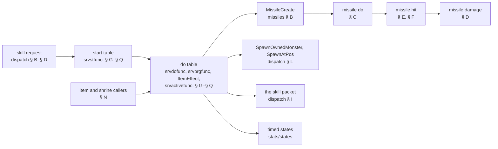
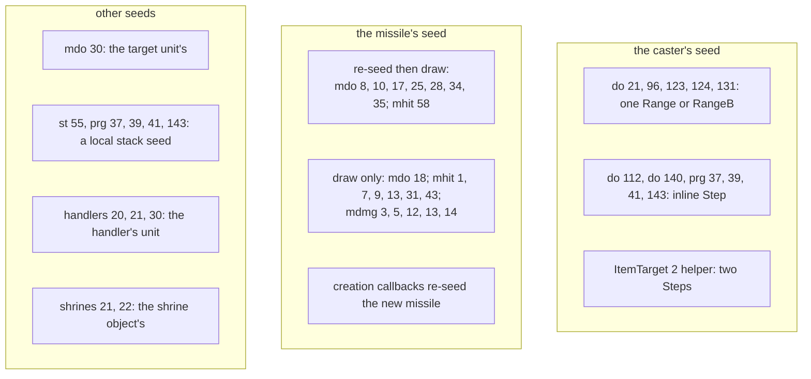
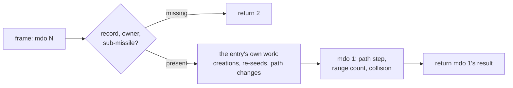
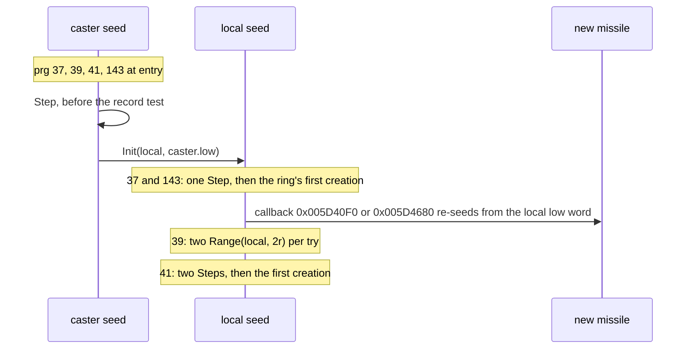
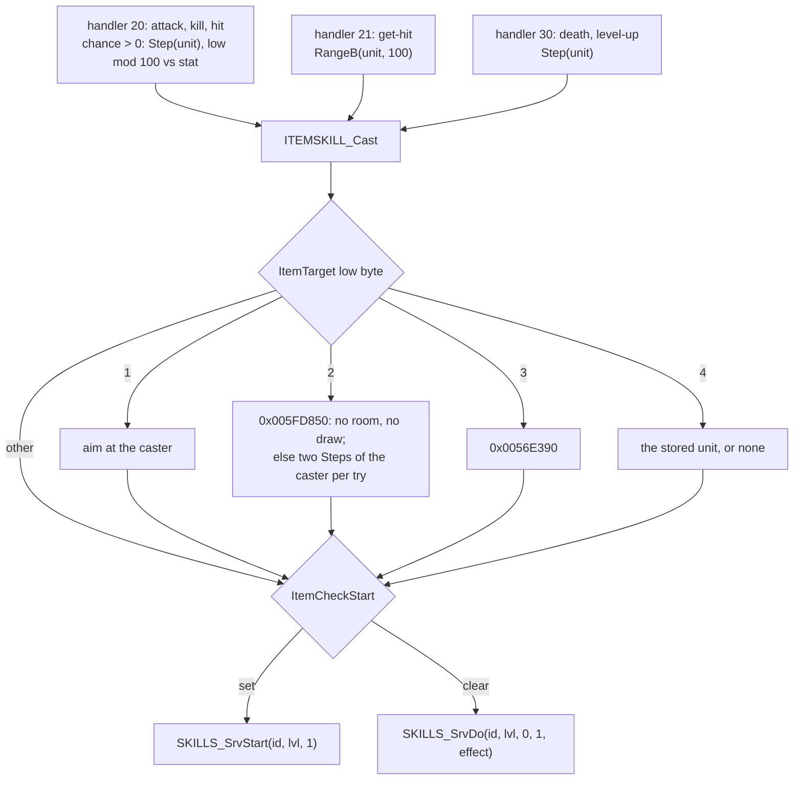
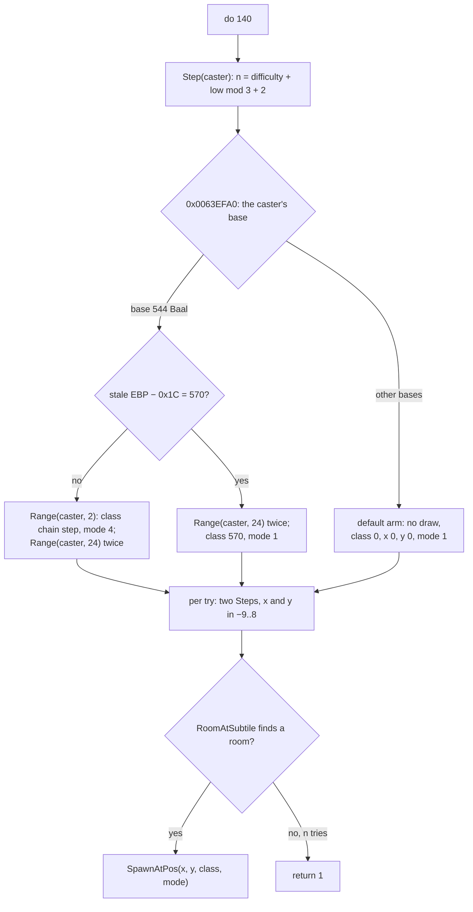

# The function catalogue: every numbered skill and missile function

## Purpose

A Skills row names its start function (`srvstfunc`), its do function (`srvdofunc`, or `srvprgfunc1..3` for a
progressive row, `ItemEffect` for an item cast, States `srvactivefunc` for a periodic state), and a Missiles row its
server do, hit and damage functions. The machinery that calls them, and the 40 tier-A entries, are
[skills/dispatch](dispatch.md) and [skills/missiles](missiles.md). This spec gives every other entry a stock row uses:
what it tests, what it writes, which missiles, units, states and packets it makes, and **every draw it makes, in
order, with its seed**. It is the catalogue of [plan 0046](../../plans/done/0046-skills-function-catalogue.md): 310 entries,
304 read by its batches ([skills/0004](../../findings/skills/0004-missile-do-1-18.md)–[0018](../../findings/skills/0018-monster-8c.md))
and the six `general` tier-A entries by plan 0045, which § A links and does not restate.



## Entry points

| When | Function | Tag |
|---|---|---|
| A skill mode starts | `g_SkillStartFuncs[srvstfunc]` from fn:SKILLS_SrvStart@0x0056F640 ([dispatch § D](dispatch.md#d-the-mode-start)) | [C] (data:g_SkillStartFuncs@0x00732140, static scan of every batch) |
| A skill's action frame | `g_SkillDoFuncs[n]` from fn:SKILLS_SrvDo@0x0056F7F0 ([dispatch § E](dispatch.md#e-the-do-frame-and-skills_srvdo)) | [C] (data:g_SkillDoFuncs@0x007322B0, static scan of every batch) |
| A missile's frame | `g_MissileSrvDoFuncs[pSrvDoFunc]` ([missiles § D](missiles.md#d-each-frame)) | [I] (data:g_MissileSrvDoFuncs@0x0073C768) |
| A missile hits a unit, or ends | `g_MissileSrvHitFuncs[pSrvHitFunc]` ([missiles § E](missiles.md#e-the-hit)) | [C] (data:g_MissileSrvHitFuncs@0x0073C840, the 9d table scan) |
| A missile's damage packet is built | `g_MissileSrvDmgFuncs[pSrvDmgFunc]` ([missiles § F](missiles.md#f-the-packet-at-the-hit-missile_builddamage)) | [I] (data:g_MissileSrvDmgFuncs@0x0073C960) |
| An item stat, a charge or a shrine casts | the callers of § N | [C] up to their boundaries (run:2026-10-21-cat-emu-item) |

## Inputs

### Tables

| Anchor | Used for |
|---|---|
| tbl:Skills.txt:srvstfunc, tbl:Skills.txt:srvdofunc | the entry numbers; the rows per number are [Skills § Function index](../../tables/Skills.md#function-index-plan-0046-phase-0) |
| tbl:Skills.txt:srvmissilea, tbl:Skills.txt:summon, tbl:Skills.txt:pettype | the missile, the summoned class and the pet type each entry passes on |
| tbl:Skills.txt:aurastate, tbl:Skills.txt:auratargetstate, tbl:Skills.txt:auralencalc, tbl:Skills.txt:aurarangecalc | the states, lengths and radii |
| tbl:Skills.txt:calc1, tbl:Skills.txt:Param1 | the calcs (`calc1..4`) and `Param1..8` an entry reads |
| tbl:Missiles.txt:pSrvDoFunc, tbl:Missiles.txt:pSrvHitFunc, tbl:Missiles.txt:pSrvDmgFunc | the missile entry numbers; rows per number in [Missiles § Function index](../../tables/Missiles.md#function-index-plan-0046-phase-0) |
| tbl:Missiles.txt:Param1, tbl:Missiles.txt:SubMissile1, tbl:Missiles.txt:HitSubMissile1 | a missile entry's parameters and sub-missiles |
| tbl:MonStats.txt:BaseId, tbl:MonStats.txt:spawn | the bases monster entries test; the class a spawner entry makes |

### Runtime state

| State | Type | Source |
|---|---|---|
| the caster's seed | Seed (unit `+0x20`) | [rng/seeds](../rng/seeds.md); most entries never touch it (§ B) |
| a missile's seed | Seed (missile `+0x20`) | [missiles § B](missiles.md#b-creation), re-seeded by the sites of § B |
| the used skill node | unit skill record; `+0x18`–`+0x24` words an entry keeps between start and do | [dispatch § D](dispatch.md#d-the-mode-start) |
| the action-done bit | `Unit+0xC4` bit 6 | [dispatch § Runtime state](dispatch.md#runtime-state) |
| `MissileData +0x28`, `+0x2C` | two s32 words a missile entry keeps | [missiles § B](missiles.md#b-creation) |

### Constants

| Name | Value | Anchor | Tag |
|---|---|---|---|
| start table | `g_SkillStartFuncs`; stock Skills names 64 distinct `srvstfunc` numbers | data:g_SkillStartFuncs@0x00732140, [Skills § Function index](../../tables/Skills.md#function-index-plan-0046-phase-0) | [C] (the batches' slot reads, `static.txt`) |
| do table | `g_SkillDoFuncs`; 138 distinct `srvdofunc` numbers, plus the progressive, `ItemEffect` and `srvactivefunc` entries | data:g_SkillDoFuncs@0x007322B0, [Skills § Function index](../../tables/Skills.md#function-index-plan-0046-phase-0) | [C] (the batches' slot reads, `static.txt`) |
| missile hit table | 71 slots; 24 filled in 31–59, 30, 34, 41, 42, 46, 49 and 60–70 null | data:g_MissileSrvHitFuncs@0x0073C840 | [C] (run:2026-10-20-cat-emu-9d) |
| `g_Circle64X`, `g_Circle64Y` | 64 s32 each: points on a radius-30 circle | 0x006E2B78, 0x006E2A78 | [I] (0x006E2B78) |

## Algorithm

### A. How an entry is written

Names: `st N` is start entry N, `do N` skill do entry N (a progressive `srvprgfunc`, an `ItemEffect` and a States
`srvactivefunc` are entries of the same table), `mdo N`, `mhit N` and `mdmg N` the missile do, hit and damage entries.
`Step(s)`, `Range(s, n)`, `RangeB(s, n)` and `Init(s, v)` are [rng](../rng/README.md)'s; `Init`'s high word is
`0x29A` (666). `caster` is the unit an entry runs for, `m` the missile, `lvl` the skill level, `calcN` the row's
`calcN` evaluated at `lvl` ([data/calc](../data/calc.md)). Divisions are signed and truncate toward zero unless stated;
life and mana are in 1/256 points.

- A1. **Shapes.** Every skill start and do entry read by the class, item and monster batches is
  `(ECX game, EDX unit; skill id, level)` with `ret 8`.
  [C] (data:g_SkillStartFuncs@0x00732140, data:g_SkillDoFuncs@0x007322B0, `static.txt` of
  [skills/0008](../../findings/skills/0008-sorceress.md#answer-summary)–[0018](../../findings/skills/0018-monster-8c.md#answer-summary))
  A missile hit entry is `(ECX game, EDX m; unit)` with `ret 4` and returns the result word of
  [missiles § E](missiles.md#e-the-hit) (bit 0 end, bit 1 damage, bit 2 keep and return at once); a damage entry is
  `(ECX game, EDX m; unit, packet)` with `ret 8` and changes only the packet, the missile's seed and (mdmg 8) the
  unit's overlay. [I] (data:g_MissileSrvHitFuncs@0x0073C840, data:g_MissileSrvDmgFuncs@0x0073C960,
  [skills/0005](../../findings/skills/0005-missile-do-19-36-damage.md#answer-summary),
  [skills/0006](../../findings/skills/0006-missile-hit-1-29.md#answer-summary))
- A2. **How far a `[C]` reaches.** Each entry was run under the emulator on its own code (ADR-0015) with synthetic and
  stock inputs and negative controls. An entry that returns is `[C]` as a whole map from the bytes it reads. An entry
  that ends at a callee is `[C]` **up to that call** (an observed boundary, ADR-0021): its tests, the call's arguments,
  the bytes it wrote before the call and the seeds, nothing after it. The pseudocode marks the boundary with `→` and
  writes what follows under `after:` with its own tag. [C] (run:2026-10-20-cat-emu-9a, run:2026-10-21-cat-emu-8c,
  [skills/0004 § 2](../../findings/skills/0004-missile-do-1-18.md#answer-summary))
- A3. **"No draw" means before the boundary.** Each batch compared the caster's and the target's seed (and the
  missile's, for the missile batches) in every case; an entry with no draw line in § B steps no seed before its
  boundary or return. The cases' calcs are constant programs that call no calc function, so a calc's own draws are
  not covered. [C] (run:2026-10-20-cat-emu-sor, run:2026-10-21-cat-emu-dru, run:2026-10-21-cat-emu-ass)
- A4. **Callees are not restated.** `MissileCreate`, `SkillMissileCreate`, `NovaAtUnit` ([missiles § B](missiles.md#b-creation)),
  `SpawnOwnedMonster` and `SkillSummonClass` ([dispatch § L](dispatch.md#l-summons)), `STATE_ApplyTimed` and the aura
  pass ([stats/states](../stats/states.md)), `COMBAT_MeleeHitTest`, `COMBAT_DeliverQueued`, `SkillRollPhys`,
  `SKILLS_RollElemDamage` ([dispatch § I](dispatch.md#i-the-skill-packet), [combat/delivery](../combat/delivery.md)) and
  `COMBAT_PrgFinisher` ([dispatch § J](dispatch.md#j-progressive-charges-and-the-finisher)) are those specs'. Their
  draws are theirs. [I] (fn:sub_0056D940_SpawnOwnedMonster@0x0056D940, [skills/0002](../../findings/skills/0002-missiles.md))
- A5. **The six `general` tier-A entries** (st 1, 2, 65; do 1, 3, 5) and the other tier-A entries are
  [dispatch § O](dispatch.md#o-tier-a-the-start-and-do-functions) and [missiles § G](missiles.md#g-the-function-tables);
  this spec names them in their batch and links there. [I] (fn:SKILL_AttackDo@0x0056F070, [plan 0046](../../plans/done/0046-skills-function-catalogue.md),
  `lane/p46m15` review, ruling 2; [skills/0003 § 5](../../findings/skills/0003-handlers.md#5-tier-a-start-and-do-functions))

### B. Every draw, by seed

The index a reimplementer needs first: each entry that steps a seed, in its own order. Everything else in §§ C–Q
draws nothing before its boundary (A3).



| Entry | Seed | Draws, in order | Tag |
|---|---|---|---|
| mdo 8, 10, 17, 25 (`0x005A9820`) | the missile | `Init(m, SubX + elapsed)`; then `RangeB(m, 2(r − 1))` for x and for y, none when `r ≤ 1` | [C] up to `COLL_CellTestAt` (run:2026-10-20-cat-emu-9a, run:2026-10-20-cat-emu-9b) |
| mdo 18 | the missile | per gold drop: `RangeB(m, 2·Param3 + 1)` twice, no re-seed | [C] up to the free spot `0x00555DA0` (run:2026-10-20-cat-emu-9a) |
| mdo 28 | the missile | `Init(m, MissileData+0x28)`; `Range(m, 2r + 1)` twice; `+0x28 ← m.low` | [C] up to `MissileCreate` (run:2026-10-20-cat-emu-9b) |
| mdo 34 | the missile | each frame from `Param1` on: `Init(m, SubX)`, one `Step(m)` to pick the sub-missile | [C] up to its boundary (run:2026-10-20-cat-emu-9b) |
| mdo 35 | the missile | `Init(m, MissileData+0x28)`; one `Step(m)` for the turn's sign | [C] up to its boundary (run:2026-10-20-cat-emu-9b) |
| mdo 30 | **the target unit** (named by `+0x28/+0x2C`) | `Range(t, 2·Param2 + 1)` twice | [C] on the path-less cases (run:2026-10-20-cat-emu-9b) |
| mhit 1, 9, 13, 31 (`0x005A8C70`) | the missile | one `RangeB(m, …)` per element roll of `EType` whose two stats are ≥ 1 | [C] (run:2026-10-20-cat-emu-9c, run:2026-10-20-cat-emu-9d) |
| mhit 7 | the missile | `RangeB(m, (calc2 << 8) − (calc1 << 8))`; when `(calc1 << 8)` plus it is ≤ 0, the heal is replaced by a roll through `0x005A8910` (stats 22/21) | [C] (run:2026-10-20-cat-emu-9c) |
| mhit 43 | the missile | `RangeB(m, PhysMax − PhysMin)` | [C] (run:2026-10-20-cat-emu-9d) |
| mhit 58 | the missile | `Init(m, x)`; `Range(m, 2r + 1)` for x, then for y | [C] up to its creation (run:2026-10-20-cat-emu-9d) |
| mdmg 3 | the missile | one `Step(m)` | [C] (run:2026-10-20-cat-emu-9b) |
| mdmg 5, 12, 13 | the missile | one `RangeB(m, …)` per element roll whose two stats are ≥ 1 | [C] (run:2026-10-20-cat-emu-9b) |
| mdmg 14 | the missile | `Range(m, 100)` when the chance is above 0 | [C] (run:2026-10-20-cat-emu-9b) |
| do 21 | the caster | `Range(caster, 100)` after the hostility and town tests | [C] (run:2026-10-20-cat-emu-sor) |
| do 96 | the caster | `RangeB(caster, hi − lo)`, none when `hi = lo` | [C] (run:2026-10-21-cat-emu-8a) |
| do 112 | the caster | one `Step(caster)` **before any test** | [C] (run:2026-10-21-cat-emu-8b) |
| do 123 | the caster | `Range(caster, 0x100)` after the cell test | [C] (run:2026-10-21-cat-emu-dru) |
| do 124 | the caster | `Range(caster, 0x10000)` after the used-skill tests | [C] (run:2026-10-21-cat-emu-dru) |
| do 131 | the caster | `Range(caster, 100)`, only for a live monster target of base 453 | [C] (run:2026-10-21-cat-emu-8c) |
| do 140 | the caster | one `Step` (the try count); Baal's arm of `0x0063EFA0`: two or three `Range` (§ Q); two `Step` per try | [C] for the count and the tries (run:2026-10-21-cat-emu-8c); [I] the arm (0x0063F473) |
| prg 37, 143 | the caster, then a local seed | `Step(caster)` at entry, **before the record test**; `Init(local, caster.low)`; one `Step(local)` before the first creation | [C] (run:2026-10-21-cat-emu-ass) |
| prg 39 | the caster, then a local seed | `Step(caster)` at entry; `Init(local, caster.low)`; `Range(local, 2r)` twice per try | [C] (run:2026-10-21-cat-emu-ass) |
| prg 41 | the caster, then a local seed | `Step(caster)` at entry; `Init(local, caster.low)`; two `Step(local)` before the first creation | [C] (run:2026-10-21-cat-emu-ass) |
| st 55 | a local seed from the target's and the caster's guids | `RangeB(local, calc2 − calc1)` | [C] (run:2026-10-21-cat-emu-8b) |
| handler 20 | the handler's unit | one `Step(unit)` (a unit, chance > 0, and no packet or packet `+0x00` bit 5) | [C] (run:2026-10-21-cat-emu-item, run:2026-10-30-skills-catalogue) |
| handler 21 | the handler's unit | `RangeB(unit, 100)` (a unit, chance > 0, packet `+0x04` bit 2) | [C] (run:2026-10-21-cat-emu-item) |
| handler 30 | the handler's unit | one `Step(unit)` for a unit with chance > 0, whatever the packet | [C] (run:2026-10-21-cat-emu-item) |
| `ItemTarget` 2 helper `0x005FD850` | the cast's caster | none without a room; else two `Step(caster)` before each collision test | [C] (run:2026-10-21-cat-emu-item) |
| shrines 21, 22 | the shrine object | `RangeB(shrine, Arg1 − Arg0)`, none for a range ≤ 0 | [C] (run:2026-10-21-cat-emu-item) |

- B1. **Creation callbacks re-seed the new missile.** The callback in the parameter block's `+0x54` runs inside
  `MissileCreate` ([missiles § H](missiles.md#h-re-seed-sites)): `0x005C9290` (do 17, do 118, do 130) and
  `0x005AC040` (mhit 38; mhit 45 when `sHitPar2 ≠ 0`) are measured there, `[C]`; `0x005CD110` (do 102),
  `0x005D40F0` (prg 37) and `0x005D4680` (prg 143) are read, `[I]`. [I] (0x005CD110, 0x005D40F0, 0x005D4680)
- B2. **Draws after a boundary, from the reading.** These lie past the point the emulator stopped and are the
  reading's order: st 10's elemental `RangeB(caster, max − min)` after its hit test; do 55's and do 58's one
  `RangeB` on **the target's** seed; do 66's one `SKILLS_RollElemDamage` per aura run (the caster's seed); do 81's
  20 % roll per unit by a `Step` of **the unit's** seed; do 82's `Range(caster, 100)` per unit `0x006456D0` accepts;
  st 35's weapon roll by a `Step(caster)` (`0x005CFD20`); do 79's `Range(caster, 100)` against calc1 (`0x005D02B0`);
  st 32's and st 39's elemental rolls (the caster's); do 69's `Range(caster, 100) < calc1` then the potion pick's
  `Step(caster)` (`0x005D8100`); do 72's two `Range(caster, 100)`; entry 145's `SkillRollPhys` and
  `SKILLS_RollElemDamage`; entry 146's re-seed of the caster ([rng/seeds](../rng/seeds.md#reimplementation-notes));
  do 33's knock roll by a `Step(caster)`, `low mod 100` against a calc by the target's kind; do 42's
  `Range(caster, 100)` at the last charge; do 107's three `RangeB(caster, max − min)`. [I] (0x005CFD20, 0x005D02B0,
  0x005D8100, 0x005D31BF–0x005D32E8, 0x005D5A91–0x005D5BE9, 0x005CDAAB–0x005CDBFF)

### C. Missile do entries (mdo 1–36)

Batches 9a and 9b ([skills/0004](../../findings/skills/0004-missile-do-1-18.md#answer-summary),
[skills/0005](../../findings/skills/0005-missile-do-19-36-damage.md#answer-summary)). An entry returns 1 to keep the
missile and 2 to free it.



- C0. **The shared tail.** Entry 1 of the table is a 5-byte `jmp 0x005AE1F0`, so mdo 1 is
  `sub_005AE1F0_MissileMoveCollide` ([missiles § D](missiles.md#d-each-frame)). Every entry of 9a ends in mdo 1 and
  returns its result (mdo 18 after its cookie check); in 9b, mdo 20 and 30 return 1 after mdo 1, mdo 32 ends in
  mdo 7 and mdo 34 in mdo 3; a missing record, owner or sub-missile returns 2. [I] (fn:sub_005B0BC0_MissDo01Thunk@0x005B0BC0,
  data:g_MissileSrvDoFuncs@0x0073C768) mdo 1, 3, 5 and 23 are tier A: [missiles § G](missiles.md#g-the-function-tables). [I] (0x005AE1F0)

```
C1. mdo 2 (0x005AE400, poisonjav):                                     [C] → MissileCreate (run:2026-10-20-cat-emu-9a)
      on a frame with path +0x34 bit 3 (flag 8): MissSubAtSelf (0x005A9720):
        SubMissile1 at the parent's position, velocity 0, source the parent,
        loops 2·lvl − 2, creation flag 8 only when SrvCalc1 > 0
      else: mdo 1
C2. mdo 6, 9, 12 (0x005AE680, 0x005AE940, 0x005AECA0):                 [C] → MissileCreate, or mdo 1 (run:2026-10-20-cat-emu-9a)
      on each flag-8 frame: SubMissile1 at the missile's own sub-tile, with its skill and level
      mdo 6, 12: need an owner and SubMissile1 ≥ 0, else return 2 (mdo 6 also with no path; mdo 12 reads a null
        path as flag 0); mdo 9 tests neither
      after: mdo 1                                                       [I] (0x005AE680)
C3. mdo 7 (0x005AE780, Guided Arrow, Bone Spirit):                     [C] the gates → mdo 1 (run:2026-10-20-cat-emu-9a)
      no record, no owner, an owner UnitIsDead calls dead, or a missile in a town room: return 2
      with MissileData+0x28 bit 0 clear, or a missile target: mdo 1
      with bit 0 set and a live hostile target: re-plan the path to it   [I] (0x005AE780)
      bit 0 is written by do 10 when cast at a unit                      [I] (fn:sub_005DB6D0_SkillDo10GuidedMissile@0x005DB6D0)
C4. mdo 8, 10, 17 (scatter around the missile):                        [C] → COLL_CellTestAt (run:2026-10-20-cat-emu-9a)
      mdo 8:  r ← Param1 + max(lvl ÷ P3, 2); period ← max(Param2 − lvl ÷ P3, 3); P3 = max(Param3, 1)
      mdo 10: r ← calc1; period ← calc2 (Blizzard's)
      mdo 17: r ← Param3; period ← Param2; only while Param1 < left < Range − Param1
      once per period: 0x005A9820 (§ B): Init(m, SubX + elapsed), dx ← RangeB(m, 2(r − 1)), dy ← RangeB(m, 2(r − 1)),
        each offset in [−(r − 1), r − 1); COLL_CellTestAt(room, x, y, 5)
      after: refused on a non-zero result, else SubMissile1 at the point; mdo 1   [I] (0x005A9820)
      mdo 17, when left ≤ Param5 + Param1 and +0x28 = 0: PermPortalAtUnit to level Param4 (38, Tristram)
                                                                         [C] → the portal call (run:2026-10-20-cat-emu-9a)
C5. mdo 11 (0x005AEB60, fingermagespider):                             [C] → PathPlan, or mdo 1 (run:2026-10-20-cat-emu-9a)
      every Param1 frames, when the edge distance (0x006416D0) to its or its owner's target is ≤ Param2:
        step the path target max(Param3, 1) sub-tiles towards the target on each axis; PathPlan
C6. mdo 13 (0x005AEDA0, Bone Wall):                                    [I] (fn:sub_005AEDA0_MissileSpawnOwnedMonster@0x005AEDA0)
      on each flag-8 frame while +0x2C (pieces left) ≠ 0: spawn the skill's summon class and pettype at the
        missile, owned by the first wall piece (+0x28, its guid), in that piece's group, mod 15, the summon
        stats, the caster as owner; +0x2C ← +0x2C − 1
C7. mdo 14 (0x005AEF70, grim wards):                                   [C] → CallDoFunc (run:2026-10-20-cat-emu-9a)
      every Param1 frames, with a skill and a level above 0: CallDoFunc(Param2, skill, lvl)
      on the period, with a skill or level ≤ 0: return 2 without mdo 1 (off the period: mdo 1)   ; missiles § G2
C8. mdo 15 (0x005AF030, Frozen Orb):                                   [C] → MissileCreate (run:2026-10-20-cat-emu-9a)
      every Param1 frames (1 on stock data): k ← |w mod 64|, w = MissileData+0x28 (C remainder)
        SubMissile1 (frozenorbbolt) aimed at the orb + (g_Circle64X[k], g_Circle64Y[k])
        +0x28 ← (Param2 + k) mod 64                                      ; stock Param2 19
C9. mdo 16 (0x005AF170, the orb nova):                                 [C] → PathPlan, or mdo 1 (run:2026-10-20-cat-emu-9a)
      on frames with elapsed < Param1 and elapsed mod max(Param2, 1) = 0:
        (a, b) ← (+0x28, +0x2C); path target ← (SubX + (a − b) ÷ 2, SubY + (a + b) ÷ 2)
          (32-bit sums, truncating division, u16 stores); PathPlan
      after: the +0x28/+0x2C stores                                      [I] (0x005AF170)
C10. mdo 18 (0x005AF300, towerchestspawner):                           [C] → UnitSetEvent, the chest drop, the free spot (run:2026-10-20-cat-emu-9a)
      at left = Range − Param1 (raw Range): the drop function 0x00585E00 on the chest whose guid is +0x28;
        +0x2C ← 1 when the chest is gone; after a found chest's drop the store follows the boundary   ; that store [I] (0x005AF300)
      then every 4·Param2 frames (8): two RangeB(m, 2·Param3 + 1) offsets in [−Param3, Param3] (±5);
        the free spot 0x00555DA0
      after: the gold pile at that spot                                  [I] (0x005AF300)
      at left = 1: unit event 0x5C on the chest
C11. mdo 19 (0x005B0940, radament death):                              [C] → the units-in-range call (run:2026-10-20-cat-emu-9b)
      while 2 ≤ left ≤ 24: UnitsInRangeCall(ECX game, EDX 0x3002; SubX, SubY, m, 124, 1, 0x005AD8F0);
        at left = 1 the same with 0x005AD910; then mdo 1
      after: the callbacks are Redemption's corpse callback, 0x005AD8F0 with the chance roll and 0x005AD910
        without it; the roll and the heal                                [I] (0x005B0940, 0x005AD8F0, 0x005AD910)
C12. mdo 20 (0x005AF540, blade creeper):                               [C] → the re-target (run:2026-10-20-cat-emu-9b)
      owner alive, with a path: re-target the path to the owner's position (0x005A99E0);
        without a path: left ← 10, then mdo 1
      else: end itself with an end-of-life hit
      after: on the path case left ← 10 and mdo 1; the return value, 1 after mdo 1 or 2 after the hit   [I] (0x005AF540)
C13. mdo 21 (0x005AF590, distraction):                                 [C] → MissileCreateAt (run:2026-10-20-cat-emu-9b)
      on a flag-8 frame: MissileCreateAt(SubMissile1); then mdo 20
C14. mdo 22 (0x005AF620, lightning trailing javelins):                 [C] → the first MissileCreate (run:2026-10-20-cat-emu-9b)
      while elapsed < 2: (+0x28, +0x2C) ← (−dy, dx), dx, dy from the missile to its path target
      on each flag-8 frame: SubMissile1 (flags 0xB, loops Param1) at the offset (+0x28, +0x2C)
      after: the second creation, at the negated offset                  [I] (0x005AF620)
C15. mdo 25 (0x005AF880):                                              [C] → COLL_CellTestAt (run:2026-10-20-cat-emu-9b)
      mdo 10's scatter (r ← calc1, period ← calc2) through 0x005A9820, with cell mask 0x45 (mdo 10: 5)
C16. mdo 26 (0x005AF980, vines):                                       [C] → MissileCreateAt (run:2026-10-20-cat-emu-9b)
      every Param1 frames: MissileCreateAt(SubMissile1)
C17. mdo 27 (0x005AFA30, tornado):                                     [C] → MISSILE_BuildDamage (run:2026-10-20-cat-emu-9b)
      every Param1 (or calc4) frames: build its damage packet
C18. mdo 28 (0x005AFB80):                                              [C] → MissileCreate (run:2026-10-20-cat-emu-9b)
      no owner: mdo 1
      when Param3 < elapsed < Param4 and elapsed mod (Param1 > 0 ? Param1 : max(calc4, 1)) = 0:
        r ← Param2 > 0 ? Param2 : max(aurarangecalc, 1)
        Init(m, +0x28); dx ← Range(m, 2r + 1) − r; dy ← Range(m, 2r + 1) − r; +0x28 ← m.low
        MissileCreate(flags 0x520, target (SubX + dx, SubY + dy), +0x24 Param5)
C19. mdo 29, 33 (0x005AFD70, 0x005AFEC0, the recycler delays):         [C] → UnitSetStat (run:2026-10-20-cat-emu-9b)
      at elapsed = Param1, when value < max (both in whole points, >> 8): the owner's life (29) or mana (33)
        ← min(value + MulDiv(max, calc1, 100), max), stored << 8
C20. mdo 30 (0x005B0010, rabies plague):                               [C] → the re-target, or MissileCreate (run:2026-10-20-cat-emu-9b)
      re-target and end itself as mdo 20, without resetting left (it ends on left < 0);
      on the path-less cases: two Range(target, 2·Param2 + 1) on the infected unit's seed,
        then SubMissile1 spread from that unit
C21. mdo 31 (0x005B01F0, wake of destruction, baal cold maker):        [C] → the first MissileCreate (run:2026-10-20-cat-emu-9b)
      two SubMissile1 at ±(+0x28, +0x2C); after: the second              [I] (0x005B01F0)
C22. mdo 32 (0x005B03E0, tiger fury):                                  [C] → MissileCreate, or mdo 7 (run:2026-10-20-cat-emu-9b)
      one SubMissile1 per flag-8 frame, then mdo 7
C23. mdo 34 (0x005B04A0):                                              [C] → its boundary (run:2026-10-20-cat-emu-9b)
      each frame from Param1 on: Init(m, SubX); Step(m) picks the sub-missile; ends in mdo 3
C24. mdo 35 (0x005B0640):                                              [C] → its boundary (run:2026-10-20-cat-emu-9b)
      Init(m, +0x28); Step(m) gives the turn's sign
C25. mdo 36 (0x005B0A40, baalfx control):                              [C] → QUESTS_IsActive (run:2026-10-20-cat-emu-9b)
      when +0x28 = 0 and left ≤ 100: +0x28 ← 1; QUESTS_IsActive(quest 36)
      after: the tyrael3 spawn (class 521) and the room pin              [I] (0x005B0A40)
```

- C26. **The sub-missile tests differ.** mdo 21, 22, 23, 25 and 26 test `SubMissile1 ≠ 0`, so a blank (−1) passes;
  the other creating entries test `≥ 0`. [C] (run:2026-10-20-cat-emu-9b)
- C27. mdo 24 is mdo 23's function (`0x005AF790`) and no stock row names it; the unused numbers of 1–36 are in
  [Missiles § Function index](../../tables/Missiles.md#function-index-plan-0046-phase-0). [I] (0x005AF790)

### D. Missile damage entries (mdmg 1–14)

Batch 9b ([skills/0005](../../findings/skills/0005-missile-do-19-36-damage.md#answer-summary)). They run inside
`MISSILE_BuildDamage` ([missiles § F](missiles.md#f-the-packet-at-the-hit-missile_builddamage)). mdmg 3 is tier A and
emulated here too; 6 is unused. Every entry below is reproduced on returning cases, mdmg 8's overlay call up to
its boundary.

```
D1. mdmg 1 (0x005AD050):  v ← min(DmgCalc1, 100) when > 0; v % of the physical damage moves to the
                          missile's EType field                                         [C] (run:2026-10-20-cat-emu-9b)
D2. mdmg 12 (0x005AD0F0): mdmg 1's share, then a fresh roll of the EType element replaces the packet's
                          damage (the fields PacketClearDamage zeroes); one RangeB(m) per roll   [C] (run:2026-10-20-cat-emu-9b)
D3. mdmg 2 (0x005AD1B0):  freeze length ← MulDiv(stat 56, max(dParam1, 0), 100); cold length ← 0   [C] (run:2026-10-20-cat-emu-9b)
D4. mdmg 3 is tier A: missiles § G (one Step(m); low & 0x7F < dParam1 sets result 0x4000)
D5. mdmg 4 (0x005AD290):  freeze ← cold length; cold ← 0                                  [C] (run:2026-10-20-cat-emu-9b)
D6. mdmg 10 (0x005AD2B0): freeze ← cold length                                            [C] (run:2026-10-20-cat-emu-9b)
D7. mdmg 5 (0x005AD2F0):  the EType roll; plus dParam1 % of it against undead, dParam2 % against demons   [C] (run:2026-10-20-cat-emu-9b)
D8. mdmg 13 (0x005AD5C0): against a monster only: the owner's stat 25 percent added to the physical
                          damage; then mdmg 5                                             [C] (run:2026-10-20-cat-emu-9b)
D9. mdmg 7, 9 (0x005AD3E0, 0x005AD4A0): stun length ← dParam1, else Param1 + (lvl − 1)·Param2 (7)
                          or Param2 (9); hit class 0x60                                   [C] (run:2026-10-20-cat-emu-9b)
D10. mdmg 11 (0x005AD530): poison length ← MissileData+0x28 − frame when in [10, ELen(owner)],
                          else poison 0                                                   [C] (run:2026-10-20-cat-emu-9b)
D11. mdmg 14 (0x005AD630): when the chance c (from dParam1, dParam2 and the target's MonStats2 small/large)
                          is above 0: Range(m, 100) < c sets knockback (result |= 0x8, a 16-bit OR at +0x04)   [C] (run:2026-10-20-cat-emu-9b)
D12. mdmg 8 (0x005AD450): with a record, the unit and ProgOverlay > 0 (s16): → 0x00621E40(unit, ProgOverlay, 0);
                          else return without a call                       [C] → 0x00621E40 (run:2026-10-20-cat-emu-9b)
      after: the overlay as stat 178 on the unit's flag-0x80 list         [I] (fn:sub_00621E40_UnitSetOverlayStat@0x00621E40)
```

### E. Missile hit entries 1–29

Batch 9c ([skills/0006](../../findings/skills/0006-missile-hit-1-29.md#answer-summary)): 25 entries (5, 6, 11, 23
are named by no row). mhit 2, 3, 14 and 17 are tier A ([missiles § G](missiles.md#g-the-function-tables)); 3, 14 and
17 are emulated here too. No entry steps the owner's or the target's seed before its boundary (8 400 cases; a
control moving the missile's draws to the owner's seed fails on every case that drew). [C] (run:2026-10-20-cat-emu-9c)

```
E1. mhit 1 (0x005A9A70, fireballs):                                    [C] → AreaHitAt (run:2026-10-20-cat-emu-9c)
      with an owner: radius ← sHitPar1 > 0 ? sHitPar1 : max(calc1, 1)
      the EType roll on the hit unit (§ B); packet +0x00 |= HitFlags; +0x04 |= ResultFlags
      AreaHitAt(owner; x, y, radius, packet, 0); return 1               ; the return [I] (0x005A9A70)
E2. mhit 13 (0x005AA8B0, glacial spike, hell meteor):                  [C] → AreaHitAt (run:2026-10-20-cat-emu-9c)
      radius ← sHitPar1 > 0 ? sHitPar1 : max(aurarangecalc, 1); len ← sHitPar2 > 0 ? sHitPar2 : auralencalc;
      when len > 0 it is the length field of the EType (0x005A8F20: cold 4 +0x30, poison 5 +0x2C,
        9 +0x44, 11 +0x18, freeze 12 +0x34); the EType roll as mhit 1
E3. mhit 24 (0x005A9BF0, pantherpotorange), mhit 44 (fire potions, bomb):   [C] → MISSILE_BuildDamage (run:2026-10-20-cat-emu-9c)
      mhit 24: MISSILE_BuildDamage(owner; m, unit, packet); mhit 44 (0x005A9E10): MISSILE_BuildDamage(owner; m, 0, packet)
      mhit 44: any non-zero sHitPar1, negative included, is the radius; no owner test
      after: the OR's, AreaHitAt, return 1 (24) or 1 or 3 (44); the radius value at the boundary sits in a
        callee-saved register                                           [I] (0x005A9BF0, 0x005A9E10)
E4. mhit 9 (0x005AA250, immolation arrow):                             [C] → UnitSetStat (run:2026-10-20-cat-emu-9c)
      with a record and a Skills row (else 1; no owner test):
      when HitSubMissile1 ≥ 0: UnitSetStat(m, 56, 0, 0) (the boundary)
      else: radius ← sHitPar2 > 0 ? sHitPar2 : max(calc2, 1); the EType roll as mhit 1, the OR's,
        → AreaHitAt(owner; x, y, radius, packet, 0)
      after (≥ 0 path): stat 134 ← 0, the disc 0x005A9530, the area hit, return 3   [I] (0x005AA2FA–0x005AA458)
E5. mhit 7 (0x005A9FB0, holy bolt):                                    [C] (run:2026-10-20-cat-emu-9c)
      the unit is the owner's pet (TargetPet set; a monster whose owner reference is the owner player's guid):
        heal ← (calc1 << 8) + RangeB(m, (calc2 << 8) − (calc1 << 8))
        when heal ≤ 0: heal ← 0x005A8910(m, 22, 21, −1) (stats 22/21; one more draw when both are ≥ 1)
        UnitSetStat(unit, 6, min(stat 6 + heal, max life))             ; the boundary (ADR-0021)
      else: SkillAllyTest (the boundary)
      sHitPar1 = 0, no owner, or a refused ally: return 3 against undead (demons when sHitPar2 = 2;
        any monster or player when sHitPar2 = 0), else 4               ; the refused-ally return [I] (0x005A9FB0)
E6. mhit 8 (0x005AA180, blaze):                                        [C] (run:2026-10-20-cat-emu-9c)
      return 0 for its owner in state 13 (blaze), else 2
E7. mhit 4 (0x005B07A0, exploding and freezing arrows, royal strike meteor):   [C] → the first MissileCreate (run:2026-10-20-cat-emu-9c)
      each of HitSubMissile1..4 (the words at +0x24, stride 2) that is > 0, with {owner, source m, skill, lvl}
E8. mhit 15 (0x005AAD40, spider goo lay): HitSubMissile1 at the missile   [C] → MissileCreate (run:2026-10-20-cat-emu-9c)
E9. mhit 25 (0x005AB820, pantherpotgreen):                             [C] → the first MissileCreate (run:2026-10-20-cat-emu-9c)
      8 directions (0,2) (2,2) (2,0) (2,−2) (0,−2) (−2,−2) (−2,0) (−2,2), in steps of sHitPar1, from the unit
        (or the missile); flags 0x1F; velocity Param1 << 7 of the sub-missile's row; loops lvl − 1
E10. mhit 26 (0x005AB8D0, grim ward start):                            [C] → MissileCreate (run:2026-10-20-cat-emu-9c)
      HitSubMissile1, flags 0x8001, range sHitPar1 > 0 ? sHitPar1 : max(calc1, 5)
E11. mhit 29 (0x005ABB00, frozen orb):                                 [C] → the first MissileCreate (run:2026-10-20-cat-emu-9c)
      frames left ≠ 0: return 2, before the owner test
      at frames left 0: a ring over the 64 circle directions (radius 30) in steps of sHitPar1 (stock 4: 16 bolts)
      after: each bolt's +0x28/+0x2C ← its direction                    [I] (0x005ABB00)
E12. mhit 12 (0x005AA730, chain lightning):                            [C] → the search (run:2026-10-20-cat-emu-9c)
      with MissileData+0x28 > 1: 0x0056BD10(owner; x, y, radius, 0x88583, unit guid, 0), the nearest unit
      after: the next bolt and its count − 1                            [I] (0x005AA730)
E13. mhit 16, 19 (0x005AAE10, 0x005AB110; spider goo, vines; finger mage spider):   [C] → STATLIST_Alloc or SKILLS_ApplyAuraStats (run:2026-10-20-cat-emu-9c)
      auratargetstate on the unit for max(calc4, 5) (16) or max(auralencalc, 5) (19) frames:
        a new timed list ending at frame + length, owned by the owner, or the unit's existing list of that state
E14. mhit 28 (0x005ABA10, grim ward scare):                            [C] → the flee call (run:2026-10-20-cat-emu-9c)
      a monster closer than Param1 + (lvl − 1)·Param2 to the ward found by MissileData+0x28:
        0x005DDD00(ward; unit, skill, Param5, Param6)
      (mhit 17, howl, is the tier-A flee: missiles § G)
E15. mhit 21 (0x005AB500, battle cry):                                 [C] → the unit filter (run:2026-10-20-cat-emu-9c)
      SkillUnitFilter(owner, unit; aurafilter ? 0xA783 : 0); a state index equal to the States count is accepted
E16. mhit 18 (0x005AB0B0, shout, battle orders, battle command):       [C] → UnitsSameParty (run:2026-10-20-cat-emu-9c)
E17. mhit 20 (0x005AB370, lightning fury):                             [C] → SKILLS_ForUnitsInRange (run:2026-10-20-cat-emu-9c)
      ForUnitsInRange(owner; x, y, radius, aurafilter or 0xA783, 0x005AB2A0, ctx, 1, …),
        ctx = {owner, m, skill, lvl, sHitPar2 > 0 ? sHitPar2 : max(calc1, 1), HitSubMissile1}
E18. mhit 22 (0x005ADD20, fist of the heavens delay):                             [C] → MISSILE_BuildDamage (run:2026-10-20-cat-emu-9c)
      the unit MissileData+0x28/+0x2C names; none → return 0; else build its damage
E19. mhit 10 (0x005AA650, guided arrow, bone spirit):                  [C] (run:2026-10-20-cat-emu-9c)
      in town → 1; at the end of life → 1 when +0x28 bit 2 or the cell's collision bit 2 is set
      with a unit (+0x28 bit 0): 3 if it is the path's target, else 4
      with bit 1: 3 or 4 by bit 2 while frames are left; at 0 the re-target 0x005AA5B0 (the boundary)
E20. mhit 27 (0x005ABA00): return 1                                     [C] (run:2026-10-20-cat-emu-9c)
```

### F. Missile hit entries 31–59 and row 568

Batch 9d ([skills/0007](../../findings/skills/0007-missile-hit-31-59.md#answer-summary)): 24 table entries are filled
in 31–59 (31–33, 35–40, 43–45, 47, 48, 50–59; mhit 44 is § E's); mhit 2 and 36 are tier A
([missiles § G](missiles.md#g-the-function-tables)) and emulated here too. No entry steps the owner's or the target's seed
before its boundary (8 400 cases; the owner-seed control fails 140 and 181 cases). [C] (run:2026-10-20-cat-emu-9d)

```
F1. mhit 31 (0x005ABD70, firehead):                                    [C] → UnitSetStat (run:2026-10-20-cat-emu-9d)
      the EType roll on the hit unit (§ B); the owner's life ← min(life + max(roll, 0), max life)
F2. mhit 43 (0x005AC350, healing vortex):                              [C] → UnitSetStat or UnitSetOverlayStat (run:2026-10-20-cat-emu-9d)
      any hit unit (no owner, ally or type test): heal ← PhysMin + RangeB(m, PhysMax − PhysMin)
      when the unit's life ≠ max life and ProgOverlay > 0 (s16): UnitSetOverlayStat(unit, ProgOverlay, 0) (the boundary)
      else: UnitSetStat(unit, 6, min(life + heal, max life))
      after the overlay: the life write; the return, 1 with CollideKill else 0   [I] (0x005AC452–0x005AC47C)
F3. mhit 55 (0x005ACB60, baal inferno):                                [C] → UnitSetStat (run:2026-10-20-cat-emu-9d)
      a hit player loses max(MulDiv(mana, clamp(sHitPar1, 1, 100), 100), 1) mana (at most all of it); any other unit → 2
F4. mhit 37 (0x005AC020, blade creeper): a unit → 2; the end of life → 0              [C] (run:2026-10-20-cat-emu-9d)
F5. mhit 50 (0x005AC800, plague vines trail): a unit → 2 while elapsed < range − sHitPar1, else 0;
      no record → 1                                                                  [C] (run:2026-10-20-cat-emu-9d)
F6. mhit 2, 59 (0x005A9D80, 0x005ACF20; plague javelin, gas potions; baal taunt poison):   [C] → the first MissileCreate (run:2026-10-20-cat-emu-9d)
      sub_005A9370_MissSubRing16: first direction (0, 2), velocity Param1 << 7 of the sub-missile's row
      mhit 2 (tier A, missiles § G; the catalogue adds its 9d map): no record or HitSubMissile1 < 0 → 3; from the
        hit unit's position (the missile's at the end of life), flags 0x1F with sHitPar3 loops when sHitPar3 > 0,
        else 0x17
      mhit 59: with a record, HitSubMissile1 ≥ 0 and an owner (else 1): loops argument 0, so flags 0x17 at the
        missile's position
F7. mhit 36 (bomb in air) is tier A: missiles § G (HitSubMissile1 at the end of life only; a unit → 0)
F8. mhit 48 (0x005AC6D0): HitSubMissile1 from the missile, flags 0x21, target the path's position words (+0x10, +0x12)   [C] → MissileCreate (run:2026-10-20-cat-emu-9d)
F9. mhit 51 (0x005AC870): HitSubMissile1                                             [C] → MissileCreate (run:2026-10-20-cat-emu-9d)
      after: HitSubMissile2, then 3                                     [I] (0x005AC870)
F10. mhit 58 (0x005ACDF0, row 654):                                    [C] → MissileCreate (run:2026-10-20-cat-emu-9d)
      r ← max(sHitPar1, 1); Init(m, x); px ← x − r + Range(m, 2r + 1); py ← y − r + Range(m, 2r + 1)
F11. mhit 52 (0x005AC940, blade fury):                                 [C] → MissileCreate (run:2026-10-20-cat-emu-9d)
      tests HitSubMissile1 ≥ 0 but never writes the block's class word +0x10, which reaches MissileCreate as 0
      after: the loop over 8 directions of length 16 in steps of max(sHitPar1, 1); MissileCreate taking the
        word as the class, so the missiles are row 0 (arrow)            [I] (0x005AC940)
F12. mhit 38, 45 (0x005AC0A0, 0x005AC480; catapult charged ball; lightning javelins):   [C] → MissileCreate or the fatal path (run:2026-10-20-cat-emu-9d)
      n ← mhit 38: (lvl − 1)·sHitPar2 + sHitPar1, else max(calc4, 1); mhit 45: sHitPar1
      sub_0056D4E0_MissNovaCreate(n): for n ≥ 41 ((n − 1) ÷ 5 > 7) the fatal path 0x00408090 (0xF0D pushed before the call);
        else the first creation: flags 3, target offsets (14, −14), creation callback 0x005AC040
        (mhit 38 always; mhit 45 when sHitPar2 ≠ 0)
F13. mhit 40 (0x005AC250, catapult spike ball):                        [C] → the scatter (run:2026-10-20-cat-emu-9d)
      sub_005D5BF0_MissScatterAtTarget(n, n ÷ 4) with mhit 38's n
F14. mhit 47 (0x005AC550, molten boulder):                             [C] → MISSILE_BuildDamage (run:2026-10-20-cat-emu-9d)
      players and monsters that are not MonStats2 large → 2 (rolls on); a large monster, or the end of life: build damage
F15. mhit 56 (0x005ACC50, armageddon and diablogeddon control): build damage with no unit   [C] → MISSILE_BuildDamage (run:2026-10-20-cat-emu-9d)
F16. mhit 53 (0x005ACA50, rabies contagion):                           [C] → sub_005C7DB0_RabiesApply (run:2026-10-20-cat-emu-9d)
      passes the contagion on when 10 ≤ end − frame ≤ ElemLen
F17. mhit 32 (0x005ABE50, cairnstones): with a record, no unit and MissileData+0x28 = 0: a permanent portal with Param4 (38); else 0   [C] → the portal call (run:2026-10-20-cat-emu-9d)
F18. mhit 33, 35 (0x005ABEB0, 0x005ABEE0; towerchestspawner, orb mist):   [C] → the room pin or the mode call (run:2026-10-20-cat-emu-9d)
      mhit 33: at the end of life, with a room, RoomPinSet(room, 1), else 0
      mhit 35: 0 for a unit; the room of the object +0x28 names, or else that object's mode ← 1 when its mode is 0
F19. mhit 39 (0x005AC1D0, imp spawn): RoomSpawnLevelMon at the missile, on every call   [C] → the spawn (run:2026-10-20-cat-emu-9d)
F20. mhit 54 (0x005ACAF0, baal spawn): PresetMonSpawn with the +0x18 word of the owner's unit skill node   [C] → the spawn (run:2026-10-20-cat-emu-9d)
F21. mhit 57 (0x005AD970, baalfx control): once +0x28 ← 1; QUESTS_IsActive(game, 0x24)   [C] → QUESTS_IsActive (run:2026-10-20-cat-emu-9d)
```

- F22. **Row 568** (`royalstrikechainlightning`, `pSrvHitFunc` 64 948): every read of the hit table (four sites) is
  behind a signed 16-bit `test ax, ax; jle` of the function word. [C] (data:g_MissileSrvHitFuncs@0x0073C840, `static.txt`)
  That the tested word is this row's `pSrvHitFunc`, so that 64 948 (−588 as an s16) runs no server hit function, is
  the reading. [I] (data:g_MissileSrvHitFuncs@0x0073C840, [skills/0007 § 10](../../findings/skills/0007-missile-hit-31-59.md#answer-summary))

### G. Sorceress (st 11–14; do 17–29, 144)

[skills/0008](../../findings/skills/0008-sorceress.md#answer-summary), 18 entries; do 18, 20, 22, 27, 28 are tier A
([dispatch § O](dispatch.md#o-tier-a-the-start-and-do-functions)), 18, 20, 22 and 28 emulated here too, 27 not. One
draw before the boundaries in the batch, do 21's; no case steps the target's seed (8 500 cases; moving the draw to the target fails 93). [C]
(run:2026-10-20-cat-emu-sor)

```
G1. st 11 (0x005C8FA0, Inferno, Arctic Blast):                         [C] → STATLIST_Alloc or 0x00553C70, inside 0x005C8E30 (run:2026-10-20-cat-emu-sor)
      refuse a caster outside state 12 whose stat 8 < startmana << 8 (signed); refuse srvmissilea outside the
        Missiles count; else 0x005C8E30(id, lvl, srvmissilea):
        a monster's used skill +0x18 ← frame + max(calc2, 1); then STATLIST_Alloc(game+0x1C, 2, frame + 0x14,
        type, guid) when the caster has no state-12 list, else 0x00553C70(1)
G2. do 19 (0x005C9640):                                                [C] → MissileCreate, 0x00553C70, 0x005C8C10 or UNIT_CancelEvents (run:2026-10-20-cat-emu-sor)
      the same class test; 0x005C8CA0(id, lvl, srvmissilea): when the used skill's +0x18 ≠ 0,
        MissileCreate {flags 0x8020, owner and source the caster, class, target the skill's target point,
        skill, lvl, +0x4C ← max(calc1, 1)}; at 0: +0x18 ← 1 and 0x00553C70(1), or for a monster
        +0x44 ← 0xB00 and 0x005C8C10 or UNIT_CancelEvents(1, 0)
G3. st 12 (0x005C9030, Telekinesis, Dragon Flight):                    [C] (run:2026-10-20-cat-emu-sor)
      with a target unit: refuse one with dx² + dy² > aurarangecalc² (32-bit, signed); accept a type > 1
        (unsigned); a player or monster needs UnitsHostile and neither unit in a town room
G4. do 21 (0x005C98F0, Telekinesis):                                   [C] (run:2026-10-20-cat-emu-sor)
      a player caster not busy; a missile or a type > 4 → 1; an object → OBJ_OperateDispatch(2, guid);
        an item → its first ITEMS_UnitIsType(item, 0x16)
      a player or monster, after the hostility and town tests: r ← Range(caster, 100)          ; draw#1
        flag ← (r < Param2, signed); → SkillRollPhys(id, lvl) with a zeroed 0x70-byte packet
      after: the packet's result |= 9 (a stun) when the flag is set    [I] (0x005C98F0)
G5. st 13 (0x005C91C0, Thunder Storm): node +0x18 ← −1; +0x1C ← 1      [C] (run:2026-10-20-cat-emu-sor)
G6. do 29 (0x005CA4D0, Thunder Storm):                                 [C] → STATE_ApplyTimed, NearestUnitInRange (run:2026-10-20-cat-emu-sor)
      the caster has the state and node +0x1C = 0: → NearestUnitInRange(game, caster; 0, 0, Param7, 3, node+0x18, 0)
      otherwise: → STATE_ApplyTimed {caster, caster, id, lvl, auralencalc, −1, 0, aurastate, 0}
      after: on the state path, stats 350/351 ← id and level on the list, node +0x1C ← 0; on the search path,
        a srvmissilea at the unit found, MISSILE_HitUnit, node +0x18 ← its guid   [I] (0x005CA4D0)
G7. st 14 (0x005C9220, Hydra): a target point whose room (RoomAtSubtile from the caster's room and its
      near rooms) exists and is not a town                              [C] (run:2026-10-20-cat-emu-sor)
G8. do 144 (0x005CA910, Hydra):                                        [C] → the first SpawnOwnedMonster (run:2026-10-20-cat-emu-sor)
      tests the summon, pettype and the room; a hireling caster's owner is the owner;
      block {1, owner, summon, 0, summode (0..15, else 1), x − 1, y − 1, pettype, petmax (the owner's calc),
        frame + (lvl > 0 ? Param1 + (lvl − 1)·Param2 : 0)}
      after: the classes summon + 1 at (x, y) and summon + 2 at (x + 1, y − 1)   [I] (0x005CA910)
G9. do 17 (0x005C9300, Charged Bolt):                                  [C] → MissileCreate (run:2026-10-20-cat-emu-sor)
      calc1 > 0 and a target point (else 1): {flags 0x21, owner, the caster's position, class, the target point,
        skill, lvl, callback 0x005C9290, +0x58 index 0}
G10. do 22 (Nova, Frost Nova) is tier A: dispatch § O, its velocity and first block there
      do 17 and do 22 take srvmissileb/srvmissilec for a progressive row whose aurastate list holds aurastat1
        at 2 or 3+                                                       [C] (run:2026-10-20-cat-emu-sor)
G11. do 24 (0x005C9EA0, Fire Wall); do 28 (Meteor, tier A) alike:   [C] → COLL_WHTest (run:2026-10-20-cat-emu-sor)
      COLL_WHTest(room, the target point, Size, Size, 5)
      after: the cell's meaning and do 24's three creations             [I] (0x005C9EA0)
G12. do 26 (0x005CA1B0, Chain Lightning):                              [C] → SkillMissileCreate (run:2026-10-20-cat-emu-sor)
      SkillMissileCreate(srvmissilea; caster, id, lvl, 0…), calc1 left in its second argument's slot
G13. do 18 (the armours) is tier A: dispatch § O, up to STATE_GroupClear(caster, aurastate; 1)
G14. do 23 (0x005C9C10, Blaze, Energy Shield), do 25 (0x005CA030, Enchant):   [C] → STATE_ApplyTimed (run:2026-10-20-cat-emu-sor)
      {caster, unit, id, lvl, auralencalc, −1, 0, aurastate, 0}, with aurastat1 ≥ −1 (signed 16-bit) and
        aurastate in range; do 25's unit is its target when UnitsSameParty says so, else the caster
```

### H. Amazon (st 4–10; do 6–8, 10–16)

[skills/0009](../../findings/skills/0009-amazon.md#answer-summary), 17 entries, all emulated; no draw before the
boundaries (8 300 cases). [C] (run:2026-10-20-cat-emu-ama) do 9 is the barbarian's (§ K). st 4, st 5, do 7 and do 8
are tier A ([dispatch § O](dispatch.md#o-tier-a-the-start-and-do-functions)); the entries kept below add the batch's map.

```
H1. st 4 (0x005DA8B0, 18 bow, crossbow and javelin rows):              [C] (run:2026-10-20-cat-emu-ama)
      no skill-record test; a non-player → 1; a player with no inventory (+0x60 = 0) →
        sub_00580310_HandsRefresh(game, unit); with one → the inventory call 0x0063C9B0 inside UnitGetWeapon
H2. st 5 (Jab): whether UNIT_GetTargetUnit gives a unit; 0 without a record   [C] (run:2026-10-20-cat-emu-ama)
H3. st 8 (Strafe), st 9 (Fend):                                        [C] → NearestUnitInRange or SKILLS_ForUnitsInRange (run:2026-10-20-cat-emu-ama)
      the record, then UNIT_GetUsedSkill (none → 0)
      st 8: start 4's ammunition test; r ← aurarangecalc; F ← 3
      st 9: r ← 0x00622870(unit) + 4 (a monster's MonStats2 MeleeRng; a player ends at the inventory call);
            F ← 0x20003
      no target unit: NearestUnitInRange(game, caster; 0, 0, r, F, −1, &n), n = 0
      a target unit: 0x0056BC80 → ForUnitsInRange(game, caster; 0, 0, r, F | 0xA783, 0x0056BC70, &n, 0, …)
      after: the count clamped by the calcs into node +0x18; the target's type and guid into +0x1C, +0x20;
        st 8 uses ammunition                                             [I] (0x0056BC80)
H4. st 6 (Power Strike, Charged Strike), st 10 (Lightning Strike), st 7 (Impale), do 7 (Jab):
                                                                         [C] → COMBAT_MeleeHitTest (run:2026-10-20-cat-emu-ama)
      a zeroed 0x70-byte packet; COMBAT_MeleeHitTest(game, caster; target, a, 0)
      a ← 0 (st 6, st 10 after the used-skill test); a ← SKILLS_GetToHit(caster, id, lvl) (st 7 after
        UnitsHostile; do 7): 0 for lvl ≤ 0, (lvl − 1)·LevToHit + ToHit (32-bit) when ToHitCalc is blank, else the calc
      do 7 is tier A (dispatch § O, its monster caster's MonAttackStats(caster, 8) first)
      after: a is the AR percent, so the ToHit columns of Power Strike, MonPowerStrike and MonIceSpear do not
        reach st 6's test; st 10's elemental RangeB(caster, max − min); the damage, the queue, the delivery
                                                                         [I] (fn:SKILLS_GetToHit@0x006449F0)
H5. do 6 (0x005DB1C0, Inner Sight, Slow Missiles):                     [C] → SKILLS_ForUnitsInRange (run:2026-10-20-cat-emu-ama)
      auratargetstate (s16) in the States count and aurastat1 (s16) in the ItemStatCost count (−1 refused):
        block {id, lvl, auralencalc, auratargetstate, aurastat1, aurastatcalc1};
        ForUnitsInRange(game, caster; 0, 0, aurarangecalc, aurafilter, 0x005DB150, &block, 1, …)
      after: the callback hands each unit to STATE_ApplyTimed           [I] (0x005DB150)
H6. do 8 (Multiple Shot, Teeth, PrimePoisonball, Shock Wave; tier A): [C] → the first MissileCreate (run:2026-10-20-cat-emu-ama)
      bit 6; needs a target point; n ← calc1; (sx, sy) perpendicular to the caster–point line (short vectors
        scaled up, then halved, truncating, until sx² + sy² ≤ 3); first creation's target point − (s·n) ÷ 2;
        +0x44 ← calc2; groups g1 = (n − c3) ÷ 2 (outer, flags 0x10820), c3 (calc3, or n when 0; centre, 0x820),
        n − g1 − c3 (outer); the first non-empty group's flags
      after: the other creations, group by group, stepped by (sx, sy)   [I] (0x005DB410)
H7. do 10 (0x005DB6D0, Guided Arrow, Bone Spirit):                     [C] → MissileCreate (run:2026-10-20-cat-emu-ama)
      bit 6; needs a target point; {flags 0x20 (0x420 without a target unit), +0x0C the target unit, the point,
        +0x54 callback 0x005DB6A0 when calc1 ≠ 0, +0x58 calc1}
      do 8 and do 10 take srvmissileb (when ≥ 0) for a caster with no inventory; with one → the inventory call
        inside 0x00623990                                                [C] (run:2026-10-20-cat-emu-ama)
H8. do 11 (0x005DB850, Charged Strike, bit 6), do 14 (0x005DBE50, Lightning Strike, no bit 6): [C] → COMBAT_DeliverQueued (run:2026-10-20-cat-emu-ama)
      with a target unit: COMBAT_DeliverQueued(game, caster; target, 0); else 0
      after: the charged bolts and the lightning chain                  [I] (fn:sub_005DB850_SkillDo11ChargedStrike@0x005DB850, 0x005DBE50)
H9. do 12 (Strafe), do 13 (0x005DBC60, Fend, Zeal, Fury):              [C] → UnitSetPathTargetUnit, InMeleeRange, NearestUnitInRange (run:2026-10-20-cat-emu-ama)
      do 12: node +0x18 (count) = 0 → 0
      the last target: GameFindUnit(+0x1C type, +0x20 guid); found: do 12 UnitSetPathTargetUnit(caster, target),
        do 13 InMeleeRange(caster, target, 0); not found: NearestUnitInRange(game, caster; 0, 0, r, F, guid, 0)
        with do 12's r = aurarangecalc, F = 3; do 13's r = 0x00622870(caster) + 4, F = 0x20003
      after: one arrow or one hit per call, the count − 1, the next target recorded; do 13 returns 0 on every path
                                                                         [I] (fn:sub_005DBC60_SkillDo13Fend@0x005DBC60)
H10. do 15 (Dopplezon), do 16 (0x005DC1E0, Valkyrie, a player caster only):   [C] → SpawnOwnedMonster (run:2026-10-20-cat-emu-ama)
      summon and the mode from SkillSummonClass; bit 6; block {0, caster, summon, 0, mode, 0, 0,
        pettype (0 at or past the PetType count), petmax calc, w}
      w (+0x24) is the mode again (do 15) and the Skills record pointer (do 16): no store fills it as a block word
      after: what the spawn makes of +0x24, the life, level, events and owner   [I] (0x005DC1E0)
```

### I. Necromancer (st 15–21; do 30–32, 55–63)

[skills/0010](../../findings/skills/0010-necromancer.md#answer-summary), 19 entries, all emulated; no draw before the
boundaries (6 100 cases). [C] (run:2026-10-20-cat-emu-nec) st 15, do 30 and do 31 are tier A
([dispatch § O](dispatch.md#o-tier-a-the-start-and-do-functions)); the entries kept below add the batch's map.

```
I1. the target tests: each but st 18 refuses (0) without a target       [C] (run:2026-10-20-cat-emu-nec)
      st 15 (0x005C3070): 0x00645510(target, 0) for a target outside town
      st 17 (0x005C31C0): 0x00645680(target)
      st 19 (0x005C3270): the target's room is not a town room
      st 18 (0x005C3260): 1, no read
      st 21 (0x005C3350): 0x005C3300 → 0x0056E2F0(ECX target, EDX 7)
      st 20 (0x005C32A0): an item target (type 4) in mode 3 whose record has +0xDC bit 1, whose data flags have
        0x10 and whose STATLIST_GetOwnerUnit is 0; an item class at or past the item count → the fatal path 0x00408090
      0x00645510(u, f): a monster in mode 12 (or 0 when f ≠ 0), carrying no state of DataTables+0x150's
        bit-set, MonStats2 flag bit 7, MonStats +0x32 ≠ 0
      0x00645680(u): a monster in mode 12, no such state, flag bit 7
      0x005C3300(u): a monster, MonStats2 flag bit 8, UnitIsDead, 0x00645510(u, 0)
I2. st 16 (0x005C30A0, Poison Dagger):                                 [C] → COMBAT_MeleeHitTest (run:2026-10-20-cat-emu-nec)
      refuse a target in town; SKILLS_GetToHit(caster, id, lvl) with a zeroed 0x70-byte packet
I3. do 32 (0x005C4CD0): bit 6; COMBAT_DeliverQueued(game, caster; target, 0)   [C] → COMBAT_DeliverQueued (run:2026-10-20-cat-emu-nec)
I4. do 30 (the eight curses, Defense Curse, Blood Mana), do 61 (0x005C3F20, Confuse):
                                                                         [C] → sub_0056E780_SkillForUnitsNearTarget (run:2026-10-20-cat-emu-nec)
      aurastat1 in [−1, ItemStatCost count) and auratargetstate in [0, States count); bit 6
      ForUnitsNearTarget(ECX game, EDX aurafilter; caster, aurarangecalc, callback, &block), a 0x68-byte block
        {game, caster, f, s, id, lvl, len, aurastat[6], aurastatcalc[6], auratargetstate, auraevent1..3,
        auraeventfunc1..3}
      do 30: len ← auralencalc, ÷ the difficulty record's +0x1C (idiv) when auratargetstate is 23 or 56 (f ← 1)
      do 61: len always divided; f ← 0; its stat list starts at aurastat2 (word 0 stays 0); event words 0
      s ← 1 when one listed stat's ItemStatCost byte +5 has bit 1
      after: the callbacks apply the state per unit                     [I] (0x005C3F20)
I5. do 31 (Raise Skeleton, Raise Skeletal Mage; tier A):               [C] → COMBAT_ApplyDamage or 0x0061A270 (run:2026-10-20-cat-emu-nec)
      0x00645510(target, 0); then 0x005C2FF0: a player caster of class 3 → COMBAT_ApplyDamage(game, caster;
        caster, 0, &packet), {+0x00 0x1000, +0x04 4, +0x08 maxhp ÷ 8, +0x4C the same}
      otherwise: the record, SkillSummonClass, a signed pettype in [0, PetType count) →
        0x0061A270(room, type, guid) of the target, with the class, mode, position and pet type in its frame
I6. do 55 (0x005C4DF0, Corpse Explosion), do 63 (0x005C5E60, Poison Explosion):   [C] → STATE_Set (run:2026-10-20-cat-emu-nec)
      0x00645680(target); STATE_Set(target, 0x68 (55) or 0x76 (63), 1)
      do 63 first: srvmissilea in [0, Missiles count), else return 1
      after: do 55's one RangeB on the target's seed (the corpse's damage roll) and its area hit   [I] (0x005C4DF0)
I7. do 58 (0x005C56C0, Revive), do 59 (0x005C3B90, Attract):           [C] → 0x0056E2F0 (run:2026-10-20-cat-emu-nec)
      do 58 inside 0x005C3300 (EDX 7); do 59 inside 0x005C31F0 (EDX 0x13, after an alignment of 0, 0x006259B0)
      after: do 58's one RangeB on the target's seed                    [I] (0x005C56C0)
I8. the summons: do 56 (0x005C5100, Clay, Blood, Fire Golem), do 57 (0x005C5250, IronGolem), do 60
      (0x005C58B0, Bone Wall), do 62 (0x005C5D00, Bone Prison through 0x005C5BC0):
                                                                         [C] → the first SpawnOwnedMonster (run:2026-10-20-cat-emu-nec)
      block {w0, caster, summon, 0, mode, x, y, pettype (0 at or past the PetType count), petmax calc, w24}
      do 56: w0 0, position 0, summon tested in [0, MonStats count), mode summode < 16 else 1, w24 the game pointer
      do 57: start 20's test again; w0 1, the target item's position, w24 the frame slot ebp−0x10, which
        do 57 does not write before the call
      do 60: w0 9, the target point inside a non-town room, w24 the game pointer
      do 62: w0 9, the target point plus the first of twelve offsets (0x006E304C/0x006E307C) whose room is not
        a town room, w24 the mode again
      do 56, 57, 58, 60, 62 and 63 refuse id 0 (a test of the id, not of the record)
      after: the summons' levels and stats                              [I] (0x005C5100)
I9. a class-3 player caster of Raise Skeleton or Revive takes 1/8 of its maximum life as a get-hit
      (class 3 is the paladin in PlayerClass order)                     [I] (fn:sub_005C2FF0_SkillClass3SelfHit@0x005C2FF0)
```

### J. Paladin (st 29, 31, 35–37; do 64–67, 73, 79–82, 150)

[skills/0011](../../findings/skills/0011-paladin.md#answer-summary), 15 entries, all emulated; no draw before the
boundaries (4 950 cases). [C] (run:2026-10-20-cat-emu-pal) Nothing in the batch tests the caster's class, and no
paladin entry calls `0x005C2FF0`. [I] (0x005C2FF0) st 36, do 65 and do 66 are tier A
([dispatch § O](dispatch.md#o-tier-a-the-start-and-do-functions)); the entries kept below add the batch's map.

```
J1. the aura entries do 65 (Might; tier A), 66 (Holy Fire; tier A), 81, 82:   [C] → AURA_ApplyToTarget or SKILLS_ForUnitsInRange (run:2026-10-20-cat-emu-pal)
      cost ← ((lvl − 1)·lvlmana + mana) << (manashift & 31)                       ; 0x00644B10
      end ← SKILLS_NextPeriodicFrame + 1 − frame, p = the perdelay calc (5 when it gives 5 or less)
      a zeroed 0x50-byte block {+0x00 state, +0x04 id, +0x08 lvl, +0x0C end, +0x10 five or six stats,
        +0x28 their values, +0x48, +0x4C}; the values evaluated unless the caster is a player whose stat 8 < cost (signed)
      0x0056B740(ECX game, EDX caster; 0x005CEDC0, &block) → AURA_ApplyToTarget(ECX &{game, caster, 0, &block}, EDX caster)
      do 65: aurastat1..6 up to the first below 0 with aurastatcalc1..6; +0x48 ← passivestate when > 0;
        +0x00 ← aurastate when in (0, States count); otherwise auratargetstate in [0, States count) and
        ForUnitsInRange(game, caster; 0, 0, aurarangecalc, aurafilter, 0x005CEDC0, &block, 1, …); neither → 1
      do 66, 81, 82: an aurastate outside [0, States count) → 0; passivestat1..5 with passivecalc1..5
        (all five, no stop; do 82 skips the value of a stat below 0); do 81 puts 0x005D0770 at +0x4C
      after: the target pass and its per-unit draws (§ B2)              [I] (fn:sub_005CF3A0_AuraHitDo@0x005CF3A0, fn:sub_005D07C0_HolyFreezeUnitCb@0x005D07C0)
J2. st 29 (0x005CE790, Sacrifice), do 150 (0x005CE9F0, Smite):         [C] → sub_00622C40_InMeleeRange(caster, target, 0) (run:2026-10-20-cat-emu-pal)
J3. st 35 (0x005CFE10, Vengeance):                                     [C] → COMBAT_MeleeHitTest (run:2026-10-20-cat-emu-pal)
      COMBAT_MeleeHitTest(target, SKILLS_GetToHit(caster, id, lvl), 0) with a zeroed 0x70-byte packet; no range test
J4. st 36 (0x005D0180, Holy Shield): no inventory (+0x60) → 0; reads no skill record; else 0x0063C8F0(inventory, 0)
                                                                         [C] → 0x0063C8F0 (run:2026-10-20-cat-emu-pal)
J5. st 37 (0x005DAF40, Zeal, Fury, BloodLordFrenzy):                   [C] → NearestUnitInRange (run:2026-10-20-cat-emu-pal)
      sub_0056E510_UnitMeleeReachPlus4; with a target: node +0x18 ← calc1, +0x1C the target's type, +0x20 its
        guid; return 1; else sub_0056BD10_NearestUnitInRange(0, 0, reach + 4, 0x20003, −1, 0)
J6. do 64 (0x005CE8E0, Sacrifice):                                     [C] → COMBAT_ApplyDamage (run:2026-10-20-cat-emu-pal)
      the first node of the caster's +0xAC chain naming the caster and the target (sub_0057D690_QueuedHitFind;
        none → 1); COMBAT_ApplyDamage(game, caster; caster, 0, &packet),
        {+0x00 0x1000, +0x08 and +0x4C ← MulDiv(min(queued +0x08, target stat 6), calc2, 100)}
J7. do 79 (0x005D0350, Conversion):                                    [C] → 0x0056E2F0 or COMBAT_DeliverQueued (run:2026-10-20-cat-emu-pal)
      bit 6; a target with its queued hit on a type-1 target with HirelingType and 0x006259B0 = 0 →
        0x0056E2F0(ECX target, EDX 0xB) inside 0x005D02B0; otherwise COMBAT_DeliverQueued(game, caster; target, 0)
J8. st 31 (0x005CF6B0, Charge, SerpentCharge):                         [C] → InMeleeRange, PathSetSpeed or 0x00649050 (run:2026-10-20-cat-emu-pal)
      no used skill or no caster path → refuse; a target → InMeleeRange(caster, target, 0)
      none: node +0x18 ← 6, +0x1C ← 0, +0x24 ← 7; sub_00648690_PathSetSpeed(path, MulDiv(base, max(stat 67, 50)
        + Param1, 100)), base = the CharStats byte +0x41 << 8 (0x100 without a record); a monster with a
        MonStats record → 0x00649050(path)
J9. do 67 (0x005CF900, Charge): no used skill → refuse; → 0x006633B0(caster)   [C] → 0x006633B0 (run:2026-10-20-cat-emu-pal)
J10. do 73 (0x005D0040, Blessed Hammer), do 80 (0x005D0670, Fist of the Heavens):   [C] → MissileCreate (run:2026-10-20-cat-emu-pal)
      SrvMissileByCharge; a class of 0 or less → refuse
      do 73: the target point; bit 6; {flags 0x20, owner and source the caster, class, +0x1C/+0x20 the point,
        id, lvl} (no start point)
      do 80: a target unit; no bit 6; {flags 1, owner, class, +0x14/+0x18 the target's position, id, lvl}
```

### K. Barbarian (st 32–34, 38–41; do 2, 9, 68–72, 74–78)

[skills/0012](../../findings/skills/0012-barbarian.md#answer-summary), 19 entries, all emulated; no draw before the
boundaries (6 800 cases). [C] (run:2026-10-21-cat-emu-bar) st 32 and do 2 are tier A
([dispatch § O](dispatch.md#o-tier-a-the-start-and-do-functions)); the entries kept below add the batch's map.

```
K1. st 32 (0x005D7EA0): the record, the target, the target's room (town → 0); → 0x0056E520(ECX caster, EDX calc3)
                                                                         [C] → 0x0056E520 (run:2026-10-21-cat-emu-bar)
K2. st 39 (0x005D97F0): → COMBAT_MeleeHitTest(target, SKILLS_GetToHit(caster, id, lvl), 0), a zeroed 0x70-byte packet
                                                                         [C] → COMBAT_MeleeHitTest (run:2026-10-21-cat-emu-bar)
      after: st 32's and st 39's elemental SKILLS_RollElemDamage on the caster's seed   [I] (0x005D97F0)
K3. do 2 (0x0056F1F0):                                                 [C] → each call below (run:2026-10-21-cat-emu-bar)
      with 0 < srvoverlay ≤ DataTables+0xBC0: a target (→ 0) and a QueuedHitFind node naming the caster and
        the target (none → 1, no delivery); sub_00621E40_UnitSetOverlayStat(target, srvoverlay, 0) when the
        packet's +0x04 bit 0 is set
      then, auratargetstate in [0, States count): the same two tests; on bit 0, end ← frame + max(auralencalc, 1),
        STATLIST_Alloc(game+0x1C, 2, end, target type, guid) for a target with no list of that state, else
        sub_005417D0_UnitQueueEvent(ECX game, EDX target; 0xC, end, 0, 0)
      then, aurastate in (0, States count): STATLIST_Alloc(game+0x1C, 4, 0, caster type, guid) or STATE_Set(caster, aurastate, 1)
      else: bit 6 and COMBAT_DeliverQueued(game, caster; target, 0) (no target → 0)
K4. do 9 (0x005D8E00, Frenzy), do 70 (0x005D8470, Double Swing): bit 8 of the caster's +0x38 (sar 8; and 0x80000001)
                                                                         [C] → each call below (run:2026-10-21-cat-emu-bar)
      do 9: DeliverQueued(target, 0) from two sites; bit 6 only when the bit is 1
      do 70, bit 1: bit 6; sub_0056BD10_NearestUnitInRange(0, 0, reach + 4, 0x20003, target guid, 0)
      do 70, bit 0: st 32, and when it returns, DeliverQueued(target, 0)
K5. st 34 (0x005D8760): 0x006455E0(target): a type-1 unit in mode 12 outside the DataTables+0x150 set with
      MonStats2 flag 7                                                   [C] (run:2026-10-21-cat-emu-bar)
K6. st 33 (0x005D80C0): 0x00645590(target) (the same, and MonStats2 flag 12 through 0x00621F60), or 0 when the
      target has state 118; neither st 33 nor st 34 reads a skill record [C] (run:2026-10-21-cat-emu-bar)
K7. do 69 (0x005D81C0), do 72 (0x005D8780): the record test and st 33's or st 34's test;
      → STATE_Set(target, 118, 1)                                        [C] → STATE_Set (run:2026-10-21-cat-emu-bar)
      after: do 69's Range(caster, 100) < calc1 and the potion pick by a Step(caster) (0x005D8100); do 72's two
        Range(caster, 100), the second picking the quality by the Param1..4 bands (sub_005A8000_MonDropNoNoDrop)
                                                                         [I] (fn:sub_005D81C0_SkillDo69FindPotion@0x005D81C0, fn:sub_005D8780_CorpseFindItem@0x005D8780)
K8. do 75 (0x005D89B0, Grim Ward): → sub_0064E7B0_FreeNearFallback(RoomAtSubtile(target room, x; y),
      &{x, y}, 2, 0x1000, 1) at the target's position                    [C] → FreeNearFallback (run:2026-10-21-cat-emu-bar)
K9. do 68 (0x005D83E0, the warcries):                                  [C] → NovaAtUnit's first MissileCreate (run:2026-10-21-cat-emu-bar)
      bit 6 before the record test; SrvMissileByCharge; a class in [0, Missiles count) (class 0 admitted);
      {flags 3, owner the caster, class, +0x14/+0x18 the caster's position, +0x1C/+0x20 the first offset pair, id, lvl},
        velocity argument 0
      after: the 64 creations and sub_005D8290_UnitApplyAuraState       [I] (0x005D83E0)
K10. do 71 (0x005D8570, Taunt):                                        [C] → 0x0056E2F0 or SKILLS_ForUnitsInRange (run:2026-10-21-cat-emu-bar)
      auratargetstate in [0, States count); a type-1 target → 0x0056E2F0(ECX target, EDX 0xC) inside 0x005D8510;
      any other or none → SKILLS_ForUnitsInRange(game, caster; 0, 0, 0x14, 0x8783, 0x0056BB20,
        &{0, 0x7FFFFFFF, x, y, 0x005D8510}, 0, 0x006DAB88, 0x2B8) inside 0x0056BBC0
K11. st 38 (0x005D8F50, Whirlwind):                                    [C] → each call below (run:2026-10-21-cat-emu-bar)
      SKILLS_GetUnitSkill(caster, id); no node, no target point → STATE_Set(caster, 0x12, 0) inside 0x00571B70;
      state 12 → 0; a target → InMeleeRange(caster, target, 0); else path +0x50 ← 0xC01, PathSetType(path, 7),
        with 0x1C09 (a player) or 0x3C01 at ebp−0x14
K12. st 40 (0x005D9D50):                            [C] → each call below (run:2026-10-21-cat-emu-bar)
      the used skill; a monster with a target → sub_005D9C80_MonSkillAttackDo(game); a monster without one:
        node +0x24 ← −1, FreeNearFallback(room, &point, UNIT_GetSizeX(caster), 0x3C01, 0)
      a player: the target point in a room it reaches (not a town room unless Skills +0x05 bit 0);
        d ← max(UnitDistance, 1); when d > range (aurarangecalc): x ← (x − ux)·range ÷ d + ux, y alike
        (32-bit, truncating); FreeNearFallback(RoomAtSubtile(…), &point, size, 0x1C09, 1) inside 0x005D9A10
K13. st 41 (0x005DA540):                                 [C] → each call below (run:2026-10-21-cat-emu-bar)
      no record test; a target → InMeleeRange inside 0x00645CA0
      none: (px, py) the path's target point, d ← UnitDistance; 0 → 0; else COLL_PatternTestBool(room,
        (px − ux)·2 ÷ d + px, (py − uy)·2 ÷ d + py, path +0x48, 0x1C09)
K14. do 74 (0x005D88B0, Double Throw): → UnitGetWeapon's inventory query; no inventory → 0
                                                                         [C] → the inventory query (run:2026-10-21-cat-emu-bar)
K15. do 76 (0x005D9580, Whirlwind):                                    [C] → each call below (run:2026-10-21-cat-emu-bar)
      → 0x005D9460(node, id, +0x18, +0x1C) (a word 0, or +0x0C & 3 = 3); 0x00553DC0(game, caster; 3) (a live
        player with bit 0); or 0x006212C0(caster, 0) (another live caster)
K16. do 77 (0x005DA370): → UNIT_CancelEvents(game, caster; 1, 0)      [C] → UNIT_CancelEvents (run:2026-10-21-cat-emu-bar)
K17. do 78 (0x005DA7E0): no record test; → 0x005DA120 (+0x0C bit 8), 0x005D9F70 (bit 7), 0x005DA660 (bit 9),
      in that order; else +0x0C ← 0x1000, return 1                       [C] (run:2026-10-21-cat-emu-bar)
```

### L. Druid (st 56–58; do 114–124; entries 145, 146)

[skills/0013](../../findings/skills/0013-druid.md#answer-summary), 16 entries, all emulated; two draws before the
boundaries, both on the caster's seed (8 400 cases). [C] (run:2026-10-21-cat-emu-dru) do 114 and 117 are tier A.

```
L1. do 114 (Raven), do 115 (0x005C6A80), do 119 (0x005C7390):          [C] → SpawnOwnedMonster (run:2026-10-21-cat-emu-dru)
      the record; sub_0056E620_SkillSummonClass(ECX caster, EDX 0; id, lvl, &mode, 0, 0) (Skills +0xBC; the mode
        +0xBF in [0, 16) else 1); a pettype byte that is negative (movsx) or at or past the PetType count → 0,
        bit 6 not set; bit 6; SpawnOwnedMonster(ECX game, EDX &block), block {0, caster, class, 0, w10, 0, 0,
        pettype, petmax, w24}
      do 114: w10 = w24 = mode; do 115: w10 = 8, w24 = mode
      do 119: SKILLS_GetTargetXY first (none → 0 with bit 6 set); w10 = mode, w24 = the target point's x, the y
        in the frame word after the block (ebp−0x14)
      after: SummonSetLevel, SummonInitStats; do 115 sets stat 12 ← max(calc2, 1) and state 150   [I] (0x005C6A80)
L2. do 116 (0x005C6EC0):                                               [C] → STATE_GroupClear (run:2026-10-21-cat-emu-dru)
      aurastate in [0, States count) (jl); bit 6; STATE_GroupClear(ECX caster, EDX aurastate; 1)
      after: its list (no max(…, 1) on its length) and the remove callback 0x005C6C50   [I] (0x005C6C50)
L3. do 120 (0x005C77C0), do 124 (0x005C8190):                          [C] → each call below (run:2026-10-21-cat-emu-dru)
      aurastate in [0, States count); UNIT_GetUsedSkill and 0x00643CE0(node) (its record's s16 +0x00) equal to
        the id, else 0; bit 6
      do 120: a target → COMBAT_DeliverQueued(game, caster; target, 0); node +0x18 = 0 → 1;
        else STATLIST_Alloc(game+0x1C, 2, frame + auralencalc, type, guid) (no list of the state) or
        StatListSetEnd(list, frame + auralencalc)
      do 124: r ← Range(caster, 0x10000), kept at ebp−0xC                        ; draw#1
        auralencalc raised to 1; the same two calls
      after, do 120: stat 169 ← min(old + 1, calc2), and SKILLS_ApplyAuraStats called with that count as the level
      after, do 124: its list, UNIT_CancelEvents(5, id), unit event 5 queued at frame + Param4 with (id, lvl),
        r stored at the used node's +0x18 (rng/seeds' Armageddon cast draw)   [I] (fn:sub_005C8190_SkillDo124PeriodicState@0x005C8190)
L4. entries 145 (0x005C8380), 146 (0x005C8520), the periodic states:   [C] → each call below (run:2026-10-21-cat-emu-dru)
      a record outside the table, lvl ≤ 0, aurastate outside [0, States count), a caster without that state,
        entry 146's SrvMissileByCharge ≤ 0 or no unit skill, or aurarangecalc ≤ 0 →
        UNIT_CancelEvents(ECX game, EDX caster; 5, id) at the shared exit
      a caster in a town room with Skills +0x05 bit 0 clear → UNIT_UnlinkStatList(caster, list) (a list of the
        state) or STATE_Set(caster, aurastate, 0)
      otherwise → UNIT_CancelEvents(game, caster; 5, id) at the re-arm site; 145 has stored frame + Param4 in
        its first argument's slot
      after, 145: SkillRollPhys and SKILLS_RollElemDamage (the caster's seed) into AreaHitAt
      after, 146: Init(caster, node +0x18); node +0x18 ← Range(caster, 1 000 000); up to five pairs of
        Range(caster, 2r + 1) for a free point, x first                 [I] (fn:sub_005C8520_SkillDo146Armageddon@0x005C8520, 0x005C8354–0x005C835C)
L5. st 56 (0x005C7690): the used skill and a target; → COMBAT_MeleeHitTest(target, SKILLS_GetToHit(caster, id, lvl), 0),
      a zeroed 0x70-byte packet                                          [C] → COMBAT_MeleeHitTest (run:2026-10-21-cat-emu-dru)
L6. st 57 (0x005C79E0): st 56 plus the node's id test; aurastate in range needs the caster's state (none → 0);
      node +0x18 ← 0; the same call, no packet zeroed                    [C] → COMBAT_MeleeHitTest (run:2026-10-21-cat-emu-dru)
L7. st 58 (0x005C7E00), do 122 (0x005C7F10, after bit 6): 0x0056E680(game, caster; target, rec, id, lvl, &packet, 0)
                                                                         [C] → each call below (run:2026-10-21-cat-emu-dru)
      ResultFlags bit 0 set, no hit test: packet +0x04 ← ResultFlags, +0x00 ← 2 | HitFlags, +0x60 a non-zero
        HitClass, st 58's +0x0C ← calc1; → COMBAT_BuildDamage(game, caster; target, &packet, 0, SrcDam)
      bit 0 clear: → MeleeHitTest(target, GetToHit, 0) inside 0x0056E680
L8. do 121 (0x005C8AD0):                                               [C] → MeleeHitTest inside 0x005C8980 (run:2026-10-21-cat-emu-dru)
      the target, the node's id and a non-zero node +0x18; +0x18 ← 0
      sum ← the 32-bit total of SKILLS_GetToHit(caster, s, lvl) over the states of the list at DataTables+0x17C
        (count s16 +0x180) that the caster has and whose list's stat 350 names a skill s in range; the last such
        skill's non-zero SrcDam byte (0x80 by default) at ebp−0x8; MeleeHitTest(target, sum, 0)
      the list is STATES_Load's: the States rows with flag bit 16 (disguise), the wereforms among them
                                                                         [I] (fn:STATES_Load@0x00618100, fn:sub_00611DC0_StatesListByFlag@0x00611DC0)
L9. do 118 (0x005C72F0); do 117 (Firestorm) is tier A, dispatch § O:  [C] → MissileCreate (run:2026-10-21-cat-emu-dru)
      SrvMissileByCharge's class in [0, Missiles count); bit 6; calc1 > 0 (else 0)
      do 118: 0x005C7040(game, caster; calc1, class, id, lvl, 0): no target point → 1; else MissileCreate
        {flags 0x21, owner the caster, class, the caster's position, the target point, id, lvl, +0x54 0x005C9290, +0x58 0}
      after: the further creations                                      [I] (0x005C7040)
L10. do 123 (0x005C8080, Volcano):                                     [C] → MissileCreate or the fatal path (run:2026-10-21-cat-emu-dru)
      a class > 0, no upper test; the target point; sub_0056E450_SkillTargetCellFree reaches the fatal path
        0x00408090 for a class at or past the Missiles count
      COLL_WHTest(room, x, y, Size, Size, 5): Size ≥ 2 → COLL_RectTest(room, &{x − Size ÷ 2, y − Size ÷ 2, …}; 5);
        Size 0 or 1 → the cell word & 5 through COLL_CellTestNb (0x27 without a room, map or word array);
        a busy cell → 0
      a free cell: bit 6; b ← Range(caster, 0x100), its low byte in the first argument's slot   ; draw#1
        MissileCreate {flags 1, owner the caster, class, x, y, id, lvl}
      after: MISSDATA_SetSeedLow(missile, b)                            [I] (fn:sub_005C8080_SkillDo123Volcano@0x005C8080)
```

### M. Assassin (st 22–28; do 33–35, 42–52, 54; progressive 36–41, 143)

[skills/0014](../../findings/skills/0014-assassin.md#answer-summary), 29 entries, all emulated (8 700 cases; the stack
seeds compared too). [C] (run:2026-10-21-cat-emu-ass) st 23 and do 35 are tier A
([dispatch § O](dispatch.md#o-tier-a-the-start-and-do-functions)); the entries kept below add the batch's map.



```
M1. the starts:                                                        [C] (run:2026-10-21-cat-emu-ass)
      st 22 (0x005D30F0): 1 for a target out of town of type 0 or 1, the caster out of town; else 0
      st 25 (0x005D6330): whether there is a target (a 16-byte target test)
      st 23 (0x005D32F0), st 24 (0x005D5970): → InMeleeRange(caster, target, 0); st 24 after the used node,
        writing 0 at its +0x18 and returning 0 without a target
      st 26 (0x005D69D0): → StatListSetEnd(state 12's list, frame + 7); or after a startmana test against stat 8,
        → STATLIST_Alloc(game+0x1C, 2, frame + 21, type, guid)
      st 27 (0x005D7090): → 0x0056E520(ECX caster, EDX Param4)
      st 28 (0x005D7A00): the unit skill, the missile and auralencalc; → STATE_GroupClear(ECX caster, EDX aurastate; 0)
M2. the hits:                                                          [C] → each call below (run:2026-10-21-cat-emu-ass)
      do 34 (0x005D3490): aurastate and aurastat1 range tests; → MeleeHitTest(target, GetToHit, 0)
      do 35 (tier A): → InvGetBodyLocItem(inventory, 4); no inventory: bit 6 set or cleared by bit 8 of +0x38, then do 34
      do 33 (0x005D3140): st 22's test; → SkillRollPhys inside 0x0057E240
      do 46 (0x005D6340): → MeleeHitTest(target, GetToHit + stat 325, 0) inside 0x005D6200
      do 52 (0x005D7850, Dragon Flight): the record; no target → 0; bit 8 of +0x38 set → a zeroed packet and
        MeleeHitTest(target, GetToHit + stat 325, 0); clear → the caster's room (0 → 0), bit 6 cleared,
        SKILLS_GetTargetXY (0 → 0), the room's Levels record (0 → 0), its Teleport byte (+0x04): 0 → 0;
        2 → 0x006229F0(caster, x, y, 0x804); any other → UnitTeleport(ECX game, EDX caster; 0, x, y, 0, 0)
      do 42 (0x005D5A30), do 50 (0x005D7180), and do 46 on a bad id: → COMBAT_PrgFinisher(game, caster;
        QueuedHitFind(caster, target)); do 42 with no null test of the hit; do 50 after copying the 0x70-byte
        packet to its frame
      the finisher calls: do 42 0x005D5A8C, do 46 0x005D6399 and 0x005D63E1, do 50 0x005D71F2, do 52 0x005D79DF
      after: do 33's knock roll by a Step(caster) and its kill flag; do 42's Range(caster, 100) at the last
        charge; the deliveries and the finisher                          [I] (0x005D31BF–0x005D32E8, 0x005D5A91–0x005D5BE9)
M3. the progressive entries:                                           [C] → the first creation, or as below (run:2026-10-21-cat-emu-ass)
      prg 36 (0x005D4DB0): SkillNovaAtUnit(game, caster; target, m, id, lvl, MissileSpeedAtLevel(m, lvl) + calc1),
        the nova centred on the target
      prg 37 (0x005D4E70), prg 143 (0x005D4F40):
        Step(caster)                                                   ; draw#1, before the record test
        Init(local, caster.low); Step(local)                           ; draw#2
        the ring's first MissileCreate: flags 3, the target point, the first direction (30, 0), callback
          0x005D40F0 (37) or 0x005D4680 (143) with the local low word; no test of the step count
      prg 38 (0x005D3E80): → DeliverQueued(game, caster; target, 0); without a target SkillRollPhys with the range
        in its first argument slot
      prg 39 (0x005D3F90):
        Step(caster); Init(local, caster.low)                          ; draw#1
        per try: dx ← Range(local, 2r); dy ← Range(local, 2r)          ; draws#2, #3 …
        the first in-circle point with a room → its boundary; after r² tries → 1
      prg 40 (0x005D5010): → MissileCreateAt(game, caster; id, lvl, m, x, y), no record test of its own
      prg 41 (0x005D5080):
        Step(caster); Init(local, caster.low)                          ; draw#1
        Step(local) twice: offsets (low₁ mod 40 − 20, low₂ mod 40 − 20), (0, 0) made (20, 0)   ; draws#2, #3
        the first MissileCreate (flags 3); a negative count → 1
      a refused record test returns with the caster's seed one step on (37, 39, 41, 143)
      after: the rings' remaining creations, an endless loop for a step count of 0   [I] (0x005D4657–0x005D467D)
M4. traps, states, areas:                                              [C] → each call below (run:2026-10-21-cat-emu-ass)
      do 44 (0x005D6020), do 45 (0x005D6170): → SpawnOwnedMonster inside 0x005D5E10, block {1, unit, class, 0, mode,
        x, y, pettype, petmax}; a bad pettype becomes 0 instead of refusing; a monster caster is replaced by its
        owner (MonsterOwner, none → 0); do 44's point the caster's position; the room and town tests on the unit
        it ends with
      do 49 (0x005D6E70): bit 6 first; → SpawnOwnedMonster {0, caster, class, 0, mode, 0, 0, pettype (0 at or past
        the count, unsigned), petmax, mode}
      do 47 (0x005D6630): when the caster lacks the state, → STATE_ApplyTimed {caster, caster, id, lvl,
        auralencalc, passivestat1, passivecalc1, aurastate, STATE_DefaultRemoveCB}
      do 48 (0x005D68A0): bit 6 cleared; while the unit skill's +0x18 is before the frame → MissileCreate (flags
        0x20); else under state 12 → 0x00553C70(game, caster; 1); else 0
      do 43 (0x005D5D70): → MissScatterAtTarget
      do 51 (0x005D76E0), do 54 (0x005D7E10) through 0x005D7CE0: → SkillRollPhys with the range in an argument
        slot; do 54 in town → 1 without it
      after: the summons' set-up, do 44's teleport of the trap to the caster, the area callbacks   [I] (0x005D5FB7–0x005D6012)
M5. ItemEffect 36 (rows 44 Frost Nova, 48 Nova): an item cast of those skills runs prg 36, a nova of the row's
      srvmissilea (119 frostnova, 90 nova) centred on the cast's target unit; nothing without one   [I] (0x005D4DB0)
```

### N. Item, charge and shrine callers (st 3, do 4, 113, 151)

[skills/0015](../../findings/skills/0015-item.md#answer-summary): four entries and ten callers, all emulated, five
families, 12 000 cases, 0 mismatches. [C] (run:2026-10-21-cat-emu-item) The cast path itself is
[dispatch § H](dispatch.md#h-item-granted-skills-and-item-event-casts) and the handler table
[dispatch § K](dispatch.md#k-stat-event-handlers).



```
N1. st 3 (0x0056CBA0, Unsummon):                                       [C] (run:2026-10-21-cat-emu-item)
      1, with node +0x18 ← the target's guid, when the target is a monster whose MonsterOwner is the caster,
        the caster a player, the target's pet type (the caster's pet list holding its guid, 0x00574A20) has
        PetType's unsummon bit (+0x04 bit 3), and there is a used node; else 0
N2. do 4 (0x0056CC20, Unsummon): → PetRemove(ECX game, EDX caster; node+0x18, 1) (0x005750E0),
      the 1 the push left on the stack                                  [C] → PetRemove (run:2026-10-21-cat-emu-item)
N3. do 113 (0x005BF3D0, rows 217–220, identify and town portal scrolls and books):   [C] → the use call (run:2026-10-21-cat-emu-item)
      walk the caster's inventory (+0x60, magic 0x01020304, +0x0C the first item, ItemData +0x64 the next);
      take the first item of type 18 (book) with Books BookSkill = the skill and stat 70 > 0, or (not a book)
        of type 22 (scro) with ScrollSkill = the skill, no quantity test
      by its ItemData +0x69 byte: 1 → 0x0055E170(ECX game, EDX caster; guid, x, y, &arg1); 2 → 0x00562390(…, 0);
        any other value → 0 without looking further
      after: both reach sub_005BF240_ItemUse                            [I] (0x005BF240)
N4. do 151 (0x005CA260, row 53 Chain Lightning's ItemEffect):          [C] → SkillMissileCreate (run:2026-10-21-cat-emu-item)
      bit 6; SkillMissileCreate(ECX game, EDX srvmissilea; caster, id, lvl, dx, dy, 0, 0, 0), (dx, dy) the
        target's position minus the caster's (0 without a target)
      after: MISSDATA_SetSeedLow(missile, calc1)                        [I] (0x005CA330–0x005CA349)
N5. ITEMSKILL_Cast (0x005FDA80):                                       [C] → SKILLS_SrvStart or SKILLS_SrvDo (run:2026-10-21-cat-emu-item)
      id 0 or ItemEffect 0 → refuse, no write; aim the caster's path at the unit or point; out type 6, guid −1,
        point (0, 0)
      ItemTarget (+0x120) low byte: 1 → aim at the caster (out type and guid the caster's)
        2 → 0x005FD850 with EDX the cast's caster (the call at 0x005FDB9F): the caster's room; none → refuse
            with no draw, the cast then restoring the target, the point and bit 6; else per try
            Step(caster), Step(caster)                                   ; draws #1, #2
            offsets low₁ mod 40 − 20, low₂ mod 40 − 20 (unsigned remainders)
            → COLL_PatternTest(room, x + off₁, y + off₂, path+0x48, path+0x4C)
        3 → 0x0056E390(ECX caster, EDX target after the aim; id, lvl)
        4 → keep a target, else the unit 0x00553010 stored (+0xC8 bit 17, +0x9C type, +0xA0 guid) or none;
            out type and guid (6 and −1 for none)
        any other low byte skips the switch (jump table 0x005FDC88, values 1–4)
      ItemCheckStart (+0x08 bit 1) → SKILLS_SrvStart(id, lvl, 1); else SKILLS_SrvDo(id, lvl, 0, 1, effect)
      helpers 3 and 4 make no draw before their boundaries, and their static closures hold none
        (586 and 554 functions; 56 and 54 indirect calls not followed)
      after: helper 2's further tries, helper 3's corpse pick, the restore on the other paths and the messages   [I] (0x005FDC3B–0x005FDC83)
N6. the handlers (dispatch K 20, 21, 30):                              [C] → the cast (run:2026-10-21-cat-emu-item)
      chance ← UnitGetStat(unit, stat, layer) of the record's stat << 16 | layer;
        skill ← layer >> DataTables+0xC6C; lvl ← layer & DataTables+0xC70
      all three: no unit → 0, and chance ≤ 0 → 0, with no draw; after the roll, a skill with no record → 0
        (handler 30 tests the skill in [0, Skills count) inline)
      handler 20 (0x005C0470): (no packet, or packet +0x00 bit 5) Step(unit); low mod 100 < chance casts:
        at the other unit (ItemCastAtUnit, effect 1) or at the unit's path point (ItemCastAtXY, effect 1);
        with ItemTgtDo (+0x07 bit 5) the other unit is the caster and the target (effect 0); no other unit → 1, no cast
      handler 21 (0x005C05A0): packet +0x04 bit 2 → RangeB(unit, 100) < chance casts, effect 0
      handler 30 (0x005C0670): Step(unit) whatever the packet; low mod 100 < chance casts, effect 0
N7. SKILLS_PayCost (0x0056BFE0):                                       [C] → UseCharge, BloodManaPay or UnitAddStat (run:2026-10-21-cat-emu-item)
      a non-player → 1; a player whose used node has the paid id and an owner item (node+0x34 ≠ −1) →
        UseCharge(EAX guid, ECX game, EDX node; caster)
      else cost ← (mana + lvlmana · max(lvl − 1, 0)) << (manashift & 31), floored by minmana << 8 (signed);
        state 114 → BloodManaPay; stat 8 ≥ cost → UnitAddStat(caster, 8, −cost, 0); less mana, a bad id, or
        mana and lvlmana both 0 → 0
N8. the shrine missiles:                                               [C] → each call below (run:2026-10-21-cat-emu-item)
      shrine 19 (0x00582DA0, Storm): the unit search 0x0065A950(pool, &iter, room, x, y, Arg1, 0x00582710,
        &{0x583, …, +0x0C x, +0x10 y, +0x14 Arg1}) round the shrine
      shrines 21 (0x005830E0, Exploding), 22 (0x00583410, Poison): n ← Arg0 + RangeB(shrine, Arg1 − Arg0)   ; draw#1
        n > 0 → ItemIndexByCode('opm ' / 'gpm '); else the first of six MissileCreate blocks
        (45 explosivepotion / 48 chokinggaspoition, flags 0x520, level clamp(clvl ÷ 5, 1, 8))
      after: shrine 19's life loss and sixteen fireballs; 21/22's potions and six missiles   [I] (0x00582E72–0x0058304F, 0x00583190–0x00583406)
```

- N9. **The effect flag.** It is 1 only from handler 20 without `ItemTgtDo`, so `ItemEffect` 36 and 151 (Nova, Frost
  Nova, Chain Lightning) replace the do entry only for the skill-on-attack, -kill and -hit stats, not for on-get-hit,
  on-death, on-level-up, the item-use entries or charges; no other call of `SKILLS_SrvDo` passes 1. [I]
  (0x005C0529–0x005C0558, [skills/0015 § 6](../../findings/skills/0015-item.md#answer-summary))
- N10. **Whose seed helper 2 steps.** The unit the handler made the caster: the other unit for handler 20 with
  `ItemTgtDo` (54 Teleport, the one stock `ItemTarget` 2 row, has it), the stat's owner otherwise; composed from three
  `[C]` links. [I] (0x005FDB96–0x005FDB9F, 0x0056E955–0x0056E960)
- N11. **Pets above a lowered `petmax`** are removed by `sub_00575900_PetLimitRefresh`, which `STATE_DefaultRemoveCB`
  and the skill shrine's own remove callback run for a player when a timed state ends: it recomputes each pet type's
  maximum from the player's skills and calls `PetLimit`. [I] (fn:sub_00575900_PetLimitRefresh@0x00575900, 0x00583BD0–0x00583BE1)
- N12. **In the game.** Handler 20's item cast fired 166 times (event 7) in the Phase 2 run: 102 failed the roll with
  exactly one draw on the handler unit's seed, 64 passed it and cast Chain Lightning at level 5 (at least the roll's
  draw each); handler 21 fired 16 times with at least one draw each. [C] (fn:sub_005C0470_StatEv20SkillOnEvent@0x005C0470,
  fn:sub_005C05A0_StatEv21SkillOnGetHit@0x005C05A0, run:2026-10-30-skills-catalogue)

### O. Monster skills, Skills rows 156–189 (st 42–53; do 83–98, 110, 111)

[skills/0016](../../findings/skills/0016-monster-8a.md#answer-summary), 30 entries, all emulated: five families,
12 600 cases, 0 mismatches; only do 96 draws before its boundary. [C] (run:2026-10-21-cat-emu-8a) Which monster uses which skill is
[plan 0052](../../plans/0052-monster-ai.md)'s.

```
O1. st 42 (0x005CAE40, Fire Hit, row 156 only):                        [C] → st 32's boundary or COMBAT_MeleeHitTest (run:2026-10-21-cat-emu-8a)
      a player caster: st 32 (0x005D7EA0), its result; any other: a zeroed hit packet,
        COMBAT_MeleeHitTest(target, SKILLS_GetToHit(caster, id, lvl), 0)
O2. do 83 (0x005CAF30), do 92 (0x005CBF90): → COMBAT_DeliverQueued(target, 0)   [C] → COMBAT_DeliverQueued (run:2026-10-21-cat-emu-8a)
    st 50 (0x005CBF30): → COMBAT_ResolveAndQueue(target, &zeroed packet, 0x80)    [C] → COMBAT_ResolveAndQueue (run:2026-10-21-cat-emu-8a)
      no target → 0 (do 92 and st 42 after their record test; do 83 and st 50 with none)
      after: do 83's QueuedHitRemove and SKILLS_SrvStart(id, lvl, 0)   [I] (0x005CAF30)
O3. st 47 (0x005CB730, Jump):                                          [C] → MeleeHitTest or COLL_PatternMark (run:2026-10-21-cat-emu-8a)
      no used node, no path, or state 1 → refuse; the point 2·target − caster (with a target) or the path's
        target point (without, node +0x24 ← −1 first); no room from RoomAtSubtile of the caster's room → refuse
      → MeleeHitTest (target), or COLL_PatternMark(room, x, y, path+0x48, 0x100) (none)
O4. do 110 (0x005CE1B0):                                               [C] → the creation or the inventory query (run:2026-10-21-cat-emu-8a)
      bit 6; 0x00645F00: a monster with stat 157 > 0 casts missile 27, with stat 158 > 0 missile 41, at the
        stat's value as the level (written into the level argument's slot); else srvmissilea by
        SkillMissileCreateLob (the Skills lob bit) or SkillMissileCreate; a player's weapon class → the inventory query
O5. the moves and marks:                                               [C] → each call below (run:2026-10-21-cat-emu-8a)
      st 43 (0x005CAF80): +0xC4 bits 1–3 cleared; → 0x00649F70(caster, 1)
      st 44 (0x005CB170): → UnitTeleport(room, x, y, 0, 0), the caster's own room and position
      st 45 (0x005CB270): bits 1–3 cleared; → COLL_PatternUnmark(room, x, y, 5, 0x1000)
      st 46 (0x005CB4D0): node +0x18/+0x1C ← the target's position; 1
      st 48 (0x005CBBF0): asserts the caster's path inside UNIT_GetTargetUnit (Fatal); no target or node → refuse;
        path +0x90/+0x91 ← 5; → PathSetType(path, 2)
      st 49 (0x005CBD10): SkillSummonClass(caster, 1) (its own MonStats spawn, spawnx/spawny, spawnmode); node
        +0x18–+0x24 ← class, x, y, mode; → COLL_PatternMark(RoomAtSubtile(room, x, y), x, y, 1, 0x100)
      st 51 (0x005CC1D0) clears and st 52 (0x005CC220) sets bits 1–3; 1
      do 89 (0x005CB940), do 91 (0x005CBE00): their node (and path, do 89) tests; → UNIT_CancelEvents(1, 0)
      do 90 (0x005CBC80): → 0x006212C0(caster, calc2) with node +0x0C zeroed when that word has bit 1, else calc1
      do 94 (0x005CC1F0): +0x4E byte ← 0; +0x3C ← 0 when the frame word +0x44 >> 8 < 1; 1
      do 98 (0x005CCC80): → UnitTeleport(room, x, y, 0, 0) at the path's target point and its room, or the
        monster owner's room when that point has none
      after: do 89's state-2 landing and path plan; do 91's spawn at the node's point with sumoverlay   [I] (0x005CB982–0x005CBB9D, 0x005CBE62–0x005CBEE0)
O6. spawns, heals, revives:                                            [C] → each call below (run:2026-10-21-cat-emu-8a)
      do 84 (0x005CAFA0, MaggotEgg): +0x3C ← 0; calc1 > 0 → SpawnNearUnitNoBox(class, mode, −1, 0); else UnitKilled(caster, 1)
      do 86 (0x005CB300, MagottDown): bit 6; +0x3C ← 0 when the frame word is not above 0; calc1 > 0 →
        UnitSetStat(caster, 6, min(s6 + MulDiv(s6, calc1, 100), UnitGetMaxHp), 0), s6 its stat 6
      do 87 (0x005CB3C0, MagottLay): → SpawnAtPos(ECX game, EDX the caster's room; x, y, class, mode, −1, 0), one
        step from the caster towards the target (the direction's byte in the id's slot, the x offset in the level's)
      do 96 (0x005CC840, ZakarumHeal, Bestow):
        hi ← clamp(calc2, 0, 100); lo ← min(max(calc1, 0), hi)
      (a bad id or no target → 0; bit 6 set first)
        r ← RangeB(caster, hi − lo)                                    ; draw#1; none for hi = lo
        pct ← lo + r; v ← MulDiv(UnitGetMaxHp(target), pct, 100) + the target's stat 6
        → UnitSetStat(target, 6, min(max(v, 1), max life), 0)
      do 97 (0x005CCB10, Resurrect): a target not a monster in mode 0 or 12, one with a state of the DataTables
        +0xD4 set, or one with no room → refuse; → COLL_PatternTestBool(room, x, y, path+0x48, 0x3C01)
      after: do 84's up to four more spawns (mode 8, up to 2n tries) and UnitKilled; do 97's path target and mode   [I] (0x005CB027–0x005CB0AC, 0x005CCBE1–0x005CCC6A)
O7. missiles and the infernos:                                         [C] → each call below (run:2026-10-21-cat-emu-8a)
      do 85 (0x005CB0C0): srvmissilea + the caster's MonStats class-chain position (+0x4B); → SkillMissileCreate
      do 88 (0x005CB580): → MissileCreate, flags 0x20, owner and source the caster, the target point one or two
        table steps from the caster towards the node's point (or the target point when the node's is 0),
        the second step by the animation frame
      do 93 (0x005CC050): → MissileCreate, flags 3, the position a sixth of the way to a point four steps from
        the caster towards the target, that point's offsets as the target words
      do 95 (0x005CC4E0): → MissileCreate, flags 0x25, from the caster's position to the target point,
        +0x28 ← (VelLev·lvl) ÷ 8 + Vel; no target point → the CancelEvents(0, 0) of 0x005CC3B0
      st 53 (0x005CC240, the infernos 178, 311, 317, 319, 323 and 193 DiabLight): a bad id or no
        used node → 0; node +0x18 ← frame + max(calc2, 1); the caster in state 12 → 1; else → STATE_Set(caster, 12, 1)
      do 111 (0x005CE670): bit 6; → the allocation inside 0x0056C210(Param4 + 2·lvl, target x, y)
      after: do 95's frame and repeat logic (0x005CC2E0, 0x005CC440, calc3's re-queue); do 111's loop: allies of
        classes 141–145 or 396–400 passing 0x005C3420 get 0x0056EBE0(id, lvl, 0x44, 0x19, 0)   [I] (0x005CC5DE–0x005CC62F, 0x005CE6E9–0x005CE772)
O8. the data joins: Fire Hit has no srvmissilea, so do 83 makes no missile; rows 183 MissileSkill1 and 202
      HireableMissile have none (stats 157/158, or a hireling's weapon class), 336 RogueMissile names rogue1;
      MaggotEgg (159), MagottLay (163) and the nests (167, 320) take their class from the caster's MonStats
      spawn row (sandmaggot1..5 → maggotegg1..5, spawnmode S1)    [I] (tbl:Skills.txt:srvdofunc, tbl:MonStats.txt:spawn)
```

### P. Monster skills, Skills rows 190–289 (st 54, 55, 59, 60, 64; do 99–109, 112, 125–127, 141, 152)

[skills/0017](../../findings/skills/0017-monster-8b.md#answer-summary), 22 entries, all emulated: four families,
9 200 cases, 0 mismatches. [C] (run:2026-10-21-cat-emu-8b)

```
P1. the missile casts:                                                 [C] → each call below (run:2026-10-21-cat-emu-8b)
      do 99 (0x005CCD10): → the first MissileCreate, flags 0x1F, +0x28 ← the missile's Param1 << 6, +0x34 ← calc1,
        target words (0, 2), the first of sixteen .rdata pairs
      do 101 (0x005CCFA0): a target → 0x00649EF0(path, Tx, Ty, 0); else MissileCreate (flags 3, the path point's
        offsets from the caster)
      do 102 (0x005CD1C0): → the first of calc1 MissileCreate calls, flags 0x21, the target point, +0x54 0x005CD110
      do 105 (0x005CD6A0): → the first of a row of calc1 missiles across the line to the target, flags 3, step
        (−2·sgn dy, 2·sgn dx), the row's start shifted back by calc1 ÷ 2 steps, the position's y the caster's y
        plus the x offset over 6
      do 106 (0x005CD870): → NovaAtUnit(caster, m, id, lvl, the missile's speed at the level)
      do 125 (0x005D1170): → MissileCreate, flags 2, SrvMissileByCharge's missile, the target point's offsets
      do 126 (0x005D1350): the target's point into the caster's path, → UnitSetPathTargetUnit; no target →
        MissileCreate (flags 0x25, the path point as the target, the speed)
      do 152 (0x005CC690) is do 95's code (147 instructions, none different)
      after: do 99's other fifteen creations and a second ring when calc2 > 1 (Param2 << 6); do 102's creations
        with +0x58 the index; do 105's further creations; do 126's inferno repeat (0x005CC440, state 12, a
        re-queue at frame + 3 or an end at frame + 13)                  [I] (0x005CCE25–0x005CCE62, 0x005D148E–0x005D154B)
P2. the hits and queued hits:                                          [C] → each call below (run:2026-10-21-cat-emu-8b)
      do 100 (0x005CCE80): → SKILLS_RollElemDamage(ECX caster, EDX &packet; id, lvl), packet +0x00 ← HitFlags,
        +0x04 ← 1 | ResultFlags, +0x34 ← the elemental length, +0x60 ← HitClass; no target → 1
      do 103 (0x005CD380): → 0x006212C0(caster, Param2) with +0x48 ← Param1 << 8 (the node's bit 1); or
        PathSetSpeed(path, MulDiv(max(calc1 << 8, 0x100), stat 67, 100)) (frame = Param3); or
        0x006212C0(caster, Param6) with +0x48 ← Param5 << 8 (frame = Param4); or InMeleeRange(caster, the node's
        stored unit, 0) (the caster's +0x4E byte 1); else 1
      do 107 (0x005CDA00): → InMeleeRange(caster, the node's stored unit, 0)
      do 108 (0x005CDC10): → the room removal 0x0061A270(room, 1, guid) of a dead (mode 12) non-hireling monster target
      do 109 (0x005CDF10, MonFrenzy 215, BloodLordFrenzy 328): → QueuedHitRemove(target)
      do 127 (0x005D16A0): a queued hit without bit 0 → DeliverQueued(target, 0); else UnitSetStat(life unit, 6, …)
        adding MulDiv(min(hit damage, the target's life), calc1, 100), the life unit a monster caster's owner
        (else the caster; 0 for a player caster)
      st 60 (0x005D1570): 0x0056E680's MeleeHitTest (ResultFlags bit 0 clear), or 0x0057E270(target, id, lvl, &packet)
        with +0x00 ← 2 | HitFlags
      after: do 103's path type 1, PathPlan and the melee hit's rolls on the caster's seed; do 107's damage
        rolls (three RangeB(caster, max − min) from the physical range >> 8), its heal by calc3 and re-arm;
        do 108's unit free and the caster's heal by calc1 of the corpse's maximum life; do 109's restart and hit
        (0x005CDD30, 0x005CDDD0)                                         [I] (0x005CDAAB–0x005CDBFF, 0x005CDC9B–0x005CDD0A)
P3. node words, prison, corpses, curse:                                [C] → each call below (run:2026-10-21-cat-emu-8b)
      st 54 (0x005CD2C0): node +0x18 ← the target's guid, +0x1C its type, +0x0C ← 0; the caster's path +0x10,
        +0x12 ← its point, +0x58 ← 0; 1
      st 55 (0x005CD910):
        local ← a seed made from the target's and the caster's guids (no unit keeps it)
        r ← RangeB(local, calc2 − calc1)                               ; draw#1
        node +0x18 ← max(calc1 + r, 1); +0x1C, +0x20 ← the target's guid and type; 1
      st 59 (0x005D1280): st 53 with calc1 for calc2 (one instruction differs); → STATE_Set(caster, 12, 1)
      st 64 (0x005CDF00): whether there is a target
      do 104 (0x005CD5D0): SkillSummonClass's mode into the level argument's slot; →
        0x005B34C0(ECX game, EDX room; 0, 0, unit, class, 0) for the target, or the object whose guid the path's
        +0x10 holds when its +0x12 is 2, unless that unit has no room or a town room
      do 141 (0x005D2E80): → 0x0056DCC0(ECX game, EDX &block), a 0x24-byte block (0x3002, the caster, skill 285
        whatever the id, its position, radius (lvl − 1)·Param6 + Param5, the level, the callback 0x005D2E50)
      do 112 (0x005CE2B0, MonCurseCast 212):
        Step(caster)                                                   ; draw#1, before any test
        k ← caster.low mod 5 picks the curse
        → SkillForUnitsNearTarget(ECX game, EDX 3; caster, radius, 0x005C35C0, &block), the drawn row's curse block
P4. the data joins:                                                    [I] (tbl:Skills.txt:srvdofunc, tbl:Skills.txt:Param7)
      DiabLight (193) runs st 53 and do 152, the infernos' cast with diablight
      Baal Corpse Explode (285): Param5 40, Param6 0, a radius of 40 at every level
      MonCurseCast (212) casts Amplify Damage (66), Weaken (72), Life Tap (82), Decrepify (87) or Lower Resist (91),
        one time in five each, at the caster's level, with the curse row's own target state, length and radius
        calcs; for row 91 the code fills Decrepify-like stats (velocity and attack rate at row 91's Param7, 0 in
        the stock file; damage and resist −50), and its resist branch (0x005CE470) is unreachable, k ≤ 4
      DiabRun's (198) Param3 5 and Param4 13 are the two frames do 103 tests
```

### Q. Monster skills, Skills rows 290–338 (st 61–63; do 128–137, 139, 140, 147–149)

[skills/0018](../../findings/skills/0018-monster-8c.md#answer-summary), 18 entries, all emulated: four families,
8 800 cases, 0 mismatches. [C] (run:2026-10-21-cat-emu-8c)



```
Q1. do 140 (0x005D2C20, Baal Tentacle; no id test):
      no caster → 0                                                    [C] (run:2026-10-21-cat-emu-8c)
      Step(caster)                                                     ; draw#1
      n: i32 ← difficulty + (caster.low mod 3) + 2                     [C] (0x005D2C20, run:2026-10-21-cat-emu-8c)
        ; difficulty the game's byte +0x6D; unsigned mod (the 0xAAAAAAAB multiply)
      0x0063EFA0(caster, &class, &x, &y, &mode, difficulty, 0)
        default arm (every base but those below): no draw; class 0 (MonStats has rows), x 0, y 0, mode 1
                                                                         [C] (run:2026-10-21-cat-emu-8c)
        Baal's arm (base 544, baalcrab, also Uber Baal's; 0x0063F473):  [I] (0x0063F473–0x0063F566)
          c570 ← 570 when the MonStats count > 570 else −1; c562 ← 562 when the count > 562 else −1
          if the class out word ≠ c570:
            class ← MonClassChainStep(c562, Range(caster, 2) + difficulty) ; draw#2
            mode ← 4
          else: class left as it was (570); mode ← 1
          x ← SubX + Range(caster, 24) − 12; y ← SubY + Range(caster, 24) − 12   ; two more draws
          the class out word is do 140's EBP − 0x1C, never written before the call, so the branch
            turns on a word an earlier call left on the stack           [I] (0x005D2C20–0x005D2C88)
      the base point (X, Y): the target's (types 2, 4, 5 the static path +0x0C/+0x10; others the path
        position, 0 without a path), else the caster's                  [C] (run:2026-10-21-cat-emu-8c)
      for i in 0 ..< n:                                                 [C] (run:2026-10-21-cat-emu-8c)
        Step(caster); x ← (caster.low mod 18) + X − 9                   ; unsigned mod (the 0x38E38E39 multiply): −9..8
        Step(caster); y ← (caster.low mod 18) + Y − 9                   ; 32-bit sums
        room ← RoomAtSubtile(UnitGetRoom(caster), x; y)
        if room: → SpawnAtPos(ECX game, EDX room; x, y, class, mode, −1, 0) at 0x005D2E0C, n − i at EBP − 0x14
      no room in n tries → 1, the seed stepped 1 + 2n times
      after: the spawn's +0xC4 |= 0x4020000, 0x005DE0F0(…, 0xF), the caster as owner; the loop goes on
        through the remaining tries (more draws, several tentacles); 1   [I] (0x005D2E0E–0x005D2E2A, 0x005D2C3D–0x005D2E07)
      the try offsets cannot wrap for a base up to 2³¹ − 9; from 2³¹ − 8 the offset +8 gives −2³¹ as s32,
        passed to RoomAtSubtile unchecked; a 16-bit path position cannot reach it, a static path's 32-bit
        word (target types 2, 4, 5) is not bounded by the code read   [C] (run:2026-10-21-cat-emu-8c, 0x005D2D8D, 0x005D2DBC)
Q2. do 131 (0x005D1F70, Overseer Whip):                                [C] → STATE_ApplyTimed or 0x005D1E10 (run:2026-10-21-cat-emu-8c)
      calc1 evaluated; only for a live monster target whose MonStats base is 453 (minion1):
        r ← Range(caster, 100)                                         ; draw#1
      through 0x005D1D70: STATE_ApplyTimed {caster, target, id, lvl, auralencalc, −1, 0, auratargetstate, no
        callback}; or, for r ≥ calc1 (signed setl) and a target not yet in the state, the class-change
        helper 0x005D1E10
      after: the class change                                           [I] (0x005D1E10–0x005D1F64)
Q3. the missile casts:                                                 [C] → each call below (run:2026-10-21-cat-emu-8c)
      do 130 (0x005D1CD0): → the first of calc1 MissileCreate calls of 0x005D1C30, flags 3, the target point,
        target words (0, 1) the first of four .rdata offsets, +0x54 0x005C9290
      do 132 (0x005D2090): → SkillMissileCreate(srvmissilea + the caster's class chain position)
      do 136 (0x005D25B0): → MissileCreateAt(caster; id, lvl, srvmissilea, 0, 0)
      do 139 (0x005D2940): → SkillMissileCreate(srvmissilea)
      do 148 (0x005CDFB0), do 149 (0x005CE0B0): → SkillMissileCreateLob (the lob bit) or SkillMissileCreate with
        srvmissilea plus the caster's monster-data byte +0x0E (148) or +0x0F (149); the bodies differ in that byte only
      st 63 (0x005D2A10): a monster caster with an owner and a target not in state 118 → STATE_Set(target, 118, 1)
      after: do 130's further vines (index i & 3); do 136's range from calc1 and the distance; do 139's missile
        +0x2C/seed word from the offsets; st 63's missile and 0x00571AA0   [I] (0x005D1C88–0x005D1CC1, 0x005D2539–0x005D25A1)
Q4. hits, curses, states:                                              [C] → each call below (run:2026-10-21-cat-emu-8c)
      do 128 (0x005D1800, Cry Help): → 0x0058F730(ECX game, EDX caster; &block), block words 1, the target's type
        and guid, game +0xA8 + max(calc1, 1)
      do 134 (0x005D2320, Siege Beast Stomp): → SkillRollPhys(ECX caster, EDX &packet; id, lvl), +0x00 ← 1 | HitFlags,
        +0x04 ← ResultFlags, +0x60 ← HitClass
      do 137 (0x005D26F0): a target that passes 0x00645590 → STATE_Set(target, 104, 1)
      do 133 (0x005D2250, Impregnate): a live monster target of no base 546 or 551, not in state 110, alignment
        not 2 → STATE_ApplyTimed, state 110, length 0, the callback 0x005D21B0
      after: do 128's overlay; do 133's end callback (the painworm spawn from a dead unit); do 134's elemental
        roll and area hit; do 137's 0x0064C040 and 0x00570590           [I] (0x005D21B0–0x005D2249, 0x005D2777–0x005D2793)
Q5. moves, spawns, links:                                              [C] → each call below (run:2026-10-21-cat-emu-8c)
      st 61 (0x005D1BF0): a monster caster with a room → UnitSetStat(caster, 6, stat 7, 0) inside 0x005CC960; no
        room → +0xC4 bits 1–3 cleared, PATH_SetMarkMask(path, 0x100)
      st 62 (0x005D2420): SkillSummonClass(caster, 1)'s class, x, y, mode into node +0x18, +0x1C, +0x20, +0x24; 1
      do 135 (0x005D2490): from those four words, when RoomAtSubtile finds a room →
        SpawnAtPos(ECX game, EDX room; x, y, class, mode, −1, 0)
      do 129 (0x005D1AB0, Imp Teleport): a caster with an owner → UnitTeleport(caster; 0, the target point, 0, 0);
        neither owner nor target → do 98 called directly (0x005D1B75, same arguments); a live ownerless target →
        UnitTeleport(caster; the target's room and position, 1, 0)
      entry 147 (0x005D2B20, States srvactivefunc of state 143 attached): → 0x006505E0(unit, its owner)
      after: do 129's attach (0x005D18E0: an imp, base 492, and a base-435 or 441 target, state 143 on, each the
        other's owner) and detach (0x005D19D0); do 135's second try (mode argument 4); start 61's revive   [I] (0x005D18E0–0x005D1AAC, 0x005CC996–0x005CCA5C)
Q6. the data joins: Siege Beast Stomp (301) has srvmissilea −1, so do 134 returns 0 for the stock row before
      its packet; Imp Teleport (330) has aurastate 143 (attached), whose srvactivefunc is 147; Overseer Whip
      (295): auratargetstate 141 (bloodlust), calc1 par1 (65), summon 461 (suicideminion1), summode 8;
      Impregnate (300) summon 551 (painworm1)                          [I] (tbl:Skills.txt:srvmissilea, tbl:MonStats.txt:BaseId)
```

- Q7. **Surprises kept as read.** do 148 and 149 differ in one byte; do 132 writes a slot; do 136 tests the point
  before bit 6; three entries have no id test; do 134 returns 0 before its packet for `srvmissilea` −1. They stand
  as code readings inside the map; what the game shows for them is under *Open questions*.
  [C] (run:2026-10-21-cat-emu-8c) That the stock row 301 takes that exit is Q6's data join. [I] (tbl:Skills.txt:srvmissilea)

### R. In the game: the Phase 2 sample

`run:2026-10-30-skills-catalogue` logged one member of each family that has no tier-A member (8a, 8b, 8c, item),
12 sessions, and `tools/skills.py` checks them with **0 mismatches**
([skills/0003 § 17](../../findings/skills/0003-handlers.md#17-plan-0046-phase-2-the-catalogue-sample-run2026-10-30-skills-catalogue)).

| Family | Member logged | Start events | Do events | Tag |
|---|---|---:|---:|---|
| 8a | 181 Resurrect (do 97) | 66 | 66 | [C] (run:2026-10-30-skills-catalogue) |
| 8a | 160 ShamanFire (do 85) | 39 | 37 | [C] (run:2026-10-30-skills-catalogue) |
| 8b | 282 Imp Inferno (st 59, do 126) | 33 | 1 004 | [C] (run:2026-10-30-skills-catalogue) |
| 8c | 299 Imp Fire Missile (do 132) | 213 | 198 | [C] (run:2026-10-30-skills-catalogue) |
| 8c | 330 Imp Teleport (do 129) | 354 | 347 | [C] (run:2026-10-30-skills-catalogue) |
| 8c | 295 Overseer Whip (do 131) | 61 | 61 | [C] (run:2026-10-30-skills-catalogue) |
| item | 53 Chain Lightning cast by *of Chain Lightning* items (`ItemEffect`, effect argument 1) | 0 | 64 | [C] (run:2026-10-30-skills-catalogue) |

- R1. **What the run checks.** Every creation of the 12 logs (44 773) and every hit end (13 576) is checked by the
  creation and hit-end rows of the checker, and the player rows' caster seeds at `SKILLS_SrvDo` and `SKILLS_SrvStart`
  (2 612 and 2 616 events). The monster rows' caster steps are reported, not checked (no monster row is in the
  checker's modelled list). [C] (fn:SKILLS_SrvDo@0x0056F7F0, fn:SKILLS_SrvStart@0x0056F640, run:2026-10-30-skills-catalogue)
- R2. **The `0x005AC040` re-seed, measured.** In 36 of 36 creations of a class-408 missile (`catapultchargedballbolt`)
  by a catapult spotter (class 516), whose parameter block's `+0x54` is `0x005AC040`, the new missile's seed at
  `MissileCreate`'s exit lies on the stream of `Init(path word +0x10)`, 10 steps past the `Init` in all 36 (the
  checker row `MC.cbseed2`). [C] (fn:sub_005AC040_MissCbReseedPathX@0x005AC040, 0x005AC073, run:2026-10-30-skills-catalogue)
  Which of the callback's three path calls makes the 10 steps, and that the `Init`'s low word is the value
  `0x00648A00(path)` returns (read as path `+0x10`), are not read; the latter fits in 36 of 36. Which of the hit
  entries that pass the callback (mhit 38 `0x005AC14B`, mhit 45 `0x005AC525`) made these creations is not logged. [I]
  (fn:sub_005AC040_MissCbReseedPathX@0x005AC040, fn:sub_00649970_PathPlan@0x00649970)
- R3. **`ReturnDamage` (stat-event handler 4, Iron Maiden) when its returned damage kills the cursed unit.** In one
  case the cursed monster's seed stepped once between the handler's entry and its return, its life going from 1 173
  to 0 inside the handler. The step is the death's processing or something else the handler calls after the
  damage; which draw is not read. The handler where the unit survives stays a no-draw check. [I]
  (fn:sub_005C5F50_StatEv04ReturnDamage@0x005C5F50, run:2026-10-30-skills-catalogue) **This kill branch is a hole in
  the checker's handler-seed check (`EVH.seed`)**: the checker reports the steps of a `ReturnDamage` call that kills
  its unit and does not check them, so the no-draw `[C]` for handler 4 does not extend to a kill. [I]
  (fn:sub_005C5F50_StatEv04ReturnDamage@0x005C5F50, [dispatch § K](dispatch.md#k-stat-event-handlers))
- R4. **Observations, not checks.** do 131 steps the caster once in 61 of 61 do events, those with a monster target,
  as Q2's one draw for a minion target allows; do 132 once in 198 of 198, the nested creation's critical roll the
  likely source; do 129 in 62 of 347, inside its `UnitTeleport` boundary; do 109 once in 361 and four times in 634 of
  995 (the restart and hit that § P's P2 leaves to the reading); the other logged monster rows none. [I]
  (fn:sub_005D1F70_SkillDo131OverseerWhip@0x005D1F70, fn:sub_005D2090_SkillDo132ImpFireMissile@0x005D2090,
  fn:sub_005D1AB0_SkillDo129ImpTeleport@0x005D1AB0, fn:sub_005CDF10_SkillDo109Frenzy@0x005CDF10, run:2026-10-30-skills-catalogue)

## Outputs

Per entry: the accept or result word it returns, the words it writes into the used skill node, the caster's or the
missile's `+0xC4`/`MissileData` words, and the boundary call it ends in with its arguments (a missile, a spawn, a
state, a packet, a delivery). The seeds it steps are § B's. Each boundary's own output is the callee's spec (A4).

## Worked example

do 140 on Hell (difficulty 2) for a caster whose seed is `(low 1, high 666)`, its default arm (no draws; the arm the
emulated cases reach: stock Baal, the only stock user, takes Baal's arm, two or three more draws, Q1), base point
`(100, 200)`, computed with [rng](../rng/README.md#algorithm)'s `Step` from Q1's steps. It is arithmetic over the
spec, not a recorded case. [I] (0x005D2C20)

| Step | Seed after (low, high) | Value |
|---|---|---|
| count `Step` | `0x6AC6935F`, `0x00000000` | `n = 2 + 0x6AC6935F mod 3 + 2 = 2 + 0 + 2 = 4` |
| try 1, x | `0x2F2ED81B`, `0x2C890AFD` | `x = 9 + 100 − 9 = 100` |
| try 1, y | `0x280687C4`, `0x13ADFE65` | `y = 8 + 200 − 9 = 199` |
| try 2, x | `0xB6AAB839`, `0x10B1BFE6` | `x = 5 + 100 − 9 = 96` |
| try 2, y | `0xBFC793C3`, `0x4C305F9E` | `y = 9 + 200 − 9 = 200` |

If try 1's point has a room, the spawn goes to `(100, 199)` with the seed three steps on (the loop then goes on
through tries 2–4, Q1's `after:`); with no room in all four tries the entry returns 1 with the seed nine steps on (`1 + 2n`).

## Reimplementation notes

- **Draws before tests.** do 112 and prg 37, 39, 41 and 143 step the caster's seed before their record test, so a
  refused cast still moves the seed by one. [C] (run:2026-10-21-cat-emu-8b, run:2026-10-21-cat-emu-ass)
- **Not the caster's seed.** mdo 30 draws on the target unit's seed, do 55 and do 58 (after their boundaries) on the
  target's, do 81's per-unit roll on each unit's, the shrine entries on the shrine object's, st 55 on a local seed no
  unit keeps. [C] for mdo 30, st 55 and the shrines (run:2026-10-20-cat-emu-9b, run:2026-10-21-cat-emu-8b,
  run:2026-10-21-cat-emu-item); [I] for do 55, 58, 81 (0x005C4DF0, 0x005C56C0, 0x005D0920)
- **Words read before anything writes them.** do 57's block word `+0x24` is the frame slot `ebp−0x10`, do 140's
  class out word is `EBP − 0x1C` (Q1), and mhit 52's class word `+0x10` is never written (so its missiles are row 0
  by the callee's reading). A reimplementation that wants the game's behaviour has to model the stale values, which
  only a logged case can give. [C] for the unwritten words (run:2026-10-20-cat-emu-nec, run:2026-10-21-cat-emu-8c,
  run:2026-10-20-cat-emu-9d); [I] for what follows (0x005AC940)
- **Fatal paths on reachable data.** `MissNovaCreate` with `n ≥ 41` (mhit 38, 45), do 123's class at or past the
  Missiles count, st 20's item class past the item count reach `0x00408090`. [C] (run:2026-10-20-cat-emu-9d,
  run:2026-10-21-cat-emu-dru, run:2026-10-20-cat-emu-nec)
- **Identical bodies.** do 152 is do 95's code; do 148 and 149 differ in one byte; st 59 is st 53 with calc1 for
  calc2. [C] (run:2026-10-21-cat-emu-8b, run:2026-10-21-cat-emu-8c)
- **Return values that look wrong.** do 13 returns 0 on every path; mdo 14 with a skill or level ≤ 0 returns 2
  without mdo 1; do 63 returns 1 for a bad missile class. [C] for mdo 14 and do 63 (run:2026-10-20-cat-emu-9a,
  run:2026-10-20-cat-emu-nec); [I] for do 13 (fn:sub_005DBC60_SkillDo13Fend@0x005DBC60)
- **Signed and unsigned tests.** A blank `SubMissile1` (−1) passes the `≠ 0` test of mdo 21, 22, 23, 25 and 26;
  class 0 passes do 68's test, and do 73 and 80 refuse it; do 31 tests `pettype` signed, do 49 unsigned, do 44 and
  45 turn a bad one into 0. [C] (run:2026-10-20-cat-emu-9b, run:2026-10-21-cat-emu-bar, run:2026-10-20-cat-emu-pal,
  run:2026-10-20-cat-emu-nec, run:2026-10-21-cat-emu-ass)
- **An endless loop.** The rings of prg 37 and 143 do not test their step count; a count of 0 loops for ever. [I]
  (0x005D4657–0x005D467D)

## Evidence

- Findings: [skills/0004](../../findings/skills/0004-missile-do-1-18.md) (9a), [0005](../../findings/skills/0005-missile-do-19-36-damage.md)
  (9b), [0006](../../findings/skills/0006-missile-hit-1-29.md) (9c), [0007](../../findings/skills/0007-missile-hit-31-59.md)
  (9d), [0008](../../findings/skills/0008-sorceress.md), [0009](../../findings/skills/0009-amazon.md),
  [0010](../../findings/skills/0010-necromancer.md), [0011](../../findings/skills/0011-paladin.md),
  [0012](../../findings/skills/0012-barbarian.md), [0013](../../findings/skills/0013-druid.md),
  [0014](../../findings/skills/0014-assassin.md), [0015](../../findings/skills/0015-item.md),
  [0016](../../findings/skills/0016-monster-8a.md), [0017](../../findings/skills/0017-monster-8b.md),
  [0018](../../findings/skills/0018-monster-8c.md); the tier-A reading [skills/0003](../../findings/skills/0003-handlers.md)
  §§ 5, 6 and the Phase 2 run § 17.
- Runs: [experiments](../../findings/skills/experiments.md) (the fifteen `cat-emu` runs and run:2026-10-30-skills-catalogue).
- Tables: [Skills](../../tables/Skills.md), [Missiles](../../tables/Missiles.md), [MonStats](../../tables/MonStats.md).
- Machinery: [skills/dispatch](dispatch.md), [skills/missiles](missiles.md), [rng/seeds](../rng/seeds.md).

## Open questions

Short floors carried from Phase 2 (each family is reached; these members are not), and what stays a reading.

- [L] **Baal Tentacle (do 140) was not reached** in run:2026-10-30-skills-catalogue: the throne route ran, the waves
  never started and class 544 was never seen. So the value in do 140's `EBP − 0x1C` before `0x0063EFA0` stays
  unknown: 570 gives two `Range` and class 570 with mode 1, anything else three and a `baaltentacle` class with mode
  4 (Q1). A logged cast with the caster's seed before and after settles it: the monster-AI plan
  ([0052](../../plans/0052-monster-ai.md)) or a session that starts the waves.
- [L] **do 113 and the charged suffixes** were not attempted (no session step uses an inventory item), so N3 and
  `SKILLS_PayCost`'s charge branch (N7) have no logged use.
- [L] **do 151 itself** is not shown as the function that ran: the logger does not record which do entry ran, so
  the 64 item casts of § R are counted at the handler, not at do 151.
- [L] **No Act 2 monster of the 8a rows** was logged; 8a's floor rests on Act 1 and Act 3 members.
- [L] **Chained pairs** were counted over the whole run (36 540 creation, 13 671 caster, 20 caster-and-logged), not
  per family.
- [L] What `ReturnDamage`'s kill step is (R3): the death's processing or another callee.
- [L] Everything after each boundary, listed per entry as `after:`, and what the game shows for Q7's surprises, for
  the harness or the monster-AI plan; whether Siege Beast Stomp does anything on the server for the stock row.
