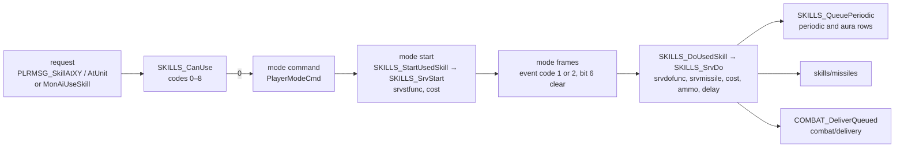
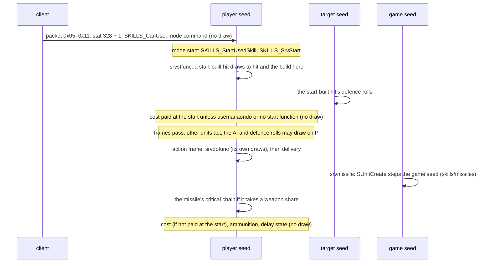
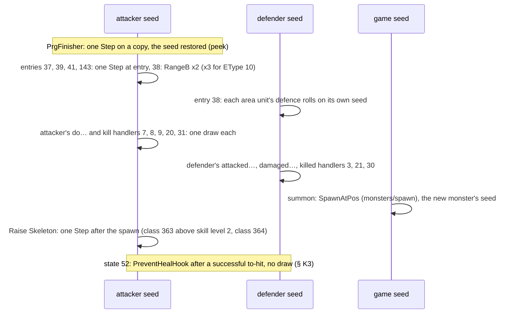
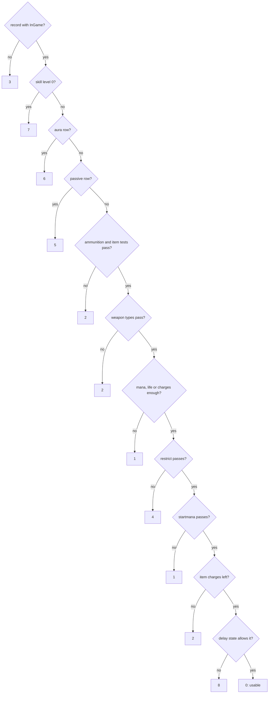
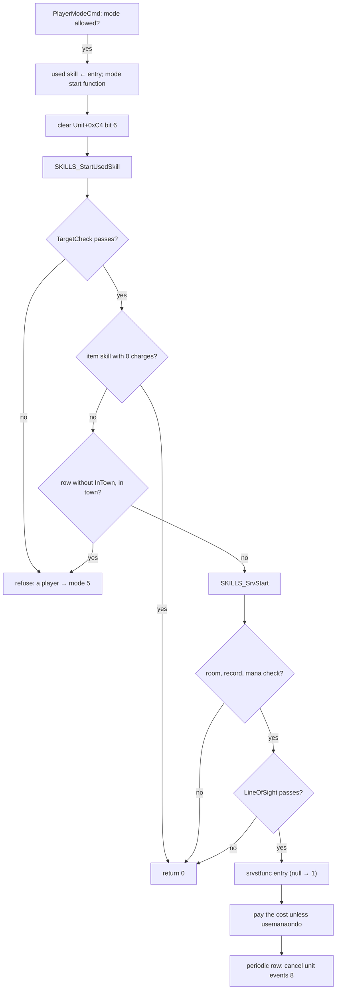

# Skill dispatch: the request, the checks, the start and do functions, costs, the skill packet, handlers, summons

## Purpose

When a unit uses a skill, the server takes the request (a client packet for a player, the AI's command for a
monster), checks it, starts the skill's mode, runs the skill's **start function** (`srvstfunc`) at the mode start and
its **do function** (`srvdofunc`) on the mode's action frame, creates the skill's missile, pays the cost and sets the
delay. This page specifies that machinery for players and monsters, item-granted skills and item-event casts, the
skill packet a skill hit builds, progressive charges and the finisher, the stat-event handler table, summons and the
pet limit, monster skill use, and ammunition and weapon wear, with every draw named by its seed. What each numbered
start and do function does outside the tier-A rows is plan 0046's catalogue; the missile a skill creates is
[skills/missiles](missiles.md). Overview and boundary: [skills](README.md).



## Entry points

| When | Function | Tag |
|---|---|---|
| A player's skill request at a location (packets 0x05, 0x08, 0x0C, 0x0F) | fn:PLRMSG_SkillAtXY@0x00549AD0 | [I] |
| A player's skill request at a unit (packets 0x06, 0x07, 0x09, 0x0A, 0x0D–0x11 but 0x0F) | fn:PLRMSG_SkillAtUnit@0x00549BA0 | [I] |
| The request checks | fn:SKILLS_CanUse@0x00647960 | [C] for codes 0, 1, 6 and 8 and their order (run:2026-10-27-skills: 1 340 calls); [I] otherwise |
| A skill mode starts (player modes 7, 8, 10–16, 18; monster modes 4, 5, 7, 8, 9) | fn:SKILLS_StartUsedSkill@0x0056FAF0 → fn:SKILLS_SrvStart@0x0056F640 | [C] for the caster's seed in the start events of the rows of § O (run:2026-10-25-skills); [I] otherwise |
| The mode's action frame | fn:SKILLS_DoUsedSkill@0x0056FC50 → fn:SKILLS_SrvDo@0x0056F7F0 | [C] for the caster's seed in the do events of the rows of § O (run:2026-10-25-skills); [I] otherwise |
| A cost is paid | fn:SKILLS_PayCost@0x0056BFE0 | [C] (run:2026-10-25-skills: 1 798 calls) |
| A periodic or aura skill runs again (unit events 8 and 9) | fn:EVENT_SelectedAuraTick@0x0056FCB0, fn:EVENT_ItemAuraTick@0x0056FE40 | [I] |
| An item's chance-to-cast fires | fn:ITEMSKILL_Cast@0x005FDA80 | [I] |
| A player's normal attack under a charged progressive state | fn:COMBAT_PrgFinisher@0x005D5220 | [I] |
| A stat event fires on a unit | fn:UNIT_DispatchEvent@0x005C0C30 | [I] |
| A skill summons a monster | fn:sub_0056D940_SpawnOwnedMonster@0x0056D940 | [I] |
| A monster's AI uses a skill | fn:sub_005DEAD0_MonAiUseSkill@0x005DEAD0 | [I] |

## Inputs

### Tables

| Anchor | Used for |
|---|---|
| tbl:Skills.txt:srvstfunc, `srvdofunc` | the start and do function numbers (§ D, § E) |
| tbl:Skills.txt:srvprgfunc1, `prgstack`, `prgcalc1` | progressive entries (§ J) |
| tbl:Skills.txt:srvmissile, `lob`, `decquant` | the do frame's missile and ammunition (§ E, § N) |
| tbl:Skills.txt:InGame, `InTown`, `aura`, `passive`, `periodic`, `immediate`, `restrict`, `State1` | the checks (§ C, § D, § G) |
| tbl:Skills.txt:itypea1, `etypea1`, `range` | the weapon test and the walk-to-range (§ B, § C) |
| tbl:Skills.txt:mana, `lvlmana`, `manashift`, `minmana`, `startmana`, `usemanaondo` | the cost (§ F) |
| tbl:Skills.txt:delay, `perdelay` | the delay state and the periodic grid (§ G) |
| tbl:Skills.txt:LineOfSight, `TargetableOnly`, `TargetCorpse`, `TargetAlly`, `TargetItem`, `AttackNoMana` | the start and request tests (§ B, § D) |
| tbl:Skills.txt:ItemEffect, `ItemTarget`, `ItemCheckStart`, `ItemTgtDo` | item-event casts (§ H) |
| tbl:Skills.txt:ResultFlags, `HitFlags`, `HitClass`, `calc1`, `calc2`, `calc3`, `calc4`, `EType`, `SrcDam`, `Kick`, `MinDam`, `MinLevDam1`, `DmgSymPerCalc`, `HitShift` | the skill packet (§ I) |
| tbl:Skills.txt:aurastate, `auratargetstate`, `auralencalc`, `aurastat1`, `aurastatcalc2`, `srvoverlay` | the melee deliver do and the charges (§ I, § J) |
| tbl:Skills.txt:summon, `summode`, `pettype`, `petmax`, `Param1` | summons (§ L) |
| tbl:PetType.txt:group | the pet group clear (§ L) |
| tbl:ItemStatCost.txt:itemeventfunc1 | the item-stat handler registrations (§ K) |
| tbl:MonStats.txt:SkillDamage | a summon's owner skill damage (§ M) |

Column semantics are the table docs': [Skills § Dispatch](../../tables/Skills.md#dispatch-plan-0045-phase-0),
[Skills § Function index](../../tables/Skills.md#function-index-plan-0046-phase-0), [PetType](../../tables/PetType.md).

### Runtime state

| State | Type | Source |
|---|---|---|
| skill list | `SkillList`: left skill `+0x08`, right `+0x0C`, used skill `+0x10` | struct:SkillList+0x10 |
| skill entry | `SkillEntry`: record, mode `+0x08`, flags `+0x0C` (bit 0 move first, bit 1 arrived), `+0x18` a per-entry word, `+0x24` the dual-wield toggle, base level `+0x28`, `+0x30` scroll quantity, owner item guid `+0x34` (−1 own), charges `+0x38` | struct:SkillEntry+0x34 |
| action-done bit | `Unit+0xC4` bit 6 (`0x40`): the do function has run in this mode | 0x0057FED8 |
| request counter | the player's base stat 328 (`pierce_idx`), +1 per accepted request | 0x00549D50 |
| unit seed | `Unit+0x20`, per unit ([rng/seeds](../rng/seeds.md)) | every draw below |
| frame | `game+0xA8` | the delay end, the periodic grid |

### Inputs and oracles

| Input | Kind | Tag |
|---|---|---|
| the frame of a mode that carries event code 1 or 2 (players), `Unit+0x4E` (monster sequences) | a logged input: animation timing is [plan 0050](../../plans/0050-animation-frame-timing.md)'s | [I] (fn:sub_00580460_PlrModeSkillFrame@0x00580460, fn:sub_005A8670_MonSeqFrame@0x005A8670) |
| the monster's choice of skill, mode and target | an input: monster AI is plan 0052's | [I] (fn:sub_005DEAD0_MonAiUseSkill@0x005DEAD0) |
| the numbered start and do functions outside § O | value oracles: plan 0046's catalogue | [I] (data:g_SkillDoFuncs@0x007322B0) |
| `SKILLS_ForUnitsInRange`'s and `SkillForUnitsNearTarget`'s unit order, `SkillUnitFilter` | logged as the list of units the callback ran on | [I] (fn:SKILLS_ForUnitsInRange@0x0056B7E0) |
| the pet chosen for removal | a logged value | [I] (fn:sub_00575850_PetLimit@0x00575850) |
| a calc's value | [data/calc](../data/calc.md) | [I] (fn:SKILLS_EvalCalc@0x00646CA0) |

### Constants

| Name | Value | Anchor | Tag |
|---|---|---|---|
| start table | `g_SkillStartFuncs`, bound `0x5B` | data:g_SkillStartFuncs@0x00732140, 0x0056F75D | [I] |
| do table | `g_SkillDoFuncs`, bound `0xBF` (shared by `srvdofunc`, `srvprgfunc1..3`, `ItemEffect`) | data:g_SkillDoFuncs@0x007322B0, 0x0056F911 | [I] |
| stat-event table | `g_StatEventFuncs`, 31 handlers (ids 1..31), bound `0x32` | data:g_StatEventFuncs@0x007325B0 | [I] |
| delay state | 121 `skilldelay` | fn:SKILLS_SetDelayState@0x0056EF90 | [I] |
| blood mana state | 114 | fn:SKILLS_PayCost@0x0056BFE0 | [I] |
| periodic grid floor | `perdelay` 5 when the calc gives less than 6 | fn:SKILLS_QueuePeriodic@0x0056CDA0 | [I] |
| charge cap | 3 | fn:SKILLS_AddProgressiveCharge@0x005D3320 | [I] |

[C] Every stock Skills row's `srvstfunc`, `srvdofunc`, `srvprgfunc1..3` and `ItemEffect` (> 1) names a non-null
entry of its table: 357 rows, none out of table; 64 non-null start entries among ids 1..65 and 152 non-null do
entries (ids 1..152; 53, 138, 142, 145, 146 and 147 used by no stock row). This is the data join of the tables'
bytes against every row; which column indexes which table is the code reading of §§ D, E and J. (data:g_SkillStartFuncs@0x00732140,
data:g_SkillDoFuncs@0x007322B0, tbl:Skills.txt:srvstfunc, [skills/0001](../../findings/skills/0001-dispatch.md#answer-summary))

## Algorithm

### A. The skill's life by event kind

The events of one skill use, each with the seeds it touches. The diagrams illustrate the sections named; the
statements are there.

**A1. Request, start and do (a player).**



**A2. A monster.** The AI sets the used skill and bit 6 and starts the mode; the mode start runs
`SKILLS_StartUsedSkill`; the action-frame handler runs `SKILLS_DoUsedSkill` without an event-code test. A monster pays
no cost, uses no ammunition and gets no delay state (§ M).

**A3. The finisher, a handler, a summon.**



### B. The request

```
B1. PacketSkill(player, packet):                                     [I] (data:g_SrvPacketTable@0x006E0D18, all of B1)
      entry ← left (SkillList+0x08) for 0x05–0x0A, right (+0x0C) for 0x0C–0x11;  none → return 3
      read the location form (5 bytes: x u16 +1, y u16 +3) or the unit form (9 bytes: type u32 +1 ≤ 5, guid u32 +5)
      baseStat(player, 328) += 1                                     ; every request, before the checks
      0x05/0x0C → SkillAtXY;  0x06/0x0D → SkillAtUnit(walk 1);  0x07/0x0E → SkillAtUnit(walk 0)
      0x08–0x0A, 0x0F–0x11: re-read the packet, then as 0x05–0x07 / 0x0C–0x0E;  0x0B: does nothing

B2. SkillAtXY(player, entry, x, y):                                  [I] (fn:PLRMSG_SkillAtXY@0x00549AD0, 0x00549B20–0x00549B40, all of B2)
      if player.mode ∈ {0 death, 17 dead}: return
      if UNIT_CanDualWield(player): entry ← DualAttackAlternate(entry)          ; B4
      c: i32 ← SKILLS_CanUse(player, entry)                                       ; § C
      if c ∈ {1, 2, 4} and row.AttackNoMana: entry ← player's skill 0 (Attack); c ← SKILLS_CanUse(player, entry)
      if entry.mode ≠ 0:
        if c = 0: PlayerModeCmd(entry, entry.mode, x, y, force 0)                ; § D
        else if c = 1: send the no-mana message to the client
      ; any other code: nothing

B3. SkillAtUnit(player, entry, type, guid, walk):                    [I] (fn:PLRMSG_SkillAtUnit@0x00549BA0, fn:SKILLS_GetRangeType@0x00645460, all of B3)
      as B2 up to c, then require c = 0, entry.mode ≠ 0 and (row.TargetItem or type ∈ {0, 1, 3})
      if the target is in state 143 (attached): target ← the unit it is attached to
      if walk = 1 and GetRangeType(entry) = 1 (h2h) and the target is out of melee range:
        run to the target (mode 3), keeping the skill id; return
      PLAYER_ModeCmdUnit(entry, entry.mode, type, guid, 0)
```

- B1. The location form refuses a length other than 5 and an invalid point, replying at most once per 25 frames;
  the unit form needs the unit in the same act. [I] (fn:sub_005496F0_PktReadXY@0x005496F0,
  fn:sub_00549830_PktReadUnit@0x00549830)
- B1. **The request counter** stat 328 is the seed of every pierce count the player's missiles make
  ([skills/missiles § C](missiles.md#c-the-damage-the-missile-carries)). It rises on every accepted request, whatever
  the checks then decide. [I] (0x00549D50, fn:sub_0059F940_MissilePierceCount@0x0059F940)
- B3. `GetRangeType`: `range` 0 none, 1 h2h, 2 rng, 3 both; `both` gives 2 when the unit has a missile weapon, else 1,
  and 1 for a player in a `meleeonly` state. [I] (fn:SKILLS_GetRangeType@0x00645460, tbl:Skills.txt:range)
- B4. **Dual-wield alternation.** For the Attack entry (skill 0) with a weapon in each hand: when the Attack entry's
  `+0x24` is 0 the request uses the unit's skill 5 (Left Hand Swing) and sets `+0x24 ← 5`; else it uses Attack and
  sets `+0x24 ← 0`. So Attack and Left Hand Swing alternate, request by request. [I]
  (fn:sub_00549960_DualAttackAlternate@0x00549960, 0x005499F4–0x00549A30, struct:SkillEntry+0x24)

### C. The request checks (`SKILLS_CanUse`)



```
C1. SKILLS_CanUse(unit, entry) → i32:                                [I] (fn:SKILLS_CanUse@0x00647960, all of C1)
      if no record or not row.InGame:                     return 3
      if SKILLS_GetSkillLevel(unit, entry, 1) = 0:        return 7
      if row.aura:                                        return 6
      if row.passive:                                     return 5
      if not SkillAmmoOk(entry, unit):                    return 2       ; C2
      if not SKILLS_WeaponTypeOk(entry, unit):            return 2       ; C3
      if not SKILLS_ManaOk(entry, unit):                  return 1       ; C4
      if not SKILLS_RestrictOk(entry, unit):              return 4       ; C5
      if not SKILLS_StartManaOk(entry, unit):             return 1       ; C6
      if not SKILLS_ItemChargesOk(unit, entry):           return 2       ; C7
      return SKILLS_DelayOk(unit, entry) ? 0 : 8                        ; § G
```

- C1. **Codes 0, 1, 6 and 8 and their order, measured.** In 1 340 calls (1 126 from the request handlers' four call
  sites, 214 changes of code at the client's per-frame check `0x004D9FC5`) the code is the one this order gives for
  the aura test (6, 1 call), the mana test of C4 (1, 8 calls) and the delay test of G2 (8, 76 calls), else 0. [C]
  (fn:SKILLS_CanUse@0x00647960, fn:SKILLS_ManaOk@0x00647540, fn:SKILLS_DelayOk@0x006478F0, run:2026-10-27-skills)
- C1. Codes 2, 3, 4, 5 and 7, the `startmana` test (C6) and the item-charge tests (C4, C7) are the code reading: no
  call of the run reached them. No step draws. All 357 stock rows have `InGame`, so code 3 is reached only with no
  record. [I] (fn:SKILLS_CanUse@0x00647960, tbl:Skills.txt:InGame, run:2026-10-27-skills)
- C2. `SkillAmmoOk`: a `scroll` row needs `SkillEntry+0x30` > 0; Throw (skill 2) needs a throwable item in the hand
  (the other hand's when dual wielding and the first is empty), or one with stat 125; Left Hand Throw (4) the same on
  the other hand; Left Hand Swing (5) dual wield and a weapon in the hand; any other skill passes. [I]
  (fn:sub_00647640_SkillAmmoOk@0x00647640, struct:SkillEntry+0x30)
- C3. `WeaponTypeOk`: a row with neither `itypea1` nor `etypea1` above 0 passes; else both hands are tested in both
  orders (for skills 4 and 5 with the primary weapon taken out of its hand first). [I]
  (fn:SKILLS_WeaponTypeOk@0x00643F80, tbl:Skills.txt:itypea1, tbl:Skills.txt:etypea1)
- C4. `ManaOk`: an item skill (`+0x34` ≠ −1) needs charges `+0x38` > 0. Else
  `lvl: i32 ← clamp(base + bonus, 0, ExpMaxLevel(0))` and the cost of § F1 (with no `minmana` floor); under state 114
  `cost ≤ stat 6` (life); else a `srvdofunc` 116 row (the shapeshifts) with `Unit+0xC8` bit 3 passes; else
  `cost ≤ stat 8`. [I] (fn:SKILLS_ManaOk@0x00647540)
- C4. **A cost equal to the mana passes.** With `lvl` the entry's base plus its bonus, a cost above stat 8 gives code 1
  (8 calls) and a cost equal to it passes (5 code-0 calls with stat 8 exactly the cost, which a strict test would
  refuse). [C] (fn:SKILLS_ManaOk@0x00647540, 0x00647589, run:2026-10-27-skills) The clamp, the charges, the state-114
  and `srvdofunc` 116 branches are not reached; the 8 refusals lie 2 mana or more below the cost, so the `− 1` of the
  level term rests on the payments of F1, not on these. [I] (run:2026-10-27-skills)
- C5. `RestrictOk` (`restrict`): 0 refuses while the unit is in a restricted state (`0x0063A510`, not read); 1
  passes; 2 passes only in a restricted state and with one of `State1..3` (the first negative ends the list); any
  other value passes. [I] (fn:SKILLS_RestrictOk@0x00644060, tbl:Skills.txt:restrict)
- C6. `StartManaOk`: a player with `startmana` > 0 and `stat 8 < startmana · 256` is refused unless in state 12
  (`inferno`). The three stock `startmana` rows (Inferno, Arctic Blast, Blade Fury) are the channelled skills: the
  first frame needs `startmana`, later ones the per-use cost only. [I] (fn:SKILLS_StartManaOk@0x006440F0,
  tbl:Skills.txt:startmana)
- C7. `ItemChargesOk`: an item skill passes only if its item (guid `+0x34`) has a non-zero low byte of stat 204 at
  layer `skill · 64 + (level & 0x3F)`; a missing item passes. [I] (fn:SKILLS_ItemChargesOk@0x00647840,
  struct:SkillEntry+0x34)
- C. **No refused request reached the server in the run.** All 1 126 request calls returned 0, while the client's own
  check of the same skills changed to a refusal 85 times (code 8 76, code 1 8, code 6 1); 60 casts in the Rogue
  Encampment gave no request at all. [C] (fn:SKILLS_CanUse@0x00647960, fn:PLRMSG_SkillAtXY@0x00549AD0,
  fn:PLRMSG_SkillAtUnit@0x00549BA0, run:2026-10-27-skills)
- C. **A stock client sends no refused request.** The client runs `SKILLS_CanUse` on its own copy of the player for
  the skill buttons every frame and, in the run, sent no request for a refused skill; its sending code is not read.
  So the refusal branches of B2–B3 and the `InTown` refusal of D2–D3 are the server path for a client that sends any
  request, stated from the code reading. [I] (0x004D9FC5, run:2026-10-27-skills)
- C. A monster does not pass through `SKILLS_CanUse` on its way to the mode start (§ M). [I]
  (fn:sub_005DEAD0_MonAiUseSkill@0x005DEAD0)

### D. The mode start



```
D1. PlayerModeCmd(entry, mode, x, y, force):                        [I] (fn:sub_005809D0_PlayerModeCmd@0x005809D0, fn:PLAYER_ModeCmdUnit@0x00580A70, all of D1)
      if not force and not PlayerModeAllowed(mode, 1, entry): return
      if entry: SkillList.used ← entry
      g_PlayerModeStartFuncs[mode].xy(mode, x, y)    ; .unit with the target for PLAYER_ModeCmdUnit
      ; modes 7, 8, 10–16, 18: PlrModeStartSkillXY / …Unit: set the path target,
      ;   Unit+0xC4 &= ~0x40, SKILLS_StartUsedSkill

D2. SKILLS_StartUsedSkill(game, unit) → i32:                        [I] (fn:SKILLS_StartUsedSkill@0x0056FAF0, all of D2)
      entry ← SkillList.used;  if none: return 0
      if not SKILLS_TargetCheck(id, game, unit): refuse; return 0
      lvl: i32 ← SKILLS_GetSkillLevel(unit, entry, 1)
      if entry is an item skill: lvl ← its own level; if charges = 0: return 0
      tgt ← UNIT_GetTargetUnit(game, unit)
      if tgt and not row.TargetAlly and SkillAllyTest(tgt, id): return 0       ; never true here (note)
      if not row.InTown and the unit's room is a town: SkillList.used ← 0; refuse; return 0
      r ← SKILLS_SrvStart(id, lvl, noCost 0)
      if unit is a player and r = 0: refuse
      return r

D3. SKILLS_SrvStart(game, unit, id, lvl, noCost) → i32:             [I] (fn:SKILLS_SrvStart@0x0056F640, all of D3)
      if no game, unit or room: return 0
      if no record or (not noCost and not SKILLS_SrvManaCheck(unit)): return 0
      if not row.InTown and (no room or a town room): SkillList.used ← 0; refuse; return 0
      if row.LineOfSight ≠ 0 and SKILLS_GetTargetXY(&x, &y):
        mask: u16 ← {1: 0x0004, 2: 0x1C09, 3: 0x0180, 4: 0x0804, 5: 0x0805}[row.LineOfSight]   ; other values: return 0
        if COLL_LineTest(room, (x, y) → unit position, mask) ≠ 0: return 0
      st: i32 ← row.srvstfunc;  if st < 0 or st ≥ 0x5B: return 0
      if g_SkillStartFuncs[st] = null: r ← 1
      else:
        r ← g_SkillStartFuncs[st](id, lvl);  if r = 0: return 0
        if not row.usemanaondo and not noCost: SKILLS_PayCost(id, lvl)      ; result ignored, § F
      if row.periodic: cancel all the unit's unit events 8
      return r
```

- D1. "Refuse" puts a player into mode 5 with `force` 1 (`PlayerModeCmd(0, 5, 0, 0, 1)`); a monster just returns.
  [I] (0x0056FB49, 0x0056FC41, 0x0056F6DB, 0x0056F8AE)
- D2. `TargetCheck`: no target passes; a `TargetableOnly` skill needs a hostile target or an ally the tests accept;
  a dead target (`+0xC4` bit 1) is kept only by a `TargetCorpse` skill, otherwise the target is cleared and the check
  passes. [I] (fn:SKILLS_TargetCheck@0x0056CC60)
- D2. The ally test in `StartUsedSkill` never refuses: it is called only when `TargetAlly` is clear, with the same
  skill, and returns false unless that bit is set. Its other callers (`SKILLS_TargetCheck`, a missile hit function)
  are where it matters. [I] (0x0056FBB2–0x0056FBC4, 0x00554D56–0x00554D6B, fn:sub_00554D20_SkillAllyTest@0x00554D20)
- D3. `SKILLS_SrvManaCheck` reads the **used** skill, not the id passed: a non-player passes, an item skill needs
  charges, else the cost of § F1 with `lvl = max(GetSkillLevel − 1, 0)` against stat 8, with the `srvdofunc` 116
  exception and **no** state-114 branch (unlike C4). [I] (fn:SKILLS_SrvManaCheck@0x0056C160)
- D3. A row with no start function pays nothing here: its cost is paid at the do (§ E), as are the two
  `usemanaondo` rows (Plague Javelin, Blade Fury). `noCost` 1 comes from an item cast (§ H). [I]
  (fn:SKILLS_SrvStart@0x0056F640)
- D3. Do functions 83 (Fire Hit) and 109 (MonFrenzy, BloodLordFrenzy) call `SKILLS_SrvStart(id, lvl, 0)` again
  inside the do frame, after delivering or dropping the queued hit, so the start function (and its cost) runs once
  more there. [I] (fn:sub_005CAF30_SkillDo83DeliverRestart@0x005CAF30, fn:sub_005CDF10_SkillDo109Frenzy@0x005CDF10)
  Do 83's `COMBAT_DeliverQueued(target, 0)` call is reproduced up to that call. [C] (ADR-0021, return address
  `0x005CAF5A`, run:2026-10-21-cat-emu-8a)
- D3. **No draw in the start machinery.** In the start events the run checked (1 142 in all, the eleven rows of § O among them), the caster's
  seed at `SKILLS_SrvStart`'s return is its entry seed stepped by the nested events' draws only, the payments inside
  them included. [C] (fn:SKILLS_SrvStart@0x0056F640, fn:SKILLS_PayCost@0x0056BFE0, run:2026-10-25-skills)

### E. The do frame and `SKILLS_SrvDo`

```
E1. PlayerSkillFrame(unit, event) → i32:                             [I] (fn:sub_00580460_PlrModeSkillFrame@0x00580460, all of E1)
      entry ← SkillList.used;  if none: return 2                    ; 2 ends the mode
      if entry.flags bit 0 (move first) and UnitMoveStep() = 2:     ; arrived
        entry.flags |= 2;  SKILLS_DoUsedSkill()
      else if Unit+0xC4 bit 6 clear and event ∈ {1, 2}: SKILLS_DoUsedSkill()
      return dead ? 2 : 1

E2. MonsterAttackFrame(unit):                                        [I] (fn:sub_005A7670_MonAttackFrame@0x005A7670, fn:sub_005A8670_MonSeqFrame@0x005A8670, all of E2)
      no used skill: the plain attack (combat/overview A2)
      move-first entry: as E1;  else SKILLS_DoUsedSkill()           ; no event-code test, no bit-6 test
      ; mode 14 (sequence): the move-first branch, then the do when Unit+0x4E = 4,
      ;   or when no move-first do ran, bit 6 is clear and Unit+0x4E ∈ {1, 2}

E3. SKILLS_DoUsedSkill(unit):                                        [I] (fn:SKILLS_DoUsedSkill@0x0056FC50)
      lvl ← SKILLS_GetSkillLevel(unit, used, 1)
      SKILLS_SrvDo(id, lvl, pay 1, item 0, effect 0);  SKILLS_QueuePeriodic(id, lvl, 0)        ; § G

E4. SKILLS_SrvDo(game, unit, id, lvl, pay, item, effect) → i32:      [I] (fn:SKILLS_SrvDo@0x0056F7F0, all of E4)
      actor: bool ← unit.type ∈ {0 player, 1 monster}
      if actor:
        used ← SkillList.used
        if used and not used.flags bit 0 and not row.InTown and (no room or a town room): refuse; return 0
        if not item and (no used, or used's id ≠ id, or GetSkillLevel(unit, used, 1) < 1):
          e ← SKILLS_GetUnitSkill(unit, id);  if no e or GetSkillLevel(unit, e, 1) < 1: return 0
      do: i32 ← row.srvdofunc;  if do < 0 or do ≥ 0xBF: return 0
      if actor and row.usemanaondo and not SKILLS_SrvManaCheck(unit): return 0
      if effect and item and row.ItemEffect > 1: do ← row.ItemEffect                    ; § H
      r ← g_SkillDoFuncs[do] ? g_SkillDoFuncs[do](id, lvl) : 0
      if row.srvmissile ≥ 0 and it names a Missiles row:
        Unit+0xC4 |= 0x40;  (dx, dy) ← (0, 0)
        if item and effect and GetTargetXY(&tx, &ty) and tx ≠ 0 and ty ≠ 0:
          (dx, dy) ← (tx − x, ty − y);  (tx, ty) ← (tx + dx, ty + dy)
        (row.lob ? SkillMissileCreateLob : SkillMissileCreate)(unit, id, lvl, dx, dy, tx, ty, useAmmo 0)
        r ← 1
      else if r = 0: return 0
      if pay:
        if actor:
          if g_SkillStartFuncs[row.srvstfunc] = null or row.usemanaondo: SKILLS_PayCost(id, lvl)   ; result ignored
          if row.decquant: PLAYER_UseAmmo()                                             ; § N
        d: i32 ← SKILLS_EvalCalc(unit, row.delay, id, lvl)
        if d > 0 and unit.type = 0 and (row.anim ≠ 18 or (Unit+0x38 & 0xFFFFFF00) = 0):
          SKILLS_SetDelayState(game, unit, d)                                           ; § G
      return r
```

- E1–E2. **Bit 6 makes the do run once per mode.** 124 sites set `Unit+0xC4` bit 6 (most do functions, the melee
  deliver do, `SKILLS_SrvDo` when it creates the missile, the monster AI's command) and 17 clear it (the player skill
  mode starts among them), so a second code-1 or code-2 frame of the same mode does not repeat a do function that set
  it. [I] (0x0057FED8, 0x0056F98A, 0x005DEB08)
- E2. A monster's AI sets bit 6 itself, and its mode start does not clear it; so a monster's do runs through the
  paths that do not test the bit: the attack-frame handler, and the mode-14 `Unit+0x4E` = 4 case. [I]
  (0x005DEB08, fn:sub_005A7670_MonAttackFrame@0x005A7670)
- E4. **The missile comes after the do function**, with `useAmmo` 0, so `decquant` is the only ammunition use on
  this path. A row with a `srvmissile` and no `srvdofunc` (entry 0 is null) gets only that missile: 48 stock rows,
  among them 36 Fire Bolt, 251 Fire Trauma (lob) and 25 Plague Javelin. Two more rows (307, 325) name only
  `srvmissilea..c` and get no missile here. [I] (fn:SKILLS_SrvDo@0x0056F7F0, tbl:Skills.txt:srvmissile,
  [skills/0002 § 2](../../findings/skills/0002-missiles.md#2-creation))
- E4. With an item cast's effect flag the line missile starts at the target point and flies on to twice the
  distance; a lob keeps the caster as its start and aims at the doubled point. [I] (0x0056F9D0–0x0056FA29)
- E4. `SKILLS_SrvDo` has eight callers: `SKILLS_DoUsedSkill`, the selected-aura tick (two), the item-aura tick, the
  right-skill aura select, `ITEMAURA_Start`, `ITEMSKILL_Cast` and the player's placement in an act. Only
  `ITEMSKILL_Cast` passes a non-zero effect flag. [I] (fn:SKILLS_SrvDo@0x0056F7F0, 0x0056FD29–0x0056FD34)
- E4. **No draw in the do machinery.** In the do events run:2026-10-25-skills checked (1 269 in all: the per-row
  seed-check total of § O, the eleven rows' 947 among them), the caster's seed at
  `SKILLS_SrvDo`'s return is its entry seed stepped by the nested events' draws only (the missile creations'
  critical draws, the to-hit rolls, the defence rolls, an aura's elemental roll), the payments and 251 of the 277
  delay states set (Meteor 30, Firestorm 221) inside them. [C] (fn:SKILLS_SrvDo@0x0056F7F0,
  fn:SKILLS_SetDelayState@0x0056EF90, run:2026-10-25-skills) Plague Javelin's 26 delay states lie in a row under 30
  events. [I] (run:2026-10-25-skills)

### F. Costs

```
F1. Cost(row, lvl) → i32:                                            [C] (fn:SKILLS_PayCost@0x0056BFE0, run:2026-10-25-skills: 1 334 payments)
      cost: i32 ← ((i32) row.lvlmana × max(lvl − 1, 0) + (i32) row.mana) << (row.manashift & 31)   ; 1/256 mana

F2. SKILLS_PayCost(unit, id, lvl) → i32:                             [I] (fn:SKILLS_PayCost@0x0056BFE0, all of F2 except as tagged)
      if no unit or unit.type ≠ 0: return 1                         ; only players pay; [C] (run:2026-10-25-skills: 205 calls)
      used ← SkillList.used
      if used and used.id = id and used.ownerItem ≠ −1: return UseCharge(unit)     ; charges − 1, no draw
      if row.mana ≠ 0 or row.lvlmana ≠ 0:
        cost ← Cost(row, lvl)
        if cost < row.minmana × 256: cost ← row.minmana × 256        ; the floor, here only
        if UNIT_HasState(unit, 114): return BloodManaPay(unit, cost)
        if cost ≤ stat(unit, 8): stat(unit, 8) −= cost; return 1
      return 0                                                        ; [C] for a row with no cost (run:2026-10-25-skills: 259 calls)
```

- F1. `mana` and `lvlmana` are s16, `manashift` the low byte of its field (count & 31), the product and sum s32, the
  shift a left shift of the s32; stat 8 is mana in 1/256. In 1 334 player payments stat 8 fell by exactly this
  amount and the return was 1: 258 of them carry a `lvlmana` term at a level above 1, and the shifts 5, 6, 7 and 8
  occur 19, 21, 117 and 1 177 times. [C] (fn:SKILLS_PayCost@0x0056BFE0, tbl:Skills.txt:lvlmana,
  tbl:Skills.txt:manashift, run:2026-10-25-skills)
- F2. `lvl` is the level the caller passes (the start's or the do's); the checks of § C and § D recompute it from the
  entry. [I] (fn:SKILLS_PayCost@0x0056BFE0, fn:SKILLS_ManaOk@0x00647540)
- F2. **The floor binds the payment only.** The checks use the unfloored cost. Seven stock rows have a negative
  `lvlmana` (Magic Arrow, Guided Arrow, Dopplezon, Teleport, Bone Prison, Summon Resist, Double Swing): the rows where
  the floor can bind. The run's payments never reached the floor. [I] (tbl:Skills.txt:minmana,
  run:2026-10-25-skills)
- F2. **The result is ignored** by `SKILLS_SrvStart`, `SKILLS_SrvDo` and Blade Fury's start function: when the cost
  exceeds the mana, nothing is taken and the skill still runs. No such refusal occurred in the run. [I]
  (0x0056F7AA, 0x0056FA7A, fn:sub_005D69D0_SkillSt26BladeFury@0x005D69D0, run:2026-10-25-skills)
- F2. **Blood mana.** With `cost ≤ stat 6` life falls by `cost`, and when the new life is below `Param5 · 256` of the
  skill that made the state (Blood Mana, `Param5` 40) the state's list is removed; else the state is removed, life is
  set to 256 and the payment fails. Not reached in the run. [I] (fn:sub_005D2B60_BloodManaPay@0x005D2B60,
  tbl:Skills.txt:Param5)
- F2. Blade Fury pays per fragment: its start function 26 extends its state-12 list each frame and calls
  `SKILLS_PayCost` after each fragment do 48 makes. [I] (fn:sub_005D69D0_SkillSt26BladeFury@0x005D69D0)

### G. The delay state; periodic, aura and channelled skills

```
G1. SKILLS_SetDelayState(game, unit, d):                             [I] (fn:SKILLS_SetDelayState@0x0056EF90, all of G1)
      a player with d ≠ 0 gets (or reuses) a timed list of state 121, end frame ← frame + d,
      and unit event 12 at that frame (the timed-list expiry, stats/states § C)

G2. SKILLS_DelayOk(unit, entry) → bool:                              [I] (fn:SKILLS_DelayOk@0x006478F0)
      return not (unit is a player in state 121 and EvalCalc(row.delay, its level) ≥ 1)

G3. SKILLS_QueuePeriodic(unit, id, lvl, selected):                   [I] (fn:SKILLS_QueuePeriodic@0x0056CDA0, all of G3)
      only for periodic or aura rows
      p: i32 ← EvalCalc(row.perdelay);  if p < 6: p ← 5
      cancel the unit's event-8 queue (all of it when selected, else this skill's)
      queue unit event 8 at ((frame − 1 + p) ÷ p) × p + 1 with (id, lvl), or (−1, 0) for the selected right-skill aura
```

- G1. **The delay ends at `f + d`.** With `SKILLS_SetDelayState` at frame `f` and delay `d`, a request at frame
  `f + d` passes (16 request calls of Meteor, Firestorm or Plague Javelin), and the client's check of the skill, 8
  from the cast, changes back to 0 at frame `f + d` in 26 delays; a state still on at `f + d` would refuse those 16.
  [C] (fn:SKILLS_SetDelayState@0x0056EF90, fn:SKILLS_DelayOk@0x006478F0, run:2026-10-27-skills)
- G1. That the state refuses on every frame up to `f + d − 1` rests on the client's check running each frame (only its
  changes are logged); 8 more client changes back to 0 come at `f + d + 1`, the client's frame one behind the
  server's there, which is not read. [I] (run:2026-10-27-skills)
- G2. **The delay test applies to a row with a `delay` only.** In state 121 a row with a `delay` is refused (code 8,
  76 calls) and a row without one passes (67 code-0 calls, which a delay test on every skill would refuse). [C]
  (fn:SKILLS_DelayOk@0x006478F0, tbl:Skills.txt:delay, run:2026-10-27-skills)
- G2. **One delay blocks every delayed skill**: the state is one per unit, whichever skill set it, and the test is
  `EvalCalc(delay) ≥ 1` of the row asked for. 23 stock rows have a `delay`. [I] (fn:SKILLS_DelayOk@0x006478F0,
  tbl:Skills.txt:delay)
- G1. A sequence-anim row (`anim` 18) sets its delay only while `Unit+0x38 & 0xFFFFFF00` is 0 (E4); what `+0x38` holds
  is open. [I] (fn:SKILLS_SrvDo@0x0056F7F0)
- G3. The grid is the aura grid of [stats/states § F](../stats/states.md#f-auras). A `periodic` row's start cancels
  all the unit's event-8 entries first (D3). The two stock `periodic` rows are Thunder Storm and Blade Shield; the
  channelled rows are the `startmana` rows (C6), not `periodic`. [I] (fn:SKILLS_QueuePeriodic@0x0056CDA0,
  tbl:Skills.txt:periodic)
- G4. **Aura select.** Selecting an `aura` row with an `aurastate` as the right skill: without `immediate` it sets the
  state and a plain list carrying the skill (stat 350) and level (stat 351); with `immediate` it runs
  `SKILLS_SrvDo(id, lvl, 1, 0, 0)` at once; then `SKILLS_QueuePeriodic(id, lvl, 1)`. [I]
  (fn:sub_0056FF10_AuraSelect@0x0056FF10)
- G5. `repeat` has no server reader; its three stock rows are the three `startmana` rows. [I]
  ([skills/0003 § 12](../../findings/skills/0003-handlers.md#12-routed-questions-from-p11), data:g_BitMask32@0x006CE268)

### H. Item-granted skills and item-event casts

- H1. **Charged skills** are entries with `ownerItem` ≠ −1: the mana checks test the charges, `ItemChargesOk` the
  item's stat 204, `StartUsedSkill` refuses at 0 charges and uses the entry's own level, and `SKILLS_PayCost` spends a
  charge. Not reached in the run. [I] (struct:SkillEntry+0x38, fn:sub_0056BEC0_UseCharge@0x0056BEC0)
- H2. **Item auras** (stat 151): `ITEMAURA_Start` queues event 9 on the grid and, for an `immediate` row, runs
  `SKILLS_SrvDo(id, lvl, 1, item 1, 0)`; `EVENT_ItemAuraTick` repeats it while stat 151 at that layer is above 0. [I]
  (fn:ITEMAURA_Start@0x005BF510, fn:EVENT_ItemAuraTick@0x0056FE40)

```
H3. ITEMSKILL_Cast(caster, id, lvl, target, x, y, effect) → bool:    [I] (fn:ITEMSKILL_Cast@0x005FDA80, all of H3)
      if id = 0 or row.ItemEffect = 0: return false
      save the caster's target, path point and Unit+0xC4 bit 6;  aim at the given unit or point
      by row.ItemTarget: 1 the caster itself; 2 a random point (H4); 3 a corpse; 4 the attacker or a previous one
        ; each helper may refuse
      if row.ItemCheckStart and not SKILLS_SrvStart(id, lvl, noCost 1): restore; return false
      SKILLS_SrvDo(id, lvl, pay 0, item 1, effect)
      restore the target, the point and bit 6
```

- H3. So an item cast pays no mana, uses no ammunition and sets no delay, and with the effect flag runs the do
  function `ItemEffect` when it is above 1: Frost Nova and Nova (36), Chain Lightning (151); the other 69 stock
  `ItemEffect` rows hold 1. [I] (fn:SKILLS_SrvDo@0x0056F7F0, tbl:Skills.txt:ItemEffect)
- H3. The effect flag is 1 only from handler 20 without `ItemTgtDo` (§ K): an item Nova, Frost Nova or Chain Lightning
  runs its `ItemEffect` only on attack, kill or hit. [I] (0x005C054E, [skills/0015 § 6](../../findings/skills/0015-item.md#6-the-stat-event-handlers-20-21-30))
- H3. `ITEMSKILL_Cast` and its two callers (`ItemCastAtUnit`, `ItemCastAtXY`, which skip a caster in state 54) make
  no draw of their own; their callers are handlers 20, 21 and 30 and two item-use entries no stock Misc row selects.
  [I] (fn:sub_005FDCA0_ItemCastAtUnit@0x005FDCA0, fn:sub_005FDD60_ItemCastAtXY@0x005FDD60)
- H4. **`ItemTarget` 2 draws.** `ITEMSKILL_Cast` gives helper 2 its own caster, whose seed the helper steps twice per
  try before the try's collision test (`low mod 40 − 20` added to x and to y), at most 10 tries until the point is
  free. The first try's two steps are reproduced up to the first collision test. [C] (ADR-0021, 0x005FDB9B,
  fn:sub_005FD850_ItemTargetRandomPoint@0x005FD850, run:2026-10-21-cat-emu-item) The later tries, from the reading. [I]
  (0x005FD900–0x005FD98A) The one stock `ItemTarget` 2 row is Teleport. Helpers 3 and 4 make no draw before their
  boundaries. [I] (fn:sub_005FD9C0_ItemTargetCorpse@0x005FD9C0, [skills/0015 § 5](../../findings/skills/0015-item.md#5-itemskill_cast-its-itemtarget-helpers-and-its-callers))

### I. The skill packet

A skill melee hit builds a combat packet ([combat/overview § The damage packet](../combat/README.md#the-damage-packet))
in its start or do function and hands it to `COMBAT_ResolveAndQueue`, which builds the weapon damage
([combat/damage](../combat/damage.md)) and queues the hit. Start function 32 (Bash, Stun, Concentrate, Conversion,
BearSmite) is the pattern.

```
I1. SkillSt32Hit(game, unit, id, lvl) → i32:                         [I] (fn:sub_005D7EA0_SkillSt32Hit@0x005D7EA0, all of I1 except as tagged)
      tgt ← UNIT_GetTargetUnit(game, unit);  if no tgt or tgt's room is a town: return 0
      SkillAttackRateList(unit, EvalCalc(row.calc3, id, lvl))        ; stat 68 on a new list
      p ← 0x70 zero bytes
      p.result: u32 ← COMBAT_MeleeHitTest(tgt, arPct: SKILLS_GetToHit(unit, id, lvl), 0)    ; to-hit draw, attacker; defence, target
      if p.result & 1:
        p.result |= row.ResultFlags;  p.flags |= row.HitFlags;  if row.HitClass ≠ 0: p.hitClass ← row.HitClass
        p.edPct: i32 ← EvalCalc(row.calc1, id, lvl)                  ; +0x0C
        if row.EType ≠ 0 and (c4: i32 ← EvalCalc(row.calc4, id, lvl)) > 0:
          p[+0x65]: u8 ← row.EType;  p[+0x68]: i32 ← c4              ; the conversion
        SKILLS_RollElemDamage(unit, p, id, lvl)                      ; I2
      COMBAT_ResolveAndQueue(tgt, p, row.SrcDam ≠ 0 ? row.SrcDam : 128)
      if q ← QueuedHitFind(unit, tgt): q.phys += EvalCalc(row.calc2, id, lvl) << 8     ; after the reductions
      if row.aurastate is valid: its own list (flags 4), STATE_Set, SKILLS_ApplyAuraStats
      return 1

I2. SKILLS_RollElemDamage(unit, p, id, lvl):                         [I] (fn:SKILLS_RollElemDamage@0x0056E0C0, fn:SKILLS_AddElemToPacket@0x0056C8E0, all of I2)
      len: i32 ← SKILLS_GetElemLen(…, 1);  min ← SKILLS_GetElemMin(…, 1);  max ← SKILLS_GetElemMax(…, 1)
      v: i32 ← RNG.RangeB(seed: unit.seed, n: max − min) + min      ; draw#1, the unit's seed (none when max − min < 1)
      AddElemToPacket(row.EType, v, len):
        if EType = 10: Step(unit.seed); EType ← table[low & 3]        ; draw#2, type 10 only; len 50 when < 1
        1 fire +0x10 (hitClass 0x20); 2 lightning +0x1C (0x40); 3 magic +0x20; 4 cold +0x24, coldLen ← len (0x30);
        5 poison +0x28, poisonLen ← len (0x50); 6/7/8 life/mana/stamina steal; 9 stun +0x44 += v + len (0x60);
        11 burn +0x14, burnLen; 12 cold +0x24, freezeLen ← len (0x30); any other: physical +0x08
        ; each adds v to its field
```

- I1. The conversion store is at `0x005D7FA8`. `calc2` is added **after** the reductions, to the queued hit's
  physical, in 1/256. The packet's weapon terms come from `COMBAT_ResolveAndQueue` (it builds when the result has
  0x1 and none of 0x8380, and `flags & 2` is clear), which adds `edPct` to stat 25 and reads the conversion. [I]
  (0x005D7FA8, fn:COMBAT_ResolveAndQueue@0x0057DBF0, struct:DamagePacket+0x65, struct:DamagePacket+0x68)
- I1. Start 32 is reproduced up to `SkillAttackRateList(unit, calc3)`, after its target and town tests; what follows
  that call is the reading above. [C] (ADR-0021, fn:sub_005D7EA0_SkillSt32Hit@0x005D7EA0, run:2026-10-21-cat-emu-bar)
- I1. **The conversion writers.** Fifteen byte stores of `EType` write the packet's `+0x65`: start functions 6, 7,
  10, 16, 29, 32, 39, 56, do functions 7, 13, 67, 150 and three helpers (`0x005D6200`, `0x005D8B10`, `0x005DA660`).
  Stock rows that convert: Concentrate (`mag`, calc4 the level of Berserk), Berserk (`mag`, 100), Vengeance, Power
  Strike and others. [I] (tbl:Skills.txt:EType, tbl:Skills.txt:calc4,
  [skills/0003 § 12](../../findings/skills/0003-handlers.md#12-routed-questions-from-p11))
- I1. Start function 6 (Power Strike, Charged Strike, …) has the same shape with to-hit 0 (the attack rating alone),
  no flags, no `calc2`/`calc3`, and `SrcDam` passed as stored (0 not replaced). [I]
  (fn:sub_005DA940_SkillSt06Hit@0x005DA940)
- I3. **Start, then do.** Start 32 builds and queues the hit at the **mode start**; its row's `srvdofunc` 2
  (`SKILL_MeleeDeliverDo`, shared by Kick, Power Strike, Impale, Vengeance, Bash, Stun, Concentrate, Berserk, Fire
  Claws, BearSmite and two monster rows) delivers on the action frame: with a `srvoverlay` (`0 < srvoverlay ≤` the
  overlay count) and a queued hit with 0x1 it puts the overlay on the target; with an `auratargetstate` and a hit it
  applies that state for `max(auralencalc, 1)` frames; with an `aurastate` it sets it on the unit; it sets bit 6 and
  calls `COMBAT_DeliverQueued`. So the to-hit, defence and build draws of such a skill fall on the start frame and
  the delivery's on the action frame. [I] (fn:SKILL_MeleeDeliverDo@0x0056F1F0, tbl:Skills.txt:auratargetstate)
- I3. Do 2 is reproduced up to its calls (`UnitSetOverlayStat`, `STATLIST_Alloc`, `UnitQueueEvent`, `STATE_Set`,
  `COMBAT_DeliverQueued`): each of the overlay and target-state blocks returns 1 **without delivering** (bit 6 not
  set) when `QueuedHitFind(caster, target)` finds no queued hit naming both, and 0 without a target; for Kick, whose
  row fills none of those columns, it sets bit 6 and delivers. [C] (ADR-0021, fn:SKILL_MeleeDeliverDo@0x0056F1F0,
  run:2026-10-21-cat-emu-bar)
- I4. **Physical damage of a skill** (`SKILLS_GetPhysMin/Max(unit, id, lvl, withWeapon)`). For a row with `Kick` clear and `SrcDam` 0, the minimum is
  `x = MinDam + LevelBands(lvl, MinLevDam1..5)` (bands 2–8, 9–16, 17–22, 23–28, 29+; 0 at `lvl ≤ 1`),
  `x += MulDiv(x, DmgSymPerCalc, 100)` when that calc is set and non-zero, then `x << HitShift`, and the maximum is the
  same with the `Max` columns. For a `Kick` row with an owner, the **minimum** is `(max(x, 1) ÷ 4) << 8` with
  `x = str + dex − 20` for a player owner or `3 · level` for another owner. [C] (ADR-0021, emulated inside hit 43,
  fn:SKILLS_GetPhysMin@0x00647BC0, fn:SKILLS_GetPhysMax@0x00647D00, fn:SKILLS_LevelBands@0x00644B70,
  run:2026-10-20-cat-emu-9d, [skills/0007 § 3](../../findings/skills/0007-missile-hit-31-59.md#3-hit-31-43-and-55-heals-and-drains))
- I4. For a `Kick` row, the **maximum** is `(max(x, 1) ÷ 3) << 8`, with `x` as for the minimum: `GetPhysMax` calls
  `sub_00644C20_SkillKickDamage` with flag 0, which divides by 3 (by 4 when the flag is set). The emulation stops at
  that call. [I] (0x00644C20–0x00644C8C, fn:sub_00644C20_SkillKickDamage@0x00644C20, fn:SKILLS_GetPhysMax@0x00647D00,
  [skills/0007 § 3](../../findings/skills/0007-missile-hit-31-59.md#3-hit-31-43-and-55-heals-and-drains))
- I4. `GetPhysMin/Max` are called by summons, missiles and several do functions (the callers are a code reading,
  outside the emulation's map). With `SrcDam ≠ 0` and `withWeapon`, `w = SrcDam · weaponMin ÷ 128` is added to `x`
  before the synergy step (`GetPhysMin` first calls `sub_00623990_SkillSrcDamWeapon(unit, 0)`, where the emulation
  stops). [I] (0x00647C4D–0x00647CA3, 0x00647CBA, fn:sub_00623990_SkillSrcDamWeapon@0x00623990)
- I4. **Kick's start hit is not built from these functions**: start 2 (`0x0056CAF0`) reads the row's `HitShift`
  (`+0x1A4`) and `MinDam` (`+0x1A8`) itself and stores `MinDam << HitShift` as the packet's physical, with flags 2,
  which `COMBAT_ResolveAndQueue` reads as "no weapon build" (I1); it calls neither `GetPhysMin` nor `GetPhysMax`. So
  the start hit carries the row's `MinDam`, not the strength-and-dexterity damage above; the `Kick` row's `MinDam`
  value is open (*Open questions*). [I] (0x0056CB54–0x0056CB71, fn:sub_0056CAF0_SkillSt02Kick@0x0056CAF0,
  [skills/0003 § 5](../../findings/skills/0003-handlers.md#5-tier-a-start-and-do-functions))
- I4. The mastery bonus enters a skill hit through the combat build (`SKILLS_GetMasteryBonus` from
  `COMBAT_BuildDamage` and `COMBAT_ToHitRoll`) and through the missile damage block; the synergies enter through the
  calcs (`DmgSymPerCalc`, `EDmgSymPerCalc`, the `skill('…'.blvl)` terms of calc1–calc4). [I]
  (fn:SKILLS_GetMasteryBonus@0x00645830, [data/calc](../data/calc.md))

### J. Progressive charges and the finisher

```
J1. PrgChargeHitDo(unit, id, lvl):         (srvdofunc 34: Tiger Strike, Cobra Strike, Royal Strike)   [I] (fn:sub_005D3490_PrgChargeHitDo@0x005D3490, all of J1)
      needs row.aurastate and row.aurastat1
      p ← zero;  p.result ← COMBAT_MeleeHitTest(tgt, SKILLS_GetToHit)
      COMBAT_ResolveAndQueue(tgt, p, SrcDam or 128)
      if the queued hit has 0x1: AddProgressiveCharge(unit, id, lvl)
      COMBAT_DeliverQueued

J2. AddProgressiveCharge(unit, id, lvl):                             [I] (fn:SKILLS_AddProgressiveCharge@0x005D3320, all of J2)
      a timed list of row.aurastate lasting auralencalc frames (refreshed; event 12), stats 350/351 = (id, lvl)
      list[aurastat1] ← min(list[aurastat1] + 1, 3)
      if it changed: list[aurastat2] += aurastatcalc2; set and send the state
```

- J1. `srvdofunc` 35 (Fists of Fire, Claws of Thunder, Blades of Ice) sets or clears bit 6 by the dual-claw test and
  the parity of `Unit+0x38 >> 8`, then runs 34. [I] (fn:sub_005D35D0_PrgChargeHitDualDo@0x005D35D0) Do 35 is
  reproduced up to its calls: with an inventory it ends at the hand-item lookup; without one, bit 6 follows bit 8 of
  `+0x38`, and do 34 ends at `MeleeHitTest(target, GetToHit, 0)` after its `aurastate` and `aurastat1` tests. [C]
  (ADR-0021, run:2026-10-21-cat-emu-ass)
- J3. **The finisher** (`COMBAT_PrgFinisher`, from the normal attack and from finishing-move do functions 42, 46, 50
  and 52) is specified in [combat/delivery § A3](../combat/delivery.md#a-queue-and-delivery): for each charged
  progressive state it **peeks** the attacker's seed (a step on a copy, the seed restored), runs `srvprgfunc1..n−1`
  (with `prgstack`) and `srvprgfunc n` from the do table, and queues a client message carrying the peeked value. [I]
  (fn:COMBAT_PrgFinisher@0x005D5220, 0x005D5368–0x005D538C, fn:sub_00571AA0_UnitMsgA3@0x00571AA0)
- J4. **The entries.** The missile is `srvmissilea/b/c` and the count or radius `prgcalc1/2/3` by the charge count
  (1, 2, 3); for a row without `progressive` it is `srvmissilea`. [I] (fn:sub_005D3CF0_SkillSrvMissileByCharge@0x005D3CF0,
  fn:sub_005D3DA0_SkillPrgCalcByCharge@0x005D3DA0)

| Entry | Stock use | What it does | Draws on the attacker's seed |
|---|---|---|---|
| 36 | Claws of Thunder charge 2 | a 64-missile nova from the target's position | none of its own |
| 37 | Claws of Thunder charge 3 | one step at entry; a ring of missiles, each re-seeded from a local seed made from the stepped low word | 1 |
| 38 | Fists of Fire and Blades of Ice charge 2 | delivers the queued hit first, then an area packet: `RangeB` physical, the elemental roll; each area unit rolls its defence on its own seed | 2 (3 for `EType` 10) |
| 39 | Fists of Fire and Blades of Ice charge 3 | one step at entry; `r²` scatter points from a local seed made from its low word, two `Range` each | 1 |
| 40 | Royal Strike charge 1 | one missile at the target point | none |
| 41 | Royal Strike charge 3 | one step at entry; `n` missiles with two inline local steps each | 1 |
| 143 | Fists of Fire charge 1, Royal Strike charge 2 | one step at entry; a ring of missiles as 37 | 1 |

- J4. The table is the reading of [skills/0003 § 1](../../findings/skills/0003-handlers.md#1-progressive-entries-srvprgfunc-and-the-finishers-tail).
  [I] (0x005D4E80, 0x005D4F50, 0x005D3F90, 0x005D5080, fn:sub_0056E170_SkillRollPhys@0x0056E170, 0x0056E1C4)
  The entries are reproduced up to their boundaries: the step at entry of 37, 39, 41 and 143 comes **before** the
  record test, so it happens even when the entry then does nothing (143 for Fists of Fire, whose `srvmissilea` is
  empty); 36's nova is centred on the target and owned by the caster; 40 has no record test of its own. [C]
  (ADR-0021, fn:sub_005D4150_SkillRing64LocalSeed@0x005D4150, run:2026-10-21-cat-emu-ass)
- J4. With `prgstack` every entry up to the current count runs: Fists of Fire at three charges runs 143, 38 and 39;
  Claws of Thunder and Blades of Ice run nothing for their first entry (0); Royal Strike has no `prgstack`, so only
  the current count's entry runs. [I] (0x005D53E0–0x005D5490, tbl:Skills.txt:prgstack)
- J4. No finisher event was checked by run:2026-10-25-skills (56 finisher calls logged as oracles). [I]
  (run:2026-10-25-skills)

### K. Stat-event handlers

```
K1. UNIT_DispatchEvent(unit, event, other, packet):                  [I] (fn:UNIT_DispatchEvent@0x005C0C30, all of K1)
      for each handler record of unit, newest first, whose event = event:
        g_StatEventFuncs[record.fn](unit, other, packet, record.p0C, record.p10)    ; event id still in EDX
        if the record is flagged for removal or has no list: unlink and free it
      ; p0C/p10: (stat << 16 | layer, …) for an item stat; (skill, level) for a skill's auraevent
```

- K1. 18 handlers are registered by ItemStatCost `itemeventfunc` (6–10, 13–21, 28–31) and 11 by Skills
  `auraeventfunc` (1–5, 22–27); 11 and 12 are named by no stock row. A handler's draw, when it has one, is on the
  **handler's unit**, the unit that owns the event: the attacker for the `do…` and `kill` events, the defender for
  `attacked…`, `damaged…` and `killed`. [I] (data:g_StatEventFuncs@0x007325B0, tbl:ItemStatCost.txt:itemeventfunc1,
  0x005BF9CF, 0x005C04D4, 0x005C06BB)
- K1. **Order inside delivery.** On a melee hit the attacker's `domeleedamage` handlers run before the defender's
  `damagedinmelee` ones; on a kill the defender's `killed` before the attacker's `kill`, newest record first. So an
  attacker's `kill` handlers (28, 31) run inside `COMBAT_ApplyDamage`. [I] (0x0057C8DD–0x0057C970,
  [combat/delivery § E](../combat/delivery.md#e-the-stat-events-crushing-blow-open-wounds-freeze))

| # | Registered by (stock) | Event | Effect | Draws | Tag |
|---|---|---|---|---|---|
| 1 | Chilling Armor | `hitbymissile` | the skill's `srvmissilea` from the unit toward a hostile missile's owner | the creation's | [I] (fn:sub_005CAB40_StatEv01MissileAtSource@0x005CAB40) |
| 2 | Frozen Armor | `damagedinmelee` | a packet, result `0x20`, `+0x34 = calc1`, on the attacker | none | [I] (fn:sub_005CAC50_StatEv02CalcHitAttacker@0x005CAC50) |
| 3 | Shiver Armor | `attackedinmelee` | `SKILLS_RollElemDamage` into a packet on the attacker | 1 (2 for `EType` 10) | [I] (fn:sub_005CAD40_StatEv03ElemHitAttacker@0x005CAD40) |
| 4 | Iron Maiden | `domeleedamage` | the cursed attacker takes back a share of its damage | none | [I] (fn:sub_005C5F50_StatEv04ReturnDamage@0x005C5F50) |
| 5 | Life Tap | `damagedinmelee`, `damagedbymissile` | the attacker heals `MulDiv(damage, calc1, 100)` | none | [C] draws (run:2026-10-27-skills: 2 calls); [I] effect (fn:sub_005C61E0_StatEv05LifeTap@0x005C61E0) |
| 6 | stat 78 | `damagedinmelee` | physical `stat << 8` to the attacker | none | [C] draws (run:2026-10-27-skills: 7 calls); [I] effect (fn:sub_005BF670_StatEv06ThornsPhys@0x005BF670) |
| 7 | stat 81 | `domeleedamage`, `domissiledamage` | knockback: `low & 0x7F < c` sets result bit 3, `c` 64 or 32/128 by MonStats2 flags | 1 inline | [C] draws (run:2026-10-27-skills: 103 calls); [I] effect (fn:sub_005BF960_StatEv07Knockback@0x005BF960) |
| 8 | stat 112 | as 7 | howl: `RangePow2(seed, 128) < stat` makes the monster flee | 1 | [C] draws (run:2026-10-27-skills: 103 calls); [I] effect (fn:sub_005BFA10_StatEv08Howl@0x005BFA10) |
| 9 | stat 113 | as 7 | stupidity: `Range(seed, 100) < c` | 1 | [C] draws (run:2026-10-27-skills: 65 calls); [I] effect (fn:sub_005BFAA0_StatEv09Stupidity@0x005BFAA0) |
| 10 | stat 128 | `damagedinmelee` | lightning `stat << 8` to the attacker | none | [I] (fn:sub_005BF720_StatEv10ThornsLightning@0x005BF720) |
| 11, 12 | none | — | fire, cold to the other unit | none | [I] (fn:sub_005BF7D0_StatEv11ThornsFire@0x005BF7D0) |
| 13 | stat 114 | `damagedinmelee`, `damagedbymissile` | a player gains mana from damage | none | [C] draws (run:2026-10-27-skills: 9 calls); [I] effect (fn:sub_005BFBB0_StatEv13DamageToMana@0x005BFBB0) |
| 14–16 | stats 134–136 | as 7 | freeze, open wounds, crushing blow ([combat/delivery § E](../combat/delivery.md#e-the-stat-events-crushing-blow-open-wounds-freeze)) | 1 inline each | [C] draws for 15 and 16 (run:2026-10-27-skills: 182, 138 calls), open wounds' roll (K2); [I] otherwise (fn:STATEVENT_OpenWounds@0x005BFE60, fn:STATEVENT_CrushingBlow@0x005BFFC0) |
| 17 | stat 138 | `kill` | mana `+= stat · 256`, capped | none | [C] draws (run:2026-10-27-skills: 172 calls) and the cap (K2); [I] the addition (fn:sub_005C0130_StatEv17ManaAfterKill@0x005C0130) |
| 18 | stat 139 | `kill` | for a demon victim, life `+= stat · 256` | none | [I] (fn:sub_005C0260_StatEv18HealAfterDemonKill@0x005C0260) |
| 19 | stat 150 | as 7 | slow: a timed state with stats 68, 69 = −v | none | [C] draws (run:2026-10-27-skills: 103 calls); [I] effect (fn:sub_005C0310_StatEv19Slow@0x005C0310) |
| 20 | stats 195, 196, 198 | attack, kill, hit | skill on event: one inline step, `low mod 100 < stat` casts (§ H) | 1 inline | [C] up to the cast (ADR-0021, fn:sub_005C0470_StatEv20SkillOnEvent@0x005C0470, run:2026-10-21-cat-emu-item); [C] one draw when the roll is at or above the stat (233 calls), at least one when below and the cast follows (19) (run:2026-10-27-skills) |
| 21 | stat 201 | `damagedinmelee`, `damagedbymissile` | skill on get-hit: `RangeB(seed, 100) < stat` casts, effect 0 | 1 | [C] up to the cast (ADR-0021, fn:sub_005C05A0_StatEv21SkillOnGetHit@0x005C05A0, run:2026-10-21-cat-emu-item); [C] at least one draw (run:2026-10-27-skills: 9 calls) |
| 22 | Bone Armor | `absorbdamage` | absorbs physical from `aurastat1`, removes the state at 0 | none | [C] draws (run:2026-10-27-skills: 2 calls); [I] effect (fn:sub_005C6370_StatEv22BoneArmorAbsorb@0x005C6370) |
| 23 | Blood Golem | `domeleedamage` | heals the golem and its owner | none | [I] (fn:sub_005C6530_StatEv23BloodGolemHit@0x005C6530) |
| 24 | Energy Shield | `absorbdamage` | moves a share of each element to mana | none | [I] (fn:sub_005CA6C0_StatEv24EnergyShield@0x005CA6C0) |
| 25 | Cyclone Armor | `absorbdamage` | absorbs fire, cold, lightning from `aurastat1` | none | [I] (fn:sub_005C87A0_StatEv25CycloneArmor@0x005C87A0) |
| 26 | Blood Golem | `damagedinmelee`, `damagedbymissile` | the owner loses life with the golem, floor 256 | none | [I] (fn:sub_005C6690_StatEv26BloodGolemDamaged@0x005C6690) |
| 27 | Clay Golem | `damagedinmelee` | slow by its stat 150 | none | [I] (fn:sub_005C6760_StatEv27ClayGolemSlow@0x005C6760) |
| 28 | stat 86 | `kill` | life `+= stat · 256`, capped | none | [C] (run:2026-10-27-skills: 78 calls; K2, fn:sub_005C01D0_StatEv28HealAfterKill@0x005C01D0) |
| 29 | stat 108 | `kill` | state 172 on the victim | none | [C] draws (run:2026-10-27-skills: 78 calls); [I] effect (fn:sub_005C0770_StatEv29RestInPeace@0x005C0770) |
| 30 | stats 197, 199 | `killed`, `levelup` | skill on death or level-up: one inline step whatever the packet, `low mod 100 < stat` casts, effect 0 | 1 inline | [C] up to the cast (ADR-0021, fn:sub_005C0670_StatEv30SkillOnDeathOrLevel@0x005C0670, run:2026-10-21-cat-emu-item) |
| 31 | stat 155 | `kill` | reanimate | 1 | [I] (fn:STATEVENT_Reanimate@0x005C09E0) |

- K2. Handlers 20, 21 and 30's gates (the chance ≤ 0, the packet bits, the record) are
  [combat/delivery § E5](../combat/delivery.md#e-the-stat-events-crushing-blow-open-wounds-freeze)'s; 21 returns before
  its draw when its packet lacks result bit 2, 30 draws whatever the packet. [C] (ADR-0021,
  fn:sub_005C05A0_StatEv21SkillOnGetHit@0x005C05A0, run:2026-10-21-cat-emu-item)
- K2. **The handlers' draws, measured.** In 1 303 handler calls (284 of run:2026-10-25-skills, 1 019 of
  run:2026-10-27-skills) the handler unit's seed steps by exactly the *Draws* column for the handlers the table marks
  `[C]`: none for 5, 6, 13, 17, 19, 22, 28 and 29, one for 7, 8, 9, 15 and 16, one for 20 when its roll fails and at
  least one when the cast follows, at least one for 21; a reading of 0 for a one-draw handler, or of 1 for a no-draw
  one, fails on every such call. [C] (fn:UNIT_DispatchEvent@0x005C0C30, fn:STATEVENT_OpenWounds@0x005BFE60,
  run:2026-10-27-skills, run:2026-10-25-skills)
- K2. The 3 461 handler fires of run:2026-10-16-combat, run:2026-10-17-stats and the *Fleshripper* log (crushing blow
  and open wounds 1 637 each, slow 59, heal after kill 57, life tap 12, 59 skill-on-attack fires with a draw) give
  the same seed effects under the handler model, 0 mismatches. [C] (fn:UNIT_DispatchEvent@0x005C0C30,
  run:2026-10-16-combat, run:2026-10-27-skills)
- K2. The remainder is the code reading: the cast's own draws after the first in 20 and 21 (a boundary, ADR-0021),
  howl's gate on the other unit's MonsterData `+0x16 & 0x0C`, knockback's `0x7F` mask and its result bit,
  stupidity's chance formula, the effects the table marks `[I]`, and the handlers no session fired (1–4, 10–12, 14,
  18, 23–27, 30, 31). [I] (0x005BFA38, run:2026-10-27-skills)
- K2. **Heal and mana after a kill.** The event-9 (kill) handler `0x005C01D0` that runs inside delivery is handler 28:
  life `+= stat << 8`, capped at stat 7; handler 17 adds `stat << 8` to mana, capped at stat 9. In 78 heals and 78
  mana gains the cap binds in 154 (the unit at its maximum), and the 2 heals with life more than `stat << 8` below the
  maximum separate the addition. [C] (fn:sub_005C01D0_StatEv28HealAfterKill@0x005C01D0,
  fn:sub_005C0130_StatEv17ManaAfterKill@0x005C0130, run:2026-10-27-skills) Mana's addition below the cap (every gain
  came at full mana) and overlay 151 are the reading. [I] (run:2026-10-27-skills)
- K2. **Open wounds' roll.** `low mod 100` of the attacker's next draw below stat 135 applies state 62 for 200 frames
  (82 of 120 fires); at or above it, nothing (38). [C] (fn:STATEVENT_OpenWounds@0x005BFE60, run:2026-10-27-skills)
- K3. **State 52 (prevent heal) is not a handler.** `COMBAT_ToHitRoll` calls `PreventHealHook` on a successful roll:
  a player attacker with stat 117 and a monster defender whose class is not 704–709 get `STATE_ApplyTimed` of state
  52 for 120 000 frames with stat 31 = 0. So it sits between the to-hit draw and the defence roll
  ([combat/to-hit](../combat/to-hit.md#a-the-chance-to-hit-combat_tohitroll)). [I] (fn:sub_0057D810_PreventHealHook@0x0057D810,
  0x0057DB80, 0x0057D879–0x0057D891)
- K3. **State 52 by stat 117, no draw.** The hook applies state 52 for 120 000 frames with stat 31 = 0 to the defender
  in 86 of 918 hook calls, exactly those with the player attacker's stat 117 non-zero (*Fleshripper*, *Nature's
  Peace*), and steps neither unit's seed. [C] (fn:sub_0057D810_PreventHealHook@0x0057D810,
  fn:STATE_ApplyTimed@0x0056E970, run:2026-10-27-skills, run:2026-10-25-skills) Every call had a player attacker and
  a monster defender outside 704–709, so the type and class tests are the reading. [I] (run:2026-10-27-skills)

### L. Summons

```
L1. SkillDo114Summon(unit, id, lvl) → i32:      (Raven; the pattern of the summon do functions)   [I] (fn:sub_005C6910_SkillDo114Summon@0x005C6910, all of L1)
      cls ← the row's summon (+0xBC) and summode (+0xBF), or the monster's own
      if cls < 0 or row.pettype is not a PetType row: return 0      ; before bit 6
      Unit+0xC4 |= 0x40
      max: i32 ← EvalCalc(row.petmax)
      m ← SpawnOwnedMonster({owner unit, cls, mode, pettype, max, …})    ; position: the target point
      if m: m.c4 &= ~4; stat(m, 74) ← 0; SummonSetLevel(m, max(calc2, 1), lvl); SummonInitStats(m, id, lvl, 0)

L2. SummonSetLevel(owner, m, lvl, skillLvl):                         [I] (fn:sub_005C49E0_SummonSetLevel@0x005C49E0, all of L2 except as tagged)
      if lvl ≤ 0:
        L: i32 ← stat(owner, 12);  if L = 0: leave the level unset
        lvl ← min(max(L × 3 ÷ 4 + skillLvl, 1), L)                  ; signed ÷ 4
      stat(m, 12) ← lvl                                             ; [C] (run:2026-10-25-skills: 8 + 207 summons; run:2026-10-27-skills: 4 more)
      add MonLvl defence (stat 31) and to-hit (stat 19) by difficulty and the expansion/ladder pair

L3. SpawnOwnedMonster(block) → unit:                                  [I] (fn:sub_0056D940_SpawnOwnedMonster@0x0056D940, all of L3)
      m ← SpawnAtPos(…, mode 0x42, the point)                        ; monsters/spawn: the new unit's seed from the game seed
      if no m and not block.flag 4: m ← SpawnAtPos(…, mode 4, …)
      MonSetOwner(m, owner);  m.c4 |= 0x20000;  queue AI event 2 at frame + 25
      PetAdd(m, pettype, max(petmax, 1))                             ; players only, L4
```

- L1. Do 114 is reproduced up to `SpawnOwnedMonster`, with its block `{0, caster, class, 0, mode, 0, 0, pettype,
  petmax, mode}`, after refusing a negative `pettype` or one at or past the PetType count **before** bit 6. [C]
  (ADR-0021, fn:sub_005C6910_SkillDo114Summon@0x005C6910, run:2026-10-21-cat-emu-dru)
- L2. **The summon level.** With `lvl` 0 (Raise Skeleton) the level is `min(max(L · 3/4 + skill level, 1), L)`, L the
  owner's level: in 12 of 12 summons with L 86 and skill level 20 (8 in run:2026-10-25-skills, 4 in
  run:2026-10-27-skills) it was 84, not the owner's 86 nor a rounded-up 85. A positive `lvl` is taken as given (207
  Raven summons). [C] (fn:sub_005C49E0_SummonSetLevel@0x005C49E0, run:2026-10-25-skills, run:2026-10-27-skills) The
  12 summons share one input: the clamps, which do not bind at 84, are the reading. [I] (run:2026-10-25-skills)
- L2. `SummonInitStats(m, id, lvl, n)`: `passivestat1..5` with `passivecalc` on the summon, `aurastat1..6` into a list
  (each stat's `itemevent` registered on the summon), `aurastate` set, maximum life `+= maxhp · calc1 / 100`
  (64-bit when large), `sumskill1..5` with `sumsk*calc`, `sumumod`, `sumoverlay`, and the equipment init. [I]
  (fn:sub_005C4470_SummonInitStats@0x005C4470)
- L3. The created unit's seed is the spawn's ([monsters/spawn § J](../monsters/spawn.md#j-creation-and-the-unit-seed));
  `SpawnOwnedMonster` adds no draw of its own. [I] (fn:sub_005B2F20_SpawnAtPos@0x005B2F20)
- L3. **The summon's seed, life and defence, measured.** In 219 summons (207 Ravens of row 221, 12 `necroskeleton` of
  Raise Skeleton) the new unit's seed is `Init(Step(game seed).low)` in its unit creation, the game seed stepped once,
  and its life (stat 6 = stat 7) and defence (stat 31) are what
  [monsters/stats](../monsters/stats.md)' `MonStatsInit` draws give on that seed: one draw per MonStats2 component
  with a count of 1 or more, then the life draw `lo + RangeB(hi − lo + 1)` of the class's raw cells (both classes
  `noRatio`). The Raven's 20–32 range separates in 207. [C] (fn:sub_0056D940_SpawnOwnedMonster@0x0056D940,
  fn:sub_00552DF0_UnitSeedInit@0x00552DF0, fn:sub_00573CB0_MonStatsInit@0x00573CB0, run:2026-10-27-skills,
  run:2026-10-25-skills)
- L3. The summon's other stats (`SummonInitStats`, the skill's bonuses, the to-hit offset), a summon class without
  `noRatio` (its MonLvl term), the golems and the other summons are the reading. [I] (fn:sub_005C4470_SummonInitStats@0x005C4470,
  run:2026-10-27-skills)
- L4. **The pet limit** (players only): `PetGroupClear(type)` removes the owner's pets of every other type with the
  same non-zero `group`; `PetLimit(type, max)` stores `max` and, while the owner's count of the type is above it and the
  type is not 7, removes the first pet of the list; type 1 keeps its stored maximum unless `max` is 1. When `petmax`
  later falls (a skill shrine wearing off), `PetLimitRefresh` recomputes each type's limit and runs `PetLimit`. [I]
  (fn:sub_00575D90_PetAdd@0x00575D90, fn:sub_00575720_PetGroupClear@0x00575720, fn:sub_00575850_PetLimit@0x00575850,
  fn:sub_00575900_PetLimitRefresh@0x00575900, tbl:PetType.txt:group)

```
L5. RaiseSkeletonDo(unit, id, lvl):            (srvdofunc 31)        [I] (fn:sub_005C4B00_SkillDo31RaiseSkeleton@0x005C4B00, all of L5 except as tagged)
      SkillClass3SelfHit(…)                                          ; before the record test
      the corpse test; remove the corpse; m ← SpawnOwnedMonster(…)
      SummonSetLevel(m, 0, lvl)                                      ; L2
      SummonClassRoll(caster, m, id, lvl):                           ; at 0x005C4C7A
        class 363 (necroskeleton): if lvl > 2: Step(caster.seed); flag ← (low mod 100) < Skills[id].Param1   ; draw
        class 364 (necromage): SummonSetDataBytes(…, 1): Step(caster.seed); data bytes ← low & 3              ; draw
        other classes: nothing
      SummonInitStats(m, id, lvl, 0);  stat 349 as resistances;  add to the target list
```

- L5. **Do 31's caster draw.** In 12 of 12 Raise Skeleton casts (class 363, skill level 20; 8 in
  run:2026-10-25-skills, 4 in run:2026-10-27-skills) the caster's seed steps exactly once between the call of
  `SummonClassRoll` at `0x005C4C7A` and its return, and nowhere else in the do event. [C]
  (fn:sub_005C4430_SummonClassRoll@0x005C4430, 0x005C4384, run:2026-10-25-skills, run:2026-10-27-skills) The 12 casts share one input:
  the level gate (no draw at skill level 2 or less) and the class-364 path are the reading. [I]
  (fn:sub_005C4300_SkeletonParam1Roll@0x005C4300, fn:sub_005C4180_SummonSetDataBytes@0x005C4180)

### M. Monster skill use

- M1. The AI's command (`MonAiUseSkill`, mode < 16): the used skill becomes the unit's entry for the chosen id with
  owner −1, `Unit+0xC4 |= 0x40`, then the mode is set; the mode start runs `SKILLS_StartUsedSkill` and the action
  frame `SKILLS_DoUsedSkill` (E2). The choice is an input. [I] (fn:sub_005DEAD0_MonAiUseSkill@0x005DEAD0,
  fn:sub_005A7C20_MonSetMode@0x005A7C20, fn:sub_005A75C0_MonModeStartSkill@0x005A75C0)
- M2. `MonAttackStats` has six callers: the mode change, start function 42 (Fire Hit), do functions 150, 67 (Charge)
  and 7 (Jab), and `MonSkillAttackDo` (the monster branch of start 40, Leap: `MonAttackStats(mode 4)`,
  `MON_MeleeHit`, `COMBAT_DeliverQueued`, then a leap past the target). Its formulas are
  [monsters/stats § H](../monsters/stats.md#h-to-hit-and-damage-at-attack-time-reference-only)'s; its draws are
  [combat/damage § E](../combat/damage.md#e-a-monsters-attack-stats-monattackstats)'s. [I]
  (fn:sub_005A4F50_MonAttackStats@0x005A4F50, fn:sub_005D9C80_MonSkillAttackDo@0x005D9C80)
- M2. **`MonAttackStats`, measured.** In 26 425 calls (12 732 in run:2026-10-25-skills' logs, 13 693 in
  run:2026-10-27-skills') stats 21, 22 and 19 are `MulDiv(MonLvl DM, MinD / MaxD, 100)` and `MulDiv(MonLvl TH, TH,
  100)` of the mode's columns, `A2` for mode 5, `S1` for modes 7 and 8, `A1` for every other (the raw cells for a
  `noRatio` class), at the unit's stat 12 and the game's difficulty; another column set gives other values in 26 383
  of them. A summon's full list adds its other lists to the same stats: the offset at its first call holds over its
  5 693 later calls. The unit's seed steps only by the `El<e>` chance rolls (21 calls with one `RNG_Range(seed, 100)`,
  19 failing and 2 applying an `El1` cold and poison attack; 26 418 with none), and the 516 calls made before the
  unit has a stat list write nothing and leave the seed as it was. [C] (fn:sub_005A4F50_MonAttackStats@0x005A4F50,
  fn:sub_006538A0_MonLvlStats@0x006538A0, run:2026-10-27-skills, run:2026-10-25-skills)
- M2. The remainder is the code reading: the list cleared before the writes, so a stat the call does not write reads 0
  afterwards (`0x005A4FB3`); `El2` and `El3` applied with `El1`'s minimum, maximum and length (the `MonLvlStats` mask
  `0x40 + e`, `0x005A51D7`–`0x005A525C`; no logged call applied one); the `L` columns (the plain ones gave the same
  values in every call), the classic scaling, the expansion bonus, type 10's redraw, and the 2 218 calls of the Raven
  class (419), whose owner skill-damage pair the checker does not model. [I] (0x005A4FB3, 0x005A51D7,
  run:2026-10-27-skills)
- M2. **A summon's owner skill damage.** For a monster with an owner whose MonStats `SkillDamage` names a skill row,
  `MonAttackStats` first adds `SKILLS_GetPhysMin(…) >> 8`, `SKILLS_GetPhysMax(…) >> 8` and `SKILLS_GetToHit(…)` of
  that skill (at the owner's level of it, clamped) to the attack mode's min, max and to-hit, before the classic and
  player-count adjustments. Which unit's level is read is register-passed and not resolved. [I]
  (fn:sub_0056E050_MonOwnerSkillDamage@0x0056E050, tbl:MonStats.txt:SkillDamage)

### N. Ammunition and weapon wear

- N1. `PLAYER_UseAmmo` (players only): with a bow or crossbow in use it takes the hand item that is stackable,
  throwable or has stat 125 (the quiver); with any other weapon only the weapon itself; then consumes one. Its callers:
  `SKILLS_SrvDo` (`decquant`, 12 stock rows), the two skill missile creators when their `useAmmo` is set
  ([skills/missiles § B](missiles.md#b-creation)), Impale's weapon wear and start function 8 (Strafe). The full
  gates are [items/economy § H](../items/economy.md#h-wear-durability-quantity-charges-replenish). [I]
  (fn:PLAYER_UseAmmo@0x0056C3F0, fn:sub_0056C310_ItemConsumeOne@0x0056C310)

```
N2. SkillWeaponWear(unit, chance, amount):     (from start 7, Impale, after its hit: chance calc2, amount calc3)   [I] (fn:sub_005DAA40_SkillWeaponWear@0x005DAA40, fn:sub_005DAB40_SkillSt07ImpaleHit@0x005DAB40, all of N2)
      w ← the unit's weapon (type 45);  if none: return                        ; no draw
      if w is not stackable and has durability:
        Step(unit.seed)                                                         ; draw
        if low mod 100 < chance:
          if dur − amount > 0: stat(w, 72) ← dur − amount  else: ItemBreak(w)
      else if w is stackable and stat(w, 70) > 0:
        Step(unit.seed); if low mod 100 < chance: use ammunition               ; draw
```

- N2. `SkillWeaponWear` has one caller, start function 7 (Impale). Impale's hit: to-hit `SKILLS_GetToHit`, the
  physical roll with `calc1` and `SrcDam`, the elemental roll, `SrcDam` 128 to `ResolveAndQueue`; then the wear when
  the weapon has durability. [I] (fn:sub_005DAB40_SkillSt07ImpaleHit@0x005DAB40, tbl:Skills.txt:calc2)

### O. Tier A: the start and do functions

The rows plan 0045 reproduces; the reading is [skills/0003 § 5](../../findings/skills/0003-handlers.md#5-tier-a-start-and-do-functions).

| Row | `srvstfunc` | `srvdofunc` | What runs | Own draws | Tag |
|---|---|---|---|---|---|
| 0 Attack, 5 Left Hand Swing | 1 `SKILL_AttackStart` | 1 `SKILL_AttackDo` | the normal attack ([combat/overview § A](../combat/README.md#a-the-attack-events)) or the missile | the attack's | [C] for Attack (fn:SKILL_AttackDo@0x0056F070, run:2026-10-16-combat); [C] for Left Hand Swing's 30 do events (run:2026-10-27-skills) |
| 1 Kick | 2 (`0x0056CAF0`): result 9, flags 2, physical `MinDam << HitShift`, hit class 1, `ResolveAndQueue(…, 128)` | 2 | start builds, do delivers (I3) | the builder's | [C] for 32 do events (run:2026-10-27-skills); [I] the build (0x0056CAF0) |
| 2 Throw, 4 Left Hand Throw | 65 (`0x0056CAB0`): the thrown item | 3, 5 | the throw missile ([skills/missiles § B](missiles.md#b-creation)) | none | [C] for Left Hand Throw's 36 do events (run:2026-10-27-skills); [I] otherwise (fn:sub_0056F460_SkillThrowDo@0x0056F460) |
| 25 Plague Javelin, 12 Multiple Shot | 4 (`0x005DA8B0`) | — / 8 | 8: `calc1` missiles fanned perpendicular to the line to the target | the creations' | [I] (fn:sub_005DB410_SkillDo08MultiShot@0x005DB410) |
| 10 Jab | 5: a target | 7 | to-hit, `edPct = calc1`, conversion, elemental roll, `ResolveAndQueue(SrcDam or 128)`, delivery | to-hit, defence, build, 1–2 | [I] (0x005DB2D0) |
| 70 Raise Skeleton | 15: a monster corpse the raise test accepts | 31 | L5 | 1 (class 363 above skill level 2, class 364) | [C] for one step at class 363, level 20, 12 of 12 (run:2026-10-25-skills, run:2026-10-27-skills) |
| 259 Fists of Fire | 23: target in melee range | 35 | J1, the finisher J3 | as J4 | [I] (fn:sub_005D35D0_PrgChargeHitDualDo@0x005D35D0) |
| 117 Holy Shield, 68 Bone Armor | 36 (a shield) / — | 18 | bit 6, `STATE_GroupClear(1)`, `STATE_ApplyTimed(aurastate, auralencalc)`, the aura and passive stats, stats 350/351, the `auraevent`s | none | [I] (fn:sub_005C9480_SkillDo18TimedSelfState@0x005C9480) |
| 42 Static Field | — | 20 | `ForUnitsInRange(aurarangecalc, aurafilter)` with calc1, calc2, the elemental length, `EType` and the difficulty's `+0x40` | the callback's | [I] (fn:sub_005C9800_SorSkillStaticMin@0x005C9800) |
| 48 Nova, 44 Frost Nova, 130 Howl | — | 22 | bit 6; `NovaAtUnit(unit, srvmissilea, id, lvl, vel + calc1)` | the creations' | [I] (fn:sub_005C9B50_SkillDo22NovaAtSelf@0x005C9B50) |
| 54 Teleport | — | 27 | the target point, room checks, the move | none | [I] (fn:sub_005CA360_SkillTeleportDo@0x005CA360) |
| 56 Meteor | — | 28 | bit 6; `srvmissilea` at the target point when the cell is free for its size | the creation's | [I] (0x005CA3E0) |
| 66 Amplify Damage | — | 30 | bit 6; `auratargetstate`, the stats and events on the units near the target point | none | [I] (fn:sub_005C37C0_SkillDo30Curse@0x005C37C0) |
| 98 Might | — | 65 | the aura run ([stats/states § F](../stats/states.md#f-auras)) | none | [I] (fn:sub_005CF010_PalAuraDo@0x005CF010) |
| 102 Holy Fire | — | 66 | the aura run; one `SKILLS_RollElemDamage` per run, its packet copied to each unit | 1 per run | [I] (fn:sub_005CF3A0_AuraHitDo@0x005CF3A0) |
| 221 Raven | — | 114 | L1 | none | [I] (fn:sub_005C6910_SkillDo114Summon@0x005C6910) |
| 225 Firestorm | — | 117 | bit 6; with `calc1 > 0` one `SkillMissileCreate`, then `calc1 − 1` creations through the re-seeding callback | the creations' | [I] (fn:sub_005C7160_SkillDo117Firestorm@0x005C7160) |
| 36 Fire Bolt, 251 Fire Trauma | — | — | the `srvmissile` only (E4) | the creation's | [I] (fn:SKILLS_SrvDo@0x0056F7F0) |

- O. **No own draw, measured.** For the eleven rows 36, 44, 48, 54, 56, 98, 102, 130, 221, 225 and 12, each met in 30
  or more do events, the caster's seed at `SKILLS_SrvDo`'s and `SKILLS_SrvStart`'s return equals the entry seed stepped
  by exactly the nested events' draws, in their 947 do and 828 start events (98 and 102 have no start event); a
  missing or extra step would be a mismatch. The 1 269 do and 1 142 start events run:2026-10-25-skills checked in
  all are the per-row seed-check totals: these eleven rows, the five rows below (106, 106), 92 Poison Nova (208, 208)
  and do 31's 8 Raise Skeleton do events. [C] (fn:SKILLS_SrvDo@0x0056F7F0, fn:SKILLS_SrvStart@0x0056F640,
  run:2026-10-25-skills)
- O. **The rows once under 30, now over it.** 25 Plague Javelin (45 do events), 66 Amplify Damage (61), 68 Bone Armor
  (34), 251 Fire Trauma (61) and 117 Holy Shield (65), part 1's events with part 2's, hold the same at `SKILLS_SrvDo`'s
  exit. [C] (fn:SKILLS_SrvDo@0x0056F7F0, run:2026-10-25-skills, run:2026-10-27-skills)
- O. **Kick, Left Hand Throw and Left Hand Swing**: 32, 36 and 30 do events, the caster's seed unchanged across each
  of their 32, 36 and 30 start events. Left Hand Swing arrives only by the dual-wield alternation of Attack (B4). [C]
  (fn:sub_00549960_DualAttackAlternate@0x00549960, run:2026-10-27-skills) 70 Raise Skeleton stays at 12 do events
  (L5). [I] (run:2026-10-27-skills)
- O. **Reproduced up to their boundaries** (ADR-0021): do 18 up to `STATE_GroupClear`; do 20 up to
  `SKILLS_ForUnitsInRange`, its block `{calc2, calc1, the difficulty record's +0x40, elemental length, EType}` with
  the third word 0 when `game+0x70` is 0; do 22 up to the first creation, its velocity Missiles
  `Vel + VelLev · lvl / 8` plus calc1; do 28 up to the free-cell test; start 4 (no record test, 1 for any non-player);
  do 7 up to `COMBAT_MeleeHitTest` (a monster first at `MonAttackStats(unit, 8)`); do 8 up to its first creation;
  start 15, do 30 up to `SkillForUnitsNearTarget`, do 31 up to the corpse removal; start 36, do 65 and do 66 up to
  `AURA_ApplyToTarget`, the aura values gated by the player's mana test as well; do 117 up to its first
  `SkillMissileCreate`, after refusing a class outside the Missiles count before bit 6. Everything after those calls
  is the reading. [C] (run:2026-10-20-cat-emu-sor, run:2026-10-20-cat-emu-ama, run:2026-10-20-cat-emu-nec,
  run:2026-10-20-cat-emu-pal, run:2026-10-21-cat-emu-dru, fn:sub_005C9480_SkillDo18TimedSelfState@0x005C9480,
  fn:AURA_ApplyToTarget@0x005CEDC0)

### P. Draws and seeds per event kind

| Event | Entry | Draws | Seed | Tag |
|---|---|---|---|---|
| request | `PLRMSG_SkillAt*`, `SKILLS_CanUse` | none (stat 328 + 1) | — | [I] (fn:SKILLS_CanUse@0x00647960); its codes per § C |
| start | `SKILLS_SrvStart` | the `srvstfunc`'s; a start-built hit: to-hit, defence, build, elemental roll | unit; target for defence | [C] machinery adds none (run:2026-10-25-skills) |
| do | `SKILLS_SrvDo` | the `srvdofunc`'s, the delivery's, the missile creations' | unit, defender, game | [C] machinery adds none (run:2026-10-25-skills) |
| cost, delay | `SKILLS_PayCost`, `SKILLS_SetDelayState` | none | — | [C] (run:2026-10-25-skills) |
| periodic queue | `SKILLS_QueuePeriodic` | none read | — | [I] (fn:SKILLS_QueuePeriodic@0x0056CDA0) |
| finisher | `COMBAT_PrgFinisher` | its peek restores the seed; entries per J4 | attacker; area units; local | [I] (fn:COMBAT_PrgFinisher@0x005D5220) |
| handler | `UNIT_DispatchEvent` | per § K | the handler's unit | [C] for the handlers § K marks (run:2026-10-27-skills: 1 303 calls); [I] otherwise (data:g_StatEventFuncs@0x007325B0) |
| state 52 | `PreventHealHook` | none | — | [C] (fn:sub_0057D810_PreventHealHook@0x0057D810, run:2026-10-27-skills: 918 calls) |
| item cast | `ITEMSKILL_Cast` | none of its own; `ItemTarget` 2: 2 per try | caster | [I] (fn:ITEMSKILL_Cast@0x005FDA80) |
| summon | `SpawnOwnedMonster` | one step of the game seed, then the new unit's `MonStatsInit` draws (L3) | game; the new unit | [C] for 219 summons (run:2026-10-27-skills); [I] otherwise (fn:sub_005B2F20_SpawnAtPos@0x005B2F20) |
| Raise Skeleton | `SummonClassRoll` | 1 | caster | [C] at class 363, level 20 (run:2026-10-25-skills, run:2026-10-27-skills) |
| weapon wear | `SkillWeaponWear` | 1 | unit | [I] (fn:sub_005DAA40_SkillWeaponWear@0x005DAA40) |
| Armageddon period | do 146 | re-seeds the caster's seed (P2) | caster | [I] (fn:sub_005C8520_SkillDo146Armageddon@0x005C8520) |

- P1. **The caster's seed across skill events.** At a start or do entry the caster's seed equals the same unit's
  seed at its previous start or do exit in 3 155 of 3 459 consecutive pairs. In the other 304 it lies 1 to 33 steps
  further on the same stream (1 ×92, 2 ×64, 3 ×59, 4 ×20, 5 ×12, the rest under 10 each), so something drew on that
  seed between the two events; none lies off the stream within 4 096 steps. [C] (fn:SKILLS_SrvStart@0x0056F640,
  fn:SKILLS_SrvDo@0x0056F7F0, run:2026-10-25-skills)
- P1. **The gaps walked draw by draw.** Walking the lines between two skill events of a unit, stepping its seed once
  for each of its own logged to-hit, defence and elemental rolls and taking the logged exit of each span the checker
  models (`MonAttackStats`, a handler, a missile creation, do 31's class roll) or treats as a boundary (a delivery, a
  queued hit, a melee attack, a missile hit), every logged observation of the seed agreeing on the way, reaches the
  next entry in 90 of run:2026-10-25-skills' 133 player gaps and 45 of run:2026-10-27-skills' 148. [C]
  (fn:SKILLS_SrvDo@0x0056F7F0, run:2026-10-25-skills, run:2026-10-27-skills)
- P1. The rest are listed with their lines: of part 1's 43, 31 with the player a hit's defender between (its defence
  rolls, logged only inside an open span then), 11 with no line naming it, 1 other; of part 2's 103, 60 as a defender,
  17 nested (an item cast of handler 20 or 21 inside a delivery), 11 off the stream within 4 096 steps, 2 with no
  line, 13 other. So between a start-built hit and its delivery, other events draw on the attacker's seed. The 171 +
  160 monster gaps point at the AI (plan 0052). [I] (run:2026-10-25-skills, run:2026-10-27-skills,
  [skills/0001 § 18](../../findings/skills/0001-dispatch.md#18-plan-0045-phase-2-part-2-the-run-run2026-10-27-skills))
- P2. **Armageddon re-seeds its caster.** The periodic function of Armageddon and Diablogeddon (do 146) seeds the
  caster's seed with `Init` of its skill entry's `+0x18` word and stores a fresh `RNG_Range(1 000 000)` there; the
  first period's word and its conditions are [rng/seeds](../rng/seeds.md#reimplementation-notes)' *Armageddon's cast
  draw*. [I] (fn:sub_005C8520_SkillDo146Armageddon@0x005C8520, 0x005C8688–0x005C8694)

## Outputs

- The unit's mode and used skill; `Unit+0xC4` bit 6 after the do. [I] (fn:SKILLS_SrvDo@0x0056F7F0)
- A queued combat hit (start- or do-built) for [combat/delivery](../combat/delivery.md); missiles for
  [skills/missiles](missiles.md); timed states for [stats/states](../stats/states.md); summoned monsters for
  [monsters/spawn](../monsters/spawn.md) and [monsters/stats](../monsters/stats.md). [I] (fn:COMBAT_ResolveAndQueue@0x0057DBF0)
- Stat changes: mana (or life, or a charge), the request counter stat 328, the delay state 121. [I]
  (fn:SKILLS_PayCost@0x0056BFE0, 0x00549D50)

## Worked example

**A Raise Skeleton cast** (run:2026-10-25-skills, the Necromancer sessions, Normal; the owner's level L = 86 (stat 12),
Raise Skeleton at skill level 20): do 31 removes the corpse and spawns a `necroskeleton` (class 363);
`SummonSetLevel(m, 0, 20)` computes `86 × 3 ÷ 4 = 64`, `64 + 20 = 84`, `max(84, 1) = 84`, `min(84, 86) = 84`: the
summon's level is 84. `SummonClassRoll` then steps the caster's seed once. The 8 casts of the run all give 84 and
one step. [C] (fn:sub_005C49E0_SummonSetLevel@0x005C49E0, fn:sub_005C4430_SummonClassRoll@0x005C4430,
run:2026-10-25-skills) The step's use, `low mod 100` against Raise Skeleton's `Param1` (5), was not logged. [I]
(fn:sub_005C4300_SkeletonParam1Roll@0x005C4300)

## Reimplementation notes

- **The request counter moves on every request.** Stat 328 rises before the checks, so a refused request still
  changes every later pierce count of the player's missiles. [I] (0x00549D50, fn:sub_0059F940_MissilePierceCount@0x0059F940)
- **A failed payment still casts.** Keep the payment's result unused; the floor binds the payment, not the checks.
  [I] (0x0056F7AA, 0x0056FA7A)
- **A start-built hit draws at the mode start.** Bash and the other start-32 rows roll to-hit, defence and damage
  when the mode starts and deliver on the action frame; Jab (do 7) does everything at the action frame. Order the
  events by frame accordingly. [I] (fn:sub_005D7EA0_SkillSt32Hit@0x005D7EA0, fn:SKILL_MeleeDeliverDo@0x0056F1F0)
- **The finisher's entries step even when they do nothing.** 37, 39, 41 and 143 step before any test. [C]
  (ADR-0021, run:2026-10-21-cat-emu-ass)
- **One delay state blocks all delayed skills**, not only the one cast. [I] (fn:SKILLS_DelayOk@0x006478F0)
- **A monster's bit 6 is set by its AI**, so its do runs only through the attack-frame handler and the mode-14
  `Unit+0x4E = 4` case. [I] (0x005DEB08)
- **`ItemEffect` replaces the do function only with the effect flag**, which only handler 20 without `ItemTgtDo`
  sets. [I] (0x005C054E)
- **The ally test of `StartUsedSkill` is dead.** Do not add a refusal there. [I] (0x0056FBB2–0x0056FBC4)

## Evidence

- [skills/0001](../../findings/skills/0001-dispatch.md): the request, checks, start and do, costs, delay, periodic,
  item skills, the skill packet, progressive charges, monster skill use, ammunition and wear; § 17 the run, § 18 part 2.
- [skills/0003](../../findings/skills/0003-handlers.md): the progressive entries, item-event casts, stat-event
  handlers, state 52, `SrvStart` inside do functions, tier A, summons; § 15 the run, § 16 part 2.
- [monsters/0004 § 9](../../findings/monsters/0004-stats.md#9-to-hit-and-damage-at-attack-time-sub_005a4f50_monattackstats):
  `MonAttackStats`.
- [skills/0008](../../findings/skills/0008-sorceress.md)–[0016](../../findings/skills/0016-monster-8a.md) (plan 0046):
  the boundary reproductions cited in §§ D, H, I, J, K, L and O.
- [skills/experiments § run:2026-10-25-skills](../../findings/skills/experiments.md#run2026-10-25-skills),
  [§ run:2026-10-27-skills](../../findings/skills/experiments.md#run2026-10-27-skills).
- [combat/0001](../../findings/combat/0001-formulas.md): the combat build and delivery a skill hit feeds.
- Tables: [Skills](../../tables/Skills.md), [PetType](../../tables/PetType.md), [MonStats](../../tables/MonStats.md),
  [ItemStatCost](../../tables/ItemStatCost.md).

## Open questions

- ~~The request refusals as the game makes them.~~ Codes 0, 1, 6 and 8 and their order, and the delay's end, by
  run:2026-10-27-skills (§ C, § G).
- [L] **The server's handling of a refused request**: codes 2–5 and 7, `startmana`, item charges, blood mana and the
  `InTown` refusal, which a stock client never sends (§ C); a forged-request test needs plan 0044's two-client
  harness or a patched client.
- ~~The stat-event handlers run.~~ The draws of the handlers § K marks, heal and mana after a kill, open wounds' roll
  and state 52, by run:2026-10-27-skills (§ K).
- [L] The handlers no session fired (1–4, 10–12, 14, 18, 23–27, 30, 31) and the effects § K leaves to the reading.
- ~~`MonAttackStats`' formulas and a run predicting them.~~ Stats 21, 22 and 19 and the draws, by
  run:2026-10-27-skills (§ M).
- [L] `MonAttackStats`' `L` columns, classic and expansion terms, type 10's redraw, `El2`/`El3`, and the Raven class's
  owner skill-damage pair (§ M).
- ~~The summoned unit's seed and stats.~~ Its seed, life and defence, by run:2026-10-27-skills (§ L).
- [L] The summon's other stats, a class without `noRatio`, the golems, the class-364 draw and the level gate of do 31.
- ~~The short tier-A rows.~~ Kick, Left Hand Throw, Left Hand Swing and the five rows under 30, by
  run:2026-10-27-skills (§ O); Raise Skeleton stays at 12 do events.
- ~~The attribution of the 304 caster resyncs.~~ 90 of part 1's 133 player gaps and 45 of part 2's 148 walked, by
  run:2026-10-27-skills (§ P).
- [L] **The caster gaps left**: the 43 + 103 player gaps listed in § P, and the 171 + 160 monster gaps, which point at
  the AI (plan 0052).
- [L] What `Unit+0x38` holds (the sequence-anim delay gate of E4 and do 35's parity).
- [L] Which frame of a mode carries event code 1 or 2, and `Unit+0x4E`: animation timing (plan 0050).
- [L] The finisher's entries in a run (56 finisher calls were oracles in run:2026-10-25-skills).
- [L] **The damage of Kick's start hit.** Start 2 stores the row's `MinDam << HitShift` itself (I4), while
  `GetPhysMin/Max` give a `Kick` row strength-and-dexterity damage. The `Kick` row's `MinDam` and `HitShift` values
  (a blank `MinDam` makes the start hit's physical 0), whether run:2026-10-27-skills's Kick events logged the queued
  hit's physical, and which path uses the `Kick` branch of `GetPhysMin/Max` are put to the reverser
  ([entry](../../backlog/2026-10-27-spec-writer-reverser-kick-start-hit-damage.md)).
- [L] Which unit's skill level `MonOwnerSkillDamage` reads (register-passed).
- [L] Pet types 1's and 7's special cases in `PetLimit`, and where do 31 and 114 fill the spawn block's pet type and
  maximum.
