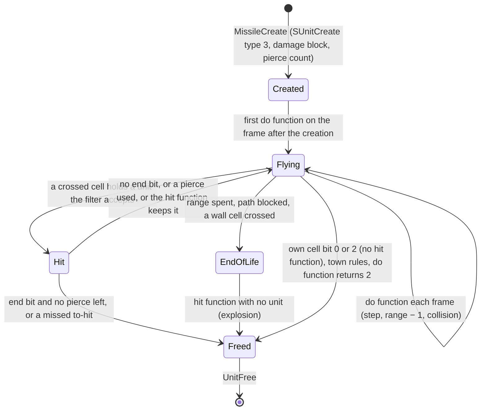
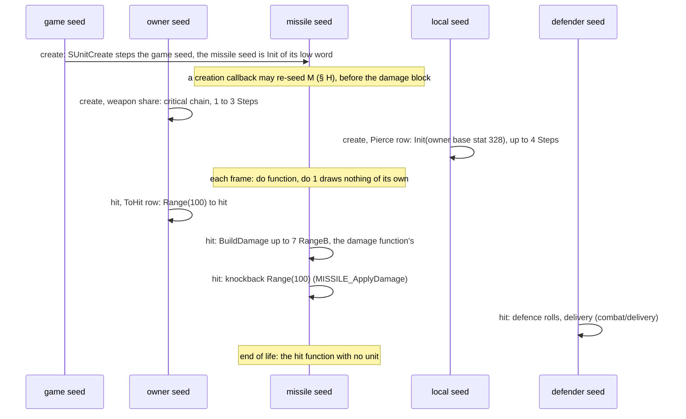

# Missiles: creation, the seed, the per-frame step, collision, the hit and the end of life

## Purpose

A missile is a server unit of type 3 that a skill, an item cast, a monster, a shrine, a quest or another missile
creates. This page specifies its creation from a parameter block (start, target, velocity, range, the collision
setup), the damage it carries from its creation, its own seed and the draws its creation makes on the owner's seed,
its step every frame (the do function, motion, the range countdown, the collision test against the room grid and the
units), the hit (the filters, pierce, the to-hit roll, the hit and damage functions, the packet it builds on its own
seed), sub-missiles and the sites that re-seed a missile, and the end of its life. What each numbered missile do, hit
and damage function does outside the tier-A rows is plan 0046's [catalogue](catalogue.md). Overview: [skills](README.md); the skill
side is [skills/dispatch](dispatch.md).



## Entry points

| When | Function | Tag |
|---|---|---|
| Any server missile is created | fn:sub_0059FA30_MissileCreate@0x0059FA30 | [C] (run:2026-10-25-skills: 31 391 creations) |
| A skill creates its `srvmissile` or a line or lob missile | fn:sub_0056ECB0_SkillMissileCreate@0x0056ECB0, fn:sub_0056EE90_SkillMissileCreateLob@0x0056EE90 | [C] for the `srvmissile` creations of rows with no `srvdofunc` (579, from `SKILLS_SrvDo`): line flags `0x21` (player, 362), `0x1021` for a monster with stat 19 above 0 (113), lob `0x420` (104), with B2's and B3's class, skill and level (run:2026-10-25-skills, [skills/0002 § 13](../../findings/skills/0002-missiles.md#13-plan-0066-batch-s2b-the-missile-lines-re-checked-2026-11-15-lanen66f)); [I] which creator a do function's creation calls, by its call site |
| A missile is created at a point (three quest functions, seven missile functions, five skill functions and two monster AIs, `AiUseSkillNearSelf` and `AiBladeCreeper`; no shrine function) | fn:sub_0056EDE0_MissileCreateAt@0x0056EDE0 | [C] its 17 callers, by three tools (static, [skills/0002 § 15](../../findings/skills/0002-missiles.md#15-plan-0066-batch-s2c-part-1-second-tool-table-call-and-data-scans-2026-11-16-lanen66q)) |
| Every frame, for every missile | fn:sub_005ADBB0_MissileDoFrame@0x005ADBB0 | [C] (run:2026-10-25-skills: 13 335 frames) |
| Do function 1, the common step | fn:sub_005AE1F0_MissileMoveCollide@0x005AE1F0 | [C] by the frame behaviour: `MF0`'s row number is `pSrvDoFunc` 1 in 20 860 windowed frames, a frame returning 2 returns its nested end call's 2 (823 range spent, 65 a failed step), a frame returning 1 is followed by the missile's frame at frame + 1, in D3's code order; the table entry reaches it through the thunk fn:sub_005B0BC0_MissDo01Thunk@0x005B0BC0 (run:2026-10-25-skills, [skills/0002 § 13](../../findings/skills/0002-missiles.md#13-plan-0066-batch-s2b-the-missile-lines-re-checked-2026-11-15-lanen66f)) |
| A missile reaches a unit, or ends its life | fn:MISSILE_HitUnit@0x005ADF10 | [C] for a missed to-hit (run:2026-10-25-skills: 105), and for the end and the pierce use of a damaging hit by a row with no hit function (run:2026-10-27-skills: 3 876); [C] an end call (no unit) of a row without a hit function builds nothing, leaves the missile's seed and returns 2 (80 600), one of a hit-function row returns 2 (5 610), and a unit call of a row without a hit function runs the to-hit, the build and the apply in that order (16 858 build and apply, 594 roll, build and apply, 718 a missed roll alone) ([skills/0002 § 13](../../findings/skills/0002-missiles.md#13-plan-0066-batch-s2b-the-missile-lines-re-checked-2026-11-15-lanen66f)); [I] what a hit function's result does |
| The packet at the hit | fn:MISSILE_BuildDamage@0x005A89A0 | [C] (run:2026-10-25-skills: 778 builds) |

## Inputs

### Tables

| Anchor | Used for |
|---|---|
| tbl:Missiles.txt:Vel, `VelLev`, `MaxVel`, `Accel`, `Range`, `LevRange`, `Activate`, `SubLoop`, `SubStart`, `SubStop` | motion and life (§ B, § D) |
| tbl:Missiles.txt:CollideType, `Collision`, `CollideKill`, `CollideFriend`, `LastCollide`, `NextHit`, `NextDelay`, `CanDestroy`, `Size` | collision and the hit filters (§ D, § E) |
| tbl:Missiles.txt:pSrvDoFunc, `pSrvHitFunc`, `pSrvDmgFunc` | the function tables (§ G) |
| tbl:Missiles.txt:SrcDamage, `SrcMissDmg`, `Half2HSrc`, `ApplyMastery`, `Holy`, `Skill`, `MissileSkill`, `EType`, `DamageRate`, `HitClass` | the damage block (§ C) |
| tbl:Missiles.txt:ToHit, `Pierce`, `Explosion`, `AlwaysExplode`, `KnockBack` | the hit (§ E) |
| tbl:Missiles.txt:Town, `SrcTown`, `CanSlow` | town ends and slowing (§ B, § D) |
| tbl:Missiles.txt:SubMissile1, `HitSubMissile1`, `Param1`, `Param2`, `sHitPar1`, `SrvCalc1` | sub-missiles and the catalogue functions (§ D, § G) |
| tbl:Skills.txt:srvmissile, `lob`, `SrcDam`, `EType` | the skill side (§ B, § C) |

Column semantics are the table docs': [Missiles](../../tables/Missiles.md),
[Missiles § Function index](../../tables/Missiles.md#function-index-plan-0046-phase-0),
[Skills § Dispatch](../../tables/Skills.md#dispatch-plan-0045-phase-0).

### Runtime state

| State | Type | Source |
|---|---|---|
| missile unit | type 3; its mode `Unit+0x10` is its `CollideType`; owner by guid with `Unit+0xC8` bit 10 | fn:sub_0059F8A0_MissileUnitInit@0x0059F8A0 |
| missile seed | `Unit+0x20`, from the game seed at creation ([rng/seeds](../rng/seeds.md)) | fn:sub_00555230_SUnitCreate@0x00555230 |
| `MissileData` (`Unit+0x14`, 0x34 bytes) | `+0x08` activate mark (s16), `+0x0A` skill (s16), `+0x0C` level (s16), `+0x0E` range (s16), `+0x10` frames left (s16), `+0x14` flags, `+0x18`/`+0x1C` last unit hit (type, guid), `+0x28` a stored word, `+0x2C` a packed offset or unit guid; s16 writes clamp to −0x8000..0x7FFF | struct:MissileData+0x10 |
| path | speed `+0x7C` (1/256 units), maximum `+0x84`, acceleration `+0x88`, collide mask `+0x50`, position 16.16 | fn:sub_006502D0_PathVelocityStep@0x006502D0 |
| frame counter | `Unit+0x44` (8.8) | 0x0059FC84–0x0059FEC3 |

### Inputs and oracles

| Input | Kind | Tag |
|---|---|---|
| the path planner's points (`PathPlan`, a missile's path types 4, 10 and 14) and its draws | no longer an oracle: [path/search](../path/search.md), H1 | [C] (fn:sub_00649970_PathPlan@0x00649970, run:2026-11-04-path-2) |
| the grid a plan reads, and the cells a step crosses | a value oracle, counted: [path/overview §§ F2, F3](../path/README.md#f3-the-counted-oracle). Types 4, 10 and 14 read no cell | [C] types 4 and 10 as [path/search](../path/search.md) §§ K and I state them; type 14's `PathPlanSpiral` calls only the cosine and sine tables and its non-stack operands are the path's (static, fn:sub_0067A140_PathPlanSpiral@0x0067A140, [skills/0002 § 16](../../findings/skills/0002-missiles.md#16-plan-0066-batch-s2c-part-2-bit-6-the-flag-bits-packets-and-the-creators-2026-11-16-lanen66q)); [I] the step's cell list (fn:sub_00648F40_PathStepCells@0x00648F40, fn:sub_0067A240_PathPlanRandomWalk@0x0067A240) |
| the numbered do, hit and damage functions outside § G's table | value oracles of the checker; specified in the [catalogue](catalogue.md) §§ C–F | [I] (data:g_MissileSrvDoFuncs@0x0073C768) |
| the result of a hit that does not miss | logged as the hit's return in run:2026-10-25-skills | [I] (fn:MISSILE_HitUnit@0x005ADF10) |
| the room collision word | [drlg/collision](../drlg/collision.md) | [I] (fn:sub_00648EB0_PathCellCollision@0x00648EB0) |

### Constants

| Name | Value | Anchor | Tag |
|---|---|---|---|
| do table | `g_MissileSrvDoFuncs`, bound 53 | data:g_MissileSrvDoFuncs@0x0073C768, data:g_MissileSrvDoFuncCount@0x0073C71C | [C] the count 53 and its one compare (0x005ADBFE); entry 0 null, 36 non-null (static, [skills/0002 § 15](../../findings/skills/0002-missiles.md#15-plan-0066-batch-s2c-part-1-second-tool-table-call-and-data-scans-2026-11-16-lanen66q)) |
| hit table | `g_MissileSrvHitFuncs`, bound 71 | data:g_MissileSrvHitFuncs@0x0073C840, data:g_MissileSrvHitFuncCount@0x0073C83C | [C] the count 71 and its four compares (0x005ADA19, 0x005AE0A7, 0x005AE112, 0x005B02DB); 53 non-null (static, [skills/0002 § 15](../../findings/skills/0002-missiles.md#15-plan-0066-batch-s2c-part-1-second-tool-table-call-and-data-scans-2026-11-16-lanen66q)) |
| damage table | `g_MissileSrvDmgFuncs`, bound 31 | data:g_MissileSrvDmgFuncs@0x0073C960 | [C] the count 31 at 0x0073C95C and its one compare (0x005AE164); 14 non-null (static, [skills/0002 § 15](../../findings/skills/0002-missiles.md#15-plan-0066-batch-s2c-part-1-second-tool-table-call-and-data-scans-2026-11-16-lanen66q)) |
| collide types | `g_MissileCollideTypes`, 9 × {filter, mask} | data:g_MissileCollideTypes@0x0073C720 | [C] 9 × 8 bytes up to the do table, read at `[esi*8 + 0x0073C720]` (0x005AE303) (static, [skills/0002 § 15](../../findings/skills/0002-missiles.md#15-plan-0066-batch-s2c-part-1-second-tool-table-call-and-data-scans-2026-11-16-lanen66q)) |
| direction table | `g_PathDirTable`, 128 × 12 bytes (image data a reimplementation carries) | data:g_PathDirTable@0x006EB7E0 | [C] `PathDirection`'s index is `(minor · 0x7F) / major`, stride 12; entries 0..127 run from (0, 4096, 0) to (2896, 2896, 7), and slot 128 is not a direction (static, [skills/0002 § 15](../../findings/skills/0002-missiles.md#15-plan-0066-batch-s2c-part-1-second-tool-table-call-and-data-scans-2026-11-16-lanen66q)) |
| velocity scale | 75/100 at creation | 0x0059FB18–0x0059FBAB | [C] (run:2026-10-25-skills) |
| distance refusal | a target 100 or more sub-tiles from the start in x or y: `abs(ex − x)` is the `neg` of the signed 32-bit difference, so a difference of exactly −2³¹ is not refused; the end point is the kept target's sub-tile position, else `(tx, ty)` | 0x0059FC2E–0x0059FC48 | [C] (run:2026-11-16-sweep2-s2ae4, [skills/0002 § 20](../../findings/skills/0002-missiles.md#20-plan-0066-batch-s2ae-part-4-the-zig-zag-callback-and-missilecreate-to-its-allocation-emulated-2026-11-16-lanen66sa)) |

[C] As data, every non-zero `pSrvDoFunc`, `pSrvHitFunc` and `pSrvDmgFunc` of the 684 rows that is positive as s16 is
below its table's bound and names a non-null entry; one cell (row 568 `pSrvHitFunc`, 64 948) is ≤ 0 as s16. Non-null
entries: do 36 (ids 1..37), hit 53 (ids 1..59), damage 14 (ids 1..14). Which column indexes which table is the code
reading of §§ D and E. (data:g_MissileSrvHitFuncs@0x0073C840, data:g_MissileSrvDmgFuncs@0x0073C960,
tbl:Missiles.txt:pSrvHitFunc, [skills/0002](../../findings/skills/0002-missiles.md#answer-summary))

## Algorithm

### A. The missile's life by event kind



### B. Creation

The parameter block (`MissileParams`, 0x5C bytes, zeroed by every caller):

| Offset | Field | Used when |
|---|---|---|
| `+0x00` | flags | below |
| `+0x04` | owner (a player or a monster, else no missile) | always |
| `+0x08` | source unit: the start when flag `0x1` is clear; the `SrcMissDmg` source | flag `0x1` clear |
| `+0x0C` | target unit: the path aims at it | when set |
| `+0x10` | missile class (row) | always; below the row count |
| `+0x14`, `+0x18` | start x, y | flag `0x1` |
| `+0x1C`, `+0x20` | target x, y: an offset from the start (flag `0x2`) or absolute (flag `0x20`); else the start | |
| `+0x28` | velocity: `<< 8` (flag `0x4`), as is (flags `0x4` and `0x10`) | flag `0x4` |
| `+0x2C`, `+0x30` | skill, level | always |
| `+0x34` | loops of the `SubStart..SubStop` range | flag `0x8` and `SubLoop` |
| `+0x40` | frames already run | flag `0x200` |
| `+0x44` | activate override | flag `0x800` |
| `+0x48` | missile stat 19 (to-hit) | flag `0x1000` |
| `+0x4C` | range override | flag `0x8000` |
| `+0x54`, `+0x58` | callback `(missile, +0x58)`, run before the damage block | non-null |
| flag `0x400` | lob: frames left from the distance | |
| flag `0x10000` | missile data flag bit 1 | |

[I] The block's layout and its flags are as above. (fn:sub_0059FA30_MissileCreate@0x0059FA30, struct:MissileParams+0x00)

```
B1. MissileCreate(game, p) → missile:                                [I] (fn:sub_0059FA30_MissileCreate@0x0059FA30, 0x0059FA79–0x0059FEC3, all of B1 except as tagged)
      if no p.owner or p.cls ∉ [0, nMissiles) (signed) or p.owner.type ∉ {0, 1} or no row: return none
      (x, y) ← p.flags & 1 ? (p.x, p.y) : p.source ? SubXY(p.source) : return none
      room ← RoomAtSubtile(room of p.owner, x, y);  if none: return none      ; the owner's room, else its first neighbour holding (x, y)
      (tx, ty) ← p.flags & 2 ? (x + p.tx, y + p.ty) : p.flags & 0x20 ? (p.tx, p.ty) : (x, y)
      v: i32 ← p.flags & 4 ? (p.flags & 0x10 ? p.vel : p.vel << 8)
                           : ((row.VelLev × p.lvl) ÷ 8 + row.Vel) << 8          ; u8 columns, i32 product, signed ÷, toward zero
      if row.CanSlow and p.owner in state 87 with its list: v ← list.stat161 × v ÷ 100   ; base stat at layer 0; i32, signed ÷
      if v ≠ 0: v ← v × 75 ÷ 100                                                   ; [C] (run:2026-10-25-skills)
      t ← p.target
      if v ≠ 0:
        if no t and (tx, ty) = (x, y): tx += 1; ty += 1
        else if t and t ≠ p.owner and SubXY(t) = SubXY(p.owner): t ← none; tx += 1; ty += 1
        (ex, ey) ← t ? SubXY(t) : (tx, ty)
        if |ex − x| ≥ 100 or |ey − y| ≥ 100: return none                  ; |d| = neg of the i32 difference: −2³¹ passes
      m ← SUnitCreate(3, p.cls, x, y, game, room, 1, mode: row.CollideType, 0)    ; one game-seed step, § C3
      range: i32 ← p.flags & 0x8000 ? p.range
                 : row.LevRange × p.lvl + row.Range + (p.flags & 8 and row.SubLoop ? (row.SubStop − row.SubStart) × p.loops : 0)
      if p.flags & 0x200: range −= p.ran;  m.u44 ← p.ran << 8
      m.data.range ← range;  m.data.left ← range
      m.data.activate ← range − (p.flags & 0x800 ? p.activate : row.Activate)
      path speed ← 0;  t ? PathSetTargetUnit(t) : PathSetTargetXY(tx, ty)
      PATH_SetMarkMask(path, row.Collision ? 0x40 : 0)
      PathSetCollMask(path, g_MissileCollideTypes[row.CollideType].mask)
      if row.CanDestroy: m.c4 |= 4
      if v ≠ 0: path speed ← v;  PathPlan(path, m, 0)
      if row.LastCollide: m.data.lastHit ← p.owner
      path accel ← row.Accel;  path max ← row.MaxVel << 8
      if p.flags & 0x400: m.data.left ← (max(Distance(m, tx, ty), 1) << 16) ÷ (v << 4)    ; unsigned; 0 when v = 0
      stat list;  if p.cb: p.cb(m, p.cbArg)                                       ; § H
      m.data.skill ← p.skill;  m.data.level ← p.lvl
      MissileInitDamage(p.source, p.owner, m, p.lvl)                               ; § C
      UnitSetOwner(m, p.owner);  m.c4 &= ~8;  PierceCount(p.owner, m)               ; § C4
      if p.flags & 0x1000: stat(m, 19) ← p.toHit
      if p.flags & 0x10000: m.data.flags |= 2
      MissileOwnerUModEvent(game, p.owner, m)                                      ; a monster owner only
      stat(m, 327) ← row.DamageRate
      return m
```

- B1. **Creation, measured in part.** In 31 391 creations the stored velocity is `(Vel << 8) · 75 / 100` (or the
  caller's, then `· 75/100`), the path's `Accel` and `MaxVel << 8` as read, the range `Range` less the frames already
  run (30 941; that run's checker took the other 450, after a creation callback, as oracles: they are H1's range and cap), the frames left equal to it (30 922; 19 lob
  counts are oracles), the activate mark, skill and level. [C] (fn:sub_0059FA30_MissileCreate@0x0059FA30,
  run:2026-10-25-skills) B1's lines up to the `SUnitCreate` call (0x0059FC75) were emulated whole: the guards (an owner
  type other than 0 or 1, negative included, refuses; the class compared signed), the start point, the room (the
  owner's room when the point lies inside its signed half-open bounds, else the first neighbour of its list at `+0`,
  count `+0x24`, that holds it, else a refusal), the target point, the velocity with the slow-missiles scaling
  (`CanSlow`, state 87 and its list) and the 75 % scaling, the `+1` adjustments and the 100-sub-tile refusal, then the
  call with its arguments (1 577 calls). [C] (fn:sub_0059FA30_MissileCreate@0x0059FA30, run:2026-11-16-sweep2-s2ae4, [skills/0002 § 20](../../findings/skills/0002-missiles.md#20-plan-0066-batch-s2ae-part-4-the-zig-zag-callback-and-missilecreate-to-its-allocation-emulated-2026-11-16-lanen66sa)) The lines after the
  call, the `SubLoop` loops in the range among them, lie past its pool allocation and are the reading. [I]
  (0x0059FC75)
- B1. **The `LevRange` term is `LevRange · lvl`, with no `− 1`.** 271 `blaze` creations (row 67, `LevRange` 25, `Range`
  90) at level 2, made by Blaze while the Sorceress walks, each have range and frames left `25 · 2 + 90` = 140;
  `LevRange · (lvl − 1) + Range` would give 115. [C] (fn:sub_0059FA30_MissileCreate@0x0059FA30,
  tbl:Missiles.txt:LevRange, run:2026-10-27-skills)
- B1. **The `VelLev` term is `(VelLev · lvl) ÷ 8`, with no `− 1`**: emulated at levels above 1, where the `− 1`
  reading fails in 853 cases. [C] (0x0059FB18–0x0059FBAB, tbl:Missiles.txt:VelLev, run:2026-11-16-sweep2-s2ae4, [skills/0002 § 20](../../findings/skills/0002-missiles.md#20-plan-0066-batch-s2ae-part-4-the-zig-zag-callback-and-missilecreate-to-its-allocation-emulated-2026-11-16-lanen66sa)) The 22 `spike2`
  creations of run:2026-10-27-skills were all at level 1, where `(7 · 1) ÷ 8` is 0 either way.
- B1. Integer semantics: `VelLev` and `Vel` are unsigned bytes and `lvl` the block's dword; `VelLev · lvl` is a 32-bit
  signed product and `÷ 8` truncates toward zero; the slow scaling reads stat 161 as the state-87 list's base stat at
  layer 0, and it and the 75 % scaling are 32-bit products before a signed `÷ 100` toward zero. [C]
  (0x0059FB18–0x0059FBAB, run:2026-11-16-sweep2-s2ae4, [skills/0002 § 20](../../findings/skills/0002-missiles.md#20-plan-0066-batch-s2ae-part-4-the-zig-zag-callback-and-missilecreate-to-its-allocation-emulated-2026-11-16-lanen66sa)) The lob division is unsigned and `MaxVel << 8` is a byte times 256. [I]
  (0x0059FDD4–0x0059FDDE, 0x0059FE02–0x0059FE12)
- B1. **The range counts do-function calls**: a missile created with range `R` runs at most `R` frames, and unit
  collision starts when `left ≤ R − Activate`. [C] every do-1 missile that ended with its range spent ran exactly the
  frames left at its creation (823 of 823), and the 230 unit hits in do-1 frames all came at frames left below the
  activate mark (run:2026-10-25-skills, [skills/0002 § 13](../../findings/skills/0002-missiles.md#13-plan-0066-batch-s2b-the-missile-lines-re-checked-2026-11-15-lanen66f)). [I] The boundary itself, `≤` against `<`: no hit came at frames left
  equal to the mark (fn:sub_005AE1F0_MissileMoveCollide@0x005AE1F0)
- B1. **The monster-owner hook** runs slot 5 of the owner's unique mods (`UModEventRun`: it needs a non-zero first
  unique-mod byte, then calls all nine, a later 0 not stopping it). Mod 29's function acts only when bit 3 of the
  monster data's byte `+0x16` is set, the missile is type 3 with an owner, its class lies in the Missiles count, the
  row's `+5` bit 4 is clear and the owner is not already marked (`+0x16` bit `0x80`), and sets that mark. It makes a
  local seed `Init(0x53454953)`, overwrites its high word with the owner's unit id and draws nothing from it before the
  first creation; the point is the owner's revalidated path target, else the missile's path position; `(dx, dy)` are
  the signs of owner − point, zeroed for classes 0x3F–0x42; the first side missile is `SkillMissileCreate(owner, skill,
  lvl, 0, 0, x0 − dy, y0 + dx, 0)` with the missile's skill and level. [C] (fn:sub_005A4270_UModEventRun@0x005A4270,
  fn:sub_005A43B0_MissileOwnerUModEvent@0x005A43B0, data:g_UModEventFns@0x0073C0B8, run:2026-11-16-sweep2-s2ae3, [skills/0002 § 19](../../findings/skills/0002-missiles.md#19-plan-0066-batch-s2ae-part-3-the-mask-uses-read-calldofunc-hit-27-and-unique-mod-29-emulated-2026-11-16-lanen66sa)) The second, at
  `(x0 + dy, y0 − dx)`, lies past the first creation's allocation. [I] (0x005A37AB)

```
B2. SkillMissileCreate(game, cls, unit, skill, lvl, dx, dy, tx, ty, useAmmo):   (line)   [I] (fn:sub_0056ECB0_SkillMissileCreate@0x0056ECB0, all of B2–B4)
      flags 0x21; start ← the unit's position + (dx, dy)
      target ← (tx, ty) when both ≠ 0, else SKILLS_GetTargetXY (no missile when it fails or gives 0)
      a monster owner with stat 19 ≠ 0: flag 0x1000 with that to-hit
      if useAmmo and a player: PLAYER_UseAmmo() must return ≥ 1, else no missile

B3. SkillMissileCreateLob(…):                                        (lob)
      flags 0x420; source ← the unit (its own position is the start); target as B2, not tested for 0; no to-hit flag

B4. MissileCreateAt(game, unit, skill, lvl, cls, x, y):              (at a point)
      (x, y) = (0, 0): take SKILLS_GetTargetXY;  refuse no point or one more than 100 from the unit (unsigned > 100)
      flags 1, start (x, y), no target: a moving missile aims at (x + 1, y + 1)
```

- B2. **The creators' flags, measured.** Over the 579 `srvmissile` creations of rows with no `srvdofunc`, the line
  creator sets flags `0x21` and the lob creator `0x420`; a monster owner with stat 19 adds `0x1000`, block `+0x48`
  and the missile's stat 19 equal to it (113 of 113), and a monster with stat 19 at 0 gets none (43). [C]
  (fn:sub_0056ECB0_SkillMissileCreate@0x0056ECB0, fn:sub_0056EE90_SkillMissileCreateLob@0x0056EE90,
  run:2026-10-25-skills, [skills/0002 § 13](../../findings/skills/0002-missiles.md#13-plan-0066-batch-s2b-the-missile-lines-re-checked-2026-11-15-lanen66f)) The target fallback and its refusal, B3's "no to-hit flag" (no lob owner had stat 19)
  and B4 are the reading. [I] (fn:sub_0056EDE0_MissileCreateAt@0x0056EDE0)
- B2. **`useAmmo` at the 33 call sites** of the line and lob creators (26 and 7): 1 at `SKILL_AttackDo` unless the
  unit's ranged missile is 27 (`magicarrow`, which takes the 0 site), at the Throw and Left Hand Throw do functions 3
  and 5 (lob for an item of type 38, else line), at six monster sites in six function bodies (0x005A2620, 0x005A2840,
  0x005A2C20, 0x005A3F30, 0x005A6D50, 0x005A6FF0), at `0x005CBF90` and at both calls of `0x005D88B0`, 14 sites in
  all; 0 at the other 19, `SKILLS_SrvDo` included. The use runs only behind the owner-type-0 test (0x0056EDA7,
  0x0056EF4A) and `PLAYER_UseAmmo`'s own test (0x0056C406). [C] (static, two decoders, fn:SKILL_AttackDo@0x0056F070,
  fn:sub_0056F460_SkillThrowDo@0x0056F460, fn:PLAYER_UseAmmo@0x0056C3F0, [skills/0002 § 16](../../findings/skills/0002-missiles.md#16-plan-0066-batch-s2c-part-2-bit-6-the-flag-bits-packets-and-the-creators-2026-11-16-lanen66q))
- B2. **No to-hit for a player's skill missile.** `SkillMissileCreate` sets flag `0x1000` for a monster owner only and
  `SkillMissileCreateLob` sets none, so neither adds the skill's `SKILLS_GetToHit` to the missile. The one exception read
  is do 74, Double Throw, which adds it to the missile's stat 19 after creating the missile
  ([catalogue § K](catalogue.md#k-barbarian-st-3234-3841-do-2-9-6872-7478)). Other creators of a to-hit flag or stat are
  unfollowed. [C] no player-owned missile carried stat 19 at a hit (0 of 101 777) and no player creation had flag
  `0x1000` (0 of 92 094), against 1 622 monster creations with it (run:2026-10-25-skills, [skills/0002 § 13](../../findings/skills/0002-missiles.md#13-plan-0066-batch-s2b-the-missile-lines-re-checked-2026-11-15-lanen66f)); the flag's only
  store sits behind the owner-type-1 test (static, [skills/0002 § 15](../../findings/skills/0002-missiles.md#15-plan-0066-batch-s2c-part-1-second-tool-table-call-and-data-scans-2026-11-16-lanen66q)). [I] do 74's add, which no session ran
  (fn:sub_0056ECB0_SkillMissileCreate@0x0056ECB0, fn:sub_0056EE90_SkillMissileCreateLob@0x0056EE90,
  fn:SKILLS_GetToHit@0x006449F0, 0x005D8943–0x005D896E, tbl:Skills.txt:srvdofunc, [quirks/0001](../../findings/quirks/0001-community-bugs.md#verdicts) row 18)
- B5. **The other creators**: skills core helpers (`0x0056D400` the nova of 64, `0x0056D4E0`), shrine effects 19, 21
  and 22, the Act V quest functions, three monster functions, 30 missile functions (the sub-missile helpers and the
  numbered functions) and 40 skill functions; 97 sites in 82 functions. Items create missiles only through
  `ITEMSKILL_Cast` → `SKILLS_SrvDo`. [C] the 97 `MissileCreate` call sites by three tools, with no absolute pointer to
  it; three of them in `SHRINE_Exploding`, `SHRINE_Poison` and `SHRINE_Storm`, none in an item or inventory function
  (static, [skills/0002 § 16](../../findings/skills/0002-missiles.md#16-plan-0066-batch-s2c-part-2-bit-6-the-flag-bits-packets-and-the-creators-2026-11-16-lanen66q)). [I] the count of functions (the symbols' bodies and 11 sites outside them) and item code's reach
  to the creators (data:g_ShrineEffects@0x006E1850, fn:sub_0056EDE0_MissileCreateAt@0x0056EDE0)

### C. The damage the missile carries

The weapon terms are taken **at creation** and stored as the missile's own stats; the packet is drawn from them at
the hit (§ F).

```
C1. MissileDamageBlock(blk, owner, source, m, lvl):                  [I] (fn:sub_0064B860_MissileDamageBlock@0x0064B860, 0x0064B8CE–0x0064BF19, all of C1)
      blk ← 0x7C zero bytes
      if row.Skill < 1 and not row.MissileSkill:                     ; the Missiles columns
        src ← row.SrcDamage;  srcMiss ← row.SrcMissDmg;  et ← row.EType
        (min, max) ← MISS_GetDamMin/Max(m, owner, cls, lvl);  (emin, emax, elen) ← MISS_GetElem*(…)
        if row.ApplyMastery: emin += ElemMastery(owner, et, emin); emax += ElemMastery(owner, et, emax)
      else:                                                          ; the Skills row
        sk ← row.Skill;  if row.MissileSkill and m.data.skill > 0: sk ← m.data.skill
        src ← Skills[sk].SrcDam;  srcMiss ← 0;  if row.SrcDamage = 0xFF: src ← 0
        (min, max) ← SKILLS_GetPhysMin/Max(owner, sk, lvl, 0);  et ← Skills[sk].EType
        (emin, emax, elen) ← SKILLS_GetElemMin/Max/Len(owner, sk, lvl, 1)
      Holy bits 1, 2, 4 → blk.flags 0x100, 0x200, 0x400
      ed ← minPct ← maxPct ← wmin ← wmax ← 0
      if src ≠ 0:
        blk.flags |= 1;  w ← the owner's weapon (a player's, a monster's when it has one)
        if CritChain(owner, w): blk.flags |= 2                      ; owner's seed: combat/overview B4
        if w is an item:
          if row.Half2HSrc and w is two-handed: src ← src ÷ 2
          ed ← GetMasteryBonus(owner, w, 0, 1) + str × StrBonus(w) ÷ 100 + dex × DexBonus(w) ÷ 100
          (lo, hi) ← throwable(w) ? (159, 160) : (owner's 0x0063D340 gives 2) ? (23, 24) : (21, 22)
          (wmin, wmax) ← (stat(owner, lo) << 8, stat(owner, hi) << 8)
          if w is of type 57: blk.undeadPct += 50
        else:
          if the owner is a hireling monster: ed ← stat(owner, 2)
          (wmin, wmax) ← (stat(owner, 21) << 8, stat(owner, 22) << 8)
        wmin ← wmin × src ÷ 128;  wmax ← wmax × src ÷ 128            ; signed, toward zero
        ed += stat(owner, 25);  minPct ← stat(owner, 18);  maxPct ← stat(owner, 17)
        demon, undead, defence-damage from the owner's stats 121, 122, 120; bypass from 103, 104, 106
      else if srcMiss ≠ 0 and source:
        if CritChain(source, none): blk.flags |= 2                  ; the source missile's seed
        wmin ← stat(source, 21) × srcMiss ÷ 128;  wmax ← stat(source, 22) × srcMiss ÷ 128
        ed ← stat(source, 25); minPct, maxPct, demon, undead, defence-damage from the source
      ed += stat(m, 25) + max(minPct, maxPct);  blk.edPct ← max(ed, −90)
      blk.min ← wmin + min;  blk.max ← wmax + max
      store (emin, emax, elen) by et: 1 fire, 2 lightning, 3 magic, 4/12 cold, 5 poison, 6/7/8 steals, 9 stun length, 11 burn
      if src ≠ 0: add the owner's elemental item damage (shift 8), scaled by src ÷ 128
      else if srcMiss ≠ 0 and source: the source's (shift 0), scaled by srcMiss ÷ 128
```

- C1. The block becomes the missile's stats: 12 level, 21/22 min/max, 48/49 fire, 315 fire length, 50/51, 52/53,
  54/55/56, 57/58/59, 326 poison count, 60–66 steals and stun, 316/317 burning, then **315 again from the burn
  length** (the fire length is overwritten), 121, 122, 120, 25; stats 103/104/106 = 1 for the bypass flags; stat 141
  = 1 for a critical; then the owner's stat-180 entries. The function also sets the missile data's `+0x14` bit 0 for
  block flag `0x1` and bit 1 for `0x4`; stat 12 comes from its fourth argument; the stat-180 entries are those of the
  owner's extended list's cache only (none for a plain list), taken from the lower bound of key `180 << 16` while fewer
  than 128, each set at its own layer. [C] (fn:sub_0064AC60_MissileDamageToStats@0x0064AC60, 0x0064ACFD, 0x0064AE2F,
  run:2026-11-16-sweep2-s2ae8, [skills/0002 § 24](../../findings/skills/0002-missiles.md#24-plan-0066-batch-s2ae-part-8-the-stat-setter-run-whole-behind-handlers-18-26-skillweaponwear-and-in-missiledamagetostats-2026-11-16-lanen66sa): 1 648 returns, the setter run whole)
- C2. **The critical chain** is [combat/overview § B4](../combat/README.md#b-draw-order-per-event)'s `CritChain`: one
  inline step against stat 337 even when it is 0, then one against stat 141 when it is non-zero, then one against the
  mastery's chance with a weapon when it is non-zero, stopping at the first success. In the run one step of the
  owner's seed was made per creation of a row that takes weapon damage and none for any other row (984 creations
  with one draw, 30 407 with none). [C] (fn:sub_0064A850_MissileCritRoll@0x0064A850, run:2026-10-25-skills) No
  creation of that run drew twice; the second and third steps were emulated with no used skill (steps 1, 2, 3: 1 216,
  1 475, 309 cases). [C] (0x0064A864–0x0064A890, run:2026-11-16-sweep2-s5fe, [combat/0001 § 22](../../findings/combat/0001-formulas.md#22-plan-0066-batch-s5fe-the-missile-critical-chain-emulated-the-finishers-entry-tests-and-peek-and-the-routes-that-cross-an-allocator-run2026-11-16-sweep2-s5fe))
- C2. A `SrcMissDmg` missile draws the chain on its **source missile's** seed, with no weapon and so no mastery step.
  [C] the chain called at 0x0064BD15 with `ESI` the block's third argument and weapon 0, so no mastery step
  (run:2026-11-16-sweep2-s5fe, [combat/0001 § 22](../../findings/combat/0001-formulas.md#22-plan-0066-batch-s5fe-the-missile-critical-chain-emulated-the-finishers-entry-tests-and-peek-and-the-routes-that-cross-an-allocator-run2026-11-16-sweep2-s5fe)). [I] that the branch is `SrcMissDmg`'s and the argument the source missile
  (fn:sub_0064B860_MissileDamageBlock@0x0064B860)
- C3. **The missile's seed.** `SUnitCreate` steps the game seed once and the missile's seed is `Init(post.low)`, in
  31 391 of 31 391 creations; the game seed chains from one creation of a do event to the next in 21 860 pairs. [C]
  (fn:sub_00555230_SUnitCreate@0x00555230, run:2026-10-25-skills)
- C4. **The pierce count.** For an owner of type 0 or 1 and a `Pierce` row, `p ← stat(owner, 166) + stat(owner,
  156)`; when `p` ≠ 0 a **local** seed `Init(baseStat(owner, 328))` is stepped up to four times while `low mod 100 <
  p`, and the count is the missile's stat 328. In 1 066 creations of `Pierce` rows (856 with draws) the count came
  from that local seed with the owner's and the game seeds untouched. [C]
  (fn:sub_0059F940_MissilePierceCount@0x0059F940, tbl:Missiles.txt:Pierce, run:2026-10-25-skills) Since stat 328
  is the owner's request counter ([skills/dispatch § B](dispatch.md#b-the-request)), the count depends on how many
  skill requests the owner has made, not on any game seed. [C] the count comes from the local `Init(stat 328)` seed in
  1 066 creations, and stat 328 rises by exactly the request calls between two observations (1 660 pairs with a request
  between) (0x00549D50, run:2026-10-25-skills, run:2026-10-27-skills, [skills/experiments, S2a](../../findings/skills/experiments.md#addendum-2026-11-10-plan-0066-batch-s2a-new-checks-over-the-three-kept-skills-runs-lanen66b), [skills/0002 § 13](../../findings/skills/0002-missiles.md#13-plan-0066-batch-s2b-the-missile-lines-re-checked-2026-11-15-lanen66f))

### D. Each frame

- D1. **The frame pass** runs the unit-event lists in the order missiles, players, monsters, objects and a fifth list,
  each first its every-frame list, then the current frame's bucket (frame & 63). So in one frame every missile steps
  before any player or monster acts. [C] the missiles' step before the players' and monsters' events: the separating
  pairs put a missile event before a monster's slot (21) and every-frame event (11), a player's slot (7) and the
  player-to-monster range (7), none after (run:2026-11-03-frame-order, [sim/frame D7](../sim/frame.md#d-the-unit-events-the-control-the-pass-the-runners)).
  [I] the objects' and the fifth list's place: no logged pair holds a missile and an object, and no fifth-list event
  is placed (fn:sub_005414D0_GameRunUnitEvents@0x005414D0, 0x005414EE–0x00541589)
- D1. A new missile first runs its do function on the frame after its creation: 493 of 493 followed missiles. [C]
  (run:2026-10-25-skills) The insertion into the every-frame list is not read. [I] (fn:sub_0059F8A0_MissileUnitInit@0x0059F8A0)

```
D2. MissileDoFrame(game, m):                                         [I] (fn:sub_005ADBB0_MissileDoFrame@0x005ADBB0, 0x005ADBEE–0x005ADCB3, all of D2)
      n: i16 ← row.pSrvDoFunc;  if no row or n ≤ 0 or n ≥ 53: return          ; signed test
      room ← the missile's room, or RoomAtSubtile(0, SubX, SubY);  owner ← UnitGetOwner(game, m)
      if row.SrcTown and owner and owner's room is a town: free
      if owner is a player and owner's room is a town:     free
      if not row.Town and room is a town:                  free
      if g_MissileSrvDoFuncs[n](game, m) = 2:              free      ; no null test

D3. MissileMoveCollide(game, m) → 1 keep, 2 free:     (do function 1, 551 stock rows)   [I] (fn:sub_005AE1F0_MissileMoveCollide@0x005AE1F0, 0x005AE1F0–0x005AE3FA, all of D3)
      if no row: return HitUnit(m, none, end 1)
      if path speed ≠ 0 and UnitMoveStep(game, m) = 2: return HitUnit(m, none, 1)     ; the step did not move
      left: i16 ← m.data.left − 1;  m.data.left ← left
      if left ≤ 0: return HitUnit(m, none, 1)                                         ; range spent
      ct ← m.mode;  if ct = 0: return 1
      if no room or no path: return 2
      c: u16 ← PathCellCollision(path);  if c & 5: return 2                           ; own cell: freed, no hit function
      if ct = 6: return 1
      if m.data.left > m.data.activate or c = 0: return 1
      if no g_MissileCollideTypes[ct].filter: return 2
      for each cell (x, y) of PathStepCells(path):
        k ← CollisionTest(room, x, y, size, g_MissileCollideTypes[ct].mask)
        if k ≠ 0:
          u ← FindUnitAtCell(room, x, y, filter, ctx, size);  if u: return HitUnit(m, u, 0)
          if k & 4: HitUnit(m, none, 1); return 2                                     ; a wall cell: end of life
      return 1

D4. PathVelocityStep(path, k):                                       [C] (fn:sub_006502D0_PathVelocityStep@0x006502D0, run:2026-10-25-skills, run:2026-11-16-sweep2-s2ae, all of D4)
      if accel ≠ 0:
        count += 1
        if count > 4:                                                ; signed
          v += accel
          if v > max: v ← max; accel ← 0
          else if v < 0: v ← 0                                       ; so a sum above a negative max keeps it
          count ← 0
      if k < 1: k ← 0x400                                            ; k: the ECX argument
      s: i32 ← (v × k) >> 6
      step.x ← (dir.x × s) >> 12;  step.y ← (dir.y × s) >> 12        ; written to path +0x72/+0x76; arithmetic shifts, 16.16
```

- D2–D3. **The do call and the range, measured.** In every windowed frame the missile's do row number is its
  `pSrvDoFunc` (do 1: 20 860, 3: 4 605, 5: 7 096, 23: 480), and a frame returning 1 is followed by the missile's frame
  at frame + 1 (31 804). In D3, 823 frames end at left 0 after the decrement and 65 before it (the failed step), each
  returning the nested end call's 2; unit hits come only at frames left below the activate mark (230); no do-1 frame
  returned 2 without a hit call. [C] (fn:sub_005ADBB0_MissileDoFrame@0x005ADBB0,
  fn:sub_005AE1F0_MissileMoveCollide@0x005AE1F0, run:2026-10-25-skills, [skills/0002 § 13](../../findings/skills/0002-missiles.md#13-plan-0066-batch-s2b-the-missile-lines-re-checked-2026-11-15-lanen66f)) The town frees, the own-cell and
  crossed-cell branches and collide types 0 and 6 were not taken in a logged frame. [I]
  (fn:sub_005AE1F0_MissileMoveCollide@0x005AE1F0)
- D2. A player's missile ends as soon as the player stands in town; a monster's only with `SrcTown`; any missile in a
  town room without `Town`. Entries 4 and 38..52 of the do table are null, used by no stock row. [I]
  (tbl:Missiles.txt:SrcTown, tbl:Missiles.txt:Town)
- D3. A cell word with bit 0 or 2 at the missile's own cell frees it **without** the hit function (no explosion); a
  crossed cell with bit 2 but no unit runs the end-of-life hit. `PathCellCollision` is the path's cached
  `CollisionTest(room, x, y, size, 0x7FFF)` at its point. [I] (fn:sub_00648EB0_PathCellCollision@0x00648EB0,
  fn:sub_00648F40_PathStepCells@0x00648F40)
- D4. **Motion, measured.** In 11 413 logged frames of 493 followed missiles the velocity took `Accel` on every fifth
  path step (278 fifth steps over 1 657 accelerating steps), was capped at `MaxVel << 8` with the acceleration
  stopping (60 caps), and the position moved by the step on both 16.16 axes; the frames left fell by 1 per
  frame (13 335). [C] (fn:sub_006502D0_PathVelocityStep@0x006502D0, fn:sub_005ADBB0_MissileDoFrame@0x005ADBB0,
  run:2026-10-25-skills) Emulated whole: the clamp at 0 (523 cases) is the `else` of the cap, the add is taken when
  the incremented count is above 4, the multiplier is the `ECX` argument, and the function writes the step to
  `+0x72`/`+0x76` without adding it to the position, which its caller moves. [C] (0x006502D0–0x0065034C, run:2026-11-16-sweep2-s2ae, [skills/0002 § 17](../../findings/skills/0002-missiles.md#17-plan-0066-batch-s2ae-part-1-leaf-functions-emulated-earlier-runs-re-read-the-routes-2026-11-16-lanen66sa))
- D4. `dir` is `PathDirection`'s vector: `i = (minor · 127) ÷ major` (0 when `major` is 0) indexes `g_PathDirTable`,
  the components swapped when `dx` is the minor axis and negated by the deltas' signs; the 64-direction index is the
  table's third word folded by the same octant rules. [C] (fn:sub_0064FC60_PathDirection@0x0064FC60,
  data:g_PathDirTable@0x006EB7E0, run:2026-11-16-sweep2-s2ae, [skills/0002 § 17](../../findings/skills/0002-missiles.md#17-plan-0066-batch-s2ae-part-1-leaf-functions-emulated-earlier-runs-re-read-the-routes-2026-11-16-lanen66sa): every octant, 3 000 cases)
- D5. **A frame's seed.** The do function of a followed frame leaves the missile's seed unchanged except by the hits
  inside it (37 frames, 110 checks: the hit's entry seed is the frame's, its exit the build's, the
  `MISSILE_ApplyDamage` boundary moving it in none of 36). [C] (fn:sub_005ADBB0_MissileDoFrame@0x005ADBB0,
  run:2026-10-25-skills)

**The collide types** (by `CollideType`):

| Type | Filter | Mask | Stock rows | Tag |
|---|---|---|---|---|
| 0 | none | — | 301 | [C] (data:g_MissileCollideTypes@0x0073C720, the `.txt` and `.bin` counts agree; (static, [skills/0002 § 15](../../findings/skills/0002-missiles.md#15-plan-0066-batch-s2c-part-1-second-tool-table-call-and-data-scans-2026-11-16-lanen66q))) |
| 1 | a player, or a monster for which `UnitAlignGet` returns 2 (stat 172 of the unit's state-0x69 list, 0 with none; 2 for any type above 1) | `0x0084` | 6 | [C] (fn:sub_005A87F0_CollidePlayerOrAlly@0x005A87F0, fn:sub_006259B0_UnitAlignGet@0x006259B0, run:2026-11-16-sweep2-s2ae2, [skills/0002 § 18](../../findings/skills/0002-missiles.md#18-plan-0066-batch-s2ae-part-2-the-mana-checks-and-the-collide-filters-emulated-2026-11-16-lanen66sa); the mask cell run:2026-11-16-sweep2-s2ae3, [skills/0002 § 19](../../findings/skills/0002-missiles.md#19-plan-0066-batch-s2ae-part-3-the-mask-uses-read-calldofunc-hit-27-and-unique-mod-29-emulated-2026-11-16-lanen66sa)) |
| 2, 5 | a monster | `0x0104` | 0 | [C] (fn:sub_005A87B0_CollideMonster@0x005A87B0, run:2026-11-16-sweep2-s2ae2, [skills/0002 § 18](../../findings/skills/0002-missiles.md#18-plan-0066-batch-s2ae-part-2-the-mana-checks-and-the-collide-filters-emulated-2026-11-16-lanen66sa); the mask cell run:2026-11-16-sweep2-s2ae3, [skills/0002 § 19](../../findings/skills/0002-missiles.md#19-plan-0066-batch-s2ae-part-3-the-mask-uses-read-calldofunc-hit-27-and-unique-mod-29-emulated-2026-11-16-lanen66sa)) |
| 3 | a player or a monster (type 0 or 1, signed) | `0x0184` | 339 | [C] (fn:sub_005A8850_CollideUnit@0x005A8850, run:2026-11-16-sweep2-s2ae2, [skills/0002 § 18](../../findings/skills/0002-missiles.md#18-plan-0066-batch-s2ae-part-2-the-mana-checks-and-the-collide-filters-emulated-2026-11-16-lanen66sa); the mask cell run:2026-11-16-sweep2-s2ae3, [skills/0002 § 19](../../findings/skills/0002-missiles.md#19-plan-0066-batch-s2ae-part-3-the-mask-uses-read-calldofunc-hit-27-and-unique-mod-29-emulated-2026-11-16-lanen66sa)) |
| 4 | none | — | 0 | [C] (data:g_MissileCollideTypes@0x0073C720, (static, [skills/0002 § 15](../../findings/skills/0002-missiles.md#15-plan-0066-batch-s2c-part-1-second-tool-table-call-and-data-scans-2026-11-16-lanen66q))) |
| 6 | no filter: walls only | `0x0004` | 24 | [C] (data:g_MissileCollideTypes@0x0073C720, (static, [skills/0002 § 15](../../findings/skills/0002-missiles.md#15-plan-0066-batch-s2c-part-1-second-tool-table-call-and-data-scans-2026-11-16-lanen66q))) |
| 7 | a `CanDestroy` missile (type 3, its class in the Missiles count, the row's `+4` bit 4) | `0x0040` | 0 | [C] (fn:sub_005A8890_CollideMissile@0x005A8890, run:2026-11-16-sweep2-s2ae2, [skills/0002 § 18](../../findings/skills/0002-missiles.md#18-plan-0066-batch-s2ae-part-2-the-mana-checks-and-the-collide-filters-emulated-2026-11-16-lanen66sa); the mask cell run:2026-11-16-sweep2-s2ae3, [skills/0002 § 19](../../findings/skills/0002-missiles.md#19-plan-0066-batch-s2ae-part-3-the-mask-uses-read-calldofunc-hit-27-and-unique-mod-29-emulated-2026-11-16-lanen66sa)) |
| 8 | a player or a monster | `0x0185` | 14 | [C] (fn:sub_005A8850_CollideUnit@0x005A8850, run:2026-11-16-sweep2-s2ae2, [skills/0002 § 18](../../findings/skills/0002-missiles.md#18-plan-0066-batch-s2ae-part-2-the-mana-checks-and-the-collide-filters-emulated-2026-11-16-lanen66sa); the mask cell run:2026-11-16-sweep2-s2ae3, [skills/0002 § 19](../../findings/skills/0002-missiles.md#19-plan-0066-batch-s2ae-part-3-the-mask-uses-read-calldofunc-hit-27-and-unique-mod-29-emulated-2026-11-16-lanen66sa)) |

- D6. The shared unit test requires the candidate's `Unit+0xC4` bits 2 and 3, and refuses a unit in state 86 for a
  `NextHit` row, the last unit hit (only for a missile whose Missiles row has bit 0 of `+4`, `MISSDATA_IsLastHit`), and
  an owner-friendly unit unless `CollideFriend`. The friend test is skipped with no owner; an owner that is the
  candidate counts as not hostile; two players are hostile when the owner's relation node for the candidate has bit 3
  (`PlayerPairFlags(…, 8)`), other pairs unless both alignments (`UnitAlignGet`) are 0 or both 2. The mask cells of the
  table above are image bytes no `.text` instruction stores through. [C]
  (fn:sub_005A8730_CollideUnitFilter@0x005A8730, 0x005A8730–0x005A88D1, fn:MISSDATA_IsLastHit@0x0064A470,
  fn:sub_0055B300_PlayerPairFlags@0x0055B300, run:2026-11-16-sweep2-s2ae2, [skills/0002 § 18](../../findings/skills/0002-missiles.md#18-plan-0066-batch-s2ae-part-2-the-mana-checks-and-the-collide-filters-emulated-2026-11-16-lanen66sa), run:2026-11-16-sweep2-s2ae3, [skills/0002 § 19](../../findings/skills/0002-missiles.md#19-plan-0066-batch-s2ae-part-3-the-mask-uses-read-calldofunc-hit-27-and-unique-mod-29-emulated-2026-11-16-lanen66sa))
- D7. **The `0x40` mark.** A `Collision` row's path marks its cell with `0x40`; do functions 3 (26 rows: the clouds,
  blizzards, `plaguejavelin`) and 5 (`meteorfire`) OR `0x40` into their cell while still or each frame; `HitUnit`
  unmarks it when a missile ends there, and do 31 unmarks it too. The one stock missile reader would be collide type
  7, which no stock row uses; the placement readers are [drlg/collision § F](../drlg/collision.md#f-unit-marks)'s. [C]
  the server's writers are `MissileCreate` (the path's mark mask, 0x0059FD54–0x0059FD64), do 3 (0x005AE504) and do 5
  (0x005AE5DD), the unmarkers `HitUnit` (0x005AE1B1–0x005AE1CB) and do 31 (0x005B0325); among the calls with a
  constant mask holding `0x40` the server readers are `MonDeathDrop`, the Zealot AI and six AI pattern tests; type 7
  is the only collide type whose mask holds `0x40` (static, [skills/0002 § 16](../../findings/skills/0002-missiles.md#16-plan-0066-batch-s2c-part-2-bit-6-the-flag-bits-packets-and-the-creators-2026-11-16-lanen66q)). [I] when do 3 and 5 mark and `HitUnit` unmarks
  (fn:sub_005AE480_MissDo03CloudMark@0x005AE480, fn:COLL_CellOrAt@0x0064CB90, data:g_MissileCollideTypes@0x0073C720)
- D8. **Do 2** (4 rows): when `SubMissile1` is set, evaluate `SrvCalc1` and create the sub-missile at the parent's
  position with velocity 0, the parent as source, its skill and level, loops `2 · lvl − 2`, then do 1. Its map up to
  that creation is reproduced: the loop count is written whether or not the value is above 0, and only flag 8 depends
  on it. [C] (ADR-0021, fn:sub_005AE400_MissDo02SubMissile@0x005AE400, run:2026-10-20-cat-emu-9a) Do 1 after a
  creation is the reading. [I] (fn:sub_005B0BC0_MissDo01Thunk@0x005B0BC0)

### E. The hit

```
E1. MISSILE_HitUnit(game, m, unit, end) → 1 keep, 2 free:            [I] (fn:MISSILE_HitUnit@0x005ADF10, 0x005ADF10–0x005AE1E9, all of E1 except as tagged)
      owner ← UnitGetOwner(game, m)
      c: u32 ← row.Explosion ? 0 : 2;  p: u32 ← 3                   ; c: bit 0 end, bit 1 damage, bit 2 keep
      if unit:
        if row.NextHit and unit in state 86: return 1
        if row.LastCollide and m.data.lastHit = unit: return 1
        m.data.lastHit ← unit                                       ; before the filters
        if not HitTypeFilter(unit, m.mode): return 1
        if owner and not Hostile(owner, unit) and not row.CollideFriend: return 1
      if owner and unit and row.Pierce and (stat(owner, 166) ≠ 0 or stat(owner, 156) ≠ 0):
        p ← PierceUse(m)                                            ; stat 328 > 0: stat 328 − 1, p ← 2; else 3
      if row.CollideKill: c |= 1
      if unit:
        if row.ToHit and not COMBAT_ToHitRoll(owner, unit, stat(m, 19), 1):     ; owner's seed: Range(100)
          JustHitState(m, unit);  UNIT_DispatchEvent(game, 0 hitbymissile, unit, m, 0)
          if row.AlwaysExplode and hitfn and hitfn(game, m, unit) & 4: return 1
          return 2                                                  ; [C] (run:2026-10-25-skills: 105 misses)
      else if not end and not row.AlwaysExplode: goto last
      if p & 2:
        JustHitState(m, unit);  UNIT_DispatchEvent(game, 0, unit, m, 0)
        if hitfn: c ← hitfn(game, m, unit);  if c & 4: return 1     ; replaces the result
      if unit and c & 2:
        MISSILE_BuildDamage(game, m, unit, &pkt)                     ; § F
        if dmgfn: dmgfn(game, m, unit, &pkt)
        MissileApplyAndAc(game, m, unit, &pkt)                       ; E3
    last:
      if (c & 1 or end) and p & 1: unmark 0x40 at the missile's cells; return 2
      return 1
```

- E1. `hitfn` is `g_MissileSrvHitFuncs[pSrvHitFunc]` when `0 < pSrvHitFunc < 71` as s16, `dmgfn` the same for
  `pSrvDmgFunc` and 31. **Row 568's 64 948 is −588 as s16** and fails the first test, so
  `royalstrikechainlightning` behaves as a row with no hit function: a signed bounds test, not an out-of-table call.
  [C] the five hit and damage tests and the do test are a `movzx` of the record word (`+0xE` hit, `+0x10` damage, `+0xC`
  do), `test ax, ax; jle`, `movsx` and a compare with the count, by two decoders; row 568 is the only row above 0x7FFF
  in any of the three columns (the `.bin` and the `.txt` agree) (0x005ADA0D–0x005ADA1F, 0x005AE09B–0x005AE0AD,
  0x005AE106–0x005AE118, 0x005B02CF–0x005B02E1, 0x005AE158–0x005AE16A, [skills/0002 § 15](../../findings/skills/0002-missiles.md#15-plan-0066-batch-s2c-part-1-second-tool-table-call-and-data-scans-2026-11-16-lanen66q))
- E1. **Order matters**: the last-hit unit is recorded before the type and hostility filters refuse; the pierce
  charge is taken before the to-hit roll, so a missed piercing missile has spent one and still ends; a hit function's
  return **replaces** the result; without one the result is `(Explosion ? 0 : 2) | (CollideKill ? 1 : 0)`; a
  successful pierce (`p` = 2) clears bit 0 of `p`, so the missile continues even with `CollideKill`. At the end of
  life (`end` 1) the hit function runs with no unit and no damage is built. [C] for a row without a hit function: the
  to-hit roll before the build and the build before `MissileApplyAndAc`, a missed roll ending the call with no build
  (718), an end call building no damage (80 600 of 80 600), a used pierce keeping a `CollideKill` missile (130 of 130)
  (fn:MISSILE_HitUnit@0x005ADF10, run:2026-10-25-skills, run:2026-10-27-skills, [skills/0002 § 13](../../findings/skills/0002-missiles.md#13-plan-0066-batch-s2b-the-missile-lines-re-checked-2026-11-15-lanen66f)). [I] the filters' order
  against the last-hit record, `NextHit` and `LastCollide`, and the hit-function rows (fn:sub_005ADA80_MissilePierceUse@0x005ADA80,
  fn:sub_005ADA40_MissileHitTypeFilter@0x005ADA40, tbl:Missiles.txt:CollideKill, tbl:Missiles.txt:AlwaysExplode)
- E1. **The end of a damaging hit, measured for a row with no hit function.** On 3 876 hit calls that reached
  `MISSILE_BuildDamage` (710 in run:2026-10-25-skills' logs, 3 166 in run:2026-10-27-skills'), the result and the
  missile's stat 328 are as E1 reads them: a pierce is used when the row has `Pierce`, the owner's stat 166 or 156
  (its value at the creation) is non-zero and stat 328 is above 0, stat 328 falling by 1 and the missile kept (130);
  otherwise the missile ends at the unit when the row has `CollideKill` (276) and is kept when it has not (3 470). [C]
  (fn:MISSILE_HitUnit@0x005ADF10, fn:sub_005ADA80_MissilePierceUse@0x005ADA80, tbl:Missiles.txt:CollideKill,
  tbl:Missiles.txt:Pierce, run:2026-10-27-skills, run:2026-10-25-skills)
- E1. **The `end` call's own branch, measured**: rows without a hit function return 2 with no build and the missile's
  seed unchanged (80 600), rows with one return 2 (5 610), and `AlwaysExplode` rows' end calls return 2 (662). [C]
  (fn:MISSILE_HitUnit@0x005ADF10, run:2026-10-25-skills, run:2026-10-27-skills, run:2026-10-30-skills-catalogue,
  [skills/0002 § 13](../../findings/skills/0002-missiles.md#13-plan-0066-batch-s2b-the-missile-lines-re-checked-2026-11-15-lanen66f)) The rest is the reading: the 64 hits of rows with a hit function (its result replaces the end bit: a
  boundary), the 1 203 calls that returned before the build (the last-hit, type and hostility filters, not separated
  from each other), `AlwaysExplode` with a hit function's bit 4, and an owner whose pierce stats changed after the
  creation. [I] (run:2026-10-27-skills, run:2026-10-25-skills)
- E1. **A missed to-hit.** `COMBAT_ToHitRoll`'s roll is the owner's next draw, `low mod 100` (269 rolls), and a failed
  roll returns 2 and frees the missile at that unit, a `Pierce` row having spent one pierce first: 105 misses, 7 with
  a pierce left. [C] (fn:COMBAT_ToHitRoll@0x0057D9B0, fn:MISSILE_HitUnit@0x005ADF10, run:2026-10-25-skills) The
  chance is [combat/to-hit § C](../combat/to-hit.md#c-the-hit-test-and-the-defence-rolls)'s with the missile's
  stat 19 as `arPct`. [I] (fn:COMBAT_ToHitRoll@0x0057D9B0) For a monster owner that is its own stat 19 from the creation
  (B2), and the monster formula adds it to the stat 19 it reads at the hit, so the attack rating counts it twice:
  [to-hit A2](../combat/to-hit.md#a-the-chance-to-hit-combat_tohitroll). [I] (fn:MISSILE_HitUnit@0x005ADF10)
- E2. **`justhit`**: for a `NextHit` row, a timed list of state 86 on the hit unit ending at `frame + NextDelay`
  (unit event 12), so any `NextHit` missile skips that unit until then. [I]
  (fn:sub_005ADB00_MissileJustHitState@0x005ADB00, tbl:Missiles.txt:NextDelay)
- E3. `MissileApplyAndAc`: `MISSILE_ApplyDamage` (the knockback `Range(missile seed, 100) < KnockBack` when the unit
  is not in state 54, the defence roll on the defender's seed, the delivery and get-hit of
  [combat/delivery](../combat/delivery.md)), then for a non-hireling monster with missile stat 120 ≠ 0 the
  monster's defence (stat 31) += it, floored at 0. [C] the knockback: `KnockBack` 0 leaves the missile's seed (17 608
  calls); `KnockBack` 33 steps it once and sets packet `+0x04` bit 3 exactly when the roll is below 33 (5 of 5); the
  defence draws inside are the defender's (85) (fn:MISSILE_ApplyDamage@0x005AD730, run:2026-10-25-skills,
  run:2026-10-27-skills, [skills/0002 § 13](../../findings/skills/0002-missiles.md#13-plan-0066-batch-s2b-the-missile-lines-re-checked-2026-11-15-lanen66f)). [I] state 54's skip and the stat-120 defence change, which no logged case reached
  (fn:sub_005ADCD0_MissileApplyAndAc@0x005ADCD0)
- E4. `sub_005AD9D0_MissileEndHit` (a hit function with no unit, then a free) has no call, jump, immediate or pointer
  in the image: unreached. [C] (static, fn:sub_005AD9D0_MissileEndHit@0x005AD9D0, [skills/0002 § 15](../../findings/skills/0002-missiles.md#15-plan-0066-batch-s2c-part-1-second-tool-table-call-and-data-scans-2026-11-16-lanen66q): no rel32 call, jump or
  conditional jump and no absolute pointer to it in any section)

### F. The packet at the hit (`MISSILE_BuildDamage`)

```
F1. MISSILE_BuildDamage(game, m, unit, pkt):                          [C] (fn:MISSILE_BuildDamage@0x005A89A0, run:2026-10-25-skills, all of F1 except as tagged)
      for (lo, hi, mastery, field) in
          [(21, 22, —, +0x08 phys), (48, 49, 329, +0x10 fire), (52, 53, 357, +0x20 magic),
           (50, 51, 330, +0x1C lightning), (54, 55, 331, +0x24 cold), (57, 58, 332, +0x28 poison),
           (316, 317, 329, +0x14 burn)]:                            ; this order: see the F1 notes
        a: i32 ← stat(m, lo);  b: i32 ← stat(m, hi)
        if a ≥ 1 and b ≥ 1:                                          ; tested before the mastery
          if a > b: swap(a, b)                                       ; [C] (0x005A894B–0x005A8951, 0x005A89EB–0x005A89F1, run:2026-11-16-sweep2-s2ae)
          k: i32 ← mastery ? stat(m, mastery) : 0                    ; [C] the missile's own stat (0x005A895F, fn:sub_005A8910_MissileElemRoll@0x005A8910, run:2026-11-16-sweep2-s2ae)
          if k ≠ 0: a += MulDiv(a, k, 100); b += MulDiv(b, k, 100)    ; [C] (0x005A8953–0x005A8982, fn:sub_005A8910_MissileElemRoll@0x005A8910, run:2026-11-16-sweep2-s2ae)
          pkt[field] ← RNG.RangeB(seed: m.seed, n: b − a) + a       ; draw, none when b − a < 1
      ; between them, no draw: cold length 56 → +0x30, poison length 59 → +0x2C (÷ stat 326 when > 1),
      ;   62 → +0x3C, 60 → +0x38, 64 → +0x40, 315 → +0x18, 66 → +0x44
      pct: i32 ← max(stat 25 + stat 121 (demon) + stat 122 (undead) + matching stat-180 entries, −90)   ; [I] stat 180 (fn:MISSILE_BuildDamage@0x005A89A0)
      pkt.phys += pkt.phys × pct ÷ 100
      if stat(m, 141): pkt.phys ×= 2; pkt.flags |= 0x2000
      stats 103/104/106 → the bypass flags
```

- F1. Over both runs, 4 118 builds in 33 logs match with 0 mismatches: the draws are `RangeB(hi − lo) + lo` on the
  missile's seed once per pair with both bounds ≥ 1 and `hi − lo ≥ 1`. In run:2026-10-25-skills's 778 builds (39 with
  no draw, 720 with one, 19 with two), every drawn elemental field (594), the physical field with its percent and
  critical doubling (164) and the cold and burn lengths (24) are as above. [C] (fn:MISSILE_BuildDamage@0x005A89A0,
  fn:sub_005A8910_MissileElemRoll@0x005A8910, run:2026-10-25-skills, run:2026-10-27-skills) The order of the pairs
  drawn together is separated by 143 two-draw builds over the three kept runs (19, 43 and 81): physical before fire
  (108), physical before poison (34), fire before cold (1). [C] (0x005A89A0–0x005A8C6F, run:2026-10-25-skills,
  run:2026-10-27-skills, run:2026-10-30-skills-catalogue, [skills/0002 § 13](../../findings/skills/0002-missiles.md#13-plan-0066-batch-s2b-the-missile-lines-re-checked-2026-11-15-lanen66f)) Magic, lightning and burn against the others (never
  two in one build) and the stat-180 entries (not in the logger's stat list) are the reading. [I]
  (0x005A89A0–0x005A8C6F)
- F1. **The mastery step, emulated.** No logged build separates it: none of the 54 655 `MH0` lists of the two
  runs holds a mastery stat (329–332, 357), so every logged mastery term is 0 and adds nothing. The emulation reaches
  it in 752 cases: the mastery is read on the same unit as the bounds (an id of −1 skipped), `MulDiv(bound, k, 100)` is
  added to both swapped bounds, and a stat of 0 adds nothing. [C] (0x005A895F,
  fn:sub_005A8910_MissileElemRoll@0x005A8910, run:2026-11-16-sweep2-s2ae, [skills/0002 § 17](../../findings/skills/0002-missiles.md#17-plan-0066-batch-s2ae-part-1-leaf-functions-emulated-earlier-runs-re-read-the-routes-2026-11-16-lanen66sa))
- F1. **Both bounds are the missile's**, the mastery stat included (`STATS_GetUnitStat` on the missile at
  `0x005A895F`, as for the bounds at `0x005A891C` and `0x005A8937`). The order is: test both bounds `> 0` (the maximum
  read first, `jg` at `0x005A8925` and `0x005A8940`; a field with either bound ≤ 0 is 0 and nothing else is read),
  swap a pair whose minimum is above its maximum (the physical pair at `0x005A89EB`–`0x005A89F1`, the others in
  `MissileElemRoll` at `0x005A894B`–`0x005A8951`), apply the mastery on the swapped bounds, then draw. No build of
  either run had an inverted pair; the emulation swaps 1 174 of them. [C] (fn:sub_005A8910_MissileElemRoll@0x005A8910,
  fn:MISSILE_BuildDamage@0x005A89A0, fn:STATS_GetUnitStat@0x00625480, run:2026-11-16-sweep2-s2ae, [skills/0002 § 17](../../findings/skills/0002-missiles.md#17-plan-0066-batch-s2ae-part-1-leaf-functions-emulated-earlier-runs-re-read-the-routes-2026-11-16-lanen66sa))
- F1. Combat's missile oracle is this build: [combat/overview § B3](../combat/README.md#b-draw-order-per-event). [I]
  (fn:MISSILE_BuildDamage@0x005A89A0)

### G. The function tables

- G1. `g_MissileSrvDoFuncs[n](game, m)` returns 1 keep or 2 free; `g_MissileSrvHitFuncs[n](game, m, unit)` returns the
  result flags; `g_MissileSrvDmgFuncs[n](game, m, unit, packet)` edits the packet. Used numbers on stock data: do 34,
  hit 49 (row 568's 64 948 aside), damage 13. [C] (data:g_MissileSrvDoFuncs@0x0073C768, data:g_MissileSrvHitFuncs@0x0073C840,
  [Missiles § Function index](../../tables/Missiles.md#function-index-plan-0046-phase-0), the `.txt` and `.bin` agree; [skills/0002 § 15](../../findings/skills/0002-missiles.md#15-plan-0066-batch-s2c-part-1-second-tool-table-call-and-data-scans-2026-11-16-lanen66q))
- G2. **A skill do function with a missile as its unit.** `CallDoFunc(n, skill, lvl)` calls `g_SkillDoFuncs[n]` when
  `n ≤ 0xBE` (unsigned) and the entry is non-null, with the missile as the unit. Its callers are hit function 23 (no
  stock row) and do function 14 (the three grim wards: `n = Param2` 30 every `Param1` 6 frames, then do 1), so on stock
  data only do 14 runs one: skill do 30 applies the creator's `auratargetstate` around the missile's path target.
  [C] the unsigned bound and the null test over the image's table (132 of 152 entries reached); `CallDoFunc` passes
  its `ECX` and `EDX` (the game, the missile) through unchanged with the stack `(skill, lvl)`, returns `n` past the
  bound and 0 at a null entry; its callers are 0x005AD03C (hit 23) and 0x005AF000 (do 14); entry 30 is `0x005C37C0`
  (run:2026-11-16-sweep2-s2ae3, [skills/0002 § 19](../../findings/skills/0002-missiles.md#19-plan-0066-batch-s2ae-part-3-the-mask-uses-read-calldofunc-hit-27-and-unique-mod-29-emulated-2026-11-16-lanen66sa)). [I] what do 30 does around the path target (fn:sub_0056D810_CallDoFunc@0x0056D810, fn:sub_005AEF70_MissDo14PeriodicDo@0x005AEF70,
  fn:sub_005C37C0_SkillDo30Curse@0x005C37C0) Do 14 is reproduced up to `CallDoFunc`, and with a skill or level ≤ 0 it
  returns 2 without do 1. [C] (ADR-0021, run:2026-10-20-cat-emu-9a)

**The tier-A missiles** (the reading of [skills/0003 § 6](../../findings/skills/0003-handlers.md#6-tier-a-missile-do-hit-and-damage-functions)):

| Missile (row) | do | hit | dmg | What it does | Tag |
|---|---|---|---|---|---|
| `firebolt` (58), `nova` (90), `frostnova` (119), `multipleshotarrow`, `firestorm` (457), `fistsoffirefirewall` (557) | 1 | — | — | D3; `ExplosionMissile` has no server reader | [C] by its operand pattern: of the 29 word operands at `+0x16`, the 11 in the server's range lie in no function that makes a Missiles row, and the row-making functions with one are client (static, [skills/0002 § 16](../../findings/skills/0002-missiles.md#16-plan-0066-batch-s2c-part-2-bit-6-the-flag-bits-packets-and-the-creators-2026-11-16-lanen66q)); [I] a row passed in as an argument, and a dword read across `+0x14..+0x17` (fn:sub_005AE1F0_MissileMoveCollide@0x005AE1F0) |
| `howl` (148) | 1 | 17 | — | a monster target without `auratargetstate`, whose level is below `owner level + Param2 + lvl`, flees for two level-scaled values; returns 0 (no damage, no end) | [C] up to the flee call (ADR-0021, run:2026-10-20-cat-emu-9c) |
| `plaguejavelin` (43) | 3 | 2 | — | do 3 marks `0x40`; hit 2 creates rings of `HitSubMissile1` (`plaguejavcloud`) from the hit unit, returns 3 | [C] up to the first ring creation (ADR-0021, run:2026-10-20-cat-emu-9d) |
| `plaguejavcloud` (221) | 3 | — | — | do 3 | [I] (fn:sub_005AE480_MissDo03CloudMark@0x005AE480) |
| `bomb in air` (385) | 1 | 36 | — | at the end of life only, `MissileCreateAt(bomb on ground)` | [C] up to that creation (ADR-0021, run:2026-10-20-cat-emu-9d) |
| `bomb on ground` (386) | 1 | 3 | — | hit 3 returns 0 for any unit; at the end hit 44 builds the damage and hits the area | [C] up to hit 44's `BuildDamage` (ADR-0021, run:2026-10-20-cat-emu-9c) |
| `meteorcenter` (101) | 1 | 14 | — | with an owner, the area hit, then a ring of 18 `meteorfire` | [C] up to `BuildDamage` (ADR-0021, run:2026-10-20-cat-emu-9c) |
| `meteorfire` (240) | 5 | — | 3 | do 5: marks `0x40`, loops its frame counter with one `RangeB(missile seed, SubStop − SubStart)` per loop; damage 3: one inline step of the missile seed, `low & 0x7F < dParam1` sets result `0x4000` | [C] for damage 3 (run:2026-10-20-cat-emu-9b); [I] do 5 (fn:sub_005AE520_MissDo05Loop@0x005AE520) |
| `firestormmaker` (458) | 23 | — | — | when path `+0x34` bit 3 is set, `SubMissile1` at its position, then do 1 | [C] up to its creation (ADR-0021, run:2026-10-20-cat-emu-9b) |
| grim wards (250, 253, 256) | 14 | 27 | — | G2; hit 27 returns 1 | [C] hit 27 (0x005ABA00) is `mov eax, 1; ret 4` (300 cases, run:2026-11-16-sweep2-s2ae3, [skills/0002 § 19](../../findings/skills/0002-missiles.md#19-plan-0066-batch-s2ae-part-3-the-mask-uses-read-calldofunc-hit-27-and-unique-mod-29-emulated-2026-11-16-lanen66sa)); do 14 is G2's (fn:sub_005AEF70_MissDo14PeriodicDo@0x005AEF70) |

- G3. The area hits (hits 44, 14) call `AreaHitUnit` per unit: the defence roll on the unit's own seed as a missile
  with no block, then the damage. [I] (fn:sub_0056B9C0_AreaHitUnit@0x0056B9C0, fn:sub_005AABB0_MissHit14AreaHitSub@0x005AABB0)

### H. Re-seed sites

A missile's seed is private: only the missile draws on it, except where a site below re-seeds it. After such a
re-seed the missile's draws are a function of the creator's value, not of the game seed. The table is also
[rng/seeds § Reimplementation notes](../rng/seeds.md#reimplementation-notes)'s *Skill and missile re-seeds*.

| Site | Re-seeds | From | Draws after | Tag |
|---|---|---|---|---|
| callback `MissCbReseedFromArg` (ring 37) | the new missile | the argument alone (the ring's local low word) | `PathPlan`'s walk: the range capped at 77, type 10, `+0x90`/`+0x91` the capped byte, then `PathPlan(path, missile, 0)` with no step before it | [C] to `PathPlan`'s entry (fn:sub_005D40F0_MissCbReseedFromArg@0x005D40F0, run:2026-11-16-sweep2-s2ae5, [skills/0002 § 21](../../findings/skills/0002-missiles.md#21-plan-0066-batch-s2ae-part-5-skills_targetcheck-and-two-re-seed-callbacks-emulated-2026-11-16-lanen66sa)); [I] the walk's steps (H1) and that the argument is do 37's ring word |
| callback `MissCbReseedZigzag` (ring 143) | the new missile | the argument | a zig-zag path: two steps before the first point (the first's low bit the turn sign, the second's `lo mod 3 + 2` the turn size), then one after each point `i` with `i mod 15 = 0` (the sign flips, a new size): `2 + ⌈n ÷ 15⌉` steps for `n ≥ 1` points, 2 for `n ≤ 0`, `n` the range capped at 77 | [C] (fn:sub_005D4680_MissCbReseedZigzag@0x005D4680, run:2026-11-16-sweep2-s2ae4, [skills/0002 § 20](../../findings/skills/0002-missiles.md#20-plan-0066-batch-s2ae-part-4-the-zig-zag-callback-and-missilecreate-to-its-allocation-emulated-2026-11-16-lanen66sa)) |
| callback `0x005C9290` (Firestorm and others) | the new missile | `Init(path +0x10 (u16) + the argument)` | `PathPlan`'s random walk steps the new seed: 20 or 38 in the logs (H1) | [C] (logged in the game: 618 of 618 over H1's runs, run:2026-10-25-skills among them; emulated: run:2026-11-03-path-emu-3) |
| callback `0x005CD110` | the new missile | path `+0x10` (u16) + the argument, a 32-bit add | 1 inline; only when its low dword mod 100 (unsigned) is at least 20, type 10 and `PathPlan` | [C] to `PathPlan`'s entry (fn:sub_005CD110_MissCbReseedRoll@0x005CD110, run:2026-11-16-sweep2-s2ae5, [skills/0002 § 21](../../findings/skills/0002-missiles.md#21-plan-0066-batch-s2ae-part-5-skills_targetcheck-and-two-re-seed-callbacks-emulated-2026-11-16-lanen66sa)); [I] the walk's steps after it (H1) |
| callback `0x005AC040` (catalogue mhit 38, 45) | the new missile | `Init(path +0x10)` | `PathPlan`'s random walk steps the new seed: 10 steps (H4) | [C] (logged in the game: run:2026-10-30-skills-catalogue, 36 of 36; emulated: run:2026-11-03-path-emu-3) |
| `0x005A9820` (do 8, 10, 17, 25) | the parent missile | `SubX + elapsed` | 2 `RangeB` | [C] (0x005A9820, run:2026-10-20-cat-emu-9a, run:2026-10-20-cat-emu-9b) |
| hit 58 (`0x005ACDF0`, row 654) | the missile | `SubX` | 2 `Range` | [C] up to its creation (ADR-0021, run:2026-10-20-cat-emu-9d) |
| do 28 (`0x005AFB80`) | the missile | `MissileData+0x28` | 2 `Range`, then `+0x28 ← low` | [C] (0x005AFB80, run:2026-10-20-cat-emu-9b) |
| do 34 (`0x005B04A0`) | the missile | `SubX` | 1 inline | [C] (0x005B04A0, run:2026-10-20-cat-emu-9b) |
| do 35 (`0x005B0640`) | the missile | `+0x28` | 1 inline, `+0x28 ← low` | [C] `(+0x28, 666)` and the step before `PathPlan` (run:2026-10-20-cat-emu-9b); [I] `+0x28 ← low` after `PathPlan` (0x005B0640) |

- H1. **`0x005C9290`, whole.** With `r` the missile's range (data `+0x0E`): when `r ≥ 78`, `r ← 77`, written back to the
  range and the frames left (`+0x0E`, `+0x10`, through their clamping setters); `Init(path word +0x10 + arg, 0x29A)`, `arg`
  the block's `+0x58`; `PathSetType(path, 10)`; `PathSetByte90(path, r)`; `PathPlan(path, missile, 0)`, which takes its
  flag `0x40000` branch to the random walk; flag `0x20` set. [C] (ADR-0015: emulated to its return, family `h1`, 198 of
  300 cases, run:2026-11-03-path-emu-3; fn:sub_005C9290_MissCbReseedPathXPlusArg@0x005C9290, 0x005C92A8–0x005C92E9,
  [path/0003 § 10](../../findings/path/0003-short-planners.md#10-missiles-h1-and-the-other-callback))
- H1. **`PathPlan` makes the steps, through the random walk, `+0x91 >> 1` of them.** `PathSetByte90` stores `min(r, 77)`
  in `+0x90` and `+0x91`. `PathSetType` and `PathSetByte90` step nothing: at `PathPlan`'s entry the seed is still the
  `Init` and the record has type 10, in all 100 cases of family `h1obs` (ADR-0021: each stops at that entry, return site
  0x005C92EE or 0x005AC090). A path with `+0x91` of 0 or 1 draws nothing (family `rwalk`). The walk, its points and its draw order are
  [path/search § I](../path/search.md#i-the-random-walk-type-10), with a worked example at [path/overview](../path/README.md#worked-example). [C] (ADR-0015 for the walk, run:2026-11-03-path-emu-3;
  fn:sub_0067A240_PathPlanRandomWalk@0x0067A240, fn:sub_00648CF0_PathSetType@0x00648CF0,
  fn:sub_00648E70_PathSetByte90@0x00648E70, 0x00649970, run:2026-11-03-path-emu-1)
- H1. **Why 20, 38 and 10, logged in the game.** In 654 of 654 creations of the game's own logs the seed at the exit is
  the one predicted from the `Init` and the logged range. The 450 of run:2026-10-25-skills are 442 of class 458 and 8 of
  class 195; the 168 more of class 195 and class 408's 36 come from the later runs. The range and frames left are logged
  as (40, 40) for all 442 and (77, 77) for all 176: these are the cap above. [C] (tbl:Missiles.txt:Range,
  run:2026-10-25-skills, run:2026-10-27-skills, run:2026-10-30-skills-catalogue, 0x005C92AD–0x005C92BB)

  | Callback | Class | Missiles row | `Range` | After the cap | Steps | Creations logged |
  |---|---:|---|---:|---:|---:|---:|
  | `0x005C9290` | 458 | `firestormmaker` | 40 | 40 | 20 | 442 |
  | `0x005C9290` | 195 | `lightunique` | 98 | 77 | 38 | 176 |
  | `0x005AC040` | 408 | `catapultchargedballbolt` | 20 | 20 | 10 | 36 |

- H1. The logged range is the row's `Range` in all 654: before the callback for the 618 of `0x005C9290`, at
  `MissileCreate`'s exit for the 36 of `0x005AC040`, which has no logger line and does not write the range back. All three
  classes have a blank `LevRange`; a missile with a `LevRange` draws by its own level (B1). The other re-seed callbacks and do functions reach
  the same walk when they set type 10, and are not rerun. [C] callbacks `0x005D40F0` and `0x005CD110` set type 10 and
  call `PathPlan(path, missile, 0)` with `+0x90`/`+0x91` the capped range, H1's entry state (2 616 calls, run:2026-11-16-sweep2-s2ae5, [skills/0002 § 21](../../findings/skills/0002-missiles.md#21-plan-0066-batch-s2ae-part-5-skills_targetcheck-and-two-re-seed-callbacks-emulated-2026-11-16-lanen66sa)).
  [I] the walk from those entries, and the do functions (fn:sub_0059FA30_MissileCreate@0x0059FA30,
  fn:sub_00649760_PathPlanStraight@0x00649760)
- H1. **After the plan.** A class 458 missile draws nothing more on that seed within its life: 68 watched seeds, each next write a block write with the high dword still the plan's exit value. [C] (0x00681F4F, run:2026-11-04-path, [path/overview D6](../path/README.md#d-the-17-types-planner-and-draws)) Classes 225 and 195 show the same at 22 and 3 watched seeds, short of the floor of 50, with one more each in the earlier run. [I] (0x00681F4F, run:2026-11-04-path-2)
- H2. The callbacks are stored at the parameter block's `+0x54` and called by `MissileCreate` with the new missile
  before the damage block (B1). [C] the call with the new missile: 618 of 618 callback lines carry `+0x54` =
  `0x005C9290`, `EDX` = `+0x58` and `ECX` the missile the creation returns, after `SUnitCreate` (run:2026-10-25-skills,
  [skills/0002 § 13](../../findings/skills/0002-missiles.md#13-plan-0066-batch-s2b-the-missile-lines-re-checked-2026-11-15-lanen66f)). [I] its place before the damage block, which none of these creations drew in
  (fn:sub_0059FA30_MissileCreate@0x0059FA30)
- H3. The other re-seed sites of the table are not reached by run:2026-10-25-skills or run:2026-10-27-skills (no
  breakpoint on them, and no session's row on their paths): `0x005ACDF0` (hit 58), `0x005D40F0` (do 37), `0x005D5BF0`
  and `0x00645390` (no reference in the image). `0x005C9290` re-seeded 168 more times in run:2026-10-27-skills, 38
  steps past the Init each. [I] (run:2026-10-25-skills, run:2026-10-27-skills) The call at `0x005AC073` was among
  them until run:2026-10-30-skills-catalogue reached it (H4).
- H4. **`0x005AC040`, whole.** The same as `0x005C9290` without the argument: `Init(path word +0x10, 0x29A)`, and
  `r > 255` gives 255, not written back, which `PathSetByte90` then caps at 77. [C] (ADR-0015: emulated to its return,
  family `h1`, 102 of 300 cases, run:2026-11-03-path-emu-3; fn:sub_005AC040_MissCbReseedPathX@0x005AC040,
  0x005AC04F–0x005AC08B)
- H4. **Logged in the game.** In 36 of 36 creations of a class-408 missile (`catapultchargedballbolt`) by a catapult
  spotter (class 516), the new missile's seed at `MissileCreate`'s exit lies on that stream, 10 steps past the `Init`:
  `Range` 20 `>> 1`, the random walk of H1. [C] (fn:sub_005AC040_MissCbReseedPathX@0x005AC040, 0x005AC073,
  run:2026-10-30-skills-catalogue,
  [skills/0003 § 17](../../findings/skills/0003-handlers.md#17-plan-0046-phase-2-the-catalogue-sample-run2026-10-30-skills-catalogue))
  24 of the 36 lie inside an `end` 1 call of a class-407 missile with hit function 38. [C]
  (run:2026-10-30-skills-catalogue, [skills/0002 § 13](../../findings/skills/0002-missiles.md#13-plan-0066-batch-s2b-the-missile-lines-re-checked-2026-11-15-lanen66f)) The entry that made the other 12, after the log's hit-line cap, is not
  read. [I] (fn:sub_005AC040_MissCbReseedPathX@0x005AC040, [catalogue § R](catalogue.md#r-in-the-game-the-phase-2-sample))

### I. Draws and seeds per event kind

| Event | Entry | Draws | Seed | Tag |
|---|---|---|---|---|
| create | `MissileCreate` | `SUnitCreate`: one step | game | [C] (run:2026-10-25-skills) |
| create | the damage block | the critical chain, 1 to 3 for weapon or source damage | owner (or the source missile) | [C] for one step (run:2026-10-25-skills) |
| create | the pierce count | up to 4 | local, from stat 328 | [C] (run:2026-10-25-skills) |
| create | a re-seeding callback | § H | the new missile | [C] for `0x005C9290` and `0x005AC040` (run:2026-10-25-skills, run:2026-10-30-skills-catalogue) |
| frame | `MissileDoFrame` | the do function's; do 1 none of its own | missile | [C] (run:2026-10-25-skills) |
| hit | `MISSILE_HitUnit` | `ToHit` roll | owner | [C] (run:2026-10-25-skills) |
| hit | `MISSILE_BuildDamage` | up to 7 `RangeB` | missile | [C] (run:2026-10-25-skills) |
| hit | the hit and damage functions | the catalogue's | missile, area units | [I] (data:g_MissileSrvHitFuncs@0x0073C840) |
| hit | `MISSILE_ApplyDamage` | knockback 1; defence, delivery | missile; defender | [C] one step on the missile's seed when `KnockBack` > 0 (5) and none at 0 (17 608), the defence rolls inside on the defender (85) (run:2026-10-25-skills, run:2026-10-27-skills, [skills/0002 § 13](../../findings/skills/0002-missiles.md#13-plan-0066-batch-s2b-the-missile-lines-re-checked-2026-11-15-lanen66f)); [I] state 54's skip; the delivery's draws are [combat/delivery](../combat/delivery.md)'s (fn:MISSILE_ApplyDamage@0x005AD730) |
| end | `MISSILE_HitUnit(…, none, 1)` | the hit function's | — | [C] none for a row without a hit function (80 600 of 80 600, [skills/0002 § 13](../../findings/skills/0002-missiles.md#13-plan-0066-batch-s2b-the-missile-lines-re-checked-2026-11-15-lanen66f)); [I] the hit functions' draws, the catalogue's (fn:MISSILE_HitUnit@0x005ADF10) |

- I1. A missile is a chain of events on three seeds: the owner's at creation (critical) and at the hit (to-hit), the
  missile's own from its creation through its hits, and the defender's. The owner's seed is shared with everything
  else the owner does between creation and hit, which the chaining of [skills/dispatch § P](dispatch.md#p-draws-and-seeds-per-event-kind)
  measures. [C] the owner's logged seeds chain forward from a missile's creation to its hit's to-hit roll in 1 356 of
  1 356 pairs; with no owner line between (1 079), the roll is the owner's next draw in 1 023 and 56 show unlogged
  owner draws (run:2026-10-27-skills, [skills/0002 § 13](../../findings/skills/0002-missiles.md#13-plan-0066-batch-s2b-the-missile-lines-re-checked-2026-11-15-lanen66f)). [I] the owner's other draws between them, dispatch § P's chaining
  (fn:sub_0064A850_MissileCritRoll@0x0064A850, fn:COMBAT_ToHitRoll@0x0057D9B0)

## Outputs

- A missile unit with its stats, path and seed; its hits as combat packets for [combat/delivery](../combat/delivery.md);
  the `0x40` cell marks for [drlg/collision](../drlg/collision.md); sub-missiles. [C] the unit with its stats, path
  and seed at the creation's return; its hits' builds carried to `MISSILE_ApplyDamage` (17 452 unit calls); sub-missiles
  from hits (961 creations inside a hit call name the hitting missile as their source) (run:2026-10-25-skills,
  run:2026-10-27-skills, [skills/0002 § 13](../../findings/skills/0002-missiles.md#13-plan-0066-batch-s2b-the-missile-lines-re-checked-2026-11-15-lanen66f)). [I] the cell marks as outputs, which no line logs (D7)
  (fn:sub_0059FA30_MissileCreate@0x0059FA30, fn:MISSILE_HitUnit@0x005ADF10)

## Worked example

**Firestorm's sub-missiles** (run:2026-10-25-skills, the Druid sessions, Normal): do 117 makes one
`SkillMissileCreate` of `firestormmaker`, then `calc1 − 1` creations through `MissileCreate` with the callback
`0x005C9290` and the index 0, 1, … as its argument. For each, `SUnitCreate` first seeds the new missile from the game
seed (C3), then the callback sets its seed to `Init(w + k)` with `w` the u16 at path `+0x10` and `k` the index (low
`w + k`, high `0x29A`), and the callback's `PathPlan` steps that seed 20 times before it returns (H1): in the run, 442 of
442 such sub-missiles. So two sub-missiles of one cast with the same `w` differ in their seeds only through `k`. [C]
(fn:sub_005C9290_MissCbReseedPathXPlusArg@0x005C9290, run:2026-10-25-skills) Each of the 221 Firestorm do events makes
one plain creation of class 458, then two with the callback and the arguments 0 and 1 in that order. [C]
(fn:sub_005C7160_SkillDo117Firestorm@0x005C7160, run:2026-10-25-skills, [skills/0002 § 13](../../findings/skills/0002-missiles.md#13-plan-0066-batch-s2b-the-missile-lines-re-checked-2026-11-15-lanen66f)) The order at a `calc1` above 3 (every
cast had 3) is the reading. [I] (fn:sub_005C7160_SkillDo117Firestorm@0x005C7160)

## Reimplementation notes

- **Test the function numbers as s16**, `> 0` first: row 568's hit function must not run. [C] (0x005ADA0D–0x005ADA1F,
  static, [skills/0002 § 15](../../findings/skills/0002-missiles.md#15-plan-0066-batch-s2c-part-1-second-tool-table-call-and-data-scans-2026-11-16-lanen66q))
- **The weapon terms are frozen at creation** for `MISSILE_BuildDamage`: it reads every stat from the missile (its
  first argument, written once at 0x005A89B9), and its direct-call closure (16 functions, no indirect call) holds no
  item or owner function. [C] (static, fn:MISSILE_BuildDamage@0x005A89A0, [skills/0002 § 16](../../findings/skills/0002-missiles.md#16-plan-0066-batch-s2c-part-2-bit-6-the-flag-bits-packets-and-the-creators-2026-11-16-lanen66q)) Two damage-table functions read the
  owner at the hit, damage 13 its stat 25 and damage 11 its elemental length ([catalogue](catalogue.md) D8, D10), so a
  missile's damage does not follow a weapon swap after it is fired only through the build. [I]
  (fn:sub_0064B860_MissileDamageBlock@0x0064B860)
- **Stat 337 draws at 0.** Every weapon-share missile steps its owner's seed at least once. [C]
  (fn:sub_0064A850_MissileCritRoll@0x0064A850, run:2026-10-25-skills)
- **The fire length is overwritten by the burn length** in stat 315 (C1). [C] (0x0064AE2F, run:2026-11-16-sweep2-s2ae8, [skills/0002 § 24](../../findings/skills/0002-missiles.md#24-plan-0066-batch-s2ae-part-8-the-stat-setter-run-whole-behind-handlers-18-26-skillweaponwear-and-in-missiledamagetostats-2026-11-16-lanen66sa): stat 315 ends
  with block word 26, not word 5)
- **A missile steps before any unit acts in its frame**, and first on the frame after its creation. [C] for the
  first frame (run:2026-10-25-skills) and for the missiles' place before the players' and monsters' events
  (run:2026-11-03-frame-order, D1); [I] for the objects and the fifth list (fn:sub_005414D0_GameRunUnitEvents@0x005414D0)
- **A missed piercing missile has spent a pierce.** [C] (run:2026-10-25-skills: 7 cases)
- **A used pierce keeps the missile**: stat 328 falls by 1 and the missile flies on. [C] (fn:sub_005ADA80_MissilePierceUse@0x005ADA80,
  run:2026-10-27-skills: 130 cases)
- **`LevRange` counts every level**: `LevRange · lvl + Range`, not from level 2. [C] (fn:sub_0059FA30_MissileCreate@0x0059FA30, run:2026-10-27-skills: 271 creations)
- **A freed missile at a bit-0 or bit-2 own cell does not explode.** [I] (fn:sub_005AE1F0_MissileMoveCollide@0x005AE1F0)
- **Keep `g_PathDirTable` as data.** The step direction is a table lookup, not a trigonometric function. [C]
  (data:g_PathDirTable@0x006EB7E0, run:2026-11-16-sweep2-s2ae, [skills/0002 § 17](../../findings/skills/0002-missiles.md#17-plan-0066-batch-s2ae-part-1-leaf-functions-emulated-earlier-runs-re-read-the-routes-2026-11-16-lanen66sa))

## Evidence

- [skills/0002](../../findings/skills/0002-missiles.md): creation, the damage block, the frame, collision, the hit,
  the packet, the tables; § 11 the run, § 12 part 2.
- [skills/0003](../../findings/skills/0003-handlers.md) §§ 6, 9, 10, 11: tier-A missile functions, re-seed sites,
  helpers, the frame pass; § 15 the run, § 16 part 2.
- [skills/0004](../../findings/skills/0004-missile-do-1-18.md)–[0007](../../findings/skills/0007-missile-hit-31-59.md)
  (plan 0046): the boundary reproductions cited in §§ D, G and H.
- [skills/experiments § run:2026-10-25-skills](../../findings/skills/experiments.md#run2026-10-25-skills),
  [§ run:2026-10-27-skills](../../findings/skills/experiments.md#run2026-10-27-skills).
- [path/overview](../path/README.md), [path/search](../path/search.md): the planner the H1 steps run in; [path/0003 § 10](../../findings/path/0003-short-planners.md#10-missiles-h1-and-the-other-callback), [path/0004 § 5](../../findings/path/0004-per-event-reproduction.md#5-draws-on-the-missiles-seed-after-a-type-10-plan), [path/0006](../../findings/path/0006-holdout.md).
- Tables: [Missiles](../../tables/Missiles.md), [Skills](../../tables/Skills.md).

## Open questions

- ~~The end of a missile at a hit and pierce uses at a hit.~~ For rows with no hit function, by run:2026-10-27-skills
  (E1).
- [L] The end of a hit for a row with a hit function, the filters before the build and `AlwaysExplode` with a hit
  function's bit 4 in a run (the `end` call's branch is measured, E1).
- ~~The `LevRange` term (case C4).~~ By run:2026-10-27-skills (B1); the lead's `− 1` contradicted.
- ~~**The `VelLev` term (case C2).**~~ The lead src:d2dfg-blizzard's `Vel` plus `VelLev` per caster level beyond 1
  is contradicted: `MissileCreate` emulated at levels above 1 gives `(VelLev · lvl) ÷ 8 + Vel` (B1,
  run:2026-11-16-sweep2-s2ae4), with the slow-missiles scaling and the distance refusal. The `SubLoop` loops, past the
  creation's allocation, wait for harness batch H2a.
- [L] **A missile over a bit-0 cell:** floor flag 01 "allow missiles pass" (`src:pk-walkable-flags-overview`) against D3's `c & 5`, which frees a do-function-1 missile with a `CollideType` on bit 0. One of the two is wrong for a cell with bit 0 and not bit 2; neither is shown by a run, and D3 stays `[I]`. [Entry](../../backlog/archive/2026-11-04-architect-reverser+spec-writer-0054-p12-missile-own-cell-bit0-vs-floor.md).
- [L] **The re-seed sites other than `0x005C9290` and `0x005AC040`** in a run (H3). ~~Which of the two callbacks' path
  calls steps the new seed~~: `PathPlan`'s random walk, H1 and H4.
- ~~The critical chain's second and third steps in a run.~~ Emulated (C2, run:2026-11-16-sweep2-s5fe), with no used
  skill.
- [L] **Whether a missile's stat list ever carries its owner's masteries** (329–332, 357), so that F1's mastery term
  is non-zero: no logged `MH0` list holds one (skills/0002 § 6). A logged build by a caster with Fire Mastery settles it.
- [L] The insertion of a new missile into the every-frame list (its first frame is measured, the code not read).
- [L] The unit filter for a missile as the unit (the grim wards' do 30) and the fifth unit-event list of the frame pass.
