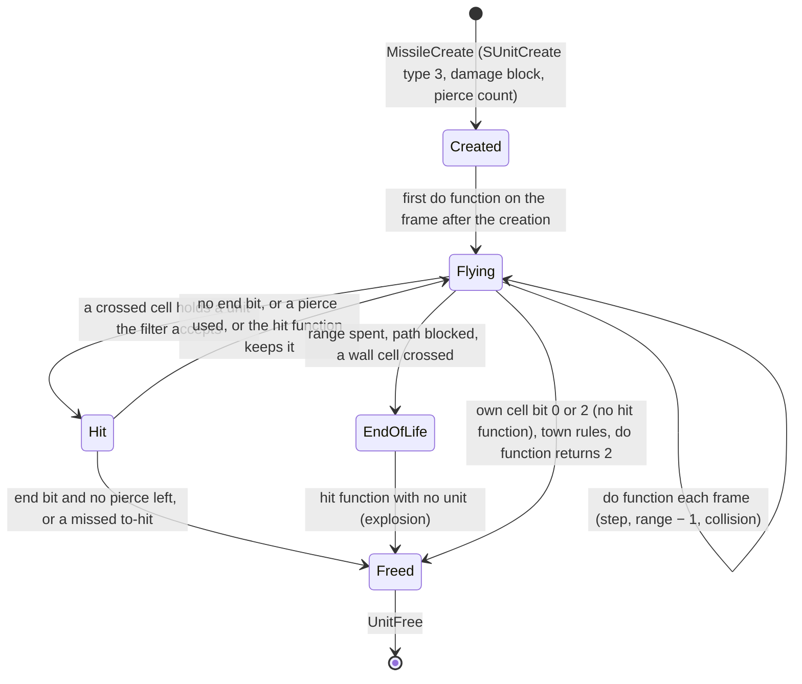

# Missiles: creation, the seed, the per-frame step, collision, the hit and the end of life

## Purpose

A missile is a server unit of type 3 that a skill, an item cast, a monster, a shrine, a quest or another missile
creates. This page specifies its creation from a parameter block (start, target, velocity, range, the collision
setup), the damage it carries from its creation, its own seed and the draws its creation makes on the owner's seed,
its step every frame (the do function, motion, the range countdown, the collision test against the room grid and the
units), the hit (the filters, pierce, the to-hit roll, the hit and damage functions, the packet it builds on its own
seed), sub-missiles and the sites that re-seed a missile, and the end of its life. What each numbered missile do, hit
and damage function does outside the tier-A rows is plan 0046's catalogue. Overview: [skills](README.md); the skill
side is [skills/dispatch](dispatch.md).



## Entry points

| When | Function | Tag |
|---|---|---|
| Any server missile is created | fn:sub_0059FA30_MissileCreate@0x0059FA30 | [C] (run:2026-10-25-skills: 31 391 creations) |
| A skill creates its `srvmissile` or a line or lob missile | fn:sub_0056ECB0_SkillMissileCreate@0x0056ECB0, fn:sub_0056EE90_SkillMissileCreateLob@0x0056EE90 | [I] |
| A missile is created at a point (quests, shrines, missiles, some skills) | fn:sub_0056EDE0_MissileCreateAt@0x0056EDE0 | [I] |
| Every frame, for every missile | fn:sub_005ADBB0_MissileDoFrame@0x005ADBB0 | [C] (run:2026-10-25-skills: 13 335 frames) |
| Do function 1, the common step | fn:sub_005AE1F0_MissileMoveCollide@0x005AE1F0 | [I] |
| A missile reaches a unit, or ends its life | fn:MISSILE_HitUnit@0x005ADF10 | [C] for a missed to-hit (run:2026-10-25-skills: 105); [I] otherwise |
| The packet at the hit | fn:MISSILE_BuildDamage@0x005A89A0 | [C] (run:2026-10-25-skills: 778 builds) |

## Inputs

### Tables

| Anchor | Used for |
|---|---|
| tbl:Missiles.txt:Vel, `VelLev`, `MaxVel`, `Accel`, `Range`, `LevRange`, `Activate`, `SubLoop`, `SubStart`, `SubStop` | motion and life (§ B, § D) |
| tbl:Missiles.txt:CollideType, `Collision`, `CollideKill`, `CollideFriend`, `LastCollide`, `NextHit`, `NextDelay`, `CanDestroy`, `Size` | collision and the hit filters (§ D, § E) |
| tbl:Missiles.txt:pSrvDoFunc, `pSrvHitFunc`, `pSrvDmgFunc` | the function tables (§ G) |
| tbl:Missiles.txt:SrcDamage, `SrcMissDmg`, `Half2HSrc`, `ApplyMastery`, `Holy`, `Skill`, `MissileSkill`, `EType`, `DamageRate`, `HitClass` | the damage block (§ C) |
| tbl:Missiles.txt:ToHit, `Pierce`, `Explosion`, `AlwaysExplode`, `KnockBack` | the hit (§ E) |
| tbl:Missiles.txt:Town, `SrcTown`, `CanSlow` | town ends and slowing (§ B, § D) |
| tbl:Missiles.txt:SubMissile1, `HitSubMissile1`, `Param1`, `Param2`, `sHitPar1`, `SrvCalc1` | sub-missiles and the catalogue functions (§ D, § G) |
| tbl:Skills.txt:srvmissile, `lob`, `SrcDam`, `EType` | the skill side (§ B, § C) |

Column semantics are the table docs': [Missiles](../../tables/Missiles.md),
[Missiles § Function index](../../tables/Missiles.md#function-index-plan-0046-phase-0),
[Skills § Dispatch](../../tables/Skills.md#dispatch-plan-0045-phase-0).

### Runtime state

| State | Type | Source |
|---|---|---|
| missile unit | type 3; its mode `Unit+0x10` is its `CollideType`; owner by guid with `Unit+0xC8` bit 10 | fn:sub_0059F8A0_MissileUnitInit@0x0059F8A0 |
| missile seed | `Unit+0x20`, from the game seed at creation ([rng/seeds](../rng/seeds.md)) | fn:sub_00555230_SUnitCreate@0x00555230 |
| `MissileData` (`Unit+0x14`, 0x34 bytes) | `+0x08` activate mark (s16), `+0x0A` skill (s16), `+0x0C` level (s16), `+0x0E` range (s16), `+0x10` frames left (s16), `+0x14` flags, `+0x18`/`+0x1C` last unit hit (type, guid), `+0x28` a stored word, `+0x2C` a packed offset or unit guid; s16 writes clamp to −0x8000..0x7FFF | struct:MissileData+0x10 |
| path | speed `+0x7C` (1/256 units), maximum `+0x84`, acceleration `+0x88`, collide mask `+0x50`, position 16.16 | fn:sub_006502D0_PathVelocityStep@0x006502D0 |
| frame counter | `Unit+0x44` (8.8) | 0x0059FC84–0x0059FEC3 |

### Inputs and oracles

| Input | Kind | Tag |
|---|---|---|
| the path planner's points (`PathPlan`, path types 7 and 10) and the cells a step crosses | value oracles | [I] (fn:sub_00649970_PathPlan@0x00649970, fn:sub_00648F40_PathStepCells@0x00648F40) |
| the numbered do, hit and damage functions outside § G's table | value oracles: plan 0046 | [I] (data:g_MissileSrvDoFuncs@0x0073C768) |
| the result of a hit that does not miss | logged as the hit's return in run:2026-10-25-skills | [I] (fn:MISSILE_HitUnit@0x005ADF10) |
| the room collision word | [drlg/collision](../drlg/collision.md) | [I] (fn:sub_00648EB0_PathCellCollision@0x00648EB0) |

### Constants

| Name | Value | Anchor | Tag |
|---|---|---|---|
| do table | `g_MissileSrvDoFuncs`, bound 53 | data:g_MissileSrvDoFuncs@0x0073C768, data:g_MissileSrvDoFuncCount@0x0073C71C | [I] |
| hit table | `g_MissileSrvHitFuncs`, bound 71 | data:g_MissileSrvHitFuncs@0x0073C840, data:g_MissileSrvHitFuncCount@0x0073C83C | [I] |
| damage table | `g_MissileSrvDmgFuncs`, bound 31 | data:g_MissileSrvDmgFuncs@0x0073C960 | [I] |
| collide types | `g_MissileCollideTypes`, 9 × {filter, mask} | data:g_MissileCollideTypes@0x0073C720 | [I] |
| direction table | `g_PathDirTable`, 128 × 12 bytes (image data a reimplementation carries) | data:g_PathDirTable@0x006EB7E0 | [I] |
| velocity scale | 75/100 at creation | 0x0059FB18–0x0059FBAB | [C] (run:2026-10-25-skills) |
| distance refusal | a target 100 or more sub-tiles from the start in x or y | 0x0059FC2E–0x0059FC48 | [I] |

[C] As data, every non-zero `pSrvDoFunc`, `pSrvHitFunc` and `pSrvDmgFunc` of the 684 rows that is positive as s16 is
below its table's bound and names a non-null entry; one cell (row 568 `pSrvHitFunc`, 64 948) is ≤ 0 as s16. Non-null
entries: do 36 (ids 1..37), hit 53 (ids 1..59), damage 14 (ids 1..14). Which column indexes which table is the code
reading of §§ D and E. (data:g_MissileSrvHitFuncs@0x0073C840, data:g_MissileSrvDmgFuncs@0x0073C960,
tbl:Missiles.txt:pSrvHitFunc, [skills/0002](../../findings/skills/0002-missiles.md#answer-summary))

## Algorithm

### A. The missile's life by event kind

```mermaid
sequenceDiagram
  participant G as game seed
  participant O as owner seed
  participant M as missile seed
  participant L as local seed
  participant D as defender seed
  G->>M: create: SUnitCreate steps the game seed, the missile seed is Init of its low word
  O->>O: create, weapon share: critical chain, 1 to 3 Steps
  L->>L: create, Pierce row: Init(owner base stat 328), up to 4 Steps
  Note over M: a creation callback may re-seed M (§ H)
  Note over M: each frame: do function; do 1 draws nothing of its own
  O->>O: hit, ToHit row: Range(100) to hit
  M->>M: hit: BuildDamage up to 7 RangeB, the damage function's
  M->>M: hit: knockback Range(100) (MISSILE_ApplyDamage)
  D->>D: hit: defence rolls, delivery (combat/delivery)
  Note over M: end of life: the hit function with no unit
```

### B. Creation

The parameter block (`MissileParams`, 0x5C bytes, zeroed by every caller):

| Offset | Field | Used when |
|---|---|---|
| `+0x00` | flags | below |
| `+0x04` | owner (a player or a monster, else no missile) | always |
| `+0x08` | source unit: the start when flag `0x1` is clear; the `SrcMissDmg` source | flag `0x1` clear |
| `+0x0C` | target unit: the path aims at it | when set |
| `+0x10` | missile class (row) | always; below the row count |
| `+0x14`, `+0x18` | start x, y | flag `0x1` |
| `+0x1C`, `+0x20` | target x, y: an offset from the start (flag `0x2`) or absolute (flag `0x20`); else the start | |
| `+0x28` | velocity: `<< 8` (flag `0x4`), as is (flags `0x4` and `0x10`) | flag `0x4` |
| `+0x2C`, `+0x30` | skill, level | always |
| `+0x34` | loops of the `SubStart..SubStop` range | flag `0x8` and `SubLoop` |
| `+0x40` | frames already run | flag `0x200` |
| `+0x44` | activate override | flag `0x800` |
| `+0x48` | missile stat 19 (to-hit) | flag `0x1000` |
| `+0x4C` | range override | flag `0x8000` |
| `+0x54`, `+0x58` | callback `(missile, +0x58)`, run before the damage block | non-null |
| flag `0x400` | lob: frames left from the distance | |
| flag `0x10000` | missile data flag bit 1 | |

[I] The block's layout and its flags are as above. (fn:sub_0059FA30_MissileCreate@0x0059FA30, struct:MissileParams+0x00)

```
B1. MissileCreate(game, p) → missile:                                [I] (fn:sub_0059FA30_MissileCreate@0x0059FA30, 0x0059FA79–0x0059FEC3, all of B1 except as tagged)
      if no p.owner or p.cls ∉ [0, nMissiles) or p.owner.type > 1 or no row: return none
      (x, y) ← p.flags & 1 ? (p.x, p.y) : p.source ? SubXY(p.source) : return none
      room ← RoomAtSubtile(room of p.owner, x, y);  if none: return none
      (tx, ty) ← p.flags & 2 ? (x + p.tx, y + p.ty) : p.flags & 0x20 ? (p.tx, p.ty) : (x, y)
      v: i32 ← p.flags & 4 ? (p.flags & 0x10 ? p.vel : p.vel << 8)
                           : ((row.VelLev × p.lvl) ÷ 8 + row.Vel) << 8          ; signed ÷, toward zero
      if row.CanSlow and p.owner in state 87 with its list: v ← list.stat161 × v ÷ 100
      if v ≠ 0: v ← v × 75 ÷ 100                                                   ; [C] (run:2026-10-25-skills)
      t ← p.target
      if v ≠ 0:
        if no t and (tx, ty) = (x, y): tx += 1; ty += 1
        else if t and t ≠ p.owner and SubXY(t) = SubXY(p.owner): t ← none; tx += 1; ty += 1
        (ex, ey) ← t ? SubXY(t) : (tx, ty)
        if |ex − x| ≥ 100 or |ey − y| ≥ 100: return none
      m ← SUnitCreate(3, p.cls, x, y, game, room, 1, mode: row.CollideType, 0)    ; one game-seed step, § C3
      range: i32 ← p.flags & 0x8000 ? p.range
                 : row.LevRange × p.lvl + row.Range + (p.flags & 8 and row.SubLoop ? (row.SubStop − row.SubStart) × p.loops : 0)
      if p.flags & 0x200: range −= p.ran;  m.u44 ← p.ran << 8
      m.data.range ← range;  m.data.left ← range
      m.data.activate ← range − (p.flags & 0x800 ? p.activate : row.Activate)
      path speed ← 0;  t ? PathSetTargetUnit(t) : PathSetTargetXY(tx, ty)
      PATH_SetMarkMask(path, row.Collision ? 0x40 : 0)
      PathSetCollMask(path, g_MissileCollideTypes[row.CollideType].mask)
      if row.CanDestroy: m.c4 |= 4
      if v ≠ 0: path speed ← v;  PathPlan(path, m, 0)
      if row.LastCollide: m.data.lastHit ← p.owner
      path accel ← row.Accel;  path max ← row.MaxVel << 8
      if p.flags & 0x400: m.data.left ← (max(Distance(m, tx, ty), 1) << 16) ÷ (v << 4)    ; unsigned; 0 when v = 0
      stat list;  if p.cb: p.cb(m, p.cbArg)                                       ; § H
      m.data.skill ← p.skill;  m.data.level ← p.lvl
      MissileInitDamage(p.source, p.owner, m, p.lvl)                               ; § C
      UnitSetOwner(m, p.owner);  m.c4 &= ~8;  PierceCount(p.owner, m)               ; § C4
      if p.flags & 0x1000: stat(m, 19) ← p.toHit
      if p.flags & 0x10000: m.data.flags |= 2
      MissileOwnerUModEvent(game, p.owner, m)                                      ; a monster owner only
      stat(m, 327) ← row.DamageRate
      return m
```

- B1. **Creation, measured in part.** In 31 391 creations the stored velocity is `(Vel << 8) · 75 / 100` (or the
  caller's, then `· 75/100`), the path's `Accel` and `MaxVel << 8` as read, the range `Range` less the frames already
  run (30 941; 450 ranges taken after a creation callback are oracles), the frames left equal to it (30 922; 19 lob
  counts are oracles), the activate mark, skill and level. [C] (fn:sub_0059FA30_MissileCreate@0x0059FA30,
  run:2026-10-25-skills) The `VelLev` and `LevRange` terms (no row with them was created), the slow-missiles scaling,
  the `SubLoop` loops and the 100-sub-tile refusal are the reading. [I] (run:2026-10-25-skills)
- B1. Integer semantics: `(VelLev · lvl) ÷ 8` is signed and truncates toward zero; the slow and the 75 % scalings are
  signed `÷ 100`; the lob division is unsigned; `MaxVel << 8` is a byte times 256. [I] (0x0059FB18–0x0059FBAB,
  0x0059FDD4–0x0059FDDE, 0x0059FE02–0x0059FE12)
- B1. **The range counts do-function calls**: a missile created with range `R` runs at most `R` frames, and unit
  collision starts when `left ≤ R − Activate`. [I] (fn:sub_005AE1F0_MissileMoveCollide@0x005AE1F0)
- B1. The monster-owner hook runs slot 5 of the owner's unique mods: mod 29's function makes a local seed from the
  constant `0x53454953` and creates two side missiles beside this one. [I]
  (fn:sub_005A43B0_MissileOwnerUModEvent@0x005A43B0, data:g_UModEventFns@0x0073C0B8)

```
B2. SkillMissileCreate(game, cls, unit, skill, lvl, dx, dy, tx, ty, useAmmo):   (line)   [I] (fn:sub_0056ECB0_SkillMissileCreate@0x0056ECB0, all of B2–B4)
      flags 0x21; start ← the unit's position + (dx, dy)
      target ← (tx, ty) when both ≠ 0, else SKILLS_GetTargetXY (no missile when it fails or gives 0)
      a monster owner with stat 19 ≠ 0: flag 0x1000 with that to-hit
      if useAmmo and a player: PLAYER_UseAmmo() must return ≥ 1, else no missile

B3. SkillMissileCreateLob(…):                                        (lob)
      flags 0x420; source ← the unit (its own position is the start); target as B2, not tested for 0; no to-hit flag

B4. MissileCreateAt(game, unit, skill, lvl, cls, x, y):              (at a point)
      (x, y) = (0, 0): take SKILLS_GetTargetXY;  refuse no point or one more than 100 from the unit (unsigned > 100)
      flags 1, start (x, y), no target: a moving missile aims at (x + 1, y + 1)
```

- B2. **`useAmmo` at the 33 call sites** of the line and lob creators: 1 at `SKILL_AttackDo` unless the unit's ranged
  missile is 27 (`magicarrow`), at the Throw and Left Hand Throw do functions 3 and 5 (lob for an item of type 38,
  else line), at five monster functions (six sites), at `0x005CBF90` and at both calls of `0x005D88B0`; 0 everywhere
  else, `SKILLS_SrvDo` included. The use acts only for a player owner. [I] (fn:SKILL_AttackDo@0x0056F070,
  fn:sub_0056F460_SkillThrowDo@0x0056F460, fn:PLAYER_UseAmmo@0x0056C3F0)
- B5. **The other creators**: skills core helpers (`0x0056D400` the nova of 64, `0x0056D4E0`), shrine effects 19, 21
  and 22, the Act V quest functions, three monster functions, 30 missile functions (the sub-missile helpers and the
  numbered functions) and 40 skill functions; 97 sites in 82 functions. Items create missiles only through
  `ITEMSKILL_Cast` → `SKILLS_SrvDo`. [I] (data:g_ShrineEffects@0x006E1850, fn:sub_0056EDE0_MissileCreateAt@0x0056EDE0)

### C. The damage the missile carries

The weapon terms are taken **at creation** and stored as the missile's own stats; the packet is drawn from them at
the hit (§ F).

```
C1. MissileDamageBlock(blk, owner, source, m, lvl):                  [I] (fn:sub_0064B860_MissileDamageBlock@0x0064B860, 0x0064B8CE–0x0064BF19, all of C1)
      blk ← 0x7C zero bytes
      if row.Skill < 1 and not row.MissileSkill:                     ; the Missiles columns
        src ← row.SrcDamage;  srcMiss ← row.SrcMissDmg;  et ← row.EType
        (min, max) ← MISS_GetDamMin/Max(m, owner, cls, lvl);  (emin, emax, elen) ← MISS_GetElem*(…)
        if row.ApplyMastery: emin += ElemMastery(owner, et, emin); emax += ElemMastery(owner, et, emax)
      else:                                                          ; the Skills row
        sk ← row.Skill;  if row.MissileSkill and m.data.skill > 0: sk ← m.data.skill
        src ← Skills[sk].SrcDam;  srcMiss ← 0;  if row.SrcDamage = 0xFF: src ← 0
        (min, max) ← SKILLS_GetPhysMin/Max(owner, sk, lvl, 0);  et ← Skills[sk].EType
        (emin, emax, elen) ← SKILLS_GetElemMin/Max/Len(owner, sk, lvl, 1)
      Holy bits 1, 2, 4 → blk.flags 0x100, 0x200, 0x400
      ed ← minPct ← maxPct ← wmin ← wmax ← 0
      if src ≠ 0:
        blk.flags |= 1;  w ← the owner's weapon (a player's, a monster's when it has one)
        if CritChain(owner, w): blk.flags |= 2                      ; owner's seed: combat/overview B4
        if w is an item:
          if row.Half2HSrc and w is two-handed: src ← src ÷ 2
          ed ← GetMasteryBonus(owner, w, 0, 1) + str × StrBonus(w) ÷ 100 + dex × DexBonus(w) ÷ 100
          (lo, hi) ← throwable(w) ? (159, 160) : (owner's 0x0063D340 gives 2) ? (23, 24) : (21, 22)
          (wmin, wmax) ← (stat(owner, lo) << 8, stat(owner, hi) << 8)
          if w is of type 57: blk.undeadPct += 50
        else:
          if the owner is a hireling monster: ed ← stat(owner, 2)
          (wmin, wmax) ← (stat(owner, 21) << 8, stat(owner, 22) << 8)
        wmin ← wmin × src ÷ 128;  wmax ← wmax × src ÷ 128            ; signed, toward zero
        ed += stat(owner, 25);  minPct ← stat(owner, 18);  maxPct ← stat(owner, 17)
        demon, undead, defence-damage from the owner's stats 121, 122, 120; bypass from 103, 104, 106
      else if srcMiss ≠ 0 and source:
        if CritChain(source, none): blk.flags |= 2                  ; the source missile's seed
        wmin ← stat(source, 21) × srcMiss ÷ 128;  wmax ← stat(source, 22) × srcMiss ÷ 128
        ed ← stat(source, 25); minPct, maxPct, demon, undead, defence-damage from the source
      ed += stat(m, 25) + max(minPct, maxPct);  blk.edPct ← max(ed, −90)
      blk.min ← wmin + min;  blk.max ← wmax + max
      store (emin, emax, elen) by et: 1 fire, 2 lightning, 3 magic, 4/12 cold, 5 poison, 6/7/8 steals, 9 stun length, 11 burn
      if src ≠ 0: add the owner's elemental item damage (shift 8), scaled by src ÷ 128
      else if srcMiss ≠ 0 and source: the source's (shift 0), scaled by srcMiss ÷ 128
```

- C1. The block becomes the missile's stats: 12 level, 21/22 min/max, 48/49 fire, 315 fire length, 50/51, 52/53,
  54/55/56, 57/58/59, 326 poison count, 60–66 steals and stun, 316/317 burning, then **315 again from the burn
  length** (the fire length is overwritten), 121, 122, 120, 25; stats 103/104/106 = 1 for the bypass flags; stat 141
  = 1 for a critical; then the owner's stat-180 entries. [I] (fn:sub_0064AC60_MissileDamageToStats@0x0064AC60,
  0x0064ACFD, 0x0064AE2F)
- C2. **The critical chain** is [combat/overview § B4](../combat/README.md#b-draw-order-per-event)'s `CritChain`: one
  inline step against stat 337 even when it is 0, then one against stat 141 when it is non-zero, then one against the
  mastery's chance with a weapon when it is non-zero, stopping at the first success. In the run one step of the
  owner's seed was made per creation of a row that takes weapon damage and none for any other row (984 creations
  with one draw, 30 407 with none). [C] (fn:sub_0064A850_MissileCritRoll@0x0064A850, run:2026-10-25-skills) No
  creation drew twice: the second and third steps are the reading. [I] (0x0064A864–0x0064A890, run:2026-10-25-skills)
- C2. A `SrcMissDmg` missile draws the chain on its **source missile's** seed, with no weapon and so no mastery step.
  [I] (fn:sub_0064B860_MissileDamageBlock@0x0064B860)
- C3. **The missile's seed.** `SUnitCreate` steps the game seed once and the missile's seed is `Init(post.low)`, in
  31 391 of 31 391 creations; the game seed chains from one creation of a do event to the next in 21 860 pairs. [C]
  (fn:sub_00555230_SUnitCreate@0x00555230, run:2026-10-25-skills)
- C4. **The pierce count.** For an owner of type 0 or 1 and a `Pierce` row, `p ← stat(owner, 166) + stat(owner,
  156)`; when `p` ≠ 0 a **local** seed `Init(baseStat(owner, 328))` is stepped up to four times while `low mod 100 <
  p`, and the count is the missile's stat 328. In 1 066 creations of `Pierce` rows (856 with draws) the count came
  from that local seed with the owner's and the game seeds untouched. [C]
  (fn:sub_0059F940_MissilePierceCount@0x0059F940, tbl:Missiles.txt:Pierce, run:2026-10-25-skills) Since stat 328
  is the owner's request counter ([skills/dispatch § B](dispatch.md#b-the-request)), the count depends on how many
  skill requests the owner has made, not on any game seed. [I] (0x00549D50)

### D. Each frame

- D1. **The frame pass** runs the unit-event lists in the order missiles, players, monsters, objects and a fifth list,
  each first its every-frame list, then the current frame's bucket (frame & 63). So in one frame every missile steps
  before any player or monster acts. [I] (fn:sub_005414D0_GameRunUnitEvents@0x005414D0, 0x005414EE–0x00541589)
- D1. A new missile first runs its do function on the frame after its creation: 493 of 493 followed missiles. [C]
  (run:2026-10-25-skills) The insertion into the every-frame list is not read. [I] (fn:sub_0059F8A0_MissileUnitInit@0x0059F8A0)

```
D2. MissileDoFrame(game, m):                                         [I] (fn:sub_005ADBB0_MissileDoFrame@0x005ADBB0, 0x005ADBEE–0x005ADCB3, all of D2)
      n: i16 ← row.pSrvDoFunc;  if no row or n ≤ 0 or n ≥ 53: return          ; signed test
      room ← the missile's room, or RoomAtSubtile(0, SubX, SubY);  owner ← UnitGetOwner(game, m)
      if row.SrcTown and owner and owner's room is a town: free
      if owner is a player and owner's room is a town:     free
      if not row.Town and room is a town:                  free
      if g_MissileSrvDoFuncs[n](game, m) = 2:              free      ; no null test

D3. MissileMoveCollide(game, m) → 1 keep, 2 free:     (do function 1, 551 stock rows)   [I] (fn:sub_005AE1F0_MissileMoveCollide@0x005AE1F0, 0x005AE1F0–0x005AE3FA, all of D3)
      if no row: return HitUnit(m, none, end 1)
      if path speed ≠ 0 and UnitMoveStep(game, m) = 2: return HitUnit(m, none, 1)     ; the step did not move
      left: i16 ← m.data.left − 1;  m.data.left ← left
      if left ≤ 0: return HitUnit(m, none, 1)                                         ; range spent
      ct ← m.mode;  if ct = 0: return 1
      if no room or no path: return 2
      c: u16 ← PathCellCollision(path);  if c & 5: return 2                           ; own cell: freed, no hit function
      if ct = 6: return 1
      if m.data.left > m.data.activate or c = 0: return 1
      if no g_MissileCollideTypes[ct].filter: return 2
      for each cell (x, y) of PathStepCells(path):
        k ← CollisionTest(room, x, y, size, g_MissileCollideTypes[ct].mask)
        if k ≠ 0:
          u ← FindUnitAtCell(room, x, y, filter, ctx, size);  if u: return HitUnit(m, u, 0)
          if k & 4: HitUnit(m, none, 1); return 2                                     ; a wall cell: end of life
      return 1

D4. PathVelocityStep(path):                                          [C] (fn:sub_006502D0_PathVelocityStep@0x006502D0, run:2026-10-25-skills, all of D4 except as tagged)
      if accel ≠ 0:
        count += 1
        if count = 5:
          v += accel;  count ← 0
          if v > max: v ← max; accel ← 0
          if v < 0: v ← 0                                            ; [I] not reached
      s: i32 ← (v × 0x400) >> 6
      pos.x += (dir.x × s) >> 12;  pos.y += (dir.y × s) >> 12         ; arithmetic shifts, 16.16
```

- D2. A player's missile ends as soon as the player stands in town; a monster's only with `SrcTown`; any missile in a
  town room without `Town`. Entries 4 and 38..52 of the do table are null, used by no stock row. [I]
  (tbl:Missiles.txt:SrcTown, tbl:Missiles.txt:Town)
- D3. A cell word with bit 0 or 2 at the missile's own cell frees it **without** the hit function (no explosion); a
  crossed cell with bit 2 but no unit runs the end-of-life hit. `PathCellCollision` is the path's cached
  `CollisionTest(room, x, y, size, 0x7FFF)` at its point. [I] (fn:sub_00648EB0_PathCellCollision@0x00648EB0,
  fn:sub_00648F40_PathStepCells@0x00648F40)
- D4. **Motion, measured.** In 11 413 logged frames of 493 followed missiles the velocity took `Accel` on every fifth
  path step (278 fifth steps over 1 657 accelerating steps), was capped at `MaxVel << 8` with the acceleration
  stopping (60 caps), and the position moved by the shifts above on both 16.16 axes; the frames left fell by 1 per
  frame (13 335). [C] (fn:sub_006502D0_PathVelocityStep@0x006502D0, fn:sub_005ADBB0_MissileDoFrame@0x005ADBB0,
  run:2026-10-25-skills)
- D4. `dir` is `PathDirection`'s vector: `i = (minor · 127) ÷ major` (0 when `major` is 0) indexes `g_PathDirTable`,
  the components swapped when `dx` is the minor axis and negated by the deltas' signs; the 64-direction index is the
  table's third word folded by the same octant rules. [I] (fn:sub_0064FC60_PathDirection@0x0064FC60,
  data:g_PathDirTable@0x006EB7E0)
- D5. **A frame's seed.** The do function of a followed frame leaves the missile's seed unchanged except by the hits
  inside it (37 frames, 110 checks: the hit's entry seed is the frame's, its exit the build's, the
  `MISSILE_ApplyDamage` boundary moving it in none of 36). [C] (fn:sub_005ADBB0_MissileDoFrame@0x005ADBB0,
  run:2026-10-25-skills)

**The collide types** (by `CollideType`):

| Type | Filter | Mask | Stock rows | Tag |
|---|---|---|---|---|
| 0 | none | — | 301 | [I] (data:g_MissileCollideTypes@0x0073C720) |
| 1 | a player, or a monster for which `0x006259B0` returns 2 | `0x0084` | 6 | [I] (fn:sub_005A87F0_CollidePlayerOrAlly@0x005A87F0) |
| 2, 5 | a monster | `0x0104` | 0 | [I] (fn:sub_005A87B0_CollideMonster@0x005A87B0) |
| 3 | a player or a monster | `0x0184` | 339 | [I] (fn:sub_005A8850_CollideUnit@0x005A8850) |
| 4 | none | — | 0 | [I] (data:g_MissileCollideTypes@0x0073C720) |
| 6 | no filter: walls only | `0x0004` | 24 | [I] (data:g_MissileCollideTypes@0x0073C720) |
| 7 | a `CanDestroy` missile | `0x0040` | 0 | [I] (fn:sub_005A8890_CollideMissile@0x005A8890) |
| 8 | a player or a monster | `0x0185` | 14 | [I] (fn:sub_005A8850_CollideUnit@0x005A8850) |

- D6. The shared unit test requires the candidate's `Unit+0xC4` bits 2 and 3, and refuses a unit in state 86 for a
  `NextHit` row, the last unit hit, and an owner-friendly unit unless `CollideFriend`. [I]
  (fn:sub_005A8730_CollideUnitFilter@0x005A8730, 0x005A8730–0x005A88D1)
- D7. **The `0x40` mark.** A `Collision` row's path marks its cell with `0x40`; do functions 3 (26 rows: the clouds,
  blizzards, `plaguejavelin`) and 5 (`meteorfire`) OR `0x40` into their cell while still or each frame; `HitUnit`
  unmarks it when a missile ends there. The one stock missile reader would be collide type 7, which no stock row uses;
  the placement readers are [drlg/collision § F](../drlg/collision.md#f-unit-marks)'s. [I]
  (fn:sub_005AE480_MissDo03CloudMark@0x005AE480, fn:COLL_CellOrAt@0x0064CB90, data:g_MissileCollideTypes@0x0073C720)
- D8. **Do 2** (4 rows): when `SubMissile1` is set, evaluate `SrvCalc1` and create the sub-missile at the parent's
  position with velocity 0, the parent as source, its skill and level, loops `2 · lvl − 2`, then do 1. Its map up to
  that creation is reproduced: the loop count is written whether or not the value is above 0, and only flag 8 depends
  on it. [C] (ADR-0021, fn:sub_005AE400_MissDo02SubMissile@0x005AE400, run:2026-10-20-cat-emu-9a) Do 1 after a
  creation is the reading. [I] (fn:sub_005B0BC0_MissDo01Thunk@0x005B0BC0)

### E. The hit

```
E1. MISSILE_HitUnit(game, m, unit, end) → 1 keep, 2 free:            [I] (fn:MISSILE_HitUnit@0x005ADF10, 0x005ADF10–0x005AE1E9, all of E1 except as tagged)
      owner ← UnitGetOwner(game, m)
      c: u32 ← row.Explosion ? 0 : 2;  p: u32 ← 3                   ; c: bit 0 end, bit 1 damage, bit 2 keep
      if unit:
        if row.NextHit and unit in state 86: return 1
        if row.LastCollide and m.data.lastHit = unit: return 1
        m.data.lastHit ← unit                                       ; before the filters
        if not HitTypeFilter(unit, m.mode): return 1
        if owner and not Hostile(owner, unit) and not row.CollideFriend: return 1
      if owner and unit and row.Pierce and (stat(owner, 166) ≠ 0 or stat(owner, 156) ≠ 0):
        p ← PierceUse(m)                                            ; stat 328 > 0: stat 328 − 1, p ← 2; else 3
      if row.CollideKill: c |= 1
      if unit:
        if row.ToHit and not COMBAT_ToHitRoll(owner, unit, stat(m, 19), 1):     ; owner's seed: Range(100)
          JustHitState(m, unit);  UNIT_DispatchEvent(game, 0 hitbymissile, unit, m, 0)
          if row.AlwaysExplode and hitfn and hitfn(game, m, unit) & 4: return 1
          return 2                                                  ; [C] (run:2026-10-25-skills: 105 misses)
      else if not end and not row.AlwaysExplode: goto last
      if p & 2:
        JustHitState(m, unit);  UNIT_DispatchEvent(game, 0, unit, m, 0)
        if hitfn: c ← hitfn(game, m, unit);  if c & 4: return 1     ; replaces the result
      if unit and c & 2:
        MISSILE_BuildDamage(game, m, unit, &pkt)                     ; § F
        if dmgfn: dmgfn(game, m, unit, &pkt)
        MissileApplyAndAc(game, m, unit, &pkt)                       ; E3
    last:
      if (c & 1 or end) and p & 1: unmark 0x40 at the missile's cells; return 2
      return 1
```

- E1. `hitfn` is `g_MissileSrvHitFuncs[pSrvHitFunc]` when `0 < pSrvHitFunc < 71` as s16, `dmgfn` the same for
  `pSrvDmgFunc` and 31. **Row 568's 64 948 is −588 as s16** and fails the first test, so
  `royalstrikechainlightning` behaves as a row with no hit function: a signed bounds test, not an out-of-table call.
  [I] (0x005ADA0D–0x005ADA1F, 0x005AE09B–0x005AE0AD, 0x005AE106–0x005AE118, 0x005B02CF–0x005B02E1, 0x005AE158–0x005AE16A)
- E1. **Order matters**: the last-hit unit is recorded before the type and hostility filters refuse; the pierce
  charge is taken before the to-hit roll, so a missed piercing missile has spent one and still ends; a hit function's
  return **replaces** the result; without one the result is `(Explosion ? 0 : 2) | (CollideKill ? 1 : 0)`; a
  successful pierce (`p` = 2) clears bit 0 of `p`, so the missile continues even with `CollideKill`. At the end of
  life (`end` 1) the hit function runs with no unit and no damage is built. [I] (fn:sub_005ADA80_MissilePierceUse@0x005ADA80,
  fn:sub_005ADA40_MissileHitTypeFilter@0x005ADA40, tbl:Missiles.txt:CollideKill, tbl:Missiles.txt:AlwaysExplode)
- E1. **A missed to-hit.** `COMBAT_ToHitRoll`'s roll is the owner's next draw, `low mod 100` (269 rolls), and a failed
  roll returns 2 and frees the missile at that unit, a `Pierce` row having spent one pierce first: 105 misses, 7 with
  a pierce left. [C] (fn:COMBAT_ToHitRoll@0x0057D9B0, fn:MISSILE_HitUnit@0x005ADF10, run:2026-10-25-skills) The
  chance is [combat/to-hit § C](../combat/to-hit.md#c-the-hit-test-and-the-defence-rolls)'s with the missile's
  stat 19 as `arPct`. [I] (fn:COMBAT_ToHitRoll@0x0057D9B0)
- E2. **`justhit`**: for a `NextHit` row, a timed list of state 86 on the hit unit ending at `frame + NextDelay`
  (unit event 12), so any `NextHit` missile skips that unit until then. [I]
  (fn:sub_005ADB00_MissileJustHitState@0x005ADB00, tbl:Missiles.txt:NextDelay)
- E3. `MissileApplyAndAc`: `MISSILE_ApplyDamage` (the knockback `Range(missile seed, 100) < KnockBack` when the unit
  is not in state 54, the defence roll on the defender's seed, the delivery and get-hit of
  [combat/delivery](../combat/delivery.md)), then for a non-hireling monster with missile stat 120 ≠ 0 the
  monster's defence (stat 31) += it, floored at 0. [I] (fn:sub_005ADCD0_MissileApplyAndAc@0x005ADCD0,
  fn:MISSILE_ApplyDamage@0x005AD730)
- E4. `sub_005AD9D0_MissileEndHit` (a hit function with no unit, then a free) has no call, jump, immediate or pointer
  in the image: unreached. [I] (fn:sub_005AD9D0_MissileEndHit@0x005AD9D0)

### F. The packet at the hit (`MISSILE_BuildDamage`)

```
F1. MISSILE_BuildDamage(game, m, unit, pkt):                          [C] (fn:MISSILE_BuildDamage@0x005A89A0, run:2026-10-25-skills, all of F1 except as tagged)
      for (lo, hi, mastery, field) in
          [(21, 22, —, +0x08 phys), (48, 49, 329, +0x10 fire), (52, 53, 357, +0x20 magic),
           (50, 51, 330, +0x1C lightning), (54, 55, 331, +0x24 cold), (57, 58, 332, +0x28 poison),
           (316, 317, 329, +0x14 burn)]:                            ; this order: [I] (note)
        a: i32 ← stat(m, lo);  b: i32 ← stat(m, hi)
        if mastery and stat(owner, mastery) ≠ 0: a += MulDiv(a, mastery, 100); b += MulDiv(b, mastery, 100)
        if a ≥ 1 and b ≥ 1: pkt[field] ← RNG.RangeB(seed: m.seed, n: b − a) + a     ; draw, none when b − a < 1
      ; between them, no draw: cold length 56 → +0x30, poison length 59 → +0x2C (÷ stat 326 when > 1),
      ;   62 → +0x3C, 60 → +0x38, 64 → +0x40, 315 → +0x18, 66 → +0x44
      pct: i32 ← max(stat 25 + stat 121 (demon) + stat 122 (undead) + matching stat-180 entries, −90)   ; [I] stat 180
      pkt.phys += pkt.phys × pct ÷ 100
      if stat(m, 141): pkt.phys ×= 2; pkt.flags |= 0x2000
      stats 103/104/106 → the bypass flags
```

- F1. In 778 builds the draws are `RangeB(hi − lo) + lo` on the missile's seed once per pair with both bounds ≥ 1 and
  `hi − lo ≥ 1`, the mastery `MulDiv` on both bounds first (39 builds with no draw, 720 with one, 19 with two); every
  drawn elemental field (594), the physical field with its percent and critical doubling (164) and the cold and burn
  lengths (24) as above. [C] (fn:MISSILE_BuildDamage@0x005A89A0, fn:sub_005A8910_MissileElemRoll@0x005A8910,
  run:2026-10-25-skills) The order of the seven pairs is separated only by the 19 two-draw builds, and the stat-180
  entries were not checked. [I] (0x005A89A0–0x005A8C6F, run:2026-10-25-skills)
- F1. Combat's missile oracle is this build: [combat/overview § B3](../combat/README.md#b-draw-order-per-event). [I]
  (fn:MISSILE_BuildDamage@0x005A89A0)

### G. The function tables

- G1. `g_MissileSrvDoFuncs[n](game, m)` returns 1 keep or 2 free; `g_MissileSrvHitFuncs[n](game, m, unit)` returns the
  result flags; `g_MissileSrvDmgFuncs[n](game, m, unit, packet)` edits the packet. Used numbers on stock data: do 34,
  hit 49, damage 13. [I] (data:g_MissileSrvDoFuncs@0x0073C768, data:g_MissileSrvHitFuncs@0x0073C840,
  [Missiles § Function index](../../tables/Missiles.md#function-index-plan-0046-phase-0))
- G2. **A skill do function with a missile as its unit.** `CallDoFunc(n, skill, lvl)` calls `g_SkillDoFuncs[n]` when
  `n ≤ 0xBE` (unsigned) and the entry is non-null, with the missile as the unit. Its callers are hit function 23 (no
  stock row) and do function 14 (the three grim wards: `n = Param2` 30 every `Param1` 6 frames, then do 1), so on stock
  data only do 14 runs one: skill do 30 applies the creator's `auratargetstate` around the missile's path target. [I]
  (fn:sub_0056D810_CallDoFunc@0x0056D810, fn:sub_005AEF70_MissDo14PeriodicDo@0x005AEF70,
  fn:sub_005C37C0_SkillDo30Curse@0x005C37C0) Do 14 is reproduced up to `CallDoFunc`, and with a skill or level ≤ 0 it
  returns 2 without do 1. [C] (ADR-0021, run:2026-10-20-cat-emu-9a)

**The tier-A missiles** (the reading of [skills/0003 § 6](../../findings/skills/0003-handlers.md#6-tier-a-missile-do-hit-and-damage-functions)):

| Missile (row) | do | hit | dmg | What it does | Tag |
|---|---|---|---|---|---|
| `firebolt` (58), `nova` (90), `frostnova` (119), `multipleshotarrow`, `firestorm` (457), `fistsoffirefirewall` (557) | 1 | — | — | D3; `ExplosionMissile` has no server reader | [I] (fn:sub_005AE1F0_MissileMoveCollide@0x005AE1F0) |
| `howl` (148) | 1 | 17 | — | a monster target without `auratargetstate`, whose level is below `owner level + Param2 + lvl`, flees for two level-scaled values; returns 0 (no damage, no end) | [C] up to the flee call (ADR-0021, run:2026-10-20-cat-emu-9c) |
| `plaguejavelin` (43) | 3 | 2 | — | do 3 marks `0x40`; hit 2 creates rings of `HitSubMissile1` (`plaguejavcloud`) from the hit unit, returns 3 | [C] up to the first ring creation (ADR-0021, run:2026-10-20-cat-emu-9d) |
| `plaguejavcloud` (221) | 3 | — | — | do 3 | [I] (fn:sub_005AE480_MissDo03CloudMark@0x005AE480) |
| `bomb in air` (385) | 1 | 36 | — | at the end of life only, `MissileCreateAt(bomb on ground)` | [C] up to that creation (ADR-0021, run:2026-10-20-cat-emu-9d) |
| `bomb on ground` (386) | 1 | 3 | — | hit 3 returns 0 for any unit; at the end hit 44 builds the damage and hits the area | [C] up to hit 44's `BuildDamage` (ADR-0021, run:2026-10-20-cat-emu-9c) |
| `meteorcenter` (101) | 1 | 14 | — | with an owner, the area hit, then a ring of 18 `meteorfire` | [C] up to `BuildDamage` (ADR-0021, run:2026-10-20-cat-emu-9c) |
| `meteorfire` (240) | 5 | — | 3 | do 5: marks `0x40`, loops its frame counter with one `RangeB(missile seed, SubStop − SubStart)` per loop; damage 3: one inline step of the missile seed, `low & 0x7F < dParam1` sets result `0x4000` | [C] for damage 3 (run:2026-10-20-cat-emu-9b); [I] do 5 (fn:sub_005AE520_MissDo05Loop@0x005AE520) |
| `firestormmaker` (458) | 23 | — | — | when path `+0x34` bit 3 is set, `SubMissile1` at its position, then do 1 | [C] up to its creation (ADR-0021, run:2026-10-20-cat-emu-9b) |
| grim wards (250, 253, 256) | 14 | 27 | — | G2; hit 27 returns 1 | [I] (fn:sub_005AEF70_MissDo14PeriodicDo@0x005AEF70) |

- G3. The area hits (hits 44, 14) call `AreaHitUnit` per unit: the defence roll on the unit's own seed as a missile
  with no block, then the damage. [I] (fn:sub_0056B9C0_AreaHitUnit@0x0056B9C0, fn:sub_005AABB0_MissHit14AreaHitSub@0x005AABB0)

### H. Re-seed sites

A missile's seed is private: only the missile draws on it, except where a site below re-seeds it. After such a
re-seed the missile's draws are a function of the creator's value, not of the game seed. The table is also
[rng/seeds § Reimplementation notes](../rng/seeds.md#reimplementation-notes)'s *Skill and missile re-seeds*.

| Site | Re-seeds | From | Draws after | Tag |
|---|---|---|---|---|
| callback `0x005D40F0` (ring 37) | the new missile | the ring's local low word | none | [I] (fn:sub_005D40F0_MissCbReseedFromArg@0x005D40F0) |
| callback `0x005D4680` (ring 143) | the new missile | the argument | inline steps for a zig-zag path | [I] (fn:sub_005D4680_MissCbReseedZigzag@0x005D4680) |
| callback `0x005C9290` (Firestorm and others) | the new missile | `Init(path +0x10 (u16) + the argument)` | its path calls step the new seed | [C] (run:2026-10-25-skills: 450 of 450) |
| callback `0x005CD110` | the new missile | path `+0x10` + the argument | 1 inline | [I] (fn:sub_005CD110_MissCbReseedRoll@0x005CD110) |
| callback `0x005AC040` | the new missile | path `+0x10` | none | [I] (fn:sub_005AC040_MissCbReseedPathX@0x005AC040) |
| `0x005A9820` (do 8, 10, 17, 25) | the parent missile | `SubX + elapsed` | 2 `RangeB` | [I] (0x005A9820) |
| hit 58 (`0x005ACDF0`, row 654) | the missile | `SubX` | 2 `Range` | [C] up to its creation (ADR-0021, run:2026-10-20-cat-emu-9d) |
| do 28 (`0x005AFB80`) | the missile | `MissileData+0x28` | 2 `Range`, then `+0x28 ← low` | [I] (0x005AFB80) |
| do 34 (`0x005B04A0`) | the missile | path X | 1 inline | [I] (0x005B04A0) |
| do 35 (`0x005B0640`) | the missile | `+0x28` | 1 inline, `+0x28 ← low` | [I] (0x005B0640) |

- H1. **`0x005C9290`, measured.** The new missile's seed at the callback's return lies on the stream of
  `Init(path x + arg)` (low = the word at path `+0x10` plus `+0x58`, high `0x29A`) in 450 of 450 creations: 20 steps past
  it for each of 442 Firestorm sub-missiles and 38 for each of 8 class-195 missiles of a monster. [C]
  (fn:sub_005C9290_MissCbReseedPathXPlusArg@0x005C9290, run:2026-10-25-skills) Which of the callback's three path
  calls (`PathSetType(path, 10)`, `PathSetByte90(path, range)`, `PathPlan(path, missile, 0)`) makes those steps, and
  why 20 or 38, is not read: the path planner is a value oracle. [I] (fn:sub_00649970_PathPlan@0x00649970)
- H2. The callbacks are stored at the parameter block's `+0x54` and called by `MissileCreate` with the new missile
  before the damage block (B1). [I] (fn:sub_0059FA30_MissileCreate@0x0059FA30)
- H3. The other re-seed sites of the table are not reached by run:2026-10-25-skills. [I] (run:2026-10-25-skills)

### I. Draws and seeds per event kind

| Event | Entry | Draws | Seed | Tag |
|---|---|---|---|---|
| create | `MissileCreate` | `SUnitCreate`: one step | game | [C] (run:2026-10-25-skills) |
| create | the damage block | the critical chain, 1 to 3 for weapon or source damage | owner (or the source missile) | [C] for one step (run:2026-10-25-skills) |
| create | the pierce count | up to 4 | local, from stat 328 | [C] (run:2026-10-25-skills) |
| create | a re-seeding callback | § H | the new missile | [C] for `0x005C9290` (run:2026-10-25-skills) |
| frame | `MissileDoFrame` | the do function's; do 1 none of its own | missile | [C] (run:2026-10-25-skills) |
| hit | `MISSILE_HitUnit` | `ToHit` roll | owner | [C] (run:2026-10-25-skills) |
| hit | `MISSILE_BuildDamage` | up to 7 `RangeB` | missile | [C] (run:2026-10-25-skills) |
| hit | the hit and damage functions | the catalogue's | missile, area units | [I] (data:g_MissileSrvHitFuncs@0x0073C840) |
| hit | `MISSILE_ApplyDamage` | knockback 1; defence, delivery | missile; defender | [I] (fn:MISSILE_ApplyDamage@0x005AD730) |
| end | `MISSILE_HitUnit(…, none, 1)` | the hit function's | — | [I] (fn:MISSILE_HitUnit@0x005ADF10) |

- I1. A missile is a chain of events on three seeds: the owner's at creation (critical) and at the hit (to-hit), the
  missile's own from its creation through its hits, and the defender's. The owner's seed is shared with everything
  else the owner does between creation and hit, which the chaining of [skills/dispatch § P](dispatch.md#p-draws-and-seeds-per-event-kind)
  measures. [I] (fn:sub_0064A850_MissileCritRoll@0x0064A850, fn:COMBAT_ToHitRoll@0x0057D9B0)

## Outputs

- A missile unit with its stats, path and seed; its hits as combat packets for [combat/delivery](../combat/delivery.md);
  the `0x40` cell marks for [drlg/collision](../drlg/collision.md); sub-missiles. [I]
  (fn:sub_0059FA30_MissileCreate@0x0059FA30, fn:MISSILE_HitUnit@0x005ADF10)

## Worked example

**Firestorm's sub-missiles** (run:2026-10-25-skills, the Druid sessions, Normal): do 117 makes one
`SkillMissileCreate` of `firestormmaker`, then `calc1 − 1` creations through `MissileCreate` with the callback
`0x005C9290` and the index 0, 1, … as its argument. For each, `SUnitCreate` first seeds the new missile from the game
seed (C3), then the callback sets its seed to `Init(w + k)` with `w` the u16 at path `+0x10` and `k` the index (low
`w + k`, high `0x29A`), and the callback's own path calls step that seed 20 times before it returns: in the run, 442 of
442 such sub-missiles. So two sub-missiles of one cast with the same `w` differ in their seeds only through `k`. [C]
(fn:sub_005C9290_MissCbReseedPathXPlusArg@0x005C9290, run:2026-10-25-skills) The order of the do 117 creations is
the reading. [I] (fn:sub_005C7160_SkillDo117Firestorm@0x005C7160)

## Reimplementation notes

- **Test the function numbers as s16**, `> 0` first: row 568's hit function must not run. [I] (0x005ADA0D–0x005ADA1F)
- **The weapon terms are frozen at creation.** A missile's damage does not follow a weapon swap after it is fired.
  [I] (fn:sub_0064B860_MissileDamageBlock@0x0064B860)
- **Stat 337 draws at 0.** Every weapon-share missile steps its owner's seed at least once. [C]
  (fn:sub_0064A850_MissileCritRoll@0x0064A850, run:2026-10-25-skills)
- **The fire length is overwritten by the burn length** in stat 315 (C1). [I] (0x0064AE2F)
- **A missile steps before any unit acts in its frame**, and first on the frame after its creation. [C] for the
  first frame (run:2026-10-25-skills); [I] for the pass order (fn:sub_005414D0_GameRunUnitEvents@0x005414D0)
- **A missed piercing missile has spent a pierce.** [C] (run:2026-10-25-skills: 7 cases)
- **A freed missile at a bit-0 or bit-2 own cell does not explode.** [I] (fn:sub_005AE1F0_MissileMoveCollide@0x005AE1F0)
- **Keep `g_PathDirTable` as data.** The step direction is a table lookup, not a trigonometric function. [I]
  (data:g_PathDirTable@0x006EB7E0)

## Evidence

- [skills/0002](../../findings/skills/0002-missiles.md): creation, the damage block, the frame, collision, the hit,
  the packet, the tables; § 11 the run.
- [skills/0003](../../findings/skills/0003-handlers.md) §§ 6, 9, 10, 11: tier-A missile functions, re-seed sites,
  helpers, the frame pass; § 15 the run.
- [skills/0004](../../findings/skills/0004-missile-do-1-18.md)–[0007](../../findings/skills/0007-missile-hit-31-59.md)
  (plan 0046): the boundary reproductions cited in §§ D, G and H.
- [skills/experiments § run:2026-10-25-skills](../../findings/skills/experiments.md#run2026-10-25-skills).
- Tables: [Missiles](../../tables/Missiles.md), [Skills](../../tables/Skills.md).

## Open questions

- [L] **The end of a missile at a hit and pierce uses at a hit** (plan 0045 Phase 2 part 2): the result of a hit that
  does not miss was an oracle in run:2026-10-25-skills (31 257 calls), and no pierce was used at a hit.
- [L] **The `VelLev` and `LevRange` terms** (cases C2 and C4 of part 2: no `spike1`–`spike4` or `blaze` missile was
  created), the slow-missiles scaling, the `SubLoop` loops and the distance refusal.
- [L] **The re-seed sites other than `0x005C9290`** in a run, and which of `0x005C9290`'s path calls steps the new seed.
- [L] The critical chain's second and third steps in a run.
- [L] The insertion of a new missile into the every-frame list (its first frame is measured, the code not read).
- [L] The unit filter for a missile as the unit (the grim wards' do 30) and the fifth unit-event list of the frame pass.
