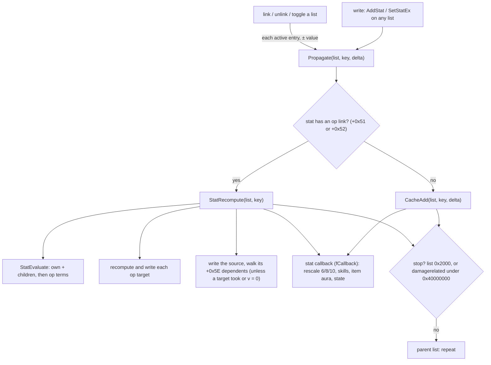
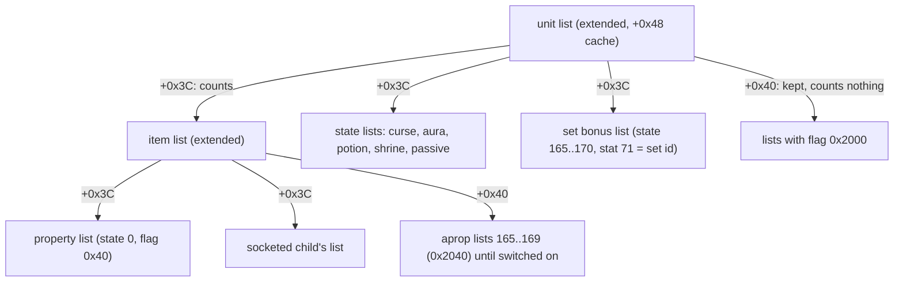
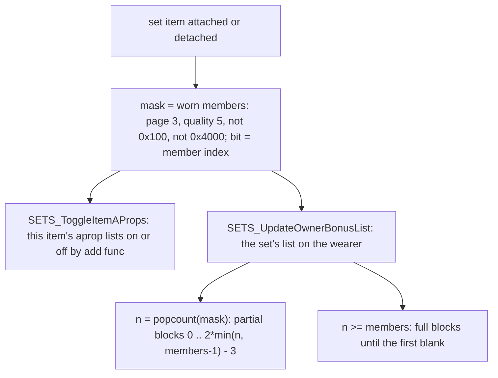

# Stat aggregation: the list tree, the cache, the `op` terms, the maxima, items and set bonuses

## Purpose

A unit's full stats are not summed when they are read. Every unit owns one **extended** stat list whose `+0x48`
array caches the full value of each stat; every write to any list of the unit's tree, and every link, unlink or
toggle of a list, passes its change up the parent chain and updates that cache, re-evaluating the stats an
`ItemStatCost` `op` connects. This spec gives the tree, the propagation, the evaluation with `op` 1–13, the reads,
the maxima and the rescale of the current values, which items count (requirements, ethereal, broken, dual wield,
the periodic refresh), set bonuses and passive stat lists. The states that hang lists in this tree, and the ticks
that write life, mana and stamina, are [stats/states](states.md). Overview and boundary: [stats](README.md).



## Entry points

| When | Function | Tag |
|---|---|---|
| A list is linked under a unit | fn:STATLIST_LinkToUnit@0x00626E10 | [C] (run:2026-10-17-stats) |
| A list is unlinked | fn:STATLIST_Unlink@0x006269F0 | [C] (run:2026-10-17-stats) |
| A state's list moves between the counting and the off chain | fn:UNIT_ToggleStatListByState@0x006279A0 | [C] (run:2026-10-17-stats: 19 525 toggles) |
| An entry is added or set | fn:STATLIST_AddStat@0x00627030, fn:STATLIST_SetStatEx@0x006270B0 | [C] (run:2026-10-17-stats) |
| The change goes up the tree | fn:STATLIST_Propagate@0x00626920 → fn:STATLIST_CacheAdd@0x006250B0 or fn:sub_006266C0_StatRecompute@0x006266C0 | [C] (run:2026-10-17-stats) |
| A full value is read | fn:sub_00624F60_StatListGetValue@0x00624F60 (through fn:sub_00625420_StatListGetStat@0x00625420, fn:STATS_GetUnitStat@0x00625480, fn:sub_00625500_UnitGetStat@0x00625500) | [C] (run:2026-10-17-stats) |
| The maxima are read | fn:sub_00625D10_UnitGetMaxHp@0x00625D10, fn:UNIT_GetMaxMana@0x00625D60, fn:UNIT_GetMaxStamina@0x00625DB0 | [I] |
| An item is equipped or unequipped | fn:ITEMS_AttachToOwner@0x0055C2C0, fn:ITEMS_DetachFromOwner@0x0055C730 | [I] |
| The requirement refresh | fn:sub_0055DBC0_EquipReqRefresh@0x0055DBC0 | [C] (run:2026-10-17-stats: 972 refreshes) |
| A set item is equipped or unequipped | fn:SETS_UpdateOnEquip@0x00663CC0 | [C] (run:2026-10-17-stats) |
| A passive's list is refreshed | fn:SKILLS_RefreshPassive@0x00646D60 | [C] (run:2026-10-17-stats: 8 832 refreshes) |

## Inputs

### Tables

| Anchor | Used for |
|---|---|
| tbl:ItemStatCost.txt:op, `op param`, `op base`, `op stat1..3` | the op graph (§ E) and the terms (§ D) |
| tbl:ItemStatCost.txt:ValShift | the shift of an `op base` value and of the `fMin` floor |
| tbl:ItemStatCost.txt:keepzero | a cache entry kept at 0 (`mana`, `stamina`) |
| tbl:ItemStatCost.txt:fMin, `MinAccr` | the read-time floor (§ F) |
| tbl:ItemStatCost.txt:damagerelated | skipped under a list linked without damage (§ B, § C) |
| tbl:ItemStatCost.txt:fCallback | the stat callback (§ G) |
| tbl:ItemStatCost.txt:Stat | stat 91 `item_req_percent`, 70 `quantity`, 71 `value` (§ H, § J) |
| tbl:CharStats.txt:LifePerVitality, `StaminaPerVitality`, `ManaPerMagic` | op 9 and op 8 (quarter points) |
| tbl:SetItems.txt:add func, `aprop1a..5b` | a set item's own bonus lists (§ J) |
| tbl:Sets.txt:PCode2a, `FCode1` (and the other partial and full blocks) | the wearer's set list (§ J) |
| tbl:Skills.txt:passivestate, `passivestat1`, `passiveitype`, `aurastate` | passive lists (§ K) |

### Runtime state

| State | Type | Source |
|---|---|---|
| a unit's extended list | `StatList`, flag `0x80000000`, at the unit | fn:sub_00626D40_UnitStatListCreate@0x00626D40 |
| own entries | `{key, value}` sorted by key at `+0x24` (struct:StatList+0x10 holds the flags) | every list |
| full cache | `{key, value}` at struct:StatList+0x48 | extended lists only |
| counting children, off children | chains at `+0x3C` and `+0x40` | extended lists only (struct:StatList+0x3C) |
| parent list, linked unit | `+0x34`, `+0x04` | [I] (struct:StatList+0x34) |
| the ISC run-time tail | `+0x51`, `+0x52`, `+0x53` flags, `+0x58` targets, `+0x5E` dependents, `+0x0DE` op inputs | struct:ItemStatCostOps+0x5E, struct:ItemStatCostOps+0xDE |
| frame | `game +0xA8` | for the time of day of op 6/7 only |

### Constants: list flags

| Flag | Meaning | Tag |
|---|---|---|
| `0x2` | timed (an end frame at `+0x18`) | [I] (fn:STATE_ApplyTimed@0x0056E970) |
| `0x4` | dropped on a mode change | [I] (fn:sub_006272E0_StatListsDropOnMode@0x006272E0) |
| `0x8` | the state's `aura` bit | [I] (fn:STATE_ApplyTimed@0x0056E970) |
| `0x20` | a curse | [I] (fn:STATE_ApplyTimed@0x0056E970) |
| `0x40` | an item's property list | [I] (fn:STATLIST_Alloc@0x006251F0) |
| `0x800` | the state's `exp` bit | [I] (fn:STATE_ApplyTimed@0x0056E970) |
| `0x2000` | on the off chain: kept, counts nothing | [C] (fn:STATLIST_LinkToUnit@0x00626E10, run:2026-10-17-stats) |
| `0x4000` | an item marked as failing its requirements | [C] (fn:sub_0055DBC0_EquipReqRefresh@0x0055DBC0, run:2026-10-17-stats) |
| `0x20000000` | the list holds an op-4/5 source | [C] (fn:STATLIST_CacheAdd@0x006250B0, run:2026-10-17-stats) |
| `0x40000000` | linked without damage | [C] (fn:STATLIST_LinkToUnit@0x00626E10, run:2026-10-17-stats) |
| `0x80000000` | extended (cache and child chains) | [C] (fn:sub_00626D40_UnitStatListCreate@0x00626D40, run:2026-10-17-stats) |

## Algorithm

### A. The list tree



- A1. [C] A unit owns one extended list (flag `0x80000000`), made with the stat callback `0x0055B800` for players and
  monsters and none for items and objects. Item property lists, set lists, state lists and the wearer's item lists
  hang under a unit list: on the `+0x3C` chain they count, on the `+0x40` chain (list flag `0x2000`) they are kept
  but count for nothing. (fn:sub_00626D40_UnitStatListCreate@0x00626D40, fn:STATLIST_LinkToUnit@0x00626E10,
  struct:StatList+0x3C, run:2026-10-17-stats)
- A2. [I] A plain list holds the unit it is linked to (`+0x04`), the type and guid of the unit that made it (`+0x08`,
  `+0x0C`), flags (`+0x10`), state (`+0x14`), end frame (`+0x18`), skill and skill level (`+0x1C`, `+0x20`), its own
  entries (`+0x24`), siblings, the parent list (`+0x34`) and a remove callback (`+0x38`). An extended list adds the two
  child chains, its unit (`+0x44`), the cache (`+0x48`), the changed keys for the client, the two state bit-sets
  (`+0x58`) and the stat callback. (fn:STATLIST_Alloc@0x006251F0, fn:sub_00626D40_UnitStatListCreate@0x00626D40,
  struct:StatList+0x48)
- A3. [I] Entries are `{key, value}`, `key = stat << 16 | param`, sorted ascending (binary search). `AddStat` adds
  to an entry and removes it at 0; `SetStatEx` replaces it and removes it when the new value is 0; both propagate the
  difference (§ C). On a player's own list a changed key is recorded for the client when the stat has ISC `+0x05`
  bit 4 (`Saved`) and is not 6, 8, 10, 13 or 14 (presentation, not modelled here). (fn:STATLIST_FindIndex@0x00624B90,
  fn:STATLIST_AddStat@0x00627030, fn:STATLIST_SetStatEx@0x006270B0, fn:STATLIST_MarkClientDirty@0x00624DD0)
- A4. [I] An extended list's **active array** is its cache (`+0x48`); a plain list's is its own entries (`+0x24`).
  An item's active array therefore holds its own entries, its property list, its sockets and its counting set lists.
  (fn:STATLIST_GetActiveArray@0x00624F40)

### B. Link, unlink, toggle

```
B1. STATLIST_LinkToUnit(unit, list, withDamage):                       [C] (fn:STATLIST_LinkToUnit@0x00626E10, run:2026-10-17-stats, all of B1)
      STATLIST_Unlink(list)
      if list is already in the unit list's parent chain: return
      if list.flags & 0x4: unitList.flags |= 0x2
      if list.flags & 0x2000:
        push list on unitList.off (+0x40); list.parent ← unitList; list.unit ← unit; return
      push list on unitList.children (+0x3C); list.parent ← unitList; list.unit ← unit
      if list is extended and list.flags & 0x20000000:
        for each key in list.cache whose stat has ISC +0x53: StatRecompute(list, key)     ; op-4/5 sources, new wearer
      if withDamage: list.flags &= ~0x40000000
                     for each (key, v) in active(list): Propagate(list, key, +v)
      else:          list.flags |= 0x40000000
                     for each (key, v) in active(list), stat not damagerelated: Propagate(list, key, +v)
B2. STATLIST_Unlink(list):                                             [C] (fn:STATLIST_Unlink@0x006269F0, run:2026-10-17-stats, all of B2)
      if list is extended and list.flags & 0x20000000: re-evaluate its +0x53 keys as in B1
      for each (key, v) in active(list), skipping damagerelated stats when list.flags & 0x40000000:
        Propagate(list.parent, key, −v)
      detach; if the list was linked to a unit: call its remove callback (+0x38)
B3. UNIT_ToggleStatListByState(unit, state, off):                      [C] (fn:UNIT_ToggleStatListByState@0x006279A0, run:2026-10-17-stats)
      list ← the unit's list of that state
      if (list.flags & 0x2000 ≠ 0) ≠ off: Unlink(list); flip 0x2000; LinkToUnit(unit, list, withDamage = true)
```

- B1. [I] `sub_00627910_StatListLinkOwner(unit, item, withDamage)`: an item in locations 11 and 12 (item data
  `+0x44`) is only unlinked; an item already linked to the unit only switches damage on or off
  (`STATLIST_EnableDamageStats`/`STATLIST_DisableDamageStats` propagate its damage-related entries); otherwise it is
  linked as B1. (fn:sub_00627910_StatListLinkOwner@0x00627910, fn:STATLIST_DisableDamageStats@0x00627A40,
  fn:STATLIST_EnableDamageStats@0x00627860)
- B1, B2. [C] Linking without damage (the dual-wield second weapon, 32 links) and the `0x20000000` re-evaluation on
  link and unlink were among the predicted events. (run:2026-10-17-stats)

### C. Propagation and the cache

```
C1. Propagate(list, key, delta):                                       [C] (fn:STATLIST_Propagate@0x00626920, run:2026-10-17-stats, all of C1)
      if list.flags & 0x2000: return
      if list is not extended: list ← list.parent
      while list:
        s ← key >> 16
        if not ISC[s].+0x51 and not ISC[s].+0x52: CacheAdd(list, key, delta)
        else:                                     StatRecompute(list, key)
        stop ← list.flags & 0x2000 or (ISC[s].damagerelated and list.flags & 0x40000000)
        list ← list.parent
        if stop: return
C2. CacheAdd(list, key, delta):                                        [C] (fn:STATLIST_CacheAdd@0x006250B0, run:2026-10-17-stats)
      old ← cache[key] (0 if absent);  new: i32 ← old + delta
      if new = 0 and not ISC[s].keepzero: remove the entry  else: cache[key] ← new
      if ISC[s].+0x53: list.flags |= 0x20000000                       ; an op-4/5 source
      if ISC[s].fCallback: callback(arg, key, old, new)                ; § G
C3. CacheWrite(list, key, v):                                          [C] (fn:STATLIST_CacheWrite@0x00625150, run:2026-10-17-stats)
      as C2 with new ← v; the callback runs only when the value changed
```

```
C4. StatRecompute(list, key) → i32:                                    [C] (fn:sub_006266C0_StatRecompute@0x006266C0, run:2026-10-17-stats, all of C4)
      s ← key >> 16
      v: i32 ← StatEvaluate(list, key)                                 ; § D
      if not ISC[s].+0x51: CacheWrite(list, key, v); return v           ; no targets, no dependents
      if v = 0: CacheWrite(list, key, 0)                               ; early write
      taken ← false
      for k in 0 ..< 3 while ISC[s].target[k] ≠ none:                   ; op stat1..3
        t ← ISC[s].target[k]
        tv ← StatRecompute(list, t << 16)
        CacheWrite(list, t << 16, tv)
        if tv ≠ 0 and Takes(list, s, k): taken ← true
      if not taken and v ≠ 0:
        CacheWrite(list, key, v)
        for each d in ISC[s].dependents (+0x5E):                       ; the rows whose op base is s
          dv ← StatRecompute(list, d << 16); CacheWrite(list, d << 16, dv)
      return v
C5. Takes(list, s, k) by ISC[s].op (class table 0x0062690C):          [I] (0x006267AD, 0x0062690C)
      op 1, 12      → true
      op 2, 3       → list.ownerType (+0x08) is a player or a monster and list.active[w] > 0
      op 4, 5       → list's linked unit (+0x04) is a player or a monster and STATS_GetUnitStat(linked unit, w) > 0
      op 6, 7       → list.ownerType (+0x08) is a player or a monster
      op 13         → list.ownerType (+0x08) is an item
      op 8, 9, 10, 11, 0 → false
      where w: u16 ← the word at ISC[s] +0x0DE + 6k                    ; the quirk, step note C5
```

Step notes:

- C1. [C] There is no other cache and no lazy recompute: the full value read at any frame is the result of the last
  propagation. Every list write, link, unlink and toggle is a recompute trigger. The run predicted 207 017
  Propagate calls (96 342 from links and unlinks, list, key and delta) and every write inside each, 137 242 CacheAdd
  and 94 800 CacheWrite, in order, with the old value each found; the tree after every top-level event equalled the
  model (5 143 snapshots). (fn:STATLIST_Propagate@0x00626920, fn:STATLIST_CacheWrite@0x00625150, run:2026-10-17-stats)
- C2. [C] The stat callback fires exactly for the writes of `fCallback` stats that change the value: 14 522 calls,
  key, old and new predicted. (fn:STATLIST_CacheAdd@0x006250B0, run:2026-10-17-stats)
- C4. [C] **The order of the writes**, from the instructions: `StatEvaluate` (0x006266D0); without `+0x51` one
  `CacheWrite` and return (0x006266EA); `v = 0` written at once (0x00626708); per target in `+0x58` order (at most
  three words, `0xFFFF` ends), `StatRecompute` of the target (0x00626775), then `CacheWrite` of its result
  (0x00626786), then the take test only when that result is non-zero (0x00626790) by the **source** row's `op` byte
  `+0x54` (0x00626799); after the loop, when no target took and `v ≠ 0` (0x0062684B, 0x00626856), the source's
  `CacheWrite` (0x00626868) and each `+0x5E` dependent, at most 64 words, recomputed (0x006268C1) and written
  (0x006268CF). The run predicted every one of these writes in order (C1). (fn:sub_006266C0_StatRecompute@0x006266C0,
  run:2026-10-17-stats)
- C4. [C] **A source keeps its old cache value while a target takes.** When a target took (C5), the source's own
  cache entry is not written, so it keeps its previous value (0 on first use) and its dependents are not walked:
  24 279 cache entries of sources whose target took kept their old value. (0x006267AD, run:2026-10-17-stats)
- C4. [C] **The zero-source early write.** A source that evaluates to 0 is written 0 at once, before its targets,
  and its `+0x5E` dependents are never walked: 1 239 such recomputes. No stock `op base` row (all are `level`)
  reaches 0. (0x006266FB–0x00626708, 0x00626847–0x00626856, run:2026-10-17-stats)
- C5. [C] **The take-test quirk (`StatRecompute`).** For ops 2–5 the stat tested is not the source row's `op base`
  (`+0x56`) but the word at the source row's own `+0x0DE + 6k`, the `op base` of the row's own *k*-th op input. The
  loader fills only `+0x5E..+0xDD` with `0xFFFF`, so on a row that is not itself an op target that word is the
  record's initial 0: stat 0, `strength`. The run's dump of the loaded table shows the word is 0 on every row that is
  not a target, and no stock op-2–5 source (rows 214–250) is a target. So on a player (strength > 0) every per-level
  source takes and its own cached value stays hidden; a monster's strength is usually 0. (0x006267C0–0x006267DA,
  0x006267F7–0x00626811, 0x00638250–0x00638262, tbl:ItemStatCost.txt:op base, run:2026-10-17-stats)
- C5. [C] The take test as far as stock rows reach it: op 1 took 156 times, op 2 280, op 4 2 568 and did not take
  3 467 (the item unlinked: no linked unit), op 5 took 26 and did not 70; ops 8 and 9 never took (615). The classes of
  ops 3, 6, 7, 12 and 13 were not reached by a source whose target took, so their lines of C5 stay as read.
  (0x0062690C, run:2026-10-17-stats)
- C4. [C] **Level-up.** `level` is the `op base` of the 37 per-level rows, so it has dependents: a change of stat 12
  re-evaluates `level` (no targets, so it is always written) and walks every per-level row and their targets
  (9 level changes, their dependent writes predicted). (fn:ITEMSTATCOST_Load@0x00637A00, tbl:ItemStatCost.txt:op base,
  run:2026-10-17-stats)

### D. The evaluation: `op` 1–13

```
D1. StatEvaluate(list, key) → i32:                                     [C] for ops 1, 2, 4, 5, 8, 9, 11, 13 (fn:sub_00626200_StatEvaluate@0x00626200, run:2026-10-17-stats)
      t ← key >> 16;  owner ← list's unit (+0x44)
      v: i32 ← list.own[key] + Σ over counting children c: active(c)[key]
                 ; a child with 0x40000000 is skipped when t is damagerelated
      if not ISC[t].+0x52: return v
      b0: i32 ← v;  acc: i32 ← v
      for k in 0 ..< 16 while ISC[t].opIn[k].op ≠ 0:                    ; source-row order (§ E)
        e ← ISC[t].opIn[k];  src ← e.source << 16                       ; param 0
        Eval(x) means StatEvaluate(list, x), on the same list
        switch e.op:
        1:  if owner: (if owner is an item: b0 ← BaseStat(owner, t))
                      if b0 ≠ 0 and (p ← Eval(src)) ≠ 0: acc ← acc + MulDiv(b0, p, 100)
        2:  if list.ownerType (+0x08) ∈ {player, monster} and e.opBase ≠ 0xFFFF:
              b ← list.active[e.opBase] >> ValShift(e.opBase)
              if b > 0 and (p ← Eval(src)) ≠ 0: acc ← acc + ((p × b) >> e.opParam)       ; i32 imul, arithmetic shift
        3:  as 2, but acc ← acc + MulDiv(b0, (p × b) >> e.opParam, 100)
        4:  as 2 with b ← STATS_GetUnitStat(list.unit (+0x04), e.opBase) >> ValShift, that unit a player or a monster
        5:  as 3 with the b of 4
        6:  if owner and owner+0x1C and (p ← Eval(src)) ≠ 0: acc ← acc + ByTime(p)
        7:  if owner and owner+0x1C and (p ← Eval(src)) ≠ 0: acc ← acc + MulDiv(acc, ByTime(p), 100)
        8:  if owner is a player: d ← Eval(src) − list.own[src]
              if d ≠ 0: acc ← acc + CharStats[owner].ManaPerMagic × d × 64
        9:  as 8 with LifePerVitality, or StaminaPerVitality when t = 11
        11: if b0 ≠ 0 and owner is a player or a monster and (p ← Eval(src)) ≠ 0: acc ← acc + MulDiv(b0, p, 100)
        13: if owner is an item: b0 ← BaseStat(owner, t)
              if b0 ≠ 0 and (p ← Eval(src)) ≠ 0: acc ← acc + MulDiv(b0, p, 100)
        10, 12: nothing
      return acc
```

Step notes:

- D1. [C] The ops a stock row reached in a predicted write: op 1 348, op 2 1 490, op 4 2 568, op 5 26, op 8 919,
  op 9 3 784, op 11 92, op 13 136, each at least 20; every other cached entry of every extended list evaluated to its
  cache (646 835 evaluations at the snapshots), except the stale sources of C4 and the item op-4/5 values of § H.
  (fn:sub_00626200_StatEvaluate@0x00626200, run:2026-10-17-stats)
- D1. [I] Ops 3, 6, 7, 10 and 12 were not reached: op 3 and op 10 have no row, ops 6 and 7 only the unspawnable
  *of Dawn* and *of Sunlight*, op 12 none. Their lines are read from the code. (0x00626294–0x00626662, jump table
  0x00626688, fn:STAT_ByTimeValue@0x0065CA30)
- D1. [I] `b0` starts as the own-plus-children sum and only ops 1 and 13 on an item replace it with the item's base
  stat, so on a player op 11 (`item_maxhp_percent`, `item_maxmana_percent`) is a percentage of the **flat sum**, not
  of the running total; op 7 alone uses the running total `acc`. `BaseStat` reads the owner's own `+0x24` entry with
  the floor of § F; `MulDiv` is [monsters/stats § A](../monsters/stats.md#a-muldiv-and-monlvlstats); the products of
  ops 2–5 are signed 32-bit, then an arithmetic shift. (0x0062660B, 0x0062624C, fn:sub_00483360_MulDiv@0x00483360)
- D1. [I] **op 8/9 add only `full − own` of the source** on the list being evaluated. On a player's list `own` is the
  base attribute, so only vitality and energy from items, states and sets pass through op 9/8; the points a player
  spends are added to the base maxima by the stat-point code. (0x00626511–0x00626606,
  fn:PLAYER_SpendStatPoint@0x00570D60, fn:CHARSTATS_GetRecord@0x004833E0)
- D1. [I] **`ByTime(p)` (op 6/7).** The source is `Encode` 4: bits 0–1 a period `q`, bits 2–11 `lo + 256`, bits
  12–21 `hi + 256`. With the phase `x` from `sub_0061C100_ActTimeOfDay`: `a ← |x − 90q|`, rounded to a multiple of 15
  (`(a + 7) ÷ 15 × 15`, 0 below 1), then `a ≥ 359 → 360 − 359`, `a ≥ 180 → 360 − a`; value `hi − (hi − lo)·a ÷ 180`.
  1.14d's server computes ops 6 and 7 (Open questions). (fn:STAT_ByTimeValue@0x0065CA30,
  fn:sub_0061C100_ActTimeOfDay@0x0061C100)

### E. The op graph the loader builds

- E1. [C] `ITEMSTATCOST_Load` walks the rows in id order and appends each row to the `opIn` table (`+0x0DE`,
  `{op base, source, op, op param}`, up to 16) of every `op stat1..3` target, so a target evaluates its sources in
  source-row order: `armorclass` 16 (op 13), 214 (op 4), 215 (op 5), 268 (op 6), 269 (op 7); `maxhp` 3 (op 9),
  76 (op 11), 216 (op 2), 270 (op 6). An `op` outside 1..13 is zeroed. It sets `+0x51` on each source with a target
  and on each `op base` row (appending the source to that row's `+0x5E` dependents), `+0x52` on each target and
  `+0x53` on the op-4/5 sources. The run's dump of the loaded tail equals these rules on all 359 rows (103 392
  fields). (fn:ITEMSTATCOST_Load@0x00637A00, 0x006382E0–0x00638490, tbl:ItemStatCost.txt:op stat1, run:2026-10-17-stats)
- E2. [I] The `op stat` cells are honoured as written, with no check against the row's name: 273
  `item_maxdamage_percent_bytime` feeds `maxdamage`, `secondary_mindamage` and `item_throw_mindamage`; 237 and 291
  feed `item_absorbmagic`. (fn:ITEMSTATCOST_Load@0x00637A00, tbl:ItemStatCost.txt:op stat1)
- E3. [C] Two targets are themselves sources, so a derivation chains: `energy` (targets of 222 and 276, itself op 8 →
  `maxmana`) and `vitality` (targets of 223 and 277, op 9 → `maxhp`, `maxstamina`). (tbl:ItemStatCost.txt:op stat1)

### F. Reads

- F1. [C] Every full read is a cache read: `sub_00625500_UnitGetStat` and `STATS_GetUnitStat` read the unit list's
  `+0x48` entry, `STATS_GetUnitBaseStat` its own `+0x24` entry; nothing is summed at read time. 891 844 reads of the
  player's list in the 50-frame windows after each list change, of 120 stat ids, each equalled the model's cache
  entry. (fn:sub_00625420_StatListGetStat@0x00625420, fn:sub_00624F60_StatListGetValue@0x00624F60,
  fn:sub_00624ED0_StatListGetBaseValue@0x00624ED0, run:2026-10-17-stats)
- F2. [I] Both readers floor the value at `MinAccr << ValShift` when the stat has `fMin` and the unit is a player or
  a monster (rows 0–3, 7 with `MinAccr` 1; 9 and 11 with 0); the stored entries are not clamped. No read of the run
  reached the floor. (fn:sub_00624F60_StatListGetValue@0x00624F60, tbl:ItemStatCost.txt:fMin,
  tbl:ItemStatCost.txt:MinAccr)
- F3. [C] `itemspecific` does not stop the propagation: the player's cache holds the sum of the equipped items' 72
  and 73 in every snapshot. (fn:STATLIST_Propagate@0x00626920, run:2026-10-17-stats)

### G. The maxima, the rescale and the stat callback

```
G1. maxhp ← full stat 7, maxmana ← full 9, maxstamina ← full 11 with the F2 floor      [C] (fn:sub_00625D10_UnitGetMaxHp@0x00625D10, run:2026-10-17-stats)
      full 7 = own 7 + Σ flat 7 of the counting lists + op 9 (vitality from items, states, sets)
             + op 11 (item_maxhp_percent of the flat sum) + op 2 (item_hp_perlevel) + op 6
G2. stat callback, stats 7 / 9 / 11 → current 6 / 8 / 10:             [C] (fn:sub_0055B800_MonStatCallback@0x0055B800, 0x0055B8EC–0x0055B998, run:2026-10-17-stats)
      if new = old or old ≤ 0: return
      cur: i32 ← current;  if cur ≤ 0: return
      r: i32 ← trunc(float32((float) new ÷ (float) max(old, 256) × cur))
      current ← min(max(r, 1), new)
```

Step notes:

- G1. [C] The maxima are the cached full stats 7, 9 and 11; item and state life reach them through the cache, item
  vitality and energy through op 9 and op 8 with the class's quarter-point factors, and op 11 is a percentage of the
  flat sum (92 predicted op-11 writes). (fn:UNIT_GetMaxMana@0x00625D60, fn:UNIT_GetMaxStamina@0x00625DB0,
  tbl:CharStats.txt:LifePerVitality, run:2026-10-17-stats) The getters' own bodies are read from the code. [I]
  (fn:sub_00625D10_UnitGetMaxHp@0x00625D10)
- G2. [C] 5 752 changes of stats 7, 9 and 11 with a positive current value; the current value after each equals G2
  (stat 7: falls 1 797, rises 1 810, capped 57; stat 9: falls 432, rises 446, capped 702; stat 11: rises 5,
  capped 503). The float arithmetic is that of [monsters/stats § E](../monsters/stats.md#e-the-stat-callback-sub_0055b800_monstatcallback-stat-7).
  (fn:sub_0055B800_MonStatCallback@0x0055B800, run:2026-10-17-stats)
- G2. [I] For a monster with a MonStats `DamageRegen` factor the callback also sets stat 74 from the new maximum
  ([monsters/stats § E](../monsters/stats.md#e-the-stat-callback-sub_0055b800_monstatcallback-stat-7)).
  (fn:sub_0055B800_MonStatCallback@0x0055B800)
- G3. [I] The callback's other cases: it (re)registers a stat's item events (`itemevent1/2`) when the value goes to
  or from 0; adds or refreshes skills for 83, 97, 107, 126, 127, 188, 204; starts or stops an item aura for 151
  ([states § F](states.md#f-auras)); and for 98 `state` sets or clears that state with the group clear
  ([states § D](states.md#d-the-group-clear)). (fn:sub_0055B800_MonStatCallback@0x0055B800,
  tbl:ItemStatCost.txt:itemevent1)
- G4. [I] `UNIT_ClampVitals` (when `ITEMS_DetachFromOwner` is asked to clamp): stamina, mana and life, in that order,
  are lowered to their maxima when above. The run took the clamp's writes as inputs. (fn:UNIT_ClampVitals@0x006275B0)

### H. Items: equip, requirements, the refresh, broken, per-level values

```
H1. ITEMS_AttachToOwner(owner, item):                                  [I] (fn:ITEMS_AttachToOwner@0x0055C2C0, all of H1)
      if owner is a player in state 7 playerbody: refuse
      a gem, rune or jewel gets its gems mods (items/sockets-runewords § C)
      if item is a set item: SETS_UpdateOnEquip(owner, item, 0, 0)       ; § J
      if owner can dual-wield and item is a weapon other than the primary one: link without damage
      else: link with damage                                           ; a broken item only when forced
H2. ITEMS_DetachFromOwner(owner, force, clamp):                         [I] (fn:ITEMS_DetachFromOwner@0x0055C730, all of H2)
      refuse for a player in state 7; a set item: SETS_UpdateOnEquip(owner, item, 1, 0)
      unlink (unless broken and not forced); a dual-wielder's remaining primary weapon is re-linked with damage
      if clamp: UNIT_ClampVitals(owner)                                ; G4
H3. ItemReqCheck(item, unit) → bool:                                   [C] for strength, dexterity, identified and ethereal (fn:sub_0062EAF0_ItemReqCheck@0x0062EAF0, run:2026-10-17-stats)
      str: i32 ← reqstr + MulDiv(reqstr, stat 91 item_req_percent, 100)    ; record +0x10A
      dex: i32 ← reqdex + MulDiv(reqdex, stat 91, 100)                     ; record +0x10C
      if item is ethereal (0x400000): str ← str − 10; dex ← dex − 10
      pass iff full strength ≥ 1 and ≥ str, full dexterity ≥ 1 and ≥ dex,
               unit level ≥ the item's level requirement, item identified (0x10),
               a type-18 base has stat 70 > 0, and the class matches
H4. EquipReqRefresh(unit):                                             [C] (fn:sub_0055DBC0_EquipReqRefresh@0x0055DBC0, run:2026-10-17-stats, all of H4)
      (1) each inventory charm (type 13) that is usable and not linked: link it
      (2) body slots 1..10, once: an item that is linked or not marked and fails H3: mark 0x4000, unlink with the clamp
      (3) repeat over slots 1..10 until nothing changes:
            an unbroken item that is marked or unlinked and passes H3: unmark, link
      (4) every equipped, unbroken, unmarked set item: detach and re-attach (H2, H1)
```

Step notes:

- H3. [C] 17 634 checks predicted from the base record, stat 91, the ethereal −10 and the model's unit stats (passed
  15 610 plain, 814 with stat 91, 428 ethereal; failed 428 by strength, 24 ethereal by strength, 240 by dexterity,
  90 unidentified). **The ethereal −10 decided 30 checks**: strength 115..124 against the ethereal War Boots' 125,
  passing only with the −10. (fn:sub_0062EAF0_ItemReqCheck@0x0062EAF0, run:2026-10-17-stats)
- H3. [I] The `item_req_percent` term changed no outcome in its 814 checks (a reading without it predicts the same),
  and the level test, the class test (item class 7 any class, a player its own class, a monster only class-4 items
  when `sub_00463900_MonClassCheck` gives 560 or 561) and the type-18 test decided none. The required level and the
  strength and dexterity values the check reads through `0x0062B450` were value oracles of the run.
  (0x0062EB63–0x0062EBBE, fn:sub_00463900_MonClassCheck@0x00463900)
- H4. [C] Every refresh (972) re-attached every equipped, usable set item (`SETS_UpdateOnEquip` mode 1 then 0, each
  item's list unlinked and linked). (fn:SETS_UpdateOnEquip@0x00663CC0, run:2026-10-17-stats)
- H4. [I] Step (2) runs once, so an unlink that breaks another item's requirement (strength from another item) is
  caught at the next refresh, not in this one. The refresh runs after equip, place, break, repair and identify.
  (fn:sub_0055DBC0_EquipReqRefresh@0x0055DBC0, fn:sub_0055DB00_ItemUsableBy@0x0055DB00,
  fn:ITEMS_IsActiveCharm@0x0062FF70)
- H4. [I] **The refresh also runs every 136 frames** with no player action: the commonest gap between two refreshes
  in every session of the run, on every character. What queues it was not read. (fn:sub_0055DBC0_EquipReqRefresh@0x0055DBC0,
  run:2026-10-17-stats)
- H5. [I] **Broken.** `sub_0055F850_ItemBreak` sets `0x100`, unlinks an equipped item, sets durability (72) to 0 and
  updates its set with the item excluded; `sub_0055F900_ItemRepairBroken` clears it and re-runs H4. No broken item
  was reached. (fn:sub_0055F850_ItemBreak@0x0055F850, fn:sub_0055F900_ItemRepairBroken@0x0055F900)
- H6. [I] Ethereal and sockets change only the item's own lists ([items/properties § F](../items/properties.md#f-ethereal-and-sockets)),
  which reach the wearer through the item's cache (A4). (fn:STATLIST_LinkToUnit@0x00626E10)
- H7. [C] **An item's per-level (op 4/5) value is not refreshed when the wearer levels up.** After the Paladin's
  level-ups, the item lists with an op-4 source (`item_armor_perlevel` on Stormshield) kept the value of their last
  link (94 entries), equal to the evaluation at the wearer's previous level: nothing propagates a stat of the linked
  unit into an item list, and only B1 and B2 re-evaluate the `+0x53` keys. The wearer's own per-level rows are
  re-evaluated by the level write (C4). (0x00626EC4, 0x00626A84, run:2026-10-17-stats)
- H7. [I] So the item's value catches up at its next link: for a set item at the next refresh's step (4), for any
  other item at its next unequip and equip. (fn:STATLIST_LinkToUnit@0x00626E10, fn:sub_0055DBC0_EquipReqRefresh@0x0055DBC0)

### I. Dual wield and the weapon switch

- I1. [C] For a Barbarian holding two weapons, the weapon that is not the primary one is linked **without damage**
  (flag `0x40000000`): its damage-related stats stay out of the wearer's cache (32 such links). (fn:ITEMS_AttachToOwner@0x0055C2C0,
  fn:INV_GetPrimaryWeapon@0x0063BEF0, run:2026-10-17-stats)
- I2. [I] `UNIT_CanDualWield` answers yes for player classes 4 and 6 (Barbarian, Assassin) and monster classes 417
  and 418; an Assassin's second weapon was not reached. (fn:UNIT_CanDualWield@0x006235A0)
- I3. [I] The weapon switch (`sub_005616A0_PlayerSwapWeapons`, from `sub_0054CE70_SwapWeaponsReq`) detaches both
  hands through H2 and attaches the other pair through H1: the logged caller chains; the function itself was not
  read. (fn:sub_005616A0_PlayerSwapWeapons@0x005616A0, fn:sub_0054CE70_SwapWeaponsReq@0x0054CE70, run:2026-10-17-stats)

### J. Set bonuses



```
J1. mask: u8 ← SETS_WornMemberMask(owner, set)                        [C] but for 0x100 (fn:SETS_WornMemberMask@0x0062A370, run:2026-10-17-stats)
      bit i set iff an item of member index i is in node page 3, quality 5, not broken (0x100),
      not marked (0x4000), of this set                                 ; a duplicate member sets the same bit
J2. SETS_ToggleItemAProps(item, mask):                                 [C] (fn:SETS_ToggleItemAProps@0x00663A20, run:2026-10-17-stats)
      own ← the item's member index
      add func 1: for each other member index k (0..5, skipping own):
                    slot ← k if k < own else k − 1
                    toggle state 165 + slot on iff bit k of mask
      add func 2: c ← popcount(mask) − 1                               ; other members worn
                    states 165 .. 165 + c − 1 on, the others off
      ; each toggle is B3 on the item's aprop list of that state
J3. SETS_UpdateOwnerBonusList(owner, item, mode):                      [C] (fn:SETS_UpdateOwnerBonusList@0x00663B40, run:2026-10-17-stats)
      list ← the owner's list with a state in 165..170 whose own stat 71 = the set id
      mode 1 (unequip): unlink and free it                             ; H4 step (4) rebuilds it
      mode 0 (equip): clear it, or allocate it in the first free state of 165..170,
                      link with damage, set the state, add stat 71 = set id, then SetBonusApply
J4. SetBonusApply(list, set, mask):                                    [C] (fn:sub_00660120_SetBonusApply@0x00660120, run:2026-10-17-stats)
      n ← popcount(mask)                                               ; the item itself counted
      for b in 0 ... 2·min(n, members − 1) − 3: if partial block b has a code ≥ 0: apply it   ; PROP_ApplyBlockByVersion mode 4
                                                     ; block b = PCode(2 + b ÷ 2) a (b even) or b (b odd)
      if n ≥ members: for each of the 8 full blocks until the first code < 0: apply it
```

Step notes:

- J1–J4. [C] 11 343 worn masks predicted from the inventory (a requirement-failing Soul Cage never counted; two
  Angelic Halo set one bit); 5 749 aprop toggle sequences (`add func` 0: 1 844, 1: 819, 2: 3 086) with 19 525
  toggles; 5 749 wearer set lists, all equal to the Sets blocks for `n = popcount(mask)` (Angelical Raiment n = 1;
  Civerb's n = 1, 2, 3; Immortal King n = 1, 2, 3; Trang-Oul's n = 4 and n = 5): 5 569 at the run, the 180 full
  Trang-Oul's lists since the 2026-10-20 re-check. (fn:SETS_WornMemberMask@0x0062A370,
  fn:sub_00660120_SetBonusApply@0x00660120, run:2026-10-17-stats)
- J4. [C] **Block *b* is the *b*-th partial quad of the record.** `SetBonusApply` takes `m = min(n, members − 1)`
  (0x006601A8–0x006601B5), walks `b = 0 .. 2m − 3` over the 16-byte quads from record `+0x010` (0x006601B7–0x006601F1)
  and the full quads from `+0x090` (0x00660200–0x0066022E); the compiled record holds the partial quads in `.txt`
  order `PCode2a`, `PCode2b`, `PCode3a` … at `+0x010 + 16j`, as the layout diff of
  [Sets § Bonus blocks](../../tables/Sets.md#bonus-blocks-plan-0041-phase-0) shows. The 5 749 predicted lists are the third
  leg. (fn:sub_00660120_SetBonusApply@0x00660120, tbl:Sets.txt:PCode2a, run:2026-10-17-stats)
- J4. [C] **The full Trang-Oul's Avatar** (n = 5, 180 lists): a full block with a `state` or an `oskill` property is
  built like the others. Its full blocks carry a `state` (`monsterset`) and an `oskill` (Fire Mastery) property; each
  of the 180 lists equals the Sets blocks for n = 5 when every value is stored `<< ValShift` (`mana` 100 → 25 600),
  the `state` block (property func 24) writes stat 98 with the compiled param 176 (`monsterset`, a state) and the
  value 1, and the `oskill` block gives the skill's id and level. A reading without the shift, or with param 0, would
  mismatch every one of the 180. The lists were taken as logged at the run and are predicted by the kept checker
  since the 2026-10-20 re-check (0 mismatches over the 18 logs). (fn:sub_00660120_SetBonusApply@0x00660120,
  fn:PROP_Func24_ParParam@0x0065F390, fn:sub_006336A0_PropParamCell@0x006336A0, run:2026-10-17-stats)
- J4. [I] A set whose last member is broken (flag `0x100`) was not reached, so its full blocks are read from the code
  only. (fn:sub_00660120_SetBonusApply@0x00660120, fn:SETS_WornMemberMask@0x0062A370)
- J2. [I] The aprop lists are the item's own lists of states 165..169 (flags `0x2040`, made at creation,
  [items/properties § G](../items/properties.md#g-stat-storage)): pair *k* counts when its member is worn
  (`add func` 1) or when *k* other members are worn (`add func` 2). `add func` 0 (blank) puts the aprop in the main list at
  creation, where it always counts. (data:g_SetBonusStates@0x006EE424, fn:SETITEMS_GetMemberIndex@0x0062B3A0,
  tbl:SetItems.txt:add func)
- J3. [I] **Stat 71 sums.** The marker stat 71 (`value`) is an ordinary entry, so the wearer's full stat 71 is the
  sum of the active sets' ids (set id 0 adds nothing) plus any other stat-71 entry under it. The lookup reads stat 71
  of each set list itself, not the cache, so the sum does not disturb it. (0x00663C93, 0x00663BDD,
  fn:STATLIST_AddStat@0x00627030)
- J4. [I] A Sets param naming a skill, a montype or a state is compiled to the first hit in the skills, then montype,
  then states tables, whatever the block's property; a name that is both a skill and a state stores the skill row.
  The ten stock named cells are consistent with that order ([stats/0001 § Phase 0 surprises](../../findings/stats/0001-aggregate.md#phase-0-surprises)).
  (fn:sub_006336A0_PropParamCell@0x006336A0, fn:EXCEL_FindName@0x006BD3C0, tbl:Sets.txt:FParam5)

### K. Passive stat lists

- K1. [C] A passive's list is the skill's `passivestate` list holding `passivestat1..5` = `passivecalc1..5` at the
  level it records in stat 351, each with param `passiveitype` (0 when none), plus 350 = the skill: 8 832 refreshes
  (Sword Mastery 127, Increased Stamina 141, Iron Skin 145, Natural Resistance 153, and Fire Mastery 61 from the full
  Trang-Oul's `oskill`). (fn:SKILLS_RefreshPassive@0x00646D60, fn:SKILLS_EvalCalc@0x00646CA0,
  tbl:Skills.txt:passivestat1, run:2026-10-17-stats)
- K2. [I] The list is rebuilt only when 351 differs from the skill's current level (with bonuses), and freed while
  the skill's `aurastate` is on the unit or the unit lacks the skill; the remove callback of a state list rebuilds the
  passives in that state ([states § C](states.md#c-expiry-and-removal)). (fn:SKILLS_RefreshPassive@0x00646D60,
  fn:SKILLS_RefreshPassivesInState@0x00646F20)
- K3. [I] The masteries 127–129 carry the `aura` bit with no `aurastate`; no code read gives the bit an effect for
  them. (fn:SKILLS_RefreshPassive@0x00646D60, fn:ITEMAURA_Start@0x005BF510)

### Draw order

- [C] Linking, unlinking, own writes (every recompute they make) and toggles draw nothing: the game seed and the
  acting unit's seed were unchanged across 12 868 links, 12 853 unlinks, 101 995 own writes and 19 525 toggles.
  (run:2026-10-17-stats)
- [I] The requirement refresh, the set activation and the passive refresh run inside those events; no RNG call was
  found in their code. (fn:sub_0055DBC0_EquipReqRefresh@0x0055DBC0, fn:sub_00660120_SetBonusApply@0x00660120,
  fn:RNG_Range@0x0045C390)

## Outputs

The unit list's `+0x48` cache, one i32 per key, which every full read returns (with the F2 floor); the current
life, mana and stamina rescaled by G2; the `0x4000` marks and the link state of each equipped item; the wearer's set
lists and each set item's aprop toggles; the passive lists.

## Worked example

**1. The ethereal −10 deciding a requirement** (run:2026-10-17-stats, `StatsBarD`, sessions `bard-town1` and
`bard-town2`). [C] A Barbarian with strength 85 and his belt and gloves off has a full strength in 115..124. The
ethereal War Boots need 125 strength; H3 makes it 115, so the boots pass and stay linked; without the −10 every one of
these 30 checks would fail. (fn:sub_0062EAF0_ItemReqCheck@0x0062EAF0, run:2026-10-17-stats)

**2. Set blocks by count** (run:2026-10-17-stats). [C] Civerb's Vestments has 3 members: with 2 worn, J4 applies
partial blocks 0 .. 2·min(2, 2) − 3 = 0..1 (`PCode2a`, `PCode2b`; only `2a` is used); with all 3 worn, partial blocks
0..1 again and the full blocks. Immortal King (6 members) with 3 worn applies partial blocks 0..3 (`2a` to `3b`); with
1 worn, none. (fn:sub_00660120_SetBonusApply@0x00660120,
run:2026-10-17-stats)

**3. Item vitality through op 9** (arithmetic of D1, illustrative). [C] A Barbarian (`LifePerVitality` 16 quarter
points) whose items add 10 vitality: `full − own` of vitality is 10, so op 9 adds `16 × 10 × 64` = 10 240 to `maxhp`,
40 life. (0x00626511–0x00626606,
tbl:CharStats.txt:LifePerVitality, run:2026-10-17-stats)

**4. A rescale** (arithmetic of G2, illustrative). [C] Max life rises from 25 600 to 30 720 with current life
12 800: `r = trunc(float32(30 720 ÷ 25 600 × 12 800))` = 15 360, between 1 and 30 720, so current life becomes 15 360.
(fn:sub_0055B800_MonStatCallback@0x0055B800, run:2026-10-17-stats)

## Reimplementation notes

- **Don't sum at read time.** A reimplementation that sums the lists when a stat is read gets the wrong value
  wherever the cache is stale by design: the source entries of C4 that keep their old value while a target takes,
  and the item op-4/5 values of H7 after a level-up. Model the cache and the propagation order exactly. [C]
  (fn:sub_006266C0_StatRecompute@0x006266C0, run:2026-10-17-stats)
- **The take test reads strength.** For ops 2–5 the stat tested is the source row's `+0x0DE + 6k` word, which is 0
  (`strength`) on every stock source; do not "fix" it to `op base`. [C] (0x006267C0, run:2026-10-17-stats)
- **op 11 is a percentage of the flat sum**, and op 8/9 count only the non-base part of energy and vitality. [C]
  (fn:sub_00626200_StatEvaluate@0x00626200, run:2026-10-17-stats)
- **A target is written twice when its source recomputes it** (once inside its own recompute, then by the source,
  C4). The second write finds the value the first left, so it changes nothing and fires no callback, unless the
  target is itself a source whose own target took: then its own recompute did not write it, and the source's write
  does. No stock target is such a source (`energy` and `vitality` feed op 8 and 9, which never take; E3). [C]
  (fn:sub_006266C0_StatRecompute@0x006266C0, 0x00626786, run:2026-10-17-stats)
- **The rescale truncates a float32**, and current life never drops below 1 by it. [C]
  (fn:sub_0055B800_MonStatCallback@0x0055B800, run:2026-10-17-stats)
- **Requirements are checked once per refresh in step (2)**; the refresh runs every 136 frames on its own as well. [I]
  (fn:sub_0055DBC0_EquipReqRefresh@0x0055DBC0)

## Evidence

- [stats/0001](../../findings/stats/0001-aggregate.md) § 1–8 (the code reading), § 9 (the run), *Leads used*
  (12 verdicts, one contradicted), *Phase 0 surprises* (b), (e).
- [stats/experiments § run:2026-10-17-stats](../../findings/stats/experiments.md#run2026-10-17-stats): 18 sessions,
  0 mismatches; the review's re-check in three orders; the *Re-check 2026-10-20* (plan 0047 Phase 1), which builds
  the full set blocks.
- `tools/stats.py` (the model: `evaluate`, `recompute`, `propagate`, the take classes), `tools/stats_survey.py`.
- Tables: [ItemStatCost § Aggregation](../../tables/ItemStatCost.md#aggregation-plan-0041-phase-0),
  [CharStats](../../tables/CharStats.md), [Sets § Bonus blocks](../../tables/Sets.md#bonus-blocks-plan-0041-phase-0),
  [SetItems § Bonus blocks](../../tables/SetItems.md#bonus-blocks-plan-0041-phase-0),
  [Skills § Passive and aura columns](../../tables/Skills.md#passive-and-aura-columns-plan-0041-phase-0).
- Types: `re/types/stats.h` (`StatList`, `StatEntry`, `ItemStatCostOps`). Plan: [0041](../../plans/done/0041-stats-and-states.md).
- Upstream: [items/properties § G](../items/properties.md#g-stat-storage), [items/uniques-sets](../items/uniques-sets.md),
  [player/creation](../player/creation.md), [monsters/stats § E](../monsters/stats.md#e-the-stat-callback-sub_0055b800_monstatcallback-stat-7),
  [data/calc](../data/calc.md). Downstream: [stats/states](states.md), [combat](../combat/README.md).

## Open questions

- [L] **op 6/7 and a contradicted lead.** src:pk-itemstatcost-guide says op 6 "does not work" and op 7 updates only
  on the client; the 1.14d server code computes both (D1). No stock path reaches them (*of Dawn* and *of Sunlight*
  are not spawnable), so no run can show it; an optional emulation of `STAT_ByTimeValue` is filed to the reverser.
  `sub_0061C100_ActTimeOfDay` and `owner +0x1C` are not read.
- [L] Not reached in the run, each inferred above: the `fMin` floor (F2); ops 3, 6, 7, 10, 12; a decisive
  `item_req_percent`, level or class test; a broken item and a set with a broken member; an Assassin's second weapon;
  the clamp of G4 as a predicted write.
- ~~The full Trang-Oul's blocks with a `state` or an `oskill` property: their content is code-read only (J4); a tool
  follow-up to predict them is filed to the reverser.~~ Answered: the kept checker builds them and predicts all 180
  lists (J4, [stats/0001 § 9](../../findings/stats/0001-aggregate.md#9-the-phase-2-run-run2026-10-17-stats), plan 0047 Phase 1).
- [L] What queues the 136-frame refresh (H4), and the weapon-switch function's own body (I3).
- [L] Which readers read a per-level source's own (hidden) cache value (C5); the character screen is client-side.
