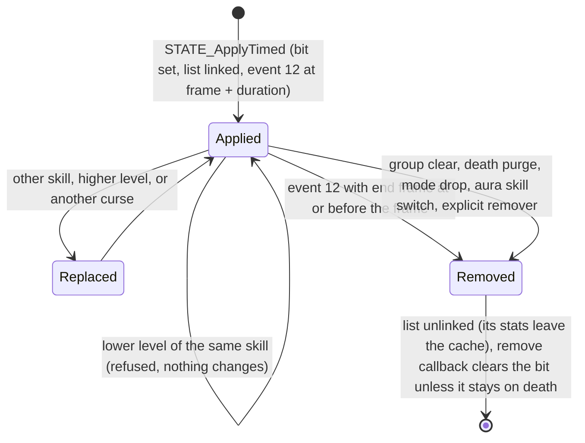
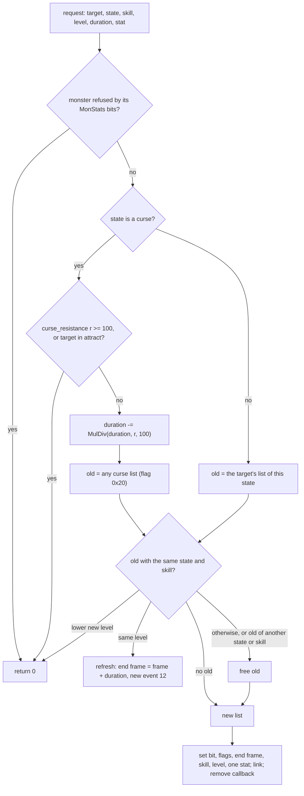
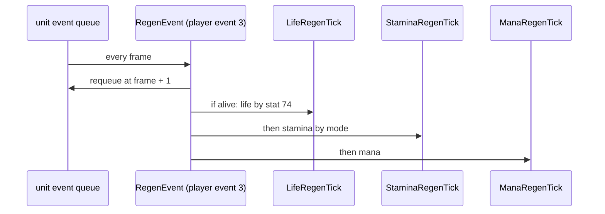

# States: the timed apply, expiry, the group clear, the regeneration tick, auras, shrines and wells

## Purpose

A state on a unit is a bit in the unit's state set and, usually, a stat list under the unit carrying the state id.
This spec gives the common timed apply (`STATE_ApplyTimed`: the curse rules, refresh, refusal and replacement), the
end of a timed state in frames, the other removals, the `group` clear, the player's per-frame regeneration tick (life
by stat 74, stamina by mode, mana), the aura runs on their `perdelay` grid with their target states, and the shrine
and well operates that apply a state or refill. The stats a state's list carries reach the unit's full values by
[stats/aggregate](aggregate.md); what a skill does when it is used is phase (3). Overview and boundary:
[stats](README.md).



## Entry points

| When | Function | Tag |
|---|---|---|
| A timed state is applied (skills, auras, shrines, open wounds, prevent-heal) | fn:STATE_ApplyTimed@0x0056E970 | [C] (run:2026-10-17-stats: 3 643 calls) |
| A timed list's end frame is reached (unit event 12) | fn:EVENT_TimedListExpire@0x00580800 → fn:UNIT_ExpireTimedLists@0x00627460 | [C] (run:2026-10-17-stats: 2 749 runs) |
| States of one `group` are cleared | fn:STATE_GroupClear@0x0056C740 | [C] (run:2026-10-17-stats: 450 calls; run:2026-10-20-shortfalls: 43 different-state clears; run:2026-10-21-shortfalls2: 24 in group 3) |
| A player's regeneration tick (player event 3, every frame) | fn:sub_00580810_RegenEvent@0x00580810 | [C] (run:2026-10-17-stats: 54 719 ticks) |
| An aura runs (unit events 8 and 9) | fn:EVENT_SelectedAuraTick@0x0056FCB0, fn:EVENT_ItemAuraTick@0x0056FE40 | [C] (run:2026-10-17-stats: 3 629 runs) |
| A shrine is operated (OperateFn 2) | fn:OBJOP_Shrine@0x00583C70 | [I] (16 operates over run:2026-10-17-stats, run:2026-10-20-shortfalls and run:2026-10-21-shortfalls2) |
| A well is used (OperateFn 22) | `0x005858A0` → `0x00585720` | [I] (5 uses) |
| A unit dies, or changes mode | fn:sub_00627540_StatListsPurgeOnDeath@0x00627540, fn:sub_006272E0_StatListsDropOnMode@0x006272E0 | [I] |

## Inputs

### Tables

| Anchor | Used for |
|---|---|
| tbl:States.txt:curse | the curse branch of the apply (§ B) |
| tbl:States.txt:group | the group clear (§ D) |
| tbl:States.txt:plrstaydeath, `monstaydeath` | the remove callback and the death purge (§ C) |
| tbl:States.txt:aura, `exp` | list flags `0x8`, `0x800` |
| tbl:States.txt:life | the monster tick ([combat/delivery § E4](../combat/delivery.md#e-the-stat-events-crushing-blow-open-wounds-freeze)) |
| tbl:Skills.txt:perdelay | the aura grid (§ F) |
| tbl:Skills.txt:aurastate, `auratargetstate`, `aurastat1..6`, `aurastatcalc1..6`, `aurarangecalc`, `aurafilter`, `passivestate` | an aura run (§ F) |
| tbl:ItemStatCost.txt:direct, `maxstat` | the aura heal (§ F) |
| tbl:CharStats.txt:ManaRegen | the mana tick (§ E) |
| tbl:Shrines.txt:Code, `Arg0`, `Arg1`, `Duration in frames`, `reset` | a shrine (§ G) |
| tbl:Objects.txt:Parm0, `Parm1`, `Parm3` | a well (§ G) |

### Runtime state

| State | Type | Source |
|---|---|---|
| frame | i32, `game +0xA8` | every end frame and grid |
| state bit-sets | two sets of `ceil(nStates / 32)` dwords at the unit list's `+0x58`: on, and changed (for the client) | fn:UNIT_SetStateBit@0x00625A70 |
| a state's list | `StatList` with the state at `+0x14`, end frame `+0x18`, skill `+0x1C`, level `+0x20`, remove callback `+0x38` | struct:StatList+0x18 |
| the apply request | `{source, target, skill, level, duration, stat, value, state (+0x1C), remove callback, …}` | struct:TimedStateReq+0x1C |
| unit seed | `Unit+0x20` | [rng/seeds](../rng/seeds.md); in the run drawn only by a damaging aura's run, once per drawing run; Holy Freeze's step of each unit hit is read only (§ H) |

### Inputs and oracles

| Input | Kind | Tag |
|---|---|---|
| the combat appliers (poison, cold, freeze, open wounds) and a monster's skills | inputs: they call the apply or make the same list shape; [combat/delivery](../combat/delivery.md) | [C] (run:2026-10-17-stats) |
| a skill's calc results that read the unit (the aura and passive calcs that do) | value oracles ([data/calc](../data/calc.md)) | [C] (run:2026-10-17-stats) |
| the shrine to-hit and damage values (`SHRINE_StatValue` 19 and 21) | value oracles | [I] (fn:SHRINE_StatValue@0x00583840) |
| a damaging aura's hit (its damage, its kill) | phase (3); only its draws are counted here (§ H) | [C] (fn:sub_005CF3A0_AuraHitDo@0x005CF3A0, run:2026-10-17-stats) |

## Algorithm

### A. The state bit and its list

- A1. [C] A state is a bit in the unit list's state set (`UNIT_HasState`) and, usually, a stat list under the unit
  carrying the state id at `+0x14`. `STATE_Set` writes the bit and the "changed" bit; most removers free the list and
  clear the bit together. (fn:STATE_Set@0x00639DB0, fn:UNIT_SetStateBit@0x00625A70, fn:UNIT_HasState@0x00639DF0,
  struct:StatList+0x14, run:2026-10-17-stats)
- A2. [I] `UNIT_HasState` answers for players, monsters and objects; `STATE_Set` also keeps unit flag `+0xC8` bit 3
  for a state with the `disguise` bit. The States flag columns are read through the loader's 40 bit-sets
  (`curse` bit 11, `plrstaydeath` 13, `monstaydeath` 14, `exp` 30, `life` 32). (fn:UNIT_TestStateBit@0x00625B70,
  fn:STATES_IsCurse@0x0063A420, fn:STATES_StaysOnDeath@0x0063A4A0, fn:STATES_IsExp@0x0063A6B0)

### B. The timed apply



```
B1. STATE_ApplyTimed(req) → list or 0:                                 [C] (fn:STATE_ApplyTimed@0x0056E970, run:2026-10-17-stats, all of B1 but the lines marked [I])
      if req.state is out of range: return 0
      if target is a monster refused by its MonStats/MonStats2 bits: return 0          [I] (0x0056E9A7–0x0056E9C3)
      curse: bool ← States[req.state].curse
      if curse:
        r: i32 ← STATS_GetUnitStat(target, 109 curse_resistance)                       (0x0056E9C9–0x0056EA4A)
        if r > 99: return 0                                                            [I] (0x0056E9C9–0x0056EA4A)
        if r ≠ 0: req.duration ← req.duration − MulDiv(req.duration, r, 100)   ; signed: r < 0 lengthens
                                                                                       [C] the cut on a player target, 1 ≤ r ≤ 99 (run:2026-10-21-shortfalls2); [I] MulDiv's rounding and r < 0
        if UNIT_HasState(target, 57 attract): return 0                                [C] on a monster target (0x0056EA40, run:2026-10-20-shortfalls); [I] on a player
      old ← curse ? the target's first list with flag 0x20 : the target's list of req.state
      if old:
        if old.state = req.state and old.skill = req.skill:
          if old.level = req.level:                                    ; refresh
            if req.duration ≠ 0:
              f: i32 ← frame + req.duration
              old.endFrame ← f; old.flags |= 0x2; queue unit event 12 at f
            return old                                                 ; the request's stat is not written
          if req.level < old.level: return 0                           ; refused
        unlink old; free it (its remove callback runs, § C)
      STATE_Set(target, req.state, on)
      flags ← curse ? 0x20 : 0;  end: i32 ← 0
      if req.duration ≠ 0: end ← frame + req.duration; flags |= 0x2; queue unit event 12 at end
      if States[req.state].exp: flags |= 0x800
      if States[req.state].aura: flags |= 0x8
      list ← STATLIST_Alloc(flags, end, source type (6 if none), source guid (−1 if none))
      list.state ← req.state; list.skill ← req.skill; list.level ← req.level
      if req.stat ≠ −1: SetStat(list, req.stat, req.value)
      STATLIST_LinkToUnit(target, list, withDamage = true)             ; stats/aggregate § B
      list.remove ← req.remove or STATE_DefaultRemoveCB
      return list
```

Step notes:

- B1. [C] 3 643 calls on the player, each predicted as refused, refreshed, replaced or new, with the list made (flags
  `0x2`, `0x20`, `0x8`, `0x800`, state, end frame = frame + duration, skill, level, the one stat) or the end frame
  moved: refreshed 2 608, refused 1 013, replaced 2, new 20. A same skill and level refreshes (the list kept, its
  stats not rewritten); the same skill at a lower level is refused (the player's and the mercenary's Prayer, at
  different levels: 1 013); a higher level frees the old list and makes a new one. (fn:STATE_ApplyTimed@0x0056E970,
  0x0056EA4B, run:2026-10-17-stats)
- B1. [I] **One curse at a time.** A curse looks up any list with flag `0x20`, so a different curse frees the old one.
  (0x0056EA2F–0x0056EA4B, fn:sub_00625760_StatListFindFlag@0x00625760)
- B1. [C] **A curse on a monster in `attract` is refused.** A Necromancer's own Attract, then Amplify Damage on the
  same monster: 71 requests on monsters with state 57 set, all refused (no list), and 151 on monsters without it, all
  made, in the same session; the 239 monster requests left both seeds unchanged. The refusal on a player target was
  not staged. (fn:STATE_ApplyTimed@0x0056E970, 0x0056E9C9–0x0056EA4A, run:2026-10-20-shortfalls)
- B1. [C] **The curse resistance cut on a player target** (stat 109, `r` between 1 and 99): under Fade
  (`curse_resistance` 84, its one stock writer, an `aurastat`), 54 curse requests on the player made or refreshed a
  list whose duration is `len − MulDiv(len, 84, 100)`, each expiry as predicted: 52 `defense_curse` from the
  Crystalline Passage's succubi (275 frames asked, 44 given) and two shrine curses (3 600 → 576, 2 400 → 384). Three
  lengths cut by the same `r` to the frame rule out a reading without the cut. (fn:STATE_ApplyTimed@0x0056E970,
  0x0056E9C9–0x0056EA4A, tbl:Skills.txt:aurastat5, run:2026-10-21-shortfalls2)
- B1. [I] **The cut's rounding** is `MulDiv`'s, read from the code: `len · 84` is a multiple of 100 for the three
  lengths of the run (231, 3 024 and 2 016 exactly), so no case separates it from a truncating division. The refusal
  at `r` ≥ 100 and a negative `r` (a longer curse) are read from the code too: no stock source gives the player 100 or
  less than 0. (0x0056E9C9–0x0056EA4A, run:2026-10-21-shortfalls2)
- B1. [I] The duration is in frames and is not rounded. The monster gate refuses every timed state on a monster whose
  MonStats `+0x0D` bit 0 is set or whose MonStats2 `+0x05` bit 1 is clear (columns not named). (0x0056E9A7–0x0056E9C3,
  fn:sub_00451FE0_MonStats2Rec@0x00451FE0)
- B2. [I] **Callers.** Open wounds (state 62, 200 frames), prevent-heal, the aura target callback (§ F), the shrines
  (§ G) and about twenty skill functions call B1; poison, burn, cold and freeze use their own appliers
  ([combat/delivery](../combat/delivery.md)) with the same list shape. (fn:STATEVENT_OpenWounds@0x005BFE60,
  fn:sub_0057D810_PreventHealHook@0x0057D810, fn:COMBAT_ApplyPoison@0x0057AC50)
- B2. [C] **Prevent heal (state 52)** is applied by B1 for 120 000 frames with stat 31 = 0 to the defender in 86 of 918
  calls of the to-hit hook, exactly those with the player attacker's stat 117 non-zero, and the hook draws on neither
  seed ([skills/dispatch § K3](../skills/dispatch.md#k-stat-event-handlers)). **Open wounds** applies state 62 for
  200 frames when its roll passes (82 of 120 fires). (fn:sub_0057D810_PreventHealHook@0x0057D810,
  fn:STATEVENT_OpenWounds@0x005BFE60, fn:STATE_ApplyTimed@0x0056E970, run:2026-10-27-skills, run:2026-10-25-skills)
- B2. [I] The hook's type and class tests (a monster defender outside 704–709) are not separated: every call had a
  player attacker and a monster defender outside that range. (fn:sub_0057D810_PreventHealHook@0x0057D810,
  run:2026-10-27-skills)
- B3. [I] **Potions** (`sub_005BEDA0_ItemUseTimedState`) run the group clear (§ D) before they apply.
  (fn:sub_005BEDA0_ItemUseTimedState@0x005BEDA0, fn:STATE_GroupClear@0x0056C740)

### C. Expiry and removal

```
C1. EVENT_TimedListExpire(unit) (unit event 12):                       [C] (fn:EVENT_TimedListExpire@0x00580800, fn:UNIT_ExpireTimedLists@0x00627460, run:2026-10-17-stats)
      for each counting child list c of the unit list (+0x3C):
        if c.flags & 0x2 and c.endFrame ≤ frame and c is not extended: free c   ; unlink, remove callback
C2. STATE_DefaultRemoveCB(unit, state):                                [I] (fn:STATE_DefaultRemoveCB@0x0056E900)
      if unit is dead and the state stays on death (plrstaydeath for players, monstaydeath otherwise): keep the bit
      else: STATE_Set(unit, state, off)
      refresh the unit; SKILLS_RefreshPassivesInState(unit, state); a player gets a skill refresh
```

Step notes:

- C1. [C] **One event per request.** Every apply and refresh with a duration queues its own event 12 at its end
  frame; an earlier event of a refreshed list still fires and frees nothing. 2 749 runs on the player freed exactly the
  children with flag 2 and end frame ≤ the frame: 123 lists, each on its own end frame (lateness 0), and 2 630 runs
  freed nothing. (fn:EVENT_TimedListExpire@0x00580800, fn:STATE_ApplyTimed@0x0056E970, run:2026-10-17-stats)
- C1. [C] **The end in frames.** A list applied at frame `f` with duration `d` is freed by the event at `f + d`; its
  stats leave the full cache by the unlink's propagation, and a maximum that drops rescales the current value
  ([aggregate § G](aggregate.md#g-the-maxima-the-rescale-and-the-stat-callback)). (fn:STATLIST_Unlink@0x006269F0,
  run:2026-10-17-stats)
- C1. [C] **The 300 expiries are met: 449 lists freed over three runs**, each on its own end frame (lateness 0) and
  each event run's free set as predicted. run:2026-10-17-stats freed 123 (potion states 178–180 79, state 21 18,
  state 113 11, poison 7, 86 5, shrines 130/131 2, Conviction 1), run:2026-10-20-shortfalls 30 (the Druid's shapes 24,
  the Sorceress armours 3, `palc-wells1` 3) and run:2026-10-21-shortfalls2 296 in its 1 401 event-12 runs (the potion
  states 100, 106 and 178–180 153, `poison` 49, `skilldelay` 48, `defense_curse` 42, the shrine states 133 and 134 4).
  (fn:EVENT_TimedListExpire@0x00580800, fn:UNIT_ExpireTimedLists@0x00627460, run:2026-10-17-stats,
  run:2026-10-20-shortfalls, run:2026-10-21-shortfalls2)
- C1. [I] The client copy calls the same function with frame 0, which counts `+0x18` down by one per call
  (presentation). (fn:UNIT_ExpireTimedLists@0x00627460)
- C3. [I] **Death and mode.** Death frees every counting child that is not from an item (`+0x08` ≠ 4), has none of
  flags `0x1`, `0x80`, `0x100`, and whose state does not stay on death. A mode change frees every flag-4 list and
  clears its state. No death was in the run. (fn:sub_00627540_StatListsPurgeOnDeath@0x00627540,
  fn:sub_006272E0_StatListsDropOnMode@0x006272E0, fn:UNIT_SetMode@0x00624690)

### D. The group clear

```
D1. STATE_GroupClear(unit, s, self):                                   [C] for the cases below (fn:STATE_GroupClear@0x0056C740, run:2026-10-17-stats)
      g ← States[s].group;  if g = 0: return                           ; nothing cleared
      for each state s' on the unit with States[s'].group = g:
        if s' ≠ s or self: free the unit's list of s' and clear its bit
D2. stat 98 (state) in the stat callback, param s:                     [C] (fn:sub_0055B800_MonStatCallback@0x0055B800, 0x0055BD8F–0x0055BDC4, run:2026-10-17-stats)
      when the full value becomes non-zero and the unit is not in s: STATE_GroupClear(unit, s, self = 0); STATE_Set(unit, s, on)
      when it goes to 0 and the unit is in s:                  STATE_GroupClear(unit, s, self = 1); STATE_Set(unit, s, off)
```

Step notes:

- D1. [C] The `group` exclusion is done by this function, not by the apply (B1 has no group test). 450 calls on the
  player: the potions of the run (antidote, thawing, stamina: states 178–180) have no `group`, so the call cleared
  nothing (90). The full Trang-Oul's Avatar sets stat 98 with param `monsterset` (176) through its full block: on the
  set's completion the call with `self` 0 found no other group-3 state (180); when the set broke the call with `self`
  1 cleared state 176 itself (180 effective clears; a reading that clears only the other states keeps the bit).
  (fn:STATE_GroupClear@0x0056C740, tbl:States.txt:group, run:2026-10-17-stats)
- D1. [C] **A different state of the same group is cleared**, for groups 1 and 2: 43 calls cleared another state of
  the applied state's group, each exit line (`GRX`) as predicted: group 1 (the Sorceress armours `frozenarmor` 10,
  `chillingarmor` 20, `shiverarmor` 88) 20, group 2 (`fade` 159, `quickness` 157) 23. (fn:STATE_GroupClear@0x0056C740,
  tbl:States.txt:group, run:2026-10-20-shortfalls)
- D1. [C] **Group 3** (the Druid's `wolf`, `bear`, `maul`, `feralrage`, `delerium` share it with `monsterset`): 24
  calls for `bear` (140) cleared `wolf` (139), each holding a nested `STATE_GroupClear` call for 139 (depth 2) before
  it returns, both exits' bits as predicted. Groups 1–3 give 67 different-state clears over the two runs (43 + 24).
  (fn:STATE_GroupClear@0x0056C740, tbl:States.txt:group, run:2026-10-21-shortfalls2)
- D1. [I] **The call is re-entered**: the nested call for 139 runs inside the outer call for 140; which function
  makes it is not followed (the return addresses are not logged). (fn:STATE_GroupClear@0x0056C740,
  run:2026-10-21-shortfalls2)

### E. The regeneration tick



```
E1. RegenEvent(player):                                                [C] (fn:sub_00580810_RegenEvent@0x00580810, run:2026-10-17-stats)
      requeue event 3 at frame + 1
      if alive: LifeTick; StaminaTick; ManaTick                        ; in this order
E2. LifeTick:                                                          [C] (fn:sub_00580610_LifeRegenTick@0x00580610, run:2026-10-17-stats)
      r: i32 ← full stat 74 (hpregen)
      if r = 0: no change
      hp: i32 ← stat 6 + r
      if hp > full stat 7: hp ← stat 7; free the healthpot (100) list
      if hp < 256: hp ← 256                                            [I] (0x0058065B–0x0058066E)
      SetStat 6 ← hp
E3. StaminaTick:                                                       [C] (fn:PLAYER_StaminaRegenTick@0x00580500, run:2026-10-17-stats, all of E3 but the line marked [I])
      s: i32 ← stat 10;  b: i32 ← full stat 28 (staminarecoverybonus);  max ← full stat 11
      shift by the unit's mode (jump table 0x005805B8): 1, 5 → 8;  3, 4 and any mode outside 1..6 → none while b < 1000
        6 → 9;  2 → 9, but none while s < 256;  3, 4 and any mode outside 1..6 with b ≥ 1000 → 8       [I] (0x0058054A–0x00580563)
      if a shift applies and s < max:
        d: i32 ← max >> shift
        if b ≠ 0: d ← d + (d × b) ÷ 100                                ; signed, truncating
        stat 10 ← min(s + d, max)
E4. ManaTick:                                                          [C] (fn:PLAYER_ManaRegenTick@0x005806F0, run:2026-10-17-stats)
      if HasState(85 nomanaregen): d: i32 ← 0
      else: k ← CharStats.ManaRegen × 25 (7500 when ManaRegen is 0)
            d ← max(full stat 9 ÷ k, 1)
            d ← MulDiv(d, full stat 27 (manarecoverybonus) + 100, 100)
      d ← d + full stat 26 (manarecovery)
      if mana = max and d > 0: free the manapot (106) list
      d ← clamp(d, −mana, max − mana);  mana ← mana + d
```

Step notes:

- E1–E4. [C] 54 719 player ticks: the life, stamina and mana written equal E2–E4 from the model's stats, the unit's
  mode and state 85 (life: +74 1 424, capped 10 657, −74 1 082, no 74 41 556; mana: regenerated 48 433, under state 85
  6 286; stamina in modes 1, 3, 4, 5, 7, 9 and 19, with and without `staminarecoverybonus`). (run:2026-10-17-stats)
- E2. [C] **The sign of stat 74.** The tick adds stat 74 whatever its sign: a positive value (potions) heals up to
  the maximum, and a negative one (poison: 1 082 ticks on `StatsPalC`, Act III and Act II fields) bleeds the player,
  `hp + stat 74`. (fn:sub_00580610_LifeRegenTick@0x00580610, run:2026-10-17-stats)
- E2. [I] **The floor at 256** (one life point): a poisoned or wounded player's tick never takes life below 256, so
  poison and open wounds cannot kill a player. No poisoned tick reached it: 0 floored in 1 431 poisoned ticks of
  run:2026-10-21-shortfalls2 (none in run:2026-10-20-shortfalls), and open wounds never hit the player. The count is
  final for plan 0047: on the staged route (a 30-life character kept alive in Normal by flat damage reduction) the
  stock items that give it also regenerate life or resist and shorten poison; a character with more life drained to
  the floor by poison alone was not tried, so this is no stock-data limit, and that route is out of the plan
  (run:2026-10-21-shortfalls2).
  When their list ends (§ C) the stat leaves the cache and the tick stops changing life. (0x0058065B–0x0058066E,
  fn:sub_00580610_LifeRegenTick@0x00580610)
- E3. [I] Modes 2 and 6 (walking) and the `b ≥ 1000` exception were not among the run's modes; the stamina shrine,
  which sets `staminarecoverybonus` 1000 (§ G), was operated twice in run:2026-10-20-shortfalls (G6), but the record
  does not count the ticks under its bonus by mode, so the exception stays a code reading. (0x00580565–0x005805AB,
  jump table 0x005805B8)
- E5. [I] A monster's tick is `sub_005A6920_MonRegenEvent` ([combat/delivery § E4](../combat/delivery.md#e-the-stat-events-crushing-blow-open-wounds-freeze));
  the life-orb byte stat 352 the player's life tick updates is presentation. (fn:sub_005A6920_MonRegenEvent@0x005A6920)

### F. Auras

```
F1. NextPeriodicFrame(frame, skill) → i32:                             [C] (fn:SKILLS_NextPeriodicFrame@0x0056CD50, run:2026-10-17-stats)
      p: i32 ← perdelay calc of the skill;  if p < 6: p ← 5
      return ((frame − 1 + p) ÷ p) × p + 1
F2. scheduling:                                                        [C] (fn:EVENT_SelectedAuraTick@0x0056FCB0, fn:EVENT_ItemAuraTick@0x0056FE40, run:2026-10-17-stats)
      event 8: the unit's selected right skill, when it has the aura bit: run it, requeue at F1
      event 9: an item aura (stat 151, param s, set by ITEMAURA_Start at F1): while stat 151 > 0 and the unit lives,
               run s and requeue at F1; at 0, cancel
F3. a paladin aura run (sub_005CF010_PalAuraDo):                       [I] (fn:sub_005CF010_PalAuraDo@0x005CF010)
      values ← aurastatcalc1..6 at the skill level, up to the first blank aurastat
      apply the caster's aurastate
      if the mana check passes and the skill has no passivestate: write the passivestat values on that list
      for each unit in range (SKILLS_ForUnitsInRange, aurarangecalc, aurafilter):
        AURA_ApplyToTarget(unit, auratargetstate, duration ← NextPeriodicFrame + 1 − frame)
      player caster with a positive mana cost: state 85 on while the run wrote a stat on a target, else off
F4. AURA_ApplyToTarget:                                                [C] for the apply (fn:AURA_ApplyToTarget@0x005CEDC0, run:2026-10-17-stats)
      STATE_ApplyTimed(target state, skill, level, duration)           ; § B: equal level refreshes, higher replaces, lower refused
      for each of the six values ≠ 0:                                  [I] (0x005CEE0B–0x005CEE9C)
        stat 110 → the Cleansing function (0x005CEC90, not read)
        a stat without direct: set on the state list; 67–68 floored at the target's cold-effect value, 68 copied to 69
        a direct stat (hitpoints): added to the current value, capped at its maxstat
      stat 350 ← skill, 351 ← level; remove the state the request names at +0x48
```

Step notes:

- F1–F2. [C] **The grid.** 3 629 runs of events 8 and 9 (the player's selected Prayer 1 709, the player's item
  Sanctuary from *Azurewrath* 899, the mercenary's selected Prayer 1 021 through the monster table) fell on frames
  `≡ 1 (mod 50)`, 50 apart, the grid of F1 with Prayer's and Sanctuary's `perdelay` 50. A hireling's aura runs the same
  way (entries 8 and 9 of the monster event table). (fn:SKILLS_NextPeriodicFrame@0x0056CD50, tbl:Skills.txt:perdelay,
  data:g_MonEventFuncs@0x006E2490, run:2026-10-17-stats)
- F3. [C] **The target's duration** is `perdelay + 1` = 51 frames in all 6 207 aura applies (Conviction's included),
  so a target keeps the state one frame past the next run. (fn:AURA_ApplyToTarget@0x005CEDC0, run:2026-10-17-stats)
- F4. [C] **Two auras of one state** from two casters follow § B: at equal level the second refreshes, a lower level
  is refused (the player's and the mercenary's Prayer), a higher level replaces. (fn:STATE_ApplyTimed@0x0056E970,
  run:2026-10-17-stats)
- F4. [C] **An aura state ends when the aura is switched off.** A Paladin switching Might, Defiance and Prayer by key
  made 61 aura state lists and ended 59, each unlinked by `sub_005701B0_PlayerSetSkill` (through
  `UNIT_UnlinkStatList`) when the next aura key changed the right skill, before the list's timed end; each unlink's
  writes checked, and no aura list was freed by event 12 in those sessions. This is a second end path beside the timed
  expiry of § C, which ended the one aura state of run:2026-10-17-stats (9 on and off events there). The plan's 50 aura
  on and off events are met: 120. (fn:sub_005701B0_PlayerSetSkill@0x005701B0, fn:UNIT_UnlinkStatList@0x006277E0,
  fn:EVENT_TimedListExpire@0x00580800, run:2026-10-20-shortfalls, run:2026-10-17-stats)
- F3. [I] **Range and filter.** A unit counts when its squared distance to the caster (subtiles) is ≤ `range²` in the
  caster's near rooms and it passes `aurafilter` (`0x583` when 0); a monster with a MonStats flag can be excluded.
  (fn:SKILLS_ForUnitsInRange@0x0056B7E0, tbl:Skills.txt:aurafilter)
- F3. [I] **The filter on a player target** (`sub_0056B3E0_SkillUnitFilter`, called with the caster and the target):
  bit `0x1` must be set; `0x10000` needs the two to share a party (both with a party of the same id) or be the same
  unit, a monster standing for its owner; `0x8000` needs the caster's pair entry for the target to carry the
  hostility bit; `0x2000` skips the caster's near rooms that are town rooms.
  ([multiplayer/0001 § 4, MP25 prediction](../../findings/multiplayer/0001-cases.md#mp25-prediction-which-aurafilter-bits-pass-a-player-2026-10-17-lanerbs2),
  fn:sub_0056B3E0_SkillUnitFilter@0x0056B3E0, fn:sub_00554DE0_UnitsSameParty@0x00554DE0,
  fn:sub_00554200_UnitsHostile@0x00554200)
- F3. [C] **`0x10000` passes a player only in the caster's party.** In plan 0044's two-client run a Paladin's Might
  (`aurafilter` `0x12003`) passed the filter for the other player 16 times while the two shared a party, and was refused
  17 times with neither partied and 28 times with the two hostile. Scope: one aura of the `0x12003` group, outside town;
  the offensive auras (`0x8000`) were not run. (fn:sub_0056B3E0_SkillUnitFilter@0x0056B3E0, run:2026-10-20-two-clients,
  [multiplayer/0001 § 6](../../findings/multiplayer/0001-cases.md#6-phase-2-results-run2026-10-20-two-clients))
- F3. [I] A run stops at the first blank `aurastat`, and a 0 value is never written, so an `aurastatcalc` with no stat
  and an `aurastat` with no calc (a blank calc evaluates to 0) write nothing. Holy Shield and the progressive skills
  use other skill functions (phase 3). (fn:SKILLS_EvalCalc@0x00646CA0, tbl:Skills.txt:aurastatcalc1)
- F2. [I] `ITEMAURA_Start` (stat 151 gains a level for a skill with `aura` and an `aurastate`) cancels the item's
  event 9 and queues it at F1. (fn:ITEMAURA_Start@0x005BF510, fn:ITEMAURA_Stop@0x005BF5D0)

### G. Shrines and wells

All of § G is inferred: run:2026-10-17-stats operated 7 shrines and 5 wells, run:2026-10-20-shortfalls 3 shrines
(codes 14 twice, 6 once) and no well, and run:2026-10-21-shortfalls2 6 shrines (codes 11 once, 12 three times, two
recharges on a full player) and no well, every one predicted: 21 against the plan's 50 operates and the 20 that the
draw-freedom check asks per kind. The count is final for plan 0047 as a slot-time ruling, not a stock-data limit: one
explore-and-operate session (`sor-shrines2`) listed one shrine, about one operate in 12 minutes, and `palc-wells2` was
not run, so a well's cure was not tried in that phase (the plan 0047 review of 2026-10-21).

```
G1. OBJOP_Shrine(object, player):                                      [I] (fn:OBJOP_Shrine@0x00583C70, tbl:Shrines.txt:reset)
      if the shrine is used: return
      set mode 1
      run g_ShrineEffects[Code].fn (SHRINE_Refill when none)
      if reset ≠ 0: queue object event 5 at frame + reset × 1200 + 1   ; re-arm
G2. the table g_ShrineEffects, {fn, stat, state} by Shrines Code:      [I] (data:g_ShrineEffects@0x006E1850)
      6 armour → 171 skill_armor_percent, 128     7 combat → —, 129       8 fire → 39, 131
      9 cold → 43, 132                           10 lightning → 41, 130   11 poison → 45, 133
      12 skill → (11, not read), 134             13 recharge → 27, 135    14 stamina → 162, 136
      15 experience → 85, 137                    0–5 and 16–23: no state
G3. SHRINE_TimedStat: SHRINE_ApplyState(duration = Duration in frames, value, stat, state)     [I] (fn:SHRINE_TimedStat@0x00583B30, fn:SHRINE_ApplyState@0x00582800)
      value ← SHRINE_StatValue(stat): Arg0 itself for 11, 27, 39, 41, 43, 45, 85, 171;
              19 a to-hit figure from the right skill; 21 the weapon's damage (value oracles);
              otherwise stat × Arg0 ÷ 100 of the player
G4. SHRINE_Combat: state 129 with 25 damagepercent = Arg1, then 19 tohit = SHRINE_StatValue(19)   [I] (fn:SHRINE_Combat@0x005839B0)
    SHRINE_Stamina: stamina ← max; state 136 with 162 = stat 162 × Arg0 ÷ 100, stat 10 = twice that,
                    28 staminarecoverybonus = 1000; its own remove callback 0x00583A40           [I] (fn:SHRINE_Stamina@0x00583A70)
    SHRINE_Skill: state 134 with stat 11 = 0, then a skill refresh                               [I] (fn:SHRINE_Skill@0x00583BF0)
G5. recharge shrines (unsigned arithmetic):                            [I] (fn:SHRINE_Refill@0x005828E0, fn:SHRINE_HealthExchange@0x00582940, fn:SHRINE_ManaExchange@0x005829A0)
      1 refill: life and mana to max;  2: life to max;  3: mana to max
      4: h ← ⌊Arg0 · ⌊life ÷ 256⌋ ÷ 100⌋ points; life −h; mana + ⌊Arg1 · h · 256 ÷ 100⌋
      5: m ← ⌊Arg0 · mana ÷ 100⌋; mana −m; life + ⌊Arg1 · m ÷ 100⌋
G6. a well (OperateFn 22, 0x00585720), with charges left (object data +0x04):   [I] (0x00585747–0x005857EE, tbl:Objects.txt:Parm1)
      life (when Parm3 bit 1), mana (bit 0) and stamina each + Parm1 · max >> 8, capped at the max
      free the poison (2) and freeze (1) lists
      if anything changed: one charge used; re-arm at frame + 1 + Parm0
```

Step notes:

- G2. [I] **Shrine states are curses.** States 128–137 carry the `curse` bit, so a shrine's list has flag `0x20` and
  is "the" curse of B1: it replaces a monster's curse, and a curse replaces it. The 3 timed shrines of the run (codes
  10 once, 8 twice) made lists with flags `0x22`, the duration `Duration in frames` and the table's stat with value
  `Arg0`. (tbl:States.txt:curse, tbl:Shrines.txt:Duration in frames, run:2026-10-17-stats)
- G2. [I] The state is not always the States row's `stat`: shrine 6 writes 171 although row 128 names `armorclass`.
  The skill shrine's +2 skills come from a reader of state 134, not from a stat (open question). (data:g_ShrineEffects@0x006E1850,
  tbl:States.txt:stat)
- G5. [I] The 4 recharge shrines of the run (codes 2 and 3) were all on a full player, so each changed nothing, as
  predicted: they decide none of G5. (fn:SHRINE_Refill@0x005828E0, run:2026-10-17-stats)
- G6. [I] The 5 wells matched G6: `Parm1 · max >> 8` = 128/256 of each maximum, capped (raised life and mana 2, mana
  1, mana and stamina 1; one on a full player returned 0 and changed nothing). Poison and freeze cured by a well, the
  combat shrine and the re-arm were not reached in the three runs (the stamina shrine, code 14, was operated twice in
  run:2026-10-20-shortfalls, G4's timed state as predicted). (tbl:Objects.txt:Parm1, run:2026-10-17-stats,
  run:2026-10-20-shortfalls, run:2026-10-21-shortfalls2)

### H. Draws per event kind

| Event kind | Draws | Tag |
|---|---|---|
| apply (B1) | none (6 232 events on the player, seeds unchanged; 239 requests on monsters) | [C] (run:2026-10-17-stats, run:2026-10-20-shortfalls) |
| expire (C1) | none (2 749 runs, and 1 401 in run:2026-10-21-shortfalls2) | [C] (run:2026-10-17-stats, run:2026-10-21-shortfalls2) |
| tick (E1–E4) | none (54 719) | [C] (run:2026-10-17-stats) |
| aura run (F) | none, except one `RNG_RangeB` on the caster's unit seed per drawing run of a damaging aura (2 763 runs unchanged, 865 drawing, 865 steps) | [C] (fn:SKILLS_RollElemDamage@0x0056E0C0, run:2026-10-17-stats) |
| aura run (F), units per run | one draw per run whatever the number of units hit: the roll precedes the target pass and its packet is copied to each unit | [I] (fn:sub_005CF3A0_AuraHitDo@0x005CF3A0, fn:sub_005CF2A0_AuraHitUnitCb@0x005CF2A0) |
| group clear (D), remove callback, death purge, mode drop | none found in the code | [I] (fn:STATE_GroupClear@0x0056C740) |
| shrine codes 0–15 (G1–G5), well (G6) | none found in the code; 16 and 5 events with the seeds unchanged over the three runs, under the floor of 20 | [I] (fn:OBJOP_Shrine@0x00583C70, run:2026-10-17-stats, run:2026-10-20-shortfalls, run:2026-10-21-shortfalls2) |

Step notes:

- H. [C] **The damaging aura's draw.** Sanctuary's run calls `sub_005CF3A0_AuraHitDo`, which calls
  `SKILLS_RollElemDamage` (at 0x005CF5D5), which draws `RNG_RangeB` (at 0x0056E132) on the caster's seed once in each
  run that draws (865 runs, 865 steps; the run did not count the units each run hit). The checker asserted each of the 865 drawing runs' exit seed against its entry advanced by its logged draws, and
  746 of the next runs of the same caster entered on that exit: chained pairs in the ADR-0014 sense (the checker's
  `aura_chained_pairs`, keyed by the caster unit, since the 2026-10-20 re-check; 115 next runs entered elsewhere and
  4 drawing runs had no next run in their log). The game seed
  moved in one aura run, when a kill dropped an item; a kill also steps the dead monster's own seeds. The draw is the
  hit's damage (phase 3), outside this spec's state code. (fn:sub_005CF3A0_AuraHitDo@0x005CF3A0,
  fn:RNG_RangeB@0x0045C3E0, run:2026-10-17-stats)
- H. [I] **Once per run, not once per unit.** Do 66 makes its one `SKILLS_RollElemDamage` call at 0x005CF5D5 before
  its target pass (`SKILLS_ForUnitsInRange`), and the pass's callback copies the packet that call filled to every unit
  hit (`rep movs` at 0x005CF367), so a run that hits several units still draws once. A run with two or more units in
  range would raise this reading. (fn:sub_005CF3A0_AuraHitDo@0x005CF3A0, fn:sub_005CF2A0_AuraHitUnitCb@0x005CF2A0,
  [skills/0011 § 3](../../findings/skills/0011-paladin.md#3-the-aura-functions-do-65-66-81-82), [stats/0002 § 7](../../findings/stats/0002-states.md#7-events-inputs-outputs-draws))
- H. [I] **Holy Freeze steps each unit's own seed.** Do 81 makes the same one roll per run on the caster's seed, and
  its target callback, for each unit it does not refuse, steps that unit's own seed once inline (`× 0x6AC690C5`, with
  carry) and sets state 107 when the new low word, unsigned, `% 100` is below 20, else clears it. The stats run met
  no Holy Freeze. (fn:sub_005D0920_SkillDo81HolyFreeze@0x005D0920, fn:sub_005D07C0_HolyFreezeUnitCb@0x005D07C0,
  [skills/0011 § 3](../../findings/skills/0011-paladin.md#3-the-aura-functions-do-65-66-81-82))
- H. [I] Shrine codes 18, 21 and 22 (missile and monster shrines, phase 3 and monsters/special) do draw; they are out
  of this spec. (0x00582CE3, 0x0058311D, 0x0058344D)

## Outputs

The state bits and the state lists of each unit (made, refreshed, freed), with their end frames and the unit
events 12 queued for them; stats 6, 8 and 10 written by the tick, the aura heal, the shrines and the wells; the
object's mode, charges and re-arm event.

## Worked example

**1. Prayer's grid and duration** (run:2026-10-17-stats; the frame numbers are illustrative, on the logged grid). [C] Prayer's `perdelay` is 50, so F1 gives `p` = 50 and
every run falls on a frame `50·m + 1`. A run at frame 5 001 queues the next at 5 051 and applies the target state
with duration `5 051 + 1 − 5 001` = 51: the state's end frame 5 052 is one frame after the next run, which refreshes
it at 5 051 (same skill and level) to 5 102. (fn:SKILLS_NextPeriodicFrame@0x0056CD50, fn:AURA_ApplyToTarget@0x005CEDC0,
run:2026-10-17-stats)

**2. Two Prayers at different levels** (run:2026-10-17-stats, `StatsPal`). [C] The player's Prayer and the Act II
mercenary's Prayer apply the same target state 34 to the player at different levels: the lower one's every run is
refused (1 013 refusals) while the higher one refreshes. When the mercenary's level is the higher (`StatsPalB`, Prayer
1 against the mercenary's), its first run replaces the player's list. (fn:STATE_ApplyTimed@0x0056E970, run:2026-10-17-stats)

**3. A mana tick** (arithmetic of E4, illustrative). [C] A class with `ManaRegen` 120, 900 maximum mana (230 400 in 1/256) and
`manarecoverybonus` 258: `d = 230 400 ÷ 3 000 = 76`, `MulDiv(76, 358, 100) = 272` per frame on the 1/256 scale,
with `manarecovery` 0 and no state 85. (fn:PLAYER_ManaRegenTick@0x005806F0, tbl:CharStats.txt:ManaRegen,
run:2026-10-17-stats)

**4. A poison tick** (run:2026-10-17-stats, `palc-spider`). [C] A poisoned Paladin's poison list carries a negative
stat 74; each frame E2 writes `stat 6 + stat 74` (1 082 such ticks), until the list's end frame frees it and stat 74
leaves the cache. (fn:sub_00580610_LifeRegenTick@0x00580610, run:2026-10-17-stats)

## Reimplementation notes

- **A refresh does not rewrite the stats.** A refreshed list keeps the values it was made with; only its end frame
  moves. A new value needs a different skill or a higher level (replace). [C] (fn:STATE_ApplyTimed@0x0056E970,
  run:2026-10-17-stats)
- **Queue one end event per apply and per refresh**, and let a stale one fire: it frees only lists whose end frame
  has passed. [C] (fn:EVENT_TimedListExpire@0x00580800, run:2026-10-17-stats)
- **A lower level is refused, not queued**: a weaker aura of the same state from another caster does nothing while
  the stronger one holds. [C] (fn:STATE_ApplyTimed@0x0056E970, run:2026-10-17-stats)
- **The group test is not in the apply.** Only the callers that run `STATE_GroupClear` (potions, stat 98, five skills)
  exclude a group. [I] (fn:STATE_GroupClear@0x0056C740, fn:STATE_ApplyTimed@0x0056E970)
- **Shrines share the curse slot.** Taking a shrine removes the player's curse, and the next curse removes the
  shrine's state. [I] (tbl:States.txt:curse, fn:STATE_ApplyTimed@0x0056E970)
- **The tick's floor is 256, not 0**, for players; a monster's tick can kill ([combat/delivery § E4](../combat/delivery.md#e-the-stat-events-crushing-blow-open-wounds-freeze)).
  [I] (fn:sub_00580610_LifeRegenTick@0x00580610)
- **A damaging aura's run draws on the caster's seed**: a reimplementation that runs Sanctuary must consume one draw on the
  caster in each run that draws, even when the state code itself draws nothing. [C] (fn:SKILLS_RollElemDamage@0x0056E0C0,
  run:2026-10-17-stats) **Draw once per run, not once per unit hit**: the one roll's packet is copied to every unit the
  run hits. [I] (fn:sub_005CF3A0_AuraHitDo@0x005CF3A0, fn:sub_005CF2A0_AuraHitUnitCb@0x005CF2A0)

## Evidence

- [stats/0002](../../findings/stats/0002-states.md) § 1–7 (the code reading), § 8 (the run), *Leads used* (3 verdicts),
  *Phase 0 surprise (f)* (the setters of the 56 unnamed States rows).
- [stats/experiments § run:2026-10-17-stats](../../findings/stats/experiments.md#run2026-10-17-stats): the applies,
  expiries, ticks, auras, the group clears, the shrines and wells, the seeds per kind and the counted shortfalls.
- [stats/0002 § 9](../../findings/stats/0002-states.md#9-plan-0047-phase-2-the-shortfalls-run2026-10-20-shortfalls) and
  [stats/experiments § The stats sessions of run:2026-10-20-shortfalls](../../findings/stats/experiments.md#the-stats-sessions-of-run2026-10-20-shortfalls)
  (plan 0047 Phase 2, 10 logs, 0 mismatches) with its review in the
  [plan 0047 log](../../plans/done/0047-simulation-shortfalls.md#implementation-log): `attract` on monsters, groups 1 and 2,
  the aura end by the skill switch, and the counts named again.
- [stats/0002 § 10](../../findings/stats/0002-states.md#10-plan-0047-phase-2b-the-staging-limited-cases-run2026-10-21-shortfalls2) and
  [stats/experiments § The stats sessions of run:2026-10-21-shortfalls2](../../findings/stats/experiments.md#the-stats-sessions-of-run2026-10-21-shortfalls2)
  (plan 0047 Phase 2b, 14 logs, 0 mismatches) with its review in the plan 0047 log: the curse resistance cut on the
  player, group 3, the 300 expiries, and the 256 floor and shrines and wells named final.
- `tools/stats.py` (the apply, expiry, tick, aura, well and recharge-shrine models).
- Tables: [States](../../tables/States.md), [Skills § Passive and aura columns](../../tables/Skills.md#passive-and-aura-columns-plan-0041-phase-0),
  [Shrines § Effects](../../tables/Shrines.md#effects-plan-0041-phase-0), [Objects](../../tables/Objects.md),
  [CharStats](../../tables/CharStats.md), [ItemStatCost](../../tables/ItemStatCost.md).
- Upstream: [stats/aggregate](aggregate.md), [rng](../rng/README.md), [data/calc](../data/calc.md),
  [combat/delivery](../combat/delivery.md) (the appliers). Downstream: [objects](../objects/README.md) (the operates),
  [combat](../combat/README.md) (the stats states carry).

## Open questions

- ~~**Named shortfalls of run:2026-10-17-stats**: an aura state's end, a different-state group clear, `attract`.~~
  Reached by run:2026-10-20-shortfalls: 120 aura on and off events (F4), 43 different-state clears in groups 1 and 2
  (D1), 71 curses refused on monsters in `attract` (B1).
- ~~**Named again after run:2026-10-20-shortfalls, carried to plan 0047 Phase 2b**: the expiries, group 3's
  different-state clear, the curse resistance cut.~~ Reached by run:2026-10-21-shortfalls2: 449 expiries over three
  runs (C1), 24 group-3 clears (D1), 54 curse cuts on the player (B1).
- [L] **Final for plan 0047, out of it** (run:2026-10-21-shortfalls2 and its review): shrines and wells (21 operates
  over three runs against 50; the combat shrine, the re-arm and a cure by a well unreached, `palc-wells2` not run);
  the 256 floor (0; a character with more life drained by poison alone not tried, E2); the curse cut's rounding
  (no length separates `MulDiv` from truncation) and its refusal at `r` ≥ 100 (B1); the caller of group 3's nested
  clear (D1). Open wounds on the player needs another player's item (plan 0044's case, not run).
- [L] The monster gate's two bits (MonStats `+0x0D` bit 0, MonStats2 `+0x05` bit 1): which columns.
- [L] The skill shrine's `Arg0` (2): no stat is written, so the +2 skills come from a reader of state 134 not read.
- ~~Holy Shield, the progressive skills and the timed self-states (armours, shouts): their skill functions; the aura
  request's `+0x48` field.~~ Specified in [skills/dispatch](../skills/dispatch.md) § O (do 18, the timed self-state of
  Holy Shield and Bone Armor) and § J (the progressive charges), plan 0045 Phase 3; the `+0x48` word is do 65's
  `passivestate`, the state the apply removes from the caster
  ([skills/0011 § Answer](../../findings/skills/0011-paladin.md#answer-summary)).
- [L] `SKILLS_ForUnitsInRange`'s monster exclusion flag.
- [L] Seven States rows (6, 25, 29, 39, 116, 164, 171) have no immediate setter in the scan of stats/0002; whether
  anything sets them is open.
- [L] Two clients (plan 0044): whether an offensive aura (`0x8000`) reaches a hostile player, and hostile states;
  the party aura's `0x10000` is F3's (run:2026-10-20-two-clients).
