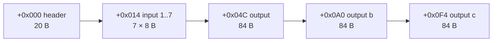

# CubeMain (`data/global/excel/cubemain.txt` → `cubemain.bin`)

> **Source archive:** patch_d2 (`.txt` and `.bin`)   **Rows:** 151 (no `Expansion` marker)   **Record:** 328 B (`0x148`)
> **sha256:** `.txt` `ff5d7e9b6b6cff4ff5462684eb23358d764ce8c193beff0f1044af7fb0cb544a`, `.bin` `a907396dc4c5e20eb3a1f0848ec9a525eae71486402fd640949feebb7e540fdd`
> **Doc status:** layout complete, every input and output cell decoded (plan 0030 Phase 0); semantics `[L]` (plan 0030 Phase 1 reads the transmute)

## Purpose

One row per Horadric Cube recipe: whether it is enabled, ladder-only, its minimum difficulty, game version, an
`op`/`param`/`value` condition and a class restriction, up to seven inputs, and up to three outputs (`output`,
`output b`, `output c`), each with its level columns and five property lines. Reader: `items/cube`
([plan 0030](../plans/0030-items-cube.md)). The loader is `0x00669130`, which allocates 328-byte records
(`0x0066A184`) and aborts with a fatal error if a `cubeserver.bin` or `cubeserver.txt` exists
([data/0001 § 3](../findings/data/0001-excel-loader.md#3-what-is-registered-datatbls_loadall-0x00619300)).
Leads: no lead; derived from data and the compile probe.

**`cubemod` and `cubetype` are not loaded.** `cubemod.txt`/`.bin` (12 rows: `ame`, `rub`, … `mag`, `rar`, `unq`,
`crf`) and `cubetype.txt`/`.bin` (15 rows: `hpt`, `mpt`, `itm`, `axe`, …) ship in d2exp, but `Game.exe` registers no
loader for them and their names do not occur in it `[C]`
([data/0001 § 4](../findings/data/0001-excel-loader.md#4-record-size-corroboration-all-88-bin-tables)). Their codes
are not the ones the compiled cells use: the cube cell keywords are strings in `Game.exe` itself (`0x006EE7D8` …
`0x006EE898`: `nru`, `eli`, `exc`, `bas`, `upg`, `eth`, `noe`, `sock`, `nos`, `tmp`, `crf`, `uni`, `rar`, `mag`, `hiq`,
`nor`, `low`, `qty`, `any`, `rch`, `rep`, `reg`, `rem`, `uns`, `suf`, `pre`, `useitem`, `usetype`, the three portal
names, then `cubemain`). This table is the only cube data the game reads.

## Row identity

- `[C]` The `.bin` is a u32 record count (151) and 151 records of 328 bytes, one per `.txt` row in order; the table
  has no `Expansion` marker ([excel-bin.md](../formats/excel-bin.md)). Rows are addressed by record index; no
  column is a key, and `description` (151 distinct strings) is not compiled.
- `[C]` **The shipped `.bin` is the compiler's output of the shipped `.txt`.** Compiling `cubemain.txt` with the game
  (`-direct -txt`) gives a `cubemain.bin` byte-identical to the shipped one
  ([run:2026-10-15-cube-saves](../formats/experiments.md#run2026-10-15-cube-saves), step 1).

## Record layout

`[C]` layout: `python3 -I tools/excel_bin.py diff workspace/merged/data/global/excel cubemain`: 151 records × 164
mapped fields = 24 764 cells, **0 mismatches**; `excel_bin.py unknown … cubemain` finds no uncovered byte, and the
18 padding bytes (`U` fields: 3 in the header, 1 per mod line) are 0 in every record. The fields that every stock row leaves blank (`min diff`,
`param`, `value`, `class`, the `mod` chances, `output b`, `output c`) and every cell keyword the stock rows don't use
are placed by the **compile probe**: the game compiled a `cubemain.txt` with those cells filled, and the same diff
over that pair gives 232 records × 164 fields = 38 048 cells, 0 mismatches
([run:2026-10-15-cube-saves](../formats/experiments.md#run2026-10-15-cube-saves); § Compile probe). A third
pair, the plan 0005 sample table (`tools/d2s_samples.py`, compiled the same way on 2026-10-11), diffs with 0
mismatches over 158 records.



### Header (`+0x000`, 20 bytes)

| Column | Observed (stock) | `.bin` field | Meaning | References | Tag |
|---|---|---|---|---|---|
| `description` | str, 151 distinct | — (not compiled) | editor comment | — | [C] |
| `enabled` | {1} on 146 rows, blank on 5 (rows 142–146) | `+0x000` u8 | recipe enabled `[L]` | — | [C] |
| `ladder` | {1} on 21 rows (104–122, 131, 132), else blank | `+0x001` u8 | ladder-only `[L]` | — | [C] |
| `min diff` | blank in every row | `+0x002` u8 (probe: 2 → 2, 300 → 44: truncated to a byte) | minimum difficulty `[L]` | — | [C] |
| `class` | blank in every row | `+0x003` u8 row index, blank −1 (`0xFF`) | class restriction `[L]` | `playerclass` `Code` (`Expansion` row dropped: `dru` → 5, `ass` → 6) | [C] |
| `op` | {28} on 5 rows (0, 1, 2, 148, 149), else blank | `+0x004` u8 (probe: 300 → 44, −2 → 254) | condition operator `[L]` | — | [C] |
| — | — | `+0x005` 3 bytes | padding; 0 in every record | — | [C] |
| `param` | blank in every row | `+0x008` s32 (probe: 1 234 567, −1, 65 537) | condition parameter `[L]` | — | [C] |
| `value` | blank in every row | `+0x00C` s32 (probe: −7, 70 000, −65 537) | condition value `[L]` | — | [C] |
| `numinputs` | int 2..7 | `+0x010` u16 | equals the sum over the input cells of `qty` (1 when absent) in all 151 rows | — | [C] |
| `version` | {0} on 55 rows, {100} on 96 | `+0x012` u16 | game version of the recipe `[L]` | — | [C] |

The five `op` 28 rows are the quest and portal recipes: Horadric Staff (0), Khalim's Flail (1), the cow portal (2),
the two Pandemonium portals (148, 149). What `op` 28 tests is plan 0030 Phase 1.

### Input record (`input 1..7` at `+0x014 + 8·(k−1)`, 8 bytes)

| Offset | Size | Field | Filled from the cell | Tag |
|---|---|---|---|---|
| `+0` | u16 | `flags` | bits below | [C] |
| `+2` | u16 | `item` | flag `0x001`: item record index over weapons + armor + misc (`any`: `0xFFFF`); flag `0x002`: item type row index | [C] |
| `+4` | u16 | `id` | a unique or set item named by the cell: its `uniqueitems` / `setitems` record index **+ 1** (0 = none) | [C] |
| `+6` | u8 | `quality` | `low` 1, `nor` 2, `hiq` 3, `mag` 4, `set` 5, `rar` 6, `uni` 7, `crf` 8, `tmp` 9; 0 = any | [C] |
| `+7` | u8 | `qty` | `qty=N` (N truncated to a byte: probe `qty=300` → 44); 0 when absent | [C] |

| Bit | Value | Keyword | Stock cells | Tag |
|---|---|---|---|---|
| 0 | `0x001` | an item code, `any`, or a unique/set name | 319 item, 5 `any`, 2 names | [C] |
| 1 | `0x002` | an item type code | 63 | [C] |
| 2 | `0x004` | `nos` | 7 | [C] |
| 3 | `0x008` | `sock` (also `sock=N`; N is not stored) | 2 | [C] |
| 4 | `0x010` | `eth` | 0 (probe) | [C] |
| 5 | `0x020` | `noe` | 4 | [C] |
| 6 | `0x040` | a unique or set item name (with bit 0) | 2 (*The Stone of Jordan*) | [C] |
| 7 | `0x080` | `upg` | 24 | [C] |
| 8 | `0x100` | `bas` | 4 | [C] |
| 9 | `0x200` | `exc` | 4 | [C] |
| 10 | `0x400` | `eli` | 4 | [C] |
| 11 | `0x800` | `nru` | 0 (probe) | [C] |

What each flag requires of a cube item (`nos` no sockets, `noe` not ethereal, `upg` the exceptional and elite
versions too, `bas`/`exc`/`eli` the base tier, `nru` not a runeword, a name the exact unique or set item) is the
obvious reading of the keyword and is `[L]` until plan 0030 Phase 1 reads the match.

### Output record (`output` at `+0x04C`, `output b` at `+0x0A0`, `output c` at `+0x0F4`, 84 bytes each)

The `b ` and `c ` columns (`b lvl`, `b mod 1`, …) fill the same fields of the second and third record.

| Offset | Size | Field | Filled from | Tag |
|---|---|---|---|---|
| `+0x00` | u16 | `flags` | bits below | [C] |
| `+0x02` | u16 | `item` | kind `0xFC`: item record index (weapons + armor + misc); kind `0xFD`: item type row index; 0 otherwise | [C] |
| `+0x04` | u16 | `id` | a named unique or set item: record index + 1 | [C] |
| `+0x06` | u8 | `quality` | the quality keyword (codes as in the input record); a unique name gives 7, a set item name 5 | [C] |
| `+0x07` | u8 | `qty` | `qty=N` **or** `sock=N`: one byte, the later keyword in the cell wins (probe: `rin,sock=2,qty=3` → 3, `rin,qty=3,sock=2` → 2) | [C] |
| `+0x08` | u8 | `kind` | `0xFC` item code or named unique/set, `0xFD` item type, `0xFE` `useitem`, `0xFF` `usetype`; 1 `Cow Portal`, 2 `Pandemonium Portal`, 3 `Pandemonium Finale Portal`; 0 for a cell the compiler can't read | [C] |
| `+0x09` | u8 | `lvl` | `lvl` / `b lvl` / `c lvl` (probe 300 → 44) | [C] |
| `+0x0A` | u8 | `plvl` | `plvl` / … (probe −1 → 255) | [C] |
| `+0x0B` | u8 | `ilvl` | `ilvl` / … (probe 256 → 0) | [C] |
| `+0x0C` | 3 × u16 | `pre1..3` | the `pre=N` keywords in order | [C] |
| `+0x12` | 3 × u16 | `suf1..3` | the `suf=N` keywords in order; a fourth `pre=` lands in `suf1` (probe `pre=7,pre=8,pre=9,pre=10` → 7, 8, 9 / 10, 0, 0) | [C] |
| `+0x18` + 12·(m−1) | 12 B | `mod m` (m = 1..5) | `mod m`: s32 [Properties](Properties.md) row index (blank or unknown −1); `mod m param` u16; `mod m min` s16; `mod m max` s16; `mod m chance` u8; 1 byte padding | [C] |

| Bit | Value | Keyword | Stock outputs (all three columns) | Tag |
|---|---|---|---|---|
| 0 | `0x001` | `mod` | 8 | [C] |
| 1 | `0x002` | `sock=N` (N in `qty`) | 1 (row 63, `useitem,sock=1`) | [C] |
| 2 | `0x004` | `eth` | 0 (probe; the sample table's `buc,eth`) | [C] |
| 3 | `0x008` | a unique or set item name | 0 (probe; the sample table's *Angelic Halo*) | [C] |
| 4 | `0x010` | `uns` | 1 (row 141) | [C] |
| 5 | `0x020` | `rem` | 0 (probe) | [C] |
| 6 | `0x040` | `reg` (and `kind` becomes `0xFF`: probe `useitem,reg` → kind `0xFF`) | 0 (probe) | [C] |
| 7 | `0x080` | `exc` | 4 | [C] |
| 8 | `0x100` | `eli` | 4 | [C] |
| 9 | `0x200` | `rep` | 4 | [C] |
| 10 | `0x400` | `rch` | 2 | [C] |

The mod widths are from the probe: `param` 70 000 → 4 464 (u16), `min` −3 → −3, `max` 65 537 → 1, `chance` 300 → 44.
A `param` cell holding a name is **not** looked up: `Holy Freeze` stores 9 013, the digit-by-digit value of
`excel-bin.md`'s integer rule (§ Cell encoding rules), unlike the `names=` columns of [Runes](Runes.md) and
[SetItems](SetItems.md). The stock `mod … param` cells are all numbers (`gethit-skill` 44). Whether the game rolls
`min..max` per line, and what `chance` does, is plan 0030 Phase 1 `[L]`.

## Cell grammar (input and output cells)

`tools/cubemain.py` holds the compiler model (`compile_input`, `compile_output`) that the layout check runs on
every cell, and the survey (`rows`, `summary`). The rules, each checked by the stock diff and the compile probe:

- `[C]` A cell is one comma list, quoted in the `.txt` when it has a comma. Its **first token** is the item; the rest
  are keywords, matched exactly.
- `[C]` **Input head:** an item **type** code is tried first, then an item code, then `any`, then a unique or set item
  name (`uniqueitems` / `setitems` `index`). `axe` and `key` are both a type and an item: as inputs they compile
  as the types (stock rows 11 and 81; the probe's `key`).
- `[C]` **Output head:** `useitem`, `usetype`, then an item **code**, then an item type, then a unique or set item
  name, then the three portal names (the whole cell). As outputs `axe` and `key` compile as the items (probe; the
  sample table's `key`), the opposite order to the inputs.
- `[C]` A named unique or set item stores its base item (`code` / `item` column) in `item`, its record index + 1 in
  `id`, and quality 7 or 5; the input sets flags `0x041`, the output flag `0x008` and kind `0xFC` (*The Stone of
  Jordan* → item 522 `rin`, id 123; *Tal Rasha's Horadric Crest* → item 358, id 81).
- `[C]` In an output, the input-only keywords `nos`, `noe`, `upg`, `bas`, `nru` and a second head `any` change no
  byte. A head the compiler doesn't know (`any` as an output) leaves the record zero, kind 0.
- `[C]` **`useitem,sock` with no `=N` stops the compile:** the game writes no `cubemain.bin` and the session goes no
  further (the probe found it by bisection, step 2 of the run). `sock` alone is fine in an input (`any,sock`).

## Survey of the stock rows

`python3 -I tools/cubemain.py rows workspace/merged/data/global/excel` prints every row with each cell's decoded
form; `summary` gives the counts (gate survey `cubemain`). Every one of the 389 input cells and 151 output cells
decodes with no token left over (`unexplained=0`). Two rows as `rows` prints them:

```
 63 3 perfect skull + 1 rare item + stone of jordan-> add 1 socket to rare  enabled=1 ladder=- version=0 op=- numinputs=5
    in1  "any,rar,nos"                      any/rar/nos flags=0x005 item=-1 id=0 q=rar qty=0
    in2  "skz,qty=3"                        item/qty flags=0x001 item=601 id=0 q=0 qty=3
    in3  The Stone of Jordan                uni name flags=0x041 item=522 id=123 q=uni qty=0
    out  "useitem,sock=1"                   useitem/sock kind=useitem flags=0x002 item=0 id=0 q=0 qty=1 lvl=- plvl=- ilvl=-
 64 magic full helm + jewel + rune 06 + perfect sapphire -> hitpower helm  enabled=1 ladder=- version=100 op=- numinputs=4
    in1  "fhl,mag,upg"                      item/mag/upg flags=0x081 item=309 id=0 q=mag qty=0
    in2  jew                                item flags=0x001 item=643 id=0 q=0 qty=0
    in3  r06                                item flags=0x001 item=615 id=0 q=0 qty=0
    in4  gpb                                item flags=0x001 item=571 id=0 q=0 qty=0
    out  "usetype,crf"                      usetype/crf kind=usetype flags=0x000 item=0 id=0 q=crf qty=0 lvl=- plvl=50 ilvl=50 mods gethit-skill(44)5..4 thorns()3..7 ac-miss()25..50
```

| count | value | rows |
|---|---:|---|
| rows | 151 | 0–150 |
| `enabled` 1 | 146 | not 142–146 (the five quality-9 `tmp` recipes) |
| `ladder` 1 | 21 | rune upgrades 104–122 (`r14` → `r15` and up), the elite upgrades 131–132 |
| `version` 0 / 100 | 55 / 96 | |
| `min diff`, `class`, `param`, `value`, any `mod` chance, `output b`, `output c` | 0 rows | blank everywhere |
| `op` 28 | 5 | 0, 1, 2, 148, 149 |
| input cells | 389 | 151 / 109 / 74 / 52 / 1 / 1 / 1 in `input 1..7`; `numinputs` sums to 532 |
| property lines | 133 | `mod 1..4` (`mod 5` blank) |

Rows by the kind and quality of `output`:

| `output` | rows | examples |
|---|---:|---|
| item code, no quality | 69 | quest items (0, 1), potions, gem / skull / rune upgrades, arrows ↔ bolts, Token of Absolution (150) |
| item code, `mag` / `nor` | 7 / 2 | prismatic amulet (6), the four `rin,mag,pre=…` rings (7–10), rings ↔ amulets (13, 14); throwing axes and javelins (11, 12) |
| item type, `mag` | 1 | `pole,mag,pre=191` (19) |
| `usetype,crf` | 36 | the crafted items, rows 64–99: Hit Power (`gpb`), Blood (`gpr`), Caster (`gpv`), Safety (`gpg`), nine each |
| `usetype,mag` | 6 | the magic rerolls and socket-weapon rows (15–18, 60, 147) |
| `usetype,rar` | 2 | the rare rerolls (61, 62) |
| `usetype,nor` | 2 | low-quality → normal (127, 128) |
| `usetype,tmp` / `useitem,tmp` | 2 / 2 | the disabled quality-9 recipes (142–145) |
| `useitem` | 19 | add sockets (63, 123–126), upgrade to exceptional / elite (129–136), repair and recharge (137–140), unsocket (141), 146 |
| portal | 3 | `Cow Portal` (2), `Pandemonium Portal` (148), `Pandemonium Finale Portal` (149) |

## Compile probe

The column semantics a stock row can't show were read off the compiler, by data only: `python3 -I tools/cubemain.py
probe-txt <excel-dir> <out-dir>` writes the stock rows followed by 81 probe rows (three header rows with every
header column filled, out-of-range values included; one row with `output`, `output b` and `output c` and all their
lvl and mod columns filled with distinct numbers; one row of over-wide mod values and a skill name in a `param`;
one row per input form and keyword; one row per output form and keyword). The game compiled it under
`-direct -txt`, and `excel_bin.py diff` matches all 232 records with the layout above
([run:2026-10-15-cube-saves](../formats/experiments.md#run2026-10-15-cube-saves)). The probe pair is kept as
`workspace/cmp/cubeprobe-excel/cubemain.{txt,bin}` (with links to the stock tables the references need).
These are compiler facts. They say how a cell is stored, not what the transmute does with it.

## Interpretation notes

- **Quantity counts.** `numinputs` is the number of items the recipe takes: the `qty` of each input, 1 when
  absent, summed (all 151 rows). Whether the match counts a stack as one item or as its quantity is Phase 1. `[L]`
- **Ladder and disabled rows.** The 21 `ladder` rows are the high rune upgrades and the elite upgrades; single
  player has no ladder, so they are expected to be refused offline (plan 0030 Open questions). `[L]`
- **No class or difficulty limits in the stock data.** The fields exist (and the sample recipes of plan 0005 used
  `class`), but no stock row sets them.
- **Item references.** Input and output `item` index the concatenated weapons + armor + misc rows ([Weapons](Weapons.md));
  types index [ItemTypes](ItemTypes.md) rows; `id` is a [UniqueItems](UniqueItems.md) or [SetItems](SetItems.md)
  record index plus one; `pre`/`suf` are [MagicPrefix](MagicPrefix.md) / [MagicSuffix](MagicSuffix.md) record indices
  as written (`pre=331` … `suf=352`; which table and base the game indexes with them is Phase 1 `[L]`).
- **Recipe saves.** `tools/d2s_recipes/` has one recipe per recipe class, each with the inputs of the first
  transmute in the cube and those of several more in the inventory (and stash), including some that should match
  no row: `cuberunes` (rune and gem upgrades, two ladder rows), `cubereroll` (the 3-perfect-gem magic reroll, the
  6-perfect-skull rare reroll, the Stone of Jordan reroll), `cubecraft` (the four crafting families on rings,
  amulets and their gloves), `cubesock` (rows 123–126, 63, 141), `cubeportal` (Wirt's Leg and a Tome of Town
  Portal, the Pandemonium keys and organs, the Token of Absolution parts) and `cubeclassic` (classic rows, and row
  60 to be refused there). Each builds with `tools/d2s.py build` and loads in the game
  ([run:2026-10-15-cube-saves](../formats/experiments.md#run2026-10-15-cube-saves);
  [d2s.md § Cube recipe saves](../formats/d2s.md#cube-recipe-saves)).

## Open questions

- `[L]` Everything the transmute does with these fields: the row scan, `enabled`/`ladder`/`min diff`/`version`/
  `class` and the `op`/`param`/`value` test (what `op` 28 checks), how each input flag and quality is matched, the
  output kinds, `lvl`/`plvl`/`ilvl`, the mod lines and their `chance`, `pre`/`suf`, `rem`/`reg`/`uns`/`rep`/`rch`:
  plan 0030 Phase 1 ([backlog](../backlog.md), plan 0030 Phase 0 requests).
- `[L]` Why the compiler resolves an input head type-first and an output head item-first (and so `axe` differs
  between the two), and why `useitem,sock` without a count stops the compile: the compiler is code (Phase 1 may
  read it in passing; not required).
