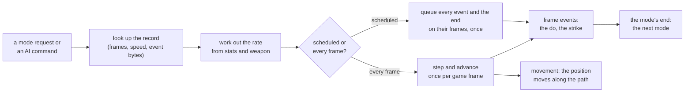
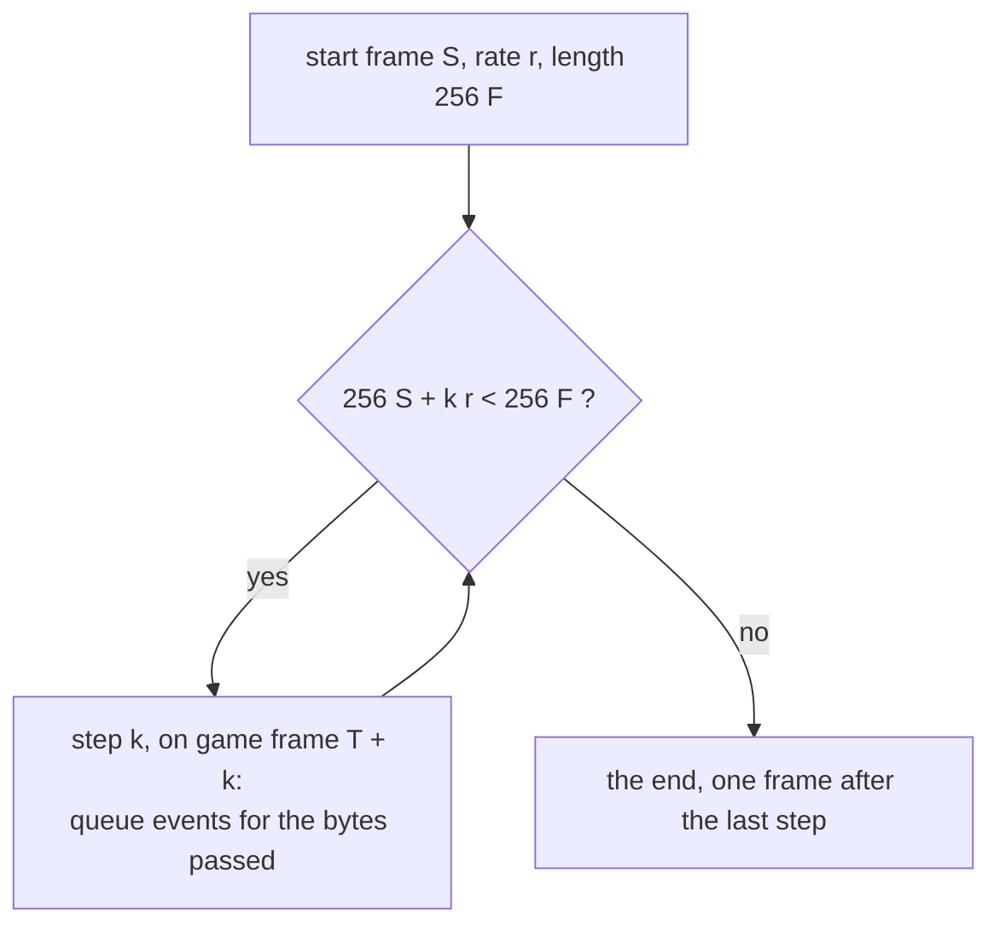
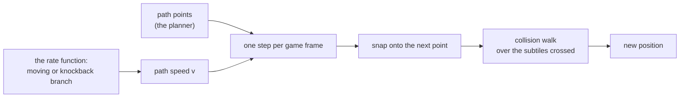

---
based_on:
  - docs/specs/anim/README.md 2026-10-27
  - docs/specs/anim/timing.md 2026-10-27
  - docs/specs/anim/movement.md 2026-10-27
---

# Animation and timing

This page explains how long a unit's actions take on the server, and how far a moving unit gets in each game frame.
Every mode a unit enters (a swing, a cast, a hit recovery, a block, a walk) has an animation record. The record, the
unit's stats and its weapon give a rate, and the rate decides on which game frames the mode's events fire and when the
mode ends. This is where "frames per cast", "attack speed breakpoints" and "walk speed" come from. The page restates
the reviewed specs: the overview in [anim/README](../specs/anim/README.md#purpose), the timing machinery in
[anim/timing](../specs/anim/timing.md#purpose) and movement in [anim/movement](../specs/anim/movement.md#purpose). The
specs carry the exact arithmetic, the addresses and the evidence; this page tells the story and says where the specs
are less sure. Terms are in the [glossary](../glossary.md).

Only what the server does is covered. Which cel the client draws and the client's own animation clock are
presentation and stay out ([how we know](how-we-know.md)). Which mode a unit is asked to enter, and when, is an input:
for a player it is the request from the client ([skills and missiles](skills.md)), for a monster the AI's command
(not yet specified), and the path a unit follows is the planner's. The specs were compared against recorded runs
(tens of thousands of logged mode starts, schedules and steps, no mismatch in the closing check); the
[evidence sections](../specs/anim/timing.md#evidence) list the runs. Where a statement is read from the code but no
run separates it, this page says so.

## The big picture

When a unit changes mode, the server finds the animation record for that unit, mode and weapon, sets the unit's frame
fields, computes the rate, and then does one of two things ([timing § A](../specs/anim/timing.md#a-the-two-clocks-and-the-event-kinds)):

- **Scheduled modes** fix everything at the start. One pass queues an event for each frame-event byte of the record,
  on the game frame it will fall on, and one event for the mode's end. Nothing is advanced afterwards. This is how a
  player's attacks, casts, get-hits, blocks and deaths run, and most of a monster's attacks.
- **Every-frame modes** run once per game frame. A monster's walk, run, knockback and sequence modes (and any attack
  whose MonStats2 `*mv` bit is set) step the unit and advance its animation frame by the rate each frame. A player's
  walk, run and knockback also run every frame, but they only step the path; they have no animation advance.

Objects, missiles and items get their frame fields at the start and no server-side advance. Monsters in neutral,
`S3`, `S4` and dead modes queue nothing.

The animation adds no random seed of its own. The only draw in the whole machinery is an object's animation start
(below); the two other draws near it, the get-hit roll and the Concentration check, belong to hits and mode commands
([draws](#the-few-draws)).

## The animation record

The record comes from `animdata.d2` ([format](../formats/animdata.md)). Its name is built from the unit's type token,
the mode token and the weapon class ([timing § B](../specs/anim/timing.md#b-the-animation-record)): for a player the
character's token, the mode (`A1`, `SC`, `GH` and so on) and the class of the weapon in hand; for a monster its
MonStats code, the mode and its MonStats2 base weapon. A record gives a frame count, a base speed and, per frame, an
event byte (1 to 4). A name with no record falls back to a default of 2 048 frames at speed 256; no logged case met
it. When a name appears twice in the file, the earlier one in its block wins.

A transformed player (werewolf, werebear) uses the form's record, start frame and rate; the mode is mapped to the
monster's. The name and lookup were met in every logged rate call; the fallback steps for modes the form lacks are
read from the code only.

An attack also has a **start frame**: the Amazon's and the Sorceress's attack begins at animation frame 1 or 2
depending on the weapon, and every other class at 0 ([timing § D](../specs/anim/timing.md#d-the-start-frame)).

## The schedule: when events fall

For a scheduled mode the server walks the animation in steps. Frame fields are in 8.8 fixed point: the record has `F`
frames, so the length is `256 F`; the rate `r` is added per step; and on step `k` the server queues a frame event for
every event byte the position has passed ([timing § E](../specs/anim/timing.md#e-the-schedule)).

What follows from it:

- The mode lasts `n = max(2, ceil(256 (F - S) / r))` game frames from its start frame `T`; the end fires at `T + n`.
  This length holds at every logged rate (over 25 000 schedules in the first run, 34 000 over both parts).
- A frame event on animation frame `f` fires at `T + max(1, ceil(256 (f - S) / r))`, and only if that is not after the
  last step (derived from the schedule's loop; read from the code).
- **A rate change does not move queued events.** Once a mode has started, a later change of speed (a weapon swap, an
  aura, a curse) leaves its events where they were. Only some skills' own functions rebuild the list, from the rate
  at their call ([timing § E3](../specs/anim/timing.md#e-the-schedule), read from the code; Whirlwind, Charge and a
  few others).
- A frozen monster loses its scheduled events, its mode end among them; they are dropped when they fall due.

An every-frame monster instead adds the rate to its frame position each game frame and takes the event byte of every
frame it passes ([timing § F](../specs/anim/timing.md#f-the-per-frame-advance-every-frame-monsters)). That advance
reads the rate at its call, so a slowed monster advances at the new rate from its next frame. A monster restarted in
the same every-frame mode by a new hit starts its animation again from 0 rather than carrying on.

### In what order a frame runs

Events are held in per-type lists. In each game frame the server runs missiles, then players, then monsters, then
objects, then items; for each type first its every-frame events (newest first) and then the events due this frame
(oldest first). An every-frame event queued in a frame runs in that frame only when it is queued before its type's
list is walked; otherwise it runs in the next one. So a walking unit's first step sometimes comes in the frame it
starts and sometimes a frame later ([timing § H](../specs/anim/timing.md#h-the-event-queue-and-the-frame-order)).
The first-run rule was confirmed in the run; the order of an every-frame event against slot events in one frame is
unknown.

## The rate

The rate is worked out by one function whenever a unit enters a mode, and again when something changes its stats
([timing § J](../specs/anim/timing.md#j-the-rate-unit_animsetrate)). It takes the record's base speed `spd` and
multiplies it by a factor in percent. Which factor depends on the kind of mode:

| Mode | Factor (percent) | Stat |
|---|---|---|
| cast (`SC`; a sequence with a cast transition) | 100 plus the FCR bonus, at most 175 | faster cast rate |
| attack | the attack-rate stat plus the weapon's speed, kept between 15 and 175 | increased attack speed, weapon speed |
| get-hit | 50 plus the FHR bonus | faster hit recovery |
| block | 50 plus the FBR bonus (100 plus under Holy Shield) | faster block rate |
| walk, run | the movement factor, at least 25 | faster run/walk, stat 67 |
| knockback | fixed (see movement) | none |
| death | the record's speed as it is | none |
| anything else | stat 69 in percent, kept between 15 and 175 | none |

Three details matter for a reimplementation:

- **The bonuses are diminishing.** An item stat `s` for IAS, FHR, FCR or FBR counts as `120 s / (120 + s)` (150 for
  faster run/walk), rounded toward zero. It rises toward 120 and never reaches it. The map was checked on thousands of
  emulated values ([timing § J1](../specs/anim/timing.md#j-the-rate-unit_animsetrate)).
- **Attack adds a few terms.** Two weapons in the hands (Double Swing, Frenzy, a dual-wield attack) replace the right
  hand's weapon term by the mean of the two. A sequence attack of Jab, Double Swing, Frenzy or Fists of Fire takes 30
  off. A transformed player's attack length comes from the human form's attack frames with the same weapon. Charge
  and Leap Attack take the default branch.
- **Divisions are unsigned except for movement.** A negative factor would wrap to the cap instead of slowing the unit,
  but no stock item gives a negative bonus, so it is not met.

Every branch was compared at all of the roughly 298 000 logged rate calls. The factor floors (25 for moving, 15 for
attack) and the cap that applies to a negative result were never reached in the run; they are read from the code.
Which stats a unit carries (100 for stats 67, 68 and 69 on a new player; 75, 100 and 100 on a new monster) and who
recalculates the rate (24 server call sites: mode starts, equipping, auras, curses, chill, the slowing states) are
in [timing § J5 and J6](../specs/anim/timing.md#j-the-rate-unit_animsetrate), read from the code.

## Breakpoints

The "breakpoint" tables the community uses are not in the game. They follow from the schedule's length and the rate
([timing § K](../specs/anim/timing.md#k-breakpoints-derived)): a stat is worth having only when it lowers
`ceil(256 (F - S) / r)` by a whole game frame. The least item stat that reaches a given length can be derived from the
bonus map above. A few of the tool's illustrations, for stock records (the tool's model, not a run):

- a Sorceress's cast (`SOSCHTH`, 14 frames) lasts 14, 13, 12, 11, 10, 9, 8 frames at 0, 9, 20, 37, 63, 105, 200 FCR;
- a Paladin's hit recovery (`PAGHHTH`, 5 frames at speed 256) lasts 10, 9, 8, 7, 6, 5, 4 frames at 0, 7, 15, 27, 48,
  86, 200 FHR.

The lengths the formulas give equal the schedule's lengths at every rate the run logged. The formulas for the other
rates rest on that and on the bonus map. The run was short of some rates, because the characters it could build did not
survive long enough: three FHR rates of 30 events for each class, a third FCR rate for three classes and two others
([timing § K3](../specs/anim/timing.md#k-breakpoints-derived)). Those breakpoints are derived, not seen.

**Counting the end.** A mode ends `n` frames after its start, while the community tables count `N = n - 1`, the last
step. The server starts the next action in the frame its request arrives. The stock client's held request arrives at
`T + N` for a held ordinary action and at `T + n` for held Lightning, so the community's number is the interval a held
button gives with this client ([timing § L4](../specs/anim/timing.md#l-the-frame-events-as-gates)). The client's own rule for when
it sends a held request is not read.

## A worked example

A Sorceress casts with 20% faster cast rate, using the `SOSCHTH` record (14 frames, speed 256, event byte 1 on frame 7,
start frame 0). The numbers are the spec's derivation, as the tool prints them
([timing § Worked example](../specs/anim/timing.md#worked-example)):

1. The bonus is `120 x 20 / 140 = 17`, so the factor is `100 + 17 = 117`, under the 175 cap.
2. The rate is `256 x 117 / 100 = 299`.
3. The length is `ceil(3584 / 299) = 12` frames, so the end fires at `T + 12`. The event on frame 7 fires at
   `T + ceil(1792 / 299) = T + 6`, which is when the spell goes off.
4. At 9% FCR the factor is 108 and the rate 276, giving 13 frames; 20 is the least FCR for 12.

A Paladin being hit with no FHR: the factor is 50, so `r = 128` and the 5-frame record takes `ceil(1280 / 128) = 10`
frames; at 7% FHR it is 9.

## What happens on and after the action frame

- **The do frame.** For a player, the first event with code 1 or 2 runs the used skill's do function, provided the
  unit's action-done bit is still clear (most do functions set it). A normal attack's hit test, damage build and
  delivery all happen in that call. A skill's missile is created in the same call, after the do function. The detail is
  in [skills and missiles](skills.md) and [timing § L](../specs/anim/timing.md#l-the-frame-events-as-gates) (partly read
  from the code).
- **The skill delay** runs from the do frame, not from the mode's start: with Frozen Orb held, the next cast started
  at the delay-state frame plus the delay in 72 of 73 cases (one 3 frames later).
- **A monster's attack** strikes on each scheduled event of its mode, or, for an every-frame mode, on frames whose
  event byte is 1 ([timing § I2](../specs/anim/timing.md#i-the-mode-machines), read from the code).
- **Object animation.** An object takes its frame count, start frame and rate from its Objects row, not the record.
  When the row's `Sync` is 0, its start draws `RangeB(FrameDelta >> 3)` on the object's own seed to vary the rate
  (490 logged starts agreed, 235 with `Sync` set drew nothing). A chest's "opened" mode is set without an animation
  start, so there is no draw at the operate end.

## The mode machines

The specs describe which mode follows which ([timing § I](../specs/anim/timing.md#i-the-mode-machines)). All of it is
read from the code and not compared against a run, apart from the points mentioned above.

- **Players.** Neutral, walk, run, attack, cast and skill modes, get-hit, block, knockback and death. An action ends
  in neutral at its kind-1 end; a walk or run ends in neutral when the path runs out, and a run at stamina 0 becomes
  a walk (not met). Death goes to the dead mode.
- **Monsters.** A table per mode says whether it is scheduled, what its frame function does and what ends it. A
  walk or run ends on arrival; a knockback ends in the frame its animation reaches the end of the get-hit record
  (541 logged ends, none earlier), then a get-hit command; ten monster classes override some attack modes.
- **Objects.** Mode 1 (operating) becomes mode 2 (opened) at a queued event after the frame count.

A player's request is accepted according to the mode tests ([timing § M4](../specs/anim/timing.md#m-hit-recovery-the-block-the-get-hit-roll-the-mode-tests-stun-and-the-hit-class)):
during an action, only a get-hit or block request passes while the end is pending (within 5 frames of the queued
end); a get-hit or a block cannot be left before its end except for death or neutral; with an item on the cursor only death and
the dead mode pass. The pending-end frame matched the queue in 1 027 logged values; the 5-frame slack and the
refusals are read from the code only (no refusal was reached).

## Hit recovery, block and the get-hit roll

Hit recovery is the get-hit mode's schedule at the FHR rate; the block's length is the block mode's schedule at the
FBR rate ([timing § M3](../specs/anim/timing.md#m-hit-recovery-the-block-the-get-hit-roll-the-mode-tests-stun-and-the-hit-class)).
Both rates and schedules matched in the run.

**Whether a hit makes the unit react.** When combat has decided a hit lands, the get-hit code looks at the result:

- For a **blocked hit on a player** the block mode starts only if `frame - (last block frame) > stat102 / 8 + 15`
  (stat 102 is the faster block rate; 867 blocked hits, 618 passed the gate, 249 did not). The last block frame is
  updated whenever the gate passes, whether or not the mode is then accepted.
- A **get-hit** that is not already a kill or a knockback goes through the **get-hit roll**
  ([timing § M2](../specs/anim/timing.md#m-hit-recovery-the-block-the-get-hit-roll-the-mode-tests-stun-and-the-hit-class)),
  unless the unit is stunned (stunned units are always staggered). The roll uses the damage as a share of the
  defender's maximum life, in bands set by a divisor `D` (16 normally, 8 for hit classes 2, 6, 10 and 11, 32 and 64
  for a few others). Below one `D`-th of it the unit is not staggered. From there up to two `D`-ths, two draws
  (`RangePow2(2)`, then `RangePow2(4)`) each can excuse the unit, which leaves a 3 in 8 chance of a stagger. From two
  to four `D`-ths one draw (`RangePow2(4)`) applies, a 3 in 4 chance. From four `D`-ths up the stagger is certain.
  The roll draws zero, one or two times on the defender's seed (7 195 logged calls, none mismatched, and the draws
  chain). A monster that is not allowed the get-hit mode at all is never staggered. The band chances are worked out
  from the draws, read from the code.
- **Stun** sets a state until a frame (capped at 250, 13 for a hireling from level 12 up). A monster's next AI event
  after a stun comes 45 frames later ([timing § M5](../specs/anim/timing.md#m-hit-recovery-the-block-the-get-hit-roll-the-mode-tests-stun-and-the-hit-class), read from the code).
- The **hit class** is a code in the damage packet (a weapon's or a monster's `hit class`, with an element nibble
  added by delivery). The server gate found on it is the roll's divisor; the rest is client presentation.
- A **player's knockback**: 12 of Blood Raven's 13 knockback results left the player in neutral in the hit's own
  frame, and two starts of mode 19 were seen; why the others end at once is not logged.

The divisors 32 and 64 were met but not separated from 16 in the run.

## Concentration and interrupts

Whether a get-hit, block or knockback may start during a skill is decided by `PlayerModeAllowed`
([timing § M4](../specs/anim/timing.md#m-hit-recovery-the-block-the-get-hit-roll-the-mode-tests-stun-and-the-hit-class)). A skill with no
interrupt flag blocks all of them (12 player skills, among them Kick, Jab, Zeal, Frenzy and Whirlwind); a skill with an
interrupt flag is only protected under Concentration, which refuses with a probability of its stat 164 in percent. Both
rules and the draw (`Range(100)` on the player's seed) are read from the code; the 26 696 logged calls left the seed
unchanged and none was under the state.

## Movement

How fast a unit moves is a second use of the same rate function; the step itself is in
[anim/movement](../specs/anim/movement.md#purpose). Positions are 16.16 subtiles.

### Speeds

- **A player's path speed** is the character's `WalkVelocity` (in 1/256 subtile units) times the factor in percent.
  The factor is the faster run/walk bonus plus stat 67, never under 25. Walk is 1 536 and run 2 304 for every class
  at the standard factors ([movement § A1](../specs/anim/movement.md#a-speeds), compared with the run).
- **The run is a stat, not a base.** A run is a walk with a +50 stat-67 list added for the run's duration
  (`RunVelocity * 100 / WalkVelocity - 100`, 50 on stock data) and dropped at the next mode change. The animation
  paces on a separate base (101 in run, 213 otherwise), which only affects the animation rate.
- **A monster's path speed** is its MonStats `Velocity` times the factor. Its stat 67 starts at 75 and champion,
  possessed, fast and fanatic mods add to it. A monster's walk and run share the same path base, so a monster runs
  faster than it walks only if the AI's command carries a velocity, which is written into stat 67 until the next mode
  change ([movement § A3](../specs/anim/movement.md#a-speeds), read from the code).
- **Walk and run animation bases of a monster** are worked out at load from its records and scaled to its base class
  (compared at all logged moving and knockback calls, 54 classes with a run scaling).
- **Knockback** moves at a fixed 4 096 (one subtile per frame on an axis).
- **Charge** sets its own path speed from the run speed, `max(stat 67, 50) + 150` percent. 160 logged steps ran at
  5 760 as that reading gives; the speed is the skill function's own and was taken as logged, not compared.

### The step

Each game frame, a moving unit's step on an axis is the direction component times the speed, shifted: in effect
`speed / 16` subtiles along an axis. The walk is 0.375 subtile a frame and the run 0.5625; a diagonal step is
shorter on each axis. When the step would reach or pass the next path point it is cut to land exactly on the centre of
that subtile (the snap), so a point `d` subtiles away takes the ceiling of `65536 d / step` frames: 8 frames for 3
subtiles walking, 6 running, 3 knocked back ([movement § B](../specs/anim/movement.md#b-the-per-frame-step)).

When the step enters a new subtile the collision walk tests each subtile it crosses (the test itself is the collision
grid's: [levels](levels.md)); a blocked subtile stops the unit at the centre of the last free one, and a monster with a
re-plan flag plans again. After ten crossings in one step the rest is taken unchecked. The step and the snap were
reproduced for 99 241 consecutive steps; the collision walk is reproduced over the logged test results. The wrap of the
step product at a speed of 32 768 and above (a factor of 2 134 for a player) is read from the code; whether any stock
source reaches it was not surveyed.

A moving unit steps once per game frame from an every-frame event. Players' and monsters' walk and run end when the
step returns "arrived".

### The run drain

Each frame of a run takes `RunDrain * 2` from stamina (1/256 units), times `armour speed / 10 + 1` for body armour with
speed 10 or more, plus `stat 154` percent, at least 1 ([movement § D](../specs/anim/movement.md#d-the-run-drain)). 37 434
logged run frames agreed. In a town it costs nothing (read from the code). At 0 stamina the run becomes a walk
(not reached in either run).

### Knockback

A player's knockback plans a path of `(5 / 2) + 1 = 3` subtiles away from the attacker, so
it lasts 3 frames on an axis, fewer if the collision walk stops it. A monster's knockback (6 subtiles for base class 78) ends on its animation, not
its path: in the frame its get-hit record's length is reached, however far it got (541 ends). The planner's final
adjustment of the point is not read.

### Slowing

Slowing states reach movement through stat 67 (chill, the curses, `item_slow`), each re-running the rate; a change
mid-move takes effect at once, since the step reads the speed every frame (212 slowed monster windows and 9 slowed
player windows matched). The Slows Target skill changes only the attack and default rates, not the movement
([movement § F](../specs/anim/movement.md#f-the-slowing-states)); the run did not report an outcome for it.

## The few draws

| Draw | When | Seed | Seen in the run? |
|---|---|---|---|
| `RangeB(FrameDelta >> 3)` | an object starts an animation with `Sync` 0 | the object's | yes, 490 values; no chained pair |
| `RangePow2(2)` and/or `RangePow2(4)` | the get-hit roll, by damage band | the defender's | yes, 7 195 calls, 102 chained pairs |
| `Range(100)` | a mode command under Concentration | the player's | no (read from the code) |

The rate, the schedule, the advance, the sequences, movement and the run drain draw nothing
([timing § N](../specs/anim/timing.md#n-draws-and-seeds-per-event-kind),
[movement § G](../specs/anim/movement.md#g-draws)).

## What is not known yet

From the specs' open questions ([timing](../specs/anim/timing.md#open-questions),
[movement](../specs/anim/movement.md#open-questions), [overview](../specs/anim/README.md#open-questions)):

- **What ends some monster modes.** An every-frame monster attack or skill mode ignores its frame function's return,
  and a generic `S3` queues nothing; presumably the AI's next command ends them (the AI is a later phase).
- **The monster AI and the path planner.** What command a monster gets, when, and the path it follows are inputs
  here. The knockback point's final adjustment is not read.
- **Branches the runs left short.** The characters the run could build did not survive long enough for some rates
  (three FHR rates for each class, some FBR and FCR rates, the Druid's throws, a second set of IAS rates), for a run
  turning into a walk at 0 stamina, a player's knockback length, the moving-factor floor of 25, Charge at a low
  stat 67, and Slows Target. The statements stay "read from the code" and none waits on a mismatch. Whether a further
  harness run settles them is for the project owner.
- **Reading of the code left open.** A few functions were not read (two called when a mode is set, part of the
  sequence mode test), the order of an every-frame event against slot events in one frame, whether a player's
  knockback-to-get-hit branch is ever reached, and the two flags that switch a move-first skill's rate branch and
  empty a hand for the dual-wield term.
- **Whether a stock source reaches the step's wrap.** A speed factor of 854 for a `Velocity`-15 monster or 2 134 for a
  player.
- **Another player's unit.** Party-wide rate auras on another player's unit need a two-client run.
- **Differences from community wording.** The specs list where community tables for 1.09 and 1.10+ differ from 1.14d
  (Slows Target, the run factor, Charge's speed); they are leads only.

## Where to read more

- The specs: [anim overview](../specs/anim/README.md#reimplementation-notes),
  [timing](../specs/anim/timing.md#reimplementation-notes) and [movement](../specs/anim/movement.md#reimplementation-notes).
  Each *Reimplementation notes* section lists the traps for someone rebuilding the system.
- The [animdata format](../formats/animdata.md) and the [glossary](../glossary.md) for D2 terms.
- Related wiki pages: [skills and missiles](skills.md) (the request, the do frame and the skill delay),
  [combat](combat.md) (the hit that starts a get-hit or block, and stun), [stats and states](stats-and-states.md) (how
  the rate stats add up and the slowing states), [monsters](monsters.md) (a monster's stats and velocity),
  [objects](objects.md) (an object's operate), [randomness](randomness.md) (unit seeds and draws), and
  [how we know](how-we-know.md).
