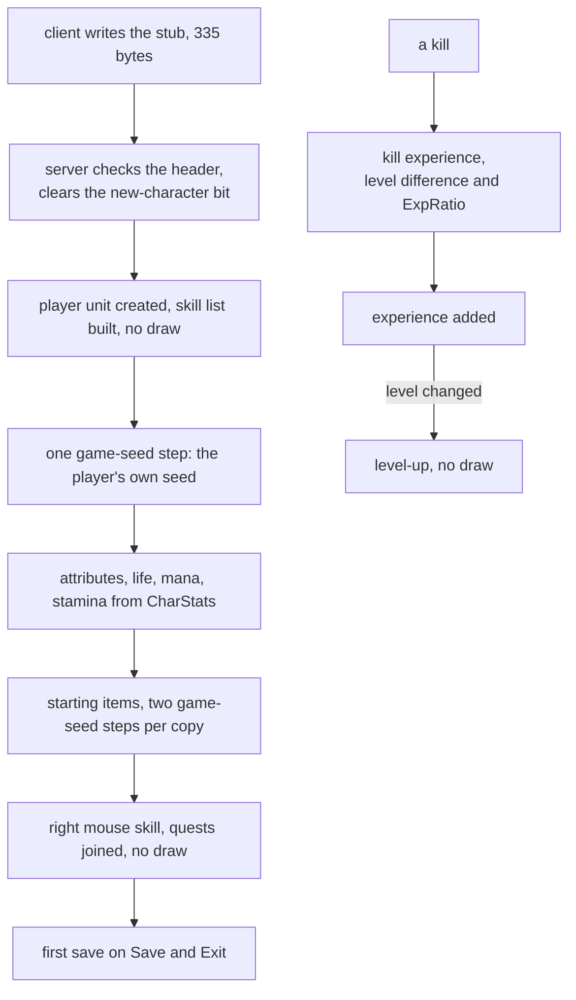
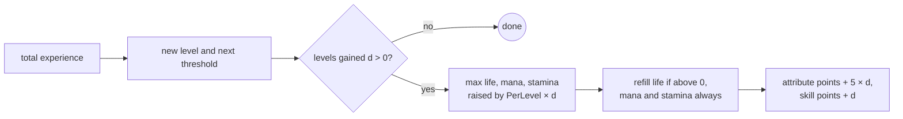

---
based_on:
  - docs/specs/player/README.md 2026-10-16
  - docs/specs/player/creation.md 2026-10-21
  - docs/specs/hirelings/README.md 2026-10-20
  - docs/specs/save/d2s.md 2026-10-20
---

# Characters and hirelings

This page follows a single-player character from the moment it is created to its first level-ups, and then
follows the [mercenaries](../glossary.md) a player can hire. It covers what a new character starts with (attributes, skills and
the starting kit), how a kill turns into experience, what a level-up changes, how a seller's hire list is made,
what a mercenary's stats are at each level, and how a saved mercenary comes back. It restates three reviewed
specs: [player](../specs/player/README.md#purpose), [player/creation](../specs/player/creation.md#purpose) and
[hirelings](../specs/hirelings/README.md#purpose). Skill effects, the skill tree and mercenary combat AI are not
covered by those specs, so they are not covered here either.

## The big picture

A new character starts as a header-only save file. The server reads it, notices the "new" flag, and builds the
character from the class's row of the `CharStats` table. On the way it takes a fixed number of steps from the
[game seed](../glossary.md): one for the player and two for each starting item (each step is one
[draw](../glossary.md)). After that, kills give experience and experience gives levels; a level-up takes no
random number at all
([player/creation § B](../specs/player/creation.md#b-newcharfromstub-the-order-of-a-new-character),
[§ I](../specs/player/creation.md#i-level-up--player_levelup)).

Hirelings run on a different seed. Each seller's hire list comes from the
[store seed](../glossary.md), the same seed the vendors use, and each name carries its own [seed](../glossary.md)
that decides the mercenary's type and level ([hirelings § Purpose](../specs/hirelings/README.md#purpose)).

## A new character starts as a stub

When you create a character, the client writes a 335-byte [`.d2s`](../glossary.md) save that holds only a header: the
[stub](../glossary.md). It has the version 96, the name, the class, level 1, the creation time, a default set of
graphics bytes, and a status word with bit 0, "new", set. The [act](../glossary.md) bytes and the [map seed](../glossary.md) are 0.
This layout was checked on 35 stubs
([player/creation § A](../specs/player/creation.md#a-the-stub-and-the-servers-checks)).

The server then checks the stub in a fixed order: length, checksum, the size field, the version (92 to 96), the
name, the status word and the class byte. This order is read from the code. Every stub of the test run passed, so
none of the failure codes has been seen. That the client adds the checksum when it writes the stub is also read
from the code only. When the "new" bit is set, the server clears it and builds a fresh character instead of
reading the rest of the file; a stub followed by extra bytes would be a load error, which is again read from the
code only. The status word and the rest of the header are explained on the [saves](saves.md) page.

Hardcore is bit 2 of the status word, and the character screen sets the expansion bit `0x20` for the Druid and the
Assassin (classes 5 and 6) before it builds the stub. Both are read from the code. Also read from the code
([creation § A](../specs/player/creation.md#a-the-stub-and-the-servers-checks)): in an expansion install, selecting
any class turns the expansion bit on, and the "expansion" checkbox turns it off again, so a classic character of the
five classic classes is made by clearing the box. The hardcore and ladder checkboxes toggle bits `0x04` and `0x40`, and
the ladder bit is also on by default in one screen mode: the one the main menu's *Battle.net* button sets (read from
the code). In single player, a TCP/IP game and Open Battle.net only the checkbox turns it on. The run's stubs
agree (the expansion bit in every expansion stub of those classes, in no classic one), but do not show which control
set it.

## Building the character, and its seed budget

The order is always the same
([player/creation § B](../specs/player/creation.md#b-newcharfromstub-the-order-of-a-new-character)):

1. The player unit is created and its skill list is built. Nothing is drawn.
2. One step of the game seed seeds the player's own unit seed.
3. The attributes, life, mana and stamina are set. Nothing is drawn.
4. The starting items are made, two game-seed steps per copy.
5. The right mouse skill is set and the quest state is joined. Nothing is drawn.

So **a new character costs exactly `1 + 2 × (number of item copies)` game-seed steps**. The stock kits have 7
copies for the Sorceress and the Necromancer and 8 for everyone else, so 15 or 17 steps. In the test runs every
new character made in one game process started from the same game seed (the game was re-created from the same
seed), so the characters of a batch shared their item seeds.
The player's own seed is drawn at creation and never saved; only the items keep their seeds
([player/creation § Reimplementation notes](../specs/player/creation.md#reimplementation-notes)).

The starting act does not come from the stub. The client record gets it when it is created: 0, unless the game
was started with the `-act N` option. That path is read from the code; what the option then does is confirmed
(see *Other ways to gain or lose experience* below).

## Starting attributes

The starting values come straight from the class's `CharStats` row. **No per-point factor applies at creation**:
life is `vit + hpadd` points, mana is the energy value, and stamina is the `stamina` column. `LifePerVitality` and
the other per-point columns are only used when you spend points later
([player/creation § C](../specs/player/creation.md#c-starting-attributes--player_initbasestats)). Every class was
created three times in a test run and each row below was reproduced.

| Class | Str | Dex | Energy | Vit | Life | Mana | Stamina | Life / mana / stamina per level |
|---|---:|---:|---:|---:|---:|---:|---:|---|
| Amazon | 20 | 25 | 15 | 20 | 50 | 15 | 84 | 2 / 1.5 / 1 |
| Sorceress | 10 | 25 | 35 | 10 | 40 | 35 | 74 | 1 / 2 / 1 |
| Necromancer | 15 | 25 | 25 | 15 | 45 | 25 | 79 | 1.5 / 2 / 1 |
| Paladin | 25 | 20 | 15 | 25 | 55 | 15 | 89 | 2 / 1.5 / 1 |
| Barbarian | 30 | 20 | 10 | 25 | 55 | 10 | 92 | 2 / 1 / 1 |
| Druid | 15 | 20 | 20 | 25 | 55 | 20 | 84 | 1.5 / 2 / 1 |
| Assassin | 20 | 20 | 25 | 20 | 50 | 25 | 95 | 2 / 1.5 / 1.25 |

Two more class columns are not read at creation but at every attack
([player/creation § Reimplementation notes](../specs/player/creation.md#reimplementation-notes)): `ToHitFactor`
(Amazon 5, Sorceress −15, Necromancer −10, Paladin 20, Barbarian 20, Druid 5, Assassin 15) is added to the base
attack rating, and is not a bonus in the chance to hit's level term as community pages say; `BlockFactor` is added in
the block chance. Both are confirmed by the combat run; see the [combat](combat.md) page.

Life, mana and stamina are stored with 8 fraction bits, so a Sorceress's 40 life is held as 10240. Every class
starts at level 1 with 500 experience needed for level 2 and gets 5 attribute points per level.

The header accepts a class byte of 7, although `CharStats` only has rows 0 to 6. Read from the code, such a
character would get no attributes, no items and no start skill, and its experience lookups would use the Amazon
column ([player/creation § J](../specs/player/creation.md#j-other-level-and-experience-changes)).

## Starting skills

Every class gets Attack, Throw, Kick, the Identify and Town Portal scrolls and books, and Unsummon. The Barbarian
adds Left Hand Throw and Left Hand Swing, and the Assassin adds Left Hand Swing. In the save, all class-skill
bytes of a new character are 0
([player/creation § D](../specs/player/creation.md#d-starting-skills)).

The class's `StartSkill` is not a skill point. It comes from the first starting item: the Sorceress's staff
carries Fire Bolt and the Necromancer's wand carries Raise Skeleton, as a +1 single-skill bonus. Once that item is
equipped, the skill shows up at the end of the list at base level 0, and it becomes the right mouse skill when the
character starts in Act I. The other classes have no `StartSkill`, so their right skill stays Attack. If a skill is
added that the list already holds, its level is raised by 1 (while below the skill's maximum level) instead of a
second entry being added; that is read from the code only.

## The starting kit

Each class row names up to ten item codes, each with a body location and a count. The game makes them in slot
order, each copy in turn, as a [starter item](../glossary.md): normal quality, identified, and with an
[ilvl](../glossary.md) equal to the character's level
([player/creation § E](../specs/player/creation.md#e-starting-items--player_givestartitems)).

Each copy takes exactly two game-seed steps: one for the item unit's seed, one for the start of its
[item seed](../glossary.md). Everything else it draws is on those two seeds:

- the [base stats](../glossary.md) on the unit seed: a weapon's durability, a shield's durability and then its
  defense, nothing for a potion or a scroll;
- the normal-quality builder on the item seed, which ends with the [staff mods](../glossary.md) roll (in the
  Sorceress example below it added nothing);
- the [ethereal](../glossary.md) roll, which stops before drawing;
- the socket roll, which **does draw** one number out of 100 for a weapon or shield and only then sees that this
  kind of item gets no sockets. The draw is spent anyway, so skipping it would shift every later draw on that item.

Placement is the same for every stock kit. The class weapon goes in the right hand, a buckler in the left for every
class but the Sorceress and the Necromancer, the four minor healing potions into belt boxes 0 to 3, and the Town
Portal and Identify scrolls into the inventory at cells (9, 3) and (9, 2). A starting weapon or shield then has its
current durability set to its maximum. The belt's column search, the fallback to the inventory when the belt or an
equip fails, and the quiver rule (250 arrows when equipped, 100 when not; no stock kit has one) are read from the
code only.

## Experience and levels

The `Experience` table gives, for each class, the experience at which each level starts. Level 1 runs from 0 to
499, level 2 starts at 500, and level 99 at 3 520 485 254. The top values are above 2³¹, so they must be handled
as unsigned numbers; the test run reached level 98 at 3 229 426 756
([player/creation § F](../specs/player/creation.md#f-the-experience-table)).

The [ExpRatio](../glossary.md) column scales kill experience at the player's level. It is 1024 (100 %) up to level
69 and falls to 5 at level 99.

**What a kill is worth** ([player/creation § G](../specs/player/creation.md#g-kill-experience--xp_compute)):

1. Start from the killed monster's experience value. That this is the monster's own value is read from the code.
2. Apply the level difference between the character (clvl) and the monster's [mlvl](../glossary.md), as a factor
   out of 256:

   | Levels apart | 0–5 | 6 | 7 | 8 | 9 | 10 or more |
   |---|---:|---:|---:|---:|---:|---:|
   | monster at or below you | 256 | 207 | 159 | 110 | 61 | 13 |
   | monster above you | 256 | 225 | 174 | 92 | 38 | 5 |

   From character level 25, a monster above you uses `exp × clvl ÷ mlvl` instead of the second row. Use these
   /256 factors, not rounded percentages: 207/256 is 80.9 % and 13/256 is 5.1 %, and percentages give different
   whole numbers.
3. Multiply by `ExpRatio` and divide by 1024.
4. Add the `item_addexperience` bonus, if any.

Several edges of this are read from the code only, because no kill in the run reached them: the clamp of a very
large experience value, the rule that a monster worth 0 or less still gives 1, the rule that a character at the
maximum level gets 0, an overflow guard in step 3, and a non-zero experience bonus in step 4.

The experience is then added. The total is capped at the threshold of the maximum level (read from the code; no
run reached it), and when the level computed from the new total differs from the old one, a level-up follows
([player/creation § H](../specs/player/creation.md#h-adding-experience--player_addexperience)).

## Level-up

**A level-up draws nothing.** Over 20 level-ups no random number was taken and the game seed and the player's
seed were unchanged ([player/creation § I](../specs/player/creation.md#i-level-up--player_levelup)).

- The new level is computed from the total experience. If several levels are gained at once, it is one level-up
  with `d` greater than 1.
- Maximum life, mana and stamina each rise by the class's per-level column times `d`. The columns are in quarter
  points, so a Barbarian's `LifePerLevel` of 8 adds 2 life per level.
- Current life (only when above 0), mana and stamina are then refilled to the **full** maxima, item bonuses
  included. How item, set and state bonuses add up to those maxima is on the
  [stats and states](stats-and-states.md#maximum-life-mana-and-stamina-and-how-current-life-follows) page; the
  level-up run took the maxima with item bonuses as given values.
- Attribute points rise by `StatPerLevel × d` (5 per level for every class) and skill points by `d`.

The level-up characters of the test run were prepared saves with unusual values (for example 8000 life), so the
run backs the arithmetic and the "no draw" result, not what a naturally levelled character's life would be. Such
values meet a limit of the save file: life, mana and stamina are written in fields that hold at most 8191.99 points,
and a larger value is written as that maximum; the same runs' saves confirm it
([save/d2s § F](../specs/save/d2s.md#f-character-stats-gf), and the [saves](saves.md) page).

## Other ways to gain or lose experience

These are in [player/creation § J](../specs/player/creation.md#j-other-level-and-experience-changes).

- **Starting in a later act.** With `-act 2` to `-act 5` the character is raised to level 16, 21, 27 or 33 before
  its items are made, so the starting items get that ilvl, and its right skill stays Attack. This was confirmed on
  game-made characters.
- **The Ancients' reward.** Killing the last of the three Ancients (the Rite of Passage quest) grants 1 400 000
  experience in Normal, 20 000 000 in Nightmare and 40 000 000 in Hell, cut to one level span, so at most one level.
  It goes to the killer, to every player standing on the Arreat Summit, and to their party members who are in Act V,
  each only once per difficulty and only from character level 20 (40 in Nightmare, 60 in Hell)
  ([creation § J](../specs/player/creation.md#j-other-level-and-experience-changes)). Read from the code only.
- **Death.** The character loses the difficulty's `DeathExpPenalty` percent of the current level's span, and the
  level never drops. Nothing is lost when the killer is a player or a player's monster. Three quarters of the
  experience actually lost (rounded down) is put on the corpse, and the owner gets it back on picking the corpse up;
  another player picking it up gets nothing. A corpse still on the ground when the character is saved comes back at
  the next load without that share, so picking it up then returns nothing. All of this is read from the code only.
- **Party share.** With two or more members (alive, in the same level, close enough, at most 8), the kill's
  experience is raised by 89/256 per extra member and split in proportion to the members' levels, and each share
  then goes through the kill formula with that member's level. Confirmed for two players in a two-client game (385
  shares, and the cases where only the killer gets the experience: the other too far, in another level, dead or not
  in the party). One detail matters for exact results: the per-level ratio is kept as a single-precision float, but
  the member's level times that ratio is truncated without rounding it to single precision first, which a
  reimplementation gets by multiplying in double precision. Three or more members and the exact edge of "close enough"
  are read from the code only.
- **Spending attribute points.** Vitality adds `LifePerVitality` and `StaminaPerVitality`, energy adds
  `ManaPerMagic`, all in quarter points. Read from the code only.

## Hirelings: the hire list

Four town NPCs hire out mercenaries: Kashya (Act I), Greiz (Act II), Asheara (Act III) and Qual-Kehk (Act V).
The first time a player talks to one of them in a game, the game builds that seller's
[hire table](../glossary.md) ([hirelings § C](../specs/hirelings/README.md#c-when-the-table-is-built-and-rebuilt),
[§ D](../specs/hirelings/README.md#d-the-stock-build-hire_buildstock)):

1. Every name of the seller's name range gets a seed: one store-seed step per name, in name order, **before** any
   name is picked.
2. Ten names are then picked, each with one draw over the range. A pick that lands on a name already listed moves to
   the next free name, without another draw.

So one build always costs `n + 10` store-seed draws, where `n` is the size of the name range. On the English string
tables those ranges are:

| Seller | Names | Draws per build |
|---|---:|---:|
| Kashya (Rogues) | 41 | 51 |
| Greiz | 21 | 31 |
| Asheara | 20 | 30 |
| Qual-Kehk (Barbarians) | 67 | 77 |

The names are [string indices](../glossary.md); the counts are those of the English string tables. The range is that
of the seller's Normal row in every difficulty, so a seller offers the same names in Nightmare and Hell.

Because vendors and hirelings share the store seed
([hirelings § B](../specs/hirelings/README.md#b-the-store-seed)), opening a trade or gamble window before you first
talk to a seller changes that seller's list, and the reverse. When a hire empties the list, the table is rebuilt
from the store seed. The table lives with the NPC, so all players of a game share it: in a two-client game
Kashya's list was built once and the second player saw the same entries. That Asheara's trade window can also build the table is read from the code and was not reached
in a run.

## A list entry and the hire

Each listed name's own seed decides its type and its level offset; the player's level at that moment decides the
rest ([hirelings § E](../specs/hirelings/README.md#e-an-entry-hireling_rollentry)):

- The **type** is one draw among the 2 or 3 types for that act and the game's difficulty (for example the fire and
  cold Rogues).
- The **level** is the player's level minus 1 to 5, **never above the player**. All 530 listed entries of the test
  run lie 1 to 5 levels below the player. A floor of level 2 exists in the code but was
  not reached.
- The **price** is the type's `Gold`, raised 15 % per level above the start of its first level band, and never below
  `Gold`. The 49 hires of the run paid exactly this.
- The **shown stats** use the type's first-band row and round negative values down.
- The **description** (for example "Fire Arrow" or "Defensive") is a fixed string picked by the row's `HireDesc`
  index; the Barbarians' row shows none. The nine strings match the nine `HireDesc` rows, which is checked against
  the data; the lookup itself is read from the code. The row's `Share` value is copied into the entry and never read,
  and the equipment columns are not read at all, so neither changes anything.

The entry is rolled again each time with the player's current level: once by the client to draw the list and once
by the server at the hire. So a level-up between opening the list and hiring would change the mercenary you buy;
this follows from the code but the run had no such case. The client's list also appears to show one Act III name
as another; only the numbers, not the text, were compared.

**The hire** ([hirelings § F](../specs/hirelings/README.md#f-the-hire-hire_hire-merc_init)) pays the price from the
gold you carry first, spawns the seller's monster class next to you, and records three values with the player: the
seed, the name and the type Id. Any earlier mercenary is released. A hire takes no store-seed draw unless the list
is rebuilt. The rest of the price comes from the stash, and a payment that gold and stash together cannot cover is
refused with both unchanged; the economy run showed this on purchases and resurrections. Several parts are read from
the code only: refusing a hire when gold is short, Qual-Kehk's quest gate, Kashya's quest gate for a player below level 8, and hiring a name that is in the table but
not listed. Hires at Greiz and classic-game hires were not made in the run.

## The mercenary's stats per level

Once hired, the mercenary's stats come from the `Hireling` row whose level band holds its level `L`, with
`d = L − band start` ([hirelings § G](../specs/hirelings/README.md#g-the-stats-per-level-merc_setlevel)):

| Stat | Value |
|---|---|
| strength, dexterity | base + per-level × d ÷ 8, at least 10 |
| life | `HP` + `HP/Lvl` × d, at least 40 |
| defense, attack rating | base + per-level × d, at least 0 |
| damage | base + `Dmg/Lvl` × d ÷ 8, minimum damage at least 0, maximum at least 1 |
| all four resistances | `Resist` + `Resist/Lvl` × d ÷ 4, one value for all four |
| life regeneration | max life (in 1/256) ÷ 2000 |
| skills | `Level` + `LvlPerLvl` × d ÷ 32 rounded down, at most 32, only from the skill's required level |

The experience needed for level `L` is cubic: `(L + 1) × L² × Exp/Lvl`. This was checked on 72 level settings,
covering every band.

Three things make these numbers differ from the hire list:

- **Divisions truncate toward zero** here, while the list rounds down. Below the first band (for example a level-30
  player hiring in Nightmare or Hell) `d` is negative, and the two give different strength, dexterity and damage.
- **The row is the mercenary's own band**, while the list always uses the first band.
- **A stat clamped to 0 disappears.** An attack rating or defense of 0 is absent from the stat list.

The mercenary is created as a monster at level 1 and these values then overwrite its level and stats. The monster
creation also leaves a few stats `Hireling` does not set (movement and attack speed values, a player count of at least
1) and, for the Rogues, their missile skill from the monster table, at level 1 in Normal, 4 in Nightmare and 8 in Hell;
the logs of every hire and load agree ([hirelings § I](../specs/hirelings/README.md#i-monster-class-and-the-monster-level)). Because
hirelings have `Align` 1 in MonStats, the player-count bonus of monster stats does not apply to it; that is read
from the code ([hirelings § I](../specs/hirelings/README.md#i-monster-class-and-the-monster-level)). When a
mercenary kills a monster, the [magic find](../glossary.md) used is its own plus its owner's
([hirelings § J](../specs/hirelings/README.md#j-magic-find-on-a-mercenarys-kill)).

Levelling in play is read from the code but was not reached by the run: a mercenary gains levels only while it is
below its owner's level, and one gain is capped at a sixty-fourth of the current level's span. How much of the
owner's experience it receives is not read.

## A saved mercenary

A mercenary is saved in the character's header as its flags, its seed, its name (as an offset into
the name range), its type Id and its experience. On load
([hirelings § H](../specs/hirelings/README.md#h-the-mercenary-from-a-save-d2s_readmercheader-merc_create)):

1. The level is the highest `L` up to 99 whose threshold the saved experience reaches.
2. The type and every stat come from the **saved Id** and that level. The saved seed goes back into the mercenary's
   record but **does not reach its stats**.
3. In a classic game, the mercenary is created only when the act of its name matches the act the player is in; an
   expansion game creates it in any act. In the run, 10 classic loads outside their act were not created and the
   header was kept.

The load side was checked on 33 headers. The write side (no save was written in that run), a dead mercenary, a
name past the end of its range, and the empty-header rule (all zeros means no mercenary) are read from the code
only. The header layout is on the [saves](saves.md) page.

Resurrection costs `min(50000, (L² ÷ 2) × 15)` gold, with `L` the mercenary's level, paid like a hire; the economy
run checked the price and the payment, and a resurrection you cannot afford takes no gold. Some things are named in
the spec only: the free mercenary from the Act I and Act III quests, death (the mercenary stays in the pet list as
dead), and how it chooses skills in combat. These are read from the code and none was run
([hirelings § K](../specs/hirelings/README.md#k-named-only)).

## Worked examples

**A new Sorceress**, copied from
[player/creation Example 1](../specs/player/creation.md#example-1-an-expansion-sorceress-staff-with-the-staff-mods-oracle).
Every character of that batch starts from game seed `5389700c:0f9a1148`.

| Step | What happens |
|---|---|
| player | one step → `48ac0a84:22d7b3ef`; the player's seed starts from `48ac0a84` |
| attributes | strength 10, energy 35, dexterity 25, vitality 10; life 40 (10240), mana 35 (8960), stamina 74 (18944); level 1, next level at 500 |
| staff | durability `10 + Range(10)` = 15 (max 20); socket draw 85, discarded; Fire Bolt single-skill bonus 1; equipped in the right hand, durability set to 20 |
| four potions | no draw on either seed; belt boxes 0, 1, 2, 3 |
| two scrolls | no draw; inventory (9, 3) and (9, 2) |
| end | game seed `20d2ae4d:5f1ebd78` after 15 steps; right skill Fire Bolt |

The staff's [staff mods](../glossary.md) roll was taken from the recording in that batch's check (its seed after the roll
and its single-skill bonus are the logged ones). The roll itself is specified in
[affixes § I](../specs/items/affixes.md#i-staff-mods--items_rollstaffmods) and is run by the project's chained tools,
but the batch's 11 staff-mods rolls were not re-run through it.

A Barbarian from the same batch gets the same seeds for the player and for its first copies; it has one copy more
(the buckler), so it ends after 17 steps at `2f6ab60b:58c69aea`
([Example 2](../specs/player/creation.md#example-2-an-expansion-barbarian-no-oracle)).

**A Barbarian levelling from 9 to 10**, copied from
[player/creation Example 3](../specs/player/creation.md#example-3-a-barbarian-level-up-9--10-built-save-lvbarb-session-34421):

| Step | Values |
|---|---|
| kill | monster level 1, experience 18; 8 levels apart → factor 110: 18 × 110 ÷ 256 = 7; ExpRatio 1024 → 7 |
| add | 57 714 + 7 = 57 721, which reaches level 10's threshold of 57 715 |
| level-up | level 10, next level at 72 144; max life up by 8 × 64 = 512 (2 points), life refilled; attribute points 0 + 5 = 5; one skill point |
| seeds | game seed and player seed unchanged |

**A hire list at Qual-Kehk**, copied from
[hirelings Example 1](../specs/hirelings/README.md#1-a-hire-list-session-3302-expansion-normal-player-level-30)
(expansion, Normal, player level 30). The store seed draws 67 name seeds, then picks 5, 48, 20, 1, 4, 55, 29, 19,
16, 57 over the 67 names, with no collision. Three of the listed entries:

| Name | Type | Level | `d` | Price | Life | Str | Dex |
|---|---:|---:|---:|---:|---:|---:|---:|
| 10836 | 25 | 28 | 0 | 9000 | 288 | 101 | 63 |
| 10839 | 24 | 29 | 1 | 10 350 | 306 | 102 | 64 |
| 10892 | 24 | 25 | −3 | 9000 | 234 | 95 | 59 |

Entry 10892 shows the traps: its price `(15 × −3 + 100) × 9000 ÷ 100` = 4950 is raised to `Gold`, 9000. The list
rounds its strength down to 95, while the hired mercenary at the same level would truncate to 96; likewise
dexterity 59 against 60, and resistances 56 in the list against 51 in the world.

**A mercenary loaded from a save**, copied from
[hirelings Example 2](../specs/hirelings/README.md#2-a-mercenary-loaded-from-a-save-session-3330-mercnova-expansion-normal):
seed 12345, name 3, Id 0 (a fire Rogue), experience 2 790 000. The level is 30, because `31 × 900 × 100` =
2 790 000 is reached and `32 × 961 × 100` = 3 075 200 is not. With `d` = 27 in band 3: strength 68, dexterity 99,
life 288, defense 231, attack rating 334, damage 7–9, resistances 54, and Inner Sight and Fire Arrow at level 9.
The same mercenary block in another test save showed level 30, life 288 and resistances 54 on the mercenary screen.

## What is not known yet

From [player/creation § Open questions](../specs/player/creation.md#open-questions):

- the first save's appearance bytes are not predicted.

Also read from the code only, not run: party sharing with three or more members, death loss and the corpse's share, the Ancients' reward,
attribute spending, the experience cap, and the edge cases of kill experience listed above.

From [hirelings § Open questions](../specs/hirelings/README.md#open-questions):

- not reached by a run: classic hire lists and hires, a Greiz hire, the free mercenary, refused hires, hiring an unlisted entry, the table built from Asheara's trade window, levelling in play and the share
  of the owner's experience, a dead or empty saved header, the written header, a second player hiring from the shared table, and
  the list window's odd name;
- whether the client ever shows its own rolled values instead of the server's.

## Where to read more

- The specs: [player](../specs/player/README.md#files), [player/creation](../specs/player/creation.md#algorithm) and
  [hirelings](../specs/hirelings/README.md#algorithm), with their *Reimplementation notes*.
- How the first save and a mercenary's header are stored: the [saves](saves.md) page and
  [save/d2s § D](../specs/save/d2s.md#d-header-fields).
- The seeds behind all of this: the [randomness](randomness.md) page.
- How a character's stats add up from items, sets, passives and states: the [stats and states](stats-and-states.md)
  page.
- Terms: the [glossary](../glossary.md).
