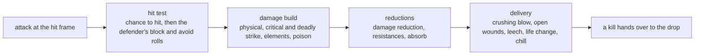
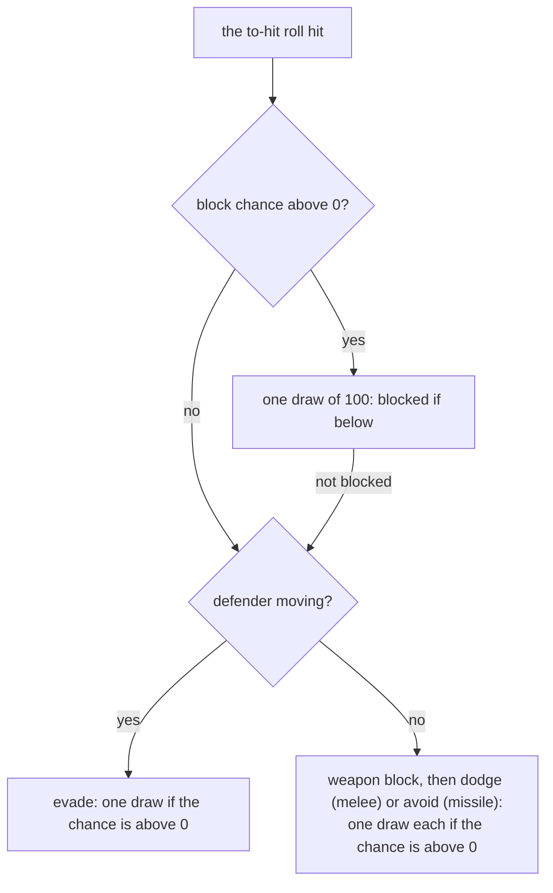
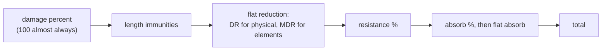
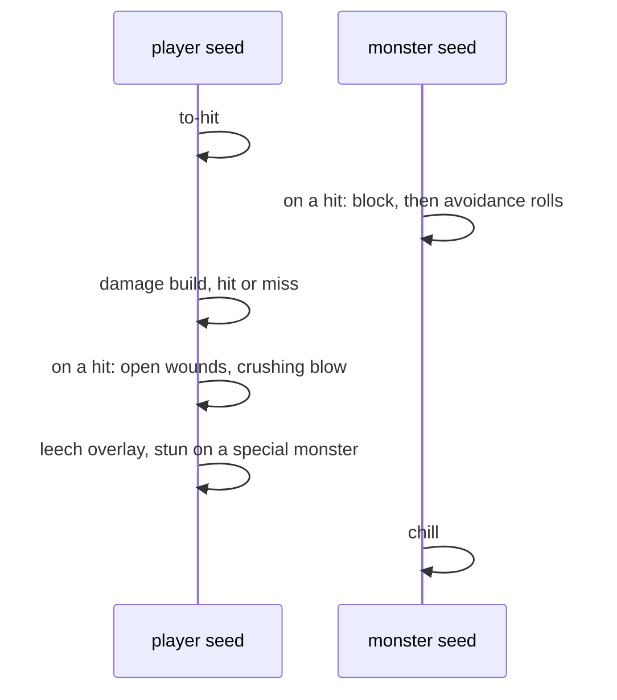

---
based_on:
  - docs/specs/combat/README.md 2026-11-16
  - docs/specs/combat/to-hit.md 2026-11-16
  - docs/specs/combat/damage.md 2026-11-16
  - docs/specs/combat/reductions.md 2026-11-16
  - docs/specs/combat/delivery.md 2026-11-16
  - docs/specs/monsters/stats.md 2026-11-04
---

# Combat

This page explains what happens when one unit hits another: whether the swing connects, how much damage it carries,
how the defender's resistances and reductions cut it down, and what the hit does on arrival (crushing blow, open
wounds, life and mana leech, chill, the life change). It restates the reviewed combat specs: the overview in
[combat/README](../specs/combat/README.md#purpose), the hit test in [to-hit](../specs/combat/to-hit.md#purpose), the
damage build in [damage](../specs/combat/damage.md#purpose), the defender's side in
[reductions](../specs/combat/reductions.md#purpose) and the arrival in [delivery](../specs/combat/delivery.md#purpose).
The specs carry the exact arithmetic and [draw](../glossary.md) order; this page tells the story. Where something is
read from the code but not yet seen in a test run, or is still unknown, the page says so. Many branches no run met are
**confirmed under emulation**: the game's own function was run on its own with declared inputs and matched the model
bit for bit ([how we know](how-we-know.md)). That confirms what the function does with its inputs, not how often play
reaches the branch.

Combat is the project's first *simulation* subject. The earlier pages describe how things are created; this one
describes a rule that runs many times a second during play. The specs were checked against one large recorded run:
15 358 logged combat events in 19 sessions at first, then 40 655 events over 40 logs once follow-up sessions aimed at
the rare branches were added, every one reproduced with no mismatch, with each unit's seed checked before and after
([overview § The ADR-0014 boundary](../specs/combat/README.md#the-adr-0014-boundary)). A second run, with characters
built for the branches the first met too rarely, reproduced 18 737 more events over 31 logs, again with no mismatch.
Where this page says "a run built for it", it means that second run.

## The big picture

A melee attack runs a fixed chain on the server
([overview § Purpose](../specs/combat/README.md#purpose), [§ A](../specs/combat/README.md#a-the-attack-events)):

Two things set combat apart from the rest of the game's randomness:

- **Every draw is on a unit's own seed, and two seeds take part.** The attacker's [unit seed](../glossary.md) draws
  the chance to hit, the damage rolls, crushing blow, open wounds, the leech overlay and the stun; the defender's
  draws the block and avoidance rolls and the chill. There is no shared "combat random number generator". A
  reimplementation that used one would get every later draw of both units wrong. This is confirmed
  ([overview § Reimplementation notes](../specs/combat/README.md#reimplementation-notes)).
- **Some draws are made even when their result is thrown away**, and others are skipped entirely when their chance
  is 0. Both are confirmed and both matter for the seed: a player's damage is built on a miss, an always-zero
  one-in-one draw is taken on every build, the leech overlay draw only picks which visual effect to show, and the
  chill's shatter roll is drawn even on a monster that cannot shatter ([overview § Reimplementation notes](../specs/combat/README.md#reimplementation-notes)).

## What the model takes as given

The combat specs do not explain how a unit's stats came about. A character's attack rating percent, its enhanced
damage, its resistances and their maxima, its damage reduction, absorb, leech and on-hit chances are all **taken as
inputs**, read off the units when the event starts ([overview § The ADR-0014 boundary](../specs/combat/README.md#the-adr-0014-boundary)).
How items, set bonuses, passives, auras and states add up to those numbers is now specified, and the
[stats and states](stats-and-states.md) page explains it; the combat run logged values, not the stat lists, so in it
the stats stay inputs, and a run that checks combat against the added-up stats is still owed
([§ Open questions](../specs/combat/README.md#open-questions)). A skill's or a missile's own damage packet is the
subject of the [skills and missiles](skills.md) page: the combat specs take it as given and describe what happens to it.

A few events with their own random draws sit at the edge of the model and are not modelled draw by draw: weapon and
armour durability loss, knockback, the get-hit decision, and a monster's on-hit skill. In the run the seed was checked
on the way into each of them and taken as logged on the way out
([delivery § F](../specs/combat/delivery.md#f-the-boundary-at-delivery)). A count of draws checked against those seeds
since is confirmed: durability loss steps the seed once for a player attacker, three times for a player defender and
not at all for a monster or a mercenary (9 680 pairs but one), and a player defender's get-hit draws are the get-hit
decision's (25 669 of 25 669). The roll values, the knockback, the monster's on-hit skill and a monster's or
mercenary's get-hit stay at the edge.

## The attack events

Three events are covered ([overview § A](../specs/combat/README.md#a-the-attack-events)):

- **A player's normal attack.** At the hit frame the game runs the hit test, then **builds the damage whether or not
  the swing hit**, reduces it on a hit, and delivers it. So a missed swing still moves the player's seed through every
  damage roll. Confirmed: 2 030 events, 386 of them misses.
- **A monster's or a mercenary's plain attack.** The hit test runs first, and the damage is built **only on a hit**.
  Confirmed: 4 533 monster and 1 259 mercenary attacks.
- **A missile reaching a unit**, from the defender's side: its block and avoid rolls, the reductions and the delivery.
  Confirmed for the defender's seed over 1 957 missiles, and for the missile's own seed, which draws its damage and its
  knockback (8 638 missile events). How the missile builds its damage and whether it rolls a
  chance to hit are on the [skills and missiles](skills.md#missiles-the-hit) page; here its damage packet is an input.

A player skill's melee hit and a monster skill's melee hit use the same machinery. For a monster skill this is
confirmed with a second code tool: its hit writes the monster's attack stats itself, then runs the melee hit and the
delivery. That a player skill passes its own attack-rating percent and damage share is read from the code only.

**A mercenary is a monster on this path.** It differs only where the code checks for a hireling: a different
crushing-blow divisor against it, a reduced damage percent against another hireling or against an act boss, leech by
the player's formula without the difficulty divisors, and no drain rolls in its damage. All of this is confirmed: the
mercenary's attacks all reproduced, 519 Hell leeches took the formula without the divisors, 1 787 of its builds drew
no drain, the boss percent held in all three difficulties (see *Reductions* below), and the hireling-against-hireling
percent and the crushing-blow divisor against a mercenary are confirmed under emulation.

## Will it hit? The chance to hit

The chance to hit is computed from the attacker's attack rating (AR), the defender's defence (DEF) and both levels,
then one draw of 100 on the **attacker's** seed decides ([to-hit § A](../specs/combat/to-hit.md#a-the-chance-to-hit-combat_tohitroll)):

1. **Attack rating.** A player's is `(dexterity − 7) × 5 + attack rating stat + ToHitFactor`. A monster's is its
   attack rating stat plus 5 × dexterity.
2. **Percent.** AR is raised by its percent bonus (for a player, the weapon mastery, item bonuses and the skill's own
   percent). The formula from the percent on is confirmed; how the player's percent is made up was taken as given in
   the run.
3. **The chance.** `c = 100 × AR ÷ (AR + DEF)`, truncated, then `c × 2 × alvl ÷ (alvl + dlvl)`, truncated, then
   clamped to 5..95. A hit is never certain and never impossible.
4. **The draw.** One `Range(100)` on the attacker's seed; the swing hits when the result is below `c`.

All four steps are confirmed: 7 669 rolls reproduced. Three details matter for exact results:

- **`ToHitFactor` is part of the attack rating, not a level bonus.** The class constants (Amazon 5, Sorceress −15,
  Necromancer −10, Paladin 20, Barbarian 20, Druid 5, Assassin 15) are added to AR before the percent, and the level
  term has no class constant. Community pages describe them as a level bonus; the run with a Sorceress and a
  Barbarian shows the code's form.
- **The percent is truncated before the level factor.** Doing the whole thing as one fraction gives different values.
- **Negative values swap.** A negative DEF is added to AR and a negative AR to DEF before the division.

Some attack-rating modifiers no logged character carried: ignoring or lowering the target's defence, and the bonuses
against demons and undead. They are confirmed under emulation, every test of the defender's kind separated: the
"ignore defence" stat does nothing against a boss, a unique, a superunique or a mercenary, and the defence-lowering
stat counts only when positive and is halved against a player, a boss, a superunique or a mercenary
([to-hit § A](../specs/combat/to-hit.md#a-the-chance-to-hit-combat_tohitroll)). Which monsters carry the unique and
superunique marks it tests is that field's own reading. Two other functions compute an attack rating, and neither is
on an attack path (confirmed with a second code tool): one serves the timed shrines' stat value, the other is client
code with no call. That the shrine's formula adds `ToHitFactor` a second time and the client's rounds differently is
read from the code.

**A monster's line missile counts its attack rating twice**, read from the code: a monster's missile is created with the
monster's attack rating, the hit passes that as the percent input when the missile's record asks for a to-hit roll, and the
monster formula adds that input to the same stat. Dexterity is not doubled, and the lob form carries no rating
([to-hit § A](../specs/combat/to-hit.md#a-the-chance-to-hit-combat_tohitroll)).

## Defence

A unit's defence is its defence stat plus a quarter of its dexterity, then raised by its defence percents
([to-hit § B](../specs/combat/to-hit.md#b-defence-unit_getdefense)). Against a melee attack the "defence against melee"
stat is added; against a missile, the "defence against missiles" one. The base part is confirmed for the player and
for the monsters of the run. The percent terms were zero on every logged unit; they are confirmed under emulation,
including a defence of 0 or below, which a percent moves toward 0 rather than further from it. Holy Shield adds a term
only with its state on and a usable shield; the gate is confirmed under emulation, while the term's value is read from
the code ([to-hit § B](../specs/combat/to-hit.md#b-defence-unit_getdefense)).

## Block, evade, dodge and avoid

Only after a hit does the defender get to roll, on **its own** seed
([to-hit § C](../specs/combat/to-hit.md#c-the-hit-test-and-the-defence-rolls)):

**Shield block** is confirmed. For a player holding a shield the chance is the block stat plus the class's
`BlockFactor`; in an expansion game that is multiplied by `(dexterity − 15)` and divided by `2 × level` (classic games
skip this step); the result is capped at 75. A monster blocks with its block stat if it has a shield or its class
allows blocking without one. The formula was checked in 2 523 expansion and 395 classic events, with 2 243 blocks. A
player holding no shield cannot block: 66 hits between two shieldless players in a two-client game all had chance 0.
A shield the player cannot use counts as no shield: the shield test, confirmed under emulation, takes a shield only
when it is neither broken nor refused by the item-requirement check. Two such layouts (a shield above the character's
level, one beside a two-handed weapon) logged chance 0 on every hit; which flag each of them sets is not read, and
four writers of those flags were not followed.

Three rules for a moving player are confirmed:

- **A running player is hit without a to-hit roll** (no draw on the attacker's seed), but still rolls block. Seen 47
  times, never with a to-hit draw.
- **A running player blocks at a third of the chance**, taken after the 75 cap, so at most 25 %. Seen 48 times: a
  75 % chance became 25 % in an expansion game, a 53 % chance 17 % in a classic one. The game tests for a chance of at
  least 1 before dividing, so a moving player with a chance of 1 or 2 still draws and always fails (confirmed under
  emulation).
- **A walking player keeps the full block chance**: the code divides by three for a moving player except one who is
  walking. Seen 6 times in play, each with the full chance, and confirmed under emulation (295 cases). The player
  counts as moving in the walk mode, the run mode and one other mode (6), confirmed under emulation.

**Evade, weapon block, dodge and avoid** are confirmed for player defenders by a run built for them: each is one
draw of 100 on the defender's seed, a success when the draw is below the chance (evade 31 successes in 46 rolls,
weapon block 30 in 50, dodge 109 in 172, avoid 68 in 103). A walking or running player rolled only evade, and the
same characters standing or attacking rolled the other three, never evade. Weapon block also passes a skill check
whose value went with two claws in the hands; what that check means is not read. A monster defender with these
skills was not logged; under emulation a defender that is not a player, in either of the two modes the code counts
as moving for it, takes the evade path only, as a moving player does (confirmed under emulation).

Each of these rolls is made only when its chance is above 0, so a defender without them draws nothing; that held
for every logged event. A missile with no physical damage cannot be blocked, which is confirmed: 10 387 such missile
events drew no block, 6 838 of them in logs where the player blocked other missiles.

## Building the damage

The attacker's damage is built in a fixed order, every random part on the **attacker's** seed
([damage § A](../specs/combat/damage.md#a-combat_builddamage-in-order)):

| # | Step | Draw | Status |
|---|---|---|---|
| 1 | against a monster: bonuses against demons, undead or a monster type, and the attacker's "damage to the target's defence" stat (stat 120, not its own defence) **added** to the monster's defence for good, never below 0 | none | confirmed under emulation for an unarmed attacker; the blunt weapon's bonus against undead read from the code |
| 2 | physical damage roll | one, if the range is not empty | confirmed |
| 3 | weapon mastery critical strike, then the critical strike stat, then deadly strike: the first success doubles physical damage | one per chance above 0, stopping at the first success | confirmed: deadly strike (250 doublings), the mastery crit before it (144 builds), the critical strike stat before it (under emulation); the mastery crit's place before the critical strike stat read from the code |
| 4 | fire, lightning, cold, magic, **in that order** | one each, if the range is not empty | confirmed |
| 5 | a monster's life, mana and stamina drain; a player's leech percents are copied, not rolled | one per drain range for monsters | confirmed |
| 6 | poison, cold length, stun length | one for poison, if the range is not empty | confirmed (the poison roll replacing the field and the stun length under emulation) |
| 7 | a one-in-one draw that always gives 0 | **always one** | confirmed |
| 8 | the defender's "attacked in melee" event, for a player or mercenary attacker | only Shiver Armor registers one, and no logged defender wore it | confirmed under emulation |
| 9 | conversion of physical damage into an element | one `Range(5)` for a random element | confirmed under emulation; no logged attack converted |
| 10 | a monster's `Crit`: doubles **every** damage field | one, if its class has `Crit` | confirmed (89 doublings) |

**The physical roll** ([damage § B](../specs/combat/damage.md#b-the-physical-roll-combat_rollphysical)) takes the
weapon's minimum and maximum (two-handed or one-handed), raises both by the enhanced-damage total (which includes
the weapon's strength and dexterity bonuses, each truncated on its own, and is never below −90 %), and draws a value
in between. **The maximum is never reached**: the roll is `low + Range(high − low)`. All of this is confirmed. With
no weapon, at least 1–2 damage is used; that is confirmed under emulation.

**Elements** ([damage § C](../specs/combat/damage.md#c-one-element-combat_rollelemstat-combat_rollrange)) work the
same way, raised by the element's mastery. A range whose maximum is not above the minimum draws nothing, unlike the
monster hit-point roll on the [monsters](monsters.md) page, which draws even for a range of one.

**The always-zero draw.** Every build (a player's on a hit or a miss, a monster's on a hit) takes one draw that can
only return 0. Its trace in the damage is a tiny "burn" value of 2 that never turns into burning, because the burning length stays 0.
Skipping the draw shifts every later draw of the attacker. The draw and the value 2 are confirmed for a plain attack,
and the general formula behind it under emulation.

**A player's critical or deadly strike doubles physical damage only**: 981 logged doublings left the elements
undoubled. A monster's `Crit` doubles physical and elemental damage alike, for the melee build and for a monster's
missile (7 734 missile events). All of this is confirmed.

**A monster's drain roll hides a base**, confirmed under emulation: the roll is given the packet's drain field and returns
it with the roll, and the result is added to the same field, so a drain already in the packet counts again. No stock path
reaches a build with a drain already in the packet: no skill row has a life, mana or stamina element, and no packet
writer sets those fields before the build (confirmed with a second code tool)
([damage § A](../specs/combat/damage.md#a-combat_builddamage-in-order)).

**The poison roll replaces the poison field** rather than adding to it, confirmed under emulation; the run's poison hits
all entered with an empty field, where the two agree.

**Conversion** of physical damage into an element exists in the build, and a skill with an element type sets it up:
when the skill hits, its hit code copies that element type and the skill's conversion percent into the attack, if the
percent comes out above 0. Those skill hit codes are the only writers, and a plain attack writes neither field
(confirmed with a second code tool). No logged attack converted; the conversion step itself, the random element
included, is confirmed under emulation ([damage § D](../specs/combat/damage.md#d-conversion)).

### A monster's attack stats

A monster's attack rating, damage and elemental damage are written when it **enters an attack mode**, not at the
hit ([damage § E](../specs/combat/damage.md#e-a-monsters-attack-stats-monattackstats)). That step draws only one
`Range(100)` for each elemental group of that attack mode whose chance is between 1 and 99, and one `Range(5)` for the random element
type. The draws are confirmed (5 060 calls). Between that moment and the hit the [monster's AI](monster-ai.md#draws-and-seeds) draws on the same seed,
which the combat model does not cover. The per-level attack rating and damage come from the monster-level table,
scaled by the attack mode's own columns (the second attack and the two skill modes have theirs): the skills runs
checked them in 26 425 calls, in Normal and Nightmare with one player. The classic Nightmare and Hell factors and the
expansion's extra damage per player (a share of 1/16 per player beyond the first, up to eight, on the elemental length
too) are confirmed: a model with them reproduces every logged call, 19 750 of 19 750. Left read from the code: the
monster-level table's `L` columns at attack time, one alignment's exception to the classic factors, and one branch of the per-player bonus that no
logged count separates. The second
elemental group takes the first group's damage and length (confirmed in 57 applications; the third group was not
met), and a summon or pet class (`noRatio`) ends up with no elemental damage at attack time, because its values are
written to one place and read from another (confirmed with a second code tool).

## Reductions on the defender

The defender's side cuts each damage field down, with no random draw
([reductions § A](../specs/combat/reductions.md#a-combat_applyreductions),
[§ B](../specs/combat/reductions.md#b-the-rows-g_damageresisttable)). The order is fixed by a table in the game:
physical, fire, lightning, cold, magic, then the cold and freeze lengths, the poison length and poison.

What is confirmed:

- **Flat reduction first, resistance second.** Damage reduction (physical) or magic damage reduction (elements) is
  subtracted first. If that pushes a field below zero, the resistance is skipped and **the field stays negative**,
  and it is added into the total like that.
- **A negative resistance increases damage.**
- **Players and mercenaries take the difficulty penalty and the cap; monsters take neither.** In an expansion game
  the penalty is 0, −40 and −100 by difficulty; in a classic game it is −20 in Nightmare and −50 in Hell. Physical and
  magic resistance take no penalty. The penalty comes before the cap, so a 115 % fire resistance in Hell is 15 %,
  not −15 %. Between the two, the code also raises anything below −99 to −100; that floor never changed a logged value
  (resistances landed on exactly −100 214 times, but none went below) and is confirmed under emulation. A resistance
  of 0 or below takes only that floor, never the cap.
- **The cap** is 75 plus the unit's "maximum resistance" bonus, at most 95; physical resistance caps at 50. Fire
  reached the cap 2 115 times and poison 692, lightning 42 times in a run built for it, and cold 31 times over the
  two runs. Magic never reached it, and cannot on unmodified data: nothing the game ships gives a player enough magic
  resistance, so the magic cap is read from the code (it is the same code as the other rows).
- **Monster immunity** is a resistance of 100 or more, which zeroes the field (seen for fire, cold, lightning,
  poison and, in 36 hits on Hell monsters immune to magic, magic).
- **Cold and freeze lengths are reduced by cold resistance**, and the poison length by its own stat, not by poison
  resistance.
- **Absorb heals.** Percent absorb (at most 40 %) takes its share out of the damage and heals the defender by that
  amount. Community pages say only flat absorb heals; 32 healing events from percent absorb say otherwise. Flat absorb
  is subtracted after the percent, and heals as well: 794 absorb heals on the player match the logged amount (percent
  371, flat fire 372, lightning 51, cold 1). Flat absorb is confirmed for fire in 113 hits and for lightning in 51;
  cold flat absorb was hit once in play, and the absorb step is one piece of code for every element, confirmed under
  emulation for the cold row too.
- **A negative field is still absorbed**, giving a negative absorbed amount that heals nothing: 186 hits where magic
  damage reduction had pushed fire or cold below zero before percent absorb.
- **"Cannot be frozen"** zeroes the cold length.

**The damage percent** is 100 for every player and monster attack the run logged. When a mercenary hits an act boss
it is the difficulty's `HireableBossDamagePercent`: 50 in Normal, 35 in Nightmare and 25 in Hell are all confirmed.
Hell's 25 is also what shows the game reads this column and not a neighbouring one that is 20 in Hell. When a prime
evil hits a unit carrying a certain internal mark the percent is raised: 200 against a mercenary, confirmed over 154
hits of Andariel on the mercenary. Only a monster that is an act boss by the monster table counts as a boss here:
191 mercenary hits on champions, uniques and superuniques that are not took 100. A player hitting another player
deals 17 %: confirmed in a two-client game for physical and lightning damage (230 hits between two hostile players),
while the other damage types were not tried. The other cases no run reached are confirmed under emulation, every
branch separated: 400 against a marked unit that is not a mercenary, 17 % from a hireling hitting a player, and 25 %
for a hireling hitting a hireling. What the mark means is not known.

Also confirmed under emulation, since no logged unit had them: pierce, which lowers a resistance unless the defender
is a monster at 100 or more; the half-freeze stat, which halves the cold and freeze lengths; the two states that cancel
poison and burning lengths; and sanctuary on the attacker, which sets a **positive** physical resistance of an undead
defender to 0 and leaves one of 0 or below unchanged. Nothing on this path keeps a hit above zero: 635 negative and 864 zero totals
left life unchanged (confirmed). An "absorb damage" event runs before the reductions, but its handlers (energy
shield and the bone and cyclone armours, by community accounts) were not read, and no logged unit had one.

## Delivery: crushing blow, open wounds, leech and the life change

When the hit is delivered, the game runs the attacker's on-hit effects, then leech, then the life change and the
timed effects ([delivery § B](../specs/combat/delivery.md#b-delivery-combat_applydamage)). Before it is queued, a
kill test already compares the total with the defender's life in whole points.

**Crushing blow** ([delivery § E](../specs/combat/delivery.md#e-the-stat-events-crushing-blow-open-wounds-freeze)) is
confirmed. One draw of 100 on the attacker's seed; on success the defender loses a share of its **current life,
before this hit's damage**:

- 1/4 for ordinary monsters, **for uniques and for champions** (247 and 63 events, then 52 on champions in a run
  built for them, most in Nightmare at 8 players). Community pages give 1/8 for champions and uniques; 1.14d does
  neither. A champion carries the special mark that every champion, unique and superunique gets, as well as its
  own champion mark (no monster in 74 logs had the champion mark alone), and crushing blow looks at neither.
- Physical resistance cuts the share by its percent, confirmed at resistances from 15 to 90 on monsters. No run met a
  resistance of 100 or more; under emulation the cut has no branch on the defender's kind, and at 100 or more it
  cancels the blow only while the share is at most 4 096 life points: above that the rounding keeps a remainder below
  one life point (confirmed under emulation).
- The share shrinks with the number of players the monster was **created** for: the divisor 4 grows by 50 % per
  player beyond the first, so at 8 players it is 18. Confirmed at 2, 3 and 8 players. Community pages say the player
  count does not matter; in 1.14d it does.
- Positive physical resistance lowers the amount.
- 1/8 for act bosses and superuniques, with the same player-count and resistance steps: confirmed on Andariel
  (34 events) and on superuniques (55).
- Confirmed under emulation, since no run met them: 1/10 against a player or a mercenary, and half the effect from a
  missile.

**Open wounds** is confirmed: one draw of 100 on the attacker's seed; on success the defender bleeds for 200 frames,
by an amount that grows in bands with the attacker's level (2 506 per frame, in 1/256 life, at level 85). A new wound
restarts the bleed. **Special monsters (champions, uniques and superuniques) bleed half as much**, confirmed over
383 wounds, Andariel's 63 included: she carries the special mark. Monsters with neither the champion nor the special
mark took the full amount (1 497 wounds).
The halving looks only at those two marks, never at whether the monster is an act boss, so a champion without the
special mark also bleeds half and an act boss without it takes the full amount; a player bleeds a quarter, and half
that from a missile. None of these was wounded in the runs, and since champions carry the special mark too, no
unmodified monster can show the first case; all are confirmed under emulation. When both effects are present, the
handlers run newest first, in the reverse of the order the unit registered them; that is confirmed with a second code
tool and by the run, where open wounds ran before crushing blow.

**Leech** ([delivery § C](../specs/combat/delivery.md#c-leech-combat_leech)) is confirmed for players, the
mercenary and monsters:

- It is computed on the **physical damage after reductions**, and after that damage is capped to the defender's
  remaining life. Elemental damage never leeches.
- A player's leech is divided by the difficulty's divisor (1, 2, 3), and further cut by the monster's `Drain` column
  for that difficulty (`fallen2`: 100, 85, 75 %). A monster with no `Drain` cannot be leeched.
- Mana is added first, then life. When both ran, one extra draw of 2 on the attacker's seed picks which visual
  overlay to show; a reimplementation without overlays still has to take it.
- The defender's on-hit handlers run before the leech, so a draining monster that the player's lightning thorns have
  just hurt adds its drain to the life the thorns left. That is read from the code, and one hit in the runs tells the
  two orders apart.
- Monster leech (a monster attacker healing itself, by up to the damage it dealt and the defender's mana and stamina)
  is confirmed over 80 events in Nightmare and Hell.
- A `manahit` boss takes 256 times the mana the same value takes through an `El` column, up to the mana the defender holds:
  the mod multiplies by 256 and the roll shifts by 8 again. The mod's side is confirmed: in 226 of 226 logged hits on
  the player by such monsters the mana lost was the packet's amount. The `El` column's side is read from the code
  ([delivery § B](../specs/combat/delivery.md#b-delivery-combat_applydamage)).

**The life change** is confirmed: the total is subtracted from the defender's life, and **a result below one life
point is 0**, a kill. A total of zero or less (for example, when magic damage reduction drove every element negative)
leaves life unchanged: confirmed in a run built for it, 488 negative totals and 113 of zero on the player and 32 of
zero on a monster.

### Chill, stun, freeze and poison

From [delivery § D](../specs/combat/delivery.md#d-stun-cold-freeze-poison-burn):

- **Chill** draws one `Range(100)` on the **defender's** seed whenever a chill is applied, whatever the outcome; that
  draw is confirmed. Read from the code: a monster whose `coldeffect` is 0 is not chilled and draws nothing, a player
  is chilled at −50, and the chill strength and the 20 % shatter chance.
- **Stun** on a special monster (a champion, a unique or a superunique) first draws `Range(100)` on the attacker's seed and succeeds only on 90 or more; that
  draw is confirmed (34 events). Read from the code: act bosses and monsters that cannot move are never stunned, and
  the stun's length caps.
- **Freeze** from the freeze stat is confirmed on melee hits up to the point where it delivers its freezing packet:
  one draw on the attacker's seed against a chance from the stat and the two levels, and a length from the margin
  (81 rolls, lengths 26 to 249 frames). The chance's formula, including the missile form no run met, is confirmed
  under emulation. What that packet then does is read from the code: it freezes ordinary monsters and only chills
  players, bosses, uniques and mercenaries.
- **Poison** replaces an existing poison only when it is at least as strong. Read from the code.

**The life tick** that carries poison and open wounds is confirmed for monsters: they bleed each frame and can die of
it, and their natural regeneration is suspended meanwhile (6 181 ticks reproduced). On a player the tick adds the
life regeneration stat whatever its sign, so poison bleeds a poisoned player every frame; that is confirmed by the
stats run (1 082 poisoned ticks). The tick never takes a player's life below one point, so poison and open wounds
cannot kill a player; no poisoned tick reached the floor in play, and the floor is confirmed under emulation
([delivery § E](../specs/combat/delivery.md#e-the-stat-events-crushing-blow-open-wounds-freeze); the tick itself is
on the [stats and states](stats-and-states.md#regeneration-life-mana-stamina-and-poison) page).

## Draw order and chaining

The order of events in a frame, and so of draws across units, is [the server frame](server-frame.md#whose-draws-come-first). The order of draws in one event is confirmed ([overview § B](../specs/combat/README.md#b-draw-order-per-event)). For
a player's normal attack on a monster:

For a monster's attack on the player, the monster's seed draws its elemental groups when the attack mode starts, then
at the hit frame the to-hit and, on a hit only, the build with `Crit` last; the player's seed draws its defence rolls
and the chill. Each draw happens only under the condition its section gives.

**Chaining** ([overview § C](../specs/combat/README.md#c-chaining-events-on-one-seed)) is confirmed. On the player's
seed, consecutive combat events follow each other with no hidden draw in between on the paths the run took (thousands
of chained pairs); where something outside combat drew in between, the run picked the seed up again. A monster's seed
chains only within one attack, from its attack-mode draws to the hit, because its AI draws between attacks.

## Difficulty and game type

From [overview § D](../specs/combat/README.md#d-branches):

| What | Changes with | Status |
|---|---|---|
| block chance | expansion uses dexterity and level; classic does not | confirmed |
| resistance penalty | classic −20 / −50; expansion 0 / −40 / −100 | confirmed |
| leech | the difficulty's divisors and the monster's `Drain` | confirmed |
| crushing blow | the monster's creation player count | confirmed |
| mercenary against an act boss | the difficulty's damage percent | confirmed for all three difficulties |
| a monster's attack values | classic Nightmare and Hell factors; expansion bonus per player | confirmed; one alignment's exception to the classic factors read from the code |
| chill and freeze lengths on monsters | the difficulty's divisors | read from the code |
| chance to hit, block, crushing blow, open wounds | no difficulty branch | confirmed |
| player against player | 17 % damage | confirmed for physical and lightning damage in a two-client run; the other types read from the code |

"Players" for a monster always means the count it was created for, not the current `/players` setting; that is
confirmed.

## Worked example

Copied from [overview § Example 1](../specs/combat/README.md#example-1-a-melee-hit-in-hell-with-crushing-blow-and-leech):
a recorded expansion Hell game at one player. A test Sorceress (level 85, dexterity 420, a Dimensional Blade, deadly
strike 15, open wounds 10, crushing blow 20, life steal 5, mana steal 7) hits a `fallen2` (level 68, defence 946,
block 16, physical resistance 15, fire 110, cold 40) that has 74 776 of its life left, in 1/256 points. Every draw
below is the logged one; the spec's table also gives each seed before and after.

| # | Seed | Draw | Result |
|---|---|---|---|
| 1 | player | to-hit `Range(100)` = 3 | AR `(420 − 7) × 5 + 250 − 15` = 2300 against DEF 946: `c` = 70, then `70 × 85 × 2 ÷ 153` = 77: a hit |
| 2 | monster | block `Range(100)` = 30 | block chance 16: not blocked; no dodge or avoid, no draw |
| 3 | player | physical roll | 92 195 |
| 4 | player | deadly strike `Range(100)` = 83 | 15 or more: no doubling |
| 5–7 | player | fire, cold, magic rolls (no lightning, no draw) | 888, 10 448, 22 020 |
| 8 | player | the always-zero draw | burn 2, no burning |
| — | — | reductions, no draw | physical 78 365 (15 %), fire 0 (immune), cold 6 268 (40 %), magic 22 020, poison 153; total 106 806 |
| 9 | player | open wounds `Range(100)` = 44 | 10 or more: no wound |
| 10 | player | crushing blow `Range(100)` = 13 | below 20: life 74 776 loses a quarter less 15 %, to 58 886 |
| 11 | player | leech overlay `Range(2)` = 0 | physical capped to 58 886; Hell divisors and `Drain` 75 %: the player gains 731 life |
| — | — | life change | 58 886 − 106 806 is below one point: 0, killed |
| 12 | monster | chill `Range(100)` = 79 | no shatter |

The per-difficulty examples (monster hits blocked and resisted in Normal, Nightmare, Hell and classic Hell, and
crushing blow at 8 players) are in the worked examples of [to-hit](../specs/combat/to-hit.md#worked-example),
[reductions](../specs/combat/reductions.md#worked-example) and [delivery](../specs/combat/delivery.md#worked-example).

## What is not known yet

From the specs' open questions ([overview](../specs/combat/README.md#open-questions),
[to-hit](../specs/combat/to-hit.md#open-questions), [damage](../specs/combat/damage.md#open-questions),
[reductions](../specs/combat/reductions.md#open-questions), [delivery](../specs/combat/delivery.md#open-questions)):

- **The inputs.** A run that checks combat against the added-up stats instead of logged values (how they add up is on
  the [stats and states](stats-and-states.md) page), and the terms of a monster's attack values that no logged
  count separates (above).
- **Skills and missiles.** A skill's or missile's own damage, a missile's chance to hit and knockback, conversion, and
  the on-hit effects other than crushing blow, open wounds and freeze are now explained on the
  [skills and missiles](skills.md) page; what stays open there (the finisher in a run, the handlers no session fired,
  the numbered functions outside tier A) is listed at its end.
- **Timing.** Hit recovery, block and knockback lengths in frames, the block gate and the get-hit roll are on the
  [animation and timing](animation.md) page; what it leaves open is listed at its end. The durability draws are on the
  [economy](economy.md) page.
- **Branches the runs met too rarely or never.** A second run built for the rare branches settled most of the first
  run's list, and emulation settled most of the rest (above). Left with no run and no emulation: the magic resistance
  cap (no unmodified item or skill reaches it, so it stays read from the code); the leech after the defender's
  handlers (one telling hit); what the weapon-block skill check means and which flag each unusable shield layout sets;
  the value of Holy Shield's defence term; the mastery crit's place before the critical strike stat. Confirmed under
  emulation but met in no run: open wounds on a champion without the special mark (no such monster exists
  unmodified) and on players (only another player's item wounds one), freeze from a missile, the floor of one point
  on the player's life tick, and pierce and conversion, which belong to skills and missiles.
- **Player against player** beyond physical and lightning damage (fire, cold, magic, poison, a defender standing in
  town), and the hostile auras, need another two-client run.

## Where to read more

- The specs: [combat overview](../specs/combat/README.md#reimplementation-notes),
  [to-hit](../specs/combat/to-hit.md#reimplementation-notes), [damage](../specs/combat/damage.md#reimplementation-notes),
  [reductions](../specs/combat/reductions.md#reimplementation-notes),
  [delivery](../specs/combat/delivery.md#reimplementation-notes). Each *Reimplementation notes* section lists the traps
  for someone rebuilding the system.
- The [glossary](../glossary.md) for D2 terms.
- Related wiki pages: [randomness](randomness.md) (unit seeds and draws), [monsters](monsters.md) (a monster's level,
  hit points and defence at creation), [characters](characters.md) (a class's base attributes),
  [stats and states](stats-and-states.md) (how a unit's stats add up), [skills and missiles](skills.md) (a skill's or a
  missile's own hit), [animation and timing](animation.md) (hit recovery, block and the get-hit roll), [items](items.md)
  (what drops at the kill) and [how we know](how-we-know.md).
