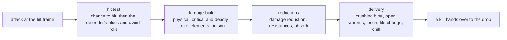
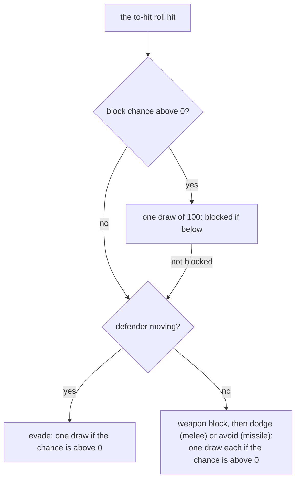
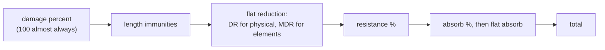
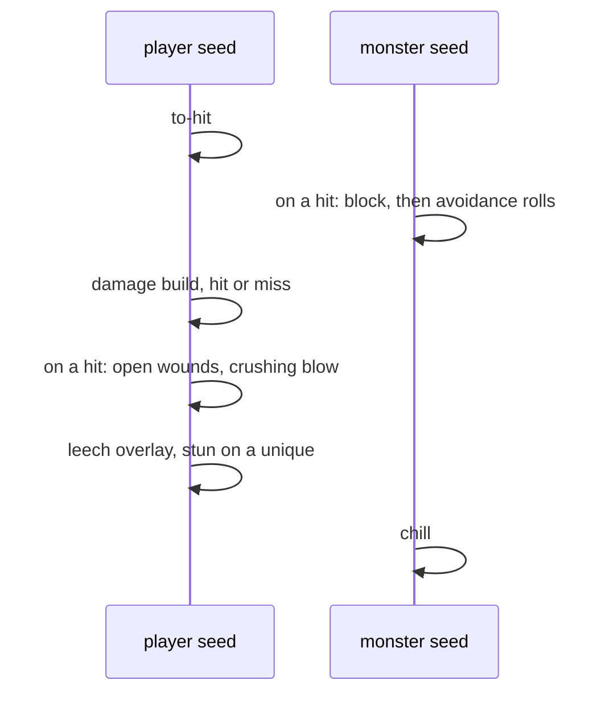

---
based_on:
  - docs/specs/combat/README.md 2026-10-17
  - docs/specs/combat/to-hit.md 2026-10-17
  - docs/specs/combat/damage.md 2026-10-16
  - docs/specs/combat/reductions.md 2026-10-17
  - docs/specs/combat/delivery.md 2026-10-17
---

# Combat

This page explains what happens when one unit hits another: whether the swing connects, how much damage it carries,
how the defender's resistances and reductions cut it down, and what the hit does on arrival (crushing blow, open
wounds, life and mana leech, chill, the life change). It restates the reviewed combat specs: the overview in
[combat/README](../specs/combat/README.md#purpose), the hit test in [to-hit](../specs/combat/to-hit.md#purpose), the
damage build in [damage](../specs/combat/damage.md#purpose), the defender's side in
[reductions](../specs/combat/reductions.md#purpose) and the arrival in [delivery](../specs/combat/delivery.md#purpose).
The specs carry the exact arithmetic and [draw](../glossary.md) order; this page tells the story. Where something is
read from the code but not yet seen in a test run, or is still unknown, the page says so.

Combat is the project's first *simulation* subject. The earlier pages describe how things are created; this one
describes a rule that runs many times a second during play. The specs were checked against one large recorded run:
15 358 logged combat events in 19 sessions at first, then 40 655 events over 40 logs once follow-up sessions aimed at
the rare branches were added, every one reproduced with no mismatch, with each unit's seed checked before and after
([overview § The ADR-0014 boundary](../specs/combat/README.md#the-adr-0014-boundary)).

## The big picture

A melee attack runs a fixed chain on the server
([overview § Purpose](../specs/combat/README.md#purpose), [§ A](../specs/combat/README.md#a-the-attack-events)):

Two things set combat apart from the rest of the game's randomness:

- **Every draw is on a unit's own seed, and two seeds take part.** The attacker's [unit seed](../glossary.md) draws
  the chance to hit, the damage rolls, crushing blow, open wounds, the leech overlay and the stun; the defender's
  draws the block and avoidance rolls and the chill. There is no shared "combat random number generator". A
  reimplementation that used one would get every later draw of both units wrong. This is confirmed
  ([overview § Reimplementation notes](../specs/combat/README.md#reimplementation-notes)).
- **Some draws are made even when their result is thrown away**, and others are skipped entirely when their chance
  is 0. Both are confirmed and both matter for the seed: a player's damage is built on a miss, an always-zero
  one-in-one draw is taken on every build, the leech overlay draw only picks which visual effect to show, and the
  chill's shatter roll is drawn even on a monster that cannot shatter ([overview § Reimplementation notes](../specs/combat/README.md#reimplementation-notes)).

## What the model takes as given

The combat specs do not explain how a unit's stats came about. A character's attack rating percent, its enhanced
damage, its resistances and their maxima, its damage reduction, absorb, leech and on-hit chances are all **taken as
inputs**, read off the units when the event starts ([overview § The ADR-0014 boundary](../specs/combat/README.md#the-adr-0014-boundary)).
How items, set bonuses, passives, auras and states add up to those numbers is now specified, and the
[stats and states](stats-and-states.md) page explains it; the combat run logged values, not the stat lists, so in it
the stats stay inputs, and a run that checks combat against the added-up stats is still owed
([§ Open questions](../specs/combat/README.md#open-questions)). A skill's or a missile's own damage packet is a later
subject: the specs take it as given and describe what happens to it.

A few events with their own random draws sit at the edge of the model and are not modelled draw by draw: weapon and
armour durability loss, knockback, the get-hit decision, and a monster's on-hit skill. In the run the seed was checked
on the way into each of them and taken as logged on the way out
([delivery § F](../specs/combat/delivery.md#f-the-boundary-at-delivery)).

## The attack events

Three events are covered ([overview § A](../specs/combat/README.md#a-the-attack-events)):

- **A player's normal attack.** At the hit frame the game runs the hit test, then **builds the damage whether or not
  the swing hit**, reduces it on a hit, and delivers it. So a missed swing still moves the player's seed through every
  damage roll. Confirmed: 2 030 events, 386 of them misses.
- **A monster's or a mercenary's plain attack.** The hit test runs first, and the damage is built **only on a hit**.
  Confirmed: 4 533 monster and 1 259 mercenary attacks.
- **A missile reaching a unit**, from the defender's side: its block and avoid rolls, the reductions and the delivery.
  Confirmed for the defender's seed over 1 957 missiles. How the missile builds its damage and whether it rolls a
  chance to hit belong to the missile phase still to come; here its damage packet is an input.

A player skill's melee hit and a monster skill's melee hit use the same machinery, with the skill's own attack-rating
percent and damage share; that is read from the code only.

**A mercenary is a monster on this path.** It differs only where the code checks for a hireling: a different
crushing-blow divisor against it, a reduced damage percent against another hireling or against an act boss, leech by
the player's formula without the difficulty divisors, and no drain rolls in its damage. The mercenary's attacks all
reproduced; that each of these differences is wired as described is read from the code, except the boss percent,
which is confirmed in all three difficulties (see *Reductions* below).

## Will it hit? The chance to hit

The chance to hit is computed from the attacker's attack rating (AR), the defender's defence (DEF) and both levels,
then one draw of 100 on the **attacker's** seed decides ([to-hit § A](../specs/combat/to-hit.md#a-the-chance-to-hit-combat_tohitroll)):

1. **Attack rating.** A player's is `(dexterity − 7) × 5 + attack rating stat + ToHitFactor`. A monster's is its
   attack rating stat plus 5 × dexterity.
2. **Percent.** AR is raised by its percent bonus (for a player, the weapon mastery, item bonuses and the skill's own
   percent). The formula from the percent on is confirmed; how the player's percent is made up was taken as given in
   the run.
3. **The chance.** `c = 100 × AR ÷ (AR + DEF)`, truncated, then `c × 2 × alvl ÷ (alvl + dlvl)`, truncated, then
   clamped to 5..95. A hit is never certain and never impossible.
4. **The draw.** One `Range(100)` on the attacker's seed; the swing hits when the result is below `c`.

All four steps are confirmed: 7 669 rolls reproduced. Three details matter for exact results:

- **`ToHitFactor` is part of the attack rating, not a level bonus.** The class constants (Amazon 5, Sorceress −15,
  Necromancer −10, Paladin 20, Barbarian 20, Druid 5, Assassin 15) are added to AR before the percent, and the level
  term has no class constant. Community pages describe them as a level bonus; the run with a Sorceress and a
  Barbarian shows the code's form.
- **The percent is truncated before the level factor.** Doing the whole thing as one fraction gives different values.
- **Negative values swap.** A negative DEF is added to AR and a negative AR to DEF before the division.

Some attack-rating modifiers are read from the code only, since no logged character carried them: ignoring or
lowering the target's defence, and the bonuses against demons and undead
([to-hit § A](../specs/combat/to-hit.md#a-the-chance-to-hit-combat_tohitroll)). Also read from the code: two other places in the
game compute an attack rating (one adds `ToHitFactor` twice, the character screen rounds differently), and
neither is used by an attack.

## Defence

A unit's defence is its defence stat plus a quarter of its dexterity, then raised by its defence percents
([to-hit § B](../specs/combat/to-hit.md#b-defence-unit_getdefense)). Against a melee attack the "defence against melee"
stat is added; against a missile, the "defence against missiles" one. The base part is confirmed for the player and
for the monsters of the run. The percent terms were zero on every logged unit, so they are read from the code only.

## Block, evade, dodge and avoid

Only after a hit does the defender get to roll, on **its own** seed
([to-hit § C](../specs/combat/to-hit.md#c-the-hit-test-and-the-defence-rolls)):

**Shield block** is confirmed. For a player holding a shield the chance is the block stat plus the class's
`BlockFactor`; in an expansion game that is multiplied by `(dexterity − 15)` and divided by `2 × level` (classic games
skip this step); the result is capped at 75. A monster blocks with its block stat if it has a shield or its class
allows blocking without one. The formula was checked in 2 523 expansion and 395 classic events, with 2 243 blocks.

Two rules for a running player are confirmed:

- **A running player is hit without a to-hit roll** (no draw on the attacker's seed), but still rolls block. Seen 47
  times, never with a to-hit draw.
- **A running player blocks at a third of the chance**, taken after the 75 cap, so at most 25 %. Seen 48 times: a
  75 % chance became 25 % in an expansion game, a 53 % chance 17 % in a classic one.

Read from the code only, because the run met them too rarely or never:

- **A walking player keeps the full block chance**: the code divides by three for a moving player except one who is
  walking, but no walking player was attacked in the run. Which kinds of movement count as moving is also taken from
  the code.
- **Evade, weapon block, dodge and avoid.** No logged character had them.

Each of these rolls is made only when its chance is above 0, so a defender without them draws nothing; that held
for every logged event. A missile with no physical damage cannot be blocked (read from the code).

## Building the damage

The attacker's damage is built in a fixed order, every random part on the **attacker's** seed
([damage § A](../specs/combat/damage.md#a-combat_builddamage-in-order)):

| # | Step | Draw | Status |
|---|---|---|---|
| 1 | bonuses against demons, undead or a monster type; a permanent defence reduction | none | read from the code |
| 2 | physical damage roll | one, if the range is not empty | confirmed |
| 3 | weapon mastery critical strike, then the critical strike stat, then deadly strike: the first success doubles physical damage | one per chance above 0, stopping at the first success | deadly strike confirmed (250 doublings); the order of the three read from the code |
| 4 | fire, lightning, cold, magic, **in that order** | one each, if the range is not empty | confirmed |
| 5 | a monster's life, mana and stamina drain; a player's leech percents are copied, not rolled | one per drain range for monsters | confirmed |
| 6 | poison, cold length, stun length | one for poison, if the range is not empty | confirmed; the stun length read from the code |
| 7 | a one-in-one draw that always gives 0 | **always one** | confirmed |
| 8 | the defender's "attacked in melee" event, for a player or mercenary attacker | none was logged | read from the code |
| 9 | conversion of physical damage into an element | one `Range(5)` for a random element | read from the code; no logged attack converted |
| 10 | a monster's `Crit`: doubles **every** damage field | one, if its class has `Crit` | confirmed (89 doublings) |

**The physical roll** ([damage § B](../specs/combat/damage.md#b-the-physical-roll-combat_rollphysical)) takes the
weapon's minimum and maximum (two-handed or one-handed), raises both by the enhanced-damage total (which includes
the weapon's strength and dexterity bonuses, each truncated on its own, and is never below −90 %), and draws a value
in between. **The maximum is never reached**: the roll is `low + Range(high − low)`. All of this is confirmed. With
no weapon, at least 1–2 damage is used; that is read from the code.

**Elements** ([damage § C](../specs/combat/damage.md#c-one-element-combat_rollelemstat-combat_rollrange)) work the
same way, raised by the element's mastery. A range whose maximum is not above the minimum draws nothing, unlike the
monster hit-point roll on the [monsters](monsters.md) page, which draws even for a range of one.

**The always-zero draw.** Every build (a player's on a hit or a miss, a monster's on a hit) takes one draw that can
only return 0. Its trace in the damage is a tiny "burn" value of 2 that never turns into burning, because the burning length stays 0.
Skipping the draw shifts every later draw of the attacker. The draw and the value 2 are confirmed for a plain attack;
the general formula behind it is read from the code.

**A player's critical or deadly strike doubles physical damage only**; that is read from the code. A monster's `Crit`
doubles physical and elemental damage alike, which is confirmed.

**Conversion** of physical damage into an element exists in the build but no logged attack converted, and the code
that would set it up was not found on the attack paths read. It is read from the code only.

### A monster's attack stats

A monster's attack rating, damage and elemental damage are written when it **enters an attack mode**, not at the
hit ([damage § E](../specs/combat/damage.md#e-a-monsters-attack-stats-monattackstats)). That step draws only one
`Range(100)` for each elemental group of that attack mode whose chance is between 1 and 99, and one `Range(5)` for the random element
type. The draws are confirmed (5 060 calls). Between that moment and the hit the monster's AI draws on the same seed,
which the combat model does not cover. The formulas of the values written (the per-level damage, the classic
Nightmare and Hell factors, the expansion's extra damage per player) were taken as given in the run and are read
from the code only. Also read from the code: a summon or pet class (`noRatio`) ends up with no elemental damage at
attack time, because its values are written to one place and read from another.

## Reductions on the defender

The defender's side cuts each damage field down, with no random draw
([reductions § A](../specs/combat/reductions.md#a-combat_applyreductions),
[§ B](../specs/combat/reductions.md#b-the-rows-g_damageresisttable)). The order is fixed by a table in the game:
physical, fire, lightning, cold, magic, then the cold and freeze lengths, the poison length and poison.

What is confirmed:

- **Flat reduction first, resistance second.** Damage reduction (physical) or magic damage reduction (elements) is
  subtracted first. If that pushes a field below zero, the resistance is skipped and **the field stays negative**,
  and it is added into the total like that.
- **A negative resistance increases damage.**
- **Players and mercenaries take the difficulty penalty and the cap; monsters take neither.** In an expansion game
  the penalty is 0, −40 and −100 by difficulty; in a classic game it is −20 in Nightmare and −50 in Hell. Physical and
  magic resistance take no penalty. The penalty comes before the cap, so a 115 % fire resistance in Hell is 15 %,
  not −15 %. Between the two, the code also raises anything below −99 to −100; that floor is read from the code only
  (resistances landed on exactly −100 214 times, but none went below, so the floor never changed a value).
- **The cap** is 75 plus the unit's "maximum resistance" bonus, at most 95; physical resistance caps at 50. Fire
  reached the cap 2 115 times and poison 692. Cold and lightning reached it fewer than about 30 times (27 and 17),
  and magic never.
- **Monster immunity** is a resistance of 100 or more, which zeroes the field (seen for fire, cold, lightning and
  poison; magic immunity was not met).
- **Cold and freeze lengths are reduced by cold resistance**, and the poison length by its own stat, not by poison
  resistance.
- **Absorb heals.** Percent absorb (at most 40 %) takes its share out of the damage and heals the defender by that
  amount. Community pages say only flat absorb heals; 32 healing events from percent absorb say otherwise. Flat absorb
  also heals by the code, but no logged unit had it.
- **"Cannot be frozen"** zeroes the cold length.

**The damage percent** is 100 for every player and monster attack the run logged. When a mercenary hits an act boss
it is the difficulty's `HireableBossDamagePercent`: 50 in Normal, 35 in Nightmare and 25 in Hell are all confirmed.
Hell's 25 is also what shows the game reads this column and not a neighbouring one that is 20 in Hell. When a prime
evil hits a unit carrying a certain internal mark the percent is raised: 200 against a mercenary, confirmed over 154
hits of Andariel on the mercenary. The other cases are read from the code only: 400 against a marked unit that is not
a mercenary (what the mark means is not known), 17 % for player against player, and 25 % for a hireling hitting a
hireling.

Read from the code only: pierce (no attacker had it), the half-freeze stat, and two states that cancel poison and
burning lengths. That nothing on this path keeps a hit above zero is also read from the code. An "absorb damage"
event runs before the reductions, but its handlers (energy shield and the bone and cyclone armours, by community
accounts) were not read, and no logged unit had one.

## Delivery: crushing blow, open wounds, leech and the life change

When the hit is delivered, the game runs the attacker's on-hit effects, then leech, then the life change and the
timed effects ([delivery § B](../specs/combat/delivery.md#b-delivery-combat_applydamage)). Before it is queued, a
kill test already compares the total with the defender's life in whole points.

**Crushing blow** ([delivery § E](../specs/combat/delivery.md#e-the-stat-events-crushing-blow-open-wounds-freeze)) is
confirmed. One draw of 100 on the attacker's seed; on success the defender loses a share of its **current life,
before this hit's damage**:

- 1/4 for ordinary monsters **and for uniques** (247 and 63 events). Community pages give 1/8 for champions and
  uniques; 1.14d does not for uniques, and by the code champions take 1/4 as well (no champion was identified in the
  run).
- The share shrinks with the number of players the monster was **created** for: the divisor 4 grows by 50 % per
  player beyond the first, so at 8 players it is 18. Confirmed at 2, 3 and 8 players. Community pages say the player
  count does not matter; in 1.14d it does.
- Positive physical resistance lowers the amount.
- 1/8 for act bosses and superuniques, with the same player-count and resistance steps: confirmed on Andariel
  (34 events) and on superuniques (55).
- Read from the code only: 1/10 against a player or a mercenary, and half the effect from a missile.

**Open wounds** is confirmed: one draw of 100 on the attacker's seed; on success the defender bleeds for 200 frames,
by an amount that grows in bands with the attacker's level (2 506 per frame, in 1/256 life, at level 85). A new wound
restarts the bleed. **Unique monsters bleed half as much**, confirmed over 383 wounds, Andariel's 63 included: she
carries the unique mark. Monsters with neither the champion nor the unique mark took the full amount (1 497 wounds).
Read from the code: the halving looks only at those two marks, never at whether the monster is an act boss, so a
champion without the unique mark also bleeds half and an act boss without it would take the full amount; players
bleed a quarter. None of these was wounded in the run. When both effects are present, the
order the handlers run in follows the order the unit registered them, newest first; that is read from the code.

**Leech** ([delivery § C](../specs/combat/delivery.md#c-leech-combat_leech)) is confirmed for players, the
mercenary and monsters:

- It is computed on the **physical damage after reductions**, and after that damage is capped to the defender's
  remaining life. Elemental damage never leeches.
- A player's leech is divided by the difficulty's divisor (1, 2, 3), and further cut by the monster's `Drain` column
  for that difficulty (`fallen2`: 100, 85, 75 %). A monster with no `Drain` cannot be leeched.
- Mana is added first, then life. When both ran, one extra draw of 2 on the attacker's seed picks which visual
  overlay to show; a reimplementation without overlays still has to take it.
- Monster leech (a monster attacker healing itself, by up to the damage it dealt and the defender's mana and stamina)
  is confirmed over 80 events in Nightmare and Hell.

**The life change** is confirmed: the total is subtracted from the defender's life, and **a result below one life
point is 0**, a kill. A total of zero or less (for example, when magic damage reduction drove every element negative)
leaves life unchanged; that was seen 25 times, just short of confirmation, and is read from the code.

### Chill, stun, freeze and poison

From [delivery § D](../specs/combat/delivery.md#d-stun-cold-freeze-poison-burn):

- **Chill** draws one `Range(100)` on the **defender's** seed whenever a chill is applied, whatever the outcome; that
  draw is confirmed. Read from the code: a monster whose `coldeffect` is 0 is not chilled and draws nothing, a player
  is chilled at −50, and the chill strength and the 20 % shatter chance.
- **Stun** on a unique monster first draws `Range(100)` on the attacker's seed and succeeds only on 90 or more; that
  draw is confirmed (34 events). Read from the code: act bosses and monsters that cannot move are never stunned, and
  the stun's length caps.
- **Freeze** freezes ordinary monsters and only chills players, bosses, uniques and mercenaries. Read from the code;
  no logged hit froze.
- **Poison** replaces an existing poison only when it is at least as strong. Read from the code.

**The life tick** that carries poison and open wounds is confirmed for monsters: they bleed each frame and can die of
it, and their natural regeneration is suspended meanwhile (6 181 ticks reproduced). On a player the tick adds the
life regeneration stat whatever its sign, so poison bleeds a poisoned player every frame; that is confirmed by the
stats run (1 082 poisoned ticks). The tick never takes a player's life below one point, so poison and open wounds
cannot kill a player; that is read from the code, since no poisoned tick reached the floor
([delivery § E](../specs/combat/delivery.md#e-the-stat-events-crushing-blow-open-wounds-freeze); the tick itself is
on the [stats and states](stats-and-states.md#regeneration-life-mana-stamina-and-poison) page).

## Draw order and chaining

The order of draws in one event is confirmed ([overview § B](../specs/combat/README.md#b-draw-order-per-event)). For
a player's normal attack on a monster:

For a monster's attack on the player, the monster's seed draws its elemental groups when the attack mode starts, then
at the hit frame the to-hit and, on a hit only, the build with `Crit` last; the player's seed draws its defence rolls
and the chill. Each draw happens only under the condition its section gives.

**Chaining** ([overview § C](../specs/combat/README.md#c-chaining-events-on-one-seed)) is confirmed. On the player's
seed, consecutive combat events follow each other with no hidden draw in between on the paths the run took (thousands
of chained pairs); where something outside combat drew in between, the run picked the seed up again. A monster's seed
chains only within one attack, from its attack-mode draws to the hit, because its AI draws between attacks.

## Difficulty and game type

From [overview § D](../specs/combat/README.md#d-branches):

| What | Changes with | Status |
|---|---|---|
| block chance | expansion uses dexterity and level; classic does not | confirmed |
| resistance penalty | classic −20 / −50; expansion 0 / −40 / −100 | confirmed |
| leech | the difficulty's divisors and the monster's `Drain` | confirmed |
| crushing blow | the monster's creation player count | confirmed |
| mercenary against an act boss | the difficulty's damage percent | confirmed for all three difficulties |
| a monster's attack values | classic Nightmare and Hell factors; expansion bonus per player | read from the code |
| chill and freeze lengths on monsters | the difficulty's divisors | read from the code |
| chance to hit, block, crushing blow, open wounds | no difficulty branch | read from the code |
| player against player | 17 % damage | read from the code; needs a two-client run |

"Players" for a monster always means the count it was created for, not the current `/players` setting; that is
confirmed.

## Worked example

Copied from [overview § Example 1](../specs/combat/README.md#example-1-a-melee-hit-in-hell-with-crushing-blow-and-leech):
a recorded expansion Hell game at one player. A test Sorceress (level 85, dexterity 420, a Dimensional Blade, deadly
strike 15, open wounds 10, crushing blow 20, life steal 5, mana steal 7) hits a `fallen2` (level 68, defence 946,
block 16, physical resistance 15, fire 110, cold 40) that has 74 776 of its life left, in 1/256 points. Every draw
below is the logged one; the spec's table also gives each seed before and after.

| # | Seed | Draw | Result |
|---|---|---|---|
| 1 | player | to-hit `Range(100)` = 3 | AR `(420 − 7) × 5 + 250 − 15` = 2300 against DEF 946: `c` = 70, then `70 × 85 × 2 ÷ 153` = 77: a hit |
| 2 | monster | block `Range(100)` = 30 | block chance 16: not blocked; no dodge or avoid, no draw |
| 3 | player | physical roll | 92 195 |
| 4 | player | deadly strike `Range(100)` = 83 | 15 or more: no doubling |
| 5–7 | player | fire, cold, magic rolls (no lightning, no draw) | 888, 10 448, 22 020 |
| 8 | player | the always-zero draw | burn 2, no burning |
| — | — | reductions, no draw | physical 78 365 (15 %), fire 0 (immune), cold 6 268 (40 %), magic 22 020, poison 153; total 106 806 |
| 9 | player | open wounds `Range(100)` = 44 | 10 or more: no wound |
| 10 | player | crushing blow `Range(100)` = 13 | below 20: life 74 776 loses a quarter less 15 %, to 58 886 |
| 11 | player | leech overlay `Range(2)` = 0 | physical capped to 58 886; Hell divisors and `Drain` 75 %: the player gains 731 life |
| — | — | life change | 58 886 − 106 806 is below one point: 0, killed |
| 12 | monster | chill `Range(100)` = 79 | no shatter |

The per-difficulty examples (monster hits blocked and resisted in Normal, Nightmare, Hell and classic Hell, and
crushing blow at 8 players) are in the worked examples of [to-hit](../specs/combat/to-hit.md#worked-example),
[reductions](../specs/combat/reductions.md#worked-example) and [delivery](../specs/combat/delivery.md#worked-example).

## What is not known yet

From the specs' open questions ([overview](../specs/combat/README.md#open-questions),
[to-hit](../specs/combat/to-hit.md#open-questions), [damage](../specs/combat/damage.md#open-questions),
[reductions](../specs/combat/reductions.md#open-questions), [delivery](../specs/combat/delivery.md#open-questions)):

- **The inputs.** A run that checks combat against the added-up stats instead of logged values (how they add up is on
  the [stats and states](stats-and-states.md) page), and the formulas of a monster's attack values.
- **Skills and missiles.** A skill's or missile's own damage, a missile's chance to hit and knockback, conversion, and
  on-hit effects other than crushing blow, open wounds and freeze.
- **Timing.** Hit recovery, knockback and stun lengths in time, and the get-hit and durability draws.
- **Branches the run met too rarely or never**: crushing blow and open wounds on champions; open wounds on players;
  the resistance cap for cold, lightning and magic; magic immunity; a negative absorbed amount; evade, weapon block,
  dodge and avoid; pierce, flat absorb, conversion and freeze; a walking player's full block chance; a negative total
  leaving life unchanged; the floor of one point on the player's life tick. A later run may settle some of these.
- **Player against player** and hostile auras need a run with two clients.

## Where to read more

- The specs: [combat overview](../specs/combat/README.md#reimplementation-notes),
  [to-hit](../specs/combat/to-hit.md#reimplementation-notes), [damage](../specs/combat/damage.md#reimplementation-notes),
  [reductions](../specs/combat/reductions.md#reimplementation-notes),
  [delivery](../specs/combat/delivery.md#reimplementation-notes). Each *Reimplementation notes* section lists the traps
  for someone rebuilding the system.
- The [glossary](../glossary.md) for D2 terms.
- Related wiki pages: [randomness](randomness.md) (unit seeds and draws), [monsters](monsters.md) (a monster's level,
  hit points and defence at creation), [characters](characters.md) (a class's base attributes),
  [stats and states](stats-and-states.md) (how a unit's stats add up), [items](items.md)
  (what drops at the kill) and [how we know](how-we-know.md).
