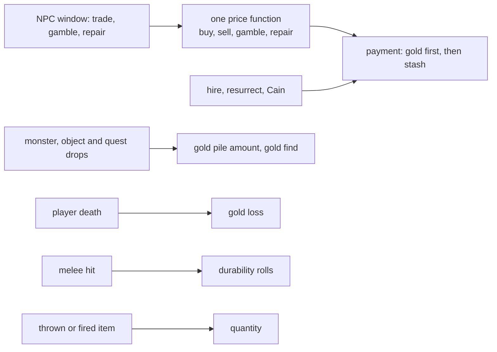
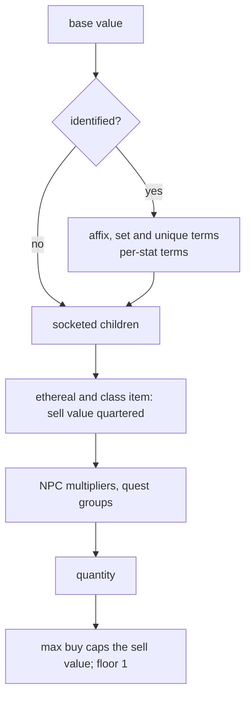
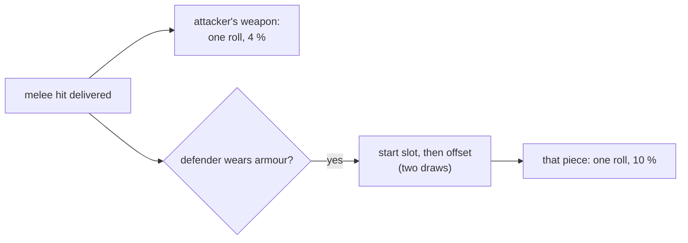

---
based_on:
  - docs/specs/items/economy.md 2026-10-19
---

# Prices, repair, gold and wear

This page explains what an item costs to buy, sell, gamble and repair, how gold is paid, capped, dropped and lost,
and how items wear out in a fight and come back. It restates one reviewed spec,
[item economy](../specs/items/economy.md#purpose), which was checked by two runs of the game: every logged price call in them, 33 901 in all, is
reproduced by the spec's arithmetic.

Two facts frame everything below. First, one function prices everything an NPC trades, with four modes: buy, sell,
gamble and repair. Second, none of these money paths draws a random number of its own. Only the wear rolls and the
count of Wirt's gold piles draw; gold piles and the store's copy of a sold item draw only through the ordinary item
creation that makes them ([§ I](../specs/items/economy.md#i-draws-and-seeds-per-event-kind)). So buying, selling and
repairing never shift a random sequence except by making an item.

## Prices

### Three values carried together

The price function keeps three running values from start to finish: what the player pays to buy (the buy value),
what the NPC pays for it (the sell value) and what a repair costs (the repair value). Every step works on all three,
and at the end the mode picks one ([§ B](../specs/items/economy.md#b-the-price-core-early-returns-and-the-base)). The
order matters: each step rounds down, so doing the steps in another order gives other numbers
([reimplementation notes](../specs/items/economy.md#reimplementation-notes)).

The steps, in order:

1. **The base.** Normally the base item's `cost` column. Armour is scaled by its defence against its base's maximum
   defence; tomes add a cost per charge; quivers and other stacks are priced per unit. The base for ears and body
   parts is read from the code only: no run priced one.
2. **The value terms** ([§ C](../specs/items/economy.md#c-the-value-terms-modes-0-1-3)), only for an identified item.
   Each affix, set row or unique row adds a multiple of the base, in 1024ths, plus a flat amount. Low quality halves
   the value instead of adding. Magic, rare, crafted, superior and tempered items also add a term per stat, computed
   from the base value (not the value after the affixes), so the stat terms and the affix terms do not compound.
   Unique and set items get no per-stat terms; that is read from the code. Each socketed gem, rune or jewel adds half
   its own base cost.
3. **Ethereal and class items.** An ethereal item sells for a quarter of its value, and a class-specific item for a
   quarter again. Neither touches the buy or repair value.
4. **The NPC.** Each NPC's row scales the values
   ([§ D](../specs/items/economy.md#d-mode-steps-the-npc-row-quantity-and-the-result)). The names are a trap:
   the column called *sell mult* scales what the player pays, *buy mult* scales what the NPC pays, and *rep mult*
   scales the repair. Two quest groups scale them again once the NPC's quest is done; a third group exists but no
   stock NPC uses it.
5. **Quantity.** The buy and sell values are multiplied by the stack size. A repairable stack (throwing weapons)
   sells for the full stack less the cost of refilling it.
6. **The cap and the floor.** The sell value is capped by the NPC's *max buy* for the difficulty, after every other
   step. Every result except the gamble price is at least 1 (apart from early exits read from the code: an item that cannot be
   repaired has a repair price of 0, and a starting item is priced at 1 in every mode). The player's *reduced prices* stat (Gheed's Fortune)
   lowers the buy and gamble prices; that it lowers the repair price too is read from the code only.

**Example** (the spec's [worked example 1](../specs/items/economy.md#1-a-magic-amulet-with-an-all-resistance-prefix-sold-to-halbu-session-4311-normal-k--b3e5b26e3c7cb331)).
A magic amulet with an all-resistance prefix, sold to Halbu in Normal. The base is 2400. The prefix adds
`2400 × 1280 ÷ 1024 + 16 000 = 19 000`. Each of the four resistance stats adds 371, computed on 2400, so 1484. The
value is `2400 + 1484 + 19 000 = 22 884`. Halbu's *buy mult* is 512 (a half), so he pays 11 442, under his cap of
20 000. The game paid 11 442.

Crafted items are priced like rare ones. The run that confirmed this used items built with a save tool (quality
crafted, with affixes, but without the extra properties a cube recipe adds), so it covers the price formula, not a
crafted item exactly as the cube makes it.

### Selling: the lower of two prices

When you sell an item, the NPC normally puts a copy of it in the store. That copy is repaired and priced again, and
you get the lower of the two sale prices, so a damaged item never sells for more than its repaired copy
([§ F](../specs/items/economy.md#f-callers-buy-sell-repair)).

Some items are not copied. The game runs eight tests, all of them every time, and any match stops the copy. Three
were seen refusing in a run: an ethereal item, a broken item, and a unique that can be carried only once (such as
*Annihilus*). The other five (a low-quality *Cracked* item, one base type, one item flag, one further item test and one
store setting) are read from the code only. Making the copy is an item creation, so it moves the game seed two steps, even when no
store page has room and the copy is thrown away; a refused copy moves nothing.

An ethereal throwing stack is not worth 1 gold, as some community guides say: it is priced on the ordinary path
([worked example 2](../specs/items/economy.md#2-an-ethereal-war-javelin-stack-sold-to-halbu-session-4311-normal-k--a583ed2bdcdff789)).

## The gamble price

A gambling price ignores the NPC's multipliers and the quest groups
([§ E](../specs/items/economy.md#e-the-gamble-price-mode-2)). For rings and amulets it is the table's *gamble cost*.
For everything else it is computed from your character level `L`:

1. The chances of an exceptional or elite upgrade grow with how far `L` is above the upgraded base's level, and an
   average cost is taken over the normal, exceptional and elite bases with those weights.
2. A level term grows with `L` (counted as at least 5) and shrinks with the base's own level.
3. The price is the level term plus the average cost, times a factor that also grows with `L`.

So the same item costs more as you level, mostly because a higher level makes an expensive upgrade more likely.
A character below level 5 is priced as level 5 in the level term and the factor; a run at level 3 confirmed it on
125 prices. The *reduced prices* stat applies.

**Example** (the spec's [worked example 4](../specs/items/economy.md#4-a-gambled-small-shield-jamella-hell-clvl-75-session-4332-k--b1bcddf538b8ce5a)).
A small shield gambled at level 75: the exceptional upgrade weight is 1901 and the elite 351 (out of 10 000), the
average cost 5262, the level term 6083, the factor 70, and the price `(6083 + 5262) × 70 ÷ 15 = 52 943`, as logged.

## Repair

The repair value is the item's value times the fraction of durability missing, times the NPC's *rep mult*
([§ D](../specs/items/economy.md#d-mode-steps-the-npc-row-quantity-and-the-result)). Missing charges add a recharge
cost after the NPC step, so the NPC does not scale it; that part is read from the code only, as no run recharged an
item. The repair price has no difficulty term, and a run in Hell confirmed the same arithmetic there.

*Repair all* is the sum of the single repair prices of every damaged item you wear; you pay the sum, then each item is
repaired ([§ F](../specs/items/economy.md#f-callers-buy-sell-repair)).

**A partial repair.** When you cannot pay for a single repair, the repairer takes all your carried gold (not the
stash) and restores as much durability as that buys. The client asks for the full price even when you are short, so
this happens in ordinary play. A run saw two: 300 gold toward a 14 464 repair raised durability from 1 to 2, and
7936 toward 14 208 raised it from 2 to 34. With no gold at all, nothing happens.

**Ethereal items** cannot be repaired. The client shows no repair choice for them, so the request never reaches the
server; the server's own refusal is read from the code only. A broken item is repaired like any other (a run repaired
a broken cap from 0 to full and cleared its broken mark); whether that repair draws any random numbers is not yet
confirmed, because it was seen once.

**The quest services' repair.** Larzuk's socketing and Anya's personalization repair the item they hand back: a
damaged cap came back at full durability from each, once each. Charsi's imbue does not: the new rare item is not yet
identified when the repair runs, and an unidentified item cannot be repaired, so the imbued cap kept its damage. No
quest script repairs anything else; that comes from a search of the code, not from a run
([§ F](../specs/items/economy.md#f-callers-buy-sell-repair)).

**Example** (the spec's [worked example 3](../specs/items/economy.md#3-two-repair-prices-at-halbu-session-4311-normal)).
A Shako worth 56 307 at durability 3 of 12: `9/12` of it is 42 230, and Halbu's *rep mult* of 128 (an eighth) makes
it 5278.

## Gold

### Paying

Every payment (buying, hiring, resurrecting) takes gold from your inventory first and the rest from the stash, and
is refused with both untouched when the two together are short
([§ G](../specs/items/economy.md#g-gold-payment-caps-piles-and-the-death-loss)). Runs confirmed it on purchases,
hires and resurrections.

| Cost | Amount |
|---|---|
| hiring | the price on the mercenary's list ([characters](characters.md)) |
| resurrection | `(L × L ÷ 2) × 15` for a mercenary of level `L`, at most 50 000; refused, it takes nothing (that it then revives nothing is read from the code) |
| Cain's identify | 100 per unidentified item, free once his quest is done (read from the code; one case seen) |
| healing | free: a heal-cost routine exists in the code but nothing calls it |

### Caps

You can carry at most 10 000 gold per character level, and the stash holds at most 2 500 000 whatever your level.
Gold given past the carried cap is dropped at your feet as piles, and picking up a pile takes only what fits. All of
this is read from the code: no run went over a cap. One trap, also read from the code: the low-level routine that
adds gold writes 0, not the cap, when an addition would overflow, so callers must clip first.

### How much a pile holds

A gold pile's amount is fixed when the pile is created: the item level plus a random number below five times the
item level, on the pile's own seed, at least 1. A monster's drop is then scaled by the treasure-class multiplier
where there is one (read from the code), and by gold find:
`amount × (100 + killer's gold find + gold find of the killer's owner) ÷ 100`. Gold find has no difficulty term.

**Example** (the spec's [worked example 7](../specs/items/economy.md#7-a-gold-pile-from-a-monster-session-4391-normal-gold-find-440)).
An item-level 5 pile draws 19 from `0 … 24`, so it holds 24; with 440 gold find it becomes `24 × 540 ÷ 100 = 129`.

Other gold:
- **Gold piles placed as objects** take the level's monster level minus 1 as their item level (confirmed where that
  monster level is above 1).
- **Wirt's body** gives 10 to 19 piles, the count drawn once on the quest seed when you first open it, then one pile
  every 10 frames. A run saw 18 piles at item level 6, Tristram's monster level; which of the level's two monster
  level columns (classic or expansion) is used is not separated, since both are 6 there.
- **Baal's quest gold** and gold dropped past the cap are split into piles of at most two billion, at most 32 piles;
  the split is read from the code only.

### Losing gold on death

When a player dies, the loss is `min(L, 20)` percent of carried gold plus stash, with `L` the character level
([§ G](../specs/items/economy.md#g-gold-payment-caps-piles-and-the-death-loss)). In a single-player game you keep at
least 500 gold per level of that total, and the loss is never more than your carried gold, so the stash is never
touched. What you carry beyond the loss is dropped on the ground as piles; the loss itself is gone. Runs confirmed
this on 20 single-player softcore deaths. Deaths to another player and other game types are read from the code only,
and the code makes no exception for hardcore.

**Example** (the spec's [worked example 5](../specs/items/economy.md#5-death-losses-sessions-4351-and-4359-hell-single-player-game-type-3)).
A level-30 character with 199 250 gold and 500 000 in the stash loses 20 % of 699 250, that is 139 850; 59 400 is
dropped and the stash keeps 500 000. With 14 000 and 1000 instead, keeping `500 × 30 = 15 000` of 15 000 leaves a
loss of 0.

## Wear

### Durability in melee

The durability rolls below run only on a delivered melee hit; a missile or a spell does not reach them (read from
the code) ([§ H](../specs/items/economy.md#h-wear-durability-quantity-charges-replenish)). On each delivered melee
hit, for each side that is a player:

- **The attacker's weapon** rolls on the attacker's seed: a 4 % chance to lose 1 durability (10 % for a throwing weapon
  in the expansion).
- **One piece of the defender's armour** is chosen, then rolls a 10 % chance on the defender's seed. The choice is
  weighted by slot: head 3, body 5, each hand 4, belt, boots and gloves 2 each, counting only slots that hold armour.
  It is not a plain weighted pick: one draw picks a starting slot, a second draws an offset into the total weight, and
  the game walks the slots in a cycle from the start until the offset falls inside a slot.

So a melee hit costs the defender three draws (two picks and the roll), two if the chosen piece has no durability,
none if no armour is worn; the weapon costs the attacker one (none if it has no durability). An indestructible item makes no roll at all. These draws
share the unit's seed with the combat rolls, so wear changes what the next hit rolls
([combat](combat.md)).

**Example** (the spec's [worked example 8](../specs/items/economy.md#8-one-melee-hit-taken-and-one-given-session-4381-normal-a-barbarian)).
A Barbarian wearing six armour pieces has a total weight of 18. The start draw gives slot 4 (the belt) and the offset
draw 0, which falls inside the belt's 2, so the belt rolls: 80, not below 10, no loss.

What happens at 0 durability is read from the code and not yet confirmed: armour breaks, a throwing stack loses one
and refills its durability, and a melee weapon is left at 0 without being marked broken (no code path that marks it
was found).

### Quantity and charges

A thrown weapon loses one from its stack per use, with no random draw (confirmed on thrown axes). Arrows and bolts,
charges used by casting, and skills that wear a weapon are read from the code only.

### Replenishing

An item with a *replenish durability* stat `r` gets a timer tick every `2500 ÷ r + 1` frames (501 frames at 5,
834 at 3, as a run measured), and the ticks draw nothing. That each tick restores one point, the floor of 125 frames
between ticks, and the same timer for *replenish quantity* are read from the code only.

## What is not known yet

From the spec's [open questions](../specs/items/economy.md#open-questions) and its points not confirmed by a run:

- **Never run, no run planned:** ears and body parts, stats priced by time of day, very old items, the recharge cost,
  charges used, skills that wear weapons, Baal's gold, the gold caps, pickup and the stash moves, deaths to another
  player and outside single player, the classic throwing weapon, the stack refill, Cain's free identify, selling a
  broken ethereal item, and repairs with a replenish stat or with *reduced prices*.
- **Seen once or not at all:** whether repairing a broken item draws; the five store-copy refusals not reached; the
  server's own refusal of an ethereal repair; a second source for "no quest script repairs"; which monster level
  column gives Wirt's piles their item level.
- **The vendor record:** three bytes of it were watched and nothing read them in the windows played; a reader in
  other NPC actions or game states is not excluded.
- **Other:** what the two other network game types are; the party gold split and trading between players (a
  two-client plan); whether anything marks a melee weapon broken at 0 durability; how arrows are chosen for a bow
  shot and which skill wears a weapon.
- The spec also lists six places where community guides differ from 1.14d (armour slot weights, the ethereal sale,
  the ethereal throwing stack, affix divisors, the gamble cost, tome costs); in each, the 1.14d behaviour above
  stands.

## Where to read more

- The spec: [item economy](../specs/items/economy.md#purpose), its
  [worked examples](../specs/items/economy.md#worked-example) and
  [reimplementation notes](../specs/items/economy.md#reimplementation-notes).
- Related pages: [other item paths](items-other-paths.md) (vendor stock, gambling, the quest services),
  [characters and hirelings](characters.md), [combat](combat.md), and the [glossary](../glossary.md).
