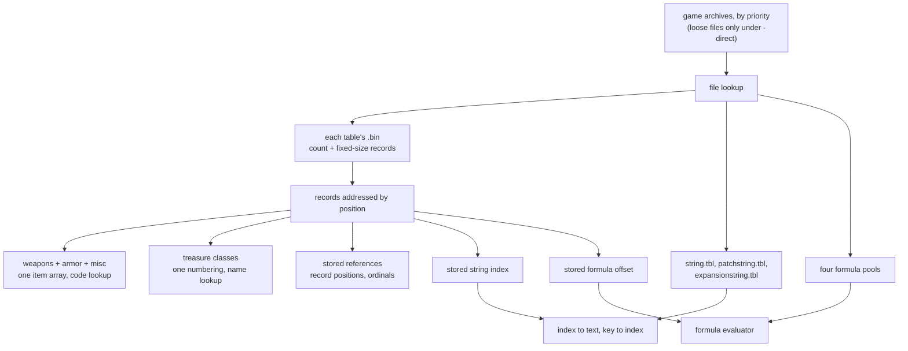
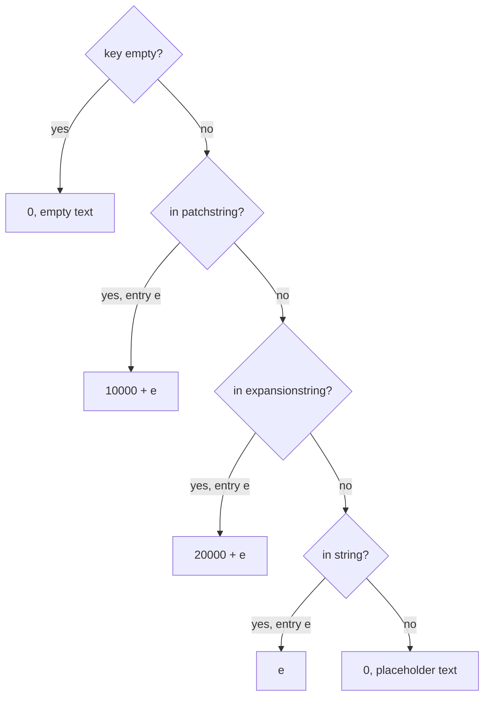

---
based_on:
  - docs/specs/data/README.md 2026-10-16
  - docs/specs/data/excel.md 2026-10-15
  - docs/specs/data/strings.md 2026-10-16
  - docs/specs/data/calc.md 2026-10-16
---

# Game data: tables, strings and formulas

Much of what Diablo II does is driven by tables: which monsters a [level](../glossary.md) can have, what a
[treasure class](../glossary.md) drops, how much a skill does. The game keeps that data in "excel" tables (Levels,
MonStats, TreasureClassEx, Weapons and about eighty more), in three string tables that hold the names and text
shown on screen, and in small compiled formulas that some table cells carry instead of a plain number. This page explains how the game finds and loads
those files, how a record is addressed, how one table points at another, how a stored number becomes a name on
screen, and how a formula is run. It restates four specs: the [data overview](../specs/data/README.md),
[excel tables](../specs/data/excel.md), [string tables](../specs/data/strings.md) and
[calc formulas](../specs/data/calc.md). The loading happens once, at program start, before any game exists, and it
draws no random number; formulas are evaluated later, when the game needs a value, and only a formula's `rand` can
draw (below).

## The big picture

The diagram is a simplified copy of the [data flow](../specs/data/README.md#data-flow) and the
[excel algorithm](../specs/data/excel.md#algorithm); the text below is what counts.

## Which archive a file is read from

The game's data sits in its MPQ archives. At start-up the game opens them and keeps them in a list sorted by
priority; a lookup walks that list and the first archive that has the file wins
([excel § A](../specs/data/excel.md#a-archives-and-file-lookup)). For the table files this gives the order
`patch_d2`, then `d2exp`, then `d2kfixup`, then `d2delta`, then `d2data`. `d2exp` is opened whenever it exists,
even for a classic game, so classic and expansion games read the same tables.

Loose files on disk are only looked at when the game runs with `-direct` (or when no archive is open at all), and
then they beat every archive. In a
normal run a loose file never overrides an archive. This whole section is read from the code; a test with a loose
table file has not been run yet, and neither of the two optional archives in the middle of the list is present to
test with.

## The game reads the .bin, not the .txt

Every table exists in two forms ([.bin and .txt](../glossary.md)): a tab-separated `.txt` source and a compiled
`.bin`, which is a 32-bit record count followed by fixed-size records. **The game always loads the `.bin`**; in a
normal run no `.txt` is parsed at all. This is confirmed: the in-memory "parse the text" path is dead, and for all
86 loaded tables the record size the game's code uses matches the file
([excel § B](../specs/data/excel.md#b-loading-one-table), [§ C](../specs/data/excel.md#c-addressing-records)).

The `-txt` option compiles the `.txt` files and writes fresh `.bin` files to disk, and then loads the `.bin`
through the normal lookup. Without `-direct` the game never sees the disk copy, so `-txt` alone changes nothing;
only `-direct -txt` makes the game run on edited text. This is read from the code and not yet tried in a run.

A few consequences that a modder or reimplementer would trip over:

- `TreasureClass.txt` is never loaded. The live table is `TreasureClassEx` (confirmed).
- For `inventory` and `PlrMode` the live `.bin` comes from `d2exp`, so the patch archive's `.txt` edits to these
  two tables are not live (read from the code and the files).
- A few tables ship and are never loaded at all (confirmed for `cubemod` and `cubetype`).

## Records are positions

Record *i* of a table is simply the *i*-th fixed-size record after the count. A record number is a position in the
`.bin`, **not** a line of the `.txt` ([excel § C](../specs/data/excel.md#c-addressing-records)). The difference
comes from the [expansion marker](../glossary.md): a `.txt` row whose first field is `Expansion` has no record, so
every record after it sits one lower than its text row. `leveldefs` is the second half of Levels: its record *i*
describes the same level as Levels record *i*, and it has no count of its own (the shared count is read from the
code).

## How one table points at another

Tables refer to each other in three ways; the first two go through a lookup object, a [link](../glossary.md)
([excel § D–F](../specs/data/excel.md#d-the-combined-item-table)):

| Kind | Example | Lookup | Case |
|---|---|---|---|
| 4-character code | item code `hax` | sorted list of codes, binary search | sensitive |
| name | a treasure class name | name tree, first 31 characters | insensitive |
| stored position | a monster in Levels `mon1` | none: the number is used directly | — |

**Items.** Weapons, armor and misc are loaded into one combined array, in that order. The
[item index](../glossary.md) used everywhere else is the position in that array: with the shipped counts, weapons
are 0–305, armor 306–507 and misc 508–658 ([excel § D](../specs/data/excel.md#d-the-combined-item-table)). An item
code is its four bytes read as a number, compared unsigned and case-sensitively
([excel § E](../specs/data/excel.md#e-code-links-4-character-codes)). If two records had the same code, the second
would be filed under the next free number and become unreachable by its own code; the shipped tables have no
duplicates, so this never happens on stock data.

**Names.** Name lookups lowercase the ASCII letters and compare only the first 31 characters. When two records
share a name, a lookup returns the first one registered
([excel § F](../specs/data/excel.md#f-name-links-tc-names-monster-ids)).

All of the lookups in this section are read from the code (they are not observed one by one in a run), except the
results the worked example checks against the shipped files.

## Treasure classes share one numbering

Every stored [treasure class](../glossary.md) (TC) reference, such as a monster's `TreasureClass1`, uses one
index space built at load ([excel § G](../specs/data/excel.md#g-treasure-classes)). This numbering is confirmed
against every non-blank TC cell of MonStats:

| [TC index](../glossary.md) | Meaning |
|---|---|
| 0 | the empty TC: a stored 0 means "no TC" |
| 1 to 160 | automatic TCs built from item types (5 types × 32 levels: 3, 6, … 96) |
| 161 + r | TreasureClassEx record r (852 records, ending at the first empty name; the count is read from the code) |

While loading TreasureClassEx, the game also resolves each `ItemN` cell. A name of up to four characters is tried
as an item code first; failing that, it is looked up as a TC name, then as a unique item name, then as a set item
name; a name that matches nothing is dropped. So a short TC name that equals an item code means the item. The loader
stops reading a row's items at the first empty `ItemN`, so an item after a blank cell is ignored; a
[Picks](../glossary.md) of 0 becomes 1; and a cell with a probability below 1 is skipped. These loader rules are
read from the code. Several details of the automatic TCs (their exact names, which items they take, their
probabilities) are not yet in a finding.

## Monster references and the off-by-one

A stored monster reference (Levels `mon1`, MonStats `minion1` and the like) does not hold a MonStats record number.
It holds a [distinct-Id ordinal](../glossary.md): the position of that monster's `Id` among the *distinct* Ids of
MonStats. The game then uses that number directly as a record position
([excel § H](../specs/data/excel.md#h-monster-references)).

The two agree until MonStats repeats an Id. It does once: `cr_lancer8` appears at records 617 and 723. From
record 724 on, ordinal and position differ by one, so a reference to one of those monsters reaches the record
**before** it. In the shipped data this affects three cells of *Act 5 - Pandemonium 3* (`mon1`, `nmon1`, `umon1`),
which name `overseer6` but reach the second `cr_lancer8`. The stored ordinals are confirmed by the data. That the
game uses them as positions is read from the code, and was observed for the level's
[monster pool](../glossary.md): that level's pool held class 723 in every logged game. Whether such a monster is
ever seen in play is left to the monster specs.

## What a stored cell means

A short guide to the values inside a `.bin` record, all checked against every cell of the documented tables
([excel, cell values](../specs/data/excel.md#cell-values-in-a-bin-record)):

| Field kind | Stored value | Blank cell |
|---|---|---|
| integer | the number, cut to the field width with no range check (999 in a byte is 231) | 0 |
| 4-character code | four bytes, space-padded | four spaces |
| reference to another table | the target's record index, first match | the target's empty-key row if it has one, else −1 |
| item-type reference | as above, key cut to 4 characters (`staff` finds `staf`) | 0, which is the `None` row |
| TC reference | TC index (TreasureClassEx row + 161) | 0 |
| [string key](../glossary.md) | [string index](../glossary.md) | 5382 |
| formula | offset into a formula pool | −1 |

The `.txt` compiler that produced these values (header matching, defaults for a missing column, the quirks above) is
described in [excel § J](../specs/data/excel.md#j-compiling-a-txt--txt-only). Only a reimplementation that compiles
`.txt` itself needs it.

## String tables: from a number to text

Records and code name a text by a 16-bit string index. Three string tables of the chosen language hold the texts,
each with its own base ([strings § C](../specs/data/strings.md#c-index--text--strtable_getbyindex)):

| Index | Table | Entry |
|---|---|---|
| 0–9999 | `string.tbl` | the index |
| 10000–19999 | `patchstring.tbl` | index − 10000 |
| 20000 and up | `expansionstring.tbl` | index − 20000 |

The game loads `string.tbl`, then `patchstring.tbl`, then `expansionstring.tbl` **whenever the expansion archive
exists**, for a classic game too. This is confirmed in a run: a classic session showed character-select text from
the expansion table ([strings § A](../specs/data/strings.md#a-loading--strtable_loadall-strtable_loadfile)). Every
text is converted from UTF-8 to 16-bit characters once, at load.

The lookup is by **entry position**. A language whose table has other entries would show other text for the same
stored index, and the stored indices are the English ones. The language comes from the first byte of the file
`data\local\use`; only English ships the expansion table, so any other language would crash at load while the expansion archive is present. The language rules are
read from the code ([strings § H](../specs/data/strings.md#h-language)). Two fallbacks (an expansion index with no
expansion table, and an entry past the end of a table) are also read from the code and cannot be reached on a stock
install ([strings § G](../specs/data/strings.md#g-index-bases-fallbacks-and-fatal-paths)).

## String keys: from a name to a number

Some code, mostly table loaders, looks a text up by its [string key](../glossary.md), an ASCII name such as
`GloomUM` ([strings § D](../specs/data/strings.md#d-key--index--strtable_getbykey)):

The search order is patchstring, then expansionstring, then string, and the match is exact and case-sensitive. Each
table is a hash table searched by walking from a home slot; a miss always walks the table's whole probe limit (1 179
nodes in the English patchstring, for example). When a key occurs twice in one table, the lowest entry wins
([strings § E](../specs/data/strings.md#e-hash-probing--strtable_findintable-strtable_hash)). A key found nowhere
returns 0 with a placeholder text: the key followed by the suffix " -not xlated call ken w", minus its last
character, so `funeralpire` gives "funeralpire -not xlated call ken " with a trailing space. All of this is
confirmed in a run that logged the game's key lookups. One quirk is read from the code: entry 0 of `string.tbl`
cannot be told apart from "not found", since both give 0.

When the `.txt` compiler turns a string-key cell into a stored index, it replaces 0 (blank or unknown) by 5382,
the `string.tbl` entry named `dummy` ([strings § F](../specs/data/strings.md#f-excel-string-key-cells--the-5382-rule)).
That is why blank name cells in the shipped `.bin` files hold 5382. One cell breaks the rule: the `uberandariel`
monster's name `Lilith` exists in the English patchstring table, yet its cell stores 5382; nothing in the code
explains it ([excel § I](../specs/data/excel.md#i-string-table-keys)).

## Names on items and monsters

Name columns hold stored string indices: MonStats `NameStr`, SuperUniques `Name` (the names of
[superuniques](../glossary.md)), the UniquePrefix name words and Weapons `namestr` are examples
([strings, inputs](../specs/data/strings.md#tables)). Showing one of those names is an index lookup.

[Rare names](../glossary.md) take a slightly different path, read from the code but not yet confirmed by a run
([strings § D](../specs/data/strings.md#d-key--index--strtable_getbykey), *Rare names*). The `.bin` stores no index for
them. When the rare-name tables are loaded, each record's `name` key is looked up and the index kept. When the
client shows a rare item, it takes the item's two rare-name ids, finds each record and shows the text of each stored
index; if an index is 0, it shows the raw key in parentheses instead. How the client then joins the two words
(order, separator) is not known yet.

One loader shows how a key lookup can silently fail: the gems table loader builds a key from bytes that, in this
version, hold the gem's compiled item index rather than its code text, so the lookups miss (the run saw 68 such keys)
and every gem stores 0 there. The cause is read from the code; the misses were seen in the run.

## Calc formulas

Some cells hold a [calc formula](../glossary.md) rather than a number: a skill's damage or duration, a number in a
skill description, a missile's synergy, a potion's duration and strength. In the shipped data these are already
compiled into postfix bytecode, kept in four pools (`skillscode`, `skilldesccode`, `misscode`, `itemscode`), and the
record stores an offset into its pool, or −1 for a blank cell, which evaluates to 0 (that last step is read from
the code) ([calc § A](../specs/data/calc.md#a-pools-and-formula-columns)). The spec describes the machine that runs the formulas, not
what each one means. One link to combat is named, from the code: the `ToHitCalc` result of a player skill is the
attack-rating percent its melee hit passes to the hit test (see the [combat](combat.md) page).

**The code.** Postfix means operands come before their operator: `(lvl < 4) ? lvl : (2+lvl/3)` becomes "lvl, 4, <,
lvl, 2, lvl, 3, ÷, +, ?:, end" ([calc § B](../specs/data/calc.md#b-the-encoding)). Each step is one opcode byte,
sometimes followed by a constant, a variable number or a function number.

**The evaluator** runs those bytes on a stack of 32-bit integers
([calc § D](../specs/data/calc.md#d-the-evaluator--calc_eval)). Three points matter for an exact copy, all confirmed
in a run of 44 529 evaluations with no mismatch:

- **Both branches of `?:` are computed.** The ternary is just an operator over three values already on the stack,
  so every variable read and function call in the unused branch still happens.
- **Division truncates toward zero**, as in C. A zero divisor gives 0 rather than a crash; that guard is read from
  the code.
- Evaluation stops at the end byte, and also at the byte the compiler emits for an unclosed `(`; stock Fire Wall
  ends that way.

**Contexts** ([calc § E](../specs/data/calc.md#e-contexts), [§ F](../specs/data/calc.md#f-function-tables),
[§ G](../specs/data/calc.md#g-variables)). A formula runs with a context: a skill formula with the unit, the skill
and its level; a missile formula with the missile, its owner and a level; an item formula with the unit that uses
the item and the item itself. Variables
are the rows of SkillCalc or MissCalc (`lvl`, `par1`…, `ln12` and so on). Item formulas have no variables (read
from the code), and the stock ones are all constants. The functions are `min max rand skill miss stat sklvl` for skills, a shorter list for
missiles and items. Values that depend on the unit's state (its skill levels, its stats, elemental damage) are inputs
the rest of the game supplies. The skills table of functions is confirmed in play; `min`, `max` and `rand` of all
three tables, the missile variables (except the ones that read damage) and the missile context are confirmed by
running the game's own code under an emulator against a model. The item context's callers (the item-use functions,
seen running when a stamina, antidote or thawing potion is drunk) are read from the code.

`rand(a, b)` is the one place a formula draws: one [draw](../glossary.md) on the unit's [seed](../glossary.md),
`a + Range(b − a + 1)`, or no draw when `a ≥ b` (see [randomness](randomness.md)). In the missile context the
code passes a value on the stack instead of a unit seed, so that draw advances no game seed. The functions
themselves are confirmed under the emulator; which unit's seed `rand` draws on when a monster actually casts the
one stock skill that uses it was not seen in play.

**Compiling.** Only `-txt` compiles formulas ([calc § C](../specs/data/calc.md#c-the-compiler--txt-only)). The
compiler folds a formula with no variables and no function calls into one constant, fails on some text a permissive parser would accept
(a cell holding one space, confirmed; `min(-1,lvl)`, read from the code), and then stores −1, so the formula yields 0. Two equal
formulas are stored twice, in record and column order.

## Worked examples

**Excel references**, copied from the [excel worked example](../specs/data/excel.md#worked-example) (values from the
shipped `.bin` files):

1. MonStats record 0 (`skeleton1`) has `TreasureClass1` = 430. Since 430 ≥ 161, that is TreasureClassEx record
   430 − 161 = 269, named `Act 1 H2H A`. Its runtime index is 430, and a name lookup of `ACT 1 H2H A` also returns
   430, because names ignore case.
2. Levels record 135 (*Act 5 - Pandemonium 3*) has `mon1` = 723. The `.txt` names `overseer6`, which is record
   724; record 723 is the second `cr_lancer8`, and that is the record the game uses.
3. The weapon code `hax` is stored as the bytes `68 61 78 20`, the number `20786168` in hex. It is weapons record
   0, so a code lookup returns item index 0.
4. TreasureClassEx record 0 is `Gold`, Picks 1, `Item1` = `gld` (three characters, so tried as an item code
   first); its runtime index is 161.

**A key lookup**, copied from the [strings worked example](../specs/data/strings.md#worked-example), as logged in
a recorded game. Looking up the key `of Amianthus`:

| Step | Table | Home slot | Nodes examined | Result |
|---|---|---|---|---|
| 1 | patchstring | 961 | all 1 179 | miss |
| 2 | expansionstring | 34 | 3 (`Shocking`, `Consecrated`, then `of Amianthus`) | entry 925 |
| — | string | not searched | — | — |

The index is 20000 + 925 = **20925**, and the text is `of Amianthus`. In the same example, index 21796 shows
`CHARACTER` (expansionstring entry 1796, logged in a classic game with the expansion archive present), and index
5382 shows `an evil force` (the `dummy` entry; this one comes from the project's model of the code, not from the
log).

**A formula**, copied from the [calc worked example](../specs/data/calc.md#worked-example): Raise Skeleton's
`petmax`, `(lvl < 4) ?lvl:(2+lvl/3)`, evaluated at skill level 3 (logged 52 times, result 3):

| # | Action | Stack after |
|---|---|---|
| 1 | read `lvl` → 3 | 3 |
| 2 | push 4 | 3 4 |
| 3 | 3 < 4 → 1 | 1 |
| 4 | read `lvl` → 3 | 1 3 |
| 5 | push 2 | 1 3 2 |
| 6 | read `lvl` → 3 | 1 3 2 3 |
| 7 | push 3 | 1 3 2 3 3 |
| 8 | 3 ÷ 3 = 1 | 1 3 2 1 |
| 9 | 2 + 1 | 1 3 3 |
| 10 | else 3, then 3, condition 1 → then | 3 |
| 11 | end: return 3 | |

The game read `lvl` three times although it dropped the else-branch. The description copy of the same formula at
level 4 takes the else-branch, 2 + 4 ÷ 3 = 3, also logged as 3.

## What is not known yet

From the open questions of [excel](../specs/data/excel.md#open-questions),
[strings](../specs/data/strings.md#open-questions) and [calc](../specs/data/calc.md#open-questions):

- The loose-file rule, `-direct -txt`, and the place of the two optional archives in the search order are read from
  the code only; a run with a loose or edited table would confirm them.
- That monster references are used as record positions is observed for the level monster pools, but not checked
  in every reader of MonStats.
- The details of the automatic item-type TCs (exact names, item filter, probabilities), a post-pass over the TCs
  after load, and the `group`/`level` walk applied when a TC is fetched, are not yet read.
- The `Lilith` cell stores 5382 although its key exists; the `.bin` was probably compiled against string tables that
  lacked the key, but nothing in the code explains it.
- Whether anything reads two MonStats padding bytes, and what a list of item indices built at item load means, are
  open.
- The string-table fallbacks and fatal checks are read from the code and unreachable on a stock install; the other
  languages' font maps are not read; how a rare item's two name words are joined is not known.
- `max` and `rand` were checked under an emulator but not in a live monster cast; the missile variables that read
  damage were not checked; the item context's second argument (the used item) is read from the code and no stock
  formula reads it; a zero divisor, an overflow, the power operator and a full stack have not been reached.

## Where to read more

- The specs: [data overview](../specs/data/README.md#files), [excel tables](../specs/data/excel.md#algorithm),
  [string tables](../specs/data/strings.md#algorithm), [calc formulas](../specs/data/calc.md#algorithm).
- The [glossary](../glossary.md) for TC index, item index, string index and key, and calc formula.
- Related wiki pages: [randomness](randomness.md) for `rand` and seeds; [items](items.md), [monsters](monsters.md)
  and [levels](levels.md) for what the game does with these tables.
