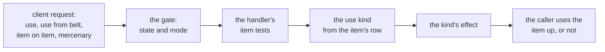
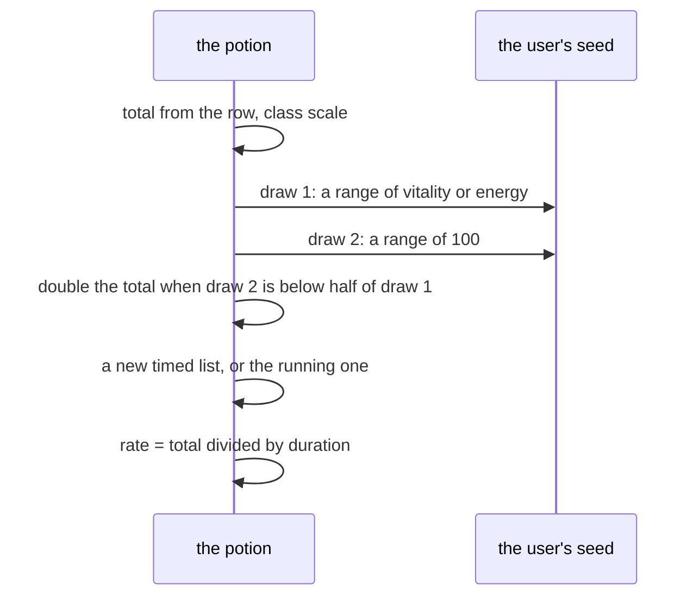
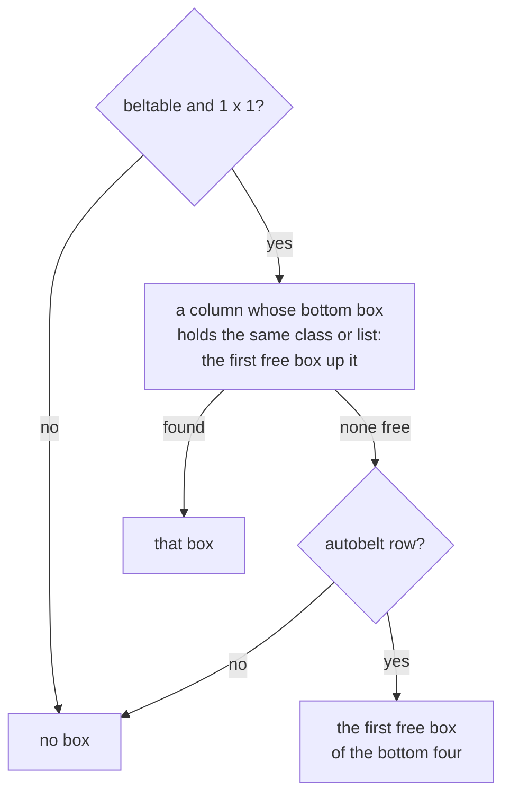
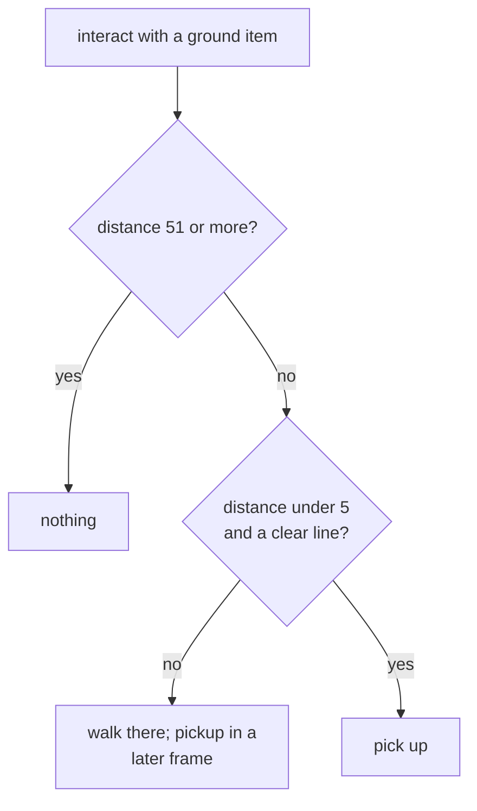
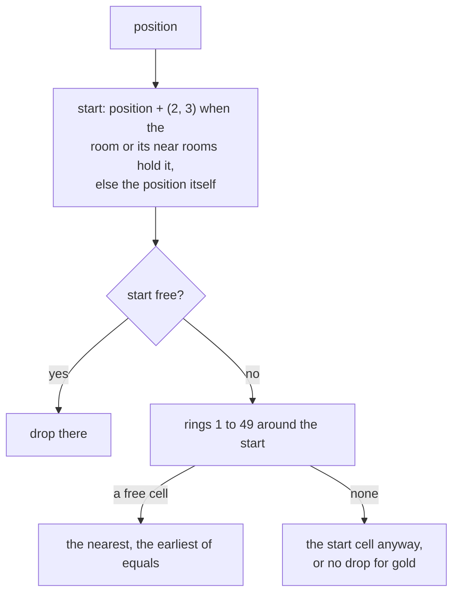
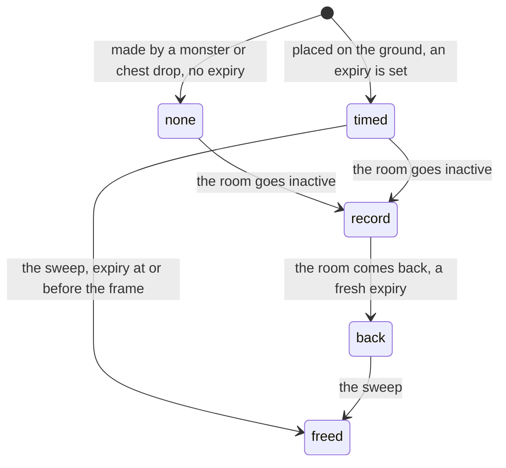

---
based_on:
  - docs/specs/items/use.md 2026-11-04
  - docs/specs/items/inventory.md 2026-11-04
---

# Using items, and the inventory

This page explains what the server does when a player uses an item (drinks a potion, reads a scroll, opens the cube),
where an item can go (the inventory, the stash, the belt, the cursor, the ground), how pickup and drop work, and how
long an item then lies on the ground. It restates two reviewed specs: [item use](../specs/items/use.md#purpose) and
[inventory](../specs/items/inventory.md#purpose). They describe the server's outcomes in game frames. What the screen
shows, trading between players and the cube's recipes are out of scope; the cube's transmute is on the
[other item paths](items-other-paths.md#the-horadric-cube) page.

## How sure each statement is

Most of this area is known in one of four ways, and the page names which at each statement. The specs spell out the
same split in their sections on [how to read the tags](../specs/items/use.md#how-to-read-the-tags) and
[the inventory's](../specs/items/inventory.md#how-to-read-the-tags). The differences matter here,
because the two sessions that played the game were small.

| Kind | What it is | Where it stops |
|---|---|---|
| **Seen in a game** | Two play sessions on the real game (a fresh process each, no forced state), with the server's calls logged and compared with a prediction. Seeds, amounts, cells and frames were read from the log. | They cover a few cases: 17 potion uses by one Sorceress, 80 ground drops, 118 ground searches. Each count is given where it is used. |
| **Emulated** | The game's own code run in an emulator on made-up inputs, and compared bit for bit with the project's model ([how we know](how-we-know.md)). It shows what the code does with the bytes it is given. | It is not a game. It says nothing about which inputs a game produces. Many runs stop at a named call into another function, and what is after that call is not covered. |
| **Read from the code** | The instructions were read, and nothing ran. | It can be wrong in ways no run has checked. |
| **Unknown** | Named under [What is not known yet](#what-is-not-known-yet). | |

Two further limits keep coming back. The gate in front of every request stops, in the emulator, at a call into the
operating system; nothing after it is evidenced. And the whole stretch from a handler to the end of its callees was
never followed for random draws; only the cases named below are bounded.

## Using an item

### The gate and the order of requests

Every client packet passes one gate first ([item use § A](../specs/items/use.md#a-the-drain-and-the-gate)).

- **Emulated:** the refusals. Packet 0, any packet above `0x66` and any packet with no handler are refused. Five packets
  skip the player-state test. A player who is in state 54 or in mode 0 or `0x11` is refused for the rest, and the one
  packet `0x41` passes only in mode `0x11`. This held over 428 cases without a mismatch.
- **Emulated, up to the call:** a packet that passes reaches the operating-system check of the handler's address in all
  106 cases tried. **What that check returns, and the handler's call after it, are read from the code, not
  evidenced.**
- **Read from the code:** two item requests in one batch of packets run in the order they arrived, each to the end, and
  the second sees the first's result; no item request is reordered, batched or rate-limited. The batch drops a handler's
  "no" answer, so whatever the handler did before refusing stays.
- **Read from the code:** the only item request that does not finish in the same step is a pickup out of reach. It
  starts a walk, and the pickup runs in a later frame ([pickup](#pickup)).

### What each request checks

All **read from the code** ([§ B](../specs/items/use.md#b-the-use-requests)):

| Request | Checks before using the item |
|---|---|
| Use an inventory item (`0x20`) | the packet is 13 bytes; the item exists, is in mode 0 and is found with the player; the player is within 50 of the stated position on each axis |
| Use a belt item (`0x26`) | 13 bytes; the item is in the belt; the position tested is the player's own, so the distance test cannot fail |
| An item on an item (`0x27`) | 9 bytes; both items are the player's |
| The mercenary button (`0x61`) | 3 bytes; an expansion game only; a cursor item that is not a quest item, the player alive and using no skill, and the pet of type 7 alive |

An item's row must also be marked usable for the first two. A usable row with no use kind passes that test and does
nothing: the item is not used up ([§ I](../specs/items/use.md#i-what-the-columns-gate)). Among the direct calls read,
the belt flag and the two warning columns gate no use; indirect callers were not followed.

### Which effect an item has

The game picks a **use kind** from the item. A tome or scroll with a row in the books table takes the kind from that
row; otherwise the kind is the item's `pSpell` column. The choice itself, with the kinds 1 to 30 and the empty
slots, was **emulated** over 600 cases ([§ C](../specs/items/use.md#c-the-dispatch-itemuse)); what each effect then
does is emulated only up to its first call into another function, except where noted.

| Kind | Stock items | What the effect does | How it is known |
|---|---|---|---|
| 1 | `isc`, `ibk` (identify) | identifies an item, in two requests | emulated to the first call; the rest read |
| 2 | `tsc`, `tbk` (town portal) | opens a town portal for a player; refused in town and on level 136 | read ([quests](quests.md)) |
| 3 | `hp1` to `hp5`, `mp1` to `mp5` | a total amount spread over a duration, with a chance of double | emulated to the first call; the two draws and the stored rate also seen, [below](#healing-and-mana-potions) |
| 4 | none | kind 3's loop without the class scale and the draws | emulated to the first call; no stock item has it |
| 5 | `rvs`, `rvl` | a percent of the maximum, at once | emulated to the first call |
| 6 | `yps`, `wms` | clears the named states, then acts as kind 9 | read |
| 7 | `box` (the cube) | opens the cube; never used up | emulated to the first call |
| 8 | `elx` | adds a stored stat to a stat | emulated to the first call |
| 9 | `vps`, `hrb` | a timed state, with the group clear | read |
| 10, 11 | none | cast skill 47 at level 1 | read; draws not looked at |

The draws of every kind before its first call into another function are listed [below](#random-draws).

### Is the item used up?

An effect never removes the item; **the request's handler does**, by the effect's answer. All of this is **read from
the code**; no emulated case enters these functions, and the sessions logged outcomes only for the potions below
([§ D](../specs/items/use.md#d-consumption-in-the-callers)).

- A scroll or potion with a non-zero answer takes one off the matching skill's quantity, then is removed. A tome with a
  skill and charges left loses one charge and stays.
- A zero answer uses nothing up. Four quest items (by code `ass`, `xyz`, `tr2` and `toa`) have their own branch,
  which applies when the answer is zero and removes the item.
- A belt use shifts the remaining items of that column down. An item used on an item from the belt does not shift its
  column, and a belt scroll used on a target that is not in a grid is removed unused.
- The mercenary button removes the cursor item whatever the answer was.
- Using the cube never uses it up. A first identify request uses nothing: it only opens the prompt. The second request,
  on an unidentified item in the player's own inventory, identifies it. The second request does not clear the
  "use mark" that the first set, so that mark stands until one of 24 other functions, the moves among them, clears it, and a second request
  after such a move runs the first step again.

### Healing and mana potions

This is the best-evidenced part of the item use. The amount of a potion is a **total**, not a per-frame number
([§ F](../specs/items/use.md#f-kinds-3-and-4-the-amount-and-the-two-draws)).

- **Two draws, then the doubling.** A life or mana potion with an amount draws on the user's seed twice, a range up to
  the character's vitality and then a range of 100; a mana potion uses the energy. The total doubles when the second
  number is below half the first, so the chance rises with vitality or energy (read from the code: about 2.0 % at 10, 24.5
  % at 100, 37.0 % at 150, 49.5 % at 200). The draws come before the amount test and happen for an amount of zero too.
  **Seen in a game, 17 of 17 uses:** 12 health potions and 5 mana potions of a Sorceress at vitality 165 and energy
  150 made exactly these two draws, and the seeds before and after, the draws' results and the amount equalled the
  prediction in all 17. The seed chains from each use's return to the next one's entry, so nothing else drew on it
  between them. The prediction was evaluated per case on the logged inputs, so this checks the code against its reading
  on those inputs; it does not say which inputs occur.
- **The doubling by potion.** The health potion showed both outcomes (6 doubled, 6 not, in 12 uses), and the prediction
  agreed with the logged amount in all 12. **The mana potion showed only "not doubled", 5 of 5. Its doubled branch has
  not been seen in a game.** At an energy of 150 the chance is about 37 %, so five misses in a row happen about one time
  in ten; this batch does not say that a mana potion never doubles.
- **The rate.** The total is stored as a rate per frame, truncated: total divided by the potion's duration. **Seen in
  16 of 16 uses on a fresh list:** 7 680 or 15 360 over 192 frames gave 40 or 80 for `hp1`, and 10 240 over
  128 gave 80 for `mp1`. The list's end was the frame plus the duration. Scope: `hp1` and `mp1` of a Sorceress. Because
  of the truncation, a potion can deliver less than its total: `hp3`'s 100 life over 171 frames is a stored rate of
  149 per frame and 99 life in all (read from the code).
- **The class factor.** The code scales a life amount by one and a half (by a shift, so an odd amount rounds down) for
  the Amazon, Paladin and Assassin, by 2 for the Barbarian and for monsters, and by 1 for the others; a mana amount by
  one and a half for the same three, 2 for Sorceress, Necromancer and Druid, and 1 for the Barbarian. This was **emulated** over 800 cases. **In a game only the Sorceress ran**
  (her health factor 1, her mana factor 2). So `hp1`'s 30 is 30, 45 or 60 life for a Sorceress, an
  Amazon or a Barbarian, on the reading.
- **A potion at full life** was used, not refused: the list and rate were set and the answer was 1. One case, `hp1`.
- **Seeds around the request.** The player's seed moved across each of the 12 inventory requests and the 5 of the 6 belt
  requests that used a potion; the game seed moved across none. The sixth belt request was a rejuvenation (`rvs`, below). This bounds those two seeds only, not other units'.
- **A second potion while the first runs** is the open case. The code is read to reuse the same list, ending at now
  plus what the first has left plus the duration, with the rate blending the first's undelivered part and the new
  amount. In the game, **the second use found the first list in 1 of 4 pairs** (33 to 43 frames apart); the other three
  started a new list. The reading of what decides it is the life or mana meter: the game frees the potion's list when
  the meter reaches its maximum. In those three pairs the first potion was used at the maximum, and by the second use
  no potion list was contributing. The free itself was not logged. **The blend of two different amounts was not separated:** the one blended
  use has the same potion twice, where the blend and a plain division give the same 40. It is [open](#what-is-not-known-yet).
- **A healing or mana potion does not clear states** (no group clear); only kinds 6 and 9 do (read from the code).

A health potion can also feed a Blood Golem: for a positive life amount on a player with a golem, a percentage
share of the amount goes to the golem and the player keeps the rest. This was **emulated** (300 cases) up to the golem
heal and not seen in a game (the 17 uses had no golem).

### Rejuvenation, elixirs, keys

- **Rejuvenation** adds a percent of the maximum life and of the maximum mana at once: 35 for `rvs` and 100 for `rvl`,
  capped so the stat does not pass its maximum. **Emulated** to the first call. Read from the code: a rejuvenation at full life still
  returns "used", so it is used up. A belt `rvs` was used once in a game and did not move the player's seed; that is one case.
- **The elixir** adds the item's own stored stat to a stat chosen by the item's file index and does not read the
  columns the other kinds do. **Emulated** to the first call (200 cases). How an elixir reaches a player, and what writes its file index and stat, are not known.
- **Keys** have no use entry. A key is taken by the chest (and by one case of the object mode switch), which uses the
  first key on the inventory page: one fewer in the stack, or the key removed. **Emulated** (300 cases), up to the
  stat change or the removal. The Assassin's skip
  is read for the chest only.

## Where an item can go

### Pages

An item sits in a unit's **inventory** in one of five modes ([§ A](../specs/items/inventory.md#a-pages-and-rows),
read from the code): on a page, on the body, in the belt, on the ground or on the cursor. A player has pages for the
inventory, the cube, the stash and two for trading.

- **The stash is 6 wide and 8 high in an expansion game, and 6 by 4 in a classic one. Emulated:** 400 cases.
- A page is created on its first use from the size given then. A later request with another size returns nothing, so
  nothing is placed (read from the code; no run reaches it).
- The grid sizes are read as bytes. Emulated: a wider reading fails 2 465 of 4 000 searches.
- The grid row follows the unit and the page (**emulated**): a monster, a hireling too, uses one row, and two object
  classes have their own. No path to those two object classes was read, and the table's hireling rows are never
  returned (read from the code).

### The placement search

When an item is put on a page without a cell, the server searches the grid ([§ B](../specs/items/inventory.md#b-the-placement-search)).
**Emulated**, 4 000 cases without a mismatch, and 112 distinct outcomes:

- For a **player**, an item one cell high takes the free spot scored best, columns from the right and each from the
  bottom, and an item taller than one cell takes the best by rows from the top, each from the left. The score is how
  many neighbouring cells, or edges of the page, are filled; a tie keeps the earlier spot. On an empty page the
  one-cell-high item goes to the bottom-right corner, a taller one to the top-left.
- For **any other owner** (a hireling, a monster, an unowned inventory) the first spot that fits wins: one cell high,
  columns from the right and each from the top; otherwise columns from the left. So a player's search and a hireling's
  differ.
- The early stop at a perfect score changes no output, and a reimplementation may leave it out.
- A small worked case, from the project's model of this search (**not logged in a game**): five 1 × 1 items in turn on
  an empty page 10 wide and 4 high go to the last column (index 9), bottom up (rows 3, 2, 1, 0), and then to the column before it at row 3.
- Placing by cell and the refusals of an occupied cell or one out of bounds were emulated as the search is used, 500
  cases. A scroll or tome placed on a page other than the stash adds its skill quantity; one placed in the stash adds
  nothing (read from the code).

### Moving between places

The client's requests that move an item are read, not run ([§ D](../specs/items/inventory.md#d-the-requests)):

| Move | Request | Note (all read from the code) |
|---|---|---|
| ground to cursor or inventory | interact (`0x13`, `0x16`) | [pickup](#pickup) |
| cursor to the ground | `0x17` | [drop](#dropping-to-the-ground) |
| cursor to a page | `0x18` | sets the page first, then places |
| a page to the cursor | `0x19` | needs an interaction for any page but the inventory |
| equip, swap with a body location | `0x1A` to `0x1E` | |
| swap with a page item | `0x1F` | |
| stack | `0x21` | [stacks](#stacks) |
| cursor to belt, belt to cursor, swap | `0x23`, `0x24`, `0x25` | [belts](#belts) |
| inventory item to belt | `0x63` | first free box |

Seen in a game: **`0x19` (item to the cursor) moved neither the player's nor the game's seed, 80 of 80 request pairs**,
and the cursor drop `0x17` likewise (80 of 80). This bounds those two seeds around the handler only. By the reading,
a stash page that the packet names needs no open stash for a **placed** item: the item is on the cursor, so the
"busy" test passes. **One forced case ran** (in the first session): a placement to the stash page in town with no stash
open was accepted, but only after the page field was written into the packet by a debugger, which the real client
cannot send, so it stays a reading.

### Belts

- **Emulated**, 2 000 cases to the return: the belt's free box. Only a beltable one-by-one item goes in. A column is
  chosen if its bottom box holds an item of the same class, or of the same group (the health potions, the mana
  potions, the rejuvenations); the item goes to the first free box up that column. If none, an item whose row allows
  it goes to the first free bottom box. The number of boxes comes from the worn belt's row, or from the default row when
  no belt is worn (four boxes).
- A row that does not allow it (`isc`, `tsc`, `yps`, `vps` and `wms` among them) is in no group, so it joins only a column whose bottom box holds its own class (read from the code).
- A pickup that goes to the belt always uses this search (read from the code).
- Taking an item from the belt shifts its column down; a swap is in place; both **read from the code**.
- **At a corpse's making** (read from the code, **not run**), a belt moved off the body is treated as the default belt:
  boxes beyond its four go to the inventory page by the placement search, and to the ground if they do not fit. A community
  text about the remastered game says the same, and a death with a belt holding items above the fourth box is among the
  [cases left open](#what-is-not-known-yet).
- **One forced case:** a belt placement to box 12 of a 12-box belt stayed in box 12, after the box field was written into
  the packet by a debugger. The stock route, and whether a smaller belt's overflow later takes the item, were not run.

### Stacks

Two items stack when (read for the tests, **emulated** for the function, 660 cases with each test broken alone) they
have the same class, quality and file index, the row is stackable, the ethereal status matches, the quality is not 0
and not one of 4 to 9, and a handful of stats match ([§ G](../specs/items/inventory.md#g-stacks)). The maximum is the row's
maximum plus a stat, capped at 511. A merge over the maximum fills the target to the maximum and leaves the rest on
the cursor; otherwise the target takes the sum and the source is freed (the sum itself was **emulated** up to the
first stat write, 500 cases; the remainder is read).

**There is no split on the server, as far as the request rows read:** the split request reaches a stub that does
nothing. Gold's withdraw and drop are other requests and were not part of that reading.

## Pickup

All of this section is **read from the code** ([§ I](../specs/items/inventory.md#i-pickup)), except where noted.

- **Reach.** The distance from the player to the item uses a table for near units and a different formula for far ones.
  **Emulated**, 1 500 cases without a mismatch: a player to an item reaches "under 5" at 22 of the 64 offsets under 8
  (a column offset of 0 to 2 with a row offset of 0 to 4, and so on). The sizes were run for a player, an item and an
  object; a monster and a missile were not. The thresholds themselves (under 5 to pick up, 51 or more to do nothing)
  are read.
- **The line** between the two must be clear for a pickup in place. The code that shortens and tests the line was
  **emulated** (600 cases) as far as the collision test itself, whose result belongs to the
  [collision page of the specs](../specs/drlg/collision.md); a player's collision mask was declared, not read from a game.
  The two tests run again when the walk ends.
- **The order a pickup tries.** Gold; an auto-stack into a tome, a stack or a quiver; then an auto-equip location if
  the item names one (for example an arrow quiver to a hand that holds a bow); the belt for a beltable item; the
  inventory page by the placement search; and if all fail, the item goes back to the ground and nothing moves.
  Note that a location that the equip test then refuses gives up on the pickup: it does not fall back to the belt or the
  inventory.
- **Who dropped it is not among the tests read** in the pickups, and the "no pickup" flag was not found read there
  either; the scope is those two functions and their direct callees' first level.
- **A merge's remainder** stays the same item with a reduced count and goes on down the list; with no room it is put
  back on the ground with that count, and the stacks it merged into keep what they took.
- **Gold and the party's share** are on the [prices page](economy.md#gold).
- Taking an item to the cursor (not the inventory) follows the same first tests and then moves it to the cursor.

## Dropping to the ground

When a player drops the cursor item, or the game drops an item for a monster, a chest, a belt that overflows, a cube
that is dropped or a corpse, the same **free-cell search** picks the cell ([§ J](../specs/items/inventory.md#j-the-ground-drops-cell)).

**Emulated, 4 000 cases without a mismatch (55 distinct outcomes), with the search at size 1 and step 1**, and given
that the memory the code asks for was handed over. It is the code's map on declared rooms, not a game:

- The search starts at the position plus (2, 3), when the room or one of its near rooms holds that cell, and at the
  position otherwise.
- A cell is **free** when it holds none of a set of blockers, one of which is another ground item, **and** a walk from the
  origin to it meets no blocker. A cell holding another item is refused as a place to drop, but does not stop the walk
  across it. Two bits of the first test are not told apart by any output at this caller.
- It then looks at rings 1 up to **49** (ring 50 is never looked at). In a ring it takes the side columns first, then the
  end rows, and keeps the lowest sum of the two distances, the first one met among equals.
- The room used to find each cell is the last room the previous lookup gave, not the room dropped from. **Emulated only:
  no game search has separated this** (a fixed-room reading fails 95 of 4 000 emulated cases and none of the 118
  logged searches).
- With no free cell, a drop takes the start cell, blocked or not, in the room the last lookup gives; with the fallback
  off the search answers with nothing and keeps the start. Those branches were **not reached in a game**. That a gold
  amount's pile is not dropped when no cell is free is read from the code.
- The walk follows a direction field from the data file `expfield.d2`. Over the whole file, every cell walks to its
  centre in as many steps as its larger offset (checked on all 65 536 cells).

**Seen in a game:** 118 searches over three logs (37 in the first run, 41 and 40 in the second) matched the model, with no
mismatch. **They are not 118 independent cases.** A player's drops are chains in place: each drop blocks the next, at six
spots (6 and 4 in the first run; 24 at the start, 12 at the parapet, 4 in the City of the Damned and 40 at the crowd
spot in the second), and the other 28 are monster or chest drops at 24 positions. The rings reached in the logs were:
the start cell 27 times, ring 1 31 times, ring 2 32, ring 3 21, and ring 4 or beyond 7. A drop in a crowd shows the walk
test mattering (without it 31 of the 40 searches at the crowd spot would come out differently). The walk's path itself, a full surround and a null result
were not reached in a game.

A worked case from the crowd session: a player standing at (5032, 5027) in the Act IV town drops six items in a row.
The start is (5034, 5030). They land in turn on (5034, 5030), (5033, 5030), (5035, 5030), (5034, 5029), (5034, 5031) and then on
(5033, 5029), the first corner at distance 2 in the search's order.

Who drops with this search is **read from the code**: 20 direct callers (monster and chest drops, the cursor drop, the
belt overflow, the cube's contents, a corpse's overflow, NPC menus, shrines), all with size 1 and fallback on; the pair form of the search has 7 direct calls, among them four item-drop bodies, a gold amount (fallback off) and the
town portal (size 3, fallback off).
A drop whose room is null (the search's answer) leaves the item on the cursor or makes no item, depending on the
caller.

## How long an item lies on the ground

([§ K](../specs/items/inventory.md#k-a-ground-items-life))

An item on the ground has an **expiry frame**, or none. There are three lives, which are **read from the code** until a note below lifts part of one:

| How it got to the ground | Its expiry | In a room that stays active |
|---|---|---|
| made by the item-creation function for a monster's or chest's drop (and a gold pile) | none (0) | never swept |
| placed by the game's ground-placement function: a player's drop, an overflow, a gold amount, NPC menus, the cube's | the frame plus 15 000, 30 000 or 45 000 (below) | freed at the first multiple of 1 500 at or past it |
| restored when a room comes back | the larger of its saved word and now plus 15 000 | as the second row |

- **The amounts** (the rule is **emulated**, 600 cases): a quest item has no expiry; quality 4 and a socket filler (a
  gem, rune or jewel) get 30 000 frames; qualities 5 to 9 get 45 000; gold gets 45 000 above 10 000 gold and 15 000 below; all
  else 15 000. At 25 frames a second 15 000 is 10 minutes. **Seen in a game, 80 of 80 drops, in 21 groups of base and
  quality:** 15 000 for qualities 1, 2 and 3 (potions, rings), 30 000 for quality 4 and for the filler, 45 000 for
  qualities 5 to 8. **Not run:** gold, a quest item, quality 9 and a socketed item. No stock path makes a quality-9
  item.
- **The sweep** runs every 1 500 frames over the active rooms and frees an item whose expiry is at or before the frame.
  Its period and its order were **emulated**, up to the first item reached; its test was emulated in 600 cases, where
  "before the frame" instead of "at or before" fails 92 and "zero expires" fails 69. **Seen in a game, 4 of 4:** a player's quality-2 drop, dropped at
  frames 3 659 to 3 863, was freed at the sweep of frame 19 500, with five monster drops beside them still there at
  21 000 and 22 500. Scope: quality 2, one sweep, a room that stayed active. Six more predictions were excluded because
  the room had gone inactive and its activity was not logged. By the reading, the item falls up to 1 499 frames after
  its expiry.
- **A monster's or chest's drop has no expiry, in the cases that ran.** **Seen in a game:** 27 of 27 drops made through
  the drop function had an expiry of 0 when made, and five of them (followed for 12 to 14 sweep dumps each, 79 sightings
  in all) were never freed. Scope: that path, those 27 creations and 5 items. The log does not tell a monster's drop from
  a chest's, and the session's source was kills. "Never swept" stays a reading for a longer life, for gold piles and
  for any copy of an item.
- **When a room goes inactive and returns**, an item's saved word is **computed afresh**, as if it were dropped now,
  not the old expiry: **seen, 45 of 45** (one monster drop with 0 before, and 44 player drops). So leaving a room can
  lengthen any item's life, a player's drop too. On return the new expiry is the larger of that word and the current frame
  plus 15 000: **seen in 40 of 40** (26 got the frame plus 15 000 and 14 got the saved word; 36 restores in the town and
  4 in the City of the Damned). A saved word of 0 staying 0 and a word equal to the limit were not seen. A restored copy
  was swept at the first multiple at or past its expiry in 22 of 22 that resolved. 14 more have their expiry after the
  session's last dump and are unresolved; 4 were saved again before their predicted sweep and are excluded, as are the
  40 town drops of that session, and the 40 crowd sweeps are unresolved. In the first session, three monster drops
  whose room went inactive came back with an expiry that was not predicted; the reading above is stated for that
  session as read, because it did not log its inputs.

## Random draws

Almost nothing in this area draws a random number of its own ([§ J of use](../specs/items/use.md#j-draws-per-seed),
[§ L of inventory](../specs/items/inventory.md#l-draws-per-seed)). What is established, by how:

| Path | Draws | How it is known |
|---|---|---|
| Healing and mana potions | 2 per life or mana amount slot with vitality or energy above 0, on the user's seed | emulated before the first call; seen for 17 uses |
| Kinds 4, 5, 8, identify (both requests), the cube, a key | 0 before the first call into another function | emulated; nothing after the first call is covered |
| Kinds 2, 6, 9 | 0 in the entry's own body | read, direct calls |
| The gate | 0 on this path | read |
| The placement search, belts, stack tests, the grid rows | 0 to their returns, no traced access to a unit's seed | emulated |
| The ground search, walk, expiry and distance | no seed is given | emulated to the return; the wider closure read |
| Cursor drop and item to cursor | the player's and the game's seeds unchanged | seen, 80 of 80 pairs each |

Beside the search there are draws: a chest-spawner missile draws twice on its unit's seed for an offset, two shrines step a
unit's seed, and a target player's belt item taken to the ground draws once and may then stop (read from the code; an
inline scan of the 20 callers; calls to the random functions inside them were not scanned). **No move's own body holds a
draw, but a whole move's bound is open:** the closures under the moves hold 2 096 to 2 122 functions, 118 of which hold a
seed step, with indirect calls unfollowed. And a monster's drop inside a death: no seed trace through the drain was built;
how the item itself is made is on the [items page](items.md).

## What is not known yet

From the specs' open questions ([use](../specs/items/use.md#open-questions),
[inventory](../specs/items/inventory.md#open-questions)). The owner decided that no third play session is run, so the
first three stay open.

- **The blend of different amounts.** What a second potion of a different strength does while the first runs, with the
  meter below its maximum both times, is a reading; the one blended use in the game had the same potion twice. The free
  of a potion's list at the maximum was not logged either.
- **Potion types for the hireling.** The reading is that a mana potion given to the mercenary by the belt flag or by the
  mercenary button is refused: only three potion types pass the code's test, and the mana potion's type is not one of
  them. It was not run. A community text says a hireling takes health, mana and rejuvenation potions; the reading and
  that text disagree, and 1.14d has not been tried.
- **A death with a belt holding items above the fourth box.** The reading is that they go to the inventory, then to the
  ground; not run in 1.14d.
- **The mana potion's doubled branch** in a game (5 of 5 seen undoubled); a Barbarian's, Amazon's and Paladin's factors,
  mana for a Barbarian; the greater health potion; a rejuvenation on a maximum above 4 096.
- **Other use cases never run:** the group clear on the antidote, thawing potion, stamina potion and herb; the Blood
  Golem split; both identify requests; a belt identify scroll and the town portal's column shift; the cube; a usable row
  with no kind; a key on a chest and a door; a potion to the mercenary; a use while trading; the elixir; the four quest codes.
  What the items' use does after the first call into another function is unbounded for draws, apart from the 17 uses.
- **Ground cases never run:** two requests in one batch, requests from a dead player, pickup at the edges of the reach
  and behind a wall, a stack remainder on the ground, a scroll into a tome, auto-equip, a dropped cube and the chest
  spawner's two draws. A drop at the seam between two rooms in a crowd, a full surround and a null result, and a drop at a
  room's edge are only emulated.
- **Expiry cases:** gold's 10 000 boundary, a quest item, a socketed item, a sweep's removal message and seed, qualities
  above 2 on a first drop, a longer life for a monster's drop, whether a chest's drop was among the 27.
- **Stock routes of two forced requests:** the stash placement with no stash open and a belt box beyond the belt's
  count each ran only with a written packet field.
- **What an elixir's value comes from** and which object classes the two last grid rows belong to are not known.
- Trading is not specified in either spec.

Two community texts differ from 1.14d, and the specs keep the code's reading. One says the belt table's box rectangles
are "for server verification": by direct calls no 1.14d server code reads them. The other says potions are scaled by
class columns of a table: 1.14d's table has no such column, and the scale is in the code, as above.

## Where to read more

- The specs: [item use](../specs/items/use.md) and [inventory](../specs/items/inventory.md), each with its worked example
  ([a pair of potions](../specs/items/use.md#worked-example), [a chain of drops](../specs/items/inventory.md#worked-example)) and
  reimplementation notes ([use](../specs/items/use.md#reimplementation-notes),
  [inventory](../specs/items/inventory.md#reimplementation-notes)).
- Related pages: [items](items.md) (how an item is made, which a monster's drop starts with), [other item
  paths](items-other-paths.md) (socketing, the cube, vendors, quests), [prices, repair, gold and wear](economy.md)
  (quantity, wear and gold), [stats and states](stats-and-states.md) (how a potion's rate reaches life and mana),
  [quests and travel](quests.md) (the town portal), [randomness](randomness.md), [how we know](how-we-know.md) and the
  [glossary](../glossary.md).
