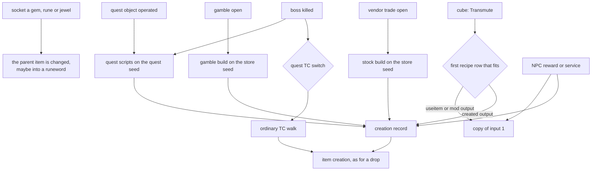
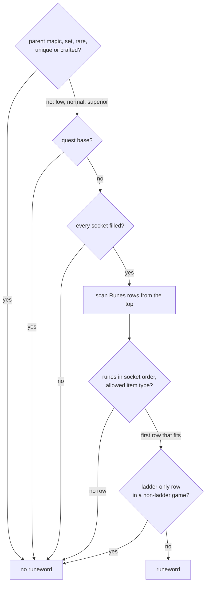
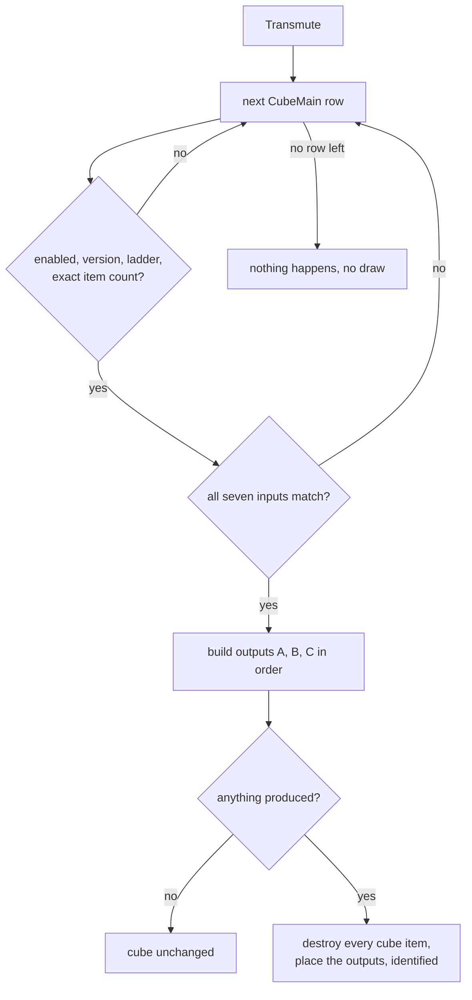
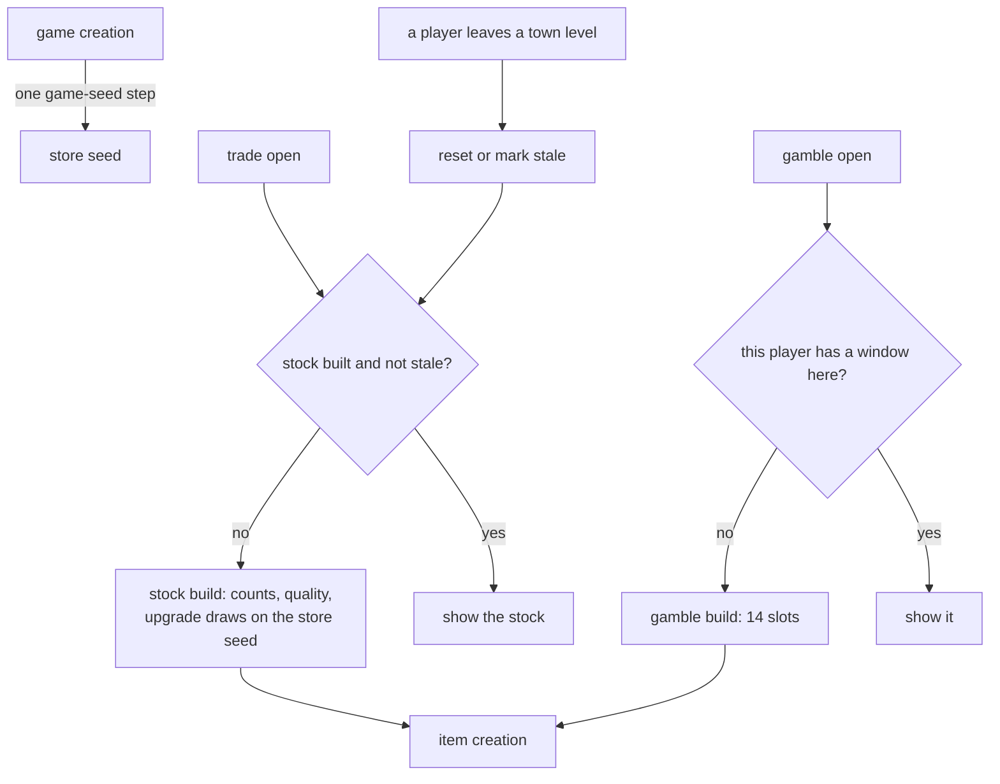

---
based_on:
  - docs/specs/items/sockets-runewords.md 2026-10-17
  - docs/specs/items/cube.md 2026-10-17
  - docs/specs/items/vendors.md 2026-10-17
  - docs/specs/items/quest-drops.md 2026-10-17
---

# Items that do not come from a monster drop

A monster drop is only one way an item comes into the game. This page covers four others: putting gems, runes and
jewels into sockets (and the [runewords](../glossary.md) that can result), the Horadric Cube, vendors and gambling, and the items that
quests drop or give. Each of these paths either calls the same item creation as a drop, with a different starting
record, or changes an item that already exists. The shared machinery (the [treasure class](../glossary.md) (TC) walk,
the quality roll, uniques and sets, affixes, [base stats](../glossary.md)) is explained on the [items](items.md) page and is not repeated
here. This page restates four reviewed specs:
[socket filling and runewords](../specs/items/sockets-runewords.md#purpose),
[the Horadric Cube](../specs/items/cube.md#purpose),
[vendor stock and gambling](../specs/items/vendors.md#purpose) and
[quest drops, quest rewards and special drops](../specs/items/quest-drops.md#purpose).

## The big picture

Every path below ends in one of two places. Either it builds a creation record (a base, an [ilvl](../glossary.md), a
quality, sometimes [forced affixes](../glossary.md)) and hands it to the ordinary item creation, or it copies or edits an item the
player already has. What differs between paths is who makes the choices and which [seed](../glossary.md) they
[draw](../glossary.md) on:

| Path | Who chooses | Seed the choices draw on |
|---|---|---|
| Socketing | the player picks the child and the order | the completing rune's own [item seed](../glossary.md) (runeword rolls only) |
| Cube | the first matching recipe row | the [game seed](../glossary.md) for new items, then each item's own seeds |
| Vendors and gambling | the stock and gamble builders | the [store seed](../glossary.md), one per game |
| Quests | a boss's [quest TC](../glossary.md), or a quest script | the dying monster's seed (TC walk) or the [quest seed](../glossary.md) |

In every path that creates an item, the item's own unit seed and item seed come from two steps of the game seed, as
they do for a drop ([cube § M](../specs/items/cube.md#m-draws-per-output-kind),
[vendors § F](../specs/items/vendors.md#f-the-creation-record-items_createforstore-and-the-item-seeds),
[quest-drops § C](../specs/items/quest-drops.md#c-the-two-creators-of-scripted-items)).

## Socketing and runewords

When the player drops a gem, rune or jewel (the [socket filler, or child](../glossary.md)) onto a socketed item (the
parent), the client first checks that the request makes sense, then the server checks again and decides
([sockets-runewords § A](../specs/items/sockets-runewords.md#a-the-client-test),
[§ B](../specs/items/sockets-runewords.md#b-the-server-insert-the-refusal-list)). The server's list of refusals is the
authority. A test run saw the whole chain pass hundreds of times, and saw one server refusal: an unidentified jewel,
which the client lets through because the client does not test the child's identified flag. The other server
refusals (child not on the cursor, parent not identified, child not a socket filler, parent not socketed, parent
full, and so on) are read from the code and were never seen failing.

Some things are *not* tested at all. The insert does not look at the parent's quality, its item class or the game
type. Low, magic, rare and [crafted](../glossary.md) parents all accepted children in the test run, and a rune went into a helm in a
classic game. The code has no level-requirement test for the child either, but that is read from the code only: no
rune in the run was above the character's level. One single case also suggests that an unidentified socketed item
looks "not socketed" to the client until it is identified.

**Socket order is insertion order.** Each child goes to the end of the parent's list of children, and that order is
the one a runeword is compared against
([§ B](../specs/items/sockets-runewords.md#b-the-server-insert-the-refusal-list)).

**What a child brings** ([§ C](../specs/items/sockets-runewords.md#c-what-a-gem-rune-or-jewel-brings)). A gem or rune
applies one of three property groups from the `Gems` table, chosen by the *parent's* base: a weapon takes the weapon
group, body armour and helms take the helm group, shields and the other shield types take the shield group. The properties are written onto the
child's own stat list, which is then linked to the parent, so the parent sees them through the link. On the stock
data no gem or rune property needs a random roll, so an insert that does not complete a runeword moves no seed at
all. A jewel applies nothing at this point: its properties were rolled when the jewel itself was created.

### When the children make a runeword

After every insert the game checks the `Runes` table for a matching runeword
([§ D](../specs/items/sockets-runewords.md#d-the-runeword-match)). Only a full item can match: until the last socket
is filled the count of children differs from the socket count and the check stops.

- Low-quality and superior bases make runewords, as normal ones do; magic, set, rare, unique and crafted bases never
  do. [Ethereal](../glossary.md) is not tested: an ethereal normal sword made *Steel* in a save the game itself wrote.
- A quest base never makes one (*Wirt's Leg* made none in the run).
- The runes must be in the row's order: the right runes in the wrong order, or in the wrong item type, matched nothing.
  Item type equivalences count, so a row for "weapons" accepts every weapon.
- A row marked for the ladder (*Spirit* in the run) makes no runeword in a non-ladder game, and the insert still
  succeeds. That it does apply in a ladder game is read from the code: no ladder game was run.
- A classic game accepts runes in sockets (confirmed) but forms no runeword. That second part is read from the code and
  the data, not seen in a run: the match has no game-type test, and every rune is an expansion item, so no row is
  classic-legal.
- *Patience* never forms: its row is not marked complete, and the match skips every incomplete row. That is checked
  against the stock table. *Passion* and *Patience* share one name, so the name a runeword shows only ever comes from
  *Passion*.

A quirk in the bound check means a row with exactly one rune more than the item has sockets compares that extra rune
against a leftover memory slot. Read from the code, such a row matches only if the leftover happens to hold that
rune's [item index](../glossary.md); the single logged case did not match. The slot holds whatever the code that ran
before at the same depth of the call stack left there, so a false match would need an earlier match check on a fuller
item, not chance. What it holds in a given game cannot be worked out from the code alone; only a run could show it.

### What the runeword rolls

When a row matches, the parent is marked as a runeword and gets one new stat list with the row's lines, applied in
column order ([§ E](../specs/items/sockets-runewords.md#e-the-runeword-flag-list-and-rolls)). The lines that have a
range are rolled on the **item seed of the child whose insert completed the word**, not on the parent's seeds and not
on the game seed. Two consequences matter to a player:

- The property handlers treat the *rune* as "the item". So `ac%` on a runeword does not reset the parent's base
  defense the way it would on a magic item, `dmg-min`/`dmg-max` write all three related damage stats, and *Famine*'s
  ethereal line never makes the parent ethereal (all confirmed by a run or a game-written save). The indestructible
  line and a few other handler branches are read from the code only, because no runeword that uses them was made in
  the run.
- A rune loaded from a save starts with a fixed item seed derived from its saved start value, so the same save with
  the same insert order gives the same rolls.

Charged skills still draw their roll, and then a player-made runeword has its charges refilled to the maximum.
That refill is confirmed for the insert a player makes; that the save reader does *not* refill is read from the code.
A runeword loaded from a save is not rolled again: read from the code, the reader rebuilds the parent with its saved
lists first, so the match finds the runeword list already present
([§ E](../specs/items/sockets-runewords.md#e-the-runeword-flag-list-and-rolls)). The save does not name the runeword's
row either: the writer runs the match again and saves that row's name index, and the reader keeps the number without
looking a row up; the row of a loaded runeword is always found again from its runes (read from the code;
[sockets-runewords, *Inputs*](../specs/items/sockets-runewords.md#tables)). Also read from the code only: a
loaded item still marked as a runeword whose row no longer matches is discarded
([§ G](../specs/items/sockets-runewords.md#g-in-the-save)).

### Socket counts

There are two ways an item gets its number of sockets
([§ F](../specs/items/sockets-runewords.md#f-socket-counts-the-two-setters)). At creation (a drop, the cube, a quest
reward) the count is capped by the inventory size, by 6, by the base's maximum, and by quality: magic at most 4, rare
at most 2, crafted at most 3, sets and uniques 1 (or the count they already have). Those quality caps are read from the
code; the socket test run did not execute them. A count loaded from a save is kept as it is, above those caps: a magic
crystal sword with 6 sockets loaded with 6 and took 6 children.

## The Horadric Cube

Pressing *Transmute* runs a scan over the `CubeMain` table, in row order. The first row whose header conditions and
seven inputs fit the items in the cube is the recipe, and the scan stops there
([cube § A](../specs/items/cube.md#a-the-transmute-and-the-row-scan--cube_transmute)). This is a
[transmute (cube recipe)](../glossary.md).

**The row filter.** A few rules decide which rows can be tried at all:

- The item count is exact. Each stack counts as one item, and on the stock data every row expects exactly the summed
  quantity of its inputs, so one extra item in the cube refuses every recipe.
- A classic game skips expansion rows.
- **Ladder rows work in single player.** The rune upgrades and the two elite unique upgrades are marked for the ladder,
  but the skip only applies to a game type that single player is not, and the run made those runes offline.
- The five disabled rows can never be reached; this is read from the code (the switch that would enable them is never
  set).

**The inputs** ([cube § B](../specs/items/cube.md#b-the-inputs--sub_005658c0_cubematchinputs-and-cube_matchinput)).
Inputs are taken in column order, and an input claims *every* matching item in the cube, not just its quantity, then
compares the count. An input can ask for a base code or an item type, a quality, sockets or no sockets, ethereal or
not, a tier (normal, exceptional, elite); the "ethereal" test and the exceptional and elite tests are read from the
code only, as no run reached them. On the recipes that need it, a quest item is tested against the difficulty:
Wirt's Leg matches only if its quest-difficulty stat is at least the current difficulty. A leg with that stat at 0
matched no row in Nightmare, one at 1 did; in Normal every leg passes. Read from the table, the same test binds the
Staff of Kings, the Viper Amulet, Khalim's Flail and Khalim's organs. A recipe whose output
adds a socket refuses a first input that cannot hold sockets (a rare amulet stayed unmatched). The rows' optional
player tests (day of the month, stats) are read from the code only; no stock row uses them. Some of the stat tests
(on the player, and on the first input) compare not the stat itself but its bonus over the base value (from items, skills and states); that reading is from
the code too.

That a stackable item relaxes the exact count is also read from the code.

### What an output can be

Outputs A, B and C are built in that order. The output ilvl comes from the row's `lvl`, `plvl` and `ilvl` columns: a
fixed `lvl` wins; otherwise a percentage of the player's level plus a percentage of **input 1's** ilvl, each truncated,
at least 1 ([cube § D](../specs/items/cube.md#d-the-output-ilvl)). Capping that value at 99 is read from the code; no
transmute reached it.

| Output kind | What it does |
|---|---|
| a fixed item code, an item type, or `usetype` | a new item through ordinary item creation, with the row's quality and any forced affix ids |
| `useitem` | a copy of input 1, with its affixes, names and stats |
| `mod` | a copy of input 1 moved to another base (the exceptional upgrade rows); base stats are re-rolled, affixes and sockets stay |
| Cow Portal | opens the portal to the cow level |
| the two Pandemonium portals | nothing: both do nothing in this game version |

Some details from [§ E](../specs/items/cube.md#e-building-one-output--sub_00565ab0_recipeoutputcreate),
[§ M](../specs/items/cube.md#m-draws-per-output-kind) and
[§ F](../specs/items/cube.md#f-after-the-item-exists-in-this-order):

- **Created items** are ordinary creations, entered with the cube's record: the ethereal roll is switched off and so
  is the socket roll. A record of quality 0 (runes, gems, potions) still goes through a quality roll that draws on the
  new item's seed, and only afterwards does the rune or gem type force the quality to normal
  ([§ H](../specs/items/cube.md#h-the-creation-side-quality-roll-of-a-quality-0-record)).
- **An item-type output** ([§ J](../specs/items/cube.md#j-a-random-item-of-a-type--sub_00565930_cubepickitemoftype)) picks a random base of that type with a level no higher than the output ilvl, with two draws
  on the game seed. The polearm recipe drew a scythe out of ten candidates. The edge cases of that pick (an empty list,
  the candidate cap) are read from the code only.
- **Copies are not clones of the seed** ([§ K](../specs/items/cube.md#k-the-copys-seeds--sub_0055a2a0_itemcopy)). A `useitem` or `mod` copy takes two game-seed steps and gets a fresh item seed,
  so its later rolls (the recipe's own lines, a socket) start from new values.
- **The recipe's own property lines** come after the item exists. On the rune socket recipes the line rolls 1 to 6
  sockets for every item class, then the base caps it: a roll of 6 on a gothic plate gave 4 sockets. Each line could
  have a chance to apply; every stock chance cell is blank, so that gate is read from the code only.
- **`sock=1`** (the recipe that adds a socket to a rare) gave one socket to a rare short sword, cap and kite shield.
  Its quality caps are read from the code; with one socket they never bind.
- Repair and recharge outputs ran only on items already full, where they changed nothing; repairing a damaged item and
  refilling charges are read from the code.

**Finishing** ([§ G](../specs/items/cube.md#g-finishing-the-transmute)). If anything was produced, every item in the
cube is destroyed (with the stock rows that is exactly the inputs) and the outputs are placed in the cube,
**identified**, crafted items included. Where each output lands is the same free-spot search the game uses for a
player's inventory, run on the empty 3 × 4 cube grid: a 1 × 1 item lands at cell (2, 3), a 2 × 1 item at (1, 3),
and anything larger at (0, 0). That search reproduced all 100 logged placements. A partly filled
cube never meets an output, since the inputs are destroyed first. If nothing was produced, the cube stays as it was:
nothing produced, nothing consumed.

### Crafted items

A crafted item is built by the crafted builder
([cube § I](../specs/items/cube.md#i-the-crafted-builder--sub_005c21d0_itembuildcrafted),
[Example 1](../specs/items/cube.md#example-1-a-crafted-hit-power-amulet-row-70)). It draws two
[rare names](../glossary.md), then an affix count of the remainder of a draw by 5, raised to a tier set by the ilvl
(above 70: 4; above 50: 3; above 30: 2; else 1), so it is never lowered. Each slot first draws a side (prefix or
suffix), every slot, then picks an affix. Properties are rolled only after all picks, then the recipe's own three lines
are added. So tier 4 always gives four affixes, while tier 1 gives one with probability 2/5. Two rarer
cases are read from the code only: an affix pick that finds no candidate, and the limit of 252 retries against a
duplicate.

### The cow portal and the Pandemonium rows

The Cow Portal opens only from the Act I town ([level](../glossary.md) 1), once per game. It is refused for a
character whose [quest record](../glossary.md) has the bit that the Cow King's death script sets for his killer, and in an expansion
game the character's Baal quest word must show the quest done (in a classic game, Diablo's; not exercised)
([cube § L](../specs/items/cube.md#l-the-special-outputs-kinds-1-2-3),
[quest-drops § D3](../specs/items/quest-drops.md#d3-the-cow-king-and-the-cows)). The run tested these gates with forced save
states, so it checks the gates, not which quest events set the bits. A refused portal leaves the leg and the tome in
the cube. Still unconfirmed: the refusal outside the encampment (every test was inside it), the classic-game condition,
and how many game-seed draws the spot search and the portal object make. The two Pandemonium rows match, produce
nothing, and leave the cube untouched in any game this executable hosts.

## Vendors and gambling

Vendor stock and gambling never go through the TC resolver
([vendors § Purpose](../specs/items/vendors.md#purpose)). All their choices draw on one store seed per game, seeded
from one game-seed step at game creation
([§ A](../specs/items/vendors.md#a-store-records-and-the-store-seed-game-creation)). Each item they make is then created
like a drop, its own seeds coming from two game-seed steps. Other units draw on the game seed between builds, so each
item's own seeds depend on every game-seed draw made before it.

### When stock is built and refreshed

There is **one stock per vendor per game, shared by every player** (read from the code; the run was single player).
It is built the first time anyone opens the trade
window, from the opener's level ([§ C](../specs/items/vendors.md#c-when-stock-is-built-reset-and-marked-stale)):

- A waypoint to another level **of the same act** resets every built store of that act at once; the next trade open
  rebuilds from the opener's current level.
- A waypoint **to another act** only marks the old act's stores stale, and only those built more than 240 seconds
  (240 000 ms) before. A stale store is rebuilt at the next trade open when the opener is the only player interacting.
  The leaving player still counts as in town here because, for a change of act, the town-leave check runs before the
  player leaves its town room; within an act it runs only after the player is found in the new level. That ordering
  is read from the code and matches the run's counts.
- Read from the code but never seen in the test run, so unconfirmed: reopening a built store keeps its stock; walking out of town behaves
  like a waypoint within the act; leaving the game from Harrogath triggers nothing; and a level-up, entering a town or
  a quest event rebuilds nothing, so the stock keeps the level of its build. The multiplayer cases (two players
  interacting, players left in town) are read from the code only; the run was single player.

### The stock build

The [stock level](../glossary.md) is the opener's level + 5. In Normal it is capped per act at 12, 20, 28, 36 and 45;
in Nightmare and Hell there is no cap, and the spec reads the code as not clamping it to 99 either
([§ D](../specs/items/vendors.md#d-the-stock-build-vendor_buildstock), [Constants](../specs/items/vendors.md#constants)).

For each base on the vendor's list, in order, and only if the base level is not above the stock level:

- **Normal copies.** Below stock level 25 the vendor makes between the base's `Min` and `Max` copies; from 25 on, none.
  Each copy draws its quality: normal, or superior with 14 in 100 below stock level 10 and 25 in 100 from 10 on (the
  code's bounds, not a measured frequency). Read from the code, the low-quality branch can never be reached, so stock is
  normal, superior or magic, never low, rare, set or unique.
- **Magic copies**, if the base allows them and its `MagicLvl` is not above the stock level. `MagicLvl` is a minimum
  stock level, **not** an affix level; the affixes come from the ordinary [affix level](../glossary.md) (alvl) rule
  with the item's ilvl. From
  stock level 25 the top of the magic count range rises by 1 or 2 (one more draw picks which).
- **Permanent items** (the bases marked `PermStoreItem`; Akara has ten) are made once per build, as normal items.

In Nightmare and Hell, with the opener above level 25, every stock item (permanent ones included) first draws an
upgrade ([§ E](../specs/items/vendors.md#e-one-stock-item-vendor_createstockitem)), one draw out of 100 000. In Nightmare it becomes the exceptional base when the draw is below
stock level × 64 + 4000, else the base's `NightmareUpgrade` if it has one. In Hell it becomes the elite base (expansion
only) below stock level × 16 + 1000, else the exceptional base below stock level × 128 + 5000; the base's `HellUpgrade`,
when it has one, then replaces either result. Those two upgrade columns always name a normal-tier base one step up the
same type, so exceptional and elite stock comes only from the two thresholds. Vendor and gamble items are **never ethereal**: the creation record switches the ethereal roll off
([vendors § F](../specs/items/vendors.md#f-the-creation-record-items_createforstore-and-the-item-seeds)). Some limits were
never reached in the run and are read from the code: the build stops after more than 32 failed creations, and a
"Cracked" low-quality result would be retried.

### Gambling

A gamble window has 14 slots and belongs to one player at one gambler NPC; read from the code, it is built only when
that player has no window there yet
([§ G](../specs/items/vendors.md#g-gambling-gamble_buildinv), [§ Worked example](../specs/items/vendors.md#worked-example),
[§ H](../specs/items/vendors.md#h-gamble-refresh-and-purchases)). For each slot:

1. A [gamble level](../glossary.md) is drawn in the range character level − 5 to + 4 (clamped to 5..99; the clamp was
   not reached in the run). It is the base filter, the item's ilvl and the upgrade level. There is no separate affix
   window around the character's level.
2. A base is drawn uniformly among the gamble list rows whose level is at most the gamble level. **Slot 0 is always a
   ring and slot 1 always an amulet**: their draws are made and thrown away, but their gamble level is kept.
3. In an expansion game the base may be upgraded: one draw against an exceptional chance, and only if that fails, one
   against an elite chance.
4. One draw out of 100 000 sets the quality. With the stock `DifficultyLevels` values that is 50 unique, 100 set,
   10 000 rare and the rest magic, in every difficulty. A unique or set that cannot be built falls back as for any
   item.

The gambled item is fully decided at the build, base and quality included. Closing the window frees it, and the next
*Gamble* builds a new one. Read from the code, not exercised: opening it twice within one interaction shows the same
items, and buying an item copies it to the player without making a replacement. A gambled unique enters the
[made-uniques set](../glossary.md) when the window is built, as a dropped one does, whether or not it is bought, so a
later pick of that row fails and falls back; this is read from the code. Prices and repair are named in the spec
but not specified ([§ I](../specs/items/vendors.md#i-named-only-prices-and-repair)).

## Quest drops and quest rewards

Quest state changes item creation in three places
([quest-drops § Purpose](../specs/items/quest-drops.md#purpose)): five bosses switch to a special TC, quest scripts
create items on their own, and three NPC services rebuild an item the player hands over. When a quest bit gets set
(dialogue, timers) is treated as an input, not modelled.

### The quest TC of the five act bosses

Andariel, Duriel, Mephisto, Diablo and Baal each have a quest TC, used instead of their usual TC
while the killer's quest record says the quest is not done
([§ B](../specs/items/quest-drops.md#b-the-quest-tc-switch-itemstc-b6)). Three bits of the boss's quest word are tested
in order, and the first one that is set keeps the usual TC: a bit that the save loader sets (read from the code, it
means "saved the game while bit 1 was set"), the "killed" bit, and a per-boss checkpoint bit.

**The drop runs before the quest scripts see the death**, so the first kill always gets the quest TC; the bits the
boss's own script sets for that kill cannot hide it. What each boss's state gives:

| Boss | Quest TC while | Evidence |
|---|---|---|
| Andariel | fresh: the quest bits are clear | confirmed |
| Andariel | killed and reported to Warriv: in every later game | confirmed for that state; that the report is what sets it is read from the code |
| Andariel | killed in this game, not yet reported: normal TC | read from the code |
| Andariel | saved and reloaded before reporting: normal TC for good | confirmed |
| Duriel | until the character's first kill in that difficulty, even with the quest marked done | confirmed |
| Mephisto | until the first kill | confirmed both ways: a fresh killer got the quest TC, a character with the quest done got the usual TC (and no soulstone) |
| Diablo, Baal | until the first kill | read from the code (neither was killed in the run) |

Scope: these results are for single player with the player as the killer. A kill by a pet, a hireling, a golem or a
monster under a state such as conversion is resolved to its owner by the code, but none was run, and no party was run
either; only the resolved player's own record is read. According to the tables, the Countess, the Cow King and
Nihlathak have no quest TC, so their drops are their ordinary [superunique](../glossary.md) TCs.

### Special drops on the quest seed

Quest scripts run after the TC drop and make their own items. Their picks draw on the **quest seed**, seeded from one
game-seed step at game creation and kept for the whole game
([§ A](../specs/items/quest-drops.md#a-the-quest-record-and-the-quest-seed),
[§ D](../specs/items/quest-drops.md#d-special-drops)). Creating the item itself never moves the quest seed. In the run
no other quest code drew it before a scripted drop, but the code shows other quest code that does, so in general its
state at a drop depends on the game's quest history and is asserted rather than derived. Its game-creation step is
the fourth draw on the game seed, after the monster regions, the object region and the store seed: confirmed in every
recorded game.

- **Andariel** ([§ D1](../specs/items/quest-drops.md#d1-andariels-gems)): on a kill whose killer's quest word shows
  neither an unreported kill nor the quest done, two picks from a list of seven (six chipped gems and a chipped skull),
  then one from the seven standard ones, one draw of 7 each, all normal quality, at Andariel's level. Kills with
  either of those bits set drew nothing. That this is the same in every difficulty and game type is read from the code.
- **The Countess** ([§ D2](../specs/items/quest-drops.md#d2-the-countess)): her death script creates no item and
  draws nothing; her runes come from her superunique TC, so quest state does not enter. Confirmed in Normal and
  Nightmare, with her quest done and not done (one owner-played kill in each of the four states); Hell is read from
  the code.
- **The Cow King** ([§ D3](../specs/items/quest-drops.md#d3-the-cow-king-and-the-cows)): after his own TC, eight
  stamina potions for a qualifying killer (one who has killed Baal, in an expansion game, and has not been credited
  before), with no draw on the quest seed. Confirmed in one owner-played kill: the script asks for quality 0 and the
  potions came out normal quality, at his level. By the code, quality 0 makes item creation run a quality roll on the
  item's own seed, and then the stamina potion's type, which is always normal, overrides the result; the roll's draws
  are not checked by any log. The two refusals and the
  classic game's test (Diablo instead of Baal) are read from the code. The cow level itself was played: 565 hell
  bovines dropped ordinary TC drops.
- **The Hellforge** ([§ D4](../specs/items/quest-drops.md#d4-the-hellforge)): the hammer must be found *and* equipped
  in the right hand, and its quest-difficulty stat must be at least the current difficulty (in Nightmare a hammer at 0
  counted no strike and one at 2 did; in Hell a hammer and a soulstone at exactly 2 were found, which settles the
  equal case). Three strikes start four waves: perfect gems, flawless, flawless, standard, one draw of 7 per gem, at
  the forge's area level; then, in an expansion game, one rune from the difficulty's list of 11 (`r01`–`r11` in
  Normal, `r12`–`r22` in Nightmare, `r15`–`r25` in Hell). Confirmed in all three difficulties with one player (the
  Hell forge in an owner-played session).
  The classic game (no rune) and several players (one gem per credited player per wave) are read from the code. The
  hammer itself drops from Hephasto as a unique and draws nothing on the quest seed. The forge's click goes to the
  forge's own operate function like any object's, and its waves arrive later as a timer event of the quest objects;
  both confirmed.
- **Baal** ([§ D6](../specs/items/quest-drops.md#d6-baals-first-kill)): read from the code only, a gold amount of
  6000·difficulty + 1500 to + 2999 per qualifying player; how it is split into piles is unknown.

### Quest items and quest chests

The Horadric parts, Wirt's Leg, the scrolls, the books and the other quest items are created by their scripts with
fixed codes and qualities ([§ E](../specs/items/quest-drops.md#e-quest-items)). Nearly all of that table is read from
the code. A duplicate is refused only by each script's own test (its quest bits, or "the player already holds the
item"); this is read from the code. Because a quest item checked against the difficulty only counts when its
quest-difficulty stat is at least the current difficulty, a Normal staff does not stop a Nightmare chest from making a new one, while the cube does.
The item on the cursor is tested slightly differently: the cube held on the cursor counts only in Normal, while in the
inventory it counts in every difficulty (read from the code). Separately, the check on moving an item refuses a second
copy of a quest item, a quest item whose finished form (the Horadric Staff, Khalim's Will) is already held, and a
second copy of a carry-one unique (read from the code). A quest chest, read from the
code, makes its quest item, then its ordinary chest drop, then 5 to 9 gold piles with one draw on the quest seed.
An object's drop takes its item level from the monster level of the object's level; in a level with no `Levels`
record, or a town (monster level 0 or 1), that is 1 (read from the code).

### NPC services: imbue, socket, personalize

Three NPC services take the item on the cursor and give back a new or changed one
([§ F](../specs/items/quest-drops.md#f-npc-item-services-and-given-items)). All three come back repaired, recharged
and identified (read from the code), and each then sets bit 0 of its quest word and clears bit 1.

- **Charsi's [imbue](../glossary.md)** ([§ F1](../specs/items/quest-drops.md#f1-charsis-imbue-action-154-word-3-bit-1-set))
  is a **fresh creation**, not an edit: same base, quality rare, ilvl = character level + 4 (character level when it
  is 5 or less), on two new game-seed steps, so the old item's seeds are not reused. 17 imbues in the run confirm it.
  The low-level branch and the imbue of an ethereal item were not run, and the list of refused items (only low, normal
  and superior bases qualify) is read from the code.
- **Larzuk's socket** ([§ F2](../specs/items/quest-drops.md#f2-larzuks-socket-action-511-word-35-bit-1-set)) copies
  the item on fresh seeds. A magic item gets 1 or 2 sockets (one draw, confirmed on 15 magic caps: 1 eight times, 2
  seven times). Read from the code only: low, normal and superior items get their base's maximum, and set, rare,
  unique and crafted items get 1.
- **Anya's personalization** ([§ F3](../specs/items/quest-drops.md#f3-anyas-personalization-action-512-word-38-bit-1-set))
  copies the item and writes the player's name on it after placing it; the service itself touches no affix or seed.

### Items NPCs give

Read from the code only, none were run ([§ F4](../specs/items/quest-drops.md#f4-given-items-quests_giveitem)):
Akara's ring (magic in Normal, rare in Nightmare and Hell, at a fixed ilvl of 7, 30 or 60), Ormus's rare ring (ilvl 21,
35 or 75), Qual-Kehk's one to three runes, Malah's items, and Anya's class item from the Prison of Ice, picked with one
quest-seed draw from a per-class list for the difficulty. These are created like store items.

### The boss level exception

A monster flagged as a boss keeps its own Nightmare and Hell level instead of the area level in an expansion game
([§ G](../specs/items/quest-drops.md#g-the-boss-level-exception-monsterspool-e4)). Andariel was level 49 in Nightmare
and 75 in Hell; a monster's scripted drop takes the monster's level as its ilvl. For the other 24 boss classes this is read from the code.

## Worked examples

### Sanctuary in a large shield

Copied from [sockets-runewords § Worked example](../specs/items/sockets-runewords.md#worked-example). A normal large
shield with 3 sockets already holds Ko, Ko. The player inserts Mal, loaded from a save, so its item seed is its saved
start value with the fixed high word 666. Mal brings its shield-group line, `red-mag` 7..7, with no draw. The shield is now full, the runes read Ko Ko Mal and a large shield is a shield, so *Sanctuary* matches. Its
seven lines are applied on Mal's item seed:

| Line | Range | Draw | Result |
|---|---|---|---|
| `block` | 20..20 | none | 20 |
| `block2` | 20..20 | none | 20 |
| `ac%` | 130..160 | #1, out of 31 | 12 → 142 |
| `ac-miss` | 250..250 | none | 250 |
| `res-all` | 50..70 | #2, out of 21 | 20 → 70 on all four resistances |
| `balance2` | 20..20 | none | 20 |
| `charged` *Slow Missiles* level 12 | 60 charges | #3, out of 53 | 9 of 60, then refilled to 60 of 60 |

The game seed and the shield's own seeds are unchanged at the end; only Mal's item seed moved, three times.

### A crafted Hit Power amulet

Copied from [cube § Example 1](../specs/items/cube.md#example-1-a-crafted-hit-power-amulet-row-70). A level-80
Sorceress, expansion, Normal, puts a magic amulet (ilvl 41), a magic jewel, `r10` and `gpb` in the cube. Row 70 is the
first that fits. The output ilvl is 80 × 50 ÷ 100 + 41 × 50 ÷ 100 = 40 + 20 = 60, which is tier 3.

1. Two game-seed steps give the amulet its unit seed and its item seed.
2. Rare names: *Shadow* and *gorget*.
3. Count draw: 0, raised to the tier: 3 affixes.
4. Slots: side suffix → *of Worth*; side prefix → *Garnet*; side suffix → *of Holy Bolts*.
5. Properties, after all picks: fire resistance 24, minimum damage 2, *Holy Bolts* level 3 charges 22 of 27.
6. The recipe's lines: `gethit-skill` (skill 44, level 4, value 5) with no draw, `thorns` 4, `howl` 15.

The game seed ends only two steps further on. The four inputs are destroyed and the identified amulet is placed in the
cube.

### Akara's stock at character level 30

Copied from [vendors § Worked example](../specs/items/vendors.md#worked-example). Expansion, Normal, Act I, so the
stock level is min(35, 12) = 12. Akara's list has 5 bases and 10 permanent codes.

| Draw | Result |
|---|---|
| `wnd` count, 4..6 | 5 normal copies |
| their five quality draws | 37, 95, 75, 80, 81 → normal, superior, superior, superior, superior |
| `wnd` magic count, 7..9 | 7 magic copies |
| `ywn` count, 1..2 | 1 copy, quality draw 22 → normal |
| `ywn` magic count, 1..1 | 1, a draw spent although the range has one value |

The build goes on the same way for 27 store-seed draws in all, then makes the 10 permanent items with no store-seed
draw: 46 items. The example also shows a gamble window at Jamella in Hell for a level-75 character. Slot 0 drew gamble
level 79 and the base `hlm`, which was replaced by a ring, and its quality draw 85041 (not below 10 150) made it magic.
Slot 6 drew level 72 and `hgl`, upgraded to its exceptional base `xhg` because the draw 899 was below the bound
(72 − 54) × 90 + 1 = 1621. The whole window took 58 store-seed draws.

### Andariel's first kill and the Hellforge

Copied from [quest-drops § Example 1](../specs/items/quest-drops.md#example-1-andariels-first-kill-quest-tc-session-3344)
and [Example 3](../specs/items/quest-drops.md#example-3-one-hellforge-operation-session-3315-normal-one-player). A
level-80 Sorceress, expansion, Normal, single player, kills Andariel (level 12) with the three tested quest bits clear. The quest TC
switch picks `Andarielq`. The TC walk on Andariel's own seed makes 7 [picks](../glossary.md): the first lands on a
`crs` that rolls rare, the other six are [NoDrop](../glossary.md). Then the death script draws three gems on the quest seed:

| Pick | Draw of 7 | Item |
|---|---|---|
| chipped list | 3 | `gcy` |
| chipped list | 6 | `skc` |
| standard list | 4 | `gsg` |

All three are normal quality at ilvl 12, and creating them left the quest seed where the picks put it. In another
session, one player in Normal operated the Hellforge with the quest seed at its start value: four waves drew `gpv`,
`glw`, `glw` and `gsb`, then the rune draw of 11 gave 6, the seventh rune of the Normal list, `r07`.

## What is not known yet

Collected from the specs' open questions and unconfirmed points:

- **Socketing** ([open questions](../specs/items/sockets-runewords.md#open-questions)): the server refusals behind the
  client test were never seen failing; a child above the player's level, ladder-only rows in a ladder game, and the
  `etype` exclusion were not tested; what the leftover slot of the one-extra-rune case holds in a game needs a run;
  the creation-side socket caps were not executed (the crafted cap is 3 in the code).
- **Cube** ([open questions](../specs/items/cube.md#open-questions)): whether upgrading an ethereal item re-applies its
  ethereal bonus; the cow portal's draws and its classic-game condition; whether the stat-bonus reading of the stat
  tests holds, since no stock row uses them; and everything the run did not reach (outputs B and C, the player and item tests, ethereal and elite inputs, repair of
  damaged items, the item level cap, the crafted edge cases).
- **Vendors** ([open questions](../specs/items/vendors.md#open-questions)): the multiplayer cases; three bytes of the
  vendor record with no reader found yet; how many draws
  the [mercenary (hireling)](../glossary.md) list takes from the shared store seed (another plan owns it).
- **Quests** ([open questions](../specs/items/quest-drops.md#open-questions)): kills by pets, hirelings or converted
  monsters, parties, classic games, Diablo, Baal and his gold, Anya's and Qual-Kehk's items, the chest and Wirt gold,
  the Countess in Hell and the Cow King's refusals were not attempted; how Baal's gold is split into piles; and, for
  quest objects other than the Hellforge, the timer route at run time.

## Where to read more

- The specs: [socket filling and runewords](../specs/items/sockets-runewords.md#purpose),
  [the Horadric Cube](../specs/items/cube.md#purpose), [vendor stock and gambling](../specs/items/vendors.md#purpose),
  [quest drops and rewards](../specs/items/quest-drops.md#purpose).
- Each spec's *Reimplementation notes* lists the traps:
  [sockets](../specs/items/sockets-runewords.md#reimplementation-notes),
  [cube](../specs/items/cube.md#reimplementation-notes),
  [vendors](../specs/items/vendors.md#reimplementation-notes),
  [quests](../specs/items/quest-drops.md#reimplementation-notes).
- The [glossary](../glossary.md) for the terms, and the wiki pages on [item drops](items.md),
  [randomness](randomness.md) and [saves](saves.md).
