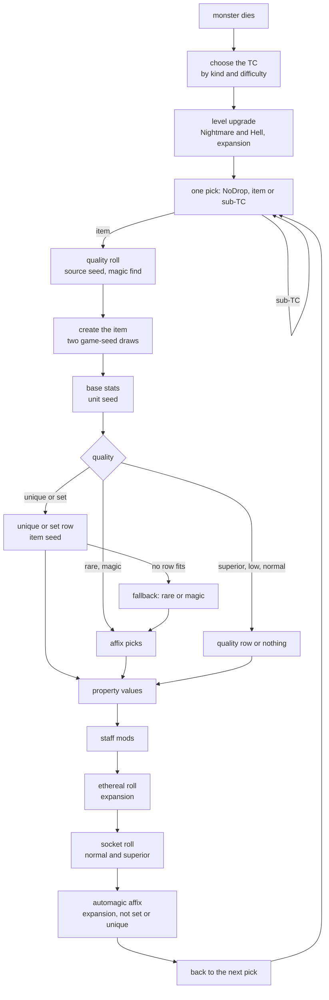
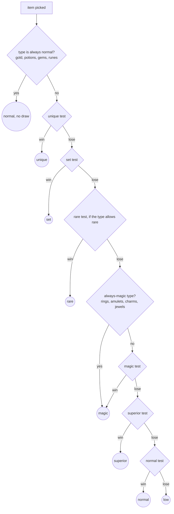
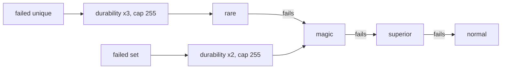

---
based_on:
  - docs/specs/items/tc.md 2026-10-20
  - docs/specs/items/quality.md 2026-10-20
  - docs/specs/items/uniques-sets.md 2026-10-17
  - docs/specs/items/affixes.md 2026-10-17
  - docs/specs/items/properties.md 2026-10-17
---

# How an item drops

A monster dies and something falls on the ground. This page follows that drop from start to finish. The game
picks a [treasure class](../glossary.md) (TC), walks it to decide how many items fall and which ones, rolls each
item's quality with your [magic find](../glossary.md), picks a unique or set row or a set of affixes, rolls the
property values,
and finally decides whether the item is ethereal, socketed, or gets an extra affix from the `AutoMagic` table. It is based on five
reviewed specs: [treasure classes](../specs/items/tc.md#purpose), [the quality roll](../specs/items/quality.md#purpose),
[uniques and sets](../specs/items/uniques-sets.md#purpose), [affixes](../specs/items/affixes.md#purpose) and
[base stats and properties](../specs/items/properties.md#purpose). Chests use the same treasure-class walk. Other
ways to get an item, such as vendors or the cube, are on [their own page](items-other-paths.md).

## The big picture

A drop uses four different random [seeds](../glossary.md), and each [draw](../glossary.md) of the drop happens on
one of them. Keeping them apart is the key to the whole chain
([TC reimplementation notes](../specs/items/tc.md#reimplementation-notes),
[properties § H](../specs/items/properties.md#h-rng-call-sequence)):

| Seed | Belongs to | Decides |
|---|---|---|
| source seed | the dying monster or the opened chest (the [source unit](../glossary.md)) | every TC pick and every quality roll |
| [game seed](../glossary.md) | the game | gives each new item its two seeds below |
| unit seed | the new item as a world object | its [base stats](../glossary.md): durability, defense, quantity, picture |
| [item seed](../glossary.md) | the new item's item data | unique or set row, affixes, property values, [ethereal](../glossary.md), sockets, [automagic](../glossary.md) |

The TC walk and the quality roll interleave on the source seed: every pick and every quality test draws from it in
turn, so one extra or missing draw changes every later item of the same drop
([quality § Draw order](../specs/items/quality.md#draw-order-on-srcseed)). Creating the item does not touch the
source seed at all; everything from the unique pick to the automagic affix happens on the new item's own seeds
([TC § H](../specs/items/tc.md#h-item-pick-and-hand-off)).

## Which treasure class

A monster has four TC columns per difficulty in MonStats: `TreasureClass1` for normal monsters and
[minions](../glossary.md), `TreasureClass2` for champions, `TreasureClass3` for uniques, and `TreasureClass4`, the
[quest TC](../glossary.md). A [superunique](../glossary.md) uses its own row's TC. The game tests the kinds in the order
superunique, champion, unique, normal. The order matters because a live monster carries several kind flags at once:
champions also carry the unique flag, and they still get the champion column. Champion-before-unique is confirmed by
a recorded Nightmare game; superunique-before-champion is read from the code only, since no monster seen in a run
carried both flags ([TC § B](../specs/items/tc.md#b-monster-drop-which-tc--monster_dropitems)).

The quest TC then replaces whichever TC was chosen when the monster has one, the killer is (or belongs to) a player,
and that player's quest bits for the boss are clear. Because the drop runs before the boss's quest script sets those
bits, a first kill always gets the quest TC. This is confirmed for single player; kills by a pet, a hireling, and a
party were not run ([TC § B](../specs/items/tc.md#b-monster-drop-which-tc--monster_dropitems)).

Some monsters carry a "no death drop" flag and skip the drop entirely. The code sets it in 30 places: 20 plain
writes of the flag, and 10 more that set it together with other flags. Read from the code, these monsters get it:

- town NPCs, critters, hirelings and player summons (every class whose `Align` is 1) when made by the normal spawn
  code;
- the bone prisons, and the Travincal compelling orb (when it is created and again when it dies);
- monsters that remove themselves through their own behaviour: nests and other spawners once they have spawned
  enough, traps, the Seven Tombs illusion, the Dark Wanderer and the trapped souls;
- monsters spawned by another unit or by a spawner skill (including Baal's tentacles and his clone), and monsters
  brought back to life by a resurrect or revive skill or by the `reanimate` item property;
- hirelings (at the hire and at resurrection), and a monster restored from an inactive room that had the flag.

An earlier reading had counted 21 plain writes (one of them sets a different flag) and split the unread ones into
"three in quest drops" and "twelve in skill code"; the closer reading shows the three are the compelling orb's two
places and a mosquito nest's behaviour, and the twelve are the self-removing monsters above. A flag word copied in
whole from somewhere else would not show up in this count, so the list is a lower bound
([TC § B, note B1](../specs/items/tc.md#b-monster-drop-which-tc--monster_dropitems)).

**Level upgrade.** In an expansion game on Nightmare or Hell, a monster's top TC can move up its group (for example
`Act 1 (N) H2H A` to `H2H B`). The game walks forward through the group while the monster's level
([mlvl](../glossary.md)) is at least the next TC's `level`. The walk only moves forward, so a base TC whose own level is
above the monster's is kept, never replaced by a lower one. Monsters flagged `boss` or `noRatio` do not upgrade, nor
do sub-TCs or chests. The walk is confirmed on Nightmare kills of normal, minion, champion, unique and superunique
monsters. The Hell columns work by the same rule but no Hell drop was recorded, the `boss` gate rests on a single
logged call, and the classic and `noRatio` gates were not exercised
([TC § C](../specs/items/tc.md#c-level-upgrade--tc_dropbyindex-and-tc_getbyindex)).

## Walking the treasure class

A TC is a weighted list of up to ten entries, each an item, an item-type TC such as `weap3`, or another TC. Its
[Picks](../glossary.md) column says how many times to pick
([TC § D](../specs/items/tc.md#d-the-resolver--tc_resolvedrops)):

- **Positive Picks**: each pick draws once on the source seed over the total weight plus the [NoDrop](../glossary.md)
  weight. A roll inside the NoDrop part drops nothing; otherwise the entry whose weight range holds the roll is taken.
  A TC whose only entry has weight 1 still spends a draw on every pick.
- **Negative Picks** (as on the unique and superunique TCs of the recorded games): no draw at all. Pick 0, 1, 2 …
  simply takes entry *i* as many times as its weight, in order. So `Act 1 Unique A` with `Picks = −3` always gives
  one pick of `Act 1 Uitem A` and two of `Act 1 Cpot A`.
- A pick that lands on another TC opens that TC and walks it fully before the parent's next pick (depth first). Sub-TCs
  never get the level upgrade ([TC § G](../specs/items/tc.md#g-recursion-into-a-sub-tc)).
- Each TC carries [ratio](../glossary.md) words (`Magic`, `Rare`, `Set`, `Unique`) that improve the quality odds.
  Down a chain of sub-TCs each word takes the larger of parent and child, so a good parent's ratios reach the item
  even through plain sub-TCs. Confirmed in a recorded game.
- A monster drop stops at six items in total across the whole walk; the sixth item ends it at once. This limit is read
  from the code ([TC § H](../specs/items/tc.md#h-item-pick-and-hand-off)).

The item-type TCs (`weapN`, `armoN`, `bowN`, `meleN`, `abowN`; for example `bow3`) are built by the game at load:
for each item type that has one, a TC for every N = 3, 6, … 96, holding every spawnable, non-quest base of that type
whose base `level` lies above N − 3 and at most N, each weighted by the `Rarity` of the base's own type. This is read from the code
([TC § I](../specs/items/tc.md#i-auto-item-type-tcs-weapn-armon-bown-melen-abown)).

When a pick lands on an item, the game asks for a quality (next section) unless the TC entry itself names a unique or
set row, in which case the quality is fixed to unique or set with no roll. In stock data the only such entries are
`Annihilus` in `ROP (N)` and `ROP (H)`, and no run reached them, so that path is read from the code
([TC § H](../specs/items/tc.md#h-item-pick-and-hand-off),
[uniques-sets § F](../specs/items/uniques-sets.md#f-a-row-named-by-the-tc)). For gold, a `mul=` value in the cell scales the amount and
the killer's (and its owner's) gold find adds a percentage; both are read from the code only.

Chests use the same walk with no level upgrade. Their TC is an `Act N Chest A/B/C` of their [act](../glossary.md) and difficulty; how
the tier is chosen is read from the code, while the chest drops of a recorded game reproduce the walk itself. The tier
(0, 1 or 2) is also passed as the item level of the quality roll, so a chest's quality roll runs at item level 0 to 2
(read from the code; [quality](../specs/items/quality.md#c-shared-terms-and-magic-find)). A chest can also force a
quality on its drop; when the entry is gold or a potion, that item skips the quality roll and is then built as normal
quality anyway, because the always-normal rule of item creation overrides it (read from the code; elixirs are the
exception and keep the forced quality). The
chest side is on the [objects](objects.md) page ([TC § J](../specs/items/tc.md#j-object-drops-named-only)).

**Classic games differ.** In a classic game the walk uses only the classic weights, skips expansion-only entries,
and when it picks a throwable item (javelins, throwing potions and the like) it gives the pick back and picks again,
up to ten times per drop. The classic weights, the scan and the throwable refund are confirmed in a recorded classic
game. Skipping an expansion-only entry that comes before the chosen one, the Long Sword that replaces the eleventh
throwable, and the rejection of expansion bases are read from the code only
([TC § E](../specs/items/tc.md#e-entry-selection), [§ H](../specs/items/tc.md#h-item-pick-and-hand-off)).

## More players, fewer empty picks

NoDrop shrinks as more players count for the kill. The game computes an effective player count
([TC § F](../specs/items/tc.md#f-nodrop-scaling)):

- *party* is the killer plus the members of its party who are alive and anywhere **in the same
  [level](../glossary.md)**, up to 8.
  There is no distance test: in a recorded two-player game a partied player counted at any distance in the killer's
  level, and not at all from another level. The project's notes record that community guides for 1.10/1.11 describe a
  "two screens" range; 1.14d does not use one.
- *n* = party + (all players in the game − party) ÷ 2, so players outside the party count half. For a monster, *n* is
  also capped by the monster's own [player-count](../glossary.md) stat (`monster_playercount`).
- The `/players N` command raises the counted players to N if there are fewer; it does not add to them. A lone player
  with `/players 8` gets *n* = 1 + (8 − 1) ÷ 2 = 4.

When *n* is above 1, the new NoDrop is computed in floating point from the old one and the TC's total weight: with
r = NoDrop ÷ (NoDrop + total), p = rⁿ and q = 1 − p, the new NoDrop is (1 − q) × total ÷ q, truncated. It is
recomputed on every pick, from the unscaled NoDrop and the current TC's total.

Confirmed for a party of one (alone or with `/players 8`) and a party of two in a two-client game. Read from the code
only: a dead party member, three or more players, the cap at 8, a monster killer counted through its owning player,
and whether `/players` works in a multiplayer game.

## The quality roll and magic find

For an ordinary item the quality roll returns a [quality code](../glossary.md): 1 low, 2 normal, 3 superior, 4 magic,
5 set, 6 rare, 7 unique. It draws 0 to 6 times on the source seed
([quality § Test order](../specs/items/quality.md#test-order)).

**Which row.** The chances come from one `ItemRatio` row, chosen by two keys: whether the base is class-specific and
whether it is an exceptional or elite ("uber") base. Both expansion and classic drops use the version-1 rows. The
project's notes record that the community description of 1.10 says classic games use the version-0 rows; in a recorded
classic game the version-1 rows reproduce every roll and the version-0 rows do not. Difficulty does not pick the row;
that is read from the code ([quality § B](../specs/items/quality.md#b-the-itemratio-row--itemratio_select)).

**One test.** With *d* = the item level ([ilvl](../glossary.md)) minus the base's quality level, each of the unique,
set, rare and magic tests computes a number *c*
([quality § D](../specs/items/quality.md#d-unique-set-rare-and-magic-tests)):

1. *c* = (row value − *d* ÷ divisor) × 128. A higher item level relative to the base lowers *c*, which is better.
2. Magic find divides it: *c* = *c* × 100 ÷ factor.
3. *c* is raised to the row's minimum if it fell below it. This comes after magic find and before the ratio word, and
   recorded games confirm both the clamp and its place: it decides the result of 138 rolls, in the rare, set and magic
   tests. No roll reached the unique test's minimum.
4. The TC's ratio word takes off its share: *c* = *c* − ratio × *c* ÷ 1024. A ratio of 1024 makes *c* zero.
5. If *c* is below 1 the test wins with no draw; otherwise one draw from 0 to *c* − 1 wins if it is below 128.

So a test wins with a chance of about 128 in *c*. The superior and the normal tests work the same way but with no
magic find, no minimum and no ratio word. Losing the normal test is the only way to get a low-quality item
([quality § E](../specs/items/quality.md#e-superior-normal-low)). Always-magic types still run the unique and set
tests, and the rare test if their type allows rare, with their draws, before they become magic.

**[Magic find](../glossary.md) (MF)** is the killer's MF plus its owner's: a summon's kill counts the summoner's MF,
and a [mercenary](../glossary.md)'s kill counts its own plus its player's, as does a Hydra's. These are confirmed in
recorded games.
Monsters can have owners too. Read from the code: the minions of a unique or superunique boss, and the MonStats
party minions of a leader whose `MonStats` row has `SetBoss`, have their leader as owner, so a minion's kill adds the
leader's MF while the leader is still in the game; a boss placed by the special-monster placement (a superunique, for
example) is its own owner, so when it is the killer its own MF counts twice. Also read from the code, these
monsters have an owner whose MF their kills add: a boss's escorts (the boss), tentacles (their spawner), formation
members (their leader; a leader owns itself), Baal's clone (Baal), Bone Wall and Bone Prison pieces, revived
monsters and monsters a missile spawns (the caster or the missile's owner), monsters raised by the `reanimate` item
property (the player the killer belongs to), and a monster restored from an inactive room (its saved owner).

That property (stock: the unique Tomb Reaver and the runeword Faith) is not a skill: on the kill of a monster that is
neither a champion nor a unique, it draws once on the killer's own seed against its value (10 % on both stock items)
and, when the draw passes, raises the dead monster for the player at the top of the killer's owner chain, so a pet or
a hireling that has it raises monsters for its player. Read from the code only. Whether any stock monster has MF at all is not checked
([quality § C, note M3](../specs/items/quality.md#c-shared-terms-and-magic-find)). The factor is:

| Test | Factor with MF ≤ 10 | Factor with MF above 10 | At MF 100 |
|---|---|---|---|
| unique | 100 + MF | 100 + MF × 250 ÷ (MF + 250) | 171 |
| set | 100 + MF | 100 + MF × 500 ÷ (MF + 500) | 183 |
| rare | 100 + MF | 100 + MF × 600 ÷ (MF + 600) | 185 |
| magic | 100 + MF | 100 + MF | 200 |

The linear part up to MF 10 is what 1.14d does: the project's notes record that the 1.10/1.11 community formula has
no such branch, and the recorded games show the linear form. Negative MF, including the case at −100 or below that
skips straight to the superior test, was not exercised.

## Creating the item: seeds and base stats

The item is created with two draws from the game seed: one seeds the item as a world object (its unit seed), the
other gives the item seed its starting value, written as `{start, 666}`. The `start` number is kept; it comes back for
the socket count and every fallback ([uniques-sets § A](../specs/items/uniques-sets.md#a-the-item-seed-at-entry)).
That a drop's two seeds come from the game seed is read from the code; that the item seed starts at `{start, 666}`
when the quality work begins is confirmed in every logged creation.

Before any quality work, the **base stats** are rolled on the unit seed
([properties § A](../specs/items/properties.md#a-base-stats-on-the-unit-seed)):

- **Durability**: with base durability *d*, the current value is ⌊*d*/2⌋ plus a draw below ⌊*d*/2⌋, so it never equals
  *d*; the maximum is *d*. Bows and throwing potions draw too: the `nodurability` column is not tested here.
- **Defense** (armour): drawn from `minac` to `maxac` inclusive, after durability.
- **Quantity** (stackables): from `minstack` up to one below the top, so never the top value. Misc items like keys use
  `spawnstack` as the top (keys come with 1 to 5); quivers ignore it.
- **Gold**: ilvl plus a draw below 5 × ilvl.
- **Picture**: a draw for the types that have several pictures (`VarInvGfx`).

A rule that would set the quantity to 1 for magic and better items never fires on a drop, because the quality is
not yet set when these stats are rolled: a rare throwing weapon keeps its drawn quantity. That is read from the code.

## Uniques and sets

Item creation first applies four override rules (an always-magic type becomes at least magic, a type that cannot be
rare turns rare into magic, a base flagged unique becomes unique, an always-normal type becomes normal). For a drop
through the quality roll they never change anything, because the roll already respects them; a TC entry that forces
unique or set on an always-normal base would end normal. A survey of the stock bases shows which ones the rules
touch: seven bases are always magic (rings, amulets, jewels, the three charms, and the Viper Amulet, a quest base that the
unique rule then makes unique), and no quiver is,
since the two quiver types that are flagged always-magic have no base of their own; 153 bases of 30 types (potions,
gems, runes, scrolls, books, keys, gold, quivers, body parts, charms, quest items) cannot be rare; 18 bases (17 quest
items and the Standard of Heroes) are flagged unique; 121 bases of 24 types are always normal ([quality § F](../specs/items/quality.md#f-boundaries-named-only)). The
rules are read from the code, and only the last one was ever seen writing
([uniques-sets § B](../specs/items/uniques-sets.md#b-itemcreatebyquality-the-creation-roll-the-overrides-and-the-switch)).

**Unique.** The game lists every `UniqueItems` row that
([uniques-sets § C](../specs/items/uniques-sets.md#c-the-unique-builder)):

1. is not expansion-only in a classic game,
2. is enabled,
3. is for this exact base,
4. passes the ladder test,
5. has `lvl` at or below the item level.

It then makes **one weighted draw** on the item seed, each row weighted by its `rarity` (at least 1). Even a single
candidate costs that draw. The weights apply in classic games too; the project's notes record a community note saying
otherwise, which 1.14d does not follow.

Only after the pick does the game check the [made-uniques set](../glossary.md): if the drawn row was already built in
this game, the whole build fails, with no re-pick. Every stock unique is marked when built, so in 1.14d each unique
can be built once per game; the set is cleared only when a game is created (that no stock row is exempt and that
nothing on the drop path clears a mark is read from the code). Ladder-only uniques drop in single player
and in a TCP/IP game, because the ladder test only excludes them when two game values are both 0, and which game type
(if any) has that is not known. Read from the code: the builder clears the identified flag of every unique, and a
quest unique is identified again right after, when its base stats are set; every stock quest base that can be unique
qualifies, which is checked against the data. `nolimit` plays no part in this; it only exempts a row from the
made-uniques set. Every way of building a unique goes through the one marking step, so a unique shown in a gamble
window is marked too ([uniques-sets § C](../specs/items/uniques-sets.md#c-the-unique-builder)).

**Set.** Set items are picked the same way from `SetItems`: the base must match, `lvl` must be at or below the item
level, and in a classic game expansion-only rows are skipped. Weight 0 counts as 1
([uniques-sets § D](../specs/items/uniques-sets.md#d-the-set-builder)). Read from the code but not seen in a run: a
set item takes its version from its set, so a classic game sees only the members of the 16 classic sets; there is no
enabled, ladder or once-per-game test for sets, so a set item can drop any number of times in a game, and the Cow
King's set can only come from a Hell Bovine.

## When a unique or set cannot be made

A build fails when no row fits the base or when the drawn unique was already made. Then
([uniques-sets § E](../specs/items/uniques-sets.md#e-failure-durability-and-the-fallback-chain)):

The durability step only touches bases that have durability. Before each fallback the item seed is reset to
`{start, 666}`, so the draw the failed builder made is thrown away and the fallback starts exactly where the unique or
set pick started. All of this is confirmed in recorded games: 39 failed uniques became rare and 47 failed sets became
magic. No fallback rare or magic build ever failed in a run, so the steps further down the chain are read from the code
only, as is the rule that a failed item keeps no unique or set row. This is the [failed unique / failed
set](../glossary.md) of the
glossary.

## Magic and rare items: affixes

Every affix pick compares rows with the item's **[alvl](../glossary.md)** (affix level), not its item level
([affixes § B](../specs/items/affixes.md#b-the-affix-level-alvl)). With *i* = the larger of ilvl and the base's quality
level *q*:

- bases with a `magic lvl` (staves, wands, orbs, circlets): alvl = *i* + `magic lvl`;
- all others: alvl = *i* − ⌊*q*/2⌋, or 2*i* − 99 once *i* reaches 99 − ⌊*q*/2⌋;
- then clamped to 1..99.

The project's notes record that the community rule "quality level up to ilvl + 2, uniform" describes only the
version-0 code path, which no drop reaches.

**One affix pick** ([affixes § C](../specs/items/affixes.md#c-one-magic-affix-pick--items_pickmagicaffix)) always
starts with a coin draw: if its lowest bit is 0 and the pick is not forced to roll, the slot stays empty. Otherwise the
game keeps each row of the prefix or suffix table that is spawnable, allowed by version, has `level` ≤ alvl and
`maxlevel` ≥ alvl (0 = no limit), is allowed on a rare if the item is rare, fits the item type (none of its excluded
types, one of its included types), has a non-zero `frequency`, does not clash with the item type's class, and whose
`group` is not already on the item. Then one draw picks a row weighted by `frequency` (times `level` on `magic lvl`
bases). The draw runs over the total weight **plus one**, so the last candidate in table order gets one extra unit of
weight. A class-specific row is not kept off classless items by its class column; only its type list does that.

**Magic** ([affixes § D](../specs/items/affixes.md#d-the-magic-builder--items_buildmagic)): a prefix pick, then a suffix
pick that must roll when no prefix was set. When both tables have candidates the shares are a quarter both, a quarter
prefix only, a half suffix only. Each pick rolls its own property values before the next pick.

**Rare** ([affixes § E](../specs/items/affixes.md#e-the-rare-builder--items_buildrare--items_buildrareaffixes)):

1. The two [rare name](../glossary.md) words come first, one uniform draw each over the `RarePrefix` and `RareSuffix`
   rows that fit the item type. They do not depend on the affixes.
2. The affix count: 3, 4, 5 or 6 with chances 1/8, 2/8, 3/8, 2/8. Rares have 3 to 6 affixes, not 2 to 6. Jewels get
   3 or 4 (read from the code; no rare jewel was logged).
3. For each slot, a coin picks prefix or suffix while both sides are open; a side closes after three affixes or when
   a pick finds no row, and the slot is then retried on the other side.
4. Only after all picks are the property values rolled, in the order prefix 1, suffix 1, prefix 2, suffix 2 and so on.

**Superior** picks a `QualityItems` row that fits the item type, redrawing rows it has already tried; throwables and
bases without durability use only the first four rows, which hold no durability bonus
([affixes § F](../specs/items/affixes.md#f-the-superior-builder--items_buildsuperior--items_buildsuperiorpick)).
**Low quality** draws a `LowQualityItems` row (confirmed). By the code, it then cuts damage or defense to 75 %, sets
the maximum durability to 33 % of the base value and draws the current durability on the unit seed; those steps are
not yet confirmed by a run
([affixes § G](../specs/items/affixes.md#g-the-low-quality-builder--items_buildlow--items_buildlowpick)). **Normal**
draws nothing for most bases ([affixes § H](../specs/items/affixes.md#h-the-normal-builder--items_buildnormal)).

**[Staff mods](../glossary.md)**: every builder ends by giving an item whose type names a class in `StaffMods` up to
three class skill bonuses ([affixes § I](../specs/items/affixes.md#i-staff-mods--items_rollstaffmods)). Where
these draws sit in the order is confirmed; the draws themselves are read from the code and not yet reproduced. Each
bonus gets up to 6 tries. A drawn skill is refused if the skill names an item type and the item is not of it, or if it repeats one
of the skills already stored; a skill index out of range or without a record skips the type test and goes straight
to the repeat test. If all 6 tries fail, the last skill drawn is written anyway but is not stored for later repeat
tests; that fallback was never reached. This test was read again in the disassembly, so the earlier doubt about the
decompile is settled, but it is still read from the code only.

A magic build fails only if neither slot gets an affix, and a rare one if no name or no affix fits; both then fall back
one step with the seed reset. Neither happened in a run.

## Property values

Once a row is chosen (a unique, a set item, an affix, a superior row), its property blocks are turned into stats on
the item seed ([properties § B](../specs/items/properties.md#b-itemapplyprops-modes-and-blocks)). Each
[property block](../glossary.md) names a `Properties` row and a `min` and `max`
([properties § D](../specs/items/properties.md#d-the-value-roll-and-the-stat-writer),
[§ E](../specs/items/properties.md#e-the-handlers-per-func)):

- `min` = `max` draws nothing. Most unique blocks are fixed, so they leave the seed alone.
- Otherwise one draw gives a value from `min` to `max` inclusive.
- A value of 0 writes nothing.
- Properties that set several stats at once (all resistances, all stats, elemental damage) draw once and reuse the
  value for each stat.
- **Enhanced defense** (`ac%`) also raises the base defense to `maxac` + 1 (and `maxac` + 2 after a second such block).
- **Superior is not "max".** The superior bonuses (attack rating, durability) roll like any other; the project's notes
  record that a later-era description says otherwise.
- **Charges** always draw once. For the magic suffixes the charge count grows with the skill level, which comes from
  the item level.
- Per-level properties store their raw value; the per-level value is not computed at creation.
- A set item's extra bonus blocks (`aprop`) are rolled at creation like the others.

A few property kinds (random skill, random class skill, the ethereal property, and two more) were not reached in any run
and are read from the code only.

## Ethereal, sockets and automagic

After the builder, three more steps run on the item seed, in this order
([properties § F](../specs/items/properties.md#f-ethereal-and-sockets),
[affixes § J](../specs/items/affixes.md#j-after-the-switch-ethereal-sockets-automagic)):

1. **[Ethereal](../glossary.md)** (expansion games only): a weapon or armour with durability, not low quality, not a set
   item and not a quest item, draws 0..99 and becomes ethereal below 5. Damage or defense goes ×3/2 and maximum
   durability becomes ⌊max/2⌋ + 1. Uniques can be ethereal; set items never are, but a failed set (now magic) can be.
2. **Sockets** (normal and superior quality only; a low-quality item fails the first test): the base must allow
   sockets (`hasinv`) and not stack. A draw 0..99 below 33 makes the item socketed. The number of sockets is **not**
   drawn: it is `start` mod cap + 1, where `start` is the item seed's starting value and cap is the smallest of the
   base's `gemsockets`, the type's maximum for the item level (`MaxSock1` up to ilvl 25, `MaxSock25` up to 40,
   `MaxSock40` above) and 3, 4 or 6 for Normal, Nightmare or Hell. All 29 socketed drops of the runs had that count.
   Classic body armour makes no socket draw at all; that is read from the code.
3. **[Automagic](../glossary.md)** (expansion games only, not set or unique): a base whose `auto prefix` names a group
   (class items such as orbs) gets one affix from `AutoMagic`, picked like any affix with the same alvl. It always
   spends its coin draw. That set and unique items skip it, and that it does not check `spawnable`, are read from the
   code; every stock automagic row is spawnable, so the second point cannot show in a normal game.

A TC can also hand the item two flags that force the outcome of the first two steps: one makes the ethereal roll
succeed, the other replaces the socket draw by 0 so that sockets are always added. These flags come only from TC
modifiers that exist in classic games (where the ethereal roll does not run, so the ethereal one has no effect at all)
or from a field the stock tables leave at zero, so no stock drop uses them. All of this is read from the code
([TC § H, note H5](../specs/items/tc.md#h-item-pick-and-hand-off)).

An item with an `ethereal` property can in principle be made ethereal a second time by the roll (a second ×3/2 and
halved durability); this was not reached in a run.

## Worked examples

All numbers below are copied from the specs' worked examples, which were checked against recorded games.

**A treasure-class walk** ([TC worked example 1](../specs/items/tc.md#worked-example)). An expansion Normal game,
a plain monster, item level 1, a lone player, so NoDrop stays 100:

| TC | Picks, NoDrop, total | Draw | Result |
|---|---|---|---|
| `Act 1 H2H A` | 1, 100, 60 | 128 of 160 | 128 − 100 = 28 → `Act 1 Equip A` |
| `Act 1 Equip A` | 1, 0, 14 | 0 of 14 | `weap3` |
| `weap3` | 1, 0, 27 | 9 of 27 | `ssd` |

The quality roll returned 1 (low), and one item was created. Three other calls of the same recorded game rolled below
100 and dropped nothing. In TC worked example 2, the same game's unique monster walks `Act 1 Unique A` (`Picks = −3`)
with no draws for its three picks, and drops five items: a magic `ssd` (its ratio words `1024,800,800,800` reached the
quality roll through two plain sub-TCs) and four potions.

**NoDrop with `/players 8`** ([TC worked example 3](../specs/items/tc.md#worked-example)): for NoDrop 100 and total 60
at *n* = 4, r = 0.625, rⁿ = 0.152587890625, and NoDrop becomes **10**; every pick then draws over 70 instead of 160.

**Magic find 100** ([quality worked example 3](../specs/items/quality.md#worked-example)). Expansion Nightmare,
a `pil` (quality level 10) at item level 49, so *d* = 39:

| Test | *c* before MF | Factor | *c* | Draw | Outcome |
|---|---|---|---|---|---|
| unique | 46208 | 171 | 27022 | 11932 | lose |
| set | 18048 | 183 | 9862 | 817 | lose |
| rare | 10368 | 185 | 5604 | 4306 | lose |
| magic | 2688 | 200 | 1344 | 1185 | lose |
| superior | 1024 | — | 1024 | 550 | lose |
| normal | −2176 | — | −2176 | none | normal, no draw |

With a plain linear factor of 200 the unique chance would have been 23104, the first draw 12, and the game would have
made a unique it did not make: one of the rolls that settle the diminishing-returns formula.

**A unique already made** ([uniques-sets example
3b](../specs/items/uniques-sets.md#example-3b-a-unique-already-made-in-the-game-forced-path)).
A classic Nightmare `brs` at item level 52, in a test run with edited quality odds, has one candidate, row 86
`Venomsward`, which was already built earlier in the game. The pick still draws (and gets row 86), the made test fails,
durability goes ×3 (34 and 50 become 102 and 150), the item seed is reset to its starting value, and the item is built
as a rare instead.

**One orb, from affixes to automagic**
([affixes example 1](../specs/items/affixes.md#example-1-a-magic-item-with-a-prefix-and-a-suffix) and
[example 3](../specs/items/affixes.md#example-3-an-automagic-pick)). Expansion Normal, a sorceress orb `ob1` (quality
level 1, `magic lvl` 1, `auto prefix` 303), item level 1, magic:

| Step | Draws | Result |
|---|---|---|
| alvl | — | max(1, 1) + 1 = 2 |
| prefix coin | 1 | lowest bit 1: roll a prefix |
| prefix pick | 1 | 7 candidates, total weight 20, draw 5 of 21 → *Lizard's* |
| suffix coin | 1 | lowest bit 1: roll a suffix |
| suffix pick | 1 | 2 candidates (both *of Energy*), weight 8, draw 4 of 9 → the second one |
| staff mods | taken from the log | class 1 |
| ethereal roll | (logged) | magic gets no socket roll |
| automagic coin | 1 | ignored |
| automagic pick | 1 | one candidate, *of the Jackal*, weight 6, draw 5 of 7 → chosen |

The prefix walk shows the weights: *Glimmering* 1 (5 → 4), *Septic* 3 (4 → 1), *Lizard's* 4 (1 → −3, chosen). The two
*of Energy* rows share a group, so they can both be candidates until one of them is on the item.

**A socketed normal weapon** ([properties example
1](../specs/items/properties.md#example-1-a-normal-weapon-socketed-stock)).
Expansion Hell, `flb`, item level 81, normal quality: durability 50 gives a current value of 25 + 21 = 46; the normal
builder draws nothing; the ethereal draw is 23 (not below 5); the socket cap is 5 and the socket draw is 24 (below 33),
so it is socketed with `start` mod 5 + 1 = **1** socket.

## Other ways to get an item

Vendors, gambling, the Horadric Cube and quest rewards reach the same builders by other paths; they, socketing and
[runewords](../glossary.md) are explained on [Other ways to make an item](items-other-paths.md)
([uniques-sets § Entry points](../specs/items/uniques-sets.md#entry-points)).

## What is not known yet

The main flow above is confirmed in recorded games. These parts are not, or are still open:

- **Treasure classes** ([TC open questions](../specs/items/tc.md#open-questions)): Hell drops; parties of three or
  more, a dead party member, the cap at 8 and a monster killer counted through its owner; champions outside one
  Nightmare class and in classic games; the superunique-before-champion order; the early stop of a negative-Picks TC
  and `Picks = 0`; the untested classic cases (expansion-only entries before the chosen one, the Long Sword, the
  ratio raises); a TC entry naming a unique (`Annihilus`) in stock data; the floating-point precision under other game
  types or renderers; whether `/players` works in a TCP/IP game; the quest TC for a kill by a pet, a hireling or a
  party member, and for Mephisto, Diablo and Baal after their quest is done; and whether any monster skips the death
  drop beyond the lower bound above. The two "upgrade" bits a TC can set turned out, by the code, to force the item
  ethereal and force sockets (see [Ethereal, sockets and automagic](#ethereal-sockets-and-automagic)); no stock data
  sets them.
- **Quality** ([quality open questions](../specs/items/quality.md#open-questions)): Hell, negative magic find,
  multiplayer, a monster killer with no player owner, and the unique-only base and quest-item early returns.
- **Uniques and sets** ([uniques-sets open questions](../specs/items/uniques-sets.md#open-questions)): the fallback
  chain past its first step; a unique-only base with no row; a quest base skipping the made test; the Cow King's set
  from a Hell Bovine; which game type, if any, excludes ladder uniques.
- **Affixes** ([affixes open questions](../specs/items/affixes.md#open-questions)): rare jewels, the classic
  refusal of throwing weapons, the socket test on affixes, an empty rare-name list, a failed magic build, charms
  reaching
  the normal builder, automagic on set and unique items, and which text a rare name id is shown as (the
  [game data](game-data.md) page has the name line).
- **Properties** ([properties open questions](../specs/items/properties.md#open-questions)): several property kinds
  never reached, the type-11 setup, classic body armour at the socket roll, the second ethereal, and the exact
  rounding of a superior ethereal item with a durability bonus, where the code and a community page disagree (for
  maximum 38 and 15 %: 23 by the code, 22 by the page). No recorded item has settled it.

## Where to read more

- The specs: [treasure classes](../specs/items/tc.md#purpose), [quality](../specs/items/quality.md#purpose),
  [uniques and sets](../specs/items/uniques-sets.md#purpose), [affixes](../specs/items/affixes.md#purpose),
  [base stats and properties](../specs/items/properties.md#purpose).
- The [glossary](../glossary.md) for every D2 term used here.
- Related pages: [randomness](randomness.md) for the seeds, [monsters](monsters.md) for monster kinds and levels,
  [objects](objects.md) for chests, [other ways to make an item](items-other-paths.md), [saves](saves.md) for how an
  item is stored, and [how we know](how-we-know.md) for what "confirmed" means here.
