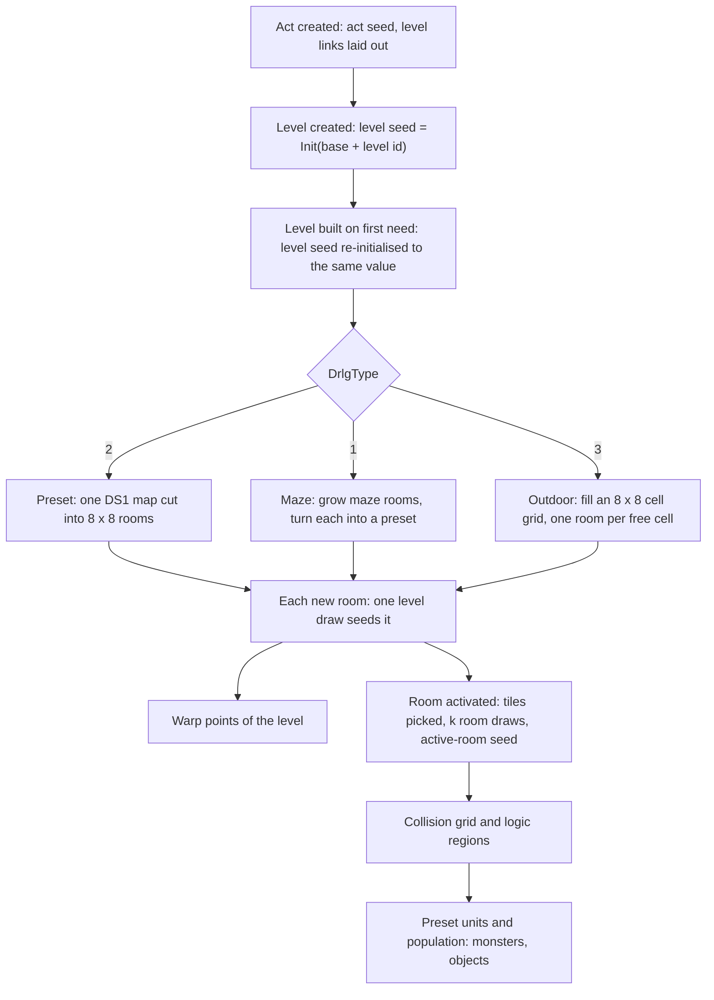
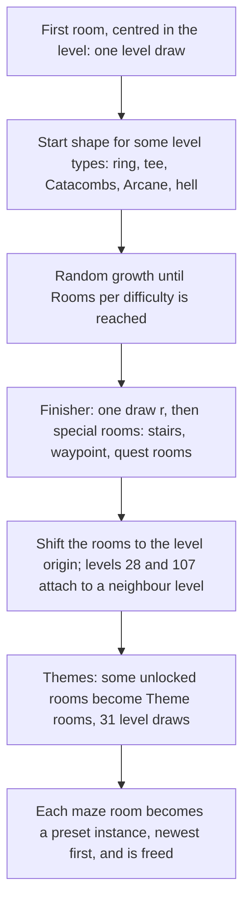
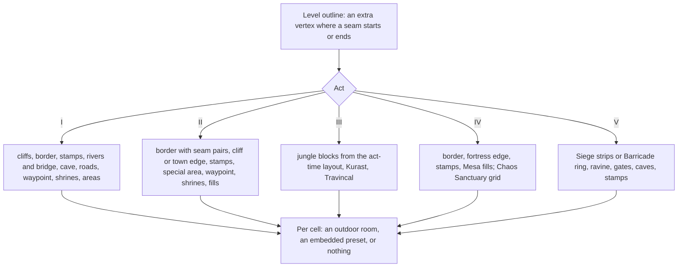
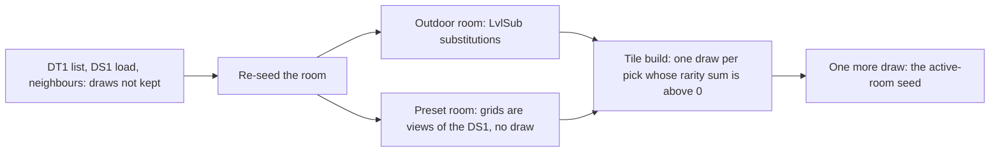
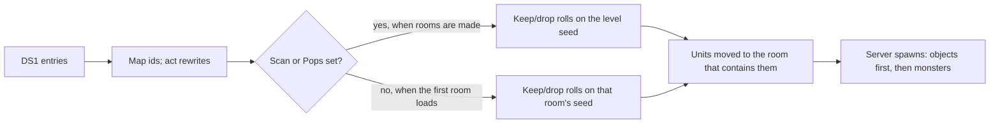
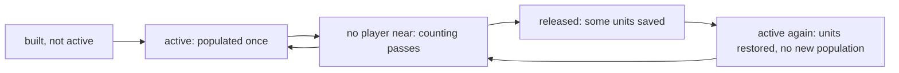

---
based_on:
  - docs/specs/drlg/README.md 2026-10-21
  - docs/specs/drlg/room-tiles.md 2026-10-21
  - docs/specs/drlg/preset.md 2026-10-17
  - docs/specs/drlg/collision.md 2026-10-27
  - docs/specs/drlg/maze.md 2026-10-17
  - docs/specs/drlg/warps.md 2026-10-17
  - docs/specs/drlg/outdoor.md 2026-10-20
  - docs/specs/drlg/lifecycle.md 2026-10-27
  - docs/specs/monsters/spawn.md 2026-10-27
---

# How a level is built

Every map you walk in Diablo II comes out of the [DRLG](../glossary.md), the game's level generator. This page
follows it from the top: an [act](../glossary.md) is laid out, each level is built from a [seed](../glossary.md) by one of three
generators (preset, maze or outdoor), the level is cut into rooms, and each room gets its floor and wall tiles, its
preset monsters and objects, its warps and finally a [collision grid](../glossary.md) that monster spawning and object placement read.
It restates the reviewed DRLG specs: the [overview](../specs/drlg/README.md), [room tiles](../specs/drlg/room-tiles.md),
[preset units](../specs/drlg/preset.md), the [maze](../specs/drlg/maze.md) and [outdoor](../specs/drlg/outdoor.md)
generators, [warps](../specs/drlg/warps.md) and the [collision grid](../specs/drlg/collision.md). Where you want the
exact order of every random [draw](../glossary.md), follow the links.

## The big picture

A level has its own seed, and the generator's random choices are draws on that level seed, on the act seed
(while the act is laid out) or on the seeds of the rooms it creates. All of these come from the
[map seed](../glossary.md). The specs give every draw in order, and the recorded games were replayed against them
draw by draw ([overview § Algorithm](../specs/drlg/README.md#algorithm)).

The diagram reads in two halves. The top half runs once per level build and makes **[DRLG rooms](../glossary.md)**: rectangles with a
seed, a type and a DT1 mask that selects its tile files. The bottom half runs per room, later, when the room is
**activated**: only then are its tiles chosen and its active room made, with the grid that units
stand on ([room tiles § Algorithm](../specs/drlg/room-tiles.md#algorithm)).

## Acts, levels and rooms

When an act is created, the game first lays out the act's linked levels (next section), then creates its town and
builds it. Each other level is created with its seed set to the act's [level seed base](../glossary.md) plus the
level id. Creation may make one draw (a preset level picks its map file), but that draw is thrown away: when the
level is actually built, the game initialises the level seed **again to the same value**, so the rooms never depend
on anything that happened between creation and build
([overview § Algorithm, step note 2](../specs/drlg/README.md#algorithm)).

A level is built lazily, the first time it is needed. When the player leaves it, its rooms are freed, and on
re-entry the build runs again on the same level. Both are confirmed: a later run logged 188 level unloads and 59
rebuilds of an unloaded level, and no level was built twice without an unload in between. In a recorded Catacombs
game, levels 35 and 36 were built three times each and level 34 twice, and every build gave the same draws, files
and rooms. So a level re-entered in the same game is rebuilt with the same rooms
and map files.

Each room a generator creates costs exactly **one level draw**, and that draw seeds the room. So the order in which
rooms are created fixes every room's seed. A room has a **type** ([room type](../glossary.md)): type 1 is an outdoor
room, type 2 a room cut out of a preset map. Maze levels end up with type-2 rooms only
([overview § Outputs](../specs/drlg/README.md#outputs)).

Each act exists in two copies, one for the server and one for the client
([server / client act copy](../glossary.md)); gameplay uses the server copy. The two copies make the same
rooms, but, as later sections show, the order in which their rooms activate can differ, and some per-room results
with it ([room tiles § k](../specs/drlg/room-tiles.md#k)).

## Laying out the act: level links

Before any level is built, the act's [link builder](../glossary.md) places the act's outdoor levels next to each
other ([warps § A](../specs/drlg/warps.md#a-per-act-link-setup), [§ B](../specs/drlg/warps.md#b-the-act-link-builder)).
For Acts I, II, IV and V it walks small tables of levels. Each entry places one level's rectangle against an
**anchor** level, on a side that is usually chosen by a draw on a *copy* of the act seed (a few entries are fixed). If
the act's check rejects the new rectangle, the entry tries its next side, with no new draw for most entries; if it
runs out of choices, the builder backs up one entry. A check rejects a rectangle that overlaps one already placed; in
Act I it also rejects a side of the Rogue Encampment that a small table of allowed sides does not list, and a side of
the Burial Grounds that another level placed against the Cold Plains already holds. Rejects of all three kinds were
logged, and each was followed by the same entry's next choice, until a later choice of that entry was accepted: the
recorded games, and an offline scan of the builder, never needed a back-up. Act III is different: its jungle layout steps the act seed itself and is part of the outdoor generator
([outdoor § J](../specs/drlg/outdoor.md#j-act-iii)).

Every side choice of every entry was reached in runs: besides one fully logged game, nine map seeds were chosen
offline so that between them they end on every choice but two, those two were placed and logged, and their builds
were replayed pick by pick
([warps § B](../specs/drlg/warps.md#b-the-act-link-builder)). Two choices of the Rogue Encampment's entry are placed
and always rejected: its table of allowed sides cannot accept them, so the Rogue Encampment ends on one of the six
other choices in every game. One more Act I test treats the Moo Moo Farm's rectangle as 200 tiles longer toward lower
y while it checks the other levels of its table. A reimplementation has to make that test, but on the shipped data it
never decides a check; that is the code's reading backed by an offline scan of every input the table can get, not a
run.

Because each table starts from a copy of the same act seed, the first draws of different tables repeat one another.
The builder also writes three things other generators read later: each level's rectangle, the map file index of the
Rogue Encampment and Lut Gholein (from the sides it chose), and the file index of level 27, the Courtyard
([warps § C](../specs/drlg/warps.md#c-level-rectangles-and-the-links-after-the-layout),
[preset § 7](../specs/drlg/preset.md#7-level-27s-file-index)). That index comes from the link builder's only draw on
the act seed itself, made after the layout while it writes the Black Marsh's links, and only when the Black Marsh ends on side 1 or 3, each
side with its own formula. When the Black Marsh ends on side 0, nothing is drawn or written, and the Courtyard keeps
the index its own creation drew. All three cases were reached in runs, and the Courtyard was built with each of its
indices 0, 1 and 2. One outcome of the side-1 formula, index 2, cannot happen with the shipped data: the Black
Marsh's side and the Courtyard's draw come from the same random value, and side 1 is kept only when that value makes
the formula give 1. For the same reason the Black Marsh never ends on side 2. Both points are the code's reading,
with every possible draw value enumerated, not something a run can show.

Each level carries eight link slots, `Vis0..7` (the destination level) and `Warp0..7` (which warp record). A slot
whose `Warp` is −1 is a [seam](../glossary.md): a walkable border between two touching levels, not stairs. The link
builder writes a seam both ways between each placed level and its anchor; the seams of Act V, and of Act III's
jungle levels, come from a "do these rectangles touch" test instead
([warps § C](../specs/drlg/warps.md#c-level-rectangles-and-the-links-after-the-layout)). Some levels also get a size from the builder that differs from the `Levels` table:
the Blood Moor is 56 × 96 or 96 × 56 depending on its side, and the Barricade-type levels of Act V are 64 × 160 or
160 × 64 ([outdoor § A](../specs/drlg/outdoor.md#a-the-window)).

## Choosing a generator

Each level's row in the `Levels` table names its generator, the [DrlgType](../glossary.md): 1 maze, 2 preset,
3 outdoor. The game dispatches on it twice, once when the level is created and once when it is built
([overview § Algorithm](../specs/drlg/README.md#algorithm)). Whatever the generator, its output is a list of DRLG
rooms, each with a position, a type, a seed and a [DT1 mask](../glossary.md): the bits that pick which tile files of
the level type the room's tiles may come from.

| `DrlgType` | Generator | What it makes |
|---|---|---|
| 2 preset | one map file for the whole level | the map cut into 8 × 8 rooms, rows then columns |
| 1 maze | maze rooms grown edge to edge | each maze room turned into a preset, then freed |
| 3 outdoor | a grid of 8 × 8 cells | one outdoor room per free cell, or an embedded preset |

## Preset levels

A preset level is one hand-made map, a DS1 file. The `LvlPrest` table lists, per preset record, up to six files and
a `Files` count. When a [preset instance](../glossary.md) is placed, one draw picks the file: `Range(Files)` on the level seed. Two details
matter for anyone reproducing it ([overview § Algorithm, step notes 4 and 6](../specs/drlg/README.md#algorithm)):

- `Files` is the operand, not the number of files the row names. A record with `Files` 1 still makes a draw; a
  record with `Files` 0 makes none.
- The level's own index wins. For the Rogue Encampment and Lut Gholein, and for the Courtyard when the Black Marsh
  ended on side 1 or 3, the link builder has already written the index, and that index is used instead of the draw.
  The draw is still made. Otherwise the level's own index is the one its creation drew from the same seed value, so
  the two agree.

The map is then cut into 8 × 8 rooms, rows outer and columns inner; the Rogue Encampment (56 × 40) becomes 35 rooms
and a 24 × 24 preset 9. Each room costs one level draw. If the preset record has `Scan` or `Pops` set, the game also
reads the map before making the rooms and makes the preset's **[keep/drop rolls](../glossary.md)** on the level seed in between (see
*What a preset places* below). Those rolls therefore shift the seeds of every later room of the level
([overview § Algorithm, step note 5](../specs/drlg/README.md#algorithm)).

## Maze levels

Caves, crypts, the Jail, the Catacombs, sewers, tombs and the other level types listed in
[maze § F](../specs/drlg/maze.md#f-the-chain-per-level-type) are mazes ([maze § Purpose](../specs/drlg/maze.md#purpose)). The generator works with [maze rooms](../glossary.md), all of one
`LvlMaze` size (24 × 24 tiles in the Den of Evil), and builds a graph of them before any real room exists.

**Growth** ([maze § C](../specs/drlg/maze.md#c-random-growth)). While the level has fewer rooms than its `Rooms`
count for the difficulty, the game picks an existing room with a level draw, then picks a direction with a draw on
**that room's own seed**, and tries to put a new room there. A new room that would overlap is freed, but all its
draws are spent. A new room also checks the other rooms it shares an edge with (not its parent, and no locked room)
and may link to each (the `Merge` chance, out of 1000); that check draws on the other room's seed **even when `Merge` is 0 or 1000**, which changes the
direction that room will draw next ([maze § B](../specs/drlg/maze.md#b-primitives)). Two of Act II's seven tombs,
chosen when the act is created, grow larger: the true tomb to three times its `Rooms` count and Kaa's tomb to twice
it (a game whose tombs have 6 grew them to 18 and 12 rooms). By the code the two choices always differ, since the act
draws again while they are equal.

**Map pieces from exits** ([maze § B](../specs/drlg/maze.md#b-primitives)). Each maze room gets its `LvlPrest`
record from its exits: on most level types, a bit per side (west 1, east 2, south 4, north 8) added to the level
type's base record; a few level types use small fixed tables instead. A room with only a west exit in the Den of Evil's level
type, for example, is record 53, `Cave W`.

**Special rooms** ([maze § D](../specs/drlg/maze.md#d-special-rooms)). After growth, a [special room](../glossary.md)
pass places the level's Prev and Next stairs, waypoint and quest rooms. Each special replaces a dead end facing the
right way if one exists; otherwise a new room is attached. On most level types a single draw `r` picks the starting
entry of the special tables (the tombs take it from their start shape instead, with no draw), and each following special moves to the next entry, so consecutive specials face different directions. Which specials
each level type places is a table in [maze § F](../specs/drlg/maze.md#f-the-chain-per-level-type), and every row of
it was built in runs and matched room for room, the tombs' Tal Rasha and Kaa entries and Lair 64 included, with two
kinds of exception. Levels 133 and 135 have no build in the stock game. Tombs 69 and 72 were not built, but the code
gives a tomb no path of its own: it follows the tomb's role (true tomb, Kaa's or plain), and all three roles were
built. A special that no room can take was met in none of 337 logged attaches; by the code, nothing is placed then.

**Placement and themes** ([maze § G](../specs/drlg/maze.md#g-placement), [§ H](../specs/drlg/maze.md#h-themes)).
Growth ignores the level rectangle; afterwards all rooms are shifted so their bounding box sits at the level's
origin. The Barracks (28) and the River of Flame (107) are instead attached to a neighbour level (the Courtyard, the
Chaos Sanctuary) and set their own rectangle. The Barracks' side comes from the Courtyard's file index as the link
builder left it ([maze § G](../specs/drlg/maze.md#g-placement)): index 0 puts the connection to the Courtyard on the
maze's east side, 1 on its south side and 2 on its west side, each by its own search for the outermost room, and all
three were built in runs. Finally the [theme](../glossary.md) pass locks up to `max(2, rooms ÷ 5 + 1)` unlocked
rooms, of any exit shape except the four-way one, as their `… Theme …` records. It always makes 31 level draws on level types that have themes, whatever it
finds (the Den of Evil skips the pass). The specials come first, so a dead end gets a theme only if no special took it.

**Conversion** ([overview § Algorithm, step 9](../specs/drlg/README.md#algorithm)). Each maze room then becomes a
preset instance (one file draw when `Files` is at least 1, as for preset levels). A forced index can override the
draw, and on some level types a file **rotation** does: the first use of a record in a build draws a start value, and each use, the first included, takes the next
file. A maze room of up to 12 × 12 becomes a single room; a larger one is cut into 8 × 8 rooms. The maze rooms are
then freed, so a maze level's real rooms are all preset rooms.

## Outdoor levels

The outdoor levels are those listed per act in [outdoor § A](../specs/drlg/outdoor.md#a-the-window): Act I's
wilderness (levels 2–7), the Burial Grounds and the Moo Moo Farm, Act II's 41–46, Act III's jungle 76–83, Act IV's
104–106 and 108, and Act V's 110–112 and 117 ([outdoor § Purpose](../specs/drlg/outdoor.md#purpose)). The level is a grid of [outdoor cells](../glossary.md), each
8 × 8 tiles. Each act has its own generator, which marks what each cell is: border, [seam opening](../glossary.md),
road, waypoint, shrine, covered, or part of a placed preset ([outdoor § B](../specs/drlg/outdoor.md#b-the-cell-grid-and-its-bits)).

The main building blocks, all on the level seed:

- **The border pass** ([outdoor § E](../specs/drlg/outdoor.md#e-seams-and-the-border-pass)) of Acts I, II and IV (not level 108)
  walks the outline and places edge and corner pieces (Act V lays its own ring, Act III has none). In Acts I, IV and
  V, where a side borders another outdoor level, the middle cell of that segment becomes the **seam opening**: its map
  file index is forced to 3 (4 on the Burial Grounds), after the rotation draw for that piece was made. Act II places
  a pair of seam pieces there instead, and Act III nothing. The cells along a seam also carry the link slot of the
  neighbour.
- **[File rotation](../glossary.md)** ([outdoor § D](../specs/drlg/outdoor.md#d-placement-primitives)): a preset placed "from the
  rotation" takes the next file of its record. The first use of a record in a build draws a start value, even when
  `Files` is 1, and the first file used is one past the drawn value. This is the commonest draw of the outdoor
  generators.
- **Random placement** shuffles the interior cells (two draws per cell) and takes the first spot that fits. The
  shuffle is drawn in full whether or not anything fits.
- **Waypoint and shrines** ([outdoor § F](../specs/drlg/outdoor.md#f-waypoint-and-shrines)) only mark cells. The room
  later made on that cell runs the `SubWaypoint` or `SubShrine` substitution, which is what puts the waypoint or
  shrine tiles there. A level gets up to five shrine cells. The Cold Plains waypoint is placed on the first cell of
  the Blood Moor seam opening, pulled inside the border, with no draw.
- **[Border stamps](../glossary.md)** ([outdoor § G](../specs/drlg/outdoor.md#g-border-stamps)): five `LvlSub`
  records act as rewrite rules on the cell grid (cliff and border shapes), matched and stamped at shuffled positions.
- **Act I extras** ([outdoor § H](../specs/drlg/outdoor.md#h-act-i)): a river column and bridge, a cave entrance in
  a cliff or a corner, or else at a random spot (in the Blood Moor, the Den of Evil entrance, placed as far as
  possible from the Rogue Encampment), and the roads, whose tiles are laid when each road room is prepared
  ([outdoor § M](../specs/drlg/outdoor.md#m-the-out-room-grids-at-the-room-prepare-and-the-act-i-road-tiles)).

When the act generator is done, the rooms are made row by row ([overview § Algorithm, step 8](../specs/drlg/README.md#algorithm)).
A cell that anchors a preset makes a preset instance; its file draw (when `Files` is at least 1) is made and then
overwritten by the index the generator stored in the cell. A cell covered by a preset makes nothing. Every other cell makes one 8 × 8 outdoor
room, which right away rolls its `LvlSub` substitutions on its **own** room seed. Each record passes with its
`Prob` chance for the level's theme and adds tile files to the room's DT1 mask.

No outdoor generator branches on difficulty, expansion or player count: one model reproduces all three
difficulties and, for Acts I–IV, both classic and expansion games. Level 134 (Pandemonium Run 2) uses the Act II
generator by the code, but no run built it.

## Room tiles and the k draws

When a DRLG room is activated, the game re-seeds it from the value stored at its creation, builds its floor, wall
and shadow tiles, and then makes one more draw to seed the active room
([room tiles § Purpose](../specs/drlg/room-tiles.md#purpose), [§ Algorithm](../specs/drlg/room-tiles.md#algorithm)).

**The tile list.** The room's DT1 mask selects tile files from its level type's `LvlTypes` row, and three fixed
files are added at the end ([DT1 list](../glossary.md)). A preset room's mask is its `LvlPrest` record's `Dt1Mask`; an
outdoor room's is a value per level type OR the `Dt1Mask` of the substitutions it rolled. The values for four level
types were checked against logged rooms: type 2 in 56 rooms, types 16 and 21 in 40 and 20 rooms, and type 31 in 145
rooms of three Act V levels. No run logged an outdoor room of types 22, 27, 28 or 30, so their values are read from
the code only ([overview § Inputs](../specs/drlg/README.md#inputs)).

**The tile pick.** Each map cell names a tile key (orientation, main index, sub index). The game gathers the tiles of
that key from the list (at most 40, a limit read from the code that never comes into play with the shipped data,
where no key has more than 28 candidates) and sums their `rarity`. If the sum is above 0 it
makes **one** draw on the room seed, even when only one tile is a candidate; if the sum is 0 it takes the first tile
with no draw. Which tile is chosen does not change the draw count, and the choice itself is confirmed: the model
picked the logged tile for each of 1 852 097 tile entries, where taking the candidates in file order would have
been wrong for 781 380 of them. If a key has no candidate at all, the game falls back to one fixed tile with no
draw. That fallback is confirmed: in replays of logged games 1 280 picks had no candidate, the model took the
fallback with no draw each time, and every room's draw count still matched. If even the fallback tile were missing,
the game would stop with a fatal error; that branch is read from the code only and no logged game met it.

**k.** The number of room-seed draws between the re-seed and the activation draw is called [k](../glossary.md). It
counts the substitution draws of an outdoor room, one per pick with a positive rarity sum, and the draws of a unit
rule on some wall cells (orientations 8 and 9), and it fixes the
active-room seed, which monster and object placement later draw on ([room tiles § k](../specs/drlg/room-tiles.md#k)).
k was predicted exactly for all 520 room activations of the first run (k from 0 to 388), and for 12 974 more
activations in later runs. What the wall-cell unit rule makes at activation is a [preset unit](../glossary.md) of the
room, not a unit: the units it names are created later, with the room's other preset units, in the window before its
objects and monsters ([room tiles § Algorithm](../specs/drlg/room-tiles.md#algorithm), step 11; see
[seed to world](seed-to-world.md#c-a-room-activates)). That reading is inferred: the code that adds the preset
unit has not been read.

**Why k depends on what is already built.** Neighbouring rooms share their edge cells, and both rooms build them
(unless a preset's `KillEdge` drops its own outer edge). The second room
to build a shared cell looks for the tile the first one placed and either adds a new tile or merges with it (the
[bit-2 path](../glossary.md)). So the number of picks, and k, depends on which neighbours were already built: the
server and client copies of one room can get different k. In one recorded town room, k was 64 on the server and 55
on the client, from the same grids and tile list. A merge can even re-pick a tile on the **neighbour's** seed, which
moves that neighbour's seed after its own activation.

A built room can also be released while its level stays loaded and later activated again
([room tiles § Release and re-activation](../specs/drlg/room-tiles.md#release-and-re-activation)). The release frees
the room's tiles but keeps its tile list, its loaded map, its neighbour list and its starting seed, so the next
activation restarts from the same seed and rebuilds the tiles. A run confirmed this with 1516 releases and 235
re-activations, each rebuilt as the model predicts. k may still differ on the rebuild, because the neighbours
built at that moment may have changed, and what the first build merged into its neighbours is not undone: of the
235 re-activations, 183 got the same k as the first build and 52 a different one. The release sets one flag only
when the server releases the room: a later run saw it set on every one of 2 440 server releases and clear on every one
of 8 277 client releases. No code that reads that flag was found.

## What a preset places: units and keep/drop rolls

A DS1 map lists objects, monsters, NPCs and their walking paths. These become [preset units](../glossary.md)
([preset § Purpose](../specs/drlg/preset.md#purpose)).

**Rewrites by act** ([preset § 1](../specs/drlg/preset.md#1-the-ds1-unit-list)). A few monster entries become objects
when the map is read: in Act III Natalya and the compelling orb, in Act V Nihlathak and three more ids (536 < id ≤ 539).
All four rewrites were reproduced in runs.

**Keep/drop rolls** ([preset § 3](../specs/drlg/preset.md#3-the-keepdrop-rolls)). Ten unit ids are
kept or dropped by chance, one draw each. Everything else, [superuniques](../glossary.md) included, is always kept with no draw.

| Unit | Kept with chance |
|---|---|
| MonStats 204, 205 (`act2vendor1`, `act2vendor2`) | 1/3 |
| MonStats 371 `lightningspire`, 372 `firetower` | 1/3 |
| MonPlace `place_group25` | 3/4 |
| MonPlace `place_group50` | 1/2 |
| MonPlace `place_group75` | 1/4 |
| objects 196, 261 (floor traps) | 1/2 |
| object 581 | 3/4 |

The `place_group25` and `place_group75` chances run **against their names**: 25 is kept three times in four, 75 once
in four. That is the code, and every observed outcome matches it. A kept group preset still places no monster when
the room is filled: by the code, the spawner does nothing for any of the four group kinds (see
[monsters](monsters.md)). The roll is still drawn. The rolls walk the units from the **last** one in
the file, and no difficulty, expansion or player-count test is involved.

**Which seed.** Each preset instance rolls exactly once ([preset § 2](../specs/drlg/preset.md#2-which-seed-rolls-and-when)).
With the record's `Scan` or `Pops` set, it rolls on the level seed while the rooms are made, so the rolls move every
later room's seed. Otherwise the first room of the instance to load rolls on its creation-time seed, just before its
re-seed, so those draws change nothing else; but they still decide the units of every room of the instance. Server
and client copies roll separately, and with the room-seed roll they agree only when the same room loads first in
both: in a run, 888 server/client pairs loaded the same room first and rolled alike, and in 4 pairs different rooms
loaded first and the roll seeds differed.

**Units the game adds** ([preset § 4](../specs/drlg/preset.md#4-units-the-game-adds)). Some river presets get ambient
river objects that exist only in the client copy; all six preset types that get them were reached in runs. In the
Blood Moor a preset of record 4–7 with file index 3 gets a monster (`navi`) at its centre, with no draw; runs built
that case on two map seeds and matched it.

**To the room and to the spawners** ([preset § 5](../specs/drlg/preset.md#5-from-the-instance-to-the-room),
[§ 6](../specs/drlg/preset.md#6-handover-to-the-server-spawners-boundary)). Each unit moves to the room whose
rectangle holds it. When the server later fills the room, it walks the list twice, non-monsters first, then
monsters; a unit whose skip flag is set, such as the client-only river objects, is skipped (read from the code). This is where the [monsters](monsters.md) and
[objects](objects.md) pages take over.

**`Populate` 0 is not "no monsters"** ([preset § LvlPrest columns](../specs/drlg/preset.md#lvlprest-columns)). A
preset record with `Populate` 0 turns off the *random* population of its rooms, but its preset units still spawn: in
Harrogath and the Pandemonium Fortress 48 preset monsters were created. The same no-population flag is also set on a
room outside a town that borders a town level.

## Warps, stairs and seams

Stairs and cave mouths come from the maps themselves ([warps § D](../specs/drlg/warps.md#d-room-flags-and-level-points-from-a-preset-instance)).
A wall cell of a warp orientation in a DS1 carries a [warp slot](../glossary.md) *m*: it means "this is the way to
`Vis`*m*". When the map of a preset whose `Scan` column is set is scanned, that slot becomes a flag on the room that
holds the cell, and so does a waypoint object. Every preset room is also pre-flagged with the seam slots of its level.
In a maze level the warp rooms are exactly the specials and fixed rooms whose map holds a slot; outdoor generators
flag their own seam rooms and waypoint cells.

**[Warp points](../glossary.md)** ([warps § E](../specs/drlg/warps.md#e-warp-points)). At the end of every level
build, the game lists the centre of each room that has a waypoint flag or a warp slot with a real warp (seams don't
count). The [population pass](../glossary.md) reads this list to test whether a spawn point is too close to a warp (next section).

**Pairing** ([warps § F](../specs/drlg/warps.md#f-warp-pairing)). When a room with a warp flag activates, the game
calls the pairing once per warp flag, in slot order, builds the destination level if needed and finds the matching
room there; a run logged 695 such activations. If a level names the
same destination in several slots (a wilderness level with four cave slots), the slots are paired in order by rank;
when rank fails, the first destination slot that names the source and has a room is taken. Rank alone mispairs the
Durance levels and some caves, so the fallback matters. 172 pairings were predicted without error.

Pairing also widens what the stairs room can see, by the code. When the room activates, the game rebuilds its
[near list](../glossary.md) (the level-building room's list, which the active room's is filtered from) from the rooms
of its own level less than 6 tiles away on both axes, itself included, then adds the paired room of the next level at
the end and sorts the list again, so that room becomes a near room of the stairs room for the tile merge and the
collision tests. The stairs room also gets a link to the paired room; nothing is marked on the destination room. For
a seam slot the call makes no link and adds every destination room with that slot and less than 6 tiles away to the
near list instead. A room of the Matron's Den (level 133) makes no pairing call at all.

## The collision grid and logic regions

When a room becomes an active room on the server, it gets a collision grid: one 16-bit cell per
subtile (five per tile in each direction) of its rectangle ([collision § A](../specs/drlg/collision.md#a-the-grid-build-at-activation)).
The grid is built once, from the tile data of the room and of its already active neighbours, and then every unit
that stands in it marks its footprint and unmarks it when it moves, dies or leaves
([collision § F](../specs/drlg/collision.md#f-unit-marks)).

**Built once, never redone.** Only tiles whose top-left corner lies in the room are stamped, and only from rooms that
are active at that moment. A grid is not stamped again when a neighbour activates later. So a room's border tiles can
end up in no grid at all if its right or bottom neighbour was active first; the run found 702 such rooms.

**Outside the room.** A cell outside every room the test can reach (the room and its [near list](../glossary.md))
counts as blocked, whatever the test asks for, with one exception: a plus-shaped test whose centre is outside
returns just the mask it was given ([collision § C](../specs/drlg/collision.md#c-cell-access-and-the-out-of-room-values)).
The spec notes that this is what keeps monsters off the rows next to an inactive neighbour.

**What blocks a spawn** ([collision § D](../specs/drlg/collision.md#d-the-u16-word-bit-by-bit)). For the default spawn
test, tiles block only through bit 0 of their cells. Earlier monsters block only through the centre marks of
their [footprint pattern](../glossary.md), not through their whole footprint, so a new monster may be placed with one
cell of an earlier monster's footprint inside its own. What most of the other bits mean to movement, missiles and
line of sight is not specified: those readers have not been read. Two bits have no writer at all on stock data (read
from the code): no stock tile carries one of them and no marking code sets either, so the player's movement test of
one of them never meets a set cell, and the other is neither written nor read.

**[Logic regions](../glossary.md)** ([collision § G](../specs/drlg/collision.md#g-logic-regions)). Each room also gets
a list of [logic boxes](../glossary.md), the rectangles the population pass makes its spawn attempts in. An outdoor
room, or a preset room whose record has `Logicals` 0, is one box covering the room, and it resets the level's region
counter, so the next flooded room of the level numbers its regions from 1 again; the runs matched every such build. A
preset with `Logicals` 1 floods its tiles into regions separated by walls, cuts them into rectangles and relabels
regions that continue into neighbour rooms. All three steps are reproduced on all 1 475 floods of two runs:

- **The walls.** A tile is a wall for the flood when one of the room's own wall entries there is on the first wall
  layer, is not a roof and lacks one exclusion flag (which a wall can take from its tile's own flags), or when a neighbour room's tile merge puts such an entry inside this
  room. Built this way from the room-tile model, the wall grid matches every recorded one.
- **The flood.** It spreads in four directions and, through a wall tile, by rules that depend on the wall's
  orientation and the direction it came from. Two of those rule entries, and three orientations that no wall tile had,
  were never used by a flood and rest on the code.
- **The relabelling.** The points along the room's four edges are walked and, for each neighbour in the near list
  that touches the room and whose tiles hold the point, the two regions there are merged. A released room takes no
  part until it is built again; leaving that out breaks 200 comparisons. With it, the region ids after every flood and
  in every logged box grid are reproduced, renames by later rooms included.

**Side effects of the warp test** ([collision § I](../specs/drlg/collision.md#i-nearwarptestgame-room-x-y-and-its-side-effects)).
The "is this point too close to a warp" test that spawning calls is not a pure test. When no warp point is near, it
looks up the level's waypoint point, which can **activate a room** in the middle of the population pass (17 times in
the run). In a level whose `Levels` row has `Position` set and that has a matching waypoint point, it also **steps the
level seed** once per call. That was seen in Tristram (20 lookups), the Canyon of the Magi (100), the Arcane Sanctuary
(554) and level 125 (1), point and seed predicted each time. A lookup with no match makes no draw. Every lookup met
had exactly one match, so the draw's range for two or more matches is read from the code. The order in which spawning
calls its tests is fixed, and a test that fails skips the later ones
([collision § The predicate order](../specs/drlg/collision.md#the-predicate-order-in-the-population-pass)).

## Rooms that come and go: release and restore

A level is built once, but its rooms are not kept active all the time. The server activates the rooms around each
player and releases rooms nobody has been near for a while; when a released room comes back, its monsters, objects
and ground items are re-created from what the release saved. The [room lifecycle spec](../specs/drlg/lifecycle.md)
has the rules; this section tells them in order.

**Which rooms are active** ([lifecycle § B](../specs/drlg/lifecycle.md#b-activation-reference-counts-per-near-list-distance),
[§ C](../specs/drlg/lifecycle.md#c-the-client-lists-0x78)). Each room keeps four counts, one per distance 0 to 3 along
the rooms' [near lists](../glossary.md) from a player's room. A count holds one reference per path, so a room reached
by several routes at the same distance counts each of them. When a room gains its first distance-1 reference it
becomes active; at distances 2 and 3 the game only prepares its tile list and map file. A run predicted every one of the
634 982 callbacks these counts triggered, and every activation. Each active room also counts the players whose current room's near
list holds it; that count drives the release and the wanderers below. With several players the counts simply add up,
but no multiplayer game was logged, so that part is read from the code only.

**Populate once, restore after** ([lifecycle § D](../specs/drlg/lifecycle.md#d-the-new-rooms-walk-populate-once-restore-once-per-activation)).
New active rooms are handled at the start of the next game frame. A room active for the first time gets its preset
units, objects and monster population. A room that comes back after a release is **never populated again**: only its
saved units are restored, once per activation. A run met 1 137 first activations and 1 361 restores.

**When a room is released** ([lifecycle § E](../specs/drlg/lifecycle.md#e-release)). Every 12th frame a pass looks at
each active room. If no player is near, the room's idle count goes up by one; if one is, it drops to zero. On the
11th player-free pass in a row the room is released, unless it is pinned (by a portal, or, read from the code, while some quest events run), the room still holds a distance-0 or
distance-1 reference, or it is in a town and some room of that level still does (the same rule for level 120 is read
from the code only). In 2 224 of the run's 2 440 releases that came 120 to 131 frames after the player's room change
took the room out of range, every value of that window seen; the others came later, after a refused pass. The rule
counts passes, not frames: a player who comes back and leaves again between two passes does not reset the count.

**What is saved** ([lifecycle § F](../specs/drlg/lifecycle.md#f-the-save-rule), [§ G](../specs/drlg/lifecycle.md#g-the-records)).
Each unit of the released room is saved, kept or freed:

| Unit | Rule |
|---|---|
| live monster | saved when the level's `SaveMonsters` flag is set or the monster came from a preset or an earlier restore, unless a later test refuses it |
| dead monster | one draw on the room seed for every corpse; saved only when that draw's low word divides by 3, and never one that carries the special-monster or minion flag |
| object | by the objects rule: `Restore` set, and for `RestoreVirgins` objects only an unused one |
| ground item | always, as its saved bytes, with an expiry 15 000, 30 000 or 45 000 frames ahead by quality and kind (a quest item never expires, read from the code) |
| missile | freed |

Every logged champion carries the flag that bars a dead special from the save, so no dead champion was saved in the
run. The code, read but not run on every path, sets that flag on every champion the server makes and never clears it,
so a dead champion is not saved with the shipped data. Anything the rule does not save is gone
for good. Several tests (pets and summons, a few special monster classes, `restore` 0 classes) and the case of a
level whose flag is clear for a monster that came from neither a preset nor a restore were never met, and stay
readings of the code.

**What comes back** ([lifecycle § H](../specs/drlg/lifecycle.md#h-the-restore)). Monsters first, then items, then
objects, each in the order they were first created. A restored monster is a **new unit** with the old id and class.
A plain one is placed at its saved position with three room-seed draws (seven when it has to search nearby); each gets a new unit seed from one game-seed draw and is
created in full, then gets its saved experience and maximum hit points back. Its hit points are the saved ones if
fewer than 7 500 frames passed since the release, and full otherwise. Its level comes from the new creation and its
re-applied mods: a minion created at the plain pool level comes back 3 levels higher at its first restore, and a
champion comes back 2 levels above the plain level. For the champion, the code and the run agree: its restore
re-applies its mods in full, as at its first creation, but makes no new minions (the minion part is read from the
code). A minion's restore re-applies its mods in the lighter form, which also skips the step a random name takes on
the monster's own seed; its level does not show which form it gets, so that is read from the code only. States, timers and anything a hit left behind are lost. Each restored item takes two game-seed draws; an item
saved in full keeps its seed, while a simple one (gold, potions, keys) comes back with seed 0. Its expiry becomes the
later of the saved one and 15 000 frames from now; an item whose expiry has already passed is not re-created (5 seen
in a run). A run reproduced 2 035 monster, 876 item and 1 799 object restores.

**A restored monster marks the collision grid** like a monster of the population pass, though outside any window
([lifecycle § H5](../specs/drlg/lifecycle.md#h5-the-grid-marks-of-a-re-created-monster),
[collision § F](../specs/drlg/collision.md#f-unit-marks)). One that comes back alive marks its footprint twice, then is
unmarked and marked again with the pattern for its size. One that comes back dead is marked once and then, if its
class's `deadCol` column is 0, takes the corpse marks (a 3 × 3 corpse rectangle, then the corpse pattern); with
`deadCol` 1 the one mark stays. The end-to-end run compared 1 903 re-creations mark by mark, 0 different; the dead
cases rest on 140 of them. That covers the marks made from the recorded cell and alive-or-dead state, which are
inputs (they depend on what the monster did before the release), not where or in what state a monster comes back.
The call path that makes the marks is read from the code; the marks and their order are what the run compared. Leaving the marks out breaks later placement
tests: the first end-to-end run's only two mismatches were that.

**Wanderers** ([lifecycle § I](../specs/drlg/lifecycle.md#i-the-wanderer-tick),
[spawn § K](../specs/monsters/spawn.md#k-wanderers-the-tick)). Each time a room is handled at the
start of a frame it takes one room-seed draw for the wandering monster. In the lifecycle run no draw passed. A later
run saw one pass, in the Chaos Sanctuary: the second draw followed on the room seed, did not fall below 3 out of 100,
and nothing spawned. The rest is read from the code only: the draw passes 1 time in 32 768 (the one pass cannot tell
how many of its bits are tested), the room must have no player near and the level must allow wanderers, a spawn needs the second draw below 3 out of 100 with fewer than 3
wanderers already in the level's region, and only Act I has a wanderer class. So wanderers can only appear in active
rooms no player is near.

**An example** ([lifecycle § Worked example](../specs/drlg/lifecycle.md#worked-example)). In the run's Cold Plains
game, one room left the player's range at frame 5331 and was released at frame 5460, 129 frames later. It held four
corpses: each took one room-seed draw, and only the one whose draw divided by 3 was saved, with an item and an
object. At frame 6570 the player came back: the corpse was re-created where it lay with its saved experience and
maximum hit points, the item came back with an expiry of 21 570, and the object was re-created by the objects rules.

## A worked example: the Den of Evil, map seed 12345

All numbers below are copied from the specs' worked examples; seeds are written `low:high` in hex. The Den of Evil
is level 8, a maze level (`DrlgType` 1) of level type 3, with a level seed base of `015B2E77`
([overview § Worked example](../specs/drlg/README.md#worked-example)).

**The maze** ([maze § Worked example](../specs/drlg/maze.md#worked-example), example 1). `LvlMaze` gives `Rooms` 1 in
every difficulty, 24 × 24 rooms. With one room already there, growth makes no draw at all.

| # | Draw | Seed after | Effect |
|---|---|---|---|
| 1 | finisher `r` | `C20781F3:5E130228` | value 3 |
| 2 | Prev stairs, entry 3 | `06E4B227:50ED9B57` | no room has record 53: a new room is attached east of the first; the first becomes 54 |
| 3 | Den of Evil room, entry 0 | `334AA35A:02E00A8C` | the first room is 54, not 60: a new room is attached south of it; the first becomes 58 |

Level 8 has no theme pass. The result, newest first: record 98 at (1500, 1024), record 83 at (1524, 1000), record 58
at (1500, 1000), all 24 × 24.

**The conversion** ([overview § Worked example](../specs/drlg/README.md#worked-example)). Records 53–67 rotate on this
level type.

| Step | Operation | Level seed after | Result |
|---|---|---|---|
| re-seed | level seed set to base + 8 | `015B2E7F:0000029A` | |
| first maze room | one room creation | `E18C3A55:0090CE8A` | |
| maze generator | (above) | `334AA35A:02E00A8C` | three maze rooms |
| record 98, `Files` 1 | `Range(1)` | `12CE5ECE:1564B05F` | index 0 (a draw even though there is one file); `Act1\Caves\CaveNSpec.ds1` |
| | 24 × 24 → 9 rooms | `42DB84E5:07D80981` … `F38BE870:3FC9280D` | |
| record 83, `Files` 2 | `Range(2)` | `83D2063D:6594D62E` | index 1: `Act1\Caves\CaveWPre2.ds1` |
| | first room of its split, at (1524, 1000), 8 × 8 | `0EE3F31F:36FB3592` | its stored creation draw is `8E258975` |
| record 58, `Files` 2 | `Range(2)` | `35E895EF:42FA8C7C` | index 1, then overridden |
| | 58 rotates, first use: `RangeB(2)` | `80265D67:167C1E75` | start 1, then (1 + 1) mod 2 = 0: `Act1\Caves\CaveSE.ds1` |

**One room's activation** ([room tiles § Worked example](../specs/drlg/room-tiles.md#worked-example)). The room with
creation draw `8E258975` is re-seeded to `8E258975:0000029A` on the client copy. Its tile list is `Cave.dt1` plus the
three fixed files. Its floor pass makes 15 draws: one for a border floor cell and 14 for other floor cells, all of key
(0, 5, 0), whose nine candidate tiles have rarities summing to 13; the other cells have a rarity sum of 0 and draw
nothing. So k = 15, the seed after the last pick is `6CC2E5DB:673E363A`, and the activation draw gives
`2FE647C1:2D5D0F6C`: the active room's seed is `Init(2FE647C1)`.

## A worked example: a keep/drop roll in the Catacombs

From [preset § Worked example](../specs/drlg/preset.md#worked-example): Catacombs Level 2 (level 35), preset record
267, file `Act1\Catacomb\CatNE.ds1`, 12 × 12, so a single room. Its `Scan` and `Pops` are 0, so the room rolls on its
creation seed, `653A205E:685C5276`. The file holds two candles, a pool of blood and one `place_group50`. The roll walks
from the last entry, so `place_group50` is first: the draw gives `F5001ACC`, the test keeps it only if the lowest bit
is 1, and `F5001ACC` is even, so it is **dropped**. The three objects need no draw and stay. The room's later re-seed
is `Init(653A205E)`, so this draw changes nothing else in the room.

The same section shows a level-seed roll in Lut Gholein: with `LutW.ds1` both vendors (204, 205) drew `r mod 3` = 2
and neither was kept; with `LutN.ds1` both drew 0 and both were kept.

## What is not known yet

These points are read from the code but not confirmed by a run, or are open questions in the specs. Each links its
section.

- **Generator dispatch** ([overview § Open questions](../specs/drlg/README.md#open-questions),
  [§ Algorithm, step note 8](../specs/drlg/README.md#algorithm)): when a level has a `SubType` and a `SubTheme`
  of −1, the substitution roll is skipped with no draw, and each outdoor room's position is the level's corner plus
  8 tiles per cell; both are confirmed by runs. A level with only one of the two −1 is read from the code only (no
  shipped level with that case has an outdoor room), and so are the outdoor room DT1 mask values for level types 22,
  27, 28 and 30.
- **Maze paths not reached** ([maze § Open questions](../specs/drlg/maze.md#open-questions)): later runs reached the
  tombs, Lair 64, the other finisher rows and the Barracks on all three sides. Two paths remain: a special that no
  room can take (met in none of 337 logged attaches), and the "level too small" error, which an offline sample of
  408 000 maze builds never raised for any pair of tombs the act can choose; a sample is not a proof, so whether a
  shipped seed can reach it stays open. Levels 133 and 135 have no stock build, and tombs 69 and 72 rest on the
  code's reading of the tomb finisher.
- **Outdoor** ([outdoor § Open questions](../specs/drlg/outdoor.md#open-questions)): level 134 is not built by any
  run (the cube cannot open its portal in this version, and no other code opens a portal to levels 133–136). Three
  branches once missing are now reached in runs and match the model: the Frigid Highlands prisons placed by the
  fallback scan, a road search that fails in the Black Marsh, and the bridge search on the non-square Blood Moor. A
  link-builder back-up was never reached. A vertex merge in the level outline and a waypoint pass with no free cell
  were never reached either, in the logged games or in 52 200 windows of an offline scan. For the vertex merge, an
  enumeration of every layout the act link builder can give rules out a case in Acts I, II, IV and V (a reading of
  the code, since the merge rule is read, not run); Act III's layouts cannot be enumerated that way and keep only the
  scan. Nothing yet shows that the shipped data cannot reach the waypoint pass. Three other branches have no case in the shipped data, by a reading of the code
  that the scan agrees with: roads with 5 or 6 endpoints (an Act I level has at most 4, since its border pieces never
  take the opening's variant), an exhausted road search (it uses at most 45 of its 900 nodes), and the cliff-cave scan's
  swapped bounds, which only a non-square level would show (of the Act I levels 2–7 only the Blood Moor is non-square,
  and nothing between the step that skips its cliffs and the scan gives it a cliff run). A few table reads past the end are not reached by the shipped tables.
- **Room tiles** ([room tiles § Open questions](../specs/drlg/room-tiles.md#open-questions)): the tile-merge
  branches that would re-orient a wall or shadow, or treat orientation 3 specially, are **unreachable on the shipped
  data**, outdoor rooms included: every wall and shadow cell of the 2077 map files a room can read carries the bit
  that skips them, and the logged merges agree one by one. The spec keeps them only as the code's reading of edited
  data. A room with no tiles was never exercised, nor was the fatal error when even the fallback tile is missing. Release
  and re-activation is confirmed, and so is the flag a server release leaves; nothing that reads that flag was
  found. A tile-file
  name of `"0"` in a room's list would not stop the build, but what happens next depends on memory contents and
  cannot be told from the code; no checked shipped room has one (the check leaves out the outdoor anchor rooms and
  some maze special rooms). One shipped file (`Act1/Outdoors/Trees.ds1`) is 12
  bytes short; reading the missing bytes as zeros matches every observed draw, but the original reads whatever is
  in memory there.
- **Preset units** ([preset § Open questions](../specs/drlg/preset.md#open-questions)): the Blood Moor centre monster
  and the river objects of all six preset types are now reached in runs. What stays read from the code has no case in
  the shipped data: the row skip for floor tiles other than the one the Act I town uses, the Courtyard's index 2 from
  the side-1 formula, the Black Marsh ending on side 2, a few map-entry branches no shipped map uses, and the special filters of levels 133–136, which
  cannot be reached. The reader of the `Outdoors` flag is found, by the code: a test of whether a room is outdoors,
  called by the client when the player changes room and by one server walk in the skill code; what the client does
  with the result is presentation and not found. On the server a preset monster's path is detached when the monster
  is spawned, which takes the path over (confirmed by a run); who detaches it on the client copy is unknown, and so is what
  a path point's `action` does.
- **Warps** ([warps § Open questions](../specs/drlg/warps.md#open-questions)): every side choice of the link builder
  and every reject rule but one was reached in runs. What stays read from the code has no case in the shipped data,
  by the code and an offline scan of every input the builder can get: a reject decided by the Moo Moo Farm's widened
  rectangle, the Courtyard's index 2 from the side-1 formula, and the outcomes of Act V's "do these rectangles touch"
  test other than a shared edge, and that test's other mode. Only edited data could reach them. What happens when the Matron's Den stairs (133 → 17),
  which have no way back, are used is unknown. The units of the `LvlWarp` columns are now read from the code: the
  `Offset` and `ExitWalk` columns are subtiles, the `Select` columns screen pixels. More than nine warp points in a
  level was not seen in 1452 logged builds (the most was 8, in the Valley of the Kings), and the slot counts in the
  data cannot give it; only one slot's warp cells falling in two rooms of a level could, and nothing in the code rules
  that out.
- **Room lifecycle** ([lifecycle § Open questions](../specs/drlg/lifecycle.md#open-questions)): whether a hostile
  monster can follow a player into a town room at all (if it can, the town's release frees it instead of saving it).
  Read from the code: such a monster cannot plan a path whose goal is in town, but nothing tests the rooms a path only
  crosses, and the teleport code tests no destination room. A scan of the town layouts in the kept logs found no
  shortest route that crosses a town (each town meets its neighbour at one gate, some camp layouts at one more opening a cell or two wide), and the two monster AIs read that
  choose a teleport point both refuse one in town; neither covers every case, so the question stays open. Also open:
  which form of the mod handlers a restored minion gets, the wanderer spawn (the roll before it fired once in a later
  run, [spawn § K](../specs/monsters/spawn.md#k-wanderers-the-tick)), a quest item that never expires,
  the dropped-record case for one alignment, which call sets one monster flag before the record is written, several
  save tests and restore paths, and multiplayer games, none of which a run met.
- **Collision** ([collision § Open questions](../specs/drlg/collision.md#open-questions)): runs have now reached the
  one-cell placement tests (sizes 0 and 1), the `sarcophagus` and `evilhut` cell checks, and the NPC footprints. A third
  special-class check has no class that stock data creates, so it cannot be seen. An NPC takes the larger footprint
  pattern when its class is flagged `npc` or `inTown` and `interact` is clear. Only the `inTown` half is confirmed: every
  upgraded class met has `inTown`, and no stock row has `npc` without `inTown` and with `interact` clear, so the `npc`
  test (and a third, unit-level test) rests on the code. Still open: a spawn test rejected by a missile's mark, the
  clear-and-restamp of a merged tile in an active neighbour (none of 41 logged calls reached a room it could write), a
  `flying` test in the spawn path, the level-seed step's range when a level has two or more matching points, spawn
  tests rejected by object marks, and the meaning of the bits that only movement reads.

## Where to read more

- The specs: [overview](../specs/drlg/README.md#algorithm), [room tiles](../specs/drlg/room-tiles.md#algorithm),
  [preset units](../specs/drlg/preset.md#algorithm), [maze](../specs/drlg/maze.md#algorithm),
  [outdoor](../specs/drlg/outdoor.md#algorithm), [warps](../specs/drlg/warps.md#algorithm) and
  [collision](../specs/drlg/collision.md#algorithm), and the [room lifecycle](../specs/drlg/lifecycle.md#algorithm). Each has a *Reimplementation notes* section listing the traps.
- The [glossary](../glossary.md) for every term linked above.
- Related wiki pages: [randomness](randomness.md) (the seed tree behind the level and room seeds),
  [monsters](monsters.md) (the population pass that uses the logic boxes and the collision grid),
  [objects](objects.md) (how preset and random objects are created), [quests and travel](quests.md#warps-death-and-joining)
  (where a player lands after a warp, a waypoint or a portal, and the quest gates on five warps) and
  [how we know](how-we-know.md).
