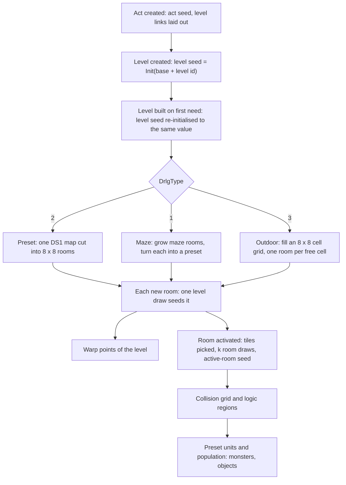
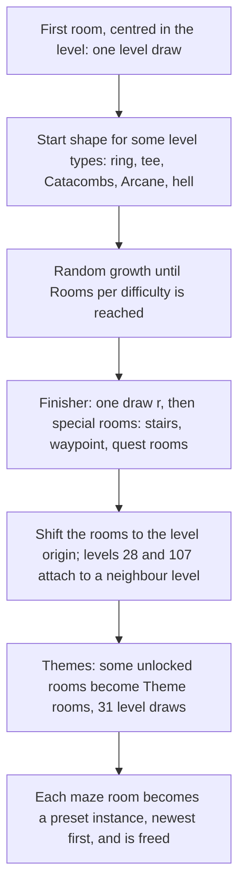
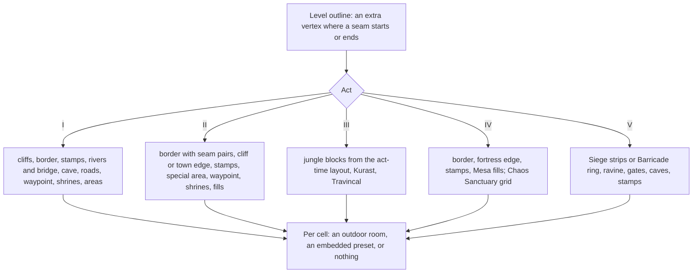
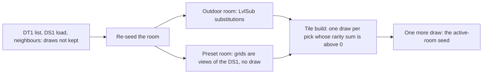
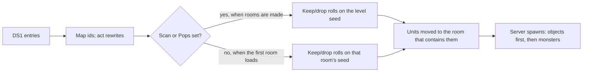

---
based_on:
  - docs/specs/drlg/README.md 2026-10-15
  - docs/specs/drlg/room-tiles.md 2026-10-15
  - docs/specs/drlg/preset.md 2026-10-15
  - docs/specs/drlg/collision.md 2026-10-15
  - docs/specs/drlg/maze.md 2026-10-15
  - docs/specs/drlg/warps.md 2026-10-16
  - docs/specs/drlg/outdoor.md 2026-10-15
---

# How a level is built

Every map you walk in Diablo II comes out of the [DRLG](../glossary.md), the game's level generator. This page
follows it from the top: an [act](../glossary.md) is laid out, each level is built from a [seed](../glossary.md) by one of three
generators (preset, maze or outdoor), the level is cut into rooms, and each room gets its floor and wall tiles, its
preset monsters and objects, its warps and finally a [collision grid](../glossary.md) that monster spawning and object placement read.
It restates the reviewed DRLG specs: the [overview](../specs/drlg/README.md), [room tiles](../specs/drlg/room-tiles.md),
[preset units](../specs/drlg/preset.md), the [maze](../specs/drlg/maze.md) and [outdoor](../specs/drlg/outdoor.md)
generators, [warps](../specs/drlg/warps.md) and the [collision grid](../specs/drlg/collision.md). Where you want the
exact order of every random [draw](../glossary.md), follow the links.

## The big picture

A level has its own seed, and the generator's random choices are draws on that level seed, on the act seed
(while the act is laid out) or on the seeds of the rooms it creates. All of these come from the
[map seed](../glossary.md). The specs give every draw in order, and the recorded games were replayed against them
draw by draw ([overview § Algorithm](../specs/drlg/README.md#algorithm)).

The diagram reads in two halves. The top half runs once per level build and makes **[DRLG rooms](../glossary.md)**: rectangles with a
seed, a type and a DT1 mask that selects its tile files. The bottom half runs per room, later, when the room is
**activated**: only then are its tiles chosen and its active room made, with the grid that units
stand on ([room tiles § Algorithm](../specs/drlg/room-tiles.md#algorithm)).

## Acts, levels and rooms

When an act is created, the game first lays out the act's linked levels (next section), then creates its town and
builds it. Each other level is created with its seed set to the act's [level seed base](../glossary.md) plus the
level id. Creation may make one draw (a preset level picks its map file), but that draw is thrown away: when the
level is actually built, the game initialises the level seed **again to the same value**, so the rooms never depend
on anything that happened between creation and build
([overview § Algorithm, step note 2](../specs/drlg/README.md#algorithm)).

A level is built lazily, the first time it is needed. When the player leaves it, its rooms are freed, and on
re-entry the build runs again on the same level. The freeing is read from the code only, but the rebuild itself is
confirmed: in a recorded Catacombs game, levels 35 and 36 were built three times each and level 34 twice, and every
build gave the same draws, files and rooms. So a level re-entered in the same game is rebuilt with the same rooms
and map files.

Each room a generator creates costs exactly **one level draw**, and that draw seeds the room. So the order in which
rooms are created fixes every room's seed. A room has a **type** ([room type](../glossary.md)): type 1 is an outdoor
room, type 2 a room cut out of a preset map. Maze levels end up with type-2 rooms only
([overview § Outputs](../specs/drlg/README.md#outputs)).

Each act exists in two copies, one for the server and one for the client
([server / client act copy](../glossary.md)); gameplay uses the server copy. The two copies make the same
rooms, but, as later sections show, the order in which their rooms activate can differ, and some per-room results
with it ([room tiles § k](../specs/drlg/room-tiles.md#k)).

## Laying out the act: level links

Before any level is built, the act's [link builder](../glossary.md) places the act's outdoor levels next to each
other ([warps § A](../specs/drlg/warps.md#a-per-act-link-setup), [§ B](../specs/drlg/warps.md#b-the-act-link-builder)).
For Acts I, II, IV and V it walks small tables of levels. Each entry places one level's rectangle against an
**anchor** level, on a side that is usually chosen by a draw on a *copy* of the act seed (a few entries are fixed). If
the act's check rejects the new rectangle (every reject in the recorded games was an overlap), the entry tries its next
side, with no new draw for most entries; if it runs out of choices, the builder backs up one entry. The recorded games
never needed a back-up: every reject was followed by the same entry's next choice, which was then accepted. Act III is different: its jungle layout steps the act seed itself and is part of the outdoor generator
([outdoor § J](../specs/drlg/outdoor.md#j-act-iii)).

Because each table starts from a copy of the same act seed, the first draws of different tables repeat one another.
The builder also writes three things other generators read later: each level's rectangle, the map file index of the
Rogue Encampment and Lut Gholein (from the sides it chose), and the file index of level 27, the Courtyard, from the
link builder's only draw on the act seed itself
([warps § C](../specs/drlg/warps.md#c-level-rectangles-and-the-links-after-the-layout),
[preset § 7](../specs/drlg/preset.md#7-level-27s-file-index)). Both formulas for that index were reached in runs,
but one of their outcomes (index 2) is read from the code only.

Each level carries eight link slots, `Vis0..7` (the destination level) and `Warp0..7` (which warp record). A slot
whose `Warp` is −1 is a [seam](../glossary.md): a walkable border between two touching levels, not stairs. The link
builder writes a seam both ways between each placed level and its anchor; the seams of Act V, and of Act III's
jungle levels, come from a "do these rectangles touch" test instead
([warps § C](../specs/drlg/warps.md#c-level-rectangles-and-the-links-after-the-layout)). Some levels also get a size from the builder that differs from the `Levels` table:
the Blood Moor is 56 × 96 or 96 × 56 depending on its side, and the Barricade-type levels of Act V are 64 × 160 or
160 × 64 ([outdoor § A](../specs/drlg/outdoor.md#a-the-window)).

## Choosing a generator

Each level's row in the `Levels` table names its generator, the [DrlgType](../glossary.md): 1 maze, 2 preset,
3 outdoor. The game dispatches on it twice, once when the level is created and once when it is built
([overview § Algorithm](../specs/drlg/README.md#algorithm)). Whatever the generator, its output is a list of DRLG
rooms, each with a position, a type, a seed and a [DT1 mask](../glossary.md): the bits that pick which tile files of
the level type the room's tiles may come from.

| `DrlgType` | Generator | What it makes |
|---|---|---|
| 2 preset | one map file for the whole level | the map cut into 8 × 8 rooms, rows then columns |
| 1 maze | maze rooms grown edge to edge | each maze room turned into a preset, then freed |
| 3 outdoor | a grid of 8 × 8 cells | one outdoor room per free cell, or an embedded preset |

## Preset levels

A preset level is one hand-made map, a DS1 file. The `LvlPrest` table lists, per preset record, up to six files and
a `Files` count. When a [preset instance](../glossary.md) is placed, one draw picks the file: `Range(Files)` on the level seed. Two details
matter for anyone reproducing it ([overview § Algorithm, step notes 4 and 6](../specs/drlg/README.md#algorithm)):

- `Files` is the operand, not the number of files the row names. A record with `Files` 1 still makes a draw; a
  record with `Files` 0 makes none.
- The level's own index wins. For the Rogue Encampment, Lut Gholein and the Courtyard the link builder has already
  written the index, and that index is used instead of the draw. The draw is still made.

The map is then cut into 8 × 8 rooms, rows outer and columns inner; the Rogue Encampment (56 × 40) becomes 35 rooms
and a 24 × 24 preset 9. Each room costs one level draw. If the preset record has `Scan` or `Pops` set, the game also
reads the map before making the rooms and makes the preset's **[keep/drop rolls](../glossary.md)** on the level seed in between (see
*What a preset places* below). Those rolls therefore shift the seeds of every later room of the level
([overview § Algorithm, step note 5](../specs/drlg/README.md#algorithm)).

## Maze levels

Caves, crypts, the Jail, the Catacombs, sewers, tombs and the other level types listed in
[maze § F](../specs/drlg/maze.md#f-the-chain-per-level-type) are mazes ([maze § Purpose](../specs/drlg/maze.md#purpose)). The generator works with [maze rooms](../glossary.md), all of one
`LvlMaze` size (24 × 24 tiles in the Den of Evil), and builds a graph of them before any real room exists.

**Growth** ([maze § C](../specs/drlg/maze.md#c-random-growth)). While the level has fewer rooms than its `Rooms`
count for the difficulty, the game picks an existing room with a level draw, then picks a direction with a draw on
**that room's own seed**, and tries to put a new room there. A new room that would overlap is freed, but all its
draws are spent. A new room also checks the other rooms it shares an edge with (not its parent, and no locked room)
and may link to each (the `Merge` chance, out of 1000); that check draws on the other room's seed **even when `Merge` is 0 or 1000**, which changes the
direction that room will draw next ([maze § B](../specs/drlg/maze.md#b-primitives)).

**Map pieces from exits** ([maze § B](../specs/drlg/maze.md#b-primitives)). Each maze room gets its `LvlPrest`
record from its exits: on most level types, a bit per side (west 1, east 2, south 4, north 8) added to the level
type's base record; a few level types use small fixed tables instead. A room with only a west exit in the Den of Evil's level
type, for example, is record 53, `Cave W`.

**Special rooms** ([maze § D](../specs/drlg/maze.md#d-special-rooms)). After growth, a [special room](../glossary.md)
pass places the level's Prev and Next stairs, waypoint and quest rooms. Each special replaces a dead end facing the
right way if one exists; otherwise a new room is attached. On most level types a single draw `r` picks the starting
entry of the special tables (the tombs take it from their start shape instead, with no draw), and each following special moves to the next entry, so consecutive specials face different directions. Which specials
each level type places is a table in [maze § F](../specs/drlg/maze.md#f-the-chain-per-level-type); several of its
rows (for example the caves 10–12, Jail 31, the tombs' Tal Rasha and Kaa entries, Lair 64) were not reached by any
run and are read from the code only.

**Placement and themes** ([maze § G](../specs/drlg/maze.md#g-placement), [§ H](../specs/drlg/maze.md#h-themes)).
Growth ignores the level rectangle; afterwards all rooms are shifted so their bounding box sits at the level's
origin. The Barracks (28) and the River of Flame (107) are instead attached to a neighbour level (the Courtyard, the
Chaos Sanctuary) and set their own rectangle. Finally the [theme](../glossary.md) pass locks up to `max(2, rooms ÷ 5 + 1)` unlocked
rooms, of any exit shape except the four-way one, as their `… Theme …` records. It always makes 31 level draws on level types that have themes, whatever it
finds (the Den of Evil skips the pass). The specials come first, so a dead end gets a theme only if no special took it.

**Conversion** ([overview § Algorithm, step 9](../specs/drlg/README.md#algorithm)). Each maze room then becomes a
preset instance (one file draw when `Files` is at least 1, as for preset levels). A forced index can override the
draw, and on some level types a file **rotation** does: the first use of a record in a build draws a start value, and each use, the first included, takes the next
file. A maze room of up to 12 × 12 becomes a single room; a larger one is cut into 8 × 8 rooms. The maze rooms are
then freed, so a maze level's real rooms are all preset rooms.

## Outdoor levels

The outdoor levels are those listed per act in [outdoor § A](../specs/drlg/outdoor.md#a-the-window): Act I's
wilderness (levels 2–7), the Burial Grounds and the Moo Moo Farm, Act II's 41–46, Act III's jungle 76–83, Act IV's
104–106 and 108, and Act V's 110–112 and 117 ([outdoor § Purpose](../specs/drlg/outdoor.md#purpose)). The level is a grid of [outdoor cells](../glossary.md), each
8 × 8 tiles. Each act has its own generator, which marks what each cell is: border, [seam opening](../glossary.md),
road, waypoint, shrine, covered, or part of a placed preset ([outdoor § B](../specs/drlg/outdoor.md#b-the-cell-grid-and-its-bits)).

The main building blocks, all on the level seed:

- **The border pass** ([outdoor § E](../specs/drlg/outdoor.md#e-seams-and-the-border-pass)) of Acts I, II and IV (not level 108)
  walks the outline and places edge and corner pieces (Act V lays its own ring, Act III has none). In Acts I, IV and
  V, where a side borders another outdoor level, the middle cell of that segment becomes the **seam opening**: its map
  file index is forced to 3 (4 on the Burial Grounds), after the rotation draw for that piece was made. Act II places
  a pair of seam pieces there instead, and Act III nothing. The cells along a seam also carry the link slot of the
  neighbour.
- **[File rotation](../glossary.md)** ([outdoor § D](../specs/drlg/outdoor.md#d-placement-primitives)): a preset placed "from the
  rotation" takes the next file of its record. The first use of a record in a build draws a start value, even when
  `Files` is 1, and the first file used is one past the drawn value. This is the commonest draw of the outdoor
  generators.
- **Random placement** shuffles the interior cells (two draws per cell) and takes the first spot that fits. The
  shuffle is drawn in full whether or not anything fits.
- **Waypoint and shrines** ([outdoor § F](../specs/drlg/outdoor.md#f-waypoint-and-shrines)) only mark cells. The room
  later made on that cell runs the `SubWaypoint` or `SubShrine` substitution, which is what puts the waypoint or
  shrine tiles there. A level gets up to five shrine cells. The Cold Plains waypoint is placed on the first cell of
  the Blood Moor seam opening, pulled inside the border, with no draw.
- **[Border stamps](../glossary.md)** ([outdoor § G](../specs/drlg/outdoor.md#g-border-stamps)): five `LvlSub`
  records act as rewrite rules on the cell grid (cliff and border shapes), matched and stamped at shuffled positions.
- **Act I extras** ([outdoor § H](../specs/drlg/outdoor.md#h-act-i)): a river column and bridge, a cave entrance in
  a cliff or a corner, or else at a random spot (in the Blood Moor, the Den of Evil entrance, placed as far as
  possible from the Rogue Encampment), and the roads, whose tiles are laid when each road room is prepared
  ([outdoor § M](../specs/drlg/outdoor.md#m-the-out-room-grids-at-the-room-prepare-and-the-act-i-road-tiles)).

When the act generator is done, the rooms are made row by row ([overview § Algorithm, step 8](../specs/drlg/README.md#algorithm)).
A cell that anchors a preset makes a preset instance; its file draw (when `Files` is at least 1) is made and then
overwritten by the index the generator stored in the cell. A cell covered by a preset makes nothing. Every other cell makes one 8 × 8 outdoor
room, which right away rolls its `LvlSub` substitutions on its **own** room seed. Each record passes with its
`Prob` chance for the level's theme and adds tile files to the room's DT1 mask.

No outdoor generator branches on difficulty, expansion or player count: one model reproduces all three
difficulties and, for Acts I–IV, both classic and expansion games. Level 134 (Pandemonium Run 2) uses the Act II
generator by the code, but no run built it.

## Room tiles and the k draws

When a DRLG room is activated, the game re-seeds it from the value stored at its creation, builds its floor, wall
and shadow tiles, and then makes one more draw to seed the active room
([room tiles § Purpose](../specs/drlg/room-tiles.md#purpose), [§ Algorithm](../specs/drlg/room-tiles.md#algorithm)).

**The tile list.** The room's DT1 mask selects tile files from its level type's `LvlTypes` row, and three fixed
files are added at the end ([DT1 list](../glossary.md)). A preset room's mask is its `LvlPrest` record's `Dt1Mask`; an
outdoor room's is a value per level type OR the `Dt1Mask` of the substitutions it rolled. The value for level type 2
was checked in 56 rooms; the values for the other level types are read from the code only
([overview § Inputs](../specs/drlg/README.md#inputs)).

**The tile pick.** Each map cell names a tile key (orientation, main index, sub index). The game gathers the tiles of
that key from the list (at most 40, a limit read from the code) and sums their `rarity`. If the sum is above 0 it
makes **one** draw on the room seed, even when only one tile is a candidate; if the sum is 0 it takes the first tile
with no draw. The runs checked the keys and the seeds, not which tile was chosen, so the tile choice itself (as
opposed to the draw count) is read from the code only.

**k.** The number of room-seed draws between the re-seed and the activation draw is called [k](../glossary.md). It
counts the substitution draws of an outdoor room, one per pick with a positive rarity sum, and the draws of a unit
rule on some wall cells (orientations 8 and 9), and it fixes the
active-room seed, which monster and object placement later draw on ([room tiles § k](../specs/drlg/room-tiles.md#k)).
k was predicted exactly for all 520 room activations of the first run (k from 0 to 388), and for 12 974 more
activations in later runs.

**Why k depends on what is already built.** Neighbouring rooms share their edge cells, and both rooms build them
(unless a preset's `KillEdge` drops its own outer edge). The second room
to build a shared cell looks for the tile the first one placed and either adds a new tile or merges with it (the
[bit-2 path](../glossary.md)). So the number of picks, and k, depends on which neighbours were already built: the
server and client copies of one room can get different k. In one recorded town room, k was 64 on the server and 55
on the client, from the same grids and tile list. A merge can even re-pick a tile on the **neighbour's** seed, which
moves that neighbour's seed after its own activation.

A built room can also be released while its level stays loaded and later activated again. That path is read from
the code only; no release was logged ([room tiles § Release and re-activation](../specs/drlg/room-tiles.md#release-and-re-activation)).
By the code, the room restarts from the same seed but may get a different k, because its neighbours may have
changed.

## What a preset places: units and keep/drop rolls

A DS1 map lists objects, monsters, NPCs and their walking paths. These become [preset units](../glossary.md)
([preset § Purpose](../specs/drlg/preset.md#purpose)).

**Rewrites by act** ([preset § 1](../specs/drlg/preset.md#1-the-ds1-unit-list)). A few monster entries become objects
when the map is read: in Act III Natalya and the compelling orb, in Act V Nihlathak and three more ids (536 < id ≤ 539).
All four rewrites were reproduced in runs.

**Keep/drop rolls** ([preset § 3](../specs/drlg/preset.md#3-the-keepdrop-rolls)). Ten unit ids are
kept or dropped by chance, one draw each. Everything else, [superuniques](../glossary.md) included, is always kept with no draw.

| Unit | Kept with chance |
|---|---|
| MonStats 204, 205 (`act2vendor1`, `act2vendor2`) | 1/3 |
| MonStats 371 `lightningspire`, 372 `firetower` | 1/3 |
| MonPlace `place_group25` | 3/4 |
| MonPlace `place_group50` | 1/2 |
| MonPlace `place_group75` | 1/4 |
| objects 196, 261 (floor traps) | 1/2 |
| object 581 | 3/4 |

The `place_group25` and `place_group75` chances run **against their names**: 25 is kept three times in four, 75 once
in four. That is the code, and every observed outcome matches it. The rolls walk the units from the **last** one in
the file, and no difficulty, expansion or player-count test is involved.

**Which seed.** Each preset instance rolls exactly once ([preset § 2](../specs/drlg/preset.md#2-which-seed-rolls-and-when)).
With the record's `Scan` or `Pops` set, it rolls on the level seed while the rooms are made, so the rolls move every
later room's seed. Otherwise the first room of the instance to load rolls on its creation-time seed, just before its
re-seed, so those draws change nothing else; but they still decide the units of every room of the instance. Server
and client copies roll separately, and with the room-seed roll they agree only when the same room loads first in
both (that agreement condition is read from the code).

**Units the game adds** ([preset § 4](../specs/drlg/preset.md#4-units-the-game-adds)). Some river presets get ambient
river objects that exist only in the client copy. In the Blood Moor, by the code, a preset of record 4–7 with
file index 3 gets a monster (`navi`) at its centre; no run built that case.

**To the room and to the spawners** ([preset § 5](../specs/drlg/preset.md#5-from-the-instance-to-the-room),
[§ 6](../specs/drlg/preset.md#6-handover-to-the-server-spawners-boundary)). Each unit moves to the room whose
rectangle holds it. When the server later fills the room, it walks the list twice, non-monsters first, then
monsters; a unit whose skip flag is set, such as the client-only river objects, is skipped (read from the code). This is where the [monsters](monsters.md) and
[objects](objects.md) pages take over.

**`Populate` 0 is not "no monsters"** ([preset § LvlPrest columns](../specs/drlg/preset.md#lvlprest-columns)). A
preset record with `Populate` 0 turns off the *random* population of its rooms, but its preset units still spawn: in
Harrogath and the Pandemonium Fortress 48 preset monsters were created. The same no-population flag is also set on a
room outside a town that borders a town level.

## Warps, stairs and seams

Stairs and cave mouths come from the maps themselves ([warps § D](../specs/drlg/warps.md#d-room-flags-and-level-points-from-a-preset-instance)).
A wall cell of a warp orientation in a DS1 carries a [warp slot](../glossary.md) *m*: it means "this is the way to
`Vis`*m*". When the map of a preset whose `Scan` column is set is scanned, that slot becomes a flag on the room that
holds the cell, and so does a waypoint object. Every preset room is also pre-flagged with the seam slots of its level.
In a maze level the warp rooms are exactly the specials and fixed rooms whose map holds a slot; outdoor generators
flag their own seam rooms and waypoint cells.

**[Warp points](../glossary.md)** ([warps § E](../specs/drlg/warps.md#e-warp-points)). At the end of every level
build, the game lists the centre of each room that has a waypoint flag or a warp slot with a real warp (seams don't
count). The [population pass](../glossary.md) reads this list to test whether a spawn point is too close to a warp (next section).

**Pairing** ([warps § F](../specs/drlg/warps.md#f-warp-pairing)). By the code, when a room with a warp flag
activates, the game builds the destination level if needed and finds the matching room there. If a level names the
same destination in several slots (a wilderness level with four cave slots), the slots are paired in order by rank;
when rank fails, the first destination slot that names the source and has a room is taken. Rank alone mispairs the
Durance levels and some caves, so the fallback matters. 172 pairings were predicted without error.

## The collision grid and logic regions

When a room becomes an active room on the server, it gets a collision grid: one 16-bit cell per
subtile (five per tile in each direction) of its rectangle ([collision § A](../specs/drlg/collision.md#a-the-grid-build-at-activation)).
The grid is built once, from the tile data of the room and of its already active neighbours, and then every unit
that stands in it marks its footprint and unmarks it when it moves, dies or leaves
([collision § F](../specs/drlg/collision.md#f-unit-marks)).

**Built once, never redone.** Only tiles whose top-left corner lies in the room are stamped, and only from rooms that
are active at that moment. A grid is not stamped again when a neighbour activates later. So a room's border tiles can
end up in no grid at all if its right or bottom neighbour was active first; the run found 702 such rooms.

**Outside the room.** A cell outside every room the test can reach (the room and its [near list](../glossary.md))
counts as blocked, whatever the test asks for, with one exception: a plus-shaped test whose centre is outside
returns just the mask it was given ([collision § C](../specs/drlg/collision.md#c-cell-access-and-the-out-of-room-values)).
The spec notes that this is what keeps monsters off the rows next to an inactive neighbour.

**What blocks a spawn** ([collision § D](../specs/drlg/collision.md#d-the-u16-word-bit-by-bit)). For the default spawn
test, tiles block only through bit 0 of their cells. Earlier monsters block only through the centre marks of
their [footprint pattern](../glossary.md), not through their whole footprint, so a new monster may be placed with one
cell of an earlier monster's footprint inside its own. What most of the other bits mean to movement, missiles and
line of sight is not specified: those readers have not been read.

**[Logic regions](../glossary.md)** ([collision § G](../specs/drlg/collision.md#g-logic-regions)). Each room also gets
a list of [logic boxes](../glossary.md), the rectangles the population pass makes its spawn attempts in. An outdoor
room, or a preset room whose record has `Logicals` 0, is one box covering the room (that builder is read from the
code). A preset with `Logicals` 1 floods its tiles into regions separated by walls, cuts them into rectangles and
relabels regions that continue into neighbour rooms; the flood was reproduced 378 times, while the wall grid it
starts from was taken from the run, and the cross-room relabelling was only counted, not traced in detail.

**Side effects of the warp test** ([collision § I](../specs/drlg/collision.md#i-nearwarptestgame-room-x-y-and-its-side-effects)).
The "is this point too close to a warp" test that spawning calls is not a pure test. When no warp point is near, it
looks up the level's waypoint point, which can **activate a room** in the middle of the population pass (17 times in
the run) and, in a level whose `Levels` row has `Position` set and that has a matching waypoint point, **step the level seed**
once per call (seen only in Tristram, 20 times; the other such levels are read from the code). The order in which spawning calls its tests is fixed, and a test that fails skips the later ones
([collision § The predicate order](../specs/drlg/collision.md#the-predicate-order-in-the-population-pass)).

## A worked example: the Den of Evil, map seed 12345

All numbers below are copied from the specs' worked examples; seeds are written `low:high` in hex. The Den of Evil
is level 8, a maze level (`DrlgType` 1) of level type 3, with a level seed base of `015B2E77`
([overview § Worked example](../specs/drlg/README.md#worked-example)).

**The maze** ([maze § Worked example](../specs/drlg/maze.md#worked-example), example 1). `LvlMaze` gives `Rooms` 1 in
every difficulty, 24 × 24 rooms. With one room already there, growth makes no draw at all.

| # | Draw | Seed after | Effect |
|---|---|---|---|
| 1 | finisher `r` | `C20781F3:5E130228` | value 3 |
| 2 | Prev stairs, entry 3 | `06E4B227:50ED9B57` | no room has record 53: a new room is attached east of the first; the first becomes 54 |
| 3 | Den of Evil room, entry 0 | `334AA35A:02E00A8C` | the first room is 54, not 60: a new room is attached south of it; the first becomes 58 |

Level 8 has no theme pass. The result, newest first: record 98 at (1500, 1024), record 83 at (1524, 1000), record 58
at (1500, 1000), all 24 × 24.

**The conversion** ([overview § Worked example](../specs/drlg/README.md#worked-example)). Records 53–67 rotate on this
level type.

| Step | Operation | Level seed after | Result |
|---|---|---|---|
| re-seed | level seed set to base + 8 | `015B2E7F:0000029A` | |
| first maze room | one room creation | `E18C3A55:0090CE8A` | |
| maze generator | (above) | `334AA35A:02E00A8C` | three maze rooms |
| record 98, `Files` 1 | `Range(1)` | `12CE5ECE:1564B05F` | index 0 (a draw even though there is one file); `Act1\Caves\CaveNSpec.ds1` |
| | 24 × 24 → 9 rooms | `42DB84E5:07D80981` … `F38BE870:3FC9280D` | |
| record 83, `Files` 2 | `Range(2)` | `83D2063D:6594D62E` | index 1: `Act1\Caves\CaveWPre2.ds1` |
| | first room of its split, at (1524, 1000), 8 × 8 | `0EE3F31F:36FB3592` | its stored creation draw is `8E258975` |
| record 58, `Files` 2 | `Range(2)` | `35E895EF:42FA8C7C` | index 1, then overridden |
| | 58 rotates, first use: `RangeB(2)` | `80265D67:167C1E75` | start 1, then (1 + 1) mod 2 = 0: `Act1\Caves\CaveSE.ds1` |

**One room's activation** ([room tiles § Worked example](../specs/drlg/room-tiles.md#worked-example)). The room with
creation draw `8E258975` is re-seeded to `8E258975:0000029A` on the client copy. Its tile list is `Cave.dt1` plus the
three fixed files. Its floor pass makes 15 draws: one for a border floor cell and 14 for other floor cells, all of key
(0, 5, 0), whose nine candidate tiles have rarities summing to 13; the other cells have a rarity sum of 0 and draw
nothing. So k = 15, the seed after the last pick is `6CC2E5DB:673E363A`, and the activation draw gives
`2FE647C1:2D5D0F6C`: the active room's seed is `Init(2FE647C1)`.

## A worked example: a keep/drop roll in the Catacombs

From [preset § Worked example](../specs/drlg/preset.md#worked-example): Catacombs Level 2 (level 35), preset record
267, file `Act1\Catacomb\CatNE.ds1`, 12 × 12, so a single room. Its `Scan` and `Pops` are 0, so the room rolls on its
creation seed, `653A205E:685C5276`. The file holds two candles, a pool of blood and one `place_group50`. The roll walks
from the last entry, so `place_group50` is first: the draw gives `F5001ACC`, the test keeps it only if the lowest bit
is 1, and `F5001ACC` is even, so it is **dropped**. The three objects need no draw and stay. The room's later re-seed
is `Init(653A205E)`, so this draw changes nothing else in the room.

The same section shows a level-seed roll in Lut Gholein: with `LutW.ds1` both vendors (204, 205) drew `r mod 3` = 2
and neither was kept; with `LutN.ds1` both drew 0 and both were kept.

## What is not known yet

These points are read from the code but not confirmed by a run, or are open questions in the specs. Each links its
section.

- **Generator dispatch** ([overview § Open questions](../specs/drlg/README.md#open-questions)): the substitution
  roll's branch for a `SubType` or `SubTheme` of −1 and the position of each outdoor room are read from the code only; the recorded games
  check seeds and masks, not room positions. The outdoor room DT1 mask values for level types other than 2, and the
  freeing of a level's rooms when the player leaves, are code-read too.
- **Maze paths not reached** ([maze § Open questions](../specs/drlg/maze.md#open-questions)): the Barracks attached on
  the west or east side (level 27's index was 1 in every log), the tombs' Tal Rasha and Kaa entries and their larger
  room counts, Lair 64, Crypt 21–24 and 133, Jail 31, the caves 10–12, Dungeon 87 and 89, a special that no room can
  take, and the "level too small" error.
- **Outdoor** ([outdoor § Open questions](../specs/drlg/outdoor.md#open-questions)): level 134 is not built by any
  run (the cube cannot open its portal in this version); several rare branches (a link-builder back-up, roads with
  5 or 6 endpoints, a waypoint pass with no free cell, and others) were never reached.
- **Room tiles** ([room tiles § Open questions](../specs/drlg/room-tiles.md#open-questions)): some tile-merge branches
  between outdoor rooms, the release and re-activation of a built room, the fallback tile, and a room with no tiles
  were never exercised. One shipped file (`Act1/Outdoors/Trees.ds1`) is 12 bytes short; reading the missing bytes as
  zeros matches every observed draw, but the original reads whatever is in memory there.
- **Preset units** ([preset § Open questions](../specs/drlg/preset.md#open-questions)): the Blood Moor centre monster,
  the river objects of three preset types, level 27's index 2 and the special filters of levels 133–136 were not
  reached. What a path point's `action` does, who detaches a preset monster's path between two builds of a room, and
  who reads the `Outdoors` flag are unknown.
- **Warps** ([warps § Open questions](../specs/drlg/warps.md#open-questions)): only one map seed was logged for the
  link builder, so many side choices are read from the code. What happens when the Matron's Den stairs (133 → 17),
  which have no way back, are used is unknown; so are the units of the warp exit offsets, and whether a level can
  have more than nine warp points.
- **Collision** ([collision § Open questions](../specs/drlg/collision.md#open-questions)): the reader of the missile
  mark in spawn tests, the clear-and-restamp of a merged tile, single-cell placement tests, three special-class spawn
  checks, NPC footprints, the level-seed step in the Arcane Sanctuary and Canyon of the Magi (seen only in Tristram),
  the wall grid behind the logic regions, and the meaning of the bits that only movement reads.

## Where to read more

- The specs: [overview](../specs/drlg/README.md#algorithm), [room tiles](../specs/drlg/room-tiles.md#algorithm),
  [preset units](../specs/drlg/preset.md#algorithm), [maze](../specs/drlg/maze.md#algorithm),
  [outdoor](../specs/drlg/outdoor.md#algorithm), [warps](../specs/drlg/warps.md#algorithm) and
  [collision](../specs/drlg/collision.md#algorithm). Each has a *Reimplementation notes* section listing the traps.
- The [glossary](../glossary.md) for every term linked above.
- Related wiki pages: [randomness](randomness.md) (the seed tree behind the level and room seeds),
  [monsters](monsters.md) (the population pass that uses the logic boxes and the collision grid),
  [objects](objects.md) (how preset and random objects are created) and [how we know](how-we-know.md).
