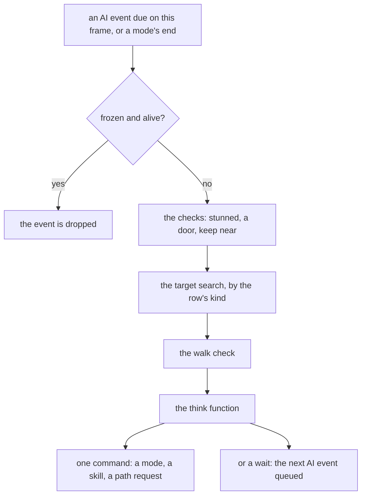
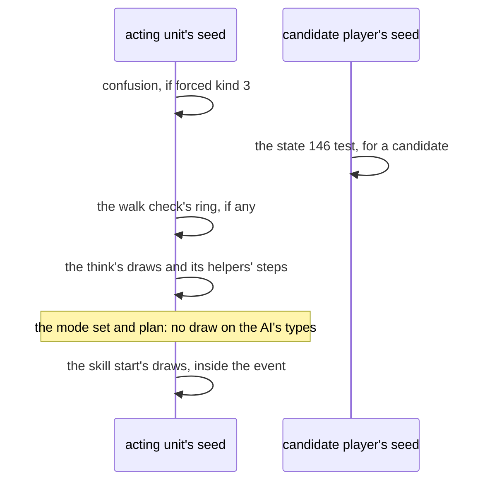

---
based_on:
  - docs/specs/monsters/ai/README.md 2026-11-04
  - docs/specs/monsters/ai/machinery.md 2026-11-04
  - docs/specs/monsters/ai/catalogue.md 2026-11-04
  - docs/specs/monsters/special.md 2026-11-03
---

# Monster AI

A monster, a summon or a hireling does not think on every frame. It has an **[AI event](../glossary.md)**, which comes due on a
frame or is called when a mode ends. One event runs a few checks, looks for a target, and calls the unit's
**[think function](../glossary.md)**, chosen from a table by the MonStats `AI` column and the unit's AI state. The think draws on
the unit's own seed and gives one command: a mode, a skill, a path request, or a wait until the next event. This page explains
that system and how much of it has been checked. It restates the [overview](../specs/monsters/ai/README.md#purpose), the
[machinery](../specs/monsters/ai/machinery.md#purpose) and, for row detail it does not repeat, the
[catalogue](../specs/monsters/ai/catalogue.md#purpose).

The mode's frames are [animation and timing](animation.md). The skill behind a command is [skills and missiles](skills.md). The
planners behind a path request are [pathing](pathing.md). How a monster is created is [monsters](monsters.md).

## How sure each statement is

This page names its ground at each statement, because the kinds differ and do not add up
([overview § G and § H](../specs/monsters/ai/README.md#how-far-this-is-evidenced)).

| Kind | What it is | Where it stops |
|---|---|---|
| **Seen in a game** | Logged in the game and compared with a model: the three kept batches of AI logs, a first run, a second of 21 sessions and a third of 17 logs. | It holds for what the logs hold. A decision compared "at its first call" says nothing past that call. |
| **Emulated** | The game's own code run on declared inputs, up to its first callee. | It shows that code's map up to that call: no callee, and no store or command after it. It does not show what the game passes in. |
| **Read from the code** | A reading of the instructions or of a finding. Nothing ran. | No run has checked it. [Not every catalogue block has yet been read against the instructions](#how-far-the-blocks-have-been-read). |
| **A consistency check** | A model walks on past the first call, taking each call's logged result, and forks where a branch reads a value the log does not hold. | A model that forks cannot fail at the fork, so it raises nothing. |
| **Unknown** | Listed under [The shorts](#the-shorts-by-name) and [What is not known yet](#what-is-not-known-yet). | |

**Past its first call, a think's block is a code reading**, except on [the logged paths named below](#past-the-first-call). Sections
say how sure they are at their head and name the exceptions.

## The big picture

The order is [overview § B](../specs/monsters/ai/README.md#b-the-tick)'s, read from the code. The think call is where the logs
compare a decision.

A stop at any step ends the event. The checks, in order:

1. **Freeze.** A unit in state 1 that is alive loses a due AI event, and the freeze queues a new one for after its length.
2. **Stunned** (state 21): idle 3 frames, and the event ends.
3. **A door.** A class with `opendoors`, on a cell with one collision bit, looks for the nearest closed door. It may operate it, then idles 5, and the event ends.
4. **Keep near:** [Following](#following).
5. **The target search** by the row's kind ([below](#the-table-and-the-state)).
6. **The walk check**, only with a target. A boss sight pause comes first: class 250, a champion or unique, or a boss, under distance 20
   from a player target, fires a unit event, idles 20 and ends this event, once only. Then a unique mod's teleport try. Then, for an
   `isMelee` class whose mode allows it, in a level with `MonSpcWalk` set and the distance above it, an approach test: passing goes on with the
   same target; failing searches for a hostile with a teleport point, which replaces the target, or with none walks a ring of 4 and ends
   ([overview § F](../specs/monsters/ai/README.md#f-the-pre-checks-and-the-walk-check)).

Seen: of 32 324 logged events in the first run, 14 645 reach the think call and 17 679 end before it, with the AI state 0 at all
of them ([overview § A](../specs/monsters/ai/README.md#a-the-event-kinds-and-their-seeds)).

## When a unit thinks

All of this is read from the code ([overview § B and § C](../specs/monsters/ai/README.md#c-when-the-next-ai-event-comes)).

**Two entries.** The event runs from the queue, or by one of nine direct calls at a mode's end, each skipped while frozen and
alive. From the queue it runs in the frame's monster pass, after every monster's every-frame event of that frame, in the order the
events were queued. From a mode's end it runs inside that mode-end event, so its draws come at that event's place in the frame.

**What queues the next one:**

| Who | What it does |
|---|---|
| A mode's neutral start | When no AI event is pending later than now: 45 frames if stunned, else the `aidel` column, whose value is the first difficulty's or, under a test of two game fields, the game's difficulty's; 15 when that is 0. |
| An idle of n | Neutral mode unless already neutral, any pending AI event cancelled, the next at now + n, at least 1. |
| A delay of n | The same with the mode unchanged. |
| A delay that only brings it earlier | The same, but only when nothing is pending, the pending one is due now, or it is due at or after now + n. |
| Others | 30 queueing sites in all, among them skills, a freeze, a restore and a knockback's end. 66 sites cancel one. |

A think that queues nothing leaves no pending event, and such a unit next thinks at a mode's end. So a monster that commands a mode
usually gets its next event from that mode's end, an idle one with no target from its row kind's idle delay, and a think may also
queue one while a mode runs, in which case the next command replaces that mode. Every command goes through one mode-set routine,
which replaces the current mode.

**A small example:** idle 5 at frame 1 000 cancels any pending AI event and queues one for frame 1 005, and idle 0 queues one for 1 001.

## The table and the state

**The table.** 148 rows, each giving a search kind, an init, a think and an alt, and 18 more rows for AI states
([overview § D](../specs/monsters/ai/README.md#d-the-ai-table-and-its-dispatch)). There are 147 distinct thinks: rows 106 and 143 share
one. A MonStats row names 146 of the rows; rows 0 and 143 are named by none. Rows 0 and 1 are bare: 0 returns at once and 1 idles 200
with a room. A class whose `AI` is outside the table gets row 0. The row-address map, for states 0 to 9 and 13 to 17, ran under
emulation, 554 cases. The table's words are bytes of the image, and what they do is read from the code.

**The search kind** decides when the think runs. It is the kind of the row for the *stored state*, not the class's: a unit in state
12, when that state's gate allows it, skips the search even if its class's row searches.

| Kind | Rows | Search | The think runs | With no target |
|---:|---:|---|---|---|
| 0 | 26 | none | always | |
| 1 | 104 | the target search | only with a target | a ring walk or an idle, and the event ends |
| 2 | 16 | the target search | either way | |
| 4 | 1 | the target search | only with a target | a ring walk, or the next event in 20 frames |
| 5 | 1 | the target search | either way | as kind 4, and then the think runs |

Any other kind stops the event, and no stock row has one. With no target at kind 1, a unit on a cell that fails a collision test, or with one unit word at 3 or 19, walks a ring of 5 if its
mode allows it. Otherwise it idles by the nearest checked player's distance `d`: 10 under 25, `d − 10` from 25 up to 35, and 25 from 35 up.

**The AI state** is a word on the unit, not its mode. 0 uses the class's row, and anything else uses the state row, except that
states 10 to 12 use it only when a class test allows it. An init routine sets the state, clears the three AI variables and frees the
parameter records. When the row being left has an alt, the alt runs for one event as a bridge and then does the full init. All read
from the code ([overview § E](../specs/monsters/ai/README.md#e-the-ai-state-on-the-unit)).

**Who sets a state**, by reading: a curse by its `auratargetstate` (states 10, 11 and 12), a flee routine (11), the cloak callback (10), a
superunique case (13), the hireling row (5 and 6), and two more skill routines (15 and 16). No call passes 2, 3, 8, 9, 14 or 17 as an immediate, the
sites passing a register give no new value, and states 4 and 7 meet the same scan. That is a reading: no spec calls those rows dead.

**Seen live.** In the second batch's 21 sessions (Normal, 7 539 decisions, 10 721 events) the state is 0 in every logged line except in
two sessions, which hold states 10, 11 and 12, and states 1 to 9 and 13 to 17 occur in no line. In the third batch's 17 logs it is 0 in 5 894
decisions, 10 in 594, 11 in 36, with 12 absent. This is a statement about those logged lines: the word is read only at a decision or an event,
and the curses not cast, Nightmare and Hell are outside it.

**Who has which row.** A monster's row is its record's. Every hireling row's class uses row 61. Summons enter like any monster; which
summon uses which row is [overview E10](../specs/monsters/ai/README.md#e-the-ai-state-on-the-unit).

## Finding a target

All of this is read from the code unless it says otherwise ([machinery § A](../specs/monsters/ai/machinery.md#a-target-search)).

**The lists.** The game holds ten target lists. Lists 0 to 7 are one per player slot, the player first and then its hirelings and
summons. List 8 holds wanderers and units from two AI functions, and list 9 holds decoys.

**The search**, for a searcher of alignment 0:

1. A forced target comes first (below). Otherwise the best distance starts at the difficulty's `aidist`, 35 when that is 0.
2. For each player list, the player counts only when in the searcher's act, in a room, and not in a town. A counted player at distance
   55 or more skips the whole list. A player in a town is never a target and its list's pets are skipped with it. A dead player's
   distance reads as out of reach, and its list's later units are still taken.
3. Any unit in the list is taken when nearer than the best so far and the line test passes. The list's later units have no act, town
   or death test here.
4. List 8 comes next, with the act test, against the same best. Then list 9 chooses: the nearest decoy, which has no range limit, wins when there is no
   other target, or when it is under 6 away and a test plan to the other target finds no point (and a further search finds nothing
   within 19).

A searcher of another alignment uses a unit search from its logic region instead, from 35, and the same decoy step. So, forced targets aside, a target is
never taken at or beyond `aidist`, and a decoy has no such bound.

**The line test.** A one-shot flag, set by a refused move under one of the [command's flags](#the-command), forces it on. Otherwise it is
off outdoors. Indoors it is on until the monster has had a target and nothing has cleared that flag. A further record, when a monster has one, can turn
it off, its word toggled at each find. A searcher of alignment 2 sets neither.

**The forced target.** Taunt, attract and confuse set a kind and an id. Kinds 1, 2 and 4 look up the unit. Kind 3, confusion, draws on the
searcher's seed, flips the alignment for the search and restores it. A unit that does not qualify clears the kind and the id.

**A think's own hostile.** Some thinks ask for it: the forced target, else the nearest hostile within 49 with a line test, then the
same decoy rule. After it, some of a think's distance tests read the event's distance and others the hostile's, as each entry says.

**The hostile searches' test holds one draw.** A candidate must be a living player or monster out of town. A **player** with state 146, outside
melee range, is refused on a draw below 80 of 100, and that draw is on the **candidate player's seed**, not the searcher's. A **monster**
with state 146 is refused inside melee range.

**The distance.** Twice the larger axis difference plus the smaller, all halved and rounded down: 10 and 3 give 11. That map ran under
emulation, 240 cases over the six unit types. A sized form first takes the unit's size off both axes, with a floor of 0.

**No light radius, as far as read.** The search's functions call no stat getter, and no code reads that stat by an immediate id. The 215
getter calls with a register id are not resolved, so the walkers' and callbacks' code is not placed in or out. The one visibility term the
server's code was found to hold is state 146.

## The command

Read from the code, with the two emulated maps named ([machinery § B](../specs/monsters/ai/machinery.md#b-the-command)).

A think commands through a small set of helpers, all ending in the mode-set routine: **a mode** at a unit or a point, **a skill** with its
mode (a mode of 16 or more stops there), **a sequence skill** in mode SQ, and **a move**. A refused mode falls back to the neutral start. A
refused skill idles 10.

**A refused move depends on its flags**, and this decides a draw:

- With the flags clear it returns 0, with no idle and no draw, and nothing is queued.
- One flag cancels the AI event, and one sets the search's one-shot line test.
- Only the third adds one step of the unit's seed, then a ring walk of 4 on a result below 70 of 100, else an idle of 10.

**The walks that draw.**

| Walk | Draws, on the acting unit's seed | How sure |
|---|---|---|
| The ring walk: a point at a given radius from the unit | 4 steps, 3 when the radius is 0, before its move | Its map to the move ran under emulation, 200 cases; the move and after are read |
| The sideways approach | 1 step, which picks path type 5 or 6 by the low byte | Its map to the override ran under emulation, 120 cases |
| The step away | none in its body | Its map to its first call ran under emulation, 200 cases |

The approach to a unit at a given distance draws nothing either (read from the code).

**Seen.** The commands logged at the AI's sites of the mode set are led by WL 6 133, RN 1 533, A1 712, A2 425, SQ 289 and S1 375, with path type
byte 101 for every-frame modes and 100 otherwise. A few of S2, S4, S3, NU and mode 7 also occur.

## The path request

Read from the code unless it says seen ([machinery § D](../specs/monsters/ai/machinery.md#d-the-path-request)). The planners are
[pathing](pathing.md)'s, and they read the live grid.

A command carries a path type: 100 means no plan, 101 means type 13, and the choice between them follows whether the mode is an
every-frame one. A think can set a **one-shot override** of the type, a step parameter and a byte, used by the next plan and then cleared.

- **Each word is stored only when non-zero**, so a later override with 0 keeps what an earlier call set in this event.
- The step parameter is limited to −126 to 126, and outside that is fatal. The byte is capped at 77 and defaults to 5.
- **An override of type 1 plans type 7** through the usual call. A lower routine does pass 1, at five sites.
- With no point after types 2, 7, 9 or 13, the plan is run again as type 15.
- The types the AI passes are 1, 2, 5, 6, 7, 13 and 15, plus the default 13. None passes 4, 10 or 14.

**Seen.** Inside decisions of the first run, all 9 618 logged plan calls with an exit line leave the unit's seed unchanged, on types 2, 5, 6, 7, 13 and 15. 316 more have no exit line, which is not examined. Type
1 was not requested in that run, so "no draw" for it comes from [the planner's own emulation](pathing.md#best-first-type-1).

**The town.** Every AI path type ends in a planner that runs only after the plan's town test, and a hostile searcher never takes a player
in a town as its target. Whether a stock town's geometry admits such a route stays open.

## Following

Read from the code ([machinery § E](../specs/monsters/ai/machinery.md#e-following)).

**Keep near** runs in the checks before the search. A unit with a stored unit to keep near, and whose mode allows it, looks that unit up; gone or
dead clears it.

| AI distance to it | What happens |
|---|---|
| Below 2, when it is a player | Steps 19 away and ends the event; a refused step wanders a ring of 19 around it instead, and ends |
| 21 or more | An override and a ring of 19 around it, 4 steps of the seed, and the event ends |
| Anything else | The AI goes on |

The pair is written for a minion toward its boss, by revive and summon routines, and by Taunt.

**The owner and the group.** A leader is a unit whose owner is itself. A leader's call pushes a copy of a small record to each minion of its
owner, and rows 6, 13 and 20 use it with a block whose kind word is the only one written, so the other four words the copies take are whatever
the stack held. One row, 30, reads two of those words from a record of that kind. Thinks read such a record from a list held on the unit.

## Draws and seeds

([overview § A](../specs/monsters/ai/README.md#a-the-event-kinds-and-their-seeds), [machinery § F](../specs/monsters/ai/machinery.md#f-draws-and-seeds-of-the-helpers))

**A worked draw**, read from the code: a chance with `aip1` = 50, on a step whose new low word is 1 234 567, gives 67, which is not below 50, so
the branch is not taken and the seed has stepped once. A chance is one step each, and it short-circuits: a test placed after a failed one makes
no draw. So keep the order of the tests.

**Seen in the first run:**

- Every logged point of a decision (entry, think call, boundaries, mode set, plan, skill start, exit) follows the one before by whole steps of
  the acting unit's own seed, 0 to 7 steps, with 0 violations in 14 645 decisions. The state 146 draw is on another seed and is not logged.
- 899 skill starts of the decision's unit between the think call and the exit, each entered at the decision's last logged seed advanced 0 to 12
  steps (0 steps 791 times), and each exiting with the event's exit seed.
- A decision's exit seed equals the same unit's next decision's entry seed in 12 368 pairs, 9 687 of them with draws. Over the three batches every
  tier AI but two has at least 20 drawing pairs: Fetish 22, the other 15 at 58 or more. The two are [named below](#the-shorts-by-name).

**The gaps between two skill events of a monster.** With the AI logged beside the skills, 41 of the 49 gaps of six replayed sessions close: every
entry seed on the way agrees with the walking seed, and the next skill event starts inside the unit's own decision, at 0 steps from its last boundary line. All 41 are row 13, and the
resumed model reproduces every decision between the two events (91). That is on logged paths only, and the callee that starts the skill is a
boundary. The other 8 stop at an attack line with the monster as attacker, its seed 1 to 4 steps past the walking seed, and which draws those are is not examined.
The 331 gaps of the skills runs cannot be walked again: their logs hold no AI line and a replay does not reproduce them. They have the same shape,
which is all their logs can say, and 330 of them are of classes 58 and 59.

**A summon's owner skill damage** is seen for one class and one skill at one level, with one player, and is on
[skills and missiles](skills.md).

## The 18 tier AIs

Each has a full entry at [machinery § T](../specs/monsters/ai/machinery.md#t-the-tier-ais), with its draw order as pseudocode. **The third column is
read from the code**, a short gloss, and it leaves out most branches. All run only with a target except rows 61 and 67, which run without a search.
Only rows 29 and 61 have an alt. The last three columns are the first run's first-call comparison:
decisions, how many distinct first calls the map predicted, and how the map was made. "By hand" means
[read, and only its equality with the log is seen](#the-first-call).

| Row | Name | What the think does | Decisions | First calls | Map |
|---:|---|---|---:|---|---|
| 2 | Skeleton | Out of melee a chance to walk; in melee a chance to attack, then a draw for which attack; else idle | 357 | 4 | emulated |
| 6 | Fallen | Unless in mode 0 or 12, cancels its pending event. A dead monster near it in mode 0 makes it step away from its target. Then, from neutral only, a leader may call its group; in melee it attacks by chance; out of melee it walks within a range, else by chance walks a ring or idles | 1 393 | 1 | by hand |
| 9 | Wraith | Out of melee a chance to move toward the target; in melee a chance of the first attack; else idle | 70 | 3 | emulated |
| 13 | FallenShaman | In melee a chance of attack. Then it looks for a corpse, may call its group, may raise, may use its missile skill, and approaches or idles | 363 | 2 (358 and 5) | by hand |
| 20 | Scarab | A leader may call its group. A unit under the call uses its skill in melee and otherwise walks. Otherwise, out of melee, a word and a draw switch it between two approaches, and in melee it has chances of skill or attack, else idles | 180, 15 not comparable | 5 | emulated |
| 21 | Mummy | `aip1` is a range, not a chance. A failed attack draw in melee idles and then walks in the same event | 168 | 5 | emulated |
| 22 | GreaterMummy | Chances of attacks near; a search for wounded allies and corpses; by chance a skill on a wounded ally, a raise, or a cast at a hostile; else approaches or idles. Radament's search is wider | 71 | 3 | emulated |
| 28 | Vampire | Keeps an engaged or fleeing state and a skill cooldown; flees under 33 % of its life and returns at 75 % | 279 | 1 | by hand |
| 29 | BatDemon | Cycles through perching, attacking and stepping away | 115: 110 think, 5 alt | 1 | think by hand, alt emulated |
| 30 | Fetish | Hit and run: after a count of rounds, with the target's life above a slot, it steps 14 away and later comes back | 130 | 1 | emulated |
| 34 | Andariel | In melee a chance of her skill, else attack. At range chances to idle or cast, else walk | 64 | 5 | emulated |
| 35 | CorruptArcher | Looks for its own hostile first. With none it approaches the event's target or idles. With one, every distance and command after is about that unit: steps away, walks or runs to a band, then skills or attack | 95 | 1 | by hand |
| 37 | SkeletonBow | With a hostile within 19, chances of attack or a sideways approach; else moves toward a ring around the event's target, or idles. No skill column is read | 278 | 1 | emulated |
| 61 | Hireable | With a player owner: far from the owner it teleports or follows by distance bands; near, out of town, it fights a hostile within 25, picking a skill by weight; else wanders near the owner. With no player owner, it changes state | 5 697 | 1 | emulated |
| 64 | SkeletonMage | Keeps a band from its hostile: walks in, steps away, attacks, or approaches sideways by chance | 226 | 1 | emulated |
| 67 | NecroPet | Cancels its pending event every time. Teleports far from the owner and walks back from 29; inside that it has a melee and a ranged branch, and what sets the switch for a necromancer's pet is not read | 184 | 1 | emulated |
| 89 | Megademon | Uses its skill's level as a distance, with a slot as a cooldown in frames; melee by chance; else approaches or idles | 98 | 1 | emulated |
| 125 | BloodLord | In melee a chance to act, then a chance of its skill in a constant mode, else attack; otherwise a chance to walk, else idle | 55 | 5 | emulated |

Those logs ran under a per-row cap of 200 per game, and the mercenary dominates because it thinks every few frames.

## The first call

([overview § G](../specs/monsters/ai/README.md#g-the-first-boundary))

A **decision** is one call of the think. Its [**first boundary**](../glossary.md), or first call, is the first call from the think's code of a function
the emulation of that think treats as a boundary. The comparison takes that callee, its call site, registers, stack words, the seed, the control words and
the block a pointer argument addresses. **It stops there.** What the callee returns, and everything after it, is the next section's.

**The counts, seen in a game, each with its scope:**

| Batch | Decisions logged | Compared | Mismatches | Outside the 0 |
|---|---:|---:|---:|---|
| First run, **every logged row** | 14 645 | 12 614: 10 374 with an emulated map, 2 240 with a map read by hand | 0 | 2 016 in rows with no model, 15 Scarab decisions the logger's window could not compare, and the 17 679 events that end before the think |
| Second, every logged row | 7 539 | 6 272 | 0 | the rest, not compared |
| Third, every logged row | 6 524 | 4 476: 3 538 modelled, 938 by hand maps | 0 | 2 048 in rows with no model |

**The floor's real scope.** 14 645 is every logged row, not the tier. **The 18 tier AIs hold 9 823 of it**, 15 of those the Scarab decisions not compared, each
tier AI at 50 or more and the smallest at 55 (the table above). So the 12 614 also holds decisions of logged rows beyond the tier, which the
[catalogue](#the-catalogue) counts row by row, each at its own first boundary.

**How much a 0 tests.** A row with one first call shows that callee and its words, not a branch choice. No think past that first call, nor any branch a callee's
result decides, is claimed by these counts.

- **3 313 of the third batch's 4 476 compared decisions sit in the 16 thinks with one first call.** They confirm that call and its words, and no branch choice. 1 163
  decisions have a choice of first call.
- By row in that batch, 9 tier AIs have one outcome there (rows 6, 13, 28, 29, 30, 35, 37, 61, 64) and 7 more than one.
- The control that moves the call site fails every decision by construction. The melee control fails 767 of 4 476 and separates nothing in 16 rows. Controls fail as required in both later batches.
- Fallen's return for modes 0 and 12 was never taken.

**A hand map stays a reading.** For rows 6, 13, 28, 29's think and 35, the map is read from the finding and the instructions, not emulated. The logged first call equals it, and
that equality is what is seen. The map as a rule of the code is not raised.

**The logger's own fault.** The first logs of one revision in the Far Oasis held 36 first-call mismatches, all Scarab, all one call inside a pending owner lookup that the
logger's pending rule hid. They are exactly the decisions with that lookup at one site. The next revision logs that one line again, and no model changed. On the logs written after
the fix the model's words at that call held in all 43 decisions that reach it, 24 from a seed that did not exist at the fix.

## Past the first call

([overview § H](../specs/monsters/ai/README.md#h-past-the-first-boundary))

A resumed model walks the code from the think call. It takes each call's seed as asserted on entry where known, and its logged exit seed and return. Where a branch reads a value the log
does not hold, the model forks, and a model that forks cannot fail there. So the number of calls matched is not the evidence.

**What is claimed, in plain words.** For the decisions in this table and no others, **on the logged paths only**: no branch the model ran read an unknown value, so with the logged inputs and the
logged results of the calls, the game's code gives exactly one sequence of calls; that sequence equals the logged one in callee, call site and every word the model knows; and the code then returns
with no further call. **This raises no role and no symbol, and no reading of a catalogue finding.** The other side of a one-way branch is not compared. It assumes that an opaque callee changes no
known memory but one unit field and its pointer arguments, and the known words exclude synthetic stack and path pointers.

| Row | Name | Decisions | Calls past the first | Two-way sites that fail alone when flipped | Logs: logger revision 4 is the second batch, 6 the third | How narrow |
|---:|---|---:|---:|---|---|---|
| 13 | FallenShaman | 103 | 361 | 10 of 10 | 4 | |
| 21 | Mummy | 205 | 205 | 4 of 4 | 4 | one call past the first in every decision |
| 30 | Fetish | 316 | 877 | 7 of 7 | 4 | 243 of the 316 on one path |
| 89 | Megademon | 77 | 232 | 7 of 7 | 4 | |
| 37 | SkeletonBow | 81 of 86 | | 6 of 6 in the 81 | 4 | the 81 only |
| 64 | SkeletonMage | 79 of 91 | | 12 of 12 in the 79 | 4 | the 79 only |
| 28 | Vampire | 56 | 168 | 15 of 15 | 6 | |
| 29 | BatDemon | 215 | 526 | 8 of 8 | 6 | |
| 35 | CorruptArcher | 111 | 226 | 10 of 10 | 6 | |
| 22 | GreaterMummy | 62: 27 and 35 | 98 | 9 of 9 | 4 and 6 | |
| 34 | Andariel | 51: 9 and 42 | 2 | 5 of 5 | 4 and 6 | two calls past the first in all |

Everything a tier entry states past its first call outside those logged paths stays a code reading.

**Row 28's block was also run as written** against every row 28 decision of the revision 4 and 6 logs: 100 decisions, 99 compared, 0 mismatches, 1 stopped at a return site not armed. That too is logged paths only.
Its melee arm under one unit word, all of its fleeing state and its two skill uses are reached by no log and stay read from the code
([machinery § T](../specs/monsters/ai/machinery.md#t-the-tier-ais)).

**What the resumed 0 tests, on the third batch.** 6 438 decisions are resumed with 0 mismatches and 86 stopped (one row's indirect call 80, a return site not armed 5, a log's end 1), with 46 832 calls matched
past the first.

- **Only 3 055 of the 6 438 have no branch on an unknown value.** The claim above applies to the table's fork-free decisions only.
- **The other 3 383 hold 42 304 of the 46 564 later calls of completed decisions**, where a fork cannot fail, and rows 6 and 61 alone hold 39 340 of them. So the large number is a consistency check.
- The controls: reversed branches fail 6 174 of 6 524, and a seed one step off fails 6 521 of 6 524.

**A consistency check only:** rows 6, 61 and 67, which have a branch on an unknown value in every resumed decision, and the other 5 of row 37 and 12 of row 64. Which call the code takes where an unknown
decides is not compared:

| Row | Later steps an unknown decides | The unknown |
|---|---:|---|
| 6 Fallen | 8 661 of 24 738 | a found unit's mode and position. Its later calls are not breadth: 21 620 of the 24 738 are one call site, in its scan loop |
| 61 Hireable | 2 095 of 31 037 | a word that picks its first arm in every decision |
| 67 NecroPet | 21 of 449 | two words, and one field of a found unit |
| 64 SkeletonMage | 12 of 148 | |
| 37 SkeletonBow | 5 of 284 | |

**Not claimed, for other reasons.** Row 20 Scarab has 205 decisions with no fork, but one two-way site fails none when flipped alone: it clears a variable and returns with no call after it, so no comparison
of calls can see it. Rows 2, 9 and 125 have no call past the first, so there is nothing to claim, and BloodLord's 38 decisions there are under the floor of 50 too.

## The catalogue

The other rows of the table and the 18 state rows are [the catalogue](../specs/monsters/ai/catalogue.md#purpose), one entry each. **Row detail belongs there, and this page does not repeat it**: `aip` meanings, decision trees and draws in order.

| Batch | Rows | State rows |
|---|---:|---:|
| [0: the machinery rows](../specs/monsters/ai/catalogue.md#batch-0-the-machinery-rows) | 2 | 2 |
| [1: acts I and II](../specs/monsters/ai/catalogue.md#batch-1-pool-a-acts-i-and-ii) | 16 | 0 |
| [2: acts II and III](../specs/monsters/ai/catalogue.md#batch-2-pool-b-acts-ii-and-iii) | 14 | 0 |
| [3: ranged, maggots, the Zakarum, nests](../specs/monsters/ai/catalogue.md#batch-3-pool-c-ranged-maggots-the-zakarum-nests) | 17 | 0 |
| [4: skeleton mages to the traps](../specs/monsters/ai/catalogue.md#batch-4-pool-d-skeletonmage-to-the-traps) | 18 | 0 |
| [5: summons](../specs/monsters/ai/catalogue.md#batch-5-summons) | 16 | 1 |
| [6: hirelings](../specs/monsters/ai/catalogue.md#batch-6-hirelings) | 1 | 3 |
| [7: bosses](../specs/monsters/ai/catalogue.md#batch-7-bosses-a) | 9 | 0 |
| [8: towers, turrets, javelins and blowguns, Venom Lords, the siege](../specs/monsters/ai/catalogue.md#batch-8-pool-e-towers-turrets-javelins-and-blowguns-venom-lords-the-siege) | 13 | 0 |
| [9: act V minions](../specs/monsters/ai/catalogue.md#batch-9-pool-f-act-v-minions) | 10 | 2 |
| [10: act V rest, the Ancients, Baal's minions](../specs/monsters/ai/catalogue.md#batch-10-pool-g-act-v-rest-the-ancients-baals-minions) | 12 | 0 |
| [11: Diablo, Nihlathak, the Baal rows, Uber Diablo and Baal](../specs/monsters/ai/catalogue.md#batch-11-bosses-b-diablo-nihlathak-the-baal-rows-uber-diablo-and-baal) | 7 | 0 |
| [12: towns, NPCs and the state rows](../specs/monsters/ai/catalogue.md#batch-12-towns-npcs-and-the-state-rows) | 13 | 10 |

The [catalogue states the census](../specs/monsters/ai/catalogue.md#how-to-read-an-entry). Of the 130 rows outside the tier: **28 have their first call compared, 15 are logged but have no model, so their first call is not raised, and 87 have no decision logged at all.** A state row's own decisions, where
it has any, are counted in its entry.

**Every entry's block is a code reading.** What can sit on top of it:

- **An emulated map:** 115 of the 130 name an emulated family for their think or their init. It covers that code up to its first callee, and no callee, store or command after it.
- **A first-call count**, for the 28 above, which covers that one call.
- **A resumed count,** on 38 entries, 4 of them state rows. Every one is a consistency check. **No entry outside the machinery's table is under [the claim past the first call](#past-the-first-call)**: nothing past the first call of any catalogue row is confirmed, and no row's role, symbol or reading is raised by being resumed.

### How far the blocks have been read

A block restates a finding's compact block or prose, and those were wrong in places no earlier review caught. The state of that is stated in one place, and it moves, so it is by link:
[**How to read an entry**](../specs/monsters/ai/catalogue.md#how-to-read-an-entry) names the blocks read line by line against the instructions, and by whom, the blocks not read, and the rate of error measured on a sample of them. Read
that paragraph before relying on a block outside its read set. Within that sample, an error changed a branch or a command's argument, and none a draw's order or count.

### Row 106's pick

**Read from the code; no log holds a decision of this row** ([catalogue, row 106 in batch 5](../specs/monsters/ai/catalogue.md#batch-5-summons)). A Shadow Master scores its skills to pick one. A skill's score starts from the skill's own numbers and the target's resistance to its element, and its `aitype` adds terms from a few words the think computes once: how near and how many hostiles are, its life, its line to the target, its owner's surroundings. Most `aitype`s also take one draw on the unit's seed, and that draw comes before the test for the list, so a skill the list does not keep has still drawn. A skill joins the list only when it beats the score of the last one in, so the list rises, and the pick walks it from the top, each entry taking a seed step that can pass it over, down to the plain attack. A skill that targets the unit itself can hold the top of the list and commands nothing.

The spec's reading was run against the think's instructions as a check of the transcription, with every call it makes stubbed, so it says the two agree and raises nothing. As data, no stock skill reaches three of the `aitype` cases. Row 143 shares this think, and no MonStats row names it.

### The tables of rows 25 and 94

Will-o'-wisps dance and desert turrets sweep by tables held in the code. [Row 25's](../specs/monsters/ai/catalogue.md#batch-2-pool-b-acts-ii-and-iii) and [row 94's](../specs/monsters/ai/catalogue.md#batch-8-pool-e-towers-turrets-javelins-and-blowguns-venom-lords-the-siege) are given in the catalogue, listed or by a rule, and **each value is compared with the game's image**, which says what they hold and not how they were made. How the thinks use them is **read from the code**, and no log holds a decision of either row. The wisp's grant to a player ends by the timed list's expiry, and death may free it first, also read from the code. As data, row 25's wisps are in the spawn columns of some levels and one superunique.

### The Uber rows

([monsters/special § J](../specs/monsters/special.md#j-other-entry-paths-and-pre-existing-mods))

Rows 145, 146 and 147 have thinks that command nothing: each only returns, which for row 146 ran under emulation, 240 cases, and for the other two is read. With no target the think does not run and the unit idles or walks a ring. With a target the boss sight pause fires once,
and then the event queues no next one, so the next AI event needs a mode change from outside. Rows 145 and 147 have alts, Baal's and Diablo's.

**No Uber event was found in this image**, by reading: no creator of the three classes and no specific driver, the helpers that would spawn the minions have no reference, and the two cube portal stubs return 0. That search cannot see a class number or address computed at run time, a value
read from a file or packet, or a class named by a string looked up in the table, and no stock session has watched the helpers. It says nothing of any other build or of the realm. What moves and casts those three units is an open question.

## The shorts, by name

What the runs did not reach, each stated as it stands ([overview § Open questions](../specs/monsters/ai/README.md#open-questions)). Each is open. Those that lack logs need a further session in a game, and state 13, Duriel's melee and the Uber forced cases need one played by hand.

- **Chaining: Andariel and BatDemon.** The chaining of decision pairs reaches 8 drawing pairs of the 20 asked for Andariel, and 1 of 300 pairs for BatDemon. For those two it stays a reading.
- **BloodLord.** 38 decisions past the first, under the floor of 50, none with a call there, so nothing is claimed past the first call.
- **The catalogue sample** is short for batches 5, 7, 10, 11 and 12, which have no row that counts: the logs hold no non-tier row of 5, 7 and 11, batch 10 only in the logs of an earlier logger revision, and of batch 12, row 54 cannot fail, row 99 has no call past the first, row 32 has a fork in all 199 decisions of the revision 4 logs, and row 100 has 4 decisions. Row 130's map has not landed. The rest of the table stays at its emulated map or its reading.
- **State 13, The Countess's state.** Two launches on her route ended the descent at levels 24 and 23, so no state 13 decision is logged. A session played by hand would give it. States 2, 3, 8, 9, 14 and 17 are not called dead.
- **Duriel in melee range.** Row 44 was not logged, and his melee has not been played under the logger. The code's side: three fresh draws in order, for Smite, then Jab, then the second attack, else the first attack. That map ran under emulation to its first callee. The frequencies are arithmetic on it, with the slots in all three difficulties: **Smite 33 %, Jab 33.5 %, first attack 33.5 %.** A community page gives **17 % first attack, 33 % Smite, 50 % Jab** for Duriel, and the same for Über Duriel, the same think and the same slots. **The two disagree and it is listed unresolved**: no logged Duriel melee decision exists to settle it, and agreement or disagreement raises nothing.
- **A champion corpse and the Greater Mummy.** A community page lists champions as an exception to its raising. By the reading, its search tests the unique flag only, so a champion corpse in range becomes its corpse, and the skill's own target test is not read for champions. No natural champion was logged. A built state cannot count, since a logger never writes game memory, so it needs a forced mode that writes nothing.
- **The Uber forced cases.** Four named cases, [G1, G2, G3 and G5](../findings/ai/0016-uber-event.md), forced setups for a session played by hand. Not run.
- **Row 23's mismatches.** Past the first call, the revision 4 logs hold 8 for this row, with the logger's call limit as the cause read. The revision 6 logs have the row at 256 decisions with 0 mismatches, but only 2 of the lines that would test that cause are this row's, so the reading is untested.
- **The other gaps.** [The 8 and the 330](#draws-and-seeds).

## What is not known yet

From the specs' open questions ([overview](../specs/monsters/ai/README.md#open-questions), [machinery](../specs/monsters/ai/machinery.md#open-questions), [catalogue](../specs/monsters/ai/catalogue.md#open-questions)):

- **Rows 25, 94, 106 and 143 in play.** No log holds a decision of these rows, so their readings are untested there ([above](#row-106s-pick)).
- **Row 94's tables.** Whether one odd cell of the turning table is a slip, which changes nothing a rebuild needs, as the code reads the table as it is; and whether the step table points the way the direction index names, which is not read.
- **What moves and casts the Uber classes**, given thinks that command nothing.
- **Unnamed here:** the column behind the gate of states 10 to 12, the writer of the unit word the ring walk tests, the third block a monster gets at creation, and the game field in the `aidel` choice.
- **The register stat getters,** which would need a resolver before a spec could say the walkers and callbacks read no light radius.
- **Path type 16's setters:** they have no reference, and a run could settle whether anything reaches them ([pathing](pathing.md#the-shorts-by-name)).
- **The town:** whether a stock town's geometry admits a follower's route.
- **Per row, in the catalogue's list:** among them what a self-kill credits, which minions two group calls reach, a state one row tests and nothing in it sets, who writes the hydra's variable, what one row's context holds when no search ran, and who posts another row's records.
- **Community claims.** 67 are listed by row, as leads: 35 held by the code reading, 23 held with a refinement, 6 not covered, 3 contradicted, those being Duriel's two and the Greater Mummy's. A verdict compares a claim with a code reading, and agreement raises nothing.

## Where to read more

- The specs: [overview](../specs/monsters/ai/README.md#reimplementation-notes), [machinery](../specs/monsters/ai/machinery.md#reimplementation-notes) and [catalogue](../specs/monsters/ai/catalogue.md#reimplementation-notes), whose *Reimplementation notes* list the traps.
- The [glossary](../glossary.md) for D2 terms and `aip`.
- Related wiki pages: [monsters](monsters.md) (how a monster is created and what its stats are), [skills and missiles](skills.md) (what a skill command does), [pathing](pathing.md) (the planners behind a request), [animation and timing](animation.md) (a mode's frames and the step), [characters and hirelings](characters.md), [randomness](randomness.md) (unit seeds and draws) and [how we know](how-we-know.md).
