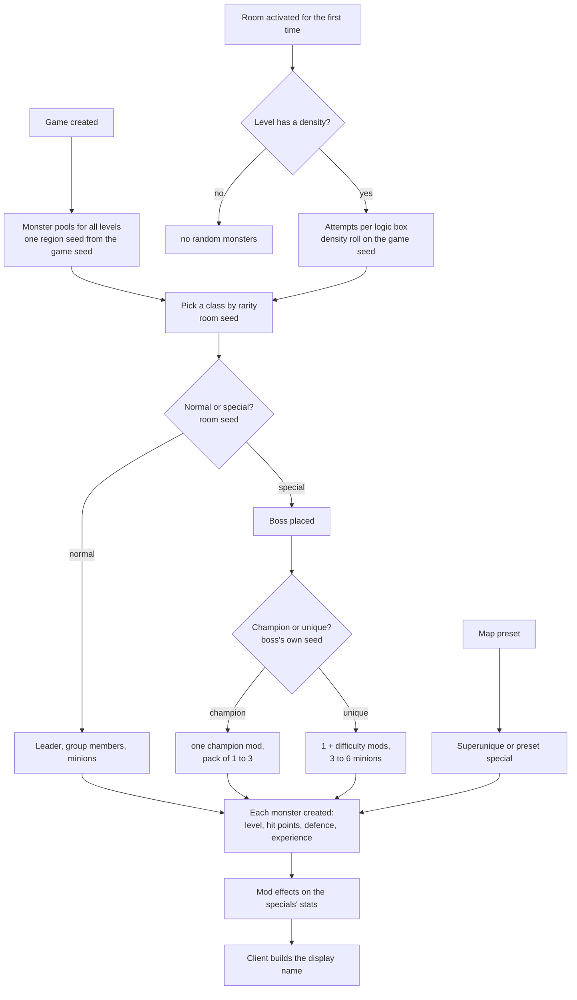
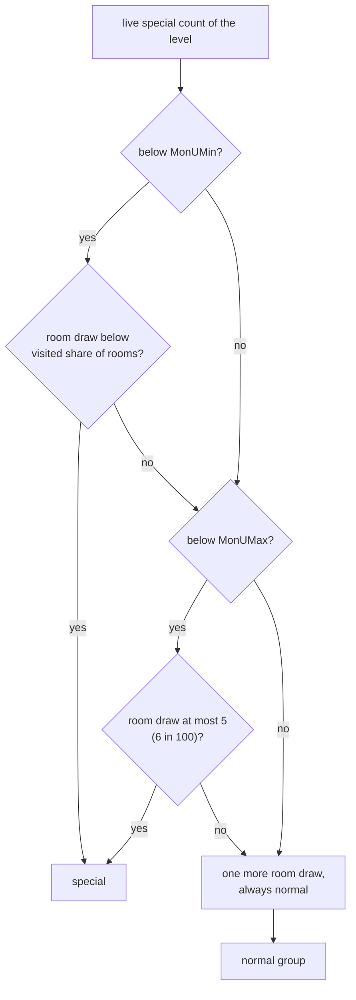

---
based_on:
  - docs/specs/monsters/README.md 2026-10-16
  - docs/specs/monsters/pool.md 2026-10-27
  - docs/specs/monsters/spawn.md 2026-10-27
  - docs/specs/monsters/special.md 2026-10-27
  - docs/specs/monsters/stats.md 2026-10-27
  - docs/specs/drlg/collision.md 2026-10-27
  - docs/specs/drlg/lifecycle.md 2026-10-21
---

# Monsters

This page explains how the game decides which monsters exist. It covers which classes each [level](../glossary.md) can host, how
a room gets filled the first time it becomes active, which of those monsters become champions, uniques or
[superuniques](../glossary.md), and what level, hit points, defence and experience each one is created with. It restates the
reviewed monster specs: the overview in [monsters/README](../specs/monsters/README.md#data-flow), the level pools
in [pool](../specs/monsters/pool.md#purpose), room population in [spawn](../specs/monsters/spawn.md#purpose),
special monsters in [special](../specs/monsters/special.md#purpose) and stats in
[stats](../specs/monsters/stats.md#purpose). The specs carry the exact arithmetic and [draw](../glossary.md) order; this page tells
the story. Where something is read from the code but not yet seen in a test run, or is still unknown, the page
says so.

## The big picture

There are four stages, and they use different [seeds](../glossary.md):

1. **At game creation** the game builds a [monster pool](../glossary.md) for every level from one seed taken from
   the [game seed](../glossary.md). It holds up to 13 classes per level.
2. **When a [room](../glossary.md) is activated for the first time**, the server's
   [population pass](../glossary.md) makes a number of attempts. Each attempt passes a density roll, picks a class
   from the pool and decides between a normal group and a [special](../glossary.md) one.
3. **Each monster is created** with its level and its hit points, defence and experience. These are set once,
   at that moment.
4. **A random special** becomes a champion or a unique by a roll on its own unit seed. It gets its [mods](../glossary.md) and its [minions](../glossary.md),
   and the mods change its stats. On the client side, a name is rolled from a small seed the server sends.

Population draws on three seeds. The room's seed gives the class picks, the normal-or-special roll and every
position. The game seed gives the density roll of each attempt and one step for each monster created. The
leader's or boss's own unit seed gives the group size, the minion counts, the champion roll and the size of a
[champion pack](../glossary.md)
([spawn § Algorithm](../specs/monsters/spawn.md#algorithm),
[README § Data flow](../specs/monsters/README.md#data-flow)). That each monster's unit seed is made from one
game-seed draw is read from the code. Its exact value after creation, which the population runs took from the logs,
is now predicted when the parts are run together (see [Placement](#placement-where-each-monster-stands)).

## Which monsters a level can have: the pool

Every level gets a [monster region](../glossary.md) at game creation. It holds the level's pool plus copies of
its density and unique-count columns from `Levels`. All regions are built in one pass, in level id order, from
one region seed. That seed is set from the game seed's first draw after the game's seeds are initialised, and it
is thrown away when the build ends
([pool § A](../specs/monsters/pool.md#a-the-region-seed-sub_00547d20_monregionsinit),
[pool § B](../specs/monsters/pool.md#b-the-region-build-sub_005479c0_monregionsbuild)).

What this means for a player: **the pool is fixed per game, not per visit.** It depends on the game seed and the
difficulty only. The [map seed](../glossary.md) and the order in which you enter levels do not change it
([pool § Reimplementation notes](../specs/monsters/pool.md#reimplementation-notes)).

How one level's pool is picked ([pool § C](../specs/monsters/pool.md#c-the-pool-pick-sub_005475e0_monregionpool)):

- Normal difficulty picks from the level's `mon` columns. Nightmare and hell pick from `nmon`, in classic and
  expansion alike.
- The number of picks is the smallest of `NumMon`, 13 and the number of candidates. Each pick takes a random
  remaining slot, so a slot is never taken twice. A class named in two slots can still end up in the pool twice,
  and every test run had 6 to 10 regions that held one class twice.
- In a level with `rangedspawn` set, the first pick is redrawn up to 20 times until it lands on a ranged class.
  After 20 redraws the last class drawn is kept, whatever it is.
- A picked class whose `isSpawn` is 0 is dropped after the pick, and the pick still counts. *Mountain Top* holds
  three such classes, so its pool is empty.
- `Rarity` is only copied at this stage. It is used later, when a room picks from the pool.

The candidate count is read from the code as the number of *leading* filled slots, stopping at the first blank.
Stock data has no gaps, so a test run cannot tell this apart from "the number of filled slots". The nightmare and
hell pools were checked in natural games for one seed only. A classic normal game reads `mon` like an expansion game:
a logged one matched all 136 regions, and in 23 of the 27 levels 110–136 the `nmon` slots would have given another
pool.

### Appearance sets

Each kept entry also gets up to three [appearance sets](../glossary.md), one variant per body component, drawn on
the same region seed. Every set after the first differs from the first in at most two components. These draws
come between one level's picks and the next level's, so a reimplementation has to make them even if it never
draws a monster. If it skips them, every later level's pool comes out wrong
([pool § D](../specs/monsters/pool.md#d-appearance-sets-sub_005bdb20_monvariantroll),
[pool § Draw order on R](../specs/monsters/pool.md#draw-order-on-r)).

A short example from the spec's worked example ([pool § Worked example](../specs/monsters/pool.md#worked-example),
`-seed 1`, normal, expansion): *Act 1 - Wilderness 2* has four candidates, `brute1`, `corruptrogue1`,
`fallenshaman1` and `cr_lancer1`, and `NumMon` 3. The three draws take `brute1`, then `fallenshaman1`, then
`cr_lancer1`, so `corruptrogue1` is left out of that game's pool for that level.

## Monster level per difficulty

The [monster level](../glossary.md) (mlvl) is set each time the server creates a monster. It depends on the
class and the level the monster stands in
([pool § E](../specs/monsters/pool.md#e-the-monster-level-sub_00573cb0_monstatsinit)):

| Game | Normal | Nightmare and hell |
|---|---|---|
| Expansion | MonStats `Level` | the area's `MonLvl2Ex` / `MonLvl3Ex` |
| Classic | MonStats `Level` | MonStats `Level(N)` / `Level(H)` |

The exceptions are as follows:

- Classes with `noRatio` (player summons and pets) and `boss` classes keep MonStats `Level(N)`/`Level(H)` even
  in expansion nightmare and hell. The `boss` rule was seen with Andariel, at level 49 in nightmare and 75 in hell
  instead of her area's 43 and 73. In an expansion nightmare game four more kept their own level where the area's
  differs: Blood Raven, Radament, Mephisto and Nihlathak. That makes five of the 25 `boss` classes met. The test
  reads the class's own flag, with no list of classes.
- A [mercenary](../glossary.md) is created at its normal-difficulty `Level` (1) in every difficulty, and its
  level and stats are then overwritten from the hireling table.
- The classic area-level columns `MonLvl1..3` gave no monster's level in any classic difficulty of the logged
  games: every creation took its MonStats level, including the many where the area level differs. In expansion
  normal the area's `MonLvl1Ex` is not used either.

The logged cases from the spec: in *Jail Level 1*, two classes with MonStats levels 10/40/70 are created at 41
(nightmare) and 71 (hell) in an expansion game, and at 40 and 70 in a classic game. In *Stony Field*, expansion
normal, `zombie2` gets 2 (its MonStats `Level`), not the area's 4.

A classic normal game takes MonStats `Level` like an expansion one; all 163 creations of a logged classic normal
game did. Still open: when the monster's level has no `Levels` record the code returns 1, but no stock case has
one, so this may never be logged. Town NPCs in expansion
nightmare or hell would take their town's blank area level, 0, which their MonStats level also gives, so the runs
cannot tell the two sources apart.

## Critters are not population

Ambient [critters](../glossary.md) such as chickens and bugs are a separate, client-side draw for each room, on
the room's seed. They never read the monster pool. Each of up to four critter slots makes one roll against its
percentage. A slot that passes creates `MinGrp` plus a random amount below `MaxGrp − MinGrp`, so `MaxGrp` itself
is never reached when the two differ. The draws made while each critter is created are not read yet, so the slots
after the first one that creates critters are not predicted
([pool § F](../specs/monsters/pool.md#f-critters-sub_0046c460_clientcritters-not-from-the-pool)).

## When a room is populated, and how many attempts

The population pass runs on the server only, once per room, the first time it is activated. The wanderer tick, the
room's preset monsters and objects come first, then the pass, and then the room is marked as populated
([spawn § A](../specs/monsters/spawn.md#a-when-the-pass-runs-and-the-room-seed-before-it)). The client never runs
this pass: only server code calls it, and every one of 4 154 logged passes ran on the server's game. On the client,
the room's own content is the critter draw.

**The gate** ([spawn § B](../specs/monsters/spawn.md#b-the-gate)). A level whose density (`MonDen` for the
difficulty) is 0 gets no random population, and neither does a room flagged "no population" by the map
generator. The gate also counts every room of the level that reaches it. That count is the level's "rooms
visited", which the special catch-up below uses. A test for Chaos Sanctuary closes the gate when a quest byte is
set. A run met it 91 times, always with the byte clear and the gate open. The closed state, once the three seal
bosses are dead, was not logged, so it rests on the code. The quest side of it is on
[quests and travel](quests.md#diablo-and-the-harrogath-portal-word-26).

**Density** ([spawn § C](../specs/monsters/spawn.md#c-density-attempts-per-logic-box)). The room is split into its
[logic boxes](../glossary.md). Each box gets `(5h ÷ 3) × (5w ÷ 3)` attempts, where `h` and `w` are its size in
tiles, so an 8 × 8-tile box gets 169 attempts. Each attempt draws on the game seed and passes when
`draw mod 100000 ≤ MonDen`, a chance of `(MonDen + 1)/100000`. The test is "at most", so a draw equal to the
density passes. A density above 10000 is clamped to 10000, and the stock maximum is 2200.

## Picking a class, and normal versus special

**The class pick** ([spawn § D](../specs/monsters/spawn.md#d-the-class-pick)) is a weighted draw on the room seed
over the pool's `Rarity` values, so, by the code, a class with `Rarity` 0 could never be picked; no stock pool holds
one. A class flagged `placespawn` (in
stock data the three crow nests) turns into its `spawn` class with a further room draw: 79 times in 100 for a
normal pick, 99 in 100 for the special pick of nightmare and hell. In normal difficulty the special class comes
from the level's `umon` columns with no substitution.

**Normal or special** ([spawn § E](../specs/monsters/spawn.md#e-the-type-roll-and-the-1--2-fold)) depends on the
level's live count of specials, compared with its `MonUMin` and `MonUMax`:

- While the level has fewer specials than `MonUMin`, an attempt that passed density is special with a chance of
  about the explored fraction of the level (rooms visited ÷ rooms). The catch-up therefore grows as you explore,
  but it is not a guarantee.
- Below `MonUMax`, a flat 6 in 100 applies to every attempt that passed density. A community page describes 5 in
  100 per room, with `MonUMax` capping successful attempts. In 1.14d it is per attempt, and a run caught a special
  at exactly the boundary value.
- A level with `MonUMin` = `MonUMax` = 0 gets no random champions or uniques.
- The last draw can return a "type 1", but the pass turns it into a normal group. The champion-formation
  branch for type 1 is never reached. The draw still happens.
- The count is live and builds up over the game. It goes up for each random boss, each champion-pack member, each
  preset special and each superunique, and goes down by one when a special leaves its level. All of these were
  logged: the increments for superuniques and preset specials too, and 188 decreases, all outside a pass. The 7 910
  logged region snapshots equal the count these rules give.

## Groups and minions

**A normal group** ([spawn § F](../specs/monsters/spawn.md#f-the-normal-group)) is a leader plus a uniform
`MinGrp … MaxGrp` total, drawn on the leader's seed. Members whose placement fails are simply missing. Fallen and
scarab classes always form a group of one, and their company comes from their minions instead.

**Minions** ([spawn § I](../specs/monsters/spawn.md#i-monstats-minions)): every leader, group
member and champion-pack member of a class with `minion1` brings `PartyMin … PartyMax` minions of `minion1`, or
of `minion1` and `minion2` in turn. A shaman-type class therefore brings its own party for each member. Bosses,
unique minions and minions themselves bring none. The minion count is drawn on the leader's seed *before* its
group size.

The `sparsePopulate` column would add a roll on the game seed before a group. Stock data never reaches it, because
the only class with a value is the evil hut, which appears only as a map preset. What the roll does is read from
the code only: the group would spawn with probability `(value + 1)/100`, and nothing would take its place.
Community descriptions disagree with this, and no stock-data run can settle it.

Group sizes, minions and density do not scale with the [player count](../glossary.md): passes logged at `/players 3`
and `/players 8` are reproduced by the same model as those at one player, and the code read for this pass has no
read of the player count. Games with several real players were not logged, so for them this rests on the code
([spawn § I](../specs/monsters/spawn.md#i-monstats-minions),
[§ Open questions](../specs/monsters/spawn.md#open-questions)).

## Placement: where each monster stands

A leader or boss gets a random point in its logic box: up to 20 tries of two room draws each, rejecting points too
close to the level's [warp points](../glossary.md) or its waypoint point (the level's `WarpDist`). Then a placement test checks the exact point. Group members,
minions and pack members are placed in growing square rings around their leader, each ring starting at a random
cell. The walk tests cells against the room's [collision grid](../glossary.md)
([spawn § H](../specs/monsters/spawn.md#h-placement-spawnpospick-and-monspawntry)). Points to know:

- Every placement costs room draws, even when it fails. An exact placement still makes 3 room draws, and the
  random point's test is made twice: once as a probe, once to create the monster.
- The grid changes as the pass runs. A monster just placed blocks later ones through its centre mark, so a later group
  member may have to take another cell. Read from the code, every monster the server creates is marked the same way,
  not only those of the pass, and a monster created already dead gets the same corpse mark as one that dies, as its
  class's `deadCol` column decides ([drlg/collision § F](../specs/drlg/collision.md#f-unit-marks)). For a monster
  re-created when its room comes back, the marks were compared in a run and agree
  ([levels](levels.md#rooms-that-come-and-go-release-and-restore)).
- The near-warp test can activate another room in the middle of the pass and, in some levels, step that level's
  seed ([drlg/collision](../specs/drlg/collision.md#i-nearwarptestgame-room-x-y-and-its-side-effects)).

Each creation steps the game seed once ([spawn § J](../specs/monsters/spawn.md#j-creation-and-the-unit-seed)).
The new monster's own seed comes from that step. On 914 of 916 logged creations it was 2 steps past its starting
value when the pass first drew on it, and 6 and 15 steps on the other two. The spawn spec's own run took that seed as
an input. The stats
spec names the two usual steps, the appearance pick and the hit-point draw
([stats § B](../specs/monsters/stats.md#b-monstatsinit-in-order)). The extra steps come from the level's list of
classes and their appearance sets: when a class with more than two pieces is created for the first time in a level, it
is added to that list, and its sets are rolled on the new monster's own seed before the two usual steps
([spawn § J](../specs/monsters/spawn.md#j-creation-and-the-unit-seed)). This is confirmed: across the 1 786 creations
in the logs, 14 were such additions, and each took exactly the number of steps the model predicts from its seed (6 to
16), the two odd ones of the pass included. Which of the other creations found their class already listed is not told
apart by the logs. With the level's class list and the stats draws modelled together, the end-to-end run predicted
this seed for all 12 580 monster creations it met ([spawn § Inputs and oracles](../specs/monsters/spawn.md#inputs-and-oracles);
[seed to world](seed-to-world.md#e-one-monsters-creation)).

**Wanderers** ([spawn § K](../specs/monsters/spawn.md#k-wanderers-the-tick)). Every room in the update walk takes one
room-seed draw per tick, and it goes on doing so after the room is populated: 4 044 logged ticks on
populated rooms each took exactly one step. Rarely (1 in 32 768 ticks), and only in a level with `MonWndr` set, a
wanderer roll follows. It fired once in a run, in the Chaos Sanctuary: the roll stepped the room seed once more,
missed its 3 in 100, and spawned nothing, so that tick took two steps. The spawn itself was never reached and is
read from the code only. So are two details of the gate that this single case cannot separate: how many bits of
the draw the gate tests, and its "no player near the room" test. The wanderer class list holds one class, for Act I
only. `MonWndr` gates only this roll: the code has no other reader of it, and watching it in play found none. It
does not decide whether monsters roam, which is what a community page says.

## Champions and uniques

When the type roll says "special", the pass makes a **second** class pick: from the level's `umon` columns in
normal difficulty, from the pool in nightmare and hell. It places the boss and only then decides what the boss is
([spawn § G](../specs/monsters/spawn.md#g-the-special-group-boss-champion-or-unique),
[special § A](../specs/monsters/special.md#a-champion-or-unique)):

- **Champion** when a draw of `Range(100)` on the boss's own seed is below 20 (the `constants` value of MonUMod row
  0), so 20 in 100. A champion gets exactly one champion mod, then a
  champion pack of 1 to 3 more monsters of its class.
- **Unique** otherwise. A unique gets `1 + difficulty` unique mods (1, 2 or 3) and 3 to 6 minions.

**The mod picks** ([special § B](../specs/monsters/special.md#b-the-weighted-picks)) are weighted draws over the
`MonUMod` rows allowed for this monster, by the difficulty's `cpick` or `upick` weight. With stock data every weight
is 1 (champion) or 6 (unique), so the allowed candidates are equally likely:

| | Classic | Expansion |
|---|---|---|
| Champion mods | `champion` only | `champion`, `ghostly`, `fanatic`, `possessed`, `berserk` |
| Unique mods | 12 in normal, 13 in nightmare and hell (`resist` joins) | the same |

A row can also be refused for the class. `teleport` needs the class to have the `A1` mode, `fast` the `WL` mode, and
`multishot` a class that is neither `isMelee` nor `nomultishot`. The one stock exclusion is `lightning` on sand
leapers. A run met it once: a unique sand leaper's candidate list lacked `lightning`, as predicted. A unique never
gets the same mod twice. A unique's
mod count costs one extra draw (`Range(1)`, which always gives 0 but still steps the seed).

**Pack members and preset champions** ([special § F](../specs/monsters/special.md#f-champion-pack-members-and-preset-champions))
are not rolled. Each one always gets mod 16 `champion`, whatever the boss drew. Each counts as a special, and each
brings its own MonStats minions if its class has them. They are not linked to the boss as minions. A pack member whose
class is a `SetBoss` class (three were logged, `fallenshaman2` and `fallenshaman6` among them) is a small leader in its
own right: its mod handlers also
run on its MonStats minions, as a unique's do on its minions (see [What the mods do](#what-the-mods-do-to-stats)).

**Map presets** ([special § H](../specs/monsters/special.md#h-monplace-presets)) can also make specials. One preset
kind makes a unique, its class picked as for a random special, at a random point of the room, with no champion roll. Another makes a champion
at the preset point, with mod 16 and a champion pack. Both were reproduced in Tristram. Many other preset kinds,
by the code, place nothing at all when the room's presets are spawned or restored: the group presets that the map's
keep/drop roll keeps (see [levels](levels.md#what-a-preset-places-units-and-keepdrop-rolls)), the river, nest, guard and maggot kinds among them. Five
place one fixed monster at the point with no special code: the rogue warner (`navi`), Blood Raven, the Maggot Queen,
and two tentacle-head kinds whose type depends on the level. A further range of kinds places one fixed class at the
point, not as a special: the fallen camps, fallen shamans, fetish shamans and imps among them. The class is first
turned into the level's own variant, then a fallen class into its camp variant, a step that looks at the class's base
type. In level 6, for example, a fallen camp comes out as `fallen2` and a shaman as `fallenshaman2`; both were logged.
The variants of the other levels, and a few of the kinds, were not logged and are read from the code. The
imp-group and minion-group kinds place a leader and its group around the point in Normal only; in Nightmare and Hell
they place nothing. That was logged in Hell; Nightmare and the Normal groups are read from the code. Other code that reads a
room's presets is not yet followed.

## Unique minions and mod transfer

A unique's 3 to 6 minions are of its `minion1` class, or of its own class when it has none. `PartyMin`/`PartyMax`
play no part here. As each minion is created, it copies the boss's mods that have `xfer` set. With stock data that is
every unique mod except `aura`, so **a unique's minions carry its rolled mods, except the aura**. The minion's own
mods, if any, stay first in its list
([special § E](../specs/monsters/special.md#e-unique-minions-and-transfer)).

The copy is the list the server sends for the minion, but a minion's own handlers are never called for it, and runs
confirm both. The effects reach a minion another way: the boss's mod handlers run on each group member, for every
boss mod, copied or not. The other readers of the copied list (the save of an inactive monster, the restore, a
packet that sends only its first three slots) are read from the code.

## Mod handlers and the name seed

After the minions, each special runs its mod handlers in a fixed order: the always-run mods `rndname`,
`hpmultiply`, (`light`, which has no handler) and `leveladd`, then its own list in slot order. A mod listed twice runs
twice ([special § C](../specs/monsters/special.md#c-mod-handlers),
[special § D](../specs/monsters/special.md#d-per-mod-draws)).

- `rndname` is the only handler that draws on a lasting seed. It steps the special's unit seed once and keeps the
  low 16 bits as the [name seed](../glossary.md). Champions and pack members run it too.
- `aura` draws on a *local* seed made from the name seed, which no other seed sees. It picks one of the aura rows
  whose minimum level the monster has reached: Might, Holy Fire, Blessed Aim, Holy Freeze, Conviction and
  Fanaticism from level 0, and Holy Shock from level 20. The aura table was read from the game's memory, and runs
  reproduced the aura skill and its level for six of its rows, in all three difficulties. A Thorns row needs level
  999, so it is never drawn. The clamps of the aura's level to 1 and 99 were never met.
- **A restored aura special holds two auras.** When a special comes back with its room, its handlers run again and
  `rndname` makes a fresh name seed, so `aura` draws on that one. Only after that does the restore put back the saved
  name seed and draw the aura a second time. The monster gets another aura and then its first one: a logged
  `regurgitator3` got Holy Shock first, then its original Holy Freeze
  ([special § J](../specs/monsters/special.md#j-other-entry-paths-and-pre-existing-mods)).
- Every other handler only writes stats (see [What the mods do](#what-the-mods-do-to-stats)).

The [draw order](../specs/monsters/special.md#draw-order-on-the-unit-seed) on the boss's seed is: for a champion,
the champion roll, its one pick, `rndname`, then the pack size. For a unique, the champion roll, `Range(1)`, one draw
per mod, the minion count, then `rndname`.

## Superuniques

A superunique is placed by a [preset unit](../glossary.md) in the map and built from its
`SuperUniques` row ([special § G](../specs/monsters/special.md#g-superuniques)):

1. **Placement.** At the preset point, or anywhere in the room when the row's `AutoPos` is set. A row with `Stacks`
   0 can be placed only once per game: three second attempts in the logs were refused, with no monster made. The
   placement makes no quest test of its own that a done quest fails. Every logged character had all its quests
   done, so whether an open quest changes anything is read from the code.
2. **Fixed mods** `Mod1`–`Mod3` are written as they are and skip the eligibility tests. That they skip the tests is
   read from the code.
3. **Extra mods**: `difficulty` unique picks, so 0, 1 or 2, with no `Range(1)` before them. An extra never repeats a
   fixed mod.
4. **Minions**: `MinGrp + d … MaxGrp + d`, where `d` is the difficulty. Rakanishu (8 and 8 in his row) got 8, 9 and 10
   minions in normal, nightmare and hell. A row with both bounds 0 still makes one draw and gets no minion.
5. **A tail per record** for a few superuniques, such as Radament's extra skeletons, the Countess's set-up and
   various quest hooks. A run met the tails of Radament, the three council members, the Infector of Souls, the Grand
   Vizier of Chaos, Shenk (20 escorts) and Nihlathak (20 escorts), each making exactly its listed calls, and records
   with no tail made none. Radament's skeleton count is two plus a draw, but the draw came out 0, so the "plus a
   draw" is read from the code. The tails of the Countess, Lord De Seis, the Cow King, the Ancients and Baal's
   second subject were not met.
6. Mod 22 `questcomplete` is appended last.

A fixed `aura` runs its handler a second time, on the same seed, so it writes the same aura twice: logged for
Bremm Sparkfist. Read from the code only: the `thief` mod is dropped from a row's fixed mods, and a superunique
that already holds 5 or more mods gets nothing below placement.

## Names

The name is built on the client ([special § I](../specs/monsters/special.md#i-names)):

- A **random unique** rolls its name from the name seed the server sends. The client keeps only the low byte of that
  seed, so **only 256 random-unique names can exist**. It draws a suffix and then a prefix. Then, with 50 in 100, it
  discards that pair and draws an appellation, a new suffix and a new prefix, giving a name of prefix, suffix and appellation
  (in one recorded game, from the keys `Fire`, `lust` and `the Mauler`). Every name roll of a test run followed this.
  The roll runs on its own seed, so by the code it cannot affect any server seed.
- A **champion** shows a word for its champion mod in front of the class name. A **superunique** shows its row's
  `Name`. A run reproduced both from the string tables, and showed that a minion gets no name. A few bosses have a
  fixed name: Andariel's, Mephisto's, Izual's and Blood Raven's were logged; those of the other fixed-name classes
  are read from the code. Where a unique's random colour is drawn is not known.

**The Warping Shrine.** One path makes an existing monster special outside population: the Warping Shrine ("nearest
monster becomes unique"). Read from the code, operating an unused one picks the nearest monster to the player, over the
player's room and the rooms near it, with no real distance limit; the first one met wins a tie. Only an ordinary
hostile monster that stands or walks qualifies: never a champion, unique, superunique or minion, a `boss`, a prime evil
or a monster with no height. It gets a mod roll that allows champion mods, and no minions. With no candidate, nothing
happens. No test session operated one ([special § J](../specs/monsters/special.md#j-other-entry-paths-and-pre-existing-mods)).

## Stats at creation: hit points, defence, experience

Every monster gets its stats once, when it is created
([stats § B](../specs/monsters/stats.md#b-monstatsinit-in-order)). In order:

1. The appearance pick (one draw on the unit seed).
2. The player bonus, then the level, the resistances and block straight from `MonStats` for the difficulty. Blank
   cells count as 0.
3. Hit points, defence and experience as `MonLvl` value × `MonStats` value ÷ 100, from the `MonLvl` row of the
   monster level ([stats § A](../specs/monsters/stats.md#a-muldiv-and-monlvlstats)). `noRatio` classes take the
   `MonStats` value as it is.
4. One hit-point draw between the scaled minimum and maximum. It still steps the seed when the two are equal.
5. The player bonus added to hit points and experience, then the regeneration value.
6. In classic nightmare and hell, the classic factors (below). Then skills, [MonProp](../glossary.md) and monster
   equipment.

A surprise from the runs: **single-player games read the `MonLvl` columns prefixed `L-`**, which a community
source reserves for ladder games. In 3 954 nightmare and hell creations where the two column sets differ, every one
matched `L-`. The two sets differ only in nightmare and hell defence and in hell hit points.

The game stores hit points times 256. A minimum above the maximum makes no draw and gives the minimum; no logged
creation met one (two stock rows have one, in normal), but each piece of that path is confirmed on its own. The scaling
arithmetic's branches, overflow included, were checked under emulation. Read from the code but never reached: a
hit-point cap for very large values and the overflow branches of the hit-point percentage step. Skills get the
difficulty's `MonsterSkillBonus` (0, 3 or 7) added to their level, with no draw; a run confirmed the skill list of
every creation in all three difficulties.

**MonProp** ([stats § F](../specs/monsters/stats.md#f-monprop-at-creation)) gives every monster
of a class its row's properties for the difficulty, special or not, with any value range rolled on the unit seed.
On stock data only `thorns` has a range, and a test run reproduced it. Stock `chance` is 0 everywhere, so the
`chance` roll is never reached. Of the three rows with a normal-difficulty part, two cannot be reached on stock
data. The third, `druidhawk`, can: it belongs to the Druid's Raven, so by the code a Raven in a normal game reads its
normal row. No such creation was logged.

**Monster equipment** (`MonEquip`, [stats § B](../specs/monsters/stats.md#b-monstatsinit-in-order), step B12) comes
last. Only two classes have a row that equips at creation in the stock table: 234 (a flying scimitar) and 267 (Blood
Raven), each with one row of level 0 and one location. For them one unit-seed step picks the location and the item is
created there when it is free, taking two game-seed steps like any item. The end-to-end run created Blood Raven three
times and the flying scimitar once, with the seed after the equipment and each item predicted. The rest of the rule
is read from the code only, because no stock row reaches it: a first row above the monster level is skipped, and with
two or three locations the step picks one of them; a location already taken gets no item.

## The player count

([stats § C](../specs/monsters/stats.md#c-the-player-count-sub_00573930_monplayerbonus))
The player count is the number of living players, raised to the `/players` setting. A two-client game confirmed that a
second real player counts like `/players 2` for the monsters created while it is in the game; whether a dead player
counts was not tested there. Hostile
monsters get **+50 % hit points and +50 % experience for each player beyond the first**, so +350 % at 8 players.
Town NPCs, critters, hirelings, summons and a few neutral classes get no bonus. At `/players 8` this was confirmed
for Lut Gholein's NPCs, the rogue hireling and the cow; the camel was not met.

**The count is applied once, at creation.** A test run changed `/players` 13 times and compared 302 live monsters
at each change: none changed. Monsters created after the change get the new count. A monster that is re-created when
its room comes back from inactive is created anew, then gets its first instance's maximum hit points and experience
back from the saved record; its level comes out of the new creation and the re-applied mods again, so a minion
created at the plain pool level comes back 3 levels higher at its first restore ([stats § Inputs and oracles](../specs/monsters/stats.md#inputs-and-oracles),
[lifecycle § H](../specs/drlg/lifecycle.md#h-the-restore); the page on [levels](levels.md#rooms-that-come-and-go-release-and-restore)
tells the whole story). The formula above 8 players is read from the code only.

## Classic nightmare and hell

A classic (non-expansion) nightmare or hell monster first gets its stats from the `MonLvl` row of its MonStats
`Level(N)`/`Level(H)`, and is then cut down
([stats § D](../specs/monsters/stats.md#d-classic-nightmare-and-hell-sub_0063eef0_monclassicdiffadjust)):

| Stat | Nightmare | Hell |
|---|---|---|
| Max hit points | × 1/2 | × 1/2 |
| Defence | × 10/12 | × 10/12 |
| Experience | × 10/17 | × 10/26 |

Its level stat is then rewritten to its normal `Level` + 25 × difficulty. So **a classic nightmare or hell monster
uses two levels**: one chose its base stats, the other is what everything later sees, including the mods' level
bonus, the enchant damage and the aura. In classic hell a run logged aura uniques whose `Level` is 18 drawing their
aura at level 71 (18 + 50 + 3).

When max hit points change, current hit points follow in proportion
([stats § E](../specs/monsters/stats.md#e-the-stat-callback-sub_0055b800_monstatcallback-stat-7)). The calculation
is done in floating point and truncated. The run settles the rounding mode. That the precision is 53 bits rests on
the code. Whether a graphics renderer could change that precision is an open question.

## What the mods do to stats

The handlers run in the order of [Mod handlers](#mod-handlers-and-the-name-seed). "Group member" means a minion of a
unique or superunique, or a MonStats minion of a champion-pack member whose class is a `SetBoss` class. Champion-pack
members run their own pass as champions
([stats § G](../specs/monsters/stats.md#g-the-mod-handlers-stat-effects)). A selection (percentages from `MonUMod`'s
constants, normal / nightmare / hell):

| Mod | On the special | On its minions |
|---|---|---|
| `hpmultiply` (always) | champion +200 / +150 / +100 % hit points; unique +300 / +200 / +100 % | +100 / +75 / +50 % |
| `leveladd` (always) | level + 3, experience × 5 | the same |
| `champion` | level − 1, experience − 2/5, more damage and to-hit (scaled by [CDB](../glossary.md)), speed + 20 if the class has a `Velocity` | nothing |
| `possessed` | + 100 % hit points on top, then the champion part | nothing |
| `berserk` | − 75 % hit points, large damage and to-hit bonus, no champion part | nothing |
| `fire` / `cold` / `lightning` | enchant damage from the level's `MonLvl` damage, resistance + 75 | weaker enchant, no resistance |
| `spectralhit` | cold, fire, lightning resistance + 20 each (below 75) | nothing |
| `stoneskin` | defence × 2, damage resistance + 50 | nothing |

Notes the spec makes a point of:

- **Spectral Hit adds 20, not the 40 of community pages.** Seen in 17 uniques of a run.
- **A berserker ends at + 3 levels**, every other champion at + 2 (`leveladd` + 3, `champion` − 1). This was shown
  by a forced test run with edited data, which backs the handler only, not how often `berserk` appears.
- **The speed bonus of `fast` and `fanatic`** is `2048 ÷ Velocity − 128`, kept between 10 and 100. Runs saw 100 at
  velocities 1 and 3 to 7 and 42 at 12. By the formula it is 100 up to `Velocity` 8 and 99 at 9; 8 and 9 were not met.
- **Mod order matters.** The resistance mods stop adding once two resistances are already at 100 or more, and each
  mod checks this when it runs, so an earlier mod can block a later one.
- The `ChampionDamageBonus` column (90 / 75 / 66) also scales a unique's `strong` bonus. That `UniqueDamageBonus`
  is never read comes from the code; the two columns are equal in stock data, so play cannot tell them apart.
- Read from the code only: the `poisonhit` and `always_run_ai` handlers, the halving for will-o'-wisp classes, and
  the `ghostly`/`fanatic`/`possessed`/`berserk` handlers on group members.

To-hit and damage are not creation stats. They are computed each time the monster enters an attack mode
([stats § H](../specs/monsters/stats.md#h-to-hit-and-damage-at-attack-time-reference-only)). The random draws of that
step are confirmed by the combat run: one draw of 100 for each elemental group of that attack mode whose chance is between 1 and 99, one
draw of 5 for one element type, and nothing else. The formulas of the values it writes are read from the code only,
because the combat run took those values as given. By the code, the expansion adds 6.25 % damage per player beyond the
first in nightmare and hell only, and a `noRatio` class (a summon or pet) ends up with no elemental damage at attack
time, because its elemental values are written to one place and read from another. The attack itself is on the
[combat](combat.md) page.

## Worked examples

### A room in Dark Wood

Copied from [spawn § Worked example](../specs/monsters/spawn.md#worked-example): `-seed 1`, expansion hell, level 5
*Dark Wood*, one room of a recorded game.

The region holds three classes: `fallen2` (rarity 2), `cr_lancer2` (1) and `quillrat2` (2), rarity sum 5. Density
is 520, `MonUMin` 7, `MonUMax` 9, and the level already has 7 specials. The room has one 8 × 8-tile box:
`(40 ÷ 3) × (40 ÷ 3) = 169` attempts.

| Attempt | Density draw | Class | Type roll | Result |
|---|---|---|---|---|
| 1–45 | above 520 | — | — | nothing |
| 46 | 504, passes | `Range(5) + 1` = 4 → `quillrat2` | 7 specials is not below `MonUMin` 7, so no catch-up; below `MonUMax`: 51 > 5; last draw 24 → 1 → normal | leader + `Range(3)` = 2 members |
| 90 | 31 | 5 → `quillrat2` | 70, then 17 → normal | a group of one |
| 100 | 520, equal to the density, passes | 2 → `fallen2` | 34, then 92 → normal | fallen: group of one, plus `2 + Range(3)` = 2 `fallen2` minions |
| 101–169 | above 520 | — | — | nothing |

During attempt 46, member 2's ring walk finds member 1 standing on a cell and moves on to the next one. The room ends
with seven monsters: three `quillrat2`, one more `quillrat2`, and a `fallen2` with two `fallen2` minions. The level's
special count stays at 7.

### A unique group and its name

Copied from [special § Example 2](../specs/monsters/special.md#example-2-a-unique-group-expansion-nightmare):
expansion nightmare, *Arreat Plateau*, a random boss of class `blunderbore6`.

| # | Draw on the boss's seed | Result |
|---|---|---|
| 1 | `Range(100)` | 36, not below 20: **unique** |
| 2 | `Range(1)` | 0; mod count 0 + 1 + 1 = 2 |
| 3 | 13 candidates of weight 6, total 78: `Range(78)` | 21 → `resist` |
| 4 | 12 left, total 72: `Range(72)` | 68 → `aura` |
| 5 | minion count `Range(4)` | 0 → 3 minions, each copying `resist` (not `aura`) |
| 6 | `rndname` step | name seed 33102 |
| — | `aura` on a local seed from 33102, level 63, 7 rows | 6 → Holy Shock |

On the client, 33102 keeps its low byte, 78. On a seed made from 78 it draws suffix 37 (`BangUM`) and prefix 47
(`DoomUM`), then `Range(100)` = 55, which is not below 50, so there is no appellation. The name is "Doom Bang".

### A possessed champion's stats

Copied from [stats § Example 2](../specs/monsters/stats.md#example-2-a-champion-sk_archer7-class-576-frozen-tundra-mod-possessed):
`sk_archer7` in *Frozen Tundra*, expansion hell, `/players 8`, monster level 81 (the area's `MonLvl3Ex`). The `MonLvl`
row 81 gives hit points 5722, defence 1581 and experience 45759. The class's hell `MonStats` give 70, 100, 100 and 95.

| Step | Value |
|---|---|
| hit-point range | 4005 … 5722; draw 65 → base 4070 |
| + 350 % for 8 players | 18315 hit points (stored as 4688640) |
| defence, experience | 1581; 43471 + 152148 = 195619 |
| `hpmultiply`, champion in hell (+100 %) | stored 9377240 |
| `leveladd` | level 84, experience 978095 |
| `possessed` (+100 %) | stored 18754440 |
| champion part | level 83, experience 586857; damage + 66, to-hit + 49, speed 75 + 20 = 95 |

## What is not known yet

Each spec's *Open questions* has the full list: [pool](../specs/monsters/pool.md#open-questions),
[spawn](../specs/monsters/spawn.md#open-questions), [special](../specs/monsters/special.md#open-questions),
[stats](../specs/monsters/stats.md#open-questions). The ones that bear on this page:

- **Pools:** a creation in a level with no record (the fallback level 1) has no stock case. Natural nightmare and
  hell pools are checked for one seed, with Act I visited.
- **Population:** what `sparsePopulate` really does (unreachable on stock data, and the community sources
  disagree), and games with several real players, which were not logged. The Chaos Sanctuary gate's closed state
  needs the three seal bosses dead, Lord De Seis among them, and no session created him. The room field the wanderer
  roll tests and the restore of inactive monsters are answered by the [room lifecycle spec](../specs/drlg/lifecycle.md).
  Many guard exits and rare branches were never reached: the evil hut object, the wanderer spawn, and others listed in
  the spec. Monster positions also depend on inputs no spec yet produces end to end: the collision grid at the start
  of the pass, whose object marks are modelled but whose marks of players, monsters that walked in, items and corpses
  are not (the grid the models build equals the recorded one in 4 723 of 4 883 rooms of the end-to-end run), and one
  waypoint point.
- **Specials:** whether a `MonUMod` row with `champion` 0 could ever be a champion mod (no stock row tests it, and a
  community source claims it can). Where a unique's colour is drawn. Read from the code only: the superunique tails
  not met (the Countess, Lord De Seis, the Cow King, the Ancients, Baal's second subject) and the draw in Radament's
  count, `thief`, the fixed names not met, the aura level clamps, the preset kinds not logged and the Warping Shrine.
  Lord De Seis was never created, so his forced aura and his tail rest on the code; an owner-played Chaos Sanctuary
  session would log him. The restore of inactive specials was reached by runs; a minion restored without its boss was
  not.
- **Stats:** whether a graphics renderer can change the
  floating-point precision of the hit-point rescale, the will-o'-wisp halving, and the unreached branches (`poisonhit`,
  `always_run_ai`, monster equipment beyond the one-row case, a `MonProp` slot with a chance, `fast` and `fanatic` at
  `Velocity` 8 and 9, more than 8 players, the hit-point percentage and regeneration overflows). A Druid's Raven reading the normal
  `druidhawk` row was not logged.
  The formulas of the attack-time to-hit and damage values were not asserted by a run.

## Where to read more

- The specs: [monsters overview](../specs/monsters/README.md#data-flow),
  [pool](../specs/monsters/pool.md#reimplementation-notes), [spawn](../specs/monsters/spawn.md#reimplementation-notes),
  [special](../specs/monsters/special.md#reimplementation-notes), [stats](../specs/monsters/stats.md#reimplementation-notes).
  Each *Reimplementation notes* section lists the traps for someone rebuilding the system.
- The [glossary](../glossary.md) for D2 terms.
- Related wiki pages: [randomness](randomness.md) (seeds and draws), [levels](levels.md) (rooms, logic boxes, the
  collision grid), [objects](objects.md) (what fills a room before the monsters), [items](items.md) (what a monster
  drops), [quests and travel](quests.md) (the quest hooks and the forced deaths) and [how we know](how-we-know.md).
