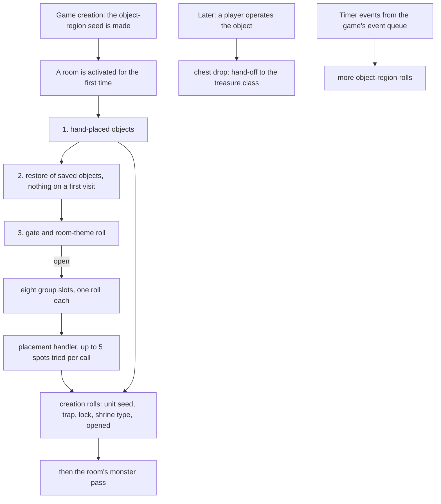
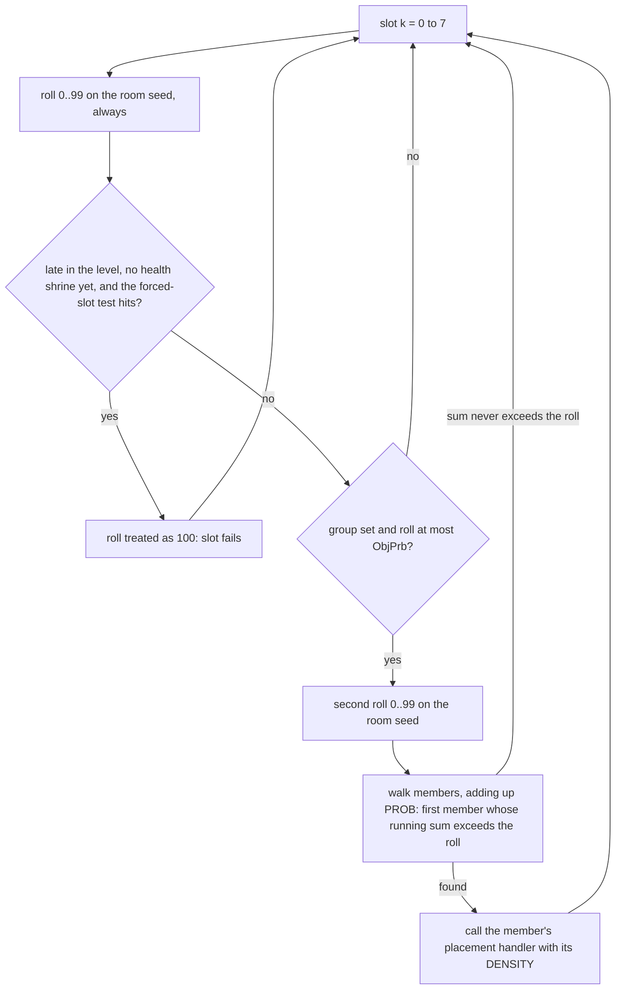
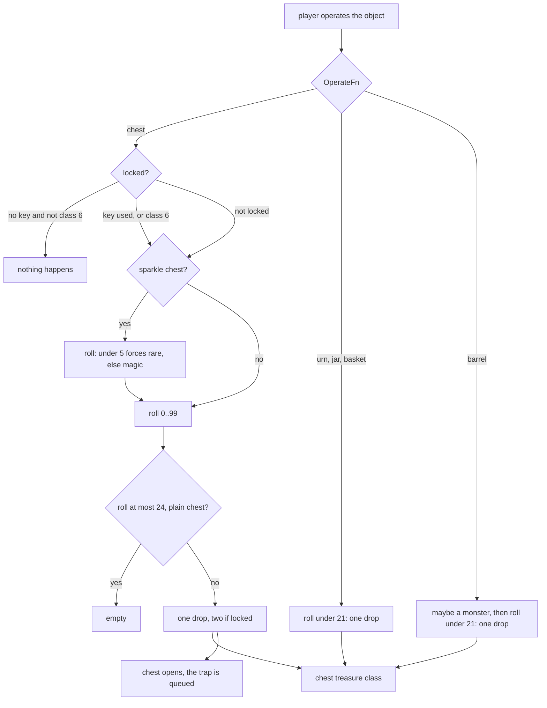

---
based_on:
  - docs/specs/objects/README.md 2026-10-17
  - docs/specs/items/tc.md 2026-10-17
---

# Objects: shrines, chests, barrels and the rest

Every [room](../glossary.md) the game activates for the first time gets its objects: the ones placed by hand in the
room's map pieces, and a random set chosen from the level's object groups. This page explains how those objects are chosen and placed, the
dice they roll when they are created (is this chest trapped? locked? which shrine is this?), what happens when a
player clicks a chest, urn or barrel, and where the chest hands over to the drop tables. It also names the timer
events and the quest objects. It restates the reviewed [objects spec](../specs/objects/README.md#purpose), plus the
short part of the [treasure class spec](../specs/items/tc.md#j-object-drops-named-only) that picks a chest's drop
table. What a shrine, a well or a trap actually *does* to the player is game simulation and is out of scope: the spec
only names it.

## The big picture

Objects are made on the server, in a fixed window of the room's first activation, just before the room's monster
[population pass](../glossary.md) ([objects § Entry points](../specs/objects/README.md#entry-points)). The window has three steps:

1. the hand-placed objects of the room's map pieces ([preset units](../glossary.md));
2. a restore of objects saved when the room was last deactivated (nothing on a first visit);
3. the random object population, which walks the eight object-group slots of the
   [level](../glossary.md) and places members of the groups that pass their roll.

Every object made in any of these ways then runs the same creation rolls. Later, a player may operate it.

Four [seeds](../glossary.md) feed these decisions, and which one a roll uses matters, because each is a separate
stream of [draws](../glossary.md) ([objects § Algorithm](../specs/objects/README.md#algorithm)):

| Seed | What it decides |
|---|---|
| the room's own seed ([active room](../glossary.md)) | the eight slot rolls, the member picks, the shrine and well handlers, and the trap handler's first roll |
| the [object-region seed](../glossary.md), one per game | every other placement, the room-theme roll, the `InitFn` and `PreOperate` creation rolls, the operate rolls, the timer events |
| the [game seed](../glossary.md) | one step for each object created |
| the object's own unit seed | its animation start and, later, its drop |

For the object-region seed there is **one stream for the whole game**, not one per
room or per level. It starts from the game seed's second draw when the game is created, and it advances with every
room's objects in the order rooms are activated, every operate and every timer event
([objects § A](../specs/objects/README.md#a-the-object-region-seed-and-level-records-game-creation)). So the order in
which players walk into rooms and click things changes every object rolled afterwards, including what the next chest
holds and whether it is locked ([objects § Reimplementation notes](../specs/objects/README.md#reimplementation-notes)).

## Which rooms get random objects: the gate

Before any random object is placed, a gate decides whether this room takes part at all
([objects § C](../specs/objects/README.md#c-the-gate-and-the-theme-roll)). A room is skipped when it holds a waypoint,
when it has no population level, when a preset test on the room says no, or when it is in a town. Those
tests come from the level generator ([DRLG](../glossary.md)); in the test runs they were taken from the recording
rather than modelled, and the gate as a whole is read from the code. Town rooms drew nothing in all 222 recorded
town activations.

Each gated room increments a "rooms visited" counter of its population level. That counter counts gated rooms, not
rooms that actually got objects, and among other things it drives the theme roll below and two later rules: the late-level health shrine (a shrine of code 2)
and the forced-slot rule below.

Then comes the **room-theme roll**, for the 39 levels whose `Themes` column is set. It costs one or two draws on the
object-region seed: a roll against 12 (raised by 5 past half the level's rooms and by 5 more past three quarters) and,
if that passes, a pick of a theme number. On the game's stock data **no theme ever runs**: every listed theme number
falls outside the range the code accepts, except one that has no handler. The draws are still made. The theme
handlers themselves (an empty room, a barrel grid, an item grid, bookshelf or weapon-rack rows) are only named in
the spec and were never reached.

## The eight slots and the member pick

A level names up to eight [object groups](../glossary.md) in its `ObjGrp0..7` columns, each with a chance in
`ObjPrb0..7`. A group lists up to eight object classes with a `PROB` and a `DENSITY` each
([objects § D](../specs/objects/README.md#d-the-slot-loop-and-the-member-pick)).

The details that matter for an exact copy:

- Every slot costs one room-seed draw, even an empty slot (group 0). A slot passes when the roll is **at most**
  `ObjPrb`, so the chance is `(ObjPrb + 1)/100`.
- A passing slot costs a second draw for the member pick. `PROB` values are percentages against 100, added up as the
  walk goes, not weights over the members' total. When they add up to no more than the roll, nothing is placed: that
  happened to 259 of 2307 passing slots in the test runs.
- **The forced-slot rule is a game bug, and the spec keeps it.** Once more than 96/128 (75 %) of a level's rooms have
  been gated and no health shrine stands, a slot is made to fail when the Objects record *whose index equals the
  group number* has a non-zero `SubClass`. It reads that record, not a member's, so the slots it suppresses are those
  with group numbers 1–6, 50–53, 59, 60, 77, 109, 116, 119, 120,
  123, 124 or 129. The run tracked this rule at every slot and it matched.
- Groups 0, 30 and 72 (no members) and group 69 (whose first member slot is empty) cost their draws and place
  nothing; a member with `PROB` 0 is never picked; and the `Gore` test never excludes anything on stock data. These
  points are read from the code, not separately confirmed by a run. The gore limit itself is a fixed value with no
  code that changes it (also read from the code).

## Placement handlers

The picked member's `PopulateFn` column chooses one of nine placement handlers
([objects § E](../specs/objects/README.md#e-the-populatefn-handlers)). Each gets the member's `DENSITY`, and most turn
it into a count with `((room width × room height >> 7) × DENSITY) >> 8`. Each also makes one roll against 100
that always passes but still costs a draw.

| Handler | Places | Seed used |
|---|---|---|
| 1 | clusters of urns, caskets, baskets, sarcophagi | object-region |
| 2 | shrines | room |
| 3 | scattered single objects | object-region |
| 4 | barrel clusters | object-region |
| 5 | crate clusters | object-region |
| 6 | corpses, then maybe flies | object-region |
| 7 | rogues on sticks | object-region |
| 8 | wells | room |
| 9 | traps | room, then object-region |

What a player may notice:

- **Barrels** come in clusters of at most 8 in total. The first barrel of a cluster is an exploding barrel with
  chance 1/3, each follower with chance 1/4.
- **Flies** (object 103) join each rogue on a stick, and the last corpse placed by the corpse handler, with chance
  29/100.
- **Shrines** are placed with up to 3 tries per call, and a new shrine must be at least 50 subtiles away from every
  earlier shrine of the level **on each axis** (not just by distance). Wells use 100. A shrine with `Orientation` 1
  always lands one subtile in from the room's first row (`y`), with `x` in the middle half of the room. Orientation 2
  is the mirror case on the other axis, read from the code only: no orientation-2 shrine was placed in the test runs.
- **The late health shrine.** Once more than 75 % of a level's rooms have been gated and no health shrine stands, the
  shrine handler gets 30 tries instead of 3. Two windows of the earlier runs needed those 30 tries. The rule that
  decides "due" is read from the code; the further step that would convert a placed shrine into a health shrine was
  never reached.
- **Caps** of 10 shrines and 4 wells per level (or more than one eighth of the level's rooms) are read from the code and were never
  reached in a run.

Some handler details are read from the code but not confirmed by a run. The crate handler (5) is used by no stock
level at all. The urn-and-casket cluster handler (1) seems to test every spot with the size of the group's member
class, even when the list draw picked a different, larger object. The runs only drew lists whose objects are all
1 × 1, so they could not tell the difference.

## Finding a spot

Placement draws a position inside the room and tests it against the room's [collision grid](../glossary.md), keeping
a one-subtile margin from the room edge and a box of six extra subtiles around the object
([objects § F](../specs/objects/README.md#f-placement-and-the-position-tests)). Each placer call makes **at most five
attempts**, two draws each, and there is no fallback: if none is free, the object is simply not made. In the test run
accepted spots fell at attempts 1 to 5 (153, 87, 67, 51 and 29 times), and 911 placer calls found no spot. An
object already placed marks the grid when its mode has collision, so it blocks later objects; all 5859 position tests of the run were predicted.

## Hand-placed objects and the pseudo-objects

Objects placed in a map piece go straight to creation in their stored mode, with no room-seed draw (unless the
object spawns monsters when it is created). All hand-placed objects come before the hand-placed monsters
([objects § B](../specs/objects/README.md#b-the-window-in-the-room-driver-and-the-revisit)).

A few map-piece ids are not objects but instructions, the pseudo-objects
([objects § I](../specs/objects/README.md#i-ds1-preset-objects-and-the-pseudo-objects)):

| Id | Makes |
|---|---|
| 581 | a random chest: one object-region draw picks a chest class from a per-[act](../glossary.md) list (special lists for levels 74 and 83) |
| 580 | a [sparkle chest](../glossary.md): a 581 chest, then the sparkle flag |
| 582 | a quest object chosen from a quest's state |
| 574–579 | a shrine of a fixed range of types |

The sparkle chest's flag is set after all of the chest's creation rolls. In Maggot Lair levels 1–3 one more roll
skips the sparkle with chance about one half (a roll above 50 out of 0..99); two sparkle chests of the run stood in
Maggot Lair 1 and drew in exactly that order. The level-25 variant (a fixed class with trap type 3) and the fixed
shrines 574–579 (no stock map piece places them) are read from the code only; so is the 582 quest object and the
closing mode reset of the 580 chest, which is expected to draw nothing.

## Creation rolls

Every object, hand-placed or random, is created the same way
([objects § G](../specs/objects/README.md#g-creation-sunitcreate-for-an-object)), with its rolls in this order:

1. one step of the game seed, which gives the object its own unit seed;
2. an animation-start draw on that unit seed, unless the object's `Sync` column is set;
3. the draws of its `InitFn` (the table below), on the object-region seed;
4. for a row with [PreOperate](../glossary.md), a 1-in-14 roll that creates the object already opened.

After that, the object marks the collision grid if its mode has collision. The class used is the Objects record's
position in the table; that the `Id` column is never read for the lookup is read from the code.

The `InitFn` column selects what extra rolls an object makes when created
([objects § H](../specs/objects/README.md#h-draws-at-creation-per-initfn)):

| What | Rolls |
|---|---|
| urns, jars, baskets | trapped if a roll 0..99 is below `MonLvl1 ÷ 8 + 5`; then a trap type 1..8 |
| chests | the same trap roll; for a lockable chest, locked if a roll is below `MonLvl1 ÷ 2 + 8`; then a new unit seed for the chest |
| shrines | which shrine (below) |
| gold-pile dummy | 1 to 9 gold piles around it |
| goo pile, fires | one roll each for a state |

Two things here matter to a player:

- **Trap and lock chances use the normal-difficulty monster level in every difficulty.** `MonLvl1` is read in
  Nightmare and Hell too, and every trap and lock roll of 212 chests and 397 containers in a recorded game matched
  that. In Lower Kurast (`MonLvl1` 22) a chest locks with chance 19 %.
- **A chest gets a fresh seed at creation.** Its drop later draws from that seed, never from the object-region
  stream.

**Shrine types.** A shrine row's `Parm0` picks one of the shrine class lists (the Shrines `effectclass`
column): `Parm0` 1 gives list 2 (in the spec's [shrine example](../specs/objects/README.md#2-a-shrine-creation-jail-level-1) it holds codes 2 and 4), `Parm0` 2 gives list 3, and
otherwise one roll gives list 1 with chance 1/10 and list 4 otherwise. A code is then drawn uniformly from that
list; the `rarity` column is not read. The draw is retried up to 8 times until the code's `LevelMin` is at most the
level's `Id` (the level number, not a monster level). If all 8 fail, the eighth code is kept anyway: a recorded game
hit this once, a shrine in Cold Plains that kept a shrine type whose `LevelMin` is 5. Codes 4, 5 and 16 are rewritten
to 2, 3 and 18, so Health Exchange, Mana Exchange and the Shrine of Enirhs are never placed by the random population.

The callee scan behind this table went three calls deep, so "no draw" for the other `InitFn`s is read from the code.
The sparkle chest's own `InitFn` (57), the fissure (58) and the Zoo (79) were not reached in a run. Quest objects and
the City of the Damned spawn monsters when created; their rolls were taken from the recording.

## Leaving and coming back

When a room goes inactive, the game saves its eligible objects (oldest first), and when the room is activated again,
it re-creates them
([objects § B](../specs/objects/README.md#b-the-window-in-the-room-driver-and-the-revisit)). The re-creation makes
**every creation roll again**, including a fresh trap and lock roll, and then overwrites the result with the saved
state: a chest locked the first time stays locked, whatever the new roll said. A random or sparkle chest comes back
as its plain class, without the pseudo-object's extra draws. The run reproduced 548 re-creations. A later run checked
the saving test on 3 023 objects; the flag it starts from is the level's `SaveMonsters` column. The room and game seeds
at a revisit are still taken from the recording in this model: the monster and item restores that come before the
objects are described by the room lifecycle spec, still in review.

## Operating chests, urns and barrels

When a player operates an object, its `OperateFn` decides what happens; the operate rolls are on the object-region
seed ([objects § J](../specs/objects/README.md#j-operate-chests-and-containers-up-to-the-drop)).

For a chest:

- A **locked** chest needs a key (consumed), or a player of character class 6; then it drops **twice**.
- A **plain** chest is empty when its roll is at most 24: **25 % of plain chests are empty**. Locked and sparkle
  chests never are.
- A **sparkle chest** first rolls its forced quality: rare with chance 5/100, magic otherwise, on every drop. If none
  of its items is magic or better, it drops up to 10 more times until one is.
- After the drops the chest changes mode and its trap fires.

In a recorded game 40 chests were operated: 11 were empty, 6 locked ones dropped twice, and 3 sparkle chests (all
forced to magic) repeated their drop until one item was magic or better, taking 4, 4 and 6 drops.

Other containers:

| Object | What the operate does |
|---|---|
| urns, jars, baskets | one drop with chance 21/100, then the trap |
| barrels | an effect on the player; a monster with chance 18.08 % (a roll of 8192 or more out of 10000); then one drop with chance 21/100 |
| caskets, sarcophagi | one drop; only if it made an item, a monster with chance 18.08 %; then the trap |
| bookshelves, trapped souls, the evil urn | their own rolls, read from the code: none was operated in a run |

The casket's monster roll after an item is read from the code; the run only saw caskets that made no item. Class
397, a special chest with its own tiered drop table, was never operated in a run, so its table is read from the code
only. Of the 68 operate handlers, only seven roll the object-region seed directly; the others reach it only through an
object they create, a trap fired later, or a room they activate (for example a portal), all read from the code. The
three other handlers operated in the run (an exploding barrel, a door and waypoints, 25 operates) left the stream
untouched. A portal-like operate that activates a room runs that room's object window inside the operate; this too is
read from the code.

## What a chest drops: the hand-off

The chest drop itself makes no roll. It chooses one of the act's chest [treasure classes](../glossary.md) (TC), named
`Act N Chest A`, `B` or `C` for the difficulty, and hands it to the drop resolver with the object as the
[source unit](../glossary.md) and the player as the killer
([objects § J](../specs/objects/README.md#j-operate-chests-and-containers-up-to-the-drop),
[items/tc § J](../specs/items/tc.md#j-object-drops-named-only)). From there the drop is the treasure class
resolution of the [items page](items.md), drawing the object's own unit seed (for a chest, the fresh seed of its
creation).

- Which of A, B or C: the level's monster level (the same value the monster pages call the area level), compared
  with the monster levels of the act's two reference levels, the span between them cut into thirds. Both specs now
  say it this way ([objects § J](../specs/objects/README.md#j-operate-chests-and-containers-up-to-the-drop),
  [treasure class spec § J](../specs/items/tc.md#j-object-drops-named-only)). It is read from the code: the exact
  cut (how the third is rounded, which bound counts) is not yet written down or checked against recorded tiers. The
  shape of the drop (no roll of its own, one hand-off) is confirmed; the 11 object drops of one test run (all
  `Act 1 Chest A`) and the Jail chest of the worked example below reproduced.
- The tier also goes to the resolver as the drop's item level for the quality roll, so a chest drop rolls its
  quality at item level 0 to 2: its odds of magic and better are no better than those of a monster drop of the same base in the same area; the
  item's own level still comes from the chest. Read from the code
  ([items/tc § J](../specs/items/tc.md#j-object-drops-named-only)); a check against recorded drops is pending.
- The forced quality: 0 from urns, caskets and barrels, the sparkle chest's rare or magic
  [quality code](../glossary.md) otherwise. A non-zero forced quality replaces the normal quality roll for every entry
  that is not a unique or set entry. A sparkle chest uses the **same** act chest TC as any other chest; only the
  quality is forced.
- When the TC entry is gold or a potion, the sparkle chest's forced quality makes no difference: the item skips the
  quality roll, and then item creation's always-normal rule builds it as normal quality anyway (elixirs excepted,
  which keep the forced quality). This is read from the code
  ([items/tc § J](../specs/items/tc.md#j-object-drops-named-only)).

## Traps and timer events

A trap does not go off during the operate. Operating a trapped object only queues a timer event 35 frames later; the
trap's rolls (for example a monster trap's one object-region draw) happen then, among the other timer events
([objects § K](../specs/objects/README.md#k-object-timer-events)). This is read from the code: no trap of the types
that roll fired in the test run, and the fire created by fire traps is not modelled.

Some objects also have periodic timer events that roll the object-region seed. One callback draws a new event time
at every call (3042 such draws in one run); the spec gives the act-town fires as an example of such a periodic
effect. When an event runs is game simulation, an input
to the model; what each callback does is only named. A reimplementation that advances the object-region seed only
during population and operates drifts as soon as such an object has run.

## Quest objects

Quest objects (the Hellforge, the quest chests, the altar that gives the viper amulet, Wirt's body, the Inifuss
tree, the Malus, the Horadric orifice) are operated like any object: the quest script is their own operate function.
Their later steps (the forge's gem waves, Wirt's gold piles) run as a timer event that a quest dispatcher hands to the
right script by object class. Their item creations roll the [quest seed](../glossary.md), not the object-region seed
([objects § L](../specs/objects/README.md#l-quest-objects-the-hellforge-and-the-quest-item-objects-named-only)).
That timer event is entry 7 of the object timer events
([objects § K](../specs/objects/README.md#k-object-timer-events)).
The objects spec only places them; their drops are explained on the [other item paths page](items-other-paths.md).
That routing is read from the code. For the Hellforge it is confirmed, for one player in Normal, Nightmare and Hell:
its click reaches its operate function and its waves come through the timer event, its 25 item creations in a test
run left the quest seed unchanged on each entry and exit and drew nothing from the object-region seed, and in Hell its
gems and rune took item level 85. A quest chest gives its quest item, then its ordinary chest drop; Wirt's body gives
10 to 19 gold piles, one per timer event. These are read from the code; for the quest objects other than the forge,
the timer route has not been seen at run time.

## A worked example

These are copied from the spec's [worked example](../specs/objects/README.md#worked-example), taken from recorded
games and reproduced with no mismatch.

**One room in Cold Plains** ([example 1](../specs/objects/README.md#1-one-rooms-object-population-cold-plains)).
Game seed 2302, Normal, expansion. The room is 40 × 40 subtiles. The gate is open, `Themes` is 0 so there is no
theme roll, and the level has had 9 of its 71 rooms gated, so the forced rule does not apply (`9·128 ÷ 71 = 16`).
The slots are group 4 (`ObjPrb` 3), groups 38, 33 and 34 (`ObjPrb` 22 each), then four empty slots.

| Draw | Seed | Value | Meaning |
|---|---|---|---|
| S1 | room | 17 | slot 0: 17 > 3, fails |
| S2 | room | 5 | slot 1: 5 ≤ 22, passes |
| S3 | room | 41 | member pick in group 38: sums 34, 67, so member 1, class 174 (`loose rock`, handler 3, `DENSITY` 30) |
| — | — | — | count: `((40·40 >> 7)·30) >> 8 = (12·30) >> 8 = 1` |
| O1 | object-region | 40 | the handler's roll against 100: passes |
| O2, O3 | object-region | 27, 36 | attempt 1 at (5107, 5636): blocked |
| O4, O5 | object-region | 20, 11 | attempt 2 at (5100, 5611): free, accepted |
| G1 | game | — | the rock is created; no other roll (no `InitFn`, no `PreOperate`, `Sync` set) |
| S4, S5 | room | 31, 99 | slots 2 and 3 fail |
| S6–S9 | room | 69, 88, 55, 36 | slots 4–7, group 0: drawn, nothing placed |

The room took 9 room-seed draws, 5 object-region draws and 1 game-seed step, as recorded.

**A chest in Jail Level 1** ([example 3](../specs/objects/README.md#3-a-chest-creation-and-its-operate-jail-level-1)).
A hand-placed lockable chest, class 241, in level 29 with `MonLvl1` 10, so the trap chance is `10 ÷ 8 + 5 = 6` and
the lock chance `10 ÷ 2 + 8 = 13`.

| Draw | Seed | Value | Meaning |
|---|---|---|---|
| G1 | game | — | the chest's unit seed |
| O1 | object-region | 5 | trap roll: 5 < 6, trapped |
| O2 | object-region | 6 | trap type `1 + 6 = 7` |
| O3 | object-region | 74 | lock roll: 74 ≥ 13, not locked |
| O4 | object-region | 47047 | the chest is re-seeded from `47047 + 1` |

Later in the same game, after the object-region stream had moved through other rooms, operates and timer events, the
player opens it. The roll is 74 (> 24), so it drops once with no forced quality: tier 2, `Act 1 Chest C`. The
resolver draws the chest's own seed and, in this case, makes no item. The chest opens and trap type 7 fires.

## What is not known yet

From the spec's [open questions](../specs/objects/README.md#open-questions) and its
[inputs list](../specs/objects/README.md#inputs-and-oracles):

- **Never reached in a run, so stated as read from the code:** the crate handler; the sparkle chest's own `InitFn`
  and the fissure's; the class-397 chest table; a casket's monster roll after an item; the shrine and well caps; the
  forced conversion of a placed shrine to a health shrine; the fixed shrines 574–579; the room-theme handlers.
- **Read from the code, but the run could not tell it apart:** the cluster handler's size tests, orientation-2
  shrines, the bookshelf, trapped-soul and evil-urn operates, the traps that roll (none fired), the level-25 sparkle
  chest, and a guard in the shrine pick that stock data never reaches.
- **Still taken from the recording, not modelled:** when timer events run; the room and game seeds at a revisit; the
  fires that fire traps create.
- **Not tried on the collision model:** a gold pile placed off its room, door masks, and units that move between a
  room's activation and its object window.
- **Open leads:** whether any code reads the Objects column `TrapProb`: none of the functions that fetch an Objects
  record reads it, but code that keeps a record from elsewhere could. A whole-image scan finds no reader of `SpawnMax`
  or `Act` either, though a reader through a computed address is not ruled out. Also open: two contradictions with a community guide (a
  `DENSITY` of 128 and a shrine row with `Parm0` 0) that only modified data could reach.
- **The chest tier's exact cut:** how the third is rounded and which bound counts, and a check of the tier (and of
  the tier used as the quality roll's item level) against recorded chests, see [the hand-off](#what-a-chest-drops-the-hand-off).
- **Multiplayer games were not recorded**, and quest-state objects stay inputs.

## Where to read more

- The full rules, with exact draw order: [objects spec](../specs/objects/README.md#algorithm), and its
  [notes for a reimplementer](../specs/objects/README.md#reimplementation-notes).
- What happens after the hand-off: [treasure class spec § J](../specs/items/tc.md#j-object-drops-named-only) and the
  [items page](items.md).
- How rooms and map pieces come to exist: [levels](levels.md). The monster pass that follows the object window:
  [monsters](monsters.md). Seeds and draws: [randomness](randomness.md).
- Terms: the [glossary](../glossary.md).
