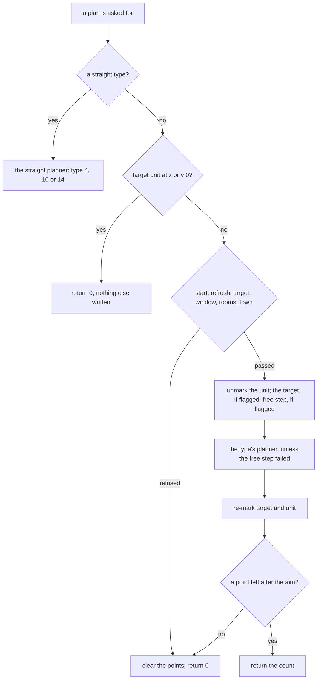

---
based_on:
  - docs/specs/path/README.md 2026-11-10
  - docs/specs/path/search.md 2026-11-04
  - docs/specs/drlg/collision.md 2026-11-04
---

# Pathing

A unit that moves, or a missile that needs a route, holds a path record with a **path type** from 0 to 16. One routine,
the plan, takes that record, checks the request, takes the unit's own marks off the [collision grid](../glossary.md),
calls the type's planner, puts the marks back and aims the path at the first point it got. This page explains that
routine, the planners behind it, the grid they read and the few draws they make. It restates the
[path overview](../specs/path/README.md#purpose) and the [path search](../specs/path/search.md#purpose), and for corpses
[collision § F5](../specs/drlg/collision.md#f5-corpse-marks-by-copy-of-the-grid).

Who asks for a plan and why is each caller's ([skills and missiles](skills.md), [monster AI](monster-ai.md#the-path-request)). The per-frame
step along the points is [animation and timing](animation.md#the-step). What the grid's cells mean is
[levels](levels.md).

## How sure each statement is

This page names its ground at each statement, because the kinds differ and they do not add up. The specs' own words on
what their confirmed tags cover are in [the search's purpose](../specs/path/search.md#purpose).

| Kind | What it is | Where it stops |
|---|---|---|
| **Seen in a game** | Plans logged in two runs of the game, 21 and 25 sessions, 46 in all, and compared with a model. | It holds for the types and outcomes the logs hold ([what each count tests](#what-each-count-tests)), and a planner's count is given the live cells from the log. |
| **Emulated** | The game's own code run in an emulator on declared inputs, and compared byte for byte with a model. | It shows what the code does with the bytes it reads, not what the game stores there or when it runs. |
| **Read from the code** | The instructions were read, and nothing ran. | No run has checked it. |
| **Unknown** | Listed under [What is not known yet](#what-is-not-known-yet). | |

**Stock and not stock.** 842 plans of the first run come after a breakpoint wrote the start's fraction word, in two
sessions (532 and 310). They are not stock, they show 0 mismatches too, and they back nothing
([overview § F1](../specs/path/README.md#f1-the-planners-take-the-live-grid)). A first-run count on this page holds them
unless it says stock.

## The big picture

The order of the checks is [overview § C](../specs/path/README.md#c-pathplan)'s; the steps below say how sure each one is.

## The plan, step by step

Steps 2 to 7 ran under emulation, 1 200 cases, 0 mismatches, as far as the planner slot's code-pointer check; the two
unmarks of steps 5 and 6 are shown there only on units whose unmark returns at once, and what they do to the grid is
[below](#the-grid-a-planner-reads). Step 1 and the steps after the planner call are read from the code, unless a step says
otherwise ([overview § C](../specs/path/README.md#c-pathplan)).

1. **No record** returns 0, and a record whose unit is not the caller's is a fatal error.
2. **A straight type** (4, 10 or 14) goes to the straight planner before any other test. Any other type reaching that
   planner is a fatal error, read from the code and never run ([search § K](../specs/path/search.md#k-the-straight-planner-and-type-4)).
3. **A target unit standing at subtile x or y 0** returns 0 and clears nothing. The other refusals clear the point index,
   the count and one flag of the path.
4. **The refusals, in this order.** The unit's position is (0, 0). The target point, after the target refresh (below), is
   (0, 0). The target equals the start. The target is more than 100 subtiles away on an axis, where 100 itself passes. The unit's
   room is missing, or the room at the target. The town test fails and the caller did not force it.
5. **The unit's own marks come off.** A dead player (mode 0 or 17) or a dead monster (mode 0 or 12) leaves its cells alone
   here ([collision § F5](../specs/drlg/collision.md#f5-corpse-marks-by-copy-of-the-grid), read from the code).
6. **The target's marks come off** when the path's flags ask for it and the target's size is not 0.
7. **The free step** runs when the path's flags ask for it and the target is blocked.
8. **The planner runs**, unless the free step failed. A planner may move the target, not the start: a changed start is a
   fatal error.
9. **The marks go back:** the target's if its unmark did something, then the unit's. The unit's mark goes back also when
   the free step returned 0 (13 emulated cases).
10. **The aim.** A count of 0 clears the flag and returns 0. Otherwise the path aims at its next point, and when every point
    is at the position the plan fails like a refusal. A plan that survives notes whether any point lies outside its
    room, keeps a copy of its target, and, with no target unit and one flag clear, takes its last point as the target.

The aim and its "every point at the position" refusal agree in all 13 265 plans of the first run that reached a planner or a
straight type, 72 of them with a non-zero count and a return of 0. The spec keeps this as inferred, and the aim's writes are
not compared ([overview § F1](../specs/path/README.md#f1-the-planners-take-the-live-grid)).

**The window** tests the request's target, before the free step, so a target the free step moved may lie a few subtiles
further, and the planners see the moved one. The room lookup uses the near list of the unit's room, so a target in an
inactive room refuses (both read from the code).

**The target refresh.** With a target unit, the target point becomes that unit's position. The routine returns 0 when
that position is (0, 0), which then refuses the plan, 2 for an object or item target and 1 otherwise. That return is the **refresh distance**
the planners below test against. It also moves a door's target 2 subtiles
toward the start, along the axis the door's `Orientation` picks, and that step never tests the grid. A player or
monster target with a non-zero offset field goes through an offset routine that is not read. All of this ran under
emulation except that branch ([overview § C1](../specs/path/README.md#c1-the-target-refresh)).

**The town test.** A monster that is not an NPC is refused a target in a town (levels 1, 40, 75, 103 and 109). "NPC" here is
the `npc` or `inTown` column of MonStats, or a negative unit field. Anything that is not a monster passes. It ran under
emulation, 400 cases ([overview § C2](../specs/path/README.md#c2-the-town-test)). Of the 68 call sites, 66 pass 0 for
"force", one passes a register holding 0, and only one client site can force. All read from the code.

**Refusals draw nothing.** The return was 0 and the seed unchanged in all 628 + 814 refusals of the two runs, 624 + 814 of
them stock. Of those, the 211 and the 281 whose reason needs the town test, the room or the free step are observed, not
predicted: their match says only that the game returned 0
([overview § C](../specs/path/README.md#c-pathplan)).

**A replan** ([overview § C4](../specs/path/README.md#c4-the-replan)) ran under emulation as far as its first boundary, 300
cases. A monster with one flag clear and no re-plan budget left returns 0. For types 2, 13 and 15 it plans again as 13 when its flag argument is
set and as 2 otherwise, and a failed plan then tries 15 (that retry read from the code). It writes the type directly, so
the path keeps the flags word of the type before it (read from the code). 836 + 889 replans of the two runs reproduce,
810 of the 836 stock, each with a target unit at the plan's entry and the seed unchanged; the target revalidation before
the call is not compared.

## Two masks

A path record holds two masks, and they are not interchangeable: the **test mask**, the bits a planner and the step
refuse, and the **mark mask**, the bits the unit writes into the grid
([overview § A](../specs/path/README.md#a-two-masks-what-a-move-tests-and-what-a-unit-writes)). Players mark `0x80`,
monsters `0x100`; a missile marks nothing at creation and `0x40` when its `Collision` column is not 0. The marks are
confirmed at [collision § F](../specs/drlg/collision.md#f-unit-marks), the test masks are read from the code. Neither of
Whirlwind's masks, the plan's and the flight's, holds `0x100`, `0x1000` or `0x2000`, so no live unit's mark refuses that plan or
that flight (read from the code). The Whirlwind plan's mask ran to its boundary under emulation.

## A blocked target, and a player's target step

The free step ([overview § C3](../specs/path/README.md#c3-the-free-target-step)) ran under emulation in all its branches.
From a blocked target it walks back toward the start along up to three lines at once: a main direction and two alternates, the
second of which may be none, each moved one step per round and tested in that order. The first cell not blocked becomes the
target, and only the main direction is recomputed between rounds. The main line reaching the start returns 0 and leaves the
plan's target as it was, and a new target equal to the start also returns 0.

**A player's target is then pushed outward.** When the moved target lies under 5 subtiles from the start on both axes, and
not on the start, it is extended away from the start until it is 5 away or the next cell is blocked. The step moves **one
axis unless the two differences are equal**: x moves by the sign of the x difference when that difference is at least as
large as the y difference, and y likewise; this ran under emulation too. A target at (3, 1) from the start steps (1, 0), not (1, 1).

## The 17 types

Every type's planner and draws. Only types 10 and 16 draw ([overview § D](../specs/path/README.md#d-the-17-types-planner-and-draws)).
"Stock server request" is what the logs and the scans found; [The shorts](#the-shorts-by-name) says what each "no" rests on.

| Type | Planner | Draws | Stock server request |
|---:|---|---|---|
| 0 | the search | none, emulated | no plan in 46 sessions |
| 1 | best-first over 200 nodes | none, emulated, and 824 plans through type 7 | no request observed in 46 sessions |
| 2 | greedy | none, seen | yes |
| 3 | greedy, client slot | none, read from the code; the emulated map reads no seed | none |
| 4 | one point at the target | none, seen | yes |
| 5 | the sideways walk, one way | none, seen | yes |
| 6 | the sideways walk, the other way | none, seen | yes |
| 7 | greedy, then best-first when near | none, seen | yes |
| 8 | knockback | none, seen | yes |
| 9 | one point along a line | none, seen | yes |
| 10 | the random walk | **the limit halved, on the seed passed**, seen and emulated | yes |
| 11 | one point along a line, client slot | none, read from the code; the emulated map reads no seed | client only |
| 12 | sideways walks at up to three settings, client slot | none, read from the code; the emulated map reads no seed | none |
| 13 | greedy, the same plan as 2 | none, seen | yes |
| 14 | the spiral | none, seen | yes |
| 15 | a line with two wall followers | none, seen | yes |
| 16 | the search, with draws | at each child and each turn, on the unit's seed, emulated | none: two functions nothing references |

**The plan routine itself draws nothing:** by reading, no random step lies in it or in what it calls, apart from the one
indirect call to the planner, and in the emulated domain the unit's seed is not read. Monster plans of types 2, 5, 6, 7,
13 and 15 reproduced in the game with the unit seed unchanged, each above a floor of 50 plans; type 1 has none
([overview § G1](../specs/path/README.md#g1-per-type)). What runs after a path is created (the mode set, the population) does reach
random functions; those are not the path's and are not followed here.

## The planners

Every planner that reads the grid tests a cell the same way. The unit's footprint pattern at a cell is tested against the mask: pattern 0 is
the cell, patterns 1, 3 and 5 a plus, patterns 2 and 4 a 3×3 rectangle, and any other is blocked. No room at the cell (for a plus, at
its centre) is blocked. A cell in a room
outside the near list of the planner's room counts as blocked, however large the search's rectangle (emulated:
[search § A1](../specs/path/search.md#a1-a-cell-read-blocked)). **The limit** that several planners use is a byte of the path record: at most 77, and 73 for a
player and 14 for a monster at creation ([overview § Runtime state](../specs/path/README.md#runtime-state)).

### Greedy: types 2 and 13

The planner first tests a straight line from the unit's position to the target. If the line reaches the target, or its end
is within the refresh distance of it, the plan is that one point. Otherwise it walks from the line's end, at most the
limit in steps. Each step tries the three directions toward the target, in order. A walk ends at the target, when all three are
blocked, or when the step found would reverse the last one, and it writes a point at each turn
([search § B](../specs/path/search.md#b-the-greedy-planner-types-2-and-13); emulated, and seen in the game's plans).

Its quirks are behaviour to keep. A walk whose last step turned ends one step short. The first point is written twice
when the walk turns at once. At most limit + 1 points, so 78 at limit 77, which only the emulation reached; the game's
longest list of any greedy plan is 21 in the first run and 27 in the second, both of type 7
([search § N](../specs/path/search.md#n-points-against-the-78-slots)). Types 2 and 13 are one plan: 13 differs in a flag no
planner tests, and the difference lies in the replan (read from the code).

### The sideways walk: types 5 and 6

These skip the line and the refresh test. The walk starts at the start, which is its first point, with the three directions
shifted by a parameter of the type: 2 for type 5 and −2 for type 6, which is the row turned by 90° (that reading from the
code), so the walk goes sideways to the line to the target
([search § C](../specs/path/search.md#c-the-0x98-walk-types-5-and-6)). At most limit points from an empty list. In the second
run these plans hold 6 points at most; the walk's other branches rest on the emulation.

### Greedy-near: type 7

A greedy plan, kept if its last point is within the refresh distance and is not the start. Otherwise, if the start and the
target are more than 324 apart in squared distance, it returns what it has. So (18, 0) falls through to the next step, and
(18, 1) at 325 does not. Next comes a best-first plan, and if that gives nothing, a greedy plan is run again, unless the
first gave 0 ([search § D](../specs/path/search.md#d-greedy-near-type-7)). This is emulated. A player plans this type (read
from the code). In the game 270 + 554 plans took the switch, of 2 725 + 4 355 that reached the planner. **The 324 boundary
and the retry separate no plan in either run**, so they rest on the emulation.

### Knockback: type 8

The distance is half the path's knockback byte, rounded down, plus 1. The point lies that far from the start, away from the
target unit, by truncating division; with no target unit it is the plan's target. A line test from the start cuts it to the last free
point. **The plan clears the path's target unit**, whether or not it finds a point, and returns 0 if the point is the start
([search § E](../specs/path/search.md#e-the-knockback-planner-type-8); emulated and seen, in the game monsters' plans with 2
player plans in the second run). A unit standing on its target gets the start as the point, and so a return of 0 (read from
the code).

### One point: type 9

The line test alone, and the plan is its end, or 0 if that is the start
([search § F](../specs/path/search.md#f-the-one-point-type-9)). In the game, 54 + 346 plans of the player's own Leap, on one
branch, one point each. The refusal branch rests on the emulation.

### Best-first: type 1

A best-first search over a pool of 200 nodes ([search § G](../specs/path/search.md#g-type-1-best-first-over-a-pool-of-200),
emulated to its return, and in the game through type 7's switch).

- With a target unit, if all 8 cells two away from the target are blocked, it returns 0 and writes nothing else.
- The diagonals are tried first, and no corner test applies: a diagonal between two blocked cells is taken.
- Among equal scores the newest node comes first, and an open node given a better cost is not moved.
- A plan past the pool ends short with what it has, even when no route reached the target.
- The start is never kept, so a route of one segment gives one point. 77 points at most: a raw 78 returns 0.
- It does not read the limit or the refresh, so a route has no length limit but its pool.

### A line with two wall followers: type 15

It draws a line of cells from the start to the target. The limit is the record's limit byte, at least 40 under a target unit,
and a line of 2 cells or fewer returns 0. At a blocked cell two followers go round the block, in turns.
One that comes back onto the line is spliced in. One that meets the other's trail again ends the plan at the line before the
block. When one stops, the nearer end to the target is taken unless the start is nearer still. The list is then reduced: a
point whose step equals the last is dropped, and, with nothing dropped since, a point where both coordinates of the step
change. So east, south, east, south loses every other corner, and east, south-east, east, south-east loses none
([search § H](../specs/path/search.md#h-type-15-a-line-with-two-wall-followers); emulated, and seen). **Most plans end at
0:** 2 273 of the second run's 3 309, the planner's own refusal or a free line of too few cells. A monster with its
creation's limit of 14 and a target unit reaches 39 subtiles here where its other plans have 14 (read from the code).

### One point at the target: type 4

One straight segment, with no collision test. It refuses at 100 or more on an axis, or a target coordinate of 0, and these
paths skip the plan's own window ([search § K](../specs/path/search.md#k-the-straight-planner-and-type-4)). In the game all
2 740 + 3 713 plans are this one point.

### The random walk: type 10

The first direction toward the target is found once. Then each draw takes one step on the seed passed: it writes a point, and the direction of the move is the first direction plus −1, 0 or 1 from the draw's low 5 bits, moving 2 subtiles. Every step is the first
direction ±1 or straight, so **it is not a walk of accumulating turns**. The first point is the position itself. **No grid
and no room are read**: a missile's collision is its own ([search § I](../specs/path/search.md#i-the-random-walk-type-10)).
A straight step has chance 10/32 and each side 11/32 (read from the code).

The count of draws is the missile's limit halved, and the count of points one more. At limit 77 that is 38 draws and 39
points. In the game, 698 + 248 plans return 39 at that limit, and in 654 of 654 creations the exit seed is the one predicted
from the seed set up and the logged range: 20 steps for class 458, 38 for class 195, 10 for class 408
([overview § D](../specs/path/README.md#d-the-17-types-planner-and-draws)).

**A worked example**, from the game's logs ([overview § Worked example](../specs/path/README.md#worked-example)): a class 225
missile at subtile (4225, 5126), target (4225, 5125), limit 77, so 38 draws and a first direction of 6, which is (0, −1).

| Draw | Add | Direction | Point written |
|---:|---:|---:|---|
| 1 | +1 | 7 | (4225, 5126), the position |
| 2 | +1 | 7 | (4227, 5124) |
| 3 | 0 | 6 | (4229, 5122) |
| 4 | −1 | 5 | (4229, 5120) |
| 5 | −1 | 5 | (4227, 5118) |

It returns 39 with a last point of (4207, 5050). No cell is read, so a wall on the way changes nothing in the plan.

After such a plan, class 458 draws nothing more on that seed within its life: 68 seeds watched, each next write a block write
over the unit's memory with the high half of the seed still the plan's exit value; that the write is the block's release or
reuse is read from the code ([overview § D](../specs/path/README.md#d-the-17-types-planner-and-draws)). Classes 225 and 195
are short of the floor of 50 each, with 22 and 3 seeds watched in one run and one more each in the other, and stay inferred.

### The spiral: type 14

77 points in a growing spiral around the position, with no draw and no grid. Its structure is read from the code; **the
truncation is seen**. The code sets the rounding field around each conversion, and the game's own stored integers agree: 233
natural plans, 43 804 stored products, 18 174 of which separate the readings, all 18 174 truncating toward zero and 0 rounding
([overview § G4](../specs/path/README.md#g4-truncation)). The point list reproduces in 27 stock plans of the first run, which
are one list relative to the start, and in 233 natural plans of the second
([search § J](../specs/path/search.md#j-the-spiral-type-14)). The emulator's rounding ignores that field, so its own spiral
cases say nothing about the game. The hammer's end at a wall is the missile's own step, not this plan's (read from the code).

### The search: types 0 and 16

An iterative-deepening depth-first walk with no open list: each node takes the first direction of a fixed fan that passes the
tests, so the fan's order is the tie-break ([search § L](../specs/path/search.md#l-the-search-types-0-and-16)). **All of this
is emulated (2 116 cases, 0 mismatches, plus 120 boundary cases). No type 0 or 16 plan appears in 46 sessions.**

- The rectangle it searches is not the true union of the two rooms: a target room with a smaller far end can shrink it below
  the unit's own room, and a start beyond it returns 0.
- **A route of one segment returns 0,** so this planner refuses a free straight or exactly diagonal line. Type 1 accepts one.
- Type 0 with its last bound at or below the unblocked distance has one pass, and finds only a route of that exact length.
- Type 16 starts at half as much again and draws at each child and each turn, a node's fifth try excepted: 994 022 draws in the
  emulated cases, every exit seed compared.
- At most 77 points. The node store of 900 is out of reach under the plan's window (read from the code).
- A rectangle can pass the size check and still overrun the stack frame: 217 × 217 fits and 218 × 218 overruns. No single stock
  room overruns (read from the code).

### The client slots: types 3, 11 and 12

No server code sets them, as far as the scan reaches ([The shorts](#the-shorts-by-name)). Their code maps ran under emulation,
60 cases each ([search § M](../specs/path/search.md#m-the-client-only-slots-types-3-11-12)). That they run in the client is out
of scope.

## The aim and the facing

After a plan the path aims at its next point: it works out the vector and the step per frame, and it may set the direction to
turn to and a turn step. An emulated family of 500 cases reproduces this, which is the code's map over declared cases, not when
the game calls it ([overview § H](../specs/path/README.md#h-the-aim-and-the-facing-step)). The names "facing" and "turn step"
are the project's, not an observed use. The turn-step table equals the exact rule
that section's H4 gives, on this image, element by element, 64 of 64, with no claim about how it was made.

**Only the client turns.** Read from the code: the step that turns the facing toward its aim, by the turn step each time,
snapping to the aim once it is reached or passed, is called only from the client's per-unit updates. The server's walk aims
the facing at the next point after every move step, which sets only the direction to turn to and the step; a player's or
monster's facing itself changes on the server only when code sets it outright. That rests on the client update passes
being the turn's only callers ([overview § H](../specs/path/README.md#h-the-aim-and-the-facing-step), H5).

## The grid a planner reads

**The planners take the live grid.** It is seen in the game: given the game's own cells at the planner call, with the unit's and
the target's unmarks already run, the models reproduce **33 722 stock plans with 0 mismatches**, 20 671 of the second run and
13 051 of the first, on 11 types (2, 4, 5, 6, 7, 8, 9, 10, 13, 14, 15). Each is compared on its return, as many point words as that
return says, and its exit seed. Apart from those stand the **842 of the first run after the written probe**, which show 0 mismatches and back
nothing ([overview § F1](../specs/path/README.md#f1-the-planners-take-the-live-grid)). The model took the planner's address, the
context and the record at the call and the target unit's position from the game, so the plan's head, the refresh, the free step,
the town test and the slot are inputs to this count, not predictions of it.

**This is not the predicted grid.** The 0 mismatches take the grid from the game. The same planners on a grid predicted from the
built map plus the units are another claim, and it failed.

**The grid is its operations in order, never a union of holders.** The grid at a planner call is the result of the marks and
unmarks in order. An unmark takes the same footprint off and no bit is counted, so it clears a shared bit another holder also set:
that is seen in a game run that logged the marks, not in the planners' counts above. A rebuild runs the operations and never computes a union of holders
([overview § F2](../specs/path/README.md#f2-the-grid-is-the-result-of-its-operations-in-order),
[collision § F7](../specs/drlg/collision.md#f7-no-bit-is-reference-counted-the-grid-is-the-result-of-its-operations-in-order)).

**The prediction is wrong in 11 of 15 663 plans**, a counted oracle ([overview § F3](../specs/path/README.md#f3-the-counted-oracle)).
Those are the plans with a built map on a run kept apart: 2 of type 2, 3 of type 13 and 6 of type 15, the bit `0x1000` alone
sufficing in all 11. The test asked for 0 wrong plans and failed by its own terms. Its rules were frozen before the run, no rule
was changed after it, and the prediction was made without the corpse call's seventh caller. Adding the rules one at a time on
the same logs: own marks alone 472 wrong; with the objects, corpses and plan's target 72; with the act change 62; with the reserved
landing 11.

The **candidates** for the 11 were chosen after the result and not tested on data they did not see:

- **8 are order:** the planning unit's own unmark over a reservation (4), a monster that left a reserved cell (1), the target's
  unmark (2), the player's mask set to 0 at Leap's flight (1).
- **3 are the seventh caller** of the corpse call: class 194 in mode 14 ([Corpses](#corpses)).

**No tested rule exists for either.** So a plan's grid stays an input, "the live cells", and a checker feeds the planners the
logged cells. What this does not establish is that the grid is a function of the present holders; it is not. The wrong-plan count
raises nothing either: each rule below rests on its own bit or line.

| Rule | What the grid holds | How sure |
|---|---|---|
| Objects | An object's rectangle is in the grid when its class's `HasCollision` is set for its mode; each operate handler that changes the state marks or unmarks itself; the mode change does not | Seen for the bits `0x400` and `0x800`: 0 cells differ over the 154 780 rooms of the 15 663 plans, against 64 229 and 1 572 with the rule off. The handlers' route is read from the code. The object bits `0x0002` and `0x0004` keep 626 and 3 708 cells of unnamed source |
| The plan's target | Under a path flag, a target whose size is not 0 is unmarked, whatever its type, and marked again when the unmark did something | Seen for a targeted object of size 1 or more: with the rule off, 274 `0x400` and 20 `0x800` cells differ and 35 more plans are wrong; with it on, 0 of those cells. The size test's 0 branch and other unit types as targets are read from the code |
| The player after an act change | Unmarked until a later move or a plan's tail; a level change inside an act keeps the mark | Read from the code. In the logs 7 of 7 act changes unmarked and a control of 3 of 3 marked, short of the floors of 10 (7 of 16 and 3 of 9 seen) |
| A reserved landing | Four skill starts mark the landing before the flight; landing unmarks it | Seen: the calls at the three reached sites, 128, 237 and 109 lines, and 474 releases. The holding until release (51 plans in the prediction), Jump's site and a monster's arm are read from the code |
| The `0x200` bit | Its source is unknown: 92 597 cells differ on that run and no logged unit holds them | No plan depends on them on these logs, and no move mask read holds it, though a spawn mask does (read from the code) |

The operations behind the target, the act change and the landing are at
[collision § F6](../specs/drlg/collision.md#f6-marks-around-a-plan-an-act-change-and-a-reserved-landing), and the rows above at
[overview § F4](../specs/path/README.md#f4-each-grid-rule-at-its-tag).

## Corpses

The game holds a room's grid twice, the server's and the client's, and they take a corpse differently. A server planner reads the
server's, never the client's plus. Every statement here holds for the copy it names, and the logged counts are lines, not deaths
([collision § F5](../specs/drlg/collision.md#f5-corpse-marks-by-copy-of-the-grid)).

| Corpse | Copy | What it does | How sure |
|---|---|---|---|
| Monster, `deadCol` 0 | server | The live mark off and a **3×3** of `0x8000`, from mode 0 on, with the record's mask and pattern unchanged | Seen: 1 527 lines, all the full 3×3, 1 505 in mode 0 and 22 in mode 12, and 1 474 distinct mode-12 monsters of the unit lists in that shape |
| Monster, `deadCol` 0 | client | A **plus** of `0x8000` | Seen: 396 of 408 lines in one run, 3 419 in another |
| Monster, `deadCol` 1 | server | The call is skipped and the live mark stays | Seen for classes 403 and 404, 18 distinct dead. Class 273 is read from the code here; the other 10 rows with `deadCol` 1 are in neither corpse run |
| Monster, `deadCol` 1 | client | The same | Seen: the other 12 of the 408 lines |
| Class 194 in mode 14 | server | The same 3×3, by a skill start, so corpse cells cannot be predicted from a mode | Seen: 35 lines. That it causes 3 of the 11 is a candidate |
| Monster re-created dead, `deadCol` 0 | server | The 3×3, then the plus on top, the record ending at pattern 5 and mask `0x8000` | Seen: 134 cases compared line by line, and 3 distinct units holding that shape later |
| Monster re-created dead, `deadCol` 1 | server | Nothing more than the one creation mark | Seen: 6 cases |
| Monster relocated dead | server | The plus alone at the new place, its old cells left. It tests the dead mode only, not `deadCol`, so a `deadCol` 1 monster takes it too | Read from the code; no such case is logged |
| Dead player | server | The 3×3 | Read from the code; the call did not fire |
| Player created in mode 0 or 17 | server | The plus, not the 3×3 | Read from the code |

These are read from the code, and no game ran on them:

- **The corpse call's last step marks nothing.** It snaps the corpse's position to the middle of its subtile, which moves no cell and,
  in practice, no room.
- **A plan does not force the unmark.** The plan's unmark leaves a dead player's or monster's cells alone, and an object it
  unmarks needs `HasCollision` set. A corpse call, a creation and a relocation force the unmark.
- **The server's 3×3 has no paired clear.** No routine read clears it: an unmark takes only the unit's own mask and pattern, which on a
  server corpse are still the live ones. So the cells outlast the corpse until the grid is
  rebuilt. This is the likely source of the 26 034 differing `0x8000` cells of the predicted grid.
- **A revival.** The client's revive routine acts only at mask `0x8000`, which the corpse of an ordinary server death does not hold. The server's revive-in-place routine sets the mask to `0x100`, which that corpse
  already holds, refreshes the pattern from the size, and marks it again; two skill routines also refresh. None of these clears the 3×3, so it stays. A monster re-created or relocated
  dead holds mask `0x8000`, so setting the mask takes that plus off, and a re-created one is left with the 3×3's four corners. Not followed: the mercenary's
  resurrect, the fetish revive callback, the resurrect packet, skill start 21's revive and three callees of the revive routines. A
  mode set from dead to alive is not given as a route, since where the mode word is written was not located. No server revival
  is logged with its grid.
- **`0x8000` is in no immediate move mask scanned:** 0 of 53 immediates that reach a move mask, and none of the monsters' masks.
  A mask built in a register or read from a table was not scanned. It is in no spawn mask either. So on what the specs state a corpse mark is not a blocker, but whether corpses block movement stays open.
- **`unflatDead` is no route to it.** Its one direct reader is a client draw-list test, so it changes no grid mark and no move
  mask, and no direct call on the server reads it ([overview § Reimplementation notes](../specs/path/README.md#reimplementation-notes)).

## Who asks

The plan routine has 68 direct calls in 58 functions, 34 on the server and 34 on the client
([overview § E](../specs/path/README.md#e-who-asks-the-request-register)). The register is read from the code, each type at its site.
Seen in the game: all 33 722 stock plans came through sites of this register, by their return addresses, and the first run's other 842 did too: 0
outside it in either run. "Current" plans with the type the path already holds.

| Who | Sites | Type at the call |
|---|---:|---|
| player | 2 | 7, or 8 in mode 19; 15 for the reach test of the position packet |
| mode machine | 5 | the request's type, 15 as its fallback, current, 8 for knockback |
| AI | 3 | 2, test plans that restore the path |
| skill | 10 | 8 and 9 (Jump), 2 then 1 (a swarm's move), 1 (Diablo's run), current (Charge), 14 (Blessed Hammer), 7 (Whirlwind), 9 then 8 (Leap Attack) |
| missile | 10 | 4 at creation, 10 from the four reseed callbacks, current for the rest |
| movement | 2 | 13 or 2, then 15 or current (the replan) |
| referenced by nothing | 2 | 16 |
| client | 34 | out of scope |

A walk, run or town walk start plans type 7. The AI's types are 1, 2, 5, 6, 7, 13 and 15, and a failed plan of 2, 7, 9 or 13 falls back to 15; [monster AI](monster-ai.md#the-path-request) has how a think asks.
No Missiles column chooses a type: it is a constant in the code that asks. All read from the code.

## What each count tests

Plans are the logged calls of the two runs, the first run's 842 among them ([overview § G1](../specs/path/README.md#g1-per-type)). "Return 0"
counts among the second run's plans that reached a planner or a straight type. The last column is the project's reading of the
first run's controls: "weak" means these logs add little, and the emulation covers the rest of the code. A planner's 0 mismatches
given live grids says nothing about predicting the grid.

| Type | Plans, run 1 + run 2 | Return 0, run 2 | Largest return, run 2 | The 0 is |
|---:|---|---:|---:|---|
| 2 | 162 + 476 | 62 | 17 | fair: 158 of the first 162 one class |
| 4 | 2 740 + 3 713 | 0 | 1 | weak for its size: one branch, 1 point, no control |
| 5 | 696 + 628 | 74 | 6 | fair: short lists |
| 6 | 655 + 664 | 71 | 6 | fair: as type 5 |
| 7 | 2 894 + 4 589 | 64 | 27 | strong; the 324 boundary and the retry unobserved |
| 7 through type 1 | 270 + 554 | — | — | fair: the switch only |
| 8 | 282 + 1 303 | 242 | 1 | fair: monster knockback, with 2 player plans in run 2 |
| 9 | 54 + 346 | 0 | 1 | weak: one branch, 1 point, no grid |
| 10 | 698 + 248 | 0 | 39 | strong for count and draws; no grid |
| 13 | 4 078 + 4 872 | 1 105 | 20 | strong |
| 14 | 54 + 233 | 0 | 77 | weak: the first run's stock plans are one list relative to the start |
| 15 | 1 580 + 3 599 | 2 273 | 29 | strong on those with points; most are the planner's own 0 |

In either run no control passed a plan it separates. On the second, 7 of 30 separate none, so those claims stay on the emulation. Flipping the
first tested cell changes the model's output in 10 938 of 15 261 plans that tested one, so the model does read the live grid.

## The shorts, by name

What the logs did not reach, each stated as it stands ([overview § G2](../specs/path/README.md#g2-type-1),
[§ G3](../specs/path/README.md#g3-the-other-short-types-and-stages)).

- **Type 1.** The planner is confirmed: emulated to its return, and seen in the game through greedy-near's switch, 270 + 554 plans. **No
  stock request was observed in 46 sessions** (21 + 25): no plan with type 1 at the plan's entry, and in the 25 all seven sites that
  request it count 0. Those seven are read from the code. Two are a retry, reached only when the request before returned 0, and followers
  planned in these logs without one (a mercenary 103 plans, a clay golem 65). Five were not staged, so their 0 says nothing of why.
- **Type 0.** Planned where a "current" site holds it. No plan in 46 sessions. The planner rests on emulation only.
- **Types 3, 11 and 12.** No server code sets them, by a scan of immediate stores (read from the code; 18 register stores of unresolved
  base and 4 read-modify-write stores remain). Break lines over 46 sessions show no server caller: types 3 and 12 no line on either side,
  type 11 client callers only, 229 + 1 105 hits. The control under the same break is counted on the second run and capped on the first,
  so there the absence past its last line is inferred. Of the 22 store sites 7 and 6 executed, none storing those types.
- **Type 16.** Planned only from two functions nothing references (read from the code), with no line on either side in 46 sessions.
- **Town-follow.** Attempted in the Rogue Encampment, 313 plans, with no hostile monster in the town room, so it is short
  (inferred). The geometry stays with the [room lifecycle](levels.md#rooms-that-come-and-go-release-and-restore). Whether a stock town's geometry admits the route is open.
- **Jump.** No stock user: no MonStats skill column and no other excel table holds it, and it occurs in `skills.txt` only (read from the code).

## What is not known yet

From the specs' open questions ([overview](../specs/path/README.md#open-questions), [search](../specs/path/search.md#open-questions)):

- **Do corpses block movement?** No immediate mask scanned holds the corpse bit, but that is what the findings did not find, and no run
  tests it. A mask built in a register or read from a table was not scanned.
- **The operations in order.** Whether marks and unmarks applied in the game's order, with the seventh caller, leave 0 wrong plans. The logger
  holds no line per ordinary mark. The same question carries the player after an act change beyond its 7 and 3, and the shorts above.
- **The `0x200` cells:** what sets them. No logged unit does.
- **A relocated dead monster and a server revival in a log**, and the routes not followed
  ([collision § Open questions](../specs/drlg/collision.md#open-questions)).
- **Pets against players:** no pet-specific mask was read, and a pet's route has a callee not followed.
- **No readable community record** for type 10, for Teleport as a pathing event (the named pages could not be fetched, so it is unread, not
  empty) or for corner stalls.
- **Whirlwind's flight:** its mask and its stop at a blocked subtile are read, not compared for a flight; no run shows a flight stopping or passing a unit.
- **Classes 225 and 195** beyond their watched seeds, and who creates class 195.
- **Type 1's stages:** the Countess's state, Diablo's run, a far-behind mercenary, a swarm's move.
- **Type 0's last bound on the server:** a monster's would be 0 by the writes read, which gives one pass; no plan logged it.
- **The 18 unresolved type stores** and the unobserved rest of the store sites.
- **The target offset** for a player or monster target: that routine is not read.
- **Two flags of the path:** what they do, and any reader outside the planners.
- **Town-follow:** whether a stock town's geometry admits the route.
- **A warp-paired room's rectangle:** whether a stock pair lies far enough to overrun the search's store, and whether a request takes it.
- **Type 1's propagation stack:** whether it can reach its 200 slots; the model's depth is 23 on the emulation's cases and 3 on the first
  run's plans, and no bound is proved.
- **The reasons** behind type 1's "more than 5" tie and the greedy walk's one-step-short end: only the behaviour is read.
- **Branches no game plan separated:** type 7's 324 boundary and retry, the context room of knockback and one-point, type 15's limit above
  80, all of the search. Each stays on its emulation until a stage reaches it, and no stage is planned.

## Where to read more

- The specs: [path overview](../specs/path/README.md#reimplementation-notes) and [path search](../specs/path/search.md#reimplementation-notes),
  whose *Reimplementation notes* list the traps, and [the collision grid](../specs/drlg/collision.md#f-unit-marks) for the marks.
- The [glossary](../glossary.md) for D2 terms.
- Related wiki pages: [animation and timing](animation.md#movement) (the step along the points, speeds, knockback's length),
  [levels](levels.md) (rooms and the collision grid), [skills and missiles](skills.md) (the skills and missiles that ask for a plan and the
  re-seed sites), [monster AI](monster-ai.md) (what a monster asks for), [monsters](monsters.md) (how a monster is created), [randomness](randomness.md) (unit seeds and draws) and
  [how we know](how-we-know.md).
