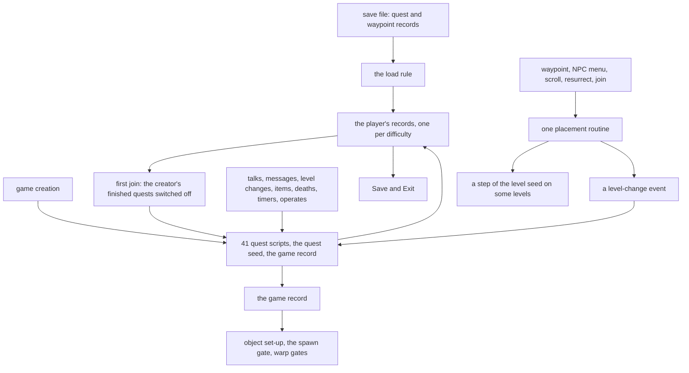
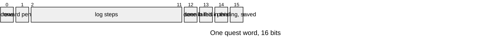
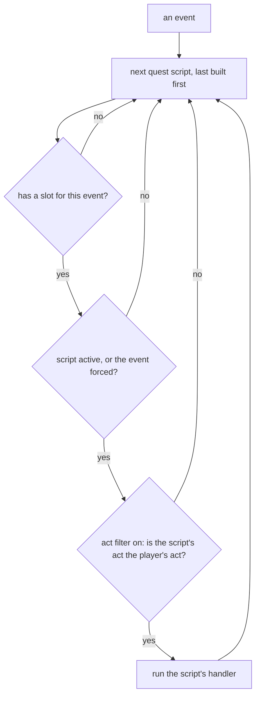
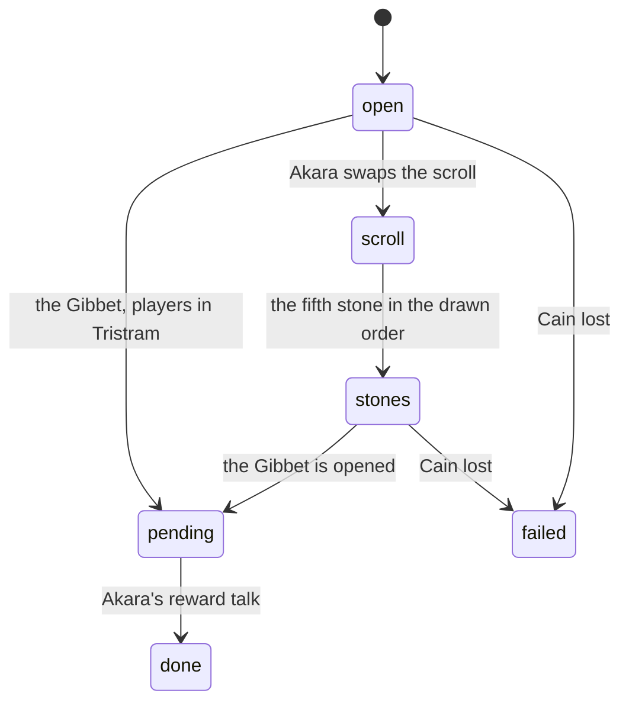
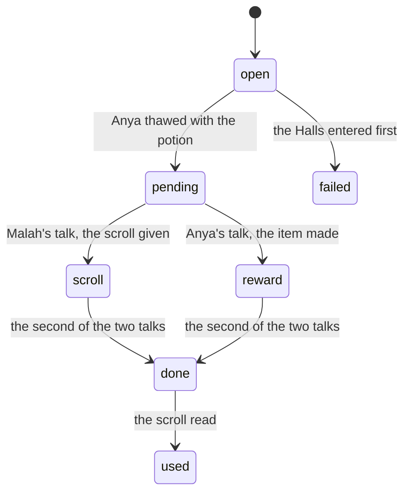
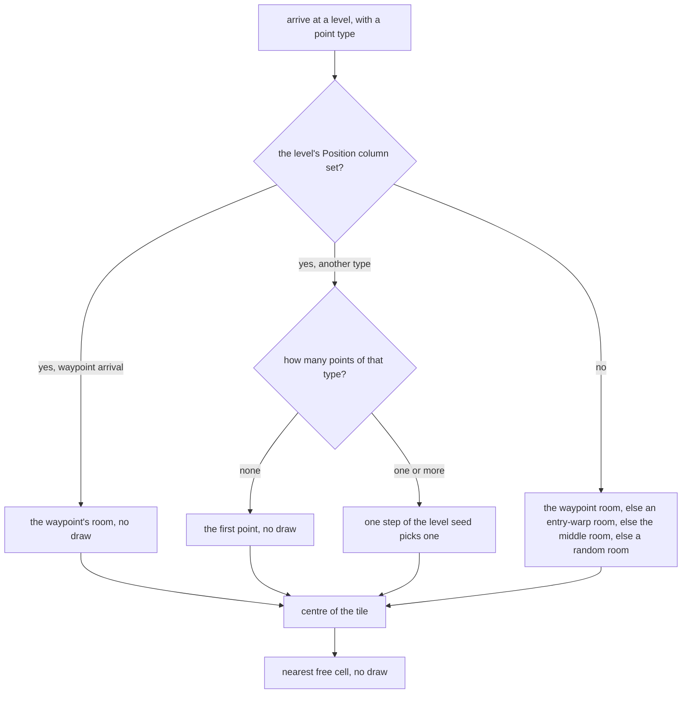
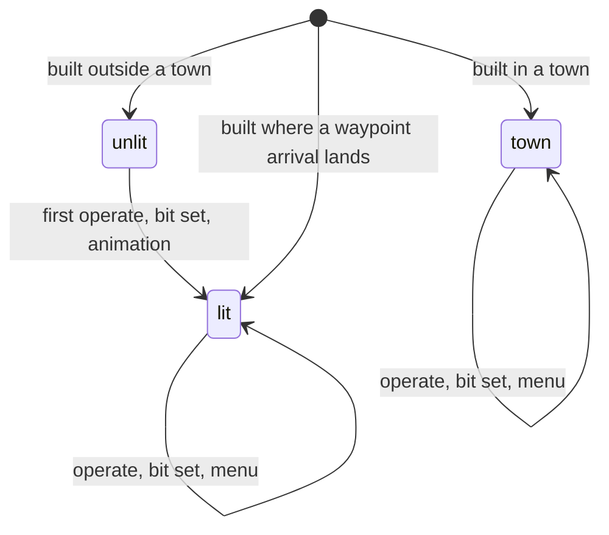
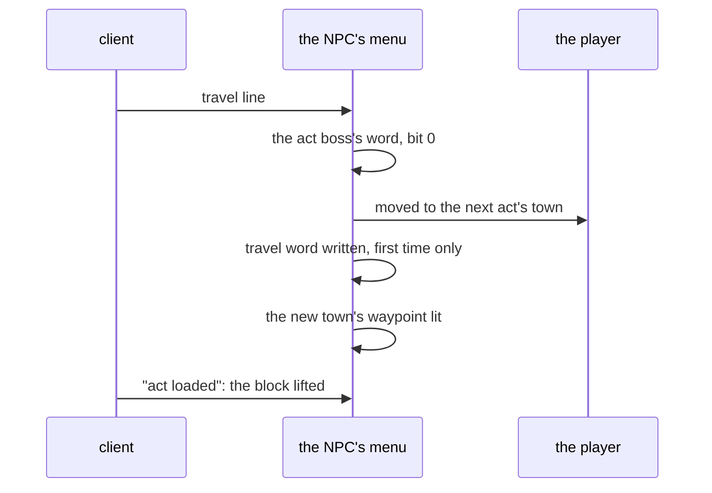
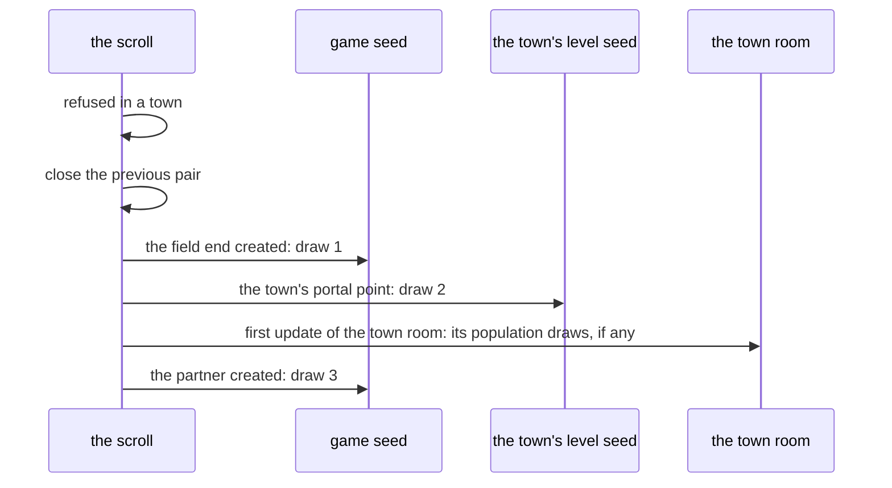

---
based_on:
  - docs/specs/quests/README.md 2026-10-20
  - docs/specs/quests/progression.md 2026-10-20
  - docs/specs/quests/travel.md 2026-10-20
---

# Quests and travel: how a character moves through the acts

Quests in Diablo II are not data. No excel table the game loads describes a quest: each one is a small script built
into the game, which listens for things that happen (a talk, a kill, entering a level, using an item) and sets bits in
the player's [quest record](../glossary.md). Travel is the other half of moving through the game: waypoints, the NPCs
and portals that change act, town portals, warp tiles, and where a player lands after each of them. This page
explains both, and which of them draw on a [seed](../glossary.md). It restates three reviewed specs: the
[quests and travel overview](../specs/quests/README.md#purpose), [quest progression](../specs/quests/progression.md#purpose)
and [travel](../specs/quests/travel.md#purpose).

What a quest *drops or gives* (the quest treasure classes, Andariel's and the Hellforge's special drops, the imbue,
socket and personalise services) is on [other item paths](items-other-paths.md#quest-drops-and-quest-rewards); how the
record is stored in the save file is on [saves](saves.md#quests-waypoints-and-npcs).

Much of the quest code is known only from reading it. The specs separate what three test runs confirmed from what is
read from the code, and so does this page: where a step was not met in a run, the text says so.

## The big picture

The game keeps two kinds of quest state: one record per player and difficulty, loaded from the save and written back
at *Save and Exit*, and one game-wide record that lives only as long as the game
([overview § Data flow](../specs/quests/README.md#data-flow)). Events reach the quest scripts, the scripts write both
records, and the game-wide record and the scripts' own state are read by the code that builds objects and monsters and
by the warp gates.

The confirmed core, from the overview's shared model: the record's load rule, the fixed order in which events reach
the quests, the first join's treatment of the game creator's history, the quest-seed draws the runs reached, and the one
placement routine that the logged waypoint, NPC and join arrivals and the town portals' town ends went through
([overview § Shared model](../specs/quests/README.md#shared-model)).

## The quest record

A player has one record per difficulty: 48 words of 16 bits each, so quest *q*'s word holds 16 flags
([progression § A](../specs/quests/progression.md#a-the-quest-record)). Most words follow one grammar:

| bit | meaning |
|---|---|
| 0 | the quest is finished (the reward taken, or there was none) |
| 1 | finished in a game, reward not yet collected |
| 2–11 | the quest-log steps; they gate nothing outside the quest's own log |
| 12 | the player opened this quest's entry in the quest log |
| 13 | finished in this game |
| 14 | failed in this game (someone else finished it) |
| 15 | a reward was pending when the character last saved |

Each quest also uses some of the bits for its own story (Anya's word, below, uses bits 7 to 10). The meanings above are
read from the code, with three exceptions confirmed in the game: bit 12 is set when the client reports a quest-log
entry opened, and the loader's handling of bits 13, 14 and 15.

**The load rule** is confirmed. For the first 42 words of a saved record, the loader clears bits 13 and 14 (they only
mean something inside one game) and sets bit 15 wherever bit 1 is set; the last six words are copied as they are.
Nothing ever clears bit 15 except one first-join check of the Radament quest's word, so a character that saved with a
reward pending carries bit 15 from then on; that is read from the code. *Save and Exit* writes each record as it stands: the runs checked the saved
words against the loaded record plus every write logged during play, 2 304 word checks with no mismatch.

Some words are no quest script's own word: words 7, 15, 23 and 28 are the act-travel words (below), word 41 (the Hell
respec offer) is written only by the Den of Evil quest's scripts as their second word, word 34 is written by no script, word 42 is held by the NPC-introduction scripts but never written, and
words 43 to 47 are never used.
This is read from the code.

**The game record** has the same shape and lives only in the game. Bit 13 of a word marks "this quest's step was done
in this game", bit 15 "the game's creator had already finished it", and word 4 bit 11 "the cow portal was opened". It is
read from the code and sent to the clients after every NPC message. See the glossary's [game record](../glossary.md).

## Events and the order quests hear them

There are 41 quest scripts: 37 in the main table, one or more per quest, and four that only handle the NPC
introductions of Acts I, II, III and V ([progression § B](../specs/quests/progression.md#b-events-and-dispatch)). Each
script fills a slot per event kind it cares about:

| event | raised by |
|---|---|
| talk start, talk end | the player starts or ends a talk with an NPC |
| NPC message | the client reports which dialogue line it played |
| level change | the player's room moves to another level, or the player steps into a town portal from a town |
| item placed, item dropped | a quest item's own hooks |
| hooked death | a monster a quest has hooked dies, after its drop |
| leave | a player leaves (first once per quest item carried) |
| first join, later join | a player joins the game |

The order is fixed and confirmed: an event runs through the scripts from the last one built (the Act V introductions)
down to the first (Warriv's), so later acts hear an event first. Talk, message and level-change events are **forced**:
they reach every script with a slot for them, even one that has been switched off for this game. The runs logged 503
such dispatches and 8 203 calls. The other half, an unforced event skipping a switched-off script, was not logged and
is read from the code; so is the list of special deaths that are forced too (four monster classes, Diablo's among them,
and a fixed set of superuniques).

What actually advances most quests is the **NPC message**. When a talk starts the server tells the client which quest
line an NPC has, the client plays it and reports the line's number back, and the scripts react to that number
([progression § F](../specs/quests/progression.md#f-npc-interaction-server-side)). No dialogue text is involved. The runs
predicted 41 talk steps over 20 table rows from the logged messages.

Four event kinds have no code that raises them, so some handlers are dead; object operates reach quest code through
the objects' own operate functions instead. This is read from the code.

## The game creator's history

When the first player joins a new game, every quest that player had finished (bit 0 or bit 15 in their record) is
**switched off** for the whole game, and its word in the game record gets bit 15
([progression § C](../specs/quests/progression.md#c-the-join-and-the-game-creators-history)). This is confirmed: 11
first joins in the first run switched off 176 quests (26 for a creator who had done everything, none for a fresh one),
the second run 464 more, in the same way. Later players' records never feed this pass. See the glossary's
[switched-off quest](../glossary.md).

"Switched off" does not mean "does nothing". Forced events still reach the script, and whether a handler then writes
depends only on its own tests. Two cases are confirmed: the Act II palace script's handler for the talk with the NPC
at the palace writes its bit with the quest off (44 times, once per talk), and the reward talks test the word's own
bits, not whether the script is active, so a reward is still handed out in a game where that quest is off.

A character made just now joins twice (once when it is built, once when its fresh save is read), and neither join runs
the switch-off pass: that is confirmed. On the first join every quest also gets its first-join call, and one chain of
"offer the next quest" is started per act; that part is read from the code.

## How a quest script is shaped

Each quest has its own copy of a few helpers, and the bit tables of the spec name them by effect
([progression § D](../specs/quests/progression.md#d-shared-shapes-of-the-quest-scripts),
[§ E](../specs/quests/progression.md#e-timers)). All of this is read from the code:

- **Near credit**: a boss's death credits every player in the death room or a room near it whose quest bits are clear.
  **Level credit** credits every player in a named level.
- **Party credit**: each party member of a credited player who has not finished the quest gets the same bits, but only
  if they stand somewhere in that quest's act. A two-client game confirmed it once, for the Den of Evil with the
  partied member waiting in the Rogue Encampment; the act test and the unpartied case are read from the code.
- **Fail others**: every other player who has not finished the quest gets bit 14 and a message.
- **The reward pattern**: the completing event sets bits 13 and 1 (or 13 and 0 when there is no reward talk); the
  reward talk, with bit 1 set, sets bit 0, clears bit 1 and wipes the log steps.

**Timers** run every 20th game frame. A timer added with period *p* first runs *p* + 1 of those boundaries later, and
one that reports it is done is removed: that is confirmed for the two quest timers the runs reached (the eclipse and
the Dark Wanderer), seven runs in four games. Both are one-shots, so a timer that repeats, and the wrap of the timer
clock, are read from the code only.

## A few quests, bit by bit

The spec has a bit table and a state diagram for every quest word
([progression § H](../specs/quests/progression.md#h-the-quests)). Five of them show the range.

### Akara's reward and the Hell respec (words 1 and 41)

The Den of Evil's word is set as pending when the last monster of the level-8 monster region dies, for each player who
killed one of its monsters, and the others fail; that kill side is read from the code. Akara's reward talk, with bit 1
set, is confirmed: it sets bit 0, clears bit 1 and the log steps, and in the same message sets bits 13 and 1 of word 41,
which is the offer of a free skill reset in Hell
([word 1](../specs/quests/progression.md#word-1-the-level-8-monster-region-and-the-hell-respec-offer-quest-object-1)).
That the reward also adds one to the player's stat 5 is read from the code.

The spec's third worked example follows one save through this
([progression § Worked example](../specs/quests/progression.md#worked-example)):

| step | word 1 | word 41 |
|---|---|---|
| saved | bit 1 | 0 |
| loaded (bit 15 from bit 1) | bits 15, 1 | 0 |
| Akara's reward talk | bits 15, 0 | bits 13, 1 |
| written at Save and Exit | bits 15, 0 | bits 13, 1 |
| loaded again | bits 15, 0 | bits 15, 1 |

The respec itself, taken from an NPC menu in Hell, is read from the code.

### Cain, the cairn stones and Tristram (word 4)

The order the five cairn stones must be touched in is a **draw on the quest seed**, made once per game at the first
use of the decoded scroll ([word 4](../specs/quests/progression.md#word-4-cain-the-cairn-stones-tristram-and-the-cow-king-quest-object-4)).
The game takes steps of the quest seed and each step picks one of five slots (the remainder of the low half by 5); an
empty slot gets the next stone, a filled one wastes the step, until all five are filled. So the draw count is at least
five and varies: three first uses took 15, 6 and 7 steps, each predicted from the seed before, and a second use drew
nothing. That touching the first stone draws the order the same way (when the scroll was not used first) is read from
the code.

"Cain lost" is confirmed for one client: the first arrival in Lut Gholein from Act I with word 4 still empty marks the
game record and gives the player bit 14. Akara's reward talk is confirmed. The stone and Gibbet credits, Cain's rescue
spawn, the Tristram portal that reappears in later games, and the Cow King bit (set on his death only for a killer who
has beaten Diablo in a classic game or Baal in an expansion game, and for the players then in the cow level) are read
from the code.

### The eclipse (word 11)

Entering the Lost City or the Valley of Snakes while the altar quest has not started **arms the eclipse**: one step of
the quest seed picks a timer period of 15 or 16 (15 plus the low bit; the call looks as if it could give 17, but it
cannot), and when the timer fires the eclipse starts and bit 2 is set
([word 11](../specs/quests/progression.md#word-11-the-altar-and-the-eclipse-quest-object-10)). This is confirmed for the
Lost City in three games (periods 15, 16, 16), each predicted from the quest seed at the entry. A second entry in the
same game drew nothing: what keeps it to once per game is the quest's state, not the flag the timer clears. The Valley
of Snakes branch, the altar and the reward are read from the code.

### Diablo and the Harrogath portal (word 26)

Diablo's death credits the players near him and fails the others; in a classic game it also sets two more bits, and
afterwards locks the cube and trading until the game ends. All of that is read from the code, and so is the gate it
feeds: once all five seals are open and the three seal bosses are dead, the Chaos Sanctuary's rooms stop being
populated ([word 26](../specs/quests/progression.md#word-26-diablo-the-seals-and-the-harrogath-portal-quest-object-23),
see [monsters](monsters.md)). Diablo's end-of-game timer counts real milliseconds, not frames (75, 90 and 95 seconds),
which is also read from the code.

Confirmed: in an expansion game Tyrael's message after Diablo sets bit 9 and creates **the Harrogath portal** next to
him; Cain's message sets bit 8. That portal, not Tyrael's menu, is how the runs went from Act IV to Act V (see
[Changing act](#changing-act) below).

### Anya (word 37)

Entering the Halls of Pain before Anya is freed fails the quest (bit 14): confirmed in Normal and Hell; the other
Nihlathak levels and a thaw by another player are read from the code
([word 37](../specs/quests/progression.md#word-37-anya-quest-object-33)). Thawing her with the potion is read from the
code. Anya's reward talk is confirmed in all three difficulties: the reward item is one draw on the quest seed among
the entries for the player's class in that difficulty's table, then bits 9 and 10 are set (and bits 0 and 1 settle when
this talk comes second); a second talk gives nothing. Reading the scroll sets bit 7, confirmed for the branch reached.
That each difficulty whose word has bit 7 adds 10 to all four resistances, so +10, +20 or +30, is read from the code.
So is the table choice in a game of type 3, which the run did not separate from the character-level rule.

### The Dark Wanderer (word 32)

When his timer fires, every player in Act III gets bit 0, and if he is still there the game takes one quest-seed step
whose low bit chooses whether to place 8 or 7 objects around him
([word 32](../specs/quests/progression.md#word-32-the-dark-wanderer-quest-object-28)). Four games confirmed the 8-object
branch; the 7-object branch was never reached. His script stores the wrong word number for the quest log (16 instead of
32), which matters only to the log.

## The quest seed and the player's seed

Quest events draw on two seeds ([progression § G](../specs/quests/progression.md#g-the-draws)). The **quest seed** is
one per game, started from one game-seed step when the game is created; see the glossary's [quest seed](../glossary.md)
and [randomness](randomness.md). The player's own unit seed is the other.

| event | draws | seed | status |
|---|---|---|---|
| a talk to the Act I NPC 266 | two, one for each of the two scripts that share its handler | player | confirmed |
| a talk to the Act II NPC 377 | one per talk | player | read from the code; no stock map places this NPC |
| a talk to the palace NPC 331 with the palace open | one, choosing the line | quest | confirmed |
| the first entry to the Lost City or the Valley of Snakes | one, the eclipse period | quest | confirmed for the Lost City |
| the first use of the decoded scroll | five or more, the stone order | quest | confirmed (the first-stone route read from the code) |
| Anya's reward | one | quest | confirmed |
| the Dark Wanderer's timer | one | quest | confirmed |
| the Zoo's set-up | one to ten | quest | read from the code; no stock map places its object |
| the quest drops (Andariel, the Hellforge, Wirt, Baal, the Cow King, quest chests) | see [other item paths](items-other-paths.md#special-drops-on-the-quest-seed) | quest | as there |
| every other quest event | none | — | read from the code |

Because there is one quest seed per game, its value at any of these draws depends on which drawing events ran before
it, in the order they ran; a reimplementation checks the seed on entry to each. Monsters, objects, portals and items
that a quest creates draw on their own seeds.

The spec's first worked example: in one session the game seed at creation steps once, so the quest seed starts at
`41772032:0000029a`. The first talk to NPC 331 steps it to `fd73e914:1b4e1a7c`, and the line is that low half modulo 3,
plus 8: line 8. The second talk steps on to `e613b6e0:69b6957c`: line 9. The runs logged 44 such talks, one step each;
in all 42 pairs of consecutive talks, each talk's exit seed was the next talk's entry.

## What quest state opens and closes

A few gates read quest state ([progression § Warp and portal gates](../specs/quests/progression.md#warp-and-portal-gates),
[§ Creation-path readers](../specs/quests/progression.md#creation-path-readers)). All are read from the code, except the
summit door, which is confirmed:

| gate | refuses while |
|---|---|
| the warp into Duriel's lair | an Act II quest's own flag is still unset |
| the warp into the Durance of Hate's first level | the Compelling Orb is whole and the player is not coming up from the second level |
| the warps out of Arreat Summit | the Ancients are not beaten in this game |
| the warp into the Worldstone Chamber | Baal has not opened it |
| another player's town portal | the user has not finished the quest that the destination level names |
| the Durance portal to Act IV | Mephisto's word has neither bit 13 nor bit 0 |
| the NPC act travel | the act boss's word (Andariel, Duriel, Diablo) has no bit 0 |
| the summit door back down | the Ancients are not beaten in this game, whatever the creator had done (88 refusals) |

The waypoint menu and waypoint travel read no quest word on the server. Object set-up reads the game record for things
like Hratli's place, the Dark Wanderer, Diablo's start point, Nihlathak and the Tristram portal; the Chaos Sanctuary's
spawn gate is the one in Diablo's story above; the cow portal reads the Diablo or Baal word and the game record's
"cow portal opened" bit ([other item paths](items-other-paths.md#the-cow-portal-and-the-pandemonium-rows)).

## Where a player lands

Arrivals by waypoint, NPC, resurrection and join, and a town portal's town end, go through one placement routine
([travel § A](../specs/quests/travel.md#a-placement), [§ B](../specs/quests/travel.md#b-the-free-cell-search)): look up a
point in the destination level, turn its tile into the subtile at the tile's centre (five subtiles per tile, plus 3), then
take the nearest free cell around it. This is confirmed over 124 placements (waypoints, NPC act changes and joins).

The point is where the seed comes in. On the 18 levels whose `Position` column is set (all five towns among them; see
the glossary's [Position level](../glossary.md)), an arrival of any point type other than "waypoint" takes **one step
of that level's seed** to choose among the matching points. A waypoint arrival into a town, the Canyon of the Magi or the Arcane Sanctuary draws nothing (28 confirmed),
point types 0 and 11 (used by joins, resurrections and NPC trips, and by a town portal's partner) step the seed once
when a point matches (356 lookups, chained from one to the next), and Meshif's westward return to Lut Gholein steps it
too, while the same kind of arrival in Harrogath, which has no point of that kind, takes the first point with no draw. On other levels the lookup draws nothing (1 958 confirmed); its
last fallback, a random room, never ran.

The free-cell search draws nothing (confirmed). It looks in growing rings around the point and takes the closest free
cell by the sum of the horizontal and vertical distances; the ring order beyond the first ring is read from the code.

## Waypoints

A waypoint is **activated by operating it**, not by walking near it
([travel § C](../specs/quests/travel.md#c-waypoint-activation)). Every operate sets the player's bit for that waypoint
first. A waypoint that is already lit opens the menu and draws on no seed: confirmed for 108 operates, all on waypoints
already in their final mode (the one a town waypoint is built in). A waypoint that has not yet been lit by anyone starts its animation on the first operate, and only the
next operate opens the menu; no unlit waypoint was operated in the runs, so this is read from the code. Five waypoint
object rows take a draw on the object's own seed when their animation changes; the other eleven never do (read from
the code).

**Travel** by waypoint ([travel § D](../specs/quests/travel.md#d-waypoint-travel)) checks only that the player has the
destination's bit (the act tabs of the menu are the client's business) and a real-time wait, described below. It reads
no quest word and draws nothing but the destination level's seed by the rule above: confirmed for 108 trips. The
towns, the Canyon of the Magi and the Arcane Sanctuary are reached with the waypoint point type, so those arrivals draw
nothing (confirmed); four more levels in the same list, and the start point type everywhere else, are read from the
code.

## Changing act

The NPCs who take a player to the next act test the previous act boss's word, move the player, and only then write the
act-travel word ([travel § E](../specs/quests/travel.md#e-act-change-through-an-npc)). The order, move first and write
second, is confirmed on 22 of Warriv's trips and Meshif's eastward one. The travel word gets bits 0 and 13 the first
time only, and only then is a flag set that the client's "act loaded" report clears (both confirmed). While the flag is
set the player can operate nothing, and the trip also lights the new town in the waypoint record; those two are read
from the code.

The trips back (Meshif's sail west to Lut Gholein, Warriv's return to Act I) use the same placement; Meshif's steps Lut
Gholein's level seed once per trip and the Act I return draws nothing (confirmed). Warriv's, Meshif's and Tyrael's
boss-word tests were not run on their refusing side.

**Act IV to Act V goes through the Harrogath portal**, not Tyrael's menu
([travel § F](../specs/quests/travel.md#f-the-durance-portal-and-the-other-travel-objects)). In five confirmed trips the
portal Tyrael creates moved the player to Harrogath with no draw, and wrote the act-travel word on the first trip only.
Tyrael's own menu has a travel branch in the code, and in the state the run reached the server never took it (confirmed).
A screenshot of the client in that state shows his menu with only *talk* and *cancel*; but a screenshot is not a reading
of the client's menu code, so the menu's lines, and that no stock state offers his travel line, are read, not
confirmed. The Durance portal to Act IV, Duriel's lair portal, the Arcane Sanctuary portal and Baal's portals are read
from the code.

## Town portals

Using a scroll or tome of Town Portal outside a town opens **a pair**: an end where you stand and a partner in your
act's town ([travel § G](../specs/quests/travel.md#g-town-portals), [opening](../specs/quests/travel.md#opening)). The
previous pair is closed first. Opening one takes **exactly three draws, in this order**, all confirmed:

Both ends are created already in their final mode, so neither draws on its own seed afterwards; a reimplementation
that sets their mode again must not draw. If the town room is updated for the first time in between, its population
draws on the game seed between draws 1 and 3 (41 draws in 9 of 62 opens). Six uses of the tome inside a town were
refused with no draw.

The spec's worked example ([travel § Worked example](../specs/quests/travel.md#worked-example)) opens a portal on
level 29 in Act I. The field end moves two subtiles to a free cell and takes the game seed from `c806df78:2ad0ed85` to
`7c9e64dd:536dfef6`. The Rogue Encampment has one town-portal point, at tile (1136, 1169); the step of its level seed
picks it (there is only one) and the partner lands at subtile (5 × 1136 + 3, 5 × 1169 + 3) = (5683, 5848). The partner
takes the game seed to `d6fbed07:33fa3ebe`. The session's next portal found the encampment's level seed where this one
left it.

**Using a portal** ([using a portal](../specs/quests/travel.md#using-a-portal)) draws on no seed of its own (122 uses
confirmed). Going in from a town raises the level-change event, and when the owner goes back through the town end both
ends are freed; those two are read from the code. With one player, the hostility, party and quest checks for using someone else's portal never come into
play. A two-client game confirmed the hostility check: a player hostile to anyone is refused at another player's
portal before any wait. The party and quest checks are read from the code.

A pair is closed when the owner goes back through the town end, opens a new one, leaves, declares hostility, or when
the Ancients' altar closes every portal on the summit ([closing](../specs/quests/travel.md#closing-and-permanent-portals)).
The runs saw a new pair after the owner used the town end, consistent with that; the rest is read from the code. The
permanent portals (Tristram, the cow level, the Arcane Sanctuary, Duriel's lair, Nihlathak's and the Act V side
levels) are never closed this way, also read from the code. See the glossary's [town portal pair](../glossary.md).

## Warps, death and joining

**A warp tile** ([travel § H](../specs/quests/travel.md#h-warps)) takes the player to its paired warp in the next level,
the nearest free cell, and a short walk out. It draws nothing: confirmed over 106 warps. Five destinations have quest
gates (listed above); the gate into the Durance was seen allowing once and never refusing, and the summit warp tiles
were never taken, so the gates are read from the code.

**A resurrection** after death ([travel § I](../specs/quests/travel.md#i-death-resurrection-and-joining)) puts the player
at the town's start point with one step of the town's level seed: confirmed for three deaths in Hell, each chained to
the last. The life, mana and stamina refill was not logged.

**A join** places the player at the start town's start point the same way (11 joins confirmed); where the hireling is
put was not separated in the runs.

## Real-time waits

Two travel gates count real milliseconds, not game frames
([travel § J](../specs/quests/travel.md#j-operate-gates-and-real-time-gates)): waypoint travel waits 10 seconds and a
portal use 5 seconds after a time stamp. The stamp is written only when a player declares hostility (read from the code); with one
player it stayed 0 and both gates always passed (confirmed for one client). In a two-client game a declaration wrote
the stamp, and both gates refused inside their wait and passed after it, so the community's single 10-second delay
holds for waypoints but not for portals (confirmed). The declaration also starts a 60-second wait before the same pair
can declare again (confirmed). By the code it needs both players at level 9 or more and the declarer in a town; the
game client itself refuses to send it outside town, which was seen, so the server's own town check was not reached. Withdrawing hostility left the stamp
alone in the one case tried. While the act-change block is set, or the
player is talking to an NPC or holds an item on the cursor, no object can be operated; that is read from the code.

## What is not known yet

From the open questions of the [overview](../specs/quests/README.md#open-questions),
[progression](../specs/quests/progression.md#open-questions) and [travel](../specs/quests/travel.md#open-questions),
and the points not confirmed by a run:

- **Not run:** the steps triggered by kills, boss events and far operates (most quests' completing events); repeating
  timers and the timer wrap; lighting an unlit waypoint; Tyrael's travel branch; the Durance, Arcane and lair portals;
  the Valley of Snakes eclipse arm; the Dark Wanderer's 7-object branch; the refusing sides of the act-travel and warp
  gates; the level-136 portal refusal.
- **Not reachable on stock data:** the Zoo's draws and the NPC 377 talk draw, because no stock map places their object
  or NPC.
- **Two players:** party credit beyond the Den's one case, the portal's party and quest gates, and what withdrawing
  hostility does in the code belong to the multiplayer plan.
- **Unknown:** which monsters are hooked to five quests (the Den of Evil, the Act I boss quest, the Countess, Andariel
  and the Act IV monster quest; not all re-read); what three object creations in the stones, the Countess's chests and Baal's death make; a
  descriptor field with no reader; a few AI and missile links; whether Anya's party callback writes into the wrong
  quest's data harmlessly; two bits of the Act II word 10 with no setter found; what the client sends its "act loaded"
  report after; the exact distance tests of an operate and a warp click; the `Levels` column `Portal`, which has no
  reader found; and the hostility toggle's way back.

## Where to read more

- The specs: the [quests and travel overview](../specs/quests/README.md#purpose),
  [quest progression](../specs/quests/progression.md#purpose) with its
  [reimplementation notes](../specs/quests/progression.md#reimplementation-notes), and
  [travel](../specs/quests/travel.md#purpose) with its [draws by event kind](../specs/quests/travel.md#draws-by-event-kind)
  and [reimplementation notes](../specs/quests/travel.md#reimplementation-notes).
- Related pages: [other item paths](items-other-paths.md) (quest drops and NPC services), [saves](saves.md) (the stored
  records), [randomness](randomness.md) (the seeds), [levels](levels.md) (the collision grid and warps),
  [monsters](monsters.md), [objects](objects.md), and the [glossary](../glossary.md).
