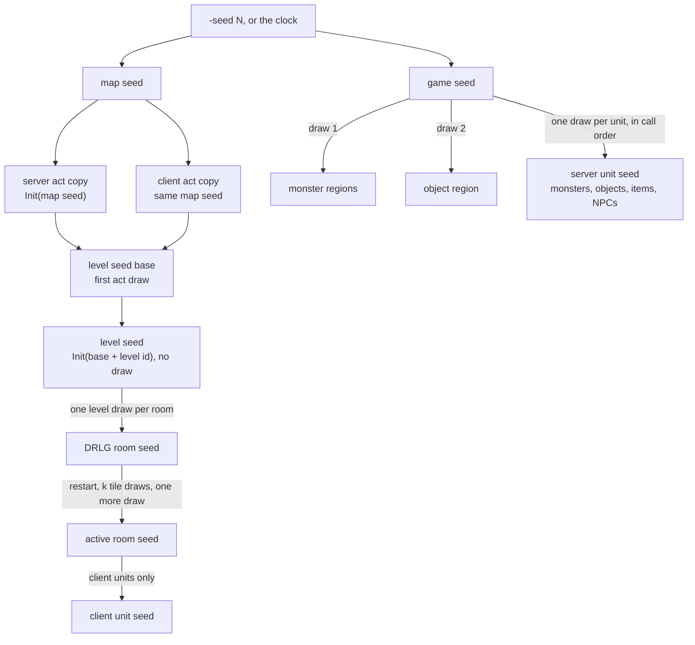

---
based_on:
  - docs/specs/rng/README.md 2026-10-11
  - docs/specs/rng/seeds.md 2026-10-16
  - docs/specs/drlg/room-tiles.md 2026-10-15
---

# Randomness: one seed per thing

Diablo II has no single global dice roller. Every random decision is a [draw](../glossary.md) from a small random-number state
that belongs to one particular thing: the game, an [act, a level, a room](../glossary.md), a monster, an item. This
page explains that [seed](../glossary.md) state and how one step of it works, then follows the chain of seeds from the game's starting number down
to the rooms and units, and shows why the same starting number always gives every level the same starting seed. It restates
two specs: [the RNG core](../specs/rng/README.md) and [the seed tree](../specs/rng/seeds.md).

## The big picture

A game has two roots. The [map seed](../glossary.md) feeds everything about the map: acts, levels and rooms.
The [game seed](../glossary.md) is a separate object that feeds every unit the server creates, monsters
included ([seed tree, reimplementation notes](../specs/rng/seeds.md#reimplementation-notes)). The diagram is a
simplified copy of the [seed tree algorithm](../specs/rng/seeds.md#algorithm); the text below is what counts.

## The generator: eight bytes and one multiplication

A [seed](../glossary.md) is 8 bytes: two unsigned 32-bit halves, `low` and `high`. It is stored inside the thing
that owns it ([RNG core, runtime state](../specs/rng/README.md#runtime-state)). As far as the code shows, the
generator reads no table.

The whole generator is a handful of operations ([RNG core, algorithm](../specs/rng/README.md#algorithm)):

| Operation | What it does | Draws? |
|---|---|---|
| Init(v) | `low` = v, `high` = 666 | no |
| InitOne | `low` = 1, `high` = 666 | no |
| Step | `low × 1791398085 + high`, computed in 64 bits; the bottom half becomes the new `low`, the top half the new `high` | yes, one |
| Range(n) | if n is below 1, return 0 and leave the seed alone; otherwise Step, then return the new `low` mod n | one, or none |
| RangePow2(n) | always Step, then return the new `low` with the bits of n − 1 kept (for n a power of two) | yes, one |

A few details matter to anyone who wants to reproduce the game exactly, and they are all confirmed
([RNG core, reimplementation notes](../specs/rng/README.md#reimplementation-notes)):

- The result comes from the **new** `low`, after the step, not the old one.
- `high` is not a constant. `Init` sets it to 666, but every step overwrites it with the carry, so all 64 bits
  carry forward.
- The modulus is unsigned, and there is no correction for bias: the game takes `low mod n` as it is.

A draw is one step of one named seed. A draw on one seed never changes another seed. Some seeds
are shared by several parts of the game, though, and then the order in which those parts draw matters as much
as what each one computes ([RNG core, algorithm](../specs/rng/README.md#algorithm)).

The "return 0 without drawing for n below 1" guard is not everywhere. Many call sites copy the step inline, and an
inlined draw with a fixed modulus (such as a `mod 7`) has no guard; neither has RangePow2. So when a
table-driven count can be zero, whether the game still draws depends on the call site. This is read from the code
and has not been confirmed for every site; each subsystem spec states the form per call site
([RNG core, reimplementation notes](../specs/rng/README.md#reimplementation-notes)). The project's count of
those inlined draw sites (852 multiplier constants in the program) is also a reading of the code, not a run
([RNG core, entry points](../specs/rng/README.md#entry-points)). One more helper, "power-of-two range plus a
base", is also in the program, but as far as the code shows nothing calls it, and no spec depends on it.

## Two roots: the map seed and the game seed

When a game is created, the game picks its two roots
([seed tree, algorithm](../specs/rng/seeds.md#algorithm), step 1):

- **With an override** (`-seed N` on the command line, or the same option in `D2.ini`): the map seed is N, and the
  game seed is `Init(N)`. No draw happens.
- **Without one**: the game seed is initialised from a value mixed from the tick count, the clock and the
  performance counter, it is stepped once, and the map seed is mixed from that. These sources cannot be
  reproduced, so only the override path is repeatable ([seed tree, step notes](../specs/rng/seeds.md#algorithm)).

`-seed 0` is impossible: the option is only applied when it is not zero, so 0 takes the clock path
([seed tree, reimplementation notes](../specs/rng/seeds.md#reimplementation-notes)). `-seed -1` is accepted but
still means "no override", because the game uses that value (all bits set) as its "none" marker. Negative numbers
are stored as their unsigned 32-bit form, so the repeatable seeds are every 32-bit value except 0 and the all-ones
value. These points about `-1` and negative values are read from the code, not checked in a run. What the game does
with `-seed` text above 2 147 483 647 was not checked either, so such a seed is given as its negative decimal
instead.

## From the map seed to acts

Every [act](../glossary.md) starts from the same number: `Init(map seed)`. Its first draw becomes the
[level seed base](../glossary.md), the value every level of that act is built from
([seed tree, algorithm](../specs/rng/seeds.md#algorithm), step 3). Because all acts share the map seed, all acts
share the same level seed base.

Some acts then draw more from their own act seed. These draws come after the level seed base is taken, so they
never change any level seed ([seed tree, step note 3](../specs/rng/seeds.md#algorithm)):

- **Act II** draws two numbers `mod 7` and repeats until they differ. They pick two of the seven Tal Rasha tomb
  levels (level ids 66 to 72). Every rejected pair costs two act draws, and the loop has no fixed limit. Which of
  the two fields is the real tomb is still open.
- **Act III** draws once and keeps the lowest bit. What that bit decides is still open.
- **The level-link setup** draws further, depending on the data. It mostly works on a throw-away copy of the act
  seed; the act seed itself is stepped only in a few cases. This part is read from the code. The counts seen in
  test runs were 0 or 1 extra steps in Act I, 119 in Act III and 0 in Acts II, IV and V.

Every act is built twice, as a **[server and a client act copy](../glossary.md)**: the server builds its copy,
and the client builds its own from the map seed the server sends. The two copies have identical seed trees up to
room activation ([seed tree, step note 3](../specs/rng/seeds.md#algorithm)).

## Levels: a sum, not a draw

A [level](../glossary.md)'s seed is `Init(level seed base + level id)`, an unsigned 32-bit sum that wraps around.
It is **not** a draw from the act seed ([seed tree, reimplementation notes](../specs/rng/seeds.md#reimplementation-notes)).
The game then hands the level to one of three generators, chosen by the level's
[DrlgType](../glossary.md) in the Levels table: 1 maze, 2 preset, 3 outdoors. The rooms come later, after the
level is re-seeded with the same value ([seed tree, step 4](../specs/rng/seeds.md#algorithm); see the
[levels page](levels.md)).

This is why a player who walks into the levels of an act in a different order still gets the same level seeds: a
level's seed depends only on the map seed and the level id, never on when or by whom the level is built. The sum
is confirmed by runs (197 level creations). Six other places in the code can create a level on demand; that they
also go through this same path is read from the code
([seed tree, step note 4](../specs/rng/seeds.md#algorithm)).

## Rooms: one draw each, then a restart

A level is built out of [DRLG](../glossary.md) [rooms](../glossary.md). Each new DRLG room takes exactly one draw
from its level's seed, initialises its own seed from it, steps once, and keeps that first value as its starting
point. So the order in which a level's rooms are created matters
([seed tree, step 5 and note 5](../specs/rng/seeds.md#algorithm)).

Later the room is activated, and this is where the
[DRLG room and active room](../glossary.md) split ([seed tree, step 6](../specs/rng/seeds.md#algorithm)):

1. The room's seed is restarted from its stored starting value. Anything drawn on it in between is forgotten.
2. The room picks its tiles. This takes [k](../glossary.md) draws; one set of runs saw k between 50 and 376 (157
   activations), and a larger run between 0 and 388 (520 activations). Exactly how k is counted belongs to the
   [room-tiles spec](../specs/drlg/room-tiles.md#k).
3. If the room got at least one wall or floor tile, it draws once more and the result seeds the new active room.
   A room with no tiles draws nothing and gets no active room. That this test counts wall and floor tiles is read
   from the code.

The active room's seed therefore depends on k but not on any draw made on the room between creation and
activation ([seed tree, step note 6](../specs/rng/seeds.md#algorithm)). One surprise, confirmed in runs: **the
server and client copies of the same room can end up with different active-room seeds**, because k can differ.
Tiles at room borders look at the neighbour rooms already built in that copy of the act, so k depends on the order
of activation. Gameplay uses the server copy.

On the server, every room of a walk over newly reached rooms gets one draw on its active-room seed (a wanderer
tick), and on its first activation it then gets its presets, its objects and its monsters. The
[population pass](../glossary.md) draws its monster class picks, type rolls and positions from the active room's
seed, and its density rolls and one step per creation from the game seed. Details are on the
[monsters page](monsters.md). That a flag on the active room marks it as already populated is read from the code.

## Units: the game seed, in call order

Every unit the server creates, except players, takes one draw from the game seed and is initialised with it
([seed tree, step 7a](../specs/rng/seeds.md#algorithm)). This holds for monsters too: **server monsters are seeded
from the game seed, not from their room**. An item takes one extra game-seed draw right after its unit seed; that
draw gives the item's own starting seed, the one its quality, affix and unique picks draw on.

Because the game seed is shared, a unit's seed depends on everything that drew from the game seed before it
([seed tree, step note 7a](../specs/rng/seeds.md#algorithm)):

| Game-seed draw | Who takes it | Status |
|---|---|---|
| 1 | the [monster regions](../glossary.md), which build every level's [monster pool](../glossary.md) from a local seed | confirmed |
| 2 | the game-wide [object-region seed](../glossary.md) | confirmed |
| 3 | the store seed (also the mercenaries' seed) | confirmed |
| 4 | the [quest seed](../glossary.md) | confirmed |
| 5 | the player's unit seed | confirmed in runs |
| 6, 8, 10… | the [starting items](../glossary.md), two draws each | confirmed in runs |

Players are seeded through their own creation paths; that those paths also use the game seed is read from the
code. A monster made by the population pass carries a unit seed already two steps along by the time the pass draws
on it (in 914 of 916 logged creations; the other two were 6 and 15 steps along). If a unit is ever created with no
parent seed, the code falls back to an unrepeatable clock-based seed; no run reached that path.

The client also seeds the units it creates, from the active room of its own act copy, as long as the unit's
position is not (0, 0). Those client seeds never decide drops or spawns
([seed tree, step note 7b](../specs/rng/seeds.md#algorithm)). That the tested pair is the unit's position is read
from the code.

## Why the same seed gives the same map

Putting it together ([seed tree, purpose](../specs/rng/seeds.md#purpose)): with a fixed map seed, the chain above
fixes every act's and every level's starting seed, and so the inputs of the level generators. Nothing in that chain
depends on the clock, on the game seed, or on the order in which levels are visited. A DRLG room's seed depends on
the level seed and on the order the generator creates rooms in; an active room's seed also depends on k, which can
depend on the order rooms are activated.

Under an override, the game seed and the act seed start from the same `Init(N)`, so their sequences are the same
numbers (the player's draw 5 equals the Act II act seed after its five draws). They are still two separate objects
([seed tree, worked example](../specs/rng/seeds.md#worked-example)).

## Which things have their own seeds

| Owner | Seeded from | Draws taken from the parent |
|---|---|---|
| game | the override N, or the clock | — |
| act (server and client copy) | the map seed | none |
| level | level seed base + level id | none |
| DRLG room | its level | one |
| active room | its DRLG room, after the restart and k tile draws | one, only if the room has tiles |
| monster-region local seed | the game seed | one (draw 1) |
| object-region seed | the game seed | one (draw 2) |
| server unit (not players) | the game seed | one; items one more |
| client unit | the active room of the client act copy | one, unless at (0, 0) |

Sources: [seed tree, outputs](../specs/rng/seeds.md#outputs) and [step notes](../specs/rng/seeds.md#algorithm).
Each subsystem page names the further seeds it uses.

## A worked example

**The generator.** Copied from the [RNG core worked example](../specs/rng/README.md#worked-example), which matches
the game's own functions bit for bit. Hex unless noted.

| # | Operation | Result | `low` after | `high` after |
|---|---|---|---|---|
| 0 | Init(s, 12345) | — | `00003039` | `0000029A` |
| 1 | Range(s, 100) | 87 (decimal) | `015B2E77` | `0000141D` |
| 2 | Range(s, 0) | 0, no draw | `015B2E77` | `0000141D` |
| 3 | Range(s, −5) | 0, no draw | `015B2E77` | `0000141D` |
| 4 | Range(s, 8) | 0 | `8B57C5B0` | `0090CE87` |
| 5 | Range(s, 7) | 3 | `606EEEF7` | `3A1E6C8A` |

Step 1 in full: `3039 × 6AC690C5 + 29A` = `0000141D 015B2E77` (hex), and `015B2E77 mod 100` = 87.

**The seed tree for `-seed 12345`.** Copied from the
[seed tree worked example](../specs/rng/seeds.md#worked-example), logged in a recorded game and reproduced from N
alone. Seeds are `low:high`, hex.

| Step | What happens | Value |
|---|---|---|
| game | override flag, map seed, game seed | 1, `00003039`, `00003039:0000029A` |
| act | Init(12345), then one step: level seed base | `015B2E77` |
| Act II | first pair `mod 7` | 3, 3: equal, so retry |
| Act II | second pair | 6, 5: the tomb fields get 72 and 71 (decimal) |
| level 1 | Init(base + 1) | `015B2E78:0000029A` |
| level 1, rooms 1–3 | level seed `low` after each room's draw | `F61E44F2`, `F3CFFCC1`, `6B277FA8` |
| room 3 | Init(`6B277FA8`), one step; stored start | `F923BEE2` |
| room 3 activated on the server | restart, then k = 64 tile draws | `2CE81EC1:55A43D6F` |
| room 3 activated on the server | one more draw: the active-room seed | `28D677F4:0000029A` |
| player | game-seed draw 5 | `B7A5C418:0000029A` |
| first starting item | game-seed draw 6 (then draw 7) | `8F16A0F0:0000029A` |

With `-seed 34844169` the level seed base is `FFFFFF87`, and level 134's seed is `0000000D:0000029A`: the sum
wrapped around.

## What is not known yet

From the [RNG core open questions](../specs/rng/README.md#open-questions) and the
[seed tree open questions](../specs/rng/seeds.md#open-questions):

- Which inlined draw sites use the guarded form and which do not is answered subsystem by subsystem, as each spec
  reads its own call sites.
- The order of game-seed draws after game creation: draws 1 to 5 are pinned, but the gaps between later units are
  open.
- Which item-creation paths pass their own two creation seeds, instead of leaving them empty as drops do, is not yet
  followed in the seed-tree spec.
- Which Act II tomb field is the real tomb, what the Act III bit means, and what decides the other Act III act-seed
  consumers, and what the level-27 bit set while building level 6 means, are open.
- What the two DRLG room bits behind the active room's flag value mean, and where one of them is set, are open.
- Only about 20 of the 76 functions that initialise a seed have been followed; others (such as a level-table global
  seed) are not yet covered.
- Read from the code but not confirmed by a run: that the generator reads no table, the "power-of-two range plus
  a base" helper being unused, the "none" marker and the handling of negative values for the seed option, the act-seed draws of the
  level-link setup, the six on-demand level creators, which rooms count as having tiles, the "already populated"
  flag, the player-creation paths, the clock fallback for a unit without a parent, and the client's (0, 0) rule.
  Calling `InitOne` right before `Init`, as the game does, has no effect, also by reading the code.

## Where to read more

- [RNG core spec](../specs/rng/README.md#algorithm) and [seed tree spec](../specs/rng/seeds.md#algorithm).
- How k is counted: [room tiles § k](../specs/drlg/room-tiles.md#k).
- The [glossary](../glossary.md) for seed, draw, map seed, game seed and the room terms.
- Related wiki pages: [levels](levels.md), [monsters](monsters.md), [objects](objects.md), [items](items.md).
