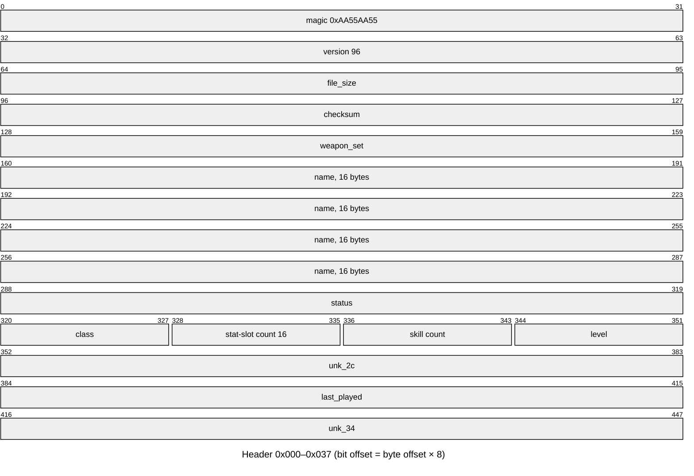
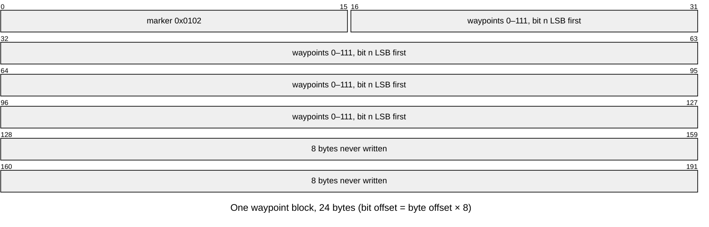
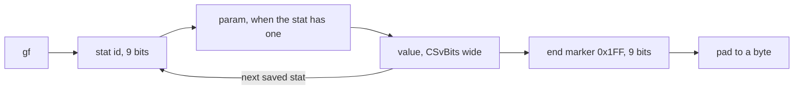
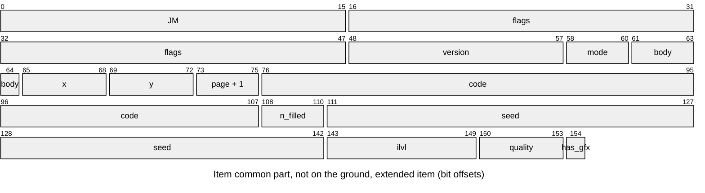
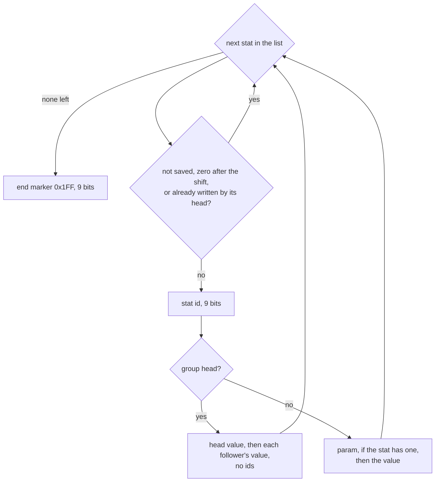

---
based_on:
  - docs/specs/save/d2s.md 2026-10-30
  - docs/specs/player/creation.md 2026-10-30
  - docs/specs/hirelings/README.md 2026-10-30
---

# Saves: what a `.d2s` file holds

A single-player character lives in one [`.d2s`](../glossary.md) file. The game writes it from the character in
memory when you leave a game and reads it back when the character joins one. This page explains what the file
holds and in what order, the checksum, the header fields, how the character's stats are packed, and how one item
is stored bit by bit, including its property list. It also says which [seeds](../glossary.md) survive a save and
which do not. Everything here restates the reviewed spec [save/d2s](../specs/save/d2s.md#purpose); how the item
stats are rolled before they are saved is on the [items](items.md) page.

Much of this format was first known only from reading the code. Most of it has since been checked: against a
corpus of 146 saves the game wrote, against logged writes and loads, and against deliberately broken saves fed to
the game's reader. The spec is careful about what is still unchecked, and so is this page: where a field's write or
read side has not been checked against a running game, the text says so.

## The big picture

The file is a fixed 335-byte header followed by a row of tagged sections, always in this order
([save/d2s § C](../specs/save/d2s.md#c-writing-a-save)):


The header is written first with its checksum field set to 0. Every section follows, then the total size goes into
the header, and the checksum over the whole file comes last. The `jf` and `kf` sections are written only in an
expansion game; the [mercenary](../glossary.md)'s item list follows `jf` only when the player has a mercenary. The section order is
confirmed, each writer starting exactly where its section starts in the file, and so is the expansion-only rule (the
expansion saves carry `jf` and `kf`, the classic ones end at the corpses). A save with a hired mercenary carries its
item list; the test the writer makes for one is read from the code.

## When the game writes and reads a save

*Save and Exit* in single player writes the file **twice**, and both writes are byte-identical. Nothing was written
during play in the first save test run ([save/d2s § Entry points](../specs/save/d2s.md#entry-points)).

Single player also writes the file during play at **a death**: a later run saw the death path save the
character once, just before the respawn. That is an event save, not an autosave. There is **no autosave** in single
player: the periodic save routine was called all through every session and never saved. Which of its checks stopped
it is read from the code. The periodic save, and a hosted save that is skipped when nothing changed, need a host
program to install a hook; read from the code, nothing in this build ever installs it, so those paths never run.

A one-client TCP/IP host saved into the client's buffer and wrote no file, which is the client-buffer path. The
shutdown save was entered at every game exit and saved nothing. Saves on quest and [act](../glossary.md) events in the
client-buffer game types were not run. The reader stops at 8 KiB: a longer file is read as its first 8 192 bytes.
That the writer's buffer is also 8 KiB is read from the code; no character big enough was made.

The character-select screen does **not** check the checksum. A corrupt save is still listed there, with the level
from its header; it fails only when the character tries to join a game.

## The checksum

The checksum is simple ([save/d2s § B](../specs/save/d2s.md#b-checksum)): start from 0, and for each byte of the
file, rotate the 32-bit sum left by one bit and add the byte. The four checksum bytes (offset `0x00C`) count as 0
while summing, both when writing and when reading.

When a save is loaded ([save/d2s § D3–D5](../specs/save/d2s.md#d3d5-reading-a-save)):

1. A file shorter than 8 bytes or with the wrong magic number fails with 9, which reaches the player as it is. A
   version below 92 goes to an older reader.
2. The header must be complete (335 bytes), else code 4.
3. The checksum is recomputed and compared. A mismatch fails with internal code 6.
4. The size field must equal the number of bytes read, else code 5.
5. The version must be 92 to 96 and the name must match the save's file name (case ignored), else code 7.
6. Then the status word is checked (below), and a class byte above 7 fails with 4.

Codes 6 and 5 both reach the player as error 14, and you are back at the main menu. The checksum is tested before
the size, so a file with a wrong size and a right checksum fails with 5, one with a wrong checksum fails with 6, and
one with **both** wrong fails with 6 too. These steps were checked with deliberately broken saves: each failed with
the code above, mapped to the error the player sees through the game's table, and versions 71, 87, 91, 92, 94, 96 and
97 behaved as described (93 and 95 were not tried). Where a file failed two tests, the code named the earlier one; the
size and version tests were not told apart. A few codes were never met. The older reader was fed test saves in the
real version-87 and version-71 layouts: it has no checksum or size test, it read every section and the game wrote
back what was built, and a version-87 file marked "new" became a fresh character. Its failure paths and the
versions between 72 and 91 other than 87 are read from the code only. In single player, a short file, a bad magic number, a wrong version or a status that does not fit the game
can only reach the reader if the file changes after the character screen has listed it, because that screen checks
those first (read from the code); the tests swapped the file in at that moment.

## The header

The header has fixed offsets. The first 56 bytes look like this:



The fields that matter most ([save/d2s § D](../specs/save/d2s.md#d-header-fields)):

| Offset | Field | What it holds |
|---|---|---|
| `0x014` | name | the character's name, up to 16 bytes |
| `0x024` | status | the status word: new, hardcore, dead, expansion, ladder, progression |
| `0x028` | class | 0 to 7 |
| `0x02B` | level | the character level, **written but never read back** |
| `0x030` | last played | the time of the write |
| `0x078`, `0x07C` | left and right skill | a skill id and an item reference |
| `0x0A8` | difficulty | one byte per difficulty: the act, with bit 7 set for the difficulty saved in |
| `0x0AB` | map seed | the [map seed](../glossary.md) of the game |
| `0x0AF`–`0x0BE` | mercenary | flags, seed, name, type Id, experience |

What is confirmed and what is not:

- Confirmed against a running game: the magic, version, size, checksum, name, status (written in expansion games,
  never in a ladder game), class, level, the left and right skills (with no item reference), the difficulty byte (Normal, Act I; a
  Nightmare save was also seen to load) and the map seed. The `level` byte is output only: a save edited to say
  level 2 for a level-1 character was rewritten with level 1. A field at `0x02C` is passed through unchanged; what
  it means is unknown.
- Also confirmed since: the weapon-swap bit written and read back after a swap, the hotkeys' "left button" flag and their empty
  slots, the two swap skills, the graphics and colour bytes (written from the equipment picture, not read on load),
  the time and `0x034` fields (not read on load), and the reserved bytes (written as 0, not read). A class byte above
  7 is a read error, and an act of 5 or more is read as 0.
- **Class 7** passes the class test, but no class-7 character ever loads: the game halts when it makes the player
  for it, from a full save or a new-character stub alike.
- The byte at `0x0CF` belongs to the host, not to the game. The game stores it on load and writes it back on save
  (confirmed). Read from the code: it hands it to the host program only in a ladder game, and no game rule reads it.
  A reimplementation carries it unchanged.
- Read from the code only: a hotkey's item reference and the mask on its skill id.

**The status word** ([save/d2s § D](../specs/save/d2s.md#d-header-fields)) packs these bits. The checks the reader
makes on them were each met with a mismatched save, except the ladder check (it needs the host hook, never installed
in this build) and the classic bounds 4 and 8, which are read from the code:

| Bit | Meaning | On load |
|---|---|---|
| 0 | new character | cleared; a header-only file becomes a fresh character |
| 2 | hardcore | must match the game's hardcore setting |
| 3 | dead | refused when hardcore |
| 5 | expansion | must match the game type |
| 6 | ladder | checked only with a host hook |
| 8–12 | progression | Nightmare needs at least 5 (expansion) or 4 (classic), Hell 10 or 8 |

A new character is first written as a header-only [stub](../glossary.md) with bit 0 set; how the game then builds the
character is on the [characters](characters.md) page and in
[player/creation § A](../specs/player/creation.md#a-the-stub-and-the-servers-checks). The creation screen sets
bit 5 for any class in an expansion install unless its "expansion" box is cleared, and toggles bits 2 and 6 with the
hardcore and ladder boxes (read from the code). Bit 1 is set only by the
client's character-creation screen and the reader never tests it (read from the code); what that screen means by it is
unknown.

## Which seeds survive a save

This matters for anyone who wants a loaded game to behave like the original
([save/d2s § D3–D5](../specs/save/d2s.md#d3d5-reading-a-save), [§ I](../specs/save/d2s.md#i-one-item)):

- **The map seed** is reused on load only in single player, only when the game was not started with `-seed`, and
  only for the difficulty the save was made in: the difficulty byte with bit 7 set is the one checked. A reused map
  seed rebuilds the saved maps; this was confirmed by a load in the same process that got the same Act I seed.
- **Each item keeps its own seed.** The saved value is the number the item unit's random generator was started
  from, which for a dropped item is one [game seed](../glossary.md) [draw](../glossary.md). On load the generator is started again from
  it, so it is back at `{seed, 666}` whatever state it had reached. The item's separate
  [item seed](../glossary.md), the one its affixes are rolled on, is **not** saved.
- **The player's own seed is not saved** ([player/creation § Reimplementation notes](../specs/player/creation.md#reimplementation-notes)).
- **A mercenary's seed** is saved, but on load it does not reach the mercenary's stats, which come from its type Id
  and experience.

## Quests, waypoints and NPCs

These three sections are blocks of bytes copied in and out, one per difficulty
([save/d2s § E](../specs/save/d2s.md#e-fixed-sections)). Their layout is confirmed over every save the game wrote in
the tests, and each came back unchanged through a load and a write:

- **Quests** (`Woo!`): three 96-byte blocks, one [quest record](../glossary.md) each, 48 words. On load, the first
  42 words of a block have bits 13 and 14 cleared, and bit 15 set when bit 1 is set; the last six are copied as they
  are. This load rule is confirmed in the game.
- **Waypoints** (`WS`): three 24-byte blocks. Each starts with a marker, then one bit per waypoint for up to 112
  waypoints; the last 8 bytes are never written. On load, a block whose marker is not one of the three the reader
  knows is an error; a block with one of the two older markers is wiped, the marker included, and the writer puts
  the current marker back on the next save. Then the first waypoint is always switched on. The game's waypoint menu
  showed exactly the waypoints whose bits a tool had set.
- **NPCs** (`01 77`): two 8-byte records per difficulty.



The code saves the three blocks in index order, and block *d* is difficulty *d* (0 Normal, 1 Nightmare, 2 Hell) in
all three sections; for the NPC blocks this comes from the code that reads them during a game. A new character's quest, waypoint and NPC sections are the same bytes for every new character
of a game type ([player/creation § Outputs](../specs/player/creation.md#outputs)).

What the quest bits mean, which events write them during a game, and how a waypoint bit gets set are on the
[quests and travel](quests.md#the-quest-record) page ([quests/progression § A](../specs/quests/progression.md#a-the-quest-record)).

## Character stats and skills

The `gf` section is the character's own stat list, packed as bits
([save/d2s § F](../specs/save/d2s.md#f-character-stats-gf)). Bits are written least significant first, byte after
byte ([§ A](../specs/save/d2s.md#a-bit-buffer)).



- Each stat of the character's base list is written in list order, unless its `CSvBits` column in `ItemStatCost` is
  0. A stat that is not in the list is not in the file; there is no "skip zeros" test. Life, mana and stamina keep
  their 8 fraction bits. This much is confirmed by saves and loads.
- **Each value is clamped to the largest number its field can hold.** Life, mana, stamina and their maxima have 21-bit
  fields, so a value of 8192 points or more (with the 8 fraction bits) is written as 8191.99. This is confirmed: in
  the level-up saves of a test run all 364 written values matched the clamped list, and the ten that differed from
  the character's value were exactly those at or above the limit (the life of Barbarian and Paladin saves in Hell, the
  mana of Sorceress saves). Experience is not clamped.
- Stats with a parameter and signed stats were not exercised: no stat of the shipped table has either. Read from the
  code, the clamp turns a negative value of an unsigned stat into 0.
- When the save is loaded, the game fixes a few stats, all confirmed: gold above its limit for the character's level
  becomes 0, and so does stash gold above its limit; stamina is set to its maximum; current life and mana are
  restored to the saved values; three more stats are set to 100; and the next-level threshold is set from the
  experience table: the row of the character's own level, which holds the experience needed to reach the next
  level. **Maximum life and mana are not recomputed**, they come from the file as is. Gold below 0 becoming 0 is read
  from the code. So, by the code, a character saved with more than 8191 life or mana comes back with 8191.99 until
  something recomputes it; that was not run.
- Saves older than version 95 store the stats in an older form, which the reader still takes; 1.14d never writes it.

The `if` section is one byte per class skill: that skill's base level. This is confirmed: the bytes come back
unchanged, the skills are used at their saved levels, and the header's skill count decides how many bytes the reader
takes ([save/d2s § G](../specs/save/d2s.md#g-skills-if)).

## Item lists

Each list starts with `JM` and a count ([save/d2s § H](../specs/save/d2s.md#h-item-lists)):

- The player's list holds every item the character has, with the two hand slots last (confirmed over 200 logged
  writes). That the item on the cursor also goes last, and that an item the writer refuses is not counted, is read
  from the code.
- An item with filled sockets is followed by its [socket fillers](../glossary.md), each on its own byte boundary
  and not counted (confirmed).
- The corpse list holds 0 or 1 corpse, each with its own item list; one corpse was written and read back in a
  test. The rest of this bullet is read from the code. With more than one corpse, the writer keeps the
  one whose items (gold aside) are worth the most, ties going to the later one. The corpse record's 12 bytes are not
  read back on load, and its first value is whatever the writer's stack held, so a reimplementation may write
  anything there. In play a corpse carries three quarters of the experience its death cost (confirmed on test deaths
  in Nightmare and Hell), and it is returned to its owner on pickup (read from the code: no pickup was run;
  [player/creation § J](../specs/player/creation.md#j-other-level-and-experience-changes)). A saved corpse does not keep it: the reader re-creates the corpse with no experience on it, so picking it up
  after a load returns nothing (read from the code).
- In an expansion game, `jf` carries the mercenary's items (confirmed with a hired mercenary), and `kf` carries one
  byte and, when the player has an Iron Golem holding an item, that item (read from the code).

## One item

Every item starts on a byte boundary with `JM`, then a common part, then either nothing more (a
[simple item](../glossary.md)) or an extended part ([save/d2s § I](../specs/save/d2s.md#i-one-item)).



- **Flags change on the way.** The writer clears bit 19 and sets bit 23, and sets bit 21 for a simple item; the
  reader strips bit 25, sets bit 19 and clears bit 13. A copy that keeps the flags unchanged writes different bytes
  after a load. This is confirmed, the bit 21 step included. A drop gets bit 13 when it is created and loses it in
  the per-frame pass over the items lying in a room (confirmed for five drops); what bit 13 means, and how soon
  after a drop that pass runs, is still open.
- **Version, mode, body location, page, code and the `x` and `y` grid position** were checked against the running
  game. The ground position of items lying in the world is read from the code only: no saved item was on the ground.
- **A simple item** (from the base's `compactsave` column; an ear is one) stops after the code.
  It has no seed, no [ilvl](../glossary.md) and no quality, and it loads with seed 0, ilvl 1 and normal quality.
  An ear stores its class, level and name in place of the code (confirmed). Bit 108 of a simple item is the realm
  flag, not a socket count: the reader takes no socket count there (confirmed). How a gold pile stores its amount is
  read from the code.
- **An extended item** then stores its socket-filler count, the seed, the ilvl (clamped to 1–99) and the
  [quality](../glossary.md). All four were confirmed, the seed, ilvl and quality for ilvl 1 and 99 and qualities
  1, 2, 4 and 7.

The rest of the extended part is confirmed over the saves the game wrote, unless the item says otherwise:

- a picture variant and an [automagic](../glossary.md) affix, each behind a presence bit. Read from the code, the
  automagic bit is set only on an expansion item that rolled one; no saved item had one, so only its "absent" side
  was seen;
- the quality fields: a 3-bit index for low and superior items, a prefix and a suffix [affix id](../glossary.md) for
  magic items (the prefix rebased, the suffix not), a 12-bit id for set and unique items, the two
  [rare name](../glossary.md) words and up to three prefixes and three suffixes for rare and crafted items. The ids
  come from the game's merged affix numbers (confirmed; a magic prefix is then rebased, as said): the magic suffixes first, then the magic prefixes, then the
  automagic rows, each id one more than its place, and the rare names likewise, suffixes before prefixes;
- a [runeword](../glossary.md) field (what an item with no runeword record writes there is read from the code), a
  personalized name, and the realm data. On load, a unique id past the end of the table becomes "none" and is
  written back as all ones, and a set id with no row drops that one item while the rest of the save loads;
- fixed fields: defense for armor, then maximum and current durability (current only when the maximum is not 0),
  the quantity of a stack, and the socket count. Defense and durability use the `Save Add` offset. That they skip
  `ValShift`, and that the quantity and the socket count skip `Save Add`, cannot be seen with the shipped table,
  where those values are 0; it is read from the code. In a save of version 95 or less (94 was tried), the reader takes the
  current durability in 8 bits. Weapon damage, speed and block are not saved; the reader rebuilds them from the base record (the low
  quality branch of that rebuild was not met);
- the property lists described below.

In the item writer, a value too wide for its field is clamped as an unsigned number, so a negative value becomes
all ones, not 0. This is confirmed by running the clamp in an emulator against a model.

## Property lists

An item's magic properties are stored as a [property list](../glossary.md)
([save/d2s § J](../specs/save/d2s.md#j-property-list-framing)):



- Each property is a 9-bit id, then its parameter in `Save Param Bits` when it has one, then its value plus
  `Save Add` in `Save Bits`. The list ends with `0x1FF`.
- Some ids are group heads that carry their followers' values with no id of their own: 17 (with 18), 48 (49),
  50 (51), 52 (53), 54 (55, 56) and 57 (58, 59). Reading them as one id each throws the rest of the item off.
- An item can have more than one list: the main list, then up to five set-bonus lists for a set item, then the
  runeword list.

How sure this is: the framing was decoded over every property list of the 146 saves the game wrote in the tests
(652 lists, 1 687 properties, 77 distinct ids), and each list ended exactly where the next item began. Groups 17,
48, 50, 52 (on one item), 54 and 57 were seen, and after group 57 the reader sets a poison counter to 1. Three dropped items saved
after pickup held exactly the lists logged when they were created. Maximum life and mana are stored without their 8
fraction bits and multiplied back by 256 on load (confirmed). An item's property parameter is read as an unsigned
number. A version-92 test save showed the older widths and the special encodings of saves before version 93: its
properties came back exactly as built. The rest is read from the code only: a follower written without its head,
whether the shift is signed, and a set item in a save before version 93.

## The mercenary header

The mercenary is not a section. It lives in the header at `0x0AF`–`0x0BE`
([save/d2s § D](../specs/save/d2s.md#d-header-fields)): a flags word whose bit 16 marks a dead mercenary, the
seed of its hire entry, its name as an offset into its seller's name range, its type Id, and its experience.

The **read** side is confirmed: 33 headers were read, and the 23 mercenaries created got the saved seed, name and
Id, the class of that Id's row and the level from the experience; 10 classic ones failed the creation's act test
and were not created. The **write** side is confirmed too: in three cases (two prepared mercenaries and one hired in
play) the header held the mercenary's seed, name, Id and experience, and a dead mercenary, prepared or killed in
play, was written with the dead flag and came back dead. The all-zero "no mercenary" header gives no mercenary and
the load goes on. A test save whose name was past the end of its range loaded with the range's first name; how the
name's 16-bit addition wraps for a huge value is read from the code. A test save with experience far past level 99
loaded at 99. Saves older than version 92 hold the mercenary in an older form, which test saves of versions 87 and
71 exercised: version 87 keeps the Id and has its experience converted on load, and version 71 keeps only the seed
and the name, so the game picks the Id (Id 1 for both test saves, in Act I and Act II). How the level and stats follow from these values is on the
[characters](characters.md) page and in
[hirelings § H](../specs/hirelings/README.md#h-the-mercenary-from-a-save-d2s_readmercheader-merc_create).

## A worked example

This is copied from the [save/d2s worked example](../specs/save/d2s.md#worked-example): a 1113-byte save written by
the game for a level-71 Barbarian named `seedtest`, in a game started with `-seed 12345`, Normal, expansion.

**Header**, first 48 bytes:

```
55 aa 55 aa 60 00 00 00 59 04 00 00 bf 15 f8 db 00 00 00 00 73 65 65 64 74 65 73 74 00 00 00 00
00 00 00 00 20 05 00 00 04 10 1e 47 00 00 00 00
```

| Offset | Bytes | Meaning |
|---|---|---|
| `0x004` | `60 00 00 00` | version 96 |
| `0x008` | `59 04 00 00` | file size 1113 |
| `0x00C` | `bf 15 f8 db` | checksum `0xDBF815BF` |
| `0x024` | `20 05 00 00` | status `0x0520`: expansion, progression 5 |
| `0x028` | `04` | class 4, Barbarian |
| `0x02B` | `47` | level 71 |
| `0x07C` | `9a 00 00 00` | right skill 154 (War Cry), no item |
| `0x0A8` | `80 00 00` | Normal: act 0, bit 7 set |
| `0x0AB` | `39 30 00 00` | map seed 12345 (not reused on the next load, because of `-seed`) |

The `gf` list holds 13 stats; seven more stats of the character's list have `CSvBits` 0 and are skipped.

**Checksum**, a few steps of the running sum, with the checksum bytes taken as 0:

| Byte index | Byte | Sum after |
|---|---|---|
| 0 | `55` | `0x55` |
| 1 | `aa` | `0x154` |
| 2 | `55` | `0x2FD` |
| 15 | `00` (checksum byte, as 0) | `0x6D6D80` |
| 1112 | `00` | `0xDBF815BF`, the stored value |

**One item**: a dropped low-quality staff (code `sst `), 29 bytes at file offset 1027:

```
4a 4d 10 00 80 00 65 00 02 32 37 47 07 02 c5 3b 52 d1 40 10 06 05 d6 90 c8 1a 13 f9 0f
```

| Bits from | Width | Field | Value |
|---:|---:|---|---|
| 0 | 16 | `JM` | |
| 16 | 32 | flags | `0x800010` (in memory `0x80010`: bit 19 cleared, bit 23 set) |
| 48 | 10 | version | 101 |
| 58 | 3 | mode | 0 |
| 76 | 32 | code | `sst ` |
| 108 | 3 | socket fillers | 0 |
| 111 | 32 | seed | 2728687498 |
| 143 | 7 | ilvl | 1 |
| 150 | 4 | quality | 1 (low) |
| 156 | 3 | low-quality index | 1 |
| 160 | 8 | max durability | 6 |
| 168 | 9 | durability | 5 |
| 177 | 21 | property 107, param 36, value 1 | |
| 198 | 21 | property 107, param 38, value 1 | |
| 219 | 9 | end | `0x1FF` |
| 228 | 4 | padding | 0 |

When the staff was dropped, the game logged the same seed, quality and ilvl, so these are the drop's. On the
reload the staff came back with that seed and its generator at `{seed, 666}`. Every header value above and every
value of the item's common part (from `JM` to the quality, except the grid position) was compared with the running
game, with no mismatch.

## What is not known yet

From [save/d2s § Open questions](../specs/save/d2s.md#open-questions):

- what item flag bit 13 means, and how soon after a drop the game clears it;
- not exercised in a run: ground positions, a hotkey bound to an item, realm data on a simple item, gold items, the
  golem section, a mercenary name id past its hireling row's last name (since run on a test save, [hirelings § H](../specs/hirelings/README.md#h-the-mercenary-from-a-save-d2s_readmercheader-merc_create)), two or more corpses, a few reader error
  codes, the older reader's failures and the old versions other than 71 and 87, character stats with a parameter or a sign, a save above 8 KiB, a classic game's items, and stats beyond those the runs
  saved;
- what the character-creation screen means by status bit 1.

Beyond those, the "read from the code" points above (the host-hook paths, the less common branches of the extended
item fields, and the old formats) are still waiting for a run, or have no case on the shipped data.

## Where to read more

- The spec: [save/d2s](../specs/save/d2s.md#algorithm), with its
  [reimplementation notes](../specs/save/d2s.md#reimplementation-notes).
- How a new character's first save comes to be: [characters](characters.md) and
  [player/creation § Outputs](../specs/player/creation.md#outputs).
- How a saved mercenary is rebuilt: [hirelings § H](../specs/hirelings/README.md#h-the-mercenary-from-a-save-d2s_readmercheader-merc_create).
- How item stats are rolled before they are saved: the [items](items.md) page.
- What the quest and waypoint records mean and which events write them: [quests and travel](quests.md).
- Terms: the [glossary](../glossary.md).
