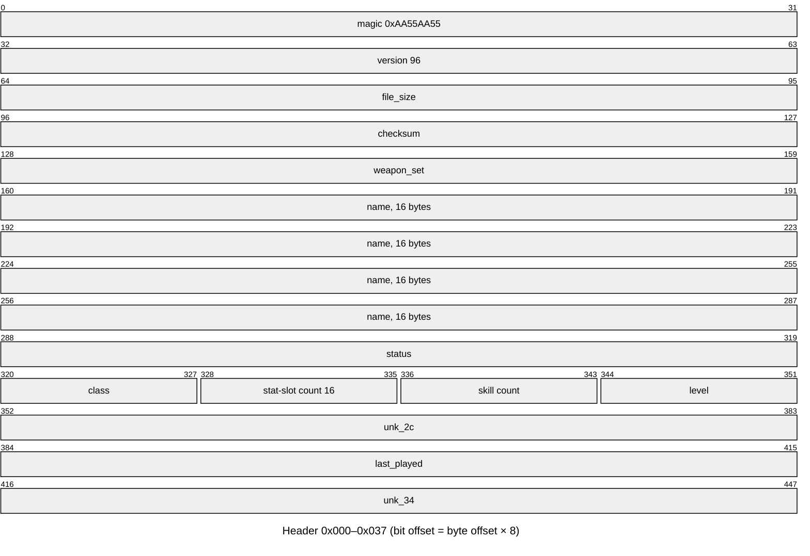
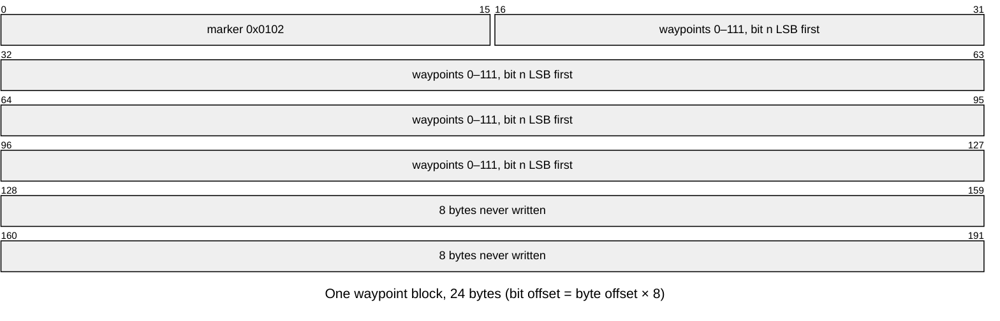
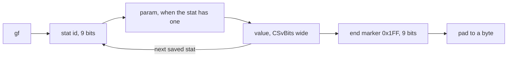
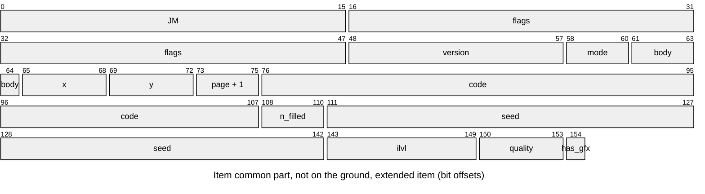
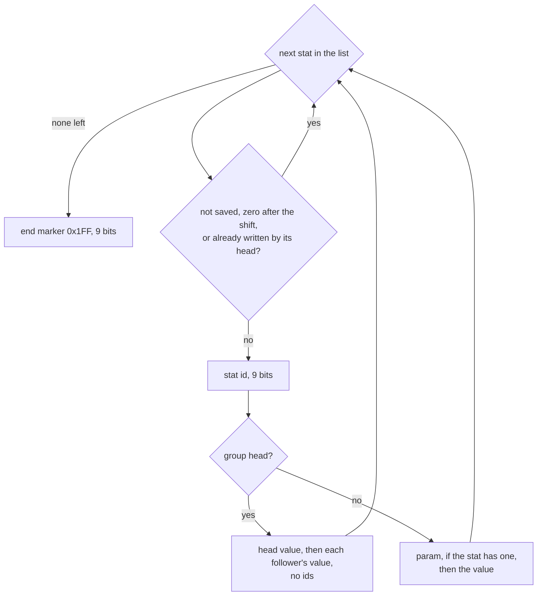

---
based_on:
  - docs/specs/save/d2s.md 2026-10-17
  - docs/specs/player/creation.md 2026-10-16
  - docs/specs/hirelings/README.md 2026-10-16
---

# Saves: what a `.d2s` file holds

A single-player character lives in one [`.d2s`](../glossary.md) file. The game writes it from the character in
memory when you leave a game and reads it back when the character joins one. This page explains what the file
holds and in what order, the checksum, the header fields, how the character's stats are packed, and how one item
is stored bit by bit, including its property list. It also says which [seeds](../glossary.md) survive a save and
which do not. Everything here restates the reviewed spec [save/d2s](../specs/save/d2s.md#purpose); how the item
stats are rolled before they are saved is on the [items](items.md) page.

A lot of this format is known only from reading the code. The spec is careful about that, and so is this page:
where a field's write or read side has not been checked against a running game, the text says so.

## The big picture

The file is a fixed 335-byte header followed by a row of tagged sections, always in this order
([save/d2s § C](../specs/save/d2s.md#c-writing-a-save)):


The header is written first with its checksum field set to 0. Every section follows, then the total size goes into
the header, and the checksum over the whole file comes last. The `jf` and `kf` sections are written only in an
expansion game; the [mercenary](../glossary.md)'s item list follows `jf` only when the player has a mercenary. The section order is
confirmed; the details of the expansion-only sections are read from the code.

## When the game writes and reads a save

*Save and Exit* in single player writes the file **twice**, and both writes are byte-identical. Nothing was written
during play in the test runs ([save/d2s § Entry points](../specs/save/d2s.md#entry-points)).

The code has other paths that save, but none of them was run: a periodic save that only runs when a host program
is attached (so not in single player), a save when a client is removed or the server shuts down, saves on quest and
[act](../glossary.md) events in the two client-buffer game types, and a death path. The write buffer and the reader both stop at 8 KiB, which
is also read from the code.

The character-select screen does **not** check the checksum. A corrupt save is still listed there, with the level
from its header; it fails only when the character tries to join a game.

## The checksum

The checksum is simple ([save/d2s § B](../specs/save/d2s.md#b-checksum)): start from 0, and for each byte of the
file, rotate the 32-bit sum left by one bit and add the byte. The four checksum bytes (offset `0x00C`) count as 0
while summing, both when writing and when reading.

When a save is loaded ([save/d2s § D3–D5](../specs/save/d2s.md#d3d5-reading-a-save)):

1. The magic number and the version are checked (read from the code). A version below 92 goes to an older
   reader.
2. The checksum is recomputed and compared. A mismatch fails with internal code 6.
3. The size field must equal the number of bytes read, else code 5.
4. The version must be 92 to 96 and the name must match, else code 7 (read from the code).

Codes 6 and 5 both reach the player as error 14, and you are back at the main menu. The checksum is tested before
the size, so a file with a wrong size and a right checksum fails with 5, and one with a wrong checksum fails with 6. That a file with **both** wrong fails with
6 follows from that order but was not tried. Only codes 5, 6 and 14 have been seen; every other error code is read
from the code.

## The header

The header has fixed offsets. The first 56 bytes look like this:



The fields that matter most ([save/d2s § D](../specs/save/d2s.md#d-header-fields)):

| Offset | Field | What it holds |
|---|---|---|
| `0x014` | name | the character's name, up to 16 bytes |
| `0x024` | status | the status word: new, hardcore, dead, expansion, ladder, progression |
| `0x028` | class | 0 to 7 |
| `0x02B` | level | the character level, **written but never read back** |
| `0x030` | last played | the time of the write |
| `0x078`, `0x07C` | left and right skill | a skill id and an item reference |
| `0x0A8` | difficulty | one byte per difficulty: the act, with bit 7 set for the difficulty saved in |
| `0x0AB` | map seed | the [map seed](../glossary.md) of the game |
| `0x0AF`–`0x0BE` | mercenary | flags, seed, name, type Id, experience |

What is confirmed and what is not:

- Confirmed against a running game (for the magic, version and name, on the write side only; their read checks are
  read from the code): the magic, version, size, checksum, name, status (seen in expansion games,
  never in a ladder game), class, level, the left and right skills (with no item reference), the difficulty byte (Normal, Act I; a
  Nightmare save was also seen to load) and the map seed. The `level` byte is output only: a save edited to say
  level 2 for a level-1 character was rewritten with level 1. A field at `0x02C` is passed through unchanged; what
  it means is unknown.
- The byte at `0x0CF` belongs to the host, not to the game. Read from the code: the game stores it on load, writes it
  back on save, and hands it to the host program only in a ladder game; no game rule reads it. A reimplementation
  carries it unchanged.
- Read from the code only: the weapon-swap bit, the hotkeys, the two swap skills, the graphics and colour bytes,
  and the reserved bytes. A class byte above 7 is a read error, and an act of 5 or more is read as 0; no run fed
  either.

**The status word** ([save/d2s § D](../specs/save/d2s.md#d-header-fields)) packs these bits. The checks the reader
makes on them are read from the code:

| Bit | Meaning | On load |
|---|---|---|
| 0 | new character | cleared; a header-only file becomes a fresh character |
| 2 | hardcore | must match the game's hardcore setting |
| 3 | dead | refused when hardcore |
| 5 | expansion | must match the game type |
| 6 | ladder | checked only with a host |
| 8–12 | progression | Nightmare needs at least 5 (expansion) or 4 (classic), Hell 10 or 8 |

A new character is first written as a header-only [stub](../glossary.md) with bit 0 set; how the game then builds the
character is on the [characters](characters.md) page and in
[player/creation § A](../specs/player/creation.md#a-the-stub-and-the-servers-checks). Bit 1 is set only by the
client's character-creation screen and the reader never tests it (read from the code); what that screen means by it is
unknown.

## Which seeds survive a save

This matters for anyone who wants a loaded game to behave like the original
([save/d2s § D3–D5](../specs/save/d2s.md#d3d5-reading-a-save), [§ I](../specs/save/d2s.md#i-one-item)):

- **The map seed** is reused on load only in single player, only when the game was not started with `-seed`, and
  only for the difficulty the save was made in: the difficulty byte with bit 7 set is the one checked. A reused map
  seed rebuilds the saved maps; this was confirmed by a load in the same process that got the same Act I seed.
- **Each item keeps its own seed.** The saved value is the number the item unit's random generator was started
  from, which for a dropped item is one [game seed](../glossary.md) [draw](../glossary.md). On load the generator is started again from
  it, so it is back at `{seed, 666}` whatever state it had reached. The item's separate
  [item seed](../glossary.md), the one its affixes are rolled on, is **not** saved.
- **The player's own seed is not saved** ([player/creation § Reimplementation notes](../specs/player/creation.md#reimplementation-notes)).
- **A mercenary's seed** is saved, but on load it does not reach the mercenary's stats, which come from its type Id
  and experience.

## Quests, waypoints and NPCs

These three sections are blocks of bytes copied in and out, one per difficulty
([save/d2s § E](../specs/save/d2s.md#e-fixed-sections)). All of it is read from the code:

- **Quests** (`Woo!`): three 96-byte blocks, one [quest record](../glossary.md) each. On load, in each of the 43
  quest words of a block, a word whose bit 1 is set has bits 13 and 14 cleared and bit 15 set.
- **Waypoints** (`WS`): three 24-byte blocks. Each starts with a marker, then one bit per waypoint for up to 112
  waypoints; the last 8 bytes are never written. On load, the first waypoint is always switched on.
- **NPCs** (`01 77`): two 8-byte records per difficulty.



The code saves the three blocks in index order, and block *d* is difficulty *d* (0 Normal, 1 Nightmare, 2 Hell) in
all three sections; for the NPC blocks this comes from the code that reads them during a game. A new character's quest, waypoint and NPC sections are the same bytes for every new character
of a game type ([player/creation § Outputs](../specs/player/creation.md#outputs)).

## Character stats and skills

The `gf` section is the character's own stat list, packed as bits
([save/d2s § F](../specs/save/d2s.md#f-character-stats-gf)). Bits are written least significant first, byte after
byte ([§ A](../specs/save/d2s.md#a-bit-buffer)).



- Each stat of the character's base list is written in list order, unless its `CSvBits` column in `ItemStatCost` is
  0. A stat that is not in the list is not in the file; there is no "skip zeros" test. Life, mana and stamina keep
  their 8 fraction bits. This much is confirmed by saves and loads.
- **Each value is clamped to the largest number its field can hold.** Life, mana, stamina and their maxima have 21-bit
  fields, so a value of 8192 points or more (with the 8 fraction bits) is written as 8191.99. This is confirmed: in
  the level-up saves of a test run all 364 written values matched the clamped list, and the ten that differed from
  the character's value were exactly those at or above the limit (the life of Barbarian and Paladin saves in Hell, the
  mana of Sorceress saves). Experience is not clamped.
- Stats with a parameter and signed stats were not exercised. Read from the code, the clamp turns a negative value
  of an unsigned stat into 0.
- When the save is loaded, the game fixes a few stats: gold outside its limits becomes 0, stamina is set to its
  maximum, current life and mana are restored to the saved values, and the next-level threshold is recomputed.
  This step is read from the code, except one confirmed point: **maximum life and mana are not recomputed**, they
  come from the file as is. So, by the code, a character saved with more than 8191 life or mana comes back with
  8191.99 until something recomputes it; that was not run.

The `if` section is one byte per class skill: that skill's base level. This is read from the code
([save/d2s § G](../specs/save/d2s.md#g-skills-if)).

## Item lists

Each list starts with `JM` and a count ([save/d2s § H](../specs/save/d2s.md#h-item-lists)). Read from the code:

- The player's list holds every item the character has, with the two hand slots and the item on the cursor last.
- An item with filled sockets is followed by its [socket fillers](../glossary.md), each on its own byte boundary
  and not counted.
- The corpse list holds 0 or 1 corpse, each with its own item list. With more than one corpse, the writer keeps the
  one whose items (gold aside) are worth the most, ties going to the later one. The corpse record's 12 bytes are not
  read back on load, and its first value is whatever the writer's stack held, so a reimplementation may write
  anything there.
- In an expansion game, `jf` carries the mercenary's items, and `kf` carries one byte and, when the player has an
  Iron Golem holding an item, that item.

## One item

Every item starts on a byte boundary with `JM`, then a common part, then either nothing more (a
[simple item](../glossary.md)) or an extended part ([save/d2s § I](../specs/save/d2s.md#i-one-item)).



- **Flags change on the way.** The writer clears bit 19 and sets bit 23, and sets bit 21 for a simple item; the
  reader strips bit 25, sets bit 19 and clears bit 13. A copy that keeps the flags unchanged writes different bytes
  after a load. This is confirmed, except the bit 21 step, which is read from the code. What bit 13 means, and how soon after a drop it is cleared, is still open.
- **Version, mode, body location, page and code** were checked against the running game. The `x` and `y` grid
  position and the ground position of items lying in the world are read from the code only.
- **A simple item** (from the base's `compactsave` column; an ear is one) stops after the code.
  It has no seed, no [ilvl](../glossary.md) and no quality, and it loads with seed 0, ilvl 1 and normal quality.
  Read from the code: a gold pile stores its amount, and bit 108 of a simple item is the realm flag, not a socket
  count.
- **An extended item** then stores its socket-filler count (read from the code), the seed, the ilvl (clamped to
  1–99) and the [quality](../glossary.md). The seed, ilvl and quality were confirmed, for ilvl 1 and 99 and
  qualities 1, 2, 4 and 7.

The rest of the extended part is read from the code only, except the picture variant's value, which was checked:

- a picture variant and an [automagic](../glossary.md) affix, each behind a presence bit; the automagic bit is set
  only on an expansion item that rolled one;
- the quality fields: a 3-bit index for low and superior items, a prefix and a suffix [affix id](../glossary.md) for
  magic items (the prefix rebased, the suffix not), a 12-bit id for set and unique items, the two
  [rare name](../glossary.md) words and up to three prefixes and three suffixes for rare and crafted items. The ids
  come from the game's merged affix numbers (confirmed; a magic prefix is then rebased, as said): the magic suffixes first, then the magic prefixes, then the
  automagic rows, each id one more than its place, and the rare names likewise, suffixes before prefixes;
- a [runeword](../glossary.md) field, an ear or a personalized name, and a realm bit;
- fixed fields: defense for armor, then maximum and current durability (current only when the maximum is not 0),
  the quantity of a stack, and the socket count. Defense and durability use the `Save Add` offset but no
  `ValShift`; the quantity and the socket count use neither. Weapon damage,
  speed and block are not saved; the reader rebuilds them from the base record;
- the property lists described below.

In the item writer, a value too wide for its field is clamped as an unsigned number, so a negative value becomes
all ones, not 0. This is also read from the code only.

## Property lists

An item's magic properties are stored as a [property list](../glossary.md)
([save/d2s § J](../specs/save/d2s.md#j-property-list-framing)):



- Each property is a 9-bit id, then its parameter in `Save Param Bits` when it has one, then its value plus
  `Save Add` in `Save Bits`. The list ends with `0x1FF`.
- Some ids are group heads that carry their followers' values with no id of their own: 17 (with 18), 48 (49),
  50 (51), 52 (53), 54 (55, 56) and 57 (58, 59). Reading them as one id each throws the rest of the item off.
- An item can have more than one list: the main list, then up to five set-bonus lists for a set item, then the
  runeword list.

How sure this is: the framing was decoded over every property list of 25 game-written saves (140 extended
items, 143 lists, 137 properties, 44 distinct ids), and each list ended exactly where the next item began. Groups
17, 48, 50 and 54 were seen. Three dropped items saved after pickup held exactly the lists logged when they were
created. The rest is read from the code only: groups 52 and 57, a follower written without its head, the
`ValShift` of maximum life and mana (stored without their 8 fraction bits), and the value clamp.

## The mercenary header

The mercenary is not a section. It lives in the header at `0x0AF`–`0x0BE`
([save/d2s § D](../specs/save/d2s.md#d-header-fields)): a flags word whose bit 16 marks a dead mercenary, the
seed of its hire entry, its name as an offset into its seller's name range, its type Id, and its experience.

The **read** side is confirmed: 33 headers were read, and the 23 mercenaries created got the saved seed, name and
Id, the class of that Id's row and the level from the experience; 10 classic ones failed the creation's act test
and were not created. The **write** side, the dead flag, a name past the end of its range and the all-zero "no mercenary" header
are read from the code only. How the level and stats follow from these values is on the
[characters](characters.md) page and in
[hirelings § H](../specs/hirelings/README.md#h-the-mercenary-from-a-save-d2s_readmercheader-merc_create).

## A worked example

This is copied from the [save/d2s worked example](../specs/save/d2s.md#worked-example): a 1113-byte save written by
the game for a level-71 Barbarian named `seedtest`, in a game started with `-seed 12345`, Normal, expansion.

**Header**, first 48 bytes:

```
55 aa 55 aa 60 00 00 00 59 04 00 00 bf 15 f8 db 00 00 00 00 73 65 65 64 74 65 73 74 00 00 00 00
00 00 00 00 20 05 00 00 04 10 1e 47 00 00 00 00
```

| Offset | Bytes | Meaning |
|---|---|---|
| `0x004` | `60 00 00 00` | version 96 |
| `0x008` | `59 04 00 00` | file size 1113 |
| `0x00C` | `bf 15 f8 db` | checksum `0xDBF815BF` |
| `0x024` | `20 05 00 00` | status `0x0520`: expansion, progression 5 |
| `0x028` | `04` | class 4, Barbarian |
| `0x02B` | `47` | level 71 |
| `0x07C` | `9a 00 00 00` | right skill 154 (War Cry), no item |
| `0x0A8` | `80 00 00` | Normal: act 0, bit 7 set |
| `0x0AB` | `39 30 00 00` | map seed 12345 (not reused on the next load, because of `-seed`) |

The `gf` list holds 13 stats; seven more stats of the character's list have `CSvBits` 0 and are skipped.

**Checksum**, a few steps of the running sum, with the checksum bytes taken as 0:

| Byte index | Byte | Sum after |
|---|---|---|
| 0 | `55` | `0x55` |
| 1 | `aa` | `0x154` |
| 2 | `55` | `0x2FD` |
| 15 | `00` (checksum byte, as 0) | `0x6D6D80` |
| 1112 | `00` | `0xDBF815BF`, the stored value |

**One item**: a dropped low-quality staff (code `sst `), 29 bytes at file offset 1027:

```
4a 4d 10 00 80 00 65 00 02 32 37 47 07 02 c5 3b 52 d1 40 10 06 05 d6 90 c8 1a 13 f9 0f
```

| Bits from | Width | Field | Value |
|---:|---:|---|---|
| 0 | 16 | `JM` | |
| 16 | 32 | flags | `0x800010` (in memory `0x80010`: bit 19 cleared, bit 23 set) |
| 48 | 10 | version | 101 |
| 58 | 3 | mode | 0 |
| 76 | 32 | code | `sst ` |
| 108 | 3 | socket fillers | 0 |
| 111 | 32 | seed | 2728687498 |
| 143 | 7 | ilvl | 1 |
| 150 | 4 | quality | 1 (low) |
| 156 | 3 | low-quality index | 1 |
| 160 | 8 | max durability | 6 |
| 168 | 9 | durability | 5 |
| 177 | 21 | property 107, param 36, value 1 | |
| 198 | 21 | property 107, param 38, value 1 | |
| 219 | 9 | end | `0x1FF` |
| 228 | 4 | padding | 0 |

When the staff was dropped, the game logged the same seed, quality and ilvl, so these are the drop's. On the
reload the staff came back with that seed and its generator at `{seed, 666}`. Every header value above and every
value of the item's common part (from `JM` to the quality, except the grid position) was compared with the running
game, with no mismatch.

## What is not known yet

From [save/d2s § Open questions](../specs/save/d2s.md#open-questions):

- what item flag bit 13 means, and how soon after a drop the game clears it;
- not exercised in a run: the grid and ground positions, hotkeys, ears and personalized names, realm data, the
  mercenary header's write side and dead flag, the mercenary item list compared item by item, the golem and corpse
  sections, most reader error codes, character stats with a parameter or a sign, a classic game's items, and stats
  beyond those the runs saved;
- what the character-creation screen means by status bit 1.

Beyond those, the many "read from the code only" points above (the other save paths, the 8 KiB limit, the quest
and waypoint fix-ups on load, the load-time stat fixes, the skills section, the item list order, most of the
extended item fields, the item clamps, and the less common property groups) are still waiting for a run.

## Where to read more

- The spec: [save/d2s](../specs/save/d2s.md#algorithm), with its
  [reimplementation notes](../specs/save/d2s.md#reimplementation-notes).
- How a new character's first save comes to be: [characters](characters.md) and
  [player/creation § Outputs](../specs/player/creation.md#outputs).
- How a saved mercenary is rebuilt: [hirelings § H](../specs/hirelings/README.md#h-the-mercenary-from-a-save-d2s_readmercheader-merc_create).
- How item stats are rolled before they are saved: the [items](items.md) page.
- Terms: the [glossary](../glossary.md).
