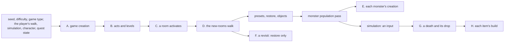
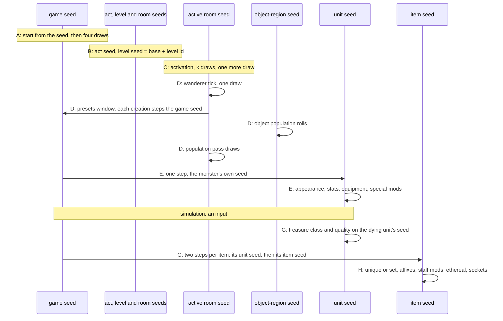

---
based_on:
  - docs/specs/chain/README.md 2026-10-21
  - docs/specs/rng/seeds.md 2026-10-27
  - docs/specs/drlg/room-tiles.md 2026-10-21
  - docs/specs/drlg/lifecycle.md 2026-10-21
  - docs/specs/monsters/stats.md 2026-10-27
  - docs/specs/objects/README.md 2026-10-21
---

# Seed to world: how a game is built

The other pages each explain one part of the game: [randomness](randomness.md), [levels](levels.md),
[monsters](monsters.md), [objects](objects.md) and [items](items.md). This page puts them in the order the server
runs them, from the moment a game is created with a seed to the moment a monster dies and its items fall. It adds no
rule of its own. Each step is explained on the page that owns it; this page says only **what runs when**, **which
[seed](../glossary.md) is handed from one step to the next**, and **what has to come from outside**: where the player
walks, and what happens in the fights. It restates the [seed-to-world spec](../specs/chain/README.md#purpose).

The short version: everything that does not depend on what the player does is built from the seed the game was
created with, and 37 recorded games were rebuilt step by step with 0 mismatches, given what the player did and what the
fights produced, as taken from the recordings, and a few counted values still read from them
([below](#how-it-was-checked)). What the player does
(which rooms it walks into, in what order, what it kills and clicks) is not a detail to be modelled: it is an input,
and it decides most of the seeds after the first room.

## The big picture

([chain § Purpose](../specs/chain/README.md#purpose), [§ Algorithm](../specs/chain/README.md#algorithm))

There are three kinds of seed in play, and the build moves between them
([rng/seeds § Algorithm](../specs/rng/seeds.md#algorithm)):

- **Seeds that depend only on the seed the game was created with.** The act seeds, every level's seed and every room's seed in the level
  generator. These are the same in every game made from the same seed, whatever the player does.
- **Seeds shared by the whole game.** The [game seed](../glossary.md) itself, which steps once for every unit other
  than a player that the server creates (twice for an item), and the [object-region seed](../glossary.md), one stream for every object roll
  in the game. Their values at any moment depend on everything created or rolled before.
- **A unit's own seed.** Each monster, object and item gets its own seed from one game-seed step when it is created.

## What has to come from outside

([chain § Runtime state](../specs/chain/README.md#runtime-state))

To rebuild a game exactly, a reimplementation needs the following besides the tables. The counts are those of the
end-to-end run, 37 recorded games, where each of these was taken from the recording.

| Input | What it decides | In the run |
|---|---|---|
| the seed, the difficulty, the game type | the game seed and map seed, the monster pools, every level's parameters | 37 games |
| which rooms activate, in which order, with which neighbours already active (the player's walk) | each room's [near list](../glossary.md) and so its collision grid, and the order of the new-rooms walk (what it decides is read from the code) | 18 459 activations |
| which object a player operates, and when | the operate's rolls and any monster it spawns | 6, 25 and 2 operate and trap spawns; 53 operates of handlers other than containers |
| the dying unit's seed at its death | the treasure class walk and the quality rolls of its drop; combat draws on that seed too | 3 784 treasure-class resolutions |
| the game seed at each drop | each dropped item's own two seeds; every unit simulation creates (a missile, a summon) steps it | 3 784 |
| when an object timer event runs | which timer rolls happen (what each one rolls is modelled) | 20 109 timer draws |
| a restored monster's class, id, cell, and whether it comes back alive or dead | which monsters a revisit re-creates, where, and in what state (monster movement and AI decide this) | 7 290 re-creations, 103 of which made no unit |
| the killer's [magic find](../glossary.md), and a summon's owner's | the quality roll's magic-find terms | 473 and 479 |
| quest state | the mode or state byte of quest objects, one class's mode, the Chaos Sanctuary gate test, the quest seed at a scripted drop | 952 modes, 49 state bytes, 3 |
| a revisited room's saved objects | the saved state of each re-created object | 35 |

Two consequences of this, both **inferred from the code and not tested on their own by a run**
([chain § Runtime state](../specs/chain/README.md#runtime-state)):

- The order in which rooms activate matters beyond the room seeds. A level's seed and a room's seed do not depend on
  it, but the game seed (one step per unit created), the object-region seed (carried from room to room) and each
  room's near list do.
- The game seed at the start of a room's population pass is a value the build itself produces only while nothing else
  created a unit since the previous pass. A missile or a summon in between shifts it. That is also why the game seed
  at each drop is an input.

## The build, step by step

([chain § Algorithm](../specs/chain/README.md#algorithm), [§ Entry contracts](../specs/chain/README.md#entry-contracts))

The letters are those of the spec. Each step names the page that explains it.

### A. Game creation

([chain § Algorithm](../specs/chain/README.md#algorithm) A, [rng/seeds](../specs/rng/seeds.md#algorithm))
The game seed and the map seed both start from the seed given at creation. Four game-seed draws follow, in this
order: one seeds the monster regions (the [monster pools](monsters.md#which-monsters-a-level-can-have-the-pool)), one
the object-region seed, one the vendors' store seed and one the quest seed. The project's tool reproduces all four from
the seed alone, along with every act's level-seed base and every level's seed; on seed 12345 it prints the
[randomness page's worked example](randomness.md#a-worked-example).

### B. Acts and levels

([chain § Algorithm](../specs/chain/README.md#algorithm) B, [levels](levels.md#acts-levels-and-rooms))
Each act's seed starts from the map seed and gives a level-seed base. A level, when it is first needed, starts its
seed from that base **plus its level id**: a sum, not a draw, so a level's seed does not depend on which levels were
built before it. The run built 176 combinations of level, difficulty and game type, with all three generator kinds and
every act of each game type in each difficulty. The level's generator (preset, maze or outdoor) then runs on that seed,
and each room it creates takes one draw.

### C. A room activates

([chain § Algorithm](../specs/chain/README.md#algorithm) C, [levels](levels.md#room-tiles-and-the-k-draws))
When a room activates (a player comes near), it is re-seeded, picks its tiles with [k](../glossary.md) draws, and gets its
collision grid, stamped from its own tiles and those of the neighbours already active. That is how the walk reaches the
grid: a neighbour that activates later is not stamped in. One more draw then gives the
[active room](../glossary.md) its seed. The tile rule on some wall cells that can draw during the tile pick makes a
*preset unit* of the room, not a unit; the units it names are created later, in the presets window of step D. That
last point is inferred: the code that adds the preset unit has not been read.

### D. The new-rooms walk

([chain § Algorithm](../specs/chain/README.md#algorithm) D, [lifecycle § D](../specs/drlg/lifecycle.md#d-the-new-rooms-walk-populate-once-restore-once-per-activation))
At the start of the next frame the server walks the act's new rooms in the order of the act's room list. For each:

1. **The wanderer tick**: one draw on the room's seed, always
   ([lifecycle § I](../specs/drlg/lifecycle.md#i-the-wanderer-tick)).
2. On the room's **first** activation:
   - the **presets window**: the room's hand-placed units in order. Hand-placed monsters go through the same
     creation as random ones (step E); superuniques and the special map presets go through their own path
     ([monsters](monsters.md)). 311 hand-placed monsters of the ordinary class kind were predicted in the recordings of the plan's first phase;
   - the **restore**, which finds nothing to restore on a first visit and draws nothing;
   - the **object population** on the object-region seed: the gate, the eight group slots and each object's creation
     rolls ([objects](objects.md)). The window draws on the room seed, the game seed and the object-region seed;
     in the run it created 13 056 objects (2 888 by the population, 10 168 hand-placed) with every seed predicted;
   - the **monster population pass**, on the room seed and the game seed, each creation through step E
     ([monsters](monsters.md#when-a-room-is-populated-and-how-many-attempts)).
3. On a **later** activation: the restore of what the room saved when it was released, and nothing else (step F).
   A room is never populated twice.

Two details carry seeds across rooms. The object-region seed is **one stream for the whole game**, so the order of
the rooms' object populations decides each room's object rolls. And a monster that the pass places on a neighbour
room's tile draws from **that** room's seed, either its seed from activation or the seed its own last pass left; the
pass's warp test can even activate a room and step a level's seed.

### E. One monster's creation

([chain § Algorithm](../specs/chain/README.md#algorithm) E, [monsters](monsters.md#placement-where-each-monster-stands))
Every server unit other than a player steps the game seed once when it is created (an item twice). For a monster:

1. one game-seed step, and the monster's own seed starts from it;
2. if its class is new to the level's list and has appearance sets, the sets are rolled on the monster's seed;
3. the stats draws (appearance, hit points, [MonProp](../glossary.md)), then the monster's equipment;
4. for a champion, unique or minion, the mod picks and their effects;
5. its marks on the collision grid.

In the run, 12 580 monster seeds were predicted out of 12 580 creations, and 63 champion packs and 162 unique and
minion packs, with 217 special-mod rolls.

Monster equipment is reached by two classes only in the stock tables, 234 (a flying scimitar) and 267 (Blood Raven),
each with one row and one location; the run reproduced their 4 creations with their items, each item taking two
game-seed steps ([stats § B](../specs/monsters/stats.md#b-monstatsinit-in-order)). The table's other branches (a level
skip, a second row, two or three locations, an occupied location) are read from the code only: no stock row reaches
them.

### F. Coming back to a room

([chain § Algorithm](../specs/chain/README.md#algorithm) F, [levels](levels.md#rooms-that-come-and-go-release-and-restore))
A released room that activates again re-creates its saved monsters, oldest first, then its items, then its other
units. A re-created monster is a **new unit for the seeds**: a new game-seed step, a new own seed and a full creation,
keeping only its id, class, cell, a few saved stats and, for a special, its mods from the save. Where it lands and
whether it comes back alive or dead depend on what it did in the meantime, so they are inputs.

It also marks the collision grid like a monster of the pass, though outside any window
([lifecycle § H5](../specs/drlg/lifecycle.md#h5-the-grid-marks-of-a-re-created-monster)). One that comes back alive
marks its footprint twice, then is unmarked and marked again with the pattern for its size. One that comes back dead
is marked once, and then, if its class's `deadCol` is 0, takes the corpse marks; with `deadCol` 1 the one mark stays.
This is confirmed on 1 903 re-creations compared mark by mark, the dead cases on 140 of them. It covers the marks made
from the recorded cell and state, not where or in what state a monster comes back. The call path that makes the marks is read
from the code; the marks and their order are what the run compared. Leaving the marks out breaks later placement tests: the first end-to-end run's
only two mismatches were exactly that.

### G. A death and its drop

([chain § Algorithm](../specs/chain/README.md#algorithm) G, [items](items.md#the-big-picture))
When a monster dies, its treasure class is walked on the **dying unit's own seed**, and each pick's quality is rolled
on the same seed. Then each item made takes two game-seed steps: the first gives the item's unit seed, on which its
base stats are drawn; the second gives the start of its [item seed](../glossary.md), on which the rest of its build
runs (step H). In the run, 1 314 monster drops with an item (1 492 items) were predicted from the dying unit's recorded
seed, with every builder modelled; all 3 784 treasure-class resolutions and 1 913 item creations reproduce.

A chest's drop runs the same steps on the chest's own seed ([objects](objects.md#what-a-chest-drops-the-hand-off)).
After it, the chest's seed is where the treasure class walk left it, the game seed has moved two steps per item, and
the object-region seed has not moved.

### H. Each item's build

([chain § Algorithm](../specs/chain/README.md#algorithm) H, [items](items.md))
On the item seed: the unique or set pick and, when it fails, the fallback builders; the builder's affix picks with
their property rolls; the [staff mods](../glossary.md); then the ethereal roll, the socket roll and the automagic pick.
The staff mods, once taken from the recording, are modelled and run in the chain.

## How it was checked

([chain § Inputs and oracles](../specs/chain/README.md#inputs-and-oracles), [§ Evidence](../specs/chain/README.md#evidence))

Each part above was first reproduced on its own, and where a part called into another that was not yet modelled, the
check took that call's result from the recording: a [boundary oracle](../glossary.md) (see
[how we know](how-we-know.md#bit-exact-reproduction-and-boundary-oracles)). For this page's spec those calls were
modelled one by one and **retired**: the property rolls, the staff mods, the builders under a failed unique or set,
the drop quality roll, a chest's drop, the gold piles' items, a monster's seed after its creation, the hand-placed
monsters, the City of the Damned's spawns, a neighbour room's seed in a pass, and the units of the wall-cell tile rule.
The gold piles' spot is read from the code, and the model's spot matched 69 of 71 piles.

The end-to-end run then rebuilt 37 recorded games with all of these models in: 0 mismatches, and 2 189 room
populations with no seed taken from the recording anywhere in their window or pass.

A few things are still read from the recording inside the chain, each counted:

- the level generator's parts of the object gate (room flags, the population level, the preset and town tests, the
  level's room count): the run checks the recorded values against the code's reading at every one of 4 883 gates,
  but the room flags are not yet handed over from the level model;
- the collision grid at the start of each pass: the grid the models build equals it in 4 723 of 4 883 rooms, and the
  rest are marks of players, monsters that walked, items and corpses; the barrier grid of the region flood and the
  waypoint point are read too;
- the monster-spawning creation rules of three other objects (2, 2 and 7 times) and three map-preset rows (3, 4 and 3);
- creations the model does not run (operate and object spawns): 34 with no level known, and 12 additions to a level's
  class list made by such creations;
- 35 placement tests in a room the grid model holds no cells for, 8 special-count increments of hand-placed monsters,
  1 gold pile's spot, and 7 chests' state bytes at their operate (see below).

## Worked examples

([chain § Worked example](../specs/chain/README.md#worked-example))

Copied from the spec; seeds are written `low:high` in hex. Each was reproduced by the end-to-end check.

**From seed 4802 to level 57** (the Halls of the Dead level 2, Normal, expansion). The tool prints these from the seed
alone, and the recording agrees:

| Step | Value |
|---|---|
| game seed, map seed | `000012C2:0000029A`, `000012C2` |
| monster regions | `E0A791E4:0000029A` |
| object-region seed | `615B8C46:0000029A`; the game seed then `615B8C46:5DB3A30E` |
| store seed, quest seed | `4231F4EC:0000029A`, `5959A58E:0000029A` |
| level-seed base | `E0A791E4` |
| level 57 | `E0A791E4 + 0x39` gives `E0A7921D:0000029A`; a maze level; region pool 374, 101, 101 |

**One room of that level, end to end**, one of the 2 189 populations with nothing taken from the recording. The room
activates with seed `4DAC63D4:0000029A`. The wanderer tick's draw keeps `0x14BE` in its low 15 bits, not 0, so no wanderer. No hand-placed unit
and nothing to restore. The object gate passes and all eight slots are rolled, but no object is created. The pass then
takes 27 game-seed steps before its first placement, and creates a leader of class 374 and two group members, each
with one game-seed step and its own seed; the leader's own seed takes two steps (appearance and hit points) and then
gives the group size. The room leaves the pass at `D0F81837:1908F5BF` and the game seed at `04994E9F:59583410`.

**A gold drop.** A class-101 monster dies with seed `3798A5AC:63BFE189`, treasure class 475, item level 15; the game
seed at the drop is `8B0F9E11:1D78C39B`, an input.

| Step | Value |
|---|---|
| treasure class | the pick draws 101 in a range of 160 and lands on item 523, gold, quality 2 |
| first game-seed step | `348CF6B0:3A00542B`: the item's unit seed starts at `348CF6B0` |
| second game-seed step | `A15D299B:15EB20E3`: the item seed starts at `A15D299B` |
| base stats | one unit-seed step; the pile holds 31 gold |
| build | no draw on the item seed |

The next drop of that game starts from the game seed `A15D299B:15EB20E3` that this one left.

## Traps for a reimplementer

([chain § Reimplementation notes](../specs/chain/README.md#reimplementation-notes))

- **The player's walk is an input, not a detail.** Two games from the same seed agree on every level and room seed,
  but their game seed and object-region seed part as soon as rooms activate or populate in another order, or the fights
  create a unit. This follows from the code; it is not a separate run's result.
- **The object-region seed is one stream for the whole game**, not one per room or per level.
- **A room's seed outlives its pass.** A later monster placed on that room's tile by another room's pass draws from
  the seed the earlier pass left.
- **A re-created monster is a new unit for the seeds**: a new game-seed step, a new own seed and a full creation.
  And it **marks the grid**: leaving its marks out broke later placement tests in the first end-to-end run.
- **A class added to a level's list is state.** If a creation the model does not run adds a class, its appearance sets
  are rolled then, and a later monster of that class reads them.

## What is not known yet

([chain § Open questions](../specs/chain/README.md#open-questions), [objects § Open questions](../specs/objects/README.md#open-questions))

- **Who changes a chest's state byte before it is opened.** Seven chests reached their operate with a lock bit or
  state their creation had not left (the lock bit set on 2, cleared on 3, the byte cleared on 2), and no recorded line
  wrote it. The check takes the byte at the operate; it decides only the locked test and that chest's drop.
- **Monster equipment beyond the one-row path**: reachable only with an edited table.
- **The room flags of the object gate**, still taken from the recording: handing the level model's per-room values to
  the walk would remove them.
- **The rest of the collision grid at a pass**: the barrier grid and the waypoint point are read but not modelled.
- **Three other monster-spawning objects and three map-preset rows** still take their seeds from the recording.
- **A world built from the seed alone**, with no recording at all, would need the player's activation order as an input
  record and a hand-off between the objects and monsters models; the plan behind this page does not build it.

## Where to read more

- The spec: [seed to world](../specs/chain/README.md#algorithm), with the entry table of what each step receives.
- The pages in build order: [randomness](randomness.md) (the seed tree), [levels](levels.md) (steps B, C and F),
  [objects](objects.md) and [monsters](monsters.md) (steps D and E), [items](items.md) (steps G and H).
- [How we know](how-we-know.md) for runs, recordings and boundary oracles; the [glossary](../glossary.md) for D2 terms.
