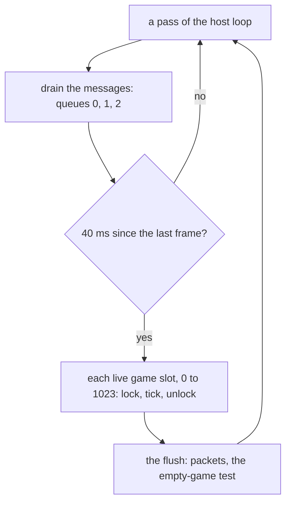
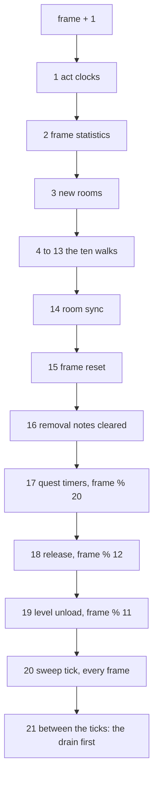
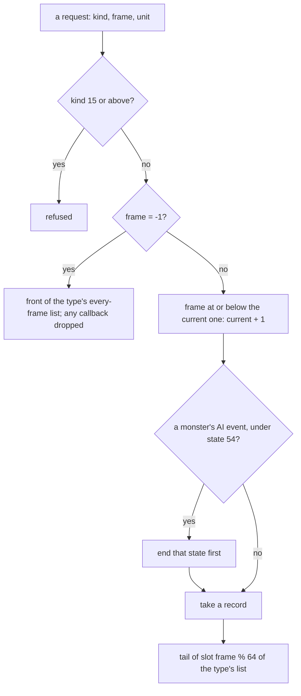
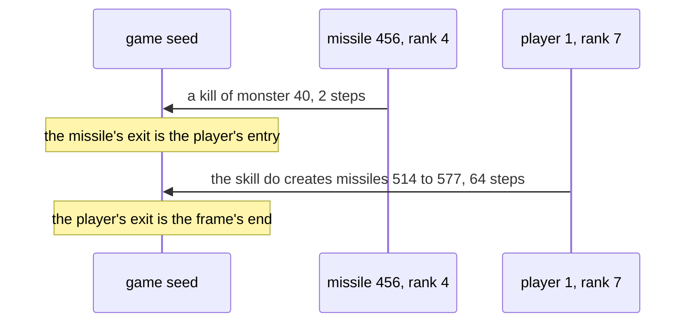

---
based_on:
  - docs/specs/sim/frame.md 2026-11-04
---

# The server frame

The server advances each game by one **frame** every 40 ms (25 per second is the value in the image, and the routine that could
change it has no reference: read from the code). This page gives the order of everything inside a frame: the tick and its
passes, the ten walks over the unit event lists, the queue that fills them, the periodic timers, the order rooms are activated
and populated in, and where client messages are applied. It answers the question that decides the draws on a
[shared seed](../glossary.md): **whose draws come first**. It restates the [server frame spec](../specs/sim/frame.md#purpose).

What an event does is another page's: a mode's frames are [animation and timing](animation.md), a think is
[monster AI](monster-ai.md), a skill or missile is [skills and missiles](skills.md), a hit is [combat](combat.md), a population is
[monsters](monsters.md) and [objects](objects.md). Here an event is opaque, in a known place.

## How sure each statement is

This page names its ground at each statement, because the kinds differ and they do not add up. **Read
[What the windows test](#what-the-windows-test) before relying on anything said to be seen in a window.**

| Kind | What it is | Where it stops |
|---|---|---|
| **Seen in a window** | A [frame window](../glossary.md) is a run of consecutive frames in one small scene of the game, with every event, queue call and seed step logged and each entry seed asserted against the chain, none resynchronised. [§ K1](../specs/sim/frame.md#k1-the-windows-as-they-stand) lists the windows and which count. | It holds for the scenes run. The same seed and script repeating confirms nothing. Much is taken from the log as given, and most events move no seed. |
| **Seen in the kept logs** | Logs of earlier game sessions, read again against an order model. No game was run for this. | The logs name few kinds of event, so a large total holds few pairs that can fail. |
| **Emulated** | The game's own code run in an emulator on declared inputs and compared with a model: the code's map. | It shows what that code does with what it is given, up to where a case ends. It is not the order in a game. |
| **Read from the code** | The instructions were read, and nothing ran. | No run has checked it. |
| **Counted, not raised** | A count taken from the window logs, with what the spec says it means. The spec keeps these below confirmed. | The count is of the logs. Its reading is not a confirmed statement. |
| **Unknown** | Listed under [What is not known yet](#what-is-not-known-yet). | |

**Counts.** How many windows there are, how many events they chain, and the pair, defender and Corpsefire results are given by link,
because § K holds their current figures. The other counts from the windows here are the spec's at the date in this page's front matter.

## The big picture

Read from the code, unless a sentence says otherwise ([§ A](../specs/sim/frame.md#a-the-host-loop-and-the-frame-clock)).

Each pass of the client's main frame in game modes 0 and 1, or of the open-server thread, drains the messages first, then asks whether
a frame is due, then flushes. In mode 0 the flush follows only a pass that ticked.

**The clock owes at most one interval.** Every caller passes the cap, so one call runs at most one frame per game. After a stall of any
length one call ticks, the next ticks again at once, and the third waits. A slowed game runs every frame in order, only later. Games tick
in slot order, each under its own lock. A second tick routine exists, but no call, jump or pointer reaches the stub that calls it, so in
this build this route runs every frame.

**The flush** comes after the frame. Per live game, it sends every client's queued packets. A game with no clients starts a timer and is
closed once 300 000 ms have passed, **or while its frame is above 1 500 and below 7 500**. A game with clients clears the timer. Called
with both arguments 0, the flush returns at once when under 40 ms have passed since its last run.

## The tick and its passes

The order of the passes is read from the code; the seven calls from rank 1 to rank 16 have no branch between them
([§ B](../specs/sim/frame.md#b-gametick)). A [rank](../glossary.md) is a place in the frame. The frame counter goes up by one **before**
rank 1, and every period below tests the raised counter.

The table's last column is each pass's route to a draw, from [§ J](../specs/sim/frame.md#j-draws-per-pass-and-the-shared-seeds), all read
from the code. **"None" means by direct reach:** the call graphs do not follow indirect calls (54 and 57 of them in ranks 1 and 15, and so on).

| Rank | Pass | What it does | Route to a draw |
|---|---|---|---|
| 1 | Act clocks | Steps each act's clock; on a change, refreshes every client's player and sends the clock packet to that act's clients | None of its own. The refresh can reach an aura's selection; whether a clock change can reach it is not read |
| 2 | Frame statistics | Statistics only | None |
| 3 | New rooms | Walks each act with rooms created since its last walk ([below](#rooms-in-the-frame)) | The wanderer tick, the population, the restore, level-point lookups |
| 4–13 | The ten walks | [Below](#the-ten-walks) | Each event's own function |
| 14 | Room sync | The autosave test, then each client's room work, activations included | Room activations, level builds, a preset's drop rolls; the game seed not by direct reach with the saves stopped. **The saves' seed is not read** |
| 15 | Frame reset | The per-frame flag clear of each unit marked updated | The free of an inventory item under one item flag |
| 16 | Removal notes cleared | Frees the notes the sync sent | None |
| 17 | Quest timers, frame % 20 | [Below](#the-periodic-calls) | Six quest callbacks |
| 18 | Release, frame % 12 | Room idle counts and releases | The release's save test and room free |
| 19 | Level unload, frame % 11 | A countdown on idle levels | Building a neighbouring level's record |
| 20 | Sweep tick | Works only when frame % 1500 = 0 | The free of an expired item |
| 21 | Between ticks | The message drain, first of all, and the client's own code | 135 random-number functions reached through the handlers; not computed per handler |

A queue call can draw too, by one route: a monster's AI event queued under state 54 ([below](#the-queue)). A frame in which no act clock changes and
no listed unit frees an item leaves the seeds of ranks 1, 2, 15 and 16 as they were (read from the code). Rank 21 assumes one thread runs both
the client frame and the ticks, the single-player loop; the open-server thread of modes 6 and 8 would break it. A debug switch sits at the
head of the tick, 0 in a normal game; its one identified writer has no reference, so it reads as unreachable in the stock image.

**What the kept logs show of this order.** Over the 331 frame-stamped kept logs, 3 713 293 events placed in 383 349 frames fall in rank order in every
frame, 0 mismatches. **What tests it is far less:** 17 254 consecutive pairs separate the order (16 935 from the animation logger, 319 from the skills
logger, none from any other), and 9 029 of them without the logger's own phase; the other placed frames agree trivially. 118 340 of the 501 689 frames
with two or more events cannot fail at all. Four wrong orders fail: monsters' walks before players' on 42 148 events, slot before every-frame on 9 608, missiles
after items on 8 885, the drain before the tick on 95 ([§ B4](../specs/sim/frame.md#b-gametick)).

**Other pieces seen in a game.**
- The periods of ranks 17, 18 and 19: each call's line appears at every due frame in the batch's windows, 12 of 12, 21 of 21 and 23 of 23 in the town's first window. The line is at the call site, so it shows
  the frames, not what the call did ([§ I5](../specs/sim/frame.md#i-the-periodic-calls)).
- The sweep's position: in one town window, frame 1500's sweep line comes after that frame's quest and release lines and before the frame's end. That window logs no
  seed steps, so it shows position only. The 1 500 period and the sweep's first steps are emulated; that the sweep unlinks, sends and frees in a game is read from the code.
- The save's position: at frame 8192 in two Den of Evil windows, one save pair each, after the frame's unit events and before its end, inside the
  room sync. Its seeds are taken as given. Those windows are nearly empty and test the position and little else
  ([§ H3](../specs/sim/frame.md#h-rooms-list-order-the-new-room-walk-the-room-sync-the-activation-record)). The test itself, a signed `frame % 8192`, is seen at
  that frame only. Read from the code: the autosave routine does not save in single player and leaves its flag at 0, which is how the save call comes to run there.

**Ranks 15 and 16, read from the code** ([§ G](../specs/sim/frame.md#g-the-other-per-frame-passes)). A unit marked updated joins its room's list; the reset visits a
room's units newest marked first, rooms in list order, and a unit that changed room only in the new one. A removal noted in frame N is sent in frame N's sync and gone before frame N + 1.
The marking and the list clear ran under emulation. The 78 marking sites are not each read.

## The message drain

Read from the code, except the one count below ([§ C](../specs/sim/frame.md#c-the-message-drain)).

Three queues are drained in order, each first in, first out: **system** messages (game create, join), **in-game packets** of every client of every game,
and **host control**. A packet's handler runs at once. A message arriving while its queue drains is drained in the same pass. The packets of all clients and all games
share one queue, so their order is their arrival order. Which drain a message falls in is arrival: a logged input, not something this page predicts.

**Messages are applied between frames, never inside the tick.** The packet dispatch has one call site, on one route from the drain, and the drain's four call sites lie in the
loops of the big picture and one wait loop that drains with no frame. A loop pass that does not tick still drains, so several drains can fall between two frames.

**The stamp is the frame before.** A packet applied while the counter reads N takes effect in the state frame N + 1's passes start from. Seen in the kept logs for the
skill-request handlers only: 87 skill checks from those handlers are logged after a missile frame of the same stamp, and "the drain reads the frame it acts before" fails all 87.

## The ten walks

The order is read from the code ([§ D](../specs/sim/frame.md#d-the-unit-events-the-control-the-pass-the-runners)); how far a game has confirmed it is the
[next section](#how-far-the-order-of-the-walks-is-confirmed).

Each unit's pending work is a record on one of five lists, one per type: missiles, players, monsters, objects, items. Each list has two parts. Its **every-frame** part
runs each frame. Its **slot** part is a ring of 64: a timed record sits in slot `frame % 64` of the frame it is due. Ranks 4 to 13 walk them:

```mermaid
flowchart LR
  M0["4 missiles every-frame"] --> M1["5 missiles slot"] --> P0["6 players every-frame"] --> P1["7 players slot"]
  P1 --> O0["8 monsters every-frame"] --> O1["9 monsters slot"]
  O1 --> B0["10 objects every-frame"] --> B1["11 objects slot"] --> I0["12 items every-frame"] --> I1["13 items slot"]
```

A walk reads its list's head when it starts, so a record queued during an earlier walk of the frame is found by a later walk of its own list. For a rebuild, a unit's events in one
frame run by its type's place in the five, then every-frame before timed, then the list's order. Two units of one type interleave by their records' places in the shared list. What
a unit is or where it stands plays no part (read from the code).

**Emulated, the code's map:** the runners, the five of them in both modes, 300 cases, and the whole pass, 100 cases, with the game's own every-frame queue call as the re-entrant
callback. A walk saves the next record before it runs one, and passes over a slot record due a later multiple of 64 frames on. "Players before missiles" fails the 33 cases it separates, and "next read after the run" the
96. This covers no dispatch or event function, and no callback that frees another record.

The counter holds for 2 147 483 647 frames, 994.2 days at 25 per second. The next increment wraps negative; no case emulates that.

## How far the order of the walks is confirmed

**Confirmed only among what the windows separate: ranks 4, 7, 8 and 9.** The other six ranks hold no event in any counted window, and their places are the reading above.

| Rank | Walk | Ground for its place |
|---|---|---|
| 4 | Missiles, every-frame | Seen in a window |
| 5 | Missiles, slot | Read from the code |
| 6 | Players, every-frame | Read from the code |
| 7 | Players, slot | Seen in a window |
| 8 | Monsters, every-frame | Seen in a window |
| 9 | Monsters, slot | Seen in a window |
| 10–13 | Objects and items, both parts | Read from the code |

**Seen in a window** ([§ D5](../specs/sim/frame.md#d-the-unit-events-the-control-the-pass-the-runners)): 1 844 adjacent walks of different ranks, none inverted, in a Blood Moor pack and the Den of
Evil, one player, Nova, with what [§ K3](../specs/sim/frame.md#k3-a-large-zero-can-test-little) takes as given: 4 before 7, 324; 7 before 8, 1 129; 7 before 9, 184; 8 before 9, 207.

**Seen in the kept logs**, by logger phase and call site, placing a walk against a neighbour:
- the players' slot walk before the monsters' (3 007 pairs);
- the monsters' every-frame walk before their slot walk (4 637);
- the missiles' walks before a player or monster event (6) and before the drain (81);
- one object event kind, the end of an operate, after the players' slot walk (3 pairs) and the monsters' (1).

These do not separate the objects' every-frame walk from their slot walk, or the missiles' likewise, and they say nothing of the items' walks. The object pairs give no object walk a rank.

## The queue

**Emulated, the code's map** ([§ E](../specs/sim/frame.md#e-the-queue)): the timed queue, 400 cases, 0 mismatches ("insert at the head" fails the 241 where the slot already holds records); the every-frame
queue, 150 cases ("append at the tail" fails the 36 it separates); the free, 300 cases; cancelling a unit's events and freeing all of them, 150 cases, thin but sufficient. The state 54 branch's own work lies past where those cases end.

**The state 54 branch** (read from the code) is the one draw route inside the queue. It ends the state and, under a second state, can kill the unit or apply a hit; for a monster it then frees the pending AI events, and only then is the new record taken, so it replaces them.

**Inside a list:**

- **Slot events run in queue order.** Seen in a window: 857 adjacent events over 449 frames, 0 inverted; 326 of the pairs are one unit's, and **104 run against ascending unit id**, so on those 104 the test separates queue
  order from id order. An id order would pass the other pairs. The kept logs agree: 4 579 consecutive slot pairs matched to their logged queue calls, 0 inverted, "newest queued first" failing all of them.
- **Every-frame events run newest queued first.** Seen in a window: 21 482 adjacent events over 1 025 frames, 0 inverted; **572 run against descending unit id**, the same separation. In the kept logs, 24 652 consecutive
  pairs of windowed missiles run newest first, which a descending id order would also predict.

**Queued during a pass.** A timed record does not run in the frame it is queued, since its frame is at least the current one plus 1 (read from the code). An every-frame record runs in this frame only if its type's list is walked later in
the frame; queued into the list being walked or one already walked, it first runs next frame (read from the code). That half is seen in the kept logs **for players and monsters**: 658 monster starts queued during the missile or player walks
ran in that frame, 2 819 monster starts queued in or after the monster walks and all 6 205 player starts ran in the next, 9 682 starts, 0 mismatched. For objects, items and missiles it stays read from the code.

**Freed during a walk** (read from the code). A record freed is not run after it, because the free moves the walker's saved next record on. A unit freed during a pass loses all its records at once. A unit moved between rooms
keeps them, since no record holds a room. A unit made inactive by a room's release loses its records with the unit. Its saved record carries an event only for a shrine, queued again at the restore; another object branch queues events and is not read further. Where a restored monster's first events come from is not read
([§ L](../specs/sim/frame.md#l-inactive-units-and-the-room-unlink)).

## What an event runs

Read from the code, except where a sentence says otherwise ([§ F](../specs/sim/frame.md#f-dispatch-the-event-tables-the-freeze-drop-kinds-6-and-11)).

An event has a **kind** below 15, and each unit type has its own table of what a kind means, so a kind's meaning depends on the type. For players and monsters the kinds are the mode's frame, the mode's end, a monster's AI, regeneration, a state's do function,
an overhead chat's expiry, the aura ticks and timed-list expiry, among others. Every missile record, of any kind, runs the missile's frame, and every missile is queued to run every frame. A record with a callback runs that instead of the table.
Some object kinds are not read. Players and monsters skip an empty entry; objects and items have no bound and stop the process on a bad one.

**The freeze drop.** A frozen, living monster's events are dropped at the dispatch, except five kinds. The runner has already set its running flag, so a dropped timed record is freed like a run one, and a dropped every-frame record stays on its list and runs
again once the freeze ends. A record with a callback is not dropped. Players have no such drop.

**Two kinds, and whether they draw:**

- **The player's status report, kind 11,** first runs 250 frames after a player's placement, then every 30 frames (read from the code). Seen in a window: draw-free in the windows' scenes, entry and exit seeds equal on every seed logged and no step on the unit's own seed, in each run
  [§ F4](../specs/sim/frame.md#f-dispatch-the-event-tables-the-freeze-drop-kinds-6-and-11) counts. The windows hold no dead pet, so the branch that removes one is not run. Read from the code: its call graph reaches no draw, with two stops.
- **The overhead chat's expiry, kind 6,** is untested in the game; § F5 says no window holds one. Its draw-free reading is by call graph only. Its three branches are emulated, up to the record's free. A chat record lives `8n + 125` frames for `n` characters, read from the code.

**The AI has two entries:** at a mode's end it runs inside that mode-end event, so its draws come at that event's place in the frame and not at the AI record's (read from the code; [monster AI](monster-ai.md#when-a-unit-thinks)).

## The periodic calls

The four run in the order of the table above, read from the call sites ([§ I](../specs/sim/frame.md#i-the-periodic-calls)). The periods of the first three are seen in a window, as [above](#the-tick-and-its-passes).

**Quest timers, every 20 frames.** Emulated, 300 cases, given that the pointer check returned 0: a tick count goes up, the list is walked from its head with the next timer read before each callback, a timer whose due tick has passed runs, one that returns 1 is unlinked and freed, the rest are due
again at the period plus the current tick, and the due ticks are folded when the tick count reaches its last value. Not covered: what any real callback does, the free, and adding a timer. Read from the code: adding pushes on the front, so timers run newest registered first, and adding is fatal while the
list runs. For a registered period `p`, a timer's first run is `p + 1` boundaries after registration and its period `20 × (p + 1)` frames. The 26 registration sites name 21 callbacks: 13 reach no draw, 2 only through a specified entry, and 6 draw through quest content (the Act V thaw, Izual's ghost, Diablo and the Act III guardians
spawn monsters, the Tristram portal picks a level point, the Dark Wanderer steps the quest seed once and creates a unit).

**Release, every 12 frames.** Emulated up to the first room whose count passes 10: the idle counts, the act order, the boundary. "At 10 or above" fails 86 cases. The release itself is [levels](levels.md#rooms-that-come-and-go-release-and-restore).

**Level unload, every 11 frames** (read from the code). Each level with no reference and built rooms counts down. At 0 the check allows the unload or re-arms to 10. It can **build a neighbouring level's record** when one of the eight vis levels is not yet in the act's list. A level's seed does
not depend on build order, so this creation is invisible to every other seed.

**The sweep, every 1 500 frames.** Its position and its first steps are [above](#the-tick-and-its-passes). Emulated: acts 0 to 4, an act's items (expiry at or before the frame) before its inactive records (expiry before the frame). It reads as the one pass that removes units by a frame test
alone, so its frames are where an item can disappear with no event (read from the code).

## Rooms in the frame

Read from the code, unless a sentence says otherwise
([§ H](../specs/sim/frame.md#h-rooms-list-order-the-new-room-walk-the-room-sync-the-activation-record)). The rooms' counts and population bodies are [levels](levels.md#rooms-that-come-and-go-release-and-restore).

**An act's room list is newest first.** A created room goes at the head and sets the act's new-rooms flag, so every pass over the list goes from the most recently created room to the oldest.

**Rank 3 walks an act whose flag is set**, from the head. Every room gets one wanderer tick on its own seed; a room not yet populated is populated, and one already populated is restored once per activation. The flag is cleared **after** the walk. So in one frame's walk, an act's rooms created since its last walk
come first, newest first, then its older rooms, and each older room's seed steps once per frame in which any room of the act was created. Emulated, 200 cases: which act is walked first, the head room reached first, the flag cleared on an act with no room. The walk past the first room is past those
cases. Seen in a game: a client's new rooms are walked at the start of the next frame. Three other callers populate one room at once, outside this order.

**A room created during the walk** is linked before the walk's position, so it is not visited, and the flag's clear leaves it waiting, unpopulated, for the next walk of its act, which needs another room of that act to be created, or for one of those three callers. One created in a later act is walked in the same pass, one in an earlier act in the next frame. No kept log stamps both the
activation and the population in a case that separates this. The spec also assumes that the act's room-create callback is 0 on the server; its writer is not read.

**Rank 14** walks clients newest first, one in single player. A client whose player's room has changed makes its room change there. Within one change, rooms are created in the near-list order of the new room, restricted to rooms not yet active, with one other route (a room whose files become ready). Across one frame: clients in list order, each client's room change, then the on-demand activations at their own passes.

## Whose draws come first

Read from the code, except the hand-offs and the re-chained entries, which are seen in the kept logs ([§ J](../specs/sim/frame.md#j-draws-per-pass-and-the-shared-seeds)).

A shared seed is one that two units' or two rooms' draws in one frame can both step, so their order decides the values. Five kinds:

1. **The game seed:** every unit creation, in population and the inactive restore at rank 3, in the unit events, in the quest timers' spawns and in the drain's handlers.
2. **Each level's seed:** the preset rolls of the rooms its activations load, the level-point lookups inside a population, the Tristram portal timer.
3. **The object-region seed,** carried across rooms, operates and timer events.
4. **The quest seed.**
5. **A unit's own seed drawn in another unit's event:** a defender's in a hit, a dead monster's in its killer's event.

A room's own seed is stepped by that room's activation, tiles and wanderer tick, and by a neighbour's population. The saves' seed is not read.

**One counter crosses games.** The hit class counter is a byte, 0 at load, with one store, the increment, and no game create or close resets it. So the element of a hit depends on the hits picked before it in the process, other games included, and only for a hit with two or more of cold, fire, lightning and poison
above 0. Otherwise two games share no seed, in the tick's call graph, whose 145 indirect calls are not followed, but for one salt store. The windows log the counter, which shows it was logged and no more.

**Hand-offs, seen in the kept logs:** 1 065 396 pairs of consecutive observations of one seed by two events of one frame, in logged order: 1 023 086 handed on, 42 310 stepped 1 to 4 096 draws on, **0 reversed**, 0 off the stream. On the game seed, 440 754 pairs, 4 675 of them stepped. A stepped pair says that something unlogged
drew on that seed between the two events, and it separates the logged order from its reverse.

**How few resynchronised entries re-chain.** Of 281 player gaps in the kept logs, 142 re-chain, and 139 stay open. Of 331 monster gaps, **none**: those logs hold no AI line.

## A worked example

Frame 1961 of a Den of Evil window, from the kept log, printed and checked by a kept script. It is one instance of the rules above, and not a separate proof of them ([worked example](../specs/sim/frame.md#worked-example)). The spec has the seed values as a test vector.

1. At rank 4, missile 456's every-frame event runs. Inside it monster 40 dies and the game seed steps 2. That the 2 are one item's is the [treasure class reading](../specs/items/tc.md#h-item-pick-and-hand-off), not this log's.
2. The seed at the missile's exit equals the seed at the player's entry: handed on.
3. At rank 7, the player's slot event runs a skill do. It creates 64 missiles, ids 514 to 577, one step per creation, 66 steps from the frame's start.
4. In frame 1962 rank 4 runs the new missiles newest first: 577, 576, 575, and on. Missile 577's own seed is set from the low half of the last step, and 514's from the first.

## What the windows test

The spec's own warning ([§ K](../specs/sim/frame.md#k-what-the-frame-windows-test)). **How many windows count, which scenes and how many events they chain are in [§ K1](../specs/sim/frame.md#k1-the-windows-as-they-stand).** Windows run in single player, one fresh process per scene. Whether a window holds Corpsefire is also § K1's result; a window without him tests the Den's Fallen, shamans, zombies and brutes and no more.

**What a window asserts** ([§ K2](../specs/sim/frame.md#k2-what-the-reader-asserts)). A chained seed is the game seed, or a unit's or room's seed from its first reading in the window. Each logged step on one is applied, and every logged reading must equal the value kept. Each step is classed by what is open: the unit's own event, the game seed inside an event, another event or a room's walk (which must be listed), or nothing (which must be a listed pass). Walks must fall in rank order, slot events in queue order, every-frame events newest first.

**Two results seen in a window, at their scope:**
- The game seed is handed between logged events with no unlogged step **on a chained seed**, with a unit's own draws taken as given and the limits below applying.
- A missile's first reading is the seed set from a game-seed low half predicted before the reading ([§ K2](../specs/sim/frame.md#k2-what-the-reader-asserts) counts them; the exceptions there are missiles created before their window and one that is no such setting).

### A zero tests less than it sounds

All of this is counted, not raised ([§ K3](../specs/sim/frame.md#k3-a-large-zero-can-test-little)).

- **Most events move no seed.** Of 27 372 events, 27 133 (99.1%) moved neither the game seed nor their own. 211 moved their own, and **only 43 moved the game seed**: the player's skill do 26, a missile's event 15, a monster's every-frame event 2. 15 did both, so 239 moved either. The chained events mostly say that no seed moved unlogged, and little about any draw's value.
- **A step on no chained seed is not tested at all.** That is 58 156 of the 67 441 logged steps: 52 629 between the ticks at no listed client location, 5 319 in the tick with no event open, 208 inside an event. The lists of allowed sites bind only a step on a chained seed.
- **Some readings accept any of several values.** While a fresh seed shares its low half with a chained one, the log reader holds every value the seed may have, and a reading passes on any of them. There a surplus step is not seen, while a lost one still is. Dropping one in-tick step at random is seen 24 of 25 times in the two full maze windows and 4 of 25 in the pack, where most in-tick steps are on no chained seed.
- **Taken as given, not predicted:** a unit's own draws (AI, skill do, a missile's own), the number of drop draws on a dead monster, the listed pass steps, the client steps, the save, and the equality of kind 11's seeds. Every think in the windows is taken as given. What is predicted is the arithmetic of every logged reading, the missiles' first readings, the class of every step, and the order.
- **A kill's even count tests almost nothing.** The game-seed steps at the item constructor's two sites are even, which follows from one path: it shows that no other unit was created in those segments, and no more. Neither the item count nor a no-drop is logged, so "2 per item" and "0 on a no-drop" are not tested there. "Two per dropped item" is the [treasure class reading](../specs/items/tc.md#h-item-pick-and-hand-off).

### Another unit's event drawing on a seed

Counted, not raised ([§ K4](../specs/sim/frame.md#k4-touches-another-units-event-or-a-rooms-walk-drawing-on-a-seed), which has the sites and the counts). A step on a seed inside someone else's event must match a listed trigger:

- **kill:** a drop's treasure-class or quality draw, inside a killer's event; the trigger names its unit through the logged death.
- **room:** a wanderer tick, a monster spawn or an object placement inside a room's walk. It needs only an open room walk, not that the rooms are neighbours.
- **owner:** a to-hit or critical-double site, with a missile's or the monster's own event open.
- **defender:** the defence, cold, wear, get-hit, hit-class and damage sites of a hit.
- **kill event:** a unique mod's death site, named through its queued event.

Owner and defender match event type and site, **not the unit**: the logger does not log the unit, so they separate "this site outside a combat event" from "inside one", and not which unit. Whether any window hit the defender's or the kill event's row, and what rests on specs alone, is § K4's result.

### Shared-seed pairs

Counted, not raised ([§ K5](../specs/sim/frame.md#k5-shared-seed-pairs)). A pair is two top-level events of different units that each moved the game seed in one frame. **It stands as a named count, and how many pairs there are is § K5's figure.** It is reported as measured, and it is not a short against a target.
**No confirmed statement rests on a pair.** The rule for whose draw comes first follows from every game-seed step being logged inside an open event and from the events running in the tested order. What is thin is the variety among drawing events: the 43 above.

### Hooks: where they ran, not where they can

Counted, not raised ([§ K6](../specs/sim/frame.md#k6-the-hooks-where-a-function-ran)). A static reach leaves 65 functions universal: it has no calling context, and a few hub functions carry every pass into each one. One Den of Evil window, uncounted for its arithmetic but whole and carried, places 27 at an event by the ranks open when they ran, 4 ran only with no event open (an equipment refresh, an item requirement check, a monster stat callback, a passive refresh), and **34 are not reached and keep every rank**. A placement says where a hook ran, and nothing of where it can.

Seen in the kept logs, three hooks' passes are separated by logged pairs, each against its logged neighbours and not as a rank: the path step 3 820 (a monster's step after the players' slot walk; the player half stays read from the code), the animation advance 568, the running stamina drain 90.

### Client steps are not evidence

Counted, not raised ([§ K7](../specs/sim/frame.md#k7-client-steps-are-not-evidence)). Between the ticks the main loop runs client code on client copies of the seeds, outside the frame. Those steps, at the listed client locations, are applied to no chained seed and counted apart. **They are no evidence of the server's frame order,** and the names on those rows are the neighbouring symbol's for a location often past a function's end, not a read function. One busy client function gets no claim at all: its lines lie between the ticks on no chained seed.

## What a build with no log still needs

**The activation record** (read from the code, [§ H5 and § H6](../specs/sim/frame.md#h-rooms-list-order-the-new-room-walk-the-room-sync-the-activation-record)). Per frame, a log-free build takes as input: each client whose player's room at rank 14 is not its client room, with the new room, the frame and the client's place in the list; every on-demand activation and every one-room population; and the room pins that hold a release back. From these the rest follows: the creations, each act's list order, each frame's population order, the idle counts, the releases.

The record **cannot be derived from client messages alone**. The room a player stands in at rank 14 is the end of its movement in the walks, so that input stays logged until a movement model exists. With one, it follows from the player's position each frame, and the on-demand activations still need the warp and waypoint requests and the population's level-point lookups.

**The act clock** ([§ G](../specs/sim/frame.md#g-the-other-per-frame-passes), [open questions](../specs/sim/frame.md#open-questions)). Each act's clock steps every frame, faster in some acts under conditions the spec gives, and it reads as the act's day-and-night light (read from the code). The step ran under emulation, 420 cases, 0 mismatches, as the code's map, with the scale kept below 5 000. But three things are not known: **the values of its three tables** are not in the spec, **the server's scale and flag**, set at act load, are not read, and so **how often the pass sends its packet and refreshes every client's player** is unknown. **So a build with no log cannot yet predict on which frames rank 1 does anything.** Also not read: whether that refresh can change a usable item and so select an aura, which is rank 1's route to a draw. A window across a clock packet would settle that.

## Traps for a rebuild

From the [reimplementation notes](../specs/sim/frame.md#reimplementation-notes).

Emulated, the code's map:
- A queue request with frame −1 **drops its callback**, and a frame at or below the current one is raised, not refused.
- A freed record returns to **the first block's** free list, last freed first, whichever block it came from. That is invisible unless a rebuild exposes record addresses.
- A slot holds records of later multiples of 64: a walk passes over them and keeps them.

Read from the code:
- **The stamp a packet reads is the frame before the one it acts in.**
- **The new-rooms flag is cleared after the walk.** A room created during its own act's walk waits; do not re-walk.
- **The wanderer tick runs on every room of a walked act,** so a frame that creates one room steps every room seed of its act once.
- **Do not reset the hit class counter per game.**
- **The act clock pass refreshes every client's player on any act's change,** and only the packet goes to that act's clients.

## What is not known yet

From the [spec's open questions](../specs/sim/frame.md#open-questions), and the limits above:

- **The act clock:** its tables' values, the server's scale and flag, how often its pass acts, and whether it can draw ([above](#what-a-build-with-no-log-still-needs)).
- **Ranks 5, 6 and 10 to 13 in a game:** no counted window holds an event in them.
- **The saves' seed.**
- **The frame reset:** the bits it clears, by name, and which item has the item flag at the reset.
- **The room sync:** two calls under one unit bit, what one more call does under a game bit, and the 16 game-code indirect calls of its graph.
- **Events:** the object handlers left unread, and which unit type each of the 269 queue sites is for, on which a kind's meaning depends.
- **Others not read:** the caller of one Act V quest function, four unreferenced sites of the room unlink, one further room-list call, a dead mercenary's way out of its pet list, the registrars behind 54 functions, and whether a logged event of a universal kind is the server's or the client's. The room unlink's list of callers is a floor: up to 500 functions of its walk have none listed.
- **Unemulated corners:** a new record block being linked (no case used more than 32 records), the counter's wrap, the act clock's product wrap at a far larger scale.
- **Leads, nothing more:** the busy client function may be rain particles, with no code read to say so, and no spec depends on it. The act's room-create callback may be 0 on the server because the server's call passes 0. Every window ran without sound; no figure here is known to depend on it, and none was run with it.

## Where to read more

- The spec: [server frame](../specs/sim/frame.md#algorithm), whose [reimplementation notes](../specs/sim/frame.md#reimplementation-notes) list the traps and whose [§ K](../specs/sim/frame.md#k-what-the-frame-windows-test) has the current counts.
- The [glossary](../glossary.md) for rank, frame window and shared seed.
- Related wiki pages: [animation and timing](animation.md) (a mode's frames and the schedule), [levels](levels.md#rooms-that-come-and-go-release-and-restore) (activation and release), [monster AI](monster-ai.md#when-a-unit-thinks), [skills and missiles](skills.md#draw-order-and-chaining), [combat](combat.md#draw-order-and-chaining), [seed to world](seed-to-world.md) (what has to come from outside), [randomness](randomness.md) (seeds and draws) and [how we know](how-we-know.md).
