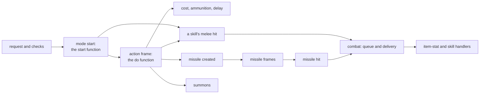
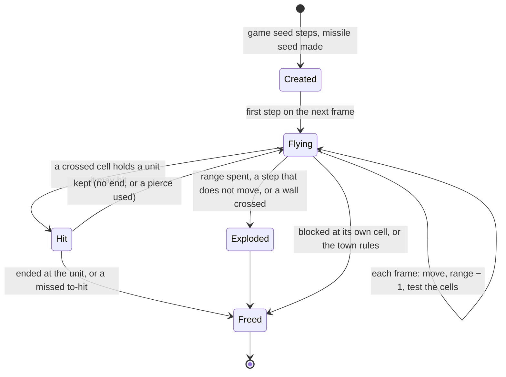
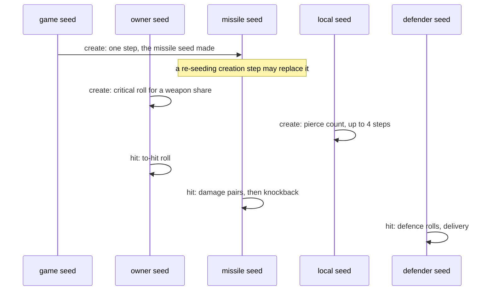

---
based_on:
  - docs/specs/skills/README.md 2026-10-27
  - docs/specs/skills/dispatch.md 2026-10-27
  - docs/specs/skills/missiles.md 2026-10-27
---

# Skills and missiles

This page explains what the server does when a unit uses a skill: how the request is checked, which function runs
when the skill's animation starts and which on its action frame, what the skill costs and how its delay works, how a
skill's melee hit is built, what the charge-up skills and their finishers do, which item stats and skills react to
hits and kills, how a summon is made, and how a missile is created, flies, collides and hits. It restates the
reviewed skills specs: the overview in [skills/README](../specs/skills/README.md#purpose), the skill side in
[dispatch](../specs/skills/dispatch.md#purpose) and the missile side in [missiles](../specs/skills/missiles.md#purpose).
The specs carry the exact arithmetic and [draw](../glossary.md) order; this page tells the story. Where something is
read from the code but not yet seen in a test run, or is still unknown, the page says so.

Skills and missiles are the project's third *simulation* subject, after [combat](combat.md) and
[stats and states](stats-and-states.md). Combat takes a skill's damage packet as given; this subject explains where
it comes from. The specs cover the **machinery** that every skill goes through, and a named set of skills, called
**tier A**, whose own functions are specified too. What each of the other numbered skill and missile functions does is
the work of a later plan, the function catalogue
([overview § Purpose](../specs/skills/README.md#purpose)). The specs were checked against two recorded runs of
skill-using characters (the second built for what the first met too rarely) and against single functions run on their
own under emulation, up to a call that ends the reproduced part ([how we know](how-we-know.md)). Life, mana and damage are kept in 1/256
points, and time is counted in game frames.

## The big picture

A skill use is a chain of server events ([overview § A](../specs/skills/README.md#a-the-event-kinds-and-their-seeds)):

1. **The request.** A player's client asks to use the left or right skill at a point or at a unit; the server checks
   the skill can be used and starts the skill's animation (its *mode*). A monster's AI skips the checks.
2. **The mode start.** The skill's **start function** ([glossary](../glossary.md)) runs. Some skills build and roll
   their melee hit here, at the start of the swing.
3. **The action frame.** On the frame of the animation that carries the action, the skill's **do function** runs,
   then the skill's missile is created, the cost is paid if it was not paid at the start, and the delay begins.
4. **The missile** steps every frame, tests the cells it crosses for units and walls, and on a hit builds its own
   damage packet and hands it to combat.
5. **Handlers.** The hits and kills fire the stat events that item stats (thorns, knockback, chance to cast) and
   some skills (Bone Armor, Life Tap) registered on the units.
6. **Summons.** A summoning skill creates a monster owned by the caster.

The order of these steps is read from the code; which parts of each the runs confirmed is said in the sections
below. Each step draws on a particular seed: the caster's, the target's, the **game seed** (one step for each missile and
each summon created, in every creation the runs logged), the missile's own seed, and a few short-lived local seeds. The rest of this page follows the
steps in order and names, for each, whose seed it draws on.

## What the model takes as given

Some inputs belong to other subjects and are taken as given, logged in the runs
([overview § The ADR-0014 boundary](../specs/skills/README.md#the-adr-0014-boundary),
[dispatch § Inputs and oracles](../specs/skills/dispatch.md#inputs-and-oracles)):

- **The frame on which the action happens.** Which frame of an animation carries the action is animation timing, the
  next simulation subject.
- **A monster's choice** of skill, mode and target: monster AI, a later subject.
- **The numbered functions outside tier A**: their effect on the seeds is taken from the logs until the function
  catalogue specifies them.
- **The path planner's points** and the cells a missile's step crosses, the order in which an area skill visits the
  units near it, and which pet the pet limit removes.
- **A unit's final stats**, which [stats and states](stats-and-states.md) explains.

## Asking for a skill: the request and its checks

A player's request arrives as one of the skill packets: left or right skill, at a point or at a unit, with or
without walking to the target first ([dispatch § B](../specs/skills/dispatch.md#b-the-request)). Read from the code:

- **Every request moves a counter.** Before any check the player's stat 328 rises by one. That counter later seeds
  every [pierce](#missiles-creation-speed-range-seed-and-damage) count of the player's missiles, so a request that is then
  refused still changes the player's later missiles.
- **Dual wielding alternates.** With a weapon in each hand, the Attack skill alternates request by request between
  Attack and Left Hand Swing. Left Hand Swing reached the run only this way (confirmed for its 30 uses).
- A request that asks to walk, at a unit too far away for a melee skill, first makes the player run to it.

The checks ([dispatch § C](../specs/skills/dispatch.md#c-the-request-checks-skills_canuse)) run in a fixed order and
return a code. 0 means usable: the server then starts the skill's mode; 1 makes it send the "not enough mana" message;
any other code does nothing.

| Order | Test | Refused with |
|---|---|---|
| 1 | the skill exists and is usable in game | 3 |
| 2 | the unit has the skill at a level above 0 | 7 |
| 3 | the skill is not an aura | 6 |
| 4 | the skill is not a passive | 5 |
| 5 | ammunition and item tests (a throw needs a throwable item, Left Hand Swing two weapons) | 2 |
| 6 | the weapon types the skill needs | 2 |
| 7 | enough mana (or life under Blood Mana, or charges for an item skill) | 1 |
| 8 | the skill's restriction to certain states | 4 |
| 9 | the starting mana of a channelled skill (Inferno, Arctic Blast, Blade Fury) | 1 |
| 10 | an item skill has charges left on its item | 2 |
| 11 | the delay state, for a skill with a delay | 8 |

**What the run confirmed.** Codes 0, 1, 6 and 8 and their order are confirmed over 1 340 checks: an aura refused with
6, the mana test with 1, the delay with 8, everything else usable. **A cost equal to the mana passes**: five checks with
exactly as much mana as the cost returned 0. The other codes, the starting-mana test and the item charges are read
from the code only; no check of the run reached them.

**No refused request reached the server.** All 1 126 requests of the run passed, while the client's own check of the
same skills switched to a refusal 85 times. Read from the code, the client runs the same checks on its own copy of the player
every frame for the skill buttons; in the run it sent no request for a refused skill (its sending code is not
read). So what
the server does with a refused request, codes 2 to 5 and 7, and the refusal of a skill not allowed in town, are the
code reading: a test needs a client that sends what a stock client does not.

## The mode start and the action frame

When the request passes, the skill's mode starts ([dispatch § D](../specs/skills/dispatch.md#d-the-mode-start)). Read
from the code: the server checks the target (a corpse only for a skill that takes corpses), refuses a skill not
allowed in town while the caster stands in a town, tests line of sight for the skills that need it, and runs the
start function. The cost is paid here, unless the skill pays on the action frame (two rows, Plague Javelin and Blade
Fury) or has no start function. A refusal at this point puts a player into mode 5.

On the action frame ([dispatch § E](../specs/skills/dispatch.md#e-the-do-frame-and-skills_srvdo)), also read from the
code, the do function runs, and **then** the skill's missile is created, if the row names one: 48 stock rows, Fire
Bolt among them, have a missile and no do function, and get only the missile. Then come the cost (if not paid at the
start), the ammunition for the rows that use some, and the delay. A flag on the unit, set by the do function or by
the missile creation and cleared at a player's mode start, makes the do function run **once per mode**, even if the
animation carries the action on more than one frame.

**The machinery draws nothing.** Over 1 142 mode starts and 1 269 action frames, the caster's seed after the start or
do function was its seed before it, stepped only by the draws of the events nested inside (a hit's to-hit and damage
rolls, the target's defence rolls, a missile creation's critical roll, an aura's elemental roll). The payments and
251 of the 277 delay states set are among what draws nothing. This is confirmed.

**A skill's melee hit may roll at the start of the swing.** Read from the code: Bash, Stun, Concentrate and the other
rows that share Bash's start function roll the to-hit, defence and damage when the mode starts and deliver the hit on
the action frame; Jab does everything on the action frame. A rebuild has to order the draws by frame accordingly
([dispatch § Reimplementation notes](../specs/skills/dispatch.md#reimplementation-notes)). Kick's start function builds
its hit from its row's values (a set result and hit class, the row's `MinDam` as physical damage), read from the code,
and the same delivering do function delivers it; in its 32 uses the caster's seed did not move at the start, and the
action frame added no draw of its own (confirmed). The
delivering do function was run on its own under emulation up to its calls.

**A monster** reaches the same start and do functions through its AI, which picks the skill, sets the
once-per-mode flag itself and sets the mode, so its do function runs through the paths that do not test the flag. A
monster passes none of the request checks, pays no cost, uses no ammunition and gets no delay. Read from the code
([dispatch § M](../specs/skills/dispatch.md#m-monster-skill-use)).

## Mana cost and delay

**The cost** ([dispatch § F](../specs/skills/dispatch.md#f-costs)) is

> cost = (`lvlmana` × max(level − 1, 0) + `mana`) shifted left by `manashift`, in 1/256 mana.

Confirmed over 1 334 payments: the mana fell by exactly this amount each time, 258 of them at a level above 1 with a
per-level term, and with shifts of 5, 6, 7 and 8. As a made-up example, a row with `mana` 8, `lvlmana` 1 and
`manashift` 8 at level 5 costs `(1 × 4 + 8) × 256` = 3 072, that is 12 mana. Only players pay: confirmed for 205
calls on other units.

Read from the code only, none of it met in the run:

- **The minimum cost** (`minmana`) binds the payment, not the checks, so a skill whose per-level cost falls (seven
  stock rows, Teleport and Magic Arrow among them) is checked against its cost without the minimum.
- **A failed payment still casts.** When the cost turns out to be above the mana at payment, nothing is taken and
  the skill runs anyway.
- **Blood Mana** takes life instead of mana, and ends when life falls too low.
- **Charged skills** on an item spend a charge instead of mana.

**The delay** ([dispatch § G](../specs/skills/dispatch.md#g-the-delay-state-periodic-aura-and-channelled-skills)). A
player's skill with a `delay` (Meteor, Firestorm, Plague Javelin and 20 other stock rows) puts the player in a delay
state for that many frames. Confirmed: a delay set at frame *f* for *d* frames **ends at frame *f + d***, when a
request passes again; and in the delay state a skill with a delay is refused while a skill without one is not. Read
from the code: the state is one per unit, so **one delay blocks every delayed skill**, not only the one cast.

**Repeating skills.** The two `periodic` rows (Thunder Storm, Blade Shield) and the auras run again on a fixed grid
of frames: every `perdelay` frames (5 when the formula gives less than 6), on a frame one past a multiple of it, the
same grid as the auras of [stats and states](stats-and-states.md). The channelled skills (Inferno, Arctic Blast, Blade
Fury) are the three with a starting mana: the first frame needs it, the later ones the per-use cost. Read from the
code.

## Item skills and chance to cast

[Dispatch § H](../specs/skills/dispatch.md#h-item-granted-skills-and-item-event-casts), read from the code unless said:

- **An aura granted by an item** runs on the same frame grid as a selected aura, while the
  item's aura stat stays above 0.
- **A chance to cast** (on attack, on striking, on kill, when struck, on death or on level-up) casts through one
  routine that pays no mana, uses no ammunition and sets no delay. Three skills, Nova, Frost Nova and Chain Lightning,
  then use a special item form of their do function, and only when cast by the "on attack, kill or hit" stats.
- **A random target point.** For the one stock skill whose item cast aims at a random nearby point (Teleport), the
  caster's seed steps twice per try (an offset from −20 to 19 on each axis) for at most 10 tries until a free point is
  found. The first try's two steps are confirmed under emulation; the later tries are read from the code.

## A skill's melee hit

A skill's melee hit builds the same damage packet as a normal attack and hands it to the combat build and queue
([dispatch § I](../specs/skills/dispatch.md#i-the-skill-packet), [combat](combat.md#building-the-damage)). Bash's
start function is the pattern, read from the code:

1. The skill's attack rating goes into the hit test: the to-hit draw on the attacker's seed, then the defence rolls on
   the target's.
2. On a hit, the skill's result flags and hit class are added, its enhanced damage (`calc1`) set, and for a skill with
   an element type a **conversion** of physical damage into that element (Concentrate, for one, converts to magic).
3. The skill's elemental damage is rolled: one draw on the attacker's seed for the range (none when the range is
   empty), and one more for the random element type 10.
4. The combat build adds the weapon damage and queues the hit; the skill's flat physical bonus (`calc2`) is added
   **after** the defender's reductions.

Bash's start function was run under emulation up to the call that sets its attack rate; the rest is the code
reading. A skill's own
physical damage, used by summons, missiles and several do functions, is the skill's min and max damage by level
bands plus its weapon share and synergy percent; for a row flagged `Kick` it is instead a quarter of
(strength + dexterity − 20), at least 1 before the quarter, for a player (Kick's own start function, above, takes its
row's `MinDam`). The
weapon masteries enter through the combat build and the missile damage, the synergies through the skill's formulas.
All of that is read from the code.

## Charge-up skills and the finisher

The Assassin's charge-up skills (Tiger Strike, Cobra Strike, Royal Strike; Fists of Fire, Claws of Thunder, Blades of
Ice) hit, and on a hit add a **charge** to a timed state on the Assassin, up to 3
([dispatch § J](../specs/skills/dispatch.md#j-progressive-charges-and-the-finisher), [glossary](../glossary.md)). The
next normal attack, or a finishing move, runs the **finisher**: for each charged state it looks at the attacker's next
random number without using it (a step on a copy) and runs the charge's entries. All of that is read from the code.

| Charges spent | What runs | Draws on the attacker's seed |
|---|---|---|
| Claws of Thunder at 2 | a nova of 64 missiles from the target | none of its own |
| Claws of Thunder at 3; Fists of Fire at 1; Royal Strike at 2 | a ring of missiles, each seeded from a local seed | 1 at entry |
| Fists of Fire and Blades of Ice at 2 | the queued hit, then an area hit around the target | 2 (3 for element type 10) |
| Fists of Fire and Blades of Ice at 3 | scattered points from a local seed | 1 at entry |
| Royal Strike at 1 | one missile at the target | none |
| Royal Strike at 3 | several missiles, each with two local steps | 1 at entry |

**An entry steps even when it does nothing.** The entries with a step at entry take it before testing their missile,
so Fists of Fire's first charge steps the seed although its row names no missile. This, and the boundaries of the
entries, are confirmed under emulation. Fists of Fire runs every entry up to its charge count (at three charges all
three); Royal Strike only the current one (read from the code). **No finisher was checked in a run**: its order is the
code reading.

## Item-stat and skill handlers

Many item stats and some skills react to events on a unit: a melee hit given or taken, a missile hit taken, a kill,
a death, a level-up. They do so through a table of 31 handlers registered on the unit
([dispatch § K](../specs/skills/dispatch.md#k-stat-event-handlers)). Read from the code: a handler draws, when it
draws, on the seed of the unit that owns the event (the attacker for an attack or a kill, the defender for a hit
taken or a death), and inside delivery the attacker's melee handlers run before the defender's, the victim's "killed"
handlers before the attacker's "kill" ones, newest first.

**The draws, measured.** Over 1 303 handler calls of the two runs, each handler's unit seed stepped by exactly the
count below; the 3 461 handler fires of the earlier combat and stats runs and of the *Fleshripper* log give the same, with no mismatch. Confirmed:

| Draws | Handlers |
|---|---|
| none | Life Tap, physical thorns, damage taken to mana, mana after a kill, slow target, Bone Armor's absorb, life after a kill, the "rest in peace" state on the victim |
| one | knockback, howl (the monster flees), stupidity, open wounds, crushing blow |
| one when the roll fails, at least one when the cast follows | chance to cast on attack, kill or hit |
| at least one | chance to cast when struck |

Also confirmed: **life and mana after a kill** add the stat in whole points and are capped at the maximum (the cap
bound in 154 of 156 gains; mana's addition below the cap is read from the code), and **open wounds** rolls `low mod 100` of
the attacker's next draw against its chance (82 of 120 fires applied it, for 200 frames). The handlers no session
fired, among them Chilling Armor, Frozen Armor, Shiver Armor, Iron Maiden, lightning thorns, freeze, life after a
demon kill, the golems, Energy Shield, Cyclone Armor, chance to cast on death or level-up and reanimate, and the effects
of the measured handlers beyond their draws, are read from the code (the three chance-to-cast handlers were run under
emulation up to their cast).

**Prevent heal is not a handler.** The item property that stops a monster from healing (*Fleshripper*, *Nature's
Peace*) is applied, read from the code, right after a successful to-hit roll and before the defence rolls. Confirmed:
the monster gets the prevent-heal state for 120 000 frames, with **no draw**: in 918 such checks the state landed in exactly the 86 with the
property on the player attacker, and neither unit's seed moved. Every check had a player attacking a monster, so the
tests on the attacker's and the monster's types are read from the code.

## Summons

A summoning skill ([dispatch § L](../specs/skills/dispatch.md#l-summons)) creates a monster owned by the caster (for
Raven, at the target point, read from the code).

- **The new unit's seed, life and defence** are those of any spawned monster: the game seed steps once, the new
  monster's seed is made from it, and its life and defence come from the usual creation draws on that seed
  ([monsters](monsters.md)). Confirmed over 219 summons, 207 Ravens and 12 skeletons of Raise Skeleton.
- **The summon's level.** A skill that passes no level (Raise Skeleton) takes `min(max(L × 3 ÷ 4 + skill level, 1), L)`,
  L the owner's level. Confirmed in 12 of 12 summons, all with the same input (see the worked example); the clamps,
  which did not bind there, are read from the code. A skill that passes a level, such as Raven, uses it as given
  (confirmed for 207 Ravens).
- **Raise Skeleton draws on the caster.** After the spawn, the caster's seed steps once for a skeleton warrior above
  skill level 2 (a roll against the skill's `Param1`) and once for a skeleton mage. Confirmed: one step,
  and only there in the action frame, in 12 of 12 casts of a skeleton warrior at skill level 20. The level gate and
  the mage's draw are read from the code.
- **The summon's other stats** (the skill's passive and aura stats, life bonus, its own skills) are read from the
  code, as are summon classes scaled by level and the golems.
- **The pet limit**, players only, read from the code: a new summon removes the owner's pets of the other types of
  its group, and while the owner has more pets of its type than the skill allows, removes the first pet of the list
  (not necessarily the oldest) ([glossary](../glossary.md)).

## A monster's attack stats

When a monster attacks or uses a skill, the game writes its damage and to-hit for that attack mode
([dispatch § M](../specs/skills/dispatch.md#m-monster-skill-use), [combat](combat.md#a-monsters-attack-stats)).
Confirmed over 26 425 such calls: minimum damage, maximum damage and to-hit are the monster's level-table values
scaled by the attack mode's own columns (the second attack for mode 5, the skill columns for modes 7 and 8, the first
attack for every other mode); a summon adds its other stat lists on top. The monster's seed moves only by the
elemental chance rolls (one roll in 21 calls, 2 of them applying the element); a monster with no stat list yet
writes nothing. Read from the code: a summon whose class names a skill for its damage adds the owner's skill damage
(which unit's skill level is read is not known), the level table's `L` columns, the classic and expansion terms, and
the second and third elemental attacks.

## Ammunition and weapon wear

Read from the code ([dispatch § N](../specs/skills/dispatch.md#n-ammunition-and-weapon-wear),
[economy](economy.md)): a skill that uses ammunition takes one arrow or bolt from the quiver with a bow or crossbow,
or one from the thrown weapon itself, and a throw or a normal ranged attack takes one at the missile's creation
(Magic Arrow excepted). Impale is the one skill that wears its weapon: one draw on the user's seed, and when it falls
below the skill's chance the weapon loses durability or breaks (a stacked throwing weapon loses one of its quantity
instead).

## Tier A: the skills specified

The tier-A rows are the ones whose own start and do functions are specified, not only the machinery
([dispatch § O](../specs/skills/dispatch.md#o-tier-a-the-start-and-do-functions)). In short:

| Skill | What runs on the action frame |
|---|---|
| Attack, Left Hand Swing | the normal attack of [combat](combat.md), or the weapon's missile |
| Kick | the hit built at the start, delivered |
| Throw, Left Hand Throw | the thrown item as a missile |
| Plague Javelin, Multiple Shot | the skill's missile; Multiple Shot fans several across the line to the target |
| Jab | the whole hit: to-hit, damage, conversion, elemental roll, delivery |
| Raise Skeleton | the summon of the section above |
| Fists of Fire | a charge-up hit |
| Holy Shield, Bone Armor | a timed state on the caster with its stats and handlers |
| Static Field | its effect on the units in range |
| Nova, Frost Nova, Howl | a ring of missiles around the caster |
| Teleport | the move to the target point |
| Meteor | its missile at the target point, if the cell is free |
| Amplify Damage | the curse on the units around the target point |
| Might, Holy Fire | an aura run (Holy Fire's with one elemental roll per run) |
| Raven | the summon |
| Firestorm | its maker missile, then the sub-missiles through a re-seeding step |
| Fire Bolt, Fire Trauma | the skill's missile only |

**No skill function of its own draws, measured.** For Fire Bolt, Frost Nova, Nova, Teleport, Meteor, Might, Holy Fire,
Howl, Raven, Firestorm and Multiple Shot (30 or more uses each), then Plague Javelin, Amplify Damage, Bone Armor, Fire
Trauma and Holy Shield once the second run raised them over 30, and for Kick, Left Hand Throw and Left Hand Swing, the
caster's seed moved by exactly the nested events' draws. Attack is confirmed by the combat run, and Raise Skeleton's
one step above. Throw, Jab, Fists of Fire and Static Field were not measured: they are read from the code, and most
of the tier-A functions were run under emulation up to a call that ends the reproduced part.

## Missiles: creation, speed, range, seed and damage

A missile is a unit of its own, created by a skill, an item cast, a monster, a shrine, a quest or another missile
([missiles § B](../specs/skills/missiles.md#b-creation), [glossary](../glossary.md)). Its life:

**Creation, confirmed** over 31 391 creations:

- **The missile's seed.** Creating it steps the game seed once and makes the missile's own seed from the result, as
  for every unit ([randomness](randomness.md)). In one skill's action frame the game seed chains from one creation to
  the next (21 860 pairs).
- **The speed** is the row's `Vel` (or the caster's given speed) times 256, then times 75 ÷ 100; acceleration and
  maximum speed as the row gives them.
- **The range** is `LevRange × level + Range` frames, with **no "− 1"**: 271 Blaze missiles at level 2 had 25 × 2 + 90 = 140,
  where a per-level term from level 2 would give 115. The missile runs at most that many frames, and starts hitting
  units once its `Activate` frames have passed (read from the code).

Read from the code: the speed's per-level term is `VelLev × level ÷ 8` (a community source counts it per level beyond
the first; no run has separated the two), the Slow Missiles state scales the speed, and a target 100 or more
sub-tiles away refuses the missile.

**The damage is taken at creation** ([missiles § C](../specs/skills/missiles.md#c-the-damage-the-missile-carries)).
The weapon share, the owner's enhanced damage and the elemental damage are stored as the missile's own stats when it
is created, and drawn from at the hit, so the damage does not follow a weapon swap after the missile is fired (read
from the code). Two draws happen at creation:

- **The critical roll, on the owner's seed.** A missile that takes a share of the weapon's damage rolls the owner's
  critical chain. Confirmed: one step of the owner's seed per such creation (984), none for any other missile
  (30 407): the chain's first roll **draws even when its chance is 0**. The second and third rolls,
  after a non-zero chance, were never reached and are read from the code. This chain is not the melee build's (read
  from the code: the order differs).
- **The pierce count, on a local seed.** For a missile that can pierce and an owner with a pierce chance, a local
  seed made from the owner's request counter (see the request above) is stepped up to four times while its roll is
  below the chance; the count of successes is the missile's pierce count. Confirmed over 1 066 creations, the owner's
  and game seeds untouched. So the count depends on how many skill requests the owner has made.

## Missiles: each frame

[Missiles § D](../specs/skills/missiles.md#d-each-frame):

- **Missiles move first.** Read from the code, every frame runs the missiles, then players, monsters and objects, so
  every missile steps before any unit acts. Confirmed: a new missile first steps on the frame after its creation
  (493 of 493 followed).
- **Motion, confirmed** over 11 413 logged frames: the speed rises by the acceleration on every fifth step and stops
  at the maximum, the position moves by the step's shifts along a direction vector, and the frames left fall by one per
  frame. Read from the code: the direction vector is looked up in a table, not computed with trigonometry.
- **No draw of its own.** The common step function leaves the missile's seed unchanged except by the hits inside it.
  Confirmed on 37 followed frames.
- **Town.** Read from the code: a player's missile ends as soon as the player stands in town; a monster's only for
  the rows that say so; any missile in a town whose row does not allow it.
- **Collision.** Read from the code: each missile's collide type picks which units it can hit (players, monsters,
  both, or walls only), and the cells it crosses are tested in turn. A unit there is hit; a wall ends the missile with
  its end-of-life hit (its explosion), as does a spent range or a step that does not move it; a blocked cell under the
  missile itself frees it **without** an explosion. Clouds and blizzards mark their cell as holding a missile (a
  `0x40` mark in the [collision grid](levels.md#the-collision-grid-and-logic-regions)); no stock missile reads that
  mark.

## Missiles: the hit

[Missiles § E](../specs/skills/missiles.md#e-the-hit) and [§ F](../specs/skills/missiles.md#f-the-packet-at-the-hit-missile_builddamage):

1. **The filters.** Read from the code: the missile records the unit as its last one hit before the type and friend
   filters, which may still refuse it.
2. **A pierce is spent before the to-hit roll.** For a piercing missile with pierces left, one is used (read from the
   code for its order; see the miss below).
3. **The to-hit roll, on the owner's seed.** A missile row with a to-hit rolls `low mod 100` of the owner's next draw
   against the hit chance, with the missile's own attack rating. A miss frees the missile at that unit, a piercing one
   having spent its pierce first. Confirmed: 105 misses, 7 with a pierce left.
4. **The hit function** of the row, if any, runs and its result decides the missile's fate (read from the code).
5. **The damage packet, on the missile's seed.** For each of up to seven damage pairs (physical, fire, magic,
   lightning, cold, poison, burning) whose bounds are both at least 1, the game draws the damage between them on the
   missile's seed; then the enhanced damage percent, and a critical doubles the physical part. Confirmed over 778
   builds, with 0, 1 or 2 draws. Read from the code: before the draw an inverted pair is swapped (no build of the run
   had one) and the elemental mastery, read on the missile itself, not on its owner, is added to both bounds; and the
   pair order, which only 19 builds separate.
6. **Delivery.** Read from the code: knockback is one `Range(100)` on the missile's seed, then the defender's defence
   rolls on its own seed and the delivery of [combat](combat.md#delivery-crushing-blow-open-wounds-leech-and-the-life-change).

**The end of a damaging hit, confirmed for rows with no hit function** over 3 876 hits: with a pierce left the
missile uses one and flies on (130); otherwise it ends at the unit when its row says so (276) and flies on when not
(3 470). The rows with a hit function, the filters before the build and the "always explode" rows are read from the
code. One stock row (a Royal Strike chain lightning) holds a function number that is negative when read as a signed
16-bit value, so it behaves as a row with no hit function: read from the code.

## Seeds a missile is given: the re-seed sites

A missile's seed is private: only the missile draws on it, except where the code that creates it sets it from the
creator's value ([missiles § H](../specs/skills/missiles.md#h-re-seed-sites), [randomness](randomness.md)). One
such site is confirmed: **Firestorm's sub-missiles** (and those of one monster missile) get the seed `Init(w + k)`,
`w` a position word of the new missile's path and `k` the creator's argument (for Firestorm, the sub-missile's index), and the new missile's own path setup
then steps that seed (20 steps for Firestorm's, 38 for the monster's) in 450 of 450 creations. Which of the path
calls makes the steps is not read. The other sites (the Assassin's rings and zig-zags, several missile functions)
are read from the code and none was reached by the runs.

## Draw order and chaining

The order in one missile's life ([missiles § I](../specs/skills/missiles.md#i-draws-and-seeds-per-event-kind)):

**Chaining** ([overview § B](../specs/skills/README.md#b-chaining-adr-0014),
[dispatch § P](../specs/skills/dispatch.md#p-draws-and-seeds-per-event-kind)):

- **The caster's seed chains across its skill events.** Confirmed in 3 155 of 3 459 consecutive pairs; in the other
  304 it lay a few steps further on the same stream, so something drew on it in between. Walking the unit's own
  logged draws between two events closes 90 of the first run's 133 player gaps and 45 of the second's 148. The
  player gaps left are listed in the spec, most with the player defending against a hit in between; the monster gaps
  point at the AI.
- **A missile's draws chain across its hits** in one frame (confirmed, 110 checks), and **the handlers step their own
  unit's seed** by their own draws (confirmed, above).
- **The finisher** had no checked pairs: its order is the code reading.
- **Armageddon re-seeds its caster.** Read from the code: each period of Armageddon seeds the caster's seed from a
  word stored in its skill entry and stores a fresh random number there ([randomness](randomness.md)).

## Difficulty, game type and player against player

[Overview § C](../specs/skills/README.md#c-branches), read from the code: difficulty enters Static Field, curse
lengths and a summon's level-table stats; expansion and player count change nothing in the machinery itself (a monster
skill hit's terms are its attack stats'). Players and monsters differ in the costs, ammunition, delay, checks and the
town rules above, and a skill's line missile carries the owner's to-hit only for a monster. Party auras and player against player were not
run.

## Worked examples

Both from the first skills run ([dispatch § Worked example](../specs/skills/dispatch.md#worked-example),
[missiles § Worked example](../specs/skills/missiles.md#worked-example)); both confirmed.

| # | Situation | Result |
|---|---|---|
| 1 | A level-86 Necromancer casts Raise Skeleton at skill level 20 on a corpse | `86 × 3 ÷ 4` = 64, `64 + 20` = 84, `max(84, 1)` = 84, `min(84, 86)` = 84: the skeleton is level 84, not 86 or 85; then the caster's seed steps once |
| 2 | A Druid casts Firestorm | one maker missile, then the sub-missiles; each is first seeded from the game seed, then re-seeded to `Init(w + k)` with its index `k` and stepped 20 times by its path setup, so two sub-missiles with the same `w` differ only through `k` |

In example 1 what the caster's step is used for (a roll against the skill's `Param1` of 5) was not logged. In
example 2 the order of the sub-missile creations is the code reading.

## What is not known yet

From the specs' open questions ([overview](../specs/skills/README.md#open-questions),
[dispatch](../specs/skills/dispatch.md#open-questions), [missiles](../specs/skills/missiles.md#open-questions)):

- **What each numbered function outside tier A does**: the function catalogue, a later plan. Client-only skill and
  missile code is presentation and out of scope.
- **The server's handling of a refused request** (codes 2 to 5 and 7, starting mana, item charges, Blood Mana, the
  town refusal), which a stock client never sends; it needs a two-client game or a patched client.
- **Handlers no session fired**, and the effects of the measured ones beyond their draws.
- **A monster's attack stats**: the level table's `L` columns, the classic and expansion terms,
  the second and third elemental attacks, a Raven's owner skill damage, and which unit's skill level that reads.
- **Summons**: their other stats, a summon class scaled by level, the golems, Raise Skeleton's level gate and the
  mage's draw; two pet types' special cases in the pet limit and where the summon's pet type is filled in.
- **The caster gaps left** (43 and 103 player gaps over the two runs) and the monster gaps, which wait for monster AI.
- **Which frame carries the action**, and the unit field behind two frame tests: animation timing.
- **The finisher** in a run.
- **Missiles**: the end of a hit for rows with a hit function, the filters before the build, the "always explode"
  rows and the end-of-life branch in a run; the speed's per-level term, the slow-missiles scaling, the extra loops and
  the distance refusal; the re-seed sites other than Firestorm's, and which path call steps Firestorm's; the critical
  chain's second and third rolls; how a new missile joins the every-frame list; and the unit filter of a missile used
  as a skill's unit, and the fifth list of the frame pass.

## Where to read more

- The specs: [skills overview](../specs/skills/README.md#reimplementation-notes),
  [dispatch](../specs/skills/dispatch.md#reimplementation-notes) and
  [missiles](../specs/skills/missiles.md#reimplementation-notes). Each *Reimplementation notes* section lists the
  traps for someone rebuilding the system.
- The [glossary](../glossary.md) for D2 terms: start and do functions, progressive charges and the finisher, the
  server missile, pet type and pet limit.
- Related wiki pages: [combat](combat.md) (what a skill hit or a missile hit enters), [stats and states](stats-and-states.md)
  (the timed states, auras and the stats a skill reads), [randomness](randomness.md) (unit seeds and re-seeds),
  [monsters](monsters.md) (a summon's creation and stats), [economy](economy.md) (ammunition and wear) and
  [how we know](how-we-know.md).
