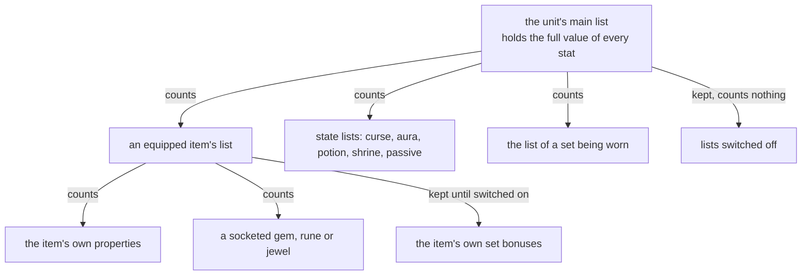
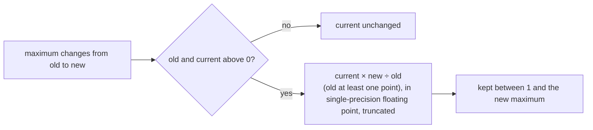
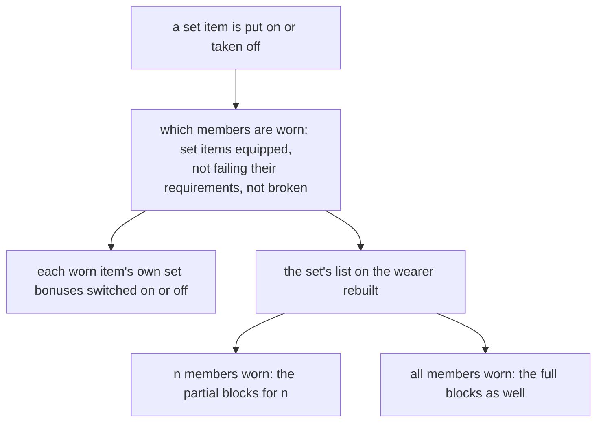
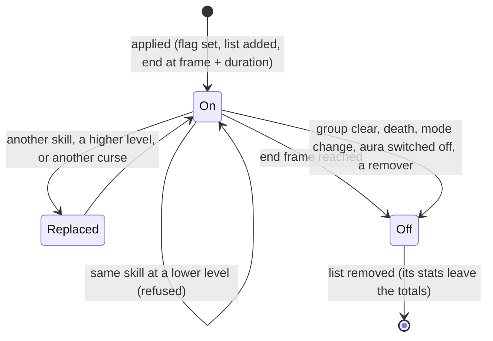

---
based_on:
  - docs/specs/stats/README.md 2026-10-21
  - docs/specs/stats/aggregate.md 2026-10-20
  - docs/specs/stats/states.md 2026-10-21
---

# Stats and states

This page explains how a character's final numbers come about: how the game adds its base attributes, its items,
its set bonuses, its passive skills and the states on it (curses, auras, potions, shrines) into the strength, life
or resistance that the rest of the game reads; and how a timed state is put on a unit, refreshed, refused, replaced
and ended. It also covers the per-frame regeneration of life, mana and stamina, auras, and shrines and wells. It
restates the reviewed stats specs: the overview in [stats/README](../specs/stats/README.md#purpose), the adding up in
[aggregate](../specs/stats/aggregate.md#purpose) and the states in [states](../specs/stats/states.md#purpose). The
specs carry the exact arithmetic; this page tells the story. Where something is read from the code but not yet seen
in a test run, or is still unknown, the page says so.

Stats and states are the project's second *simulation* subject, after [combat](combat.md). Combat takes a unit's
stats as given; this subject explains where they come from. The specs were checked against one recorded run of 18
sessions with six characters, with no mismatch: every change to the player's stats in order, every stat read in the
50 frames after each change, every requirement check, every set bonus, and every state applied, refreshed and ended
([overview § The boundary](../specs/stats/README.md#the-boundary-plan-0041-phase-2)). Life, mana and stamina are kept
in 1/256 points, and time is counted in game frames.

## The big picture

A unit's stats live in a tree of **stat lists** ([overview § Purpose](../specs/stats/README.md#purpose),
[aggregate § A](../specs/stats/aggregate.md#a-the-list-tree)). The unit has one main list. Under it hang the lists of
its equipped items (each with its sockets and its set bonuses), the list of each set it wears, and the list of each
state on it. Some lists hang there without counting: they are kept, but add nothing. That is how an item's set bonus
can wait, switched off, until enough of the set is worn. All of this is confirmed.

**The full value is kept, not summed when read.** The main list holds a cache with the full value of every stat.
Every change anywhere in the tree (a stat written, a list added, removed, or switched on or off) is passed up the tree
at once and updates that cache, and every read of a stat (by combat, by the regeneration tick, by a skill's formula)
is a read of the cache. This is confirmed: the run predicted over 200 000 such updates in order, and nearly 900 000
reads each equalled the model's cache ([aggregate § C](../specs/stats/aggregate.md#c-propagation-and-the-cache),
[§ F](../specs/stats/aggregate.md#f-reads)).

That difference matters because some cached values are **stale by design**: a per-level item bonus after a level-up
(below), and a hidden value in the per-level stats explained under *Derived stats*. A rebuild that sums the lists
whenever a stat is read gets those cases wrong ([aggregate § Reimplementation notes](../specs/stats/aggregate.md#reimplementation-notes)).

**Nothing in this subject draws a random number**, with one exception. Adding and removing lists, writing stats,
switching set bonuses, applying and ending states, the regeneration tick and an aura's run all left both the game seed
and the unit's seed unchanged, confirmed over thousands of events of each kind. The exception is a damaging aura such
as Sanctuary: each of its runs that draws takes one number from the caster's seed for its damage (see *Auras*)
([overview § Draw order](../specs/stats/README.md#draw-order)).

## Derived stats: what each op family does

Many stats are not just added up: the `ItemStatCost` table gives some stats an `op` that derives another stat from
them ([aggregate § D](../specs/stats/aggregate.md#d-the-evaluation-op-113),
[§ E](../specs/stats/aggregate.md#e-the-op-graph-the-loader-builds)). A stat's full value is its own entries plus
those of every counting list below, and then each derivation that targets it adds its term, in the order of the
source rows in the table. In plain terms:

| op | What it adds to the target | Status |
|---|---|---|
| 1 | a percentage of the target's value (on an item, of the item's base value) | confirmed |
| 2 | a per-level bonus from the level of the unit whose list it is, such as life per level | confirmed |
| 4, 5 | a per-level bonus from the **wearer's** level, such as defence per level on an item; 5 as a percentage of the target's value | confirmed |
| 8, 9 | mana from energy (8); life, and stamina, from vitality (9), at the class's quarter-point rates | confirmed |
| 11 | a percentage of maximum life or mana, taken of the **flat sum**, not of the running total | confirmed |
| 13 | a percentage of an item's base value, such as the item's defence percent | confirmed |
| 3, 6, 7, 10, 12 | 3: as 2, as a percentage; 6 and 7: a value by time of day; 10, 12: nothing | read from the code; no stock row reaches them |

The confirmed lines were each met at least 20 times in the run. Op 3 and op 10 have no row in the table, op 12 none,
and ops 6 and 7 belong only to the *of Dawn* and *of Sunlight* affixes, which cannot spawn. The code of 1.14d computes
both 6 and 7 on the server, although a community guide says op 6 does not work; no run can settle it, so it is an open
question.

Three details matter for exact values:

- **Energy and vitality count only their non-base part.** Only the vitality and energy that come from items, states
  and sets reach life and mana through op 9 and op 8; this is confirmed for how the maxima add up. The points a player
  spends go into the base maxima through the stat-point code instead; that is read from the code
  ([aggregate § D](../specs/stats/aggregate.md#d-the-evaluation-op-113)).
- **Two derivations chain**: energy and vitality are themselves targets of other derivations and the sources of
  op 8 and op 9, so a derived energy or vitality bonus reaches mana, life and stamina too. Confirmed from the table.
- **A per-level source hides its own value on a player.** When a source's target "takes" the derived value, the
  source's own cached value is not written and keeps its old value (0 on first use). For the per-level ops 2 to 5,
  whether the target takes depends on a test that, because of a quirk in how the game loads the table, checks the
  unit's **strength** instead of the stat the row names. A player's strength is above 0, so on a player every
  per-level source takes and its own value stays hidden; a monster's strength is usually 0. Both are confirmed
  (24 279 cache entries kept their old value), and a rebuild must not "fix" the test
  ([aggregate § C](../specs/stats/aggregate.md#c-propagation-and-the-cache)). Which game code reads that hidden value
  is not known.

**A level-up** re-evaluates every per-level stat of the character's own lists at once; confirmed.

## Maximum life, mana and stamina, and how current life follows

Maximum life, mana and stamina are just the cached full values of those three stats
([aggregate § G](../specs/stats/aggregate.md#g-the-maxima-the-rescale-and-the-stat-callback)). Maximum life is the
character's own maximum, plus every flat life bonus of the counting lists, plus life from item and state vitality
(op 9), plus the percent bonus of the flat sum (op 11), plus life per level (op 2), plus a time-of-day term (op 6)
that no stock item reaches. That composition is confirmed;
the functions that return the maxima are read from the code. A floor applied when some stats are read (at least 1
for the four attributes and maximum life) is read from the code only; no read in the run reached it.

**When a maximum changes, the current value is rescaled in proportion.** This is confirmed over 5 752 changes:

So putting on a life item raises current life in the same proportion as the maximum, and taking it off lowers it; a rescale
never takes current life below one 1/256 point. The same holds for mana and stamina. For a monster that regenerates,
the same step also sets its regeneration from the new maximum (read from the code). When the game asks for it,
taking an item off also lowers stamina, mana and life to their maxima when they are above; that is read from the
code.

## Item requirements, ethereal items and the 136-frame refresh

**The check** ([aggregate § H](../specs/stats/aggregate.md#h-items-equip-requirements-the-refresh-broken-per-level-values)):
an item counts for its wearer only when the wearer's full strength and dexterity are at least 1 and at least the
item's requirements, the wearer's level is high enough, the item is identified, the class matches, and an item of
one type has a positive quantity. The
requirements are raised or lowered by the item's "requirements percent" stat, and **an ethereal item needs 10 less
strength and 10 less dexterity**. The strength, dexterity, identified and ethereal parts are confirmed over 17 634
checks: the ethereal −10 alone decided 30 of them (see the worked example). The requirements percent changed no
outcome in its 814 checks, and the level and class tests decided none, so those parts are read from the code.

**The refresh** runs the check over the equipment, in steps (confirmed over 972 refreshes):

1. Each charm in the inventory that is usable and not yet counting is added.
2. Each body slot, once: an item that fails the check is marked and stops counting, and life, mana and stamina are
   lowered to the new maxima if above (that lowering is read from the code; the run took its values as given).
3. Repeated until nothing changes: an unbroken item that is marked or not counting and now passes is added back.
4. Every equipped, usable set item is taken off and put back, which rebuilds its set bonuses.

Step 2 runs only once, so if dropping one item takes away strength another item needs, that second item is caught at
the next refresh, not this one. The refresh runs after equipping, placing, breaking, repairing and identifying an
item; these two points are read from the code. **It also appears to run every 136 frames** with no player action:
136 frames was the commonest gap between two refreshes in every session of the run, on every character. That is
inferred from the run's timing, not read from the code; what schedules it is not known.

A broken item stops counting until it is repaired (read from the code; no broken item was met). Ethereal state and
sockets change only the item's own lists, which reach the wearer through the item (read from the code; how they are
made is on the [items](items.md) page).

**Per-level item values do not refresh on level-up.** An item's "per wearer level" bonus (defence per level on
Stormshield, in the run) is computed when the item starts counting, and nothing updates it when the wearer gains a
level. After the Paladin's level-ups, 94 such entries still held the value of the previous level. That is confirmed.
Read from the code: the value catches up the next time the item is added, which for a set item is the next
refresh (step 4) and for any other item its next unequip and equip.

## Dual wield and the weapon switch

From [aggregate § I](../specs/stats/aggregate.md#i-dual-wield-and-the-weapon-switch):

- **A Barbarian's second weapon counts without its damage.** The weapon that is not the primary one is added with
  its damage-related stats left out of the wearer's totals; its other stats count. Confirmed over 32 such adds.
- The classes that can wield two weapons are the Barbarian and the Assassin (and two monster classes); an
  Assassin's second weapon was not met, so that part is read from the code.
- The weapon switch takes both hands off and puts the other pair on through the ordinary equip steps. This is taken
  from the logged order of calls; the switch's own code was not read.

## Set bonuses, partial and full

From [aggregate § J](../specs/stats/aggregate.md#j-set-bonuses), all confirmed except where noted:

- **Which members count.** A member counts when it is equipped, is a set item of that set and has not failed its
  requirements (11 343 worn masks predicted; a Soul Cage the wearer could not use never counted). Two copies of the
  same member count once (two Angelic Halos). A broken member is left out by the code, but none was met.
- **The set's own bonuses** go in a list on the wearer. With `n` members worn (the item itself included) the game
  applies the partial bonus blocks in pairs: two worn give the "2 items" pair, three worn add the "3 items" pair, and
  so on, never more than the pairs up to one member short of the full set. With every member worn it also applies the
  full-set bonuses, up to the first empty one. All 5 749 rebuilt lists equal the table's blocks for that count.
- That includes the 180 lists of the **full Trang-Oul's Avatar**, whose full bonus puts a state (`monsterset`) on the
  wearer and grants a skill (Fire Mastery). The test run first took those lists as logged; a later re-check of the
  same logs rebuilt them too, and they match exactly when every value is stored in the stat's internal scale (mana
  100 kept as 25 600) and the state bonus writes the state's stat with the `monsterset` state as its parameter.
- **Each item's own set bonuses** are switched on and off by the item's `add func`:
  with 1, each bonus belongs to one specific other member being worn; with 2, the bonuses switch on by how many other
  members are worn. Both are confirmed (19 525 switches). With `add func` empty, the bonus is part of the item's
  ordinary properties and always counts; that is read from the code.
- Every requirement refresh (above) takes each set item off and puts it back, so the set bonuses are rebuilt at every
  refresh, the periodic one included.

## Passive skills

A passive skill such as a weapon mastery, Iron Skin or Natural Resistance keeps its bonuses in a state list of its
own: the skill's passive stats computed at the level the list records, plus a mark naming the skill
([aggregate § K](../specs/stats/aggregate.md#k-passive-stat-lists)). That is confirmed over 8 832 refreshes, including
Fire Mastery granted by the full Trang-Oul's set. Read from the code: the list is rebuilt only when the skill's
current level (with bonuses) differs from the recorded one, and it is removed while the skill's aura state is on the
unit or when the unit no longer has the skill.

## Timed states: apply, refresh, refuse, replace

A state is a flag on the unit and, usually, a stat list carrying the state's stats
([states § A](../specs/stats/states.md#a-the-state-bit-and-its-list), [§ B](../specs/stats/states.md#b-the-timed-apply)).
Skills, auras, shrines, open wounds and the prevent-heal effect put states on a unit through one common routine; poison, burning,
cold and freeze use their own routines that make the same kind of list (read from the code;
[combat](combat.md#chill-stun-freeze-and-poison) covers those).

When a state is applied to a unit that already has it, the outcome is decided by the skill and level that sent it,
confirmed over 3 643
applies on the player:

- **Same skill, same level: refresh.** The end frame moves to the current frame plus the new duration. **The stats
  are not rewritten**: the list keeps the values it was made with.
- **Same skill, lower level: refused.** Nothing changes. In the run the player's Prayer and the mercenary's Prayer, at
  different levels, reached the player: the weaker one was refused at every run (1 013 times).
- **A higher level, or another skill: replaced.** The old list is removed and a new one made.

**Curses** follow the same rules, with these differences: a unit holds **one curse at a time**, so a different curse
replaces the old one (read from the code); the target's curse resistance shortens the duration by its percentage (a
negative value lengthens it), and 100 or more refuses the curse (read from the code: the one stock source of curse
resistance is the Assassin's Fade, and no monster cursed her under it in the runs so far); and **a unit under Attract
refuses every curse**, confirmed on monsters: after a Necromancer's own Attract, 71 curses on attracted monsters were
all refused and 151 on the others were all made, in the same session. On a player it is read from the code.

Also read from the code: durations are in frames and are not rounded; some monsters refuse every timed state by two
flags, one in their `MonStats` row and one in their `MonStats2` row (which columns those are is not known); and a potion clears its state's group (below)
before it applies.

## How a state ends

From [states § C](../specs/stats/states.md#c-expiry-and-removal):

- **At its end frame.** Each apply and each refresh with a duration schedules its own end event. A state applied at
  frame `f` for `d` frames is removed by the event at `f + d`; its stats leave the totals at once, and if a maximum
  drops the current value is rescaled as above. An earlier event of a refreshed state still fires and removes
  nothing. Confirmed: 2 749 end events, each removing exactly the lists whose end frame had come, and no other. Only
  123 lists actually ended in the run, and 30 more in a second run (153; the plan asked for 300), so the count is a
  named shortfall that a further pass of the plan takes, but the rule rests on the 2 749 events.
- **When its aura is switched off.** An aura's state on the player also ends when the player switches the right skill
  to another aura: the switch removes the list at once, before its end frame. Confirmed in a second run, with a
  Paladin switching Might, Defiance and Prayer: 61 aura states made and 59 ended this way, every change checked.
- **On death**, every state list not from an item is removed, except a few specially flagged lists and the states
  marked to stay on death (for players and monsters separately). **On a mode change**, the lists marked for it are removed. Read from the code; no
  death happened in the run.

## Group clears

Some states share a `group` in the `States` table, and a group clear removes the other states of that group
([states § D](../specs/stats/states.md#d-the-group-clear)). **The apply itself never does this**; only the callers that
run the clear exclude a group (potions, the "state" stat that some items carry, and five skills). Confirmed in the run
for the cases met: the potions of the run have no group, so their clear removed nothing; the full Trang-Oul's set
switches its `monsterset` state on with a clear that found nothing else in the group, and when the set broke the clear
removed that state itself. Clearing a **different** state of the same group is confirmed by a second run for two
groups: the Sorceress's three armours (20 clears) and the Assassin's Fade and Quickness (23). For the Druid's werewolf
and werebear forms, which share a third group, the clear was reached 12 times and the old form's mark was gone
afterwards, but the logger recorded no result for those calls, so that group is still read from the code.

## Regeneration: life, mana, stamina and poison

Every frame, while the player is alive, one tick changes life, then stamina, then mana, in that order
([states § E](../specs/stats/states.md#e-the-regeneration-tick)). The three formulas are confirmed over 54 719 ticks:

- **Life** adds the "life regeneration" stat, **whatever its sign**, capped at maximum life. Healing potions give it
  a positive value until life is full (reaching the cap removes the potion's state); **poison gives it a negative
  value**, so a poisoned player bleeds by the same tick (1 082 poisoned ticks reproduced), until the poison's list
  ends and its stat leaves the totals. By the code the tick never takes a player's life below one point, so poison
  and open wounds cannot kill a player; no poisoned tick reached that floor. A monster's tick is different and can
  kill ([combat](combat.md#chill-stun-freeze-and-poison)).
- **Stamina** regains a share of maximum stamina that depends on what the player is doing: 1/256 of the maximum per
  frame in some modes, none in others, raised by the stamina recovery bonus, and never above the maximum. By the
  code, walking gives 1/512 (in one of the two walking modes, none while stamina is below one point), and a stamina recovery bonus of 1000 or more (which the stamina shrine gives) restores
  stamina in the modes that otherwise give none; neither was met.
- **Mana** regains maximum mana divided by 25 × the class's `ManaRegen` (at least one 1/256 point per frame), raised
  by the mana recovery bonus percent, plus the flat mana recovery stat, never above the maximum. A "no mana
  regeneration" state stops the first part (6 286 ticks under it); reaching full mana removes a mana potion's state.

## Auras

From [states § F](../specs/stats/states.md#f-auras), confirmed except where noted:

- **The perdelay grid.** An aura does not run every frame. It runs on a fixed grid of frames: every `perdelay`
  frames (from the skill's formula, at least 5), always on a frame one past a multiple of `perdelay`. Prayer and
  Sanctuary have `perdelay` 50, and all 3 629 runs in the run (the player's selected Prayer, Sanctuary from the
  *Azurewrath* sword and the mercenary's Prayer) fell on frames 1, 51, 101 and so on. A hireling's aura runs the same
  way.
- **Each run applies the target state for `perdelay + 1` frames**, 51 for Prayer, in all 6 207 aura applies. So the
  state lasts one frame past the next run, and the next run refreshes it before it ends.
- **Two auras of the same state** from two casters follow the timed-state rules: equal levels refresh, a lower one
  is refused, a higher one replaces.
- Read from the code: a run computes the aura's values at its level, puts the aura's own state on the caster and
  applies the target state to every unit in range that passes the aura's filter; a stat that heals directly is added
  to current life up to its maximum. While a player's aura with a mana cost writes a stat on a target, the player is
  in the "no mana regeneration" state, which stops the ordinary part of the mana tick.
- **Sanctuary's draw.** A damaging aura's run that draws takes one random number from the **caster's** unit seed, for
  the elemental damage roll. This is confirmed: 865 drawing runs, one draw each, each one's draws accounted for, and 746 consecutive runs
  of the same caster picking up exactly where the last one left the seed, as the project's stats checker counts them
  (in 115 others the next run did not start where the last one left the seed, and the record does not say why; 4 runs
  were the caster's last in their log). The
  damage itself belongs to the skills phase still to come, but a rebuild that runs Sanctuary must take that draw. A
  kill by the aura also moves the game seed when it drops an item.
- **Once per run, not once per unit hit.** The run did not count how many units each run hit. Read from the code:
  the aura rolls its damage once, before it goes over the units in range, and gives every unit it hits a copy of that
  one roll. So a run that hits several monsters still takes one number from the caster's seed, and a rebuild that drew
  once per monster would fall out of step. Holy Freeze, which the run never met, takes that same one number per run
  and, read from the code, also steps the own seed of each unit it does not turn away, once each.

Auras turning on and off were met only 9 times in the first run, because Prayer and Sanctuary always reached the
player. A second run built for it switched auras by key and met 120 (the plan asked for 50): an aura's state ends
when the aura is switched off (see *How a state ends*).

## Shrines and wells

Everything in this section is read from the code: the first run operated 7 shrines and 5 wells and a second run 3
more shrines, all predicted, 15 against the 50 the plan asked for; a further pass of the plan takes the rest
([states § G](../specs/stats/states.md#g-shrines-and-wells)).

- **Shrine states count as curses.** The states of the timed shrines (armour, combat, the resist shrines, skill,
  mana recharge, stamina, experience) carry the curse mark, so a shrine's state is "the" curse of the unit: taking a
  shrine removes the player's curse, and the next curse a monster casts removes the shrine's state. In the run the 3
  timed shrines met (lightning once, fire twice) made curse-marked lists with the shrine's duration and value.
- Each timed shrine writes one stat for its duration, mostly a value from its `Shrines` row; the combat shrine adds
  enhanced damage and attack rating, and the stamina shrine fills stamina and sets the stamina recovery bonus to 1000.
  The skill shrine writes no skill stat; where its +2 skills come from is not known.
- The **refill shrines** fill life, mana or both; the exchange shrines trade a share of life for mana or the
  reverse. The 4 met were life and mana refills, all on a full player, and changed nothing.
- A shrine that can be used again re-arms its `reset` value times 1 200 frames (plus one) later.
- **A well** with charges left raises stamina, and life or mana as flags in its `Objects` row say, each by a
  share of the maximum (half, for the wells of the run), capped, and cures poison and freezing; it uses a charge only if something changed, then re-arms. The 5
  wells met matched; a cure by a well was not met.
- No random draw was found in the code of these shrines and wells (the missile and monster shrines do draw, and
  belong to other subjects).

## Worked examples

From the specs' worked examples ([aggregate](../specs/stats/aggregate.md#worked-example),
[states](../specs/stats/states.md#worked-example)). Examples 1 and 2 are from the run; 5 puts illustrative frame
numbers on the run's grid; 3, 4 and 6 are the specs' arithmetic on illustrative values.

| # | Situation | Result |
|---|---|---|
| 1 | A Barbarian with his belt and gloves off has full strength between 115 and 124; his ethereal War Boots need 125 | the ethereal −10 makes it 115, so the boots keep counting; without it all 30 such checks would fail |
| 2 | Civerb's Vestments (3 members), 2 worn; then all 3 | the "2 items" pair (only its first block is used); then the same pair and the full-set bonuses |
| 3 | A Barbarian (`LifePerVitality` 16 quarter points) whose items add 10 vitality | `16 × 10 × 64` = 10 240 in 1/256 points: 40 life |
| 4 | Maximum life rises from 100 to 120 (25 600 to 30 720) with 50 life left (12 800) | `30 720 ÷ 25 600 × 12 800` = 15 360: 60 life |
| 5 | Prayer (`perdelay` 50) runs at frame 5 001 | the next run is at 5 051; the state lasts 51 frames, to 5 052, and the run at 5 051 refreshes it to 5 102 |
| 6 | A class with `ManaRegen` 120, 900 maximum mana (230 400) and 258 % mana recovery | `230 400 ÷ 3 000` = 76, then `76 × 358 ÷ 100` = 272 in 1/256 points per frame |

## What is not known yet

From the specs' open questions ([overview](../specs/stats/README.md#open-questions),
[aggregate](../specs/stats/aggregate.md#open-questions), [states](../specs/stats/states.md#open-questions)):

- **Never met in the run, so read from the code only**: the floor on reads, derivation ops 3, 6, 7, 10 and 12, a
  requirements percent, level or class test that decides, a broken item and a set with a broken member, an Assassin's
  second weapon, the lowering of life and mana when an item comes off, the 1/512 walking stamina, the death and
  mode-change removals, curse resistance, Attract on a player, open wounds on the player, and the life floor of one
  point.
- **Ops 6 and 7** (by time of day) are computed by the 1.14d server, against a community claim; no stock item reaches
  them, so no run can show it.
- **Named shortfalls**, still short after the second run and taken by a further pass of the plan: shrines and wells
  (15 operates of 50; the combat and stamina shrines, re-arming and a well's cure not met), state ends (153 of 300),
  the werewolf and werebear group clear, the life floor of one point and curse resistance. Auras turning on and off
  (120 of 50) and a group clear of a different state for two groups are now met.
- What schedules the **136-frame refresh**, the weapon switch's own code, and which code reads a per-level source's
  hidden value.
- Two flags of `MonStats` that make a monster refuse timed states, the skill shrine's +2 skills, and seven `States`
  rows nothing was found to set.
- **Skills** (Holy Shield, the timed armours and shouts, a damaging aura's hit) belong to the skills phase still to
  come. A two-client game confirmed that a helping aura such as Might reaches another player only while the two share
  a party; **offensive auras on a hostile player and hostile states** still need a run with two clients.

## Where to read more

- The specs: [stats overview](../specs/stats/README.md#files),
  [aggregate](../specs/stats/aggregate.md#reimplementation-notes) and
  [states](../specs/stats/states.md#reimplementation-notes). Each *Reimplementation notes* section lists the traps for
  someone rebuilding the system.
- The [glossary](../glossary.md) for D2 terms.
- Related wiki pages: [combat](combat.md) (what reads these stats), [characters](characters.md) (base attributes and
  level-up), [items](items.md) (how an item's properties, ethereal state and sockets are made),
  [objects](objects.md) (shrines and wells as objects), [randomness](randomness.md) (unit seeds) and
  [how we know](how-we-know.md).
